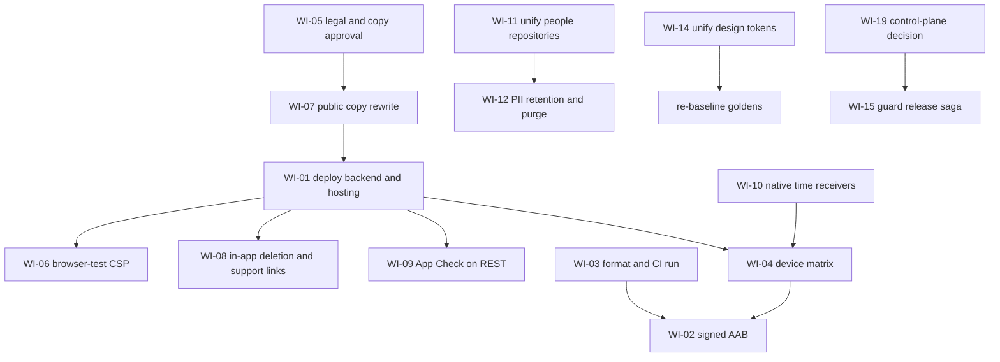

# AI-Birthday — Implementation status, quality and release readiness
**Purpose and scope.** This document is the canonical record of what is implemented, what is verified, what is broken or open, what changed in the current transformation, and what stands between the repository and a release. It covers the Flutter app (`lib/`), the Android native layer (`android/`), the Firebase control plane (`backend/functions`), the public Hosting site (`backend/hosting`) and the test and CI assets. Product intent lives in [PRODUCT.md](PRODUCT.md), structure and data model in [ARCHITECTURE.md](ARCHITECTURE.md), security and privacy rules in [SECURITY.md](SECURITY.md), and deployment and runbooks in [OPERATIONS.md](OPERATIONS.md); this document does not repeat them.
**Status & evidence.** Snapshot: Git HEAD `c4aace16` plus uncommitted fixes in the working tree (59 modified tracked files, 17 untracked paths). Verified locally after the fixes: `flutter test --exclude-tags golden` 653 passed / 0 failed, golden shell test 2 passed, `flutter analyze` no issues, backend functions `npm run check` 91 tests, hosting `npm run check` 12 tests, Firestore emulator suites 22/22 (run manually). Nothing was verified on a physical device, against a deployed backend, or in CI on this exact commit. Every status below is derived from the working-tree source and these runs; a status tag means "source present and test-mapped", not "observed in production".
**Evidence tags used.** `[IMPLEMENTED]` `[PARTIAL]` `[NOT IMPLEMENTED]` `[BROKEN]` `[MOCKED]` `[UNREACHABLE]` `[UNKNOWN]` for features; `FIXED / PARTIAL / OPEN / UNCONFIRMED` for audit issues; `[APPROVED] [PROPOSED] [OPEN] [DEPRECATED]` for decisions and legacy proposals.

**Contents**

1. [Snapshot and verification evidence](#1-snapshot-and-verification-evidence)
2. [Implementation status by module and feature](#2-implementation-status-by-module-and-feature)
3. [Changes made in this transformation](#3-changes-made-in-this-transformation)
4. [Issue register](#4-issue-register)
5. [Known limitations and technical debt](#5-known-limitations-and-technical-debt)
6. [Test inventory and coverage](#6-test-inventory-and-coverage)
7. [Dependencies between work items and remaining work](#7-dependencies-between-work-items-and-remaining-work)
8. [Release readiness checklist](#8-release-readiness-checklist)
9. [Historical implementation record](#9-historical-implementation-record)
10. [Data inventory and risk register](#10-data-inventory-and-risk-register)
11. [Open questions](#11-open-questions)

## 1. Snapshot and verification evidence

### 1.1 Snapshot
| Item | Value (computed from the repository) |
|---|---|
| Branch / HEAD | `main` @ `c4aace16`; uncommitted fixes on top (nothing committed by this transformation) |
| Working tree | At the final verification run: 94 modified tracked files outside documentation (+3,998 / −1,360 lines, of which about 77 files carry comment-only `legacy SSOT` reference edits), 38 untracked files (3 new `lib/` files, 13 new test files, the six new canonical documents and `docs/graph/`), and 225 deleted legacy documents (recoverable from Git commit `c4aace16`). Exact counts change as the tree changes; recompute with `git status` and `git diff --numstat`. |
| Tracked files / commits | 578 tracked files at HEAD; 788 commits (2026-05 → 2026-11) |
| Dart source | 95 tracked `lib/` Dart files (98 in the working tree incl. 3 new files); 5 tracked Kotlin files (3 under `android/`: [BirthdayNotificationReceiver.kt](android/app/src/main/kotlin/com/yashsomani/ai_birthday/BirthdayNotificationReceiver.kt), [BirthdaySmsReceiver.kt](android/app/src/main/kotlin/com/yashsomani/ai_birthday/BirthdaySmsReceiver.kt), [MainActivity.kt](android/app/src/main/kotlin/com/yashsomani/ai_birthday/MainActivity.kt)) |
| Local DB schema | Drift `schemaVersion` 7 ([app_database.dart](lib/core/database/app_database.dart)) |
| App version / SDK | `pubspec.yaml` version `1.0.0+1`, Dart SDK `>=3.12.0`; CI pins Flutter 3.47.6 |
| Platforms | Android only (no `ios/` directory); flavors `play` (no `SEND_SMS`) and `personal` (has `SEND_SMS`) |
| Feature registry | 191 nodes: the 82 original features plus 109 nodes added from the audits ([docs/graph/feature-registry.json](docs/graph/feature-registry.json)); statuses in §2 |

Documentation figures that disagree with these numbers (460/464/517 tests, schema v5/v6, 50-node registry, two-adapter claims) are historical; see §1.6 and §9.

### 1.2 Baseline versus after-fix verification
Commands were run from the repository root (Flutter) or the package directory (backend). "Baseline" is the working tree at HEAD before the fixes; "After" is the current working tree.
| Check | Baseline (HEAD) | After fixes | Notes |
|---|---|---|---|
| `flutter analyze` | 30 infos, exit 1 (the CI step would fail) | No issues | 35 `prefer_initializing_formals` hints (the 30 baseline infos plus 5 introduced by new code) fixed with `dart fix`; 1 unnecessary import removed |
| `flutter test --exclude-tags golden` | 517 passed | **653 passed / 0 failed** | +136 tests; 13 new test files |
| Golden: [shell_goldens_test.dart](test/app/shell_goldens_test.dart) | — | 2 passed | CI runs goldens as a separate step |
| Functions `npm run check` (`backend/functions`) | 81 tests | **91 tests** (12 files) | Excludes emulator suites |
| Firestore emulator suites | Not run | **22/22 passed** | Run manually under OpenJDK 21; `npm run test:emulator` is not runnable offline |
| Hosting `npm run check` (`backend/hosting`) | Passed | Passed — 12 tests (3 files) | A CSP assertion was added for A4-001 |
| `dart format --output=none --set-exit-if-changed .` (CI "Verify Formatting" step) | Not run at HEAD; one file ([gemini_nano_platform.dart](lib/core/platform/gemini_nano_platform.dart)) was already unformatted, so the CI step would also have failed on the baseline | **Passes** (198 files, 0 changed) after `dart format` was applied to 3 files | Re-run at the end of the transformation |
| Play debug APK (`assemblePlayDebug`) | Built | Built | Output recorded during the baseline run |
| Knowledge-base validator (legacy docs) | 29 markdown files, 776 links, 0 errors | n/a | Validated legacy `docs/knowledge`; the files are being consolidated |

**Golden tests.** `test/app/shell_goldens_test.dart` (2 tests) passed after the fixes. The CI workflow runs it as its own step; the main CI test step excludes the `golden` tag.
**Emulator.** The 22 emulator tests (16 in `controlPlane.emulator.test.ts`, 6 in `firestore.rules.emulator.test.ts`) passed; they cover the A4-002, A4-004 and A4-005 fixes. Only the Firestore emulator was run; no Android emulator or device UI journey was run during this transformation.

### 1.3 What was NOT executed
| Not executed | Consequence |
|---|---|
| Device or Android-emulator UI journeys (`integration_test/device_journey_test.dart`, reminders, reboot, exact alarms, contacts, share/WhatsApp/SMS handoff, Nano/AICore) | All native behaviour is compile-checked or fake-backed only [UNKNOWN] on devices |
| CI-only steps: `flutter build apk --release` (both flavors) and `npm audit --omit=dev --audit-level=high`; functions `npm run check` (typecheck, lint, tests) did pass but `npm run build` was not separately run | Release-build and audit results are unknown |
| `npm audit` (functions and hosting) | Dependency advisories are unreviewed for this commit; legacy sources recorded 8 moderate runtime advisories (uuid via Firebase Admin 13.x) as of 2026-07-12 |
| Release APK / AAB build and signing | No signed artefact exists; signing needs `android/key.properties` or CI signing |
| CSP browser test of the Hosting page (A4-001 fix) | The Google popup-auth CSP change is unproven in a browser |
| CI run on the exact working-tree commit | Local results are not CI evidence; the aapt2 manifest guard (A4-008) has never run |
| Live Play Billing, App Check/Play Integrity, Firebase deployment, deployed `verifyPurchase` | Server/purchase behaviour is emulator- and fake-verified only |
| Real-user database inventory | Data-quality rates (duplicates, malformed phones, leap days) are unknown (§10.1) |

### 1.4 Static repository counts
Computed from `git ls-files` and source scans of the working tree; see §6.1 for the per-area breakdown. Flutter test files: 85 (72 tracked + 13 untracked). Static `test(` / `testWidgets(` declarations: 583 — the runner reports 653 because of loop-generated and parameterised cases, so the runner figure is the authoritative pass count. Functions test files: 15 (one is a fixtures helper); hosting test files: 3 with 12 tests; Kotlin tests: 0.

### 1.5 Evidence policy and status vocabulary
Claims are graded by the strongest evidence that supports them. Lower evidence never upgrades a status.
| Rank | Evidence class | Example in this repository |
|---|---|---|
| 1 | Device or production observation on a named build | None available |
| 2 | CI run on the exact commit | None for the working tree |
| 3 | Passing named automated assertion | The runs in §1.2 |
| 4 | Static source inspection | Registry status for source-present code |
| 5 | Documentation claim | Legacy README/PROJECT.md statements |
| 6 | Historical label | Archive "complete" labels |

Implementation-status vocabulary (finer-grained than §2 tags): not inspected → source located → source reviewed → test located → assertion inspected → CI observed → device observed → deployed observed; plus Partial, Gap, Blocked. "Implemented" here means source present and test-mapped, never device-verified or deployed; the coordination backend must not be conflated with autonomous WhatsApp sending. A green CI run from a different commit, an emulator pass, a fake-backed "E2E" test or a test report is not release evidence for device, Play, Firebase or live-provider behaviour.

### 1.6 Superseded verification figures
Historical figures are kept only so that older reports can be interpreted; none describes the current tree.
| Legacy figure | Source (legacy) | Current |
|---|---|---|
| CI run 45245907678 on `644571f`: 460 Flutter tests, 11 backend Vitest files, 2 emulator files, 12 hosting tests | legacy source: docs/product-blueprint/pb/08-quality-and-verification.md (removed; recoverable from Git commit c4aace16) | 653 / 12 non-emulator files + 2 emulator files / 12 (local runs, not CI) |
| 464 Flutter tests, 2 goldens, focused matrix 122, backend 81; Firestore emulator did not run (as of 2026-11-24) | legacy source: docs/product-blueprint (Phase 2.4.x reports; removed) | 653; 91; emulator 22/22 |
| 133 tests / 68 backend (android master report) | legacy source: docs/archive (removed) | see §6.1 |
| `flutter_analyze` after-run with 35 infos in the stored baseline artefacts | Intermediate run in the working notes | Final run: no issues |

## 2. Implementation status by module and feature
Statuses start from [feature-registry.json](docs/graph/feature-registry.json) (source-presence statuses at snapshot `20a598e9`) and are corrected by the code audits A1–A4 and the fix ledger. "Confidence" is the confidence in the stated status (HIGH = source and test read; MEDIUM = source read, behaviour partly inferred; LOW = inferred). `UNREACHABLE` means source exists but no production path reaches it with default configuration.

### 2.1 Status table (the 82 original registry features, corrected by the audits)
**Verified strengths** (source and tests read): Drift schema with a `leap_day_resolution` column (now v7), atomic `PersonService` writes, recipient/device calendar math in `BirthdayEngine`, a durable job-backed AI Studio, an entitlement-first AI router, Firebase/Play purchase verification on the server and `enforceAppCheck` on the purchase callable ([index.ts](backend/functions/src/functions/index.ts)). Legacy counts are outdated: the 2026-10-14 registry had 50 nodes (49 implemented, 1 partial) and the 2.0 feature register used ranges F-001..F-109 (entry, people, birthday, planning/reminders, studio/AI, delivery/history, account, backup/privacy, jobs/automation, operations/public/control); the current registry has 82 features and is the reference. The legacy domain mapping (registry ID → domain → retain/verify disposition) remains useful but is not reproduced.
| ID | Feature | Status | Conf. | Primary source | Tests | Notes (audit / fix-ledger deltas) |
|---|---|---|---|---|---|---|
| `APP` | AI-Birthday Android application | [IMPLEMENTED] | HIGH | [main.dart](lib/main.dart) | 1 | Global error handlers + logged init failures added (A3-009); startup recovery screen exists. |
| `ONB` | Onboarding | [IMPLEMENTED] | HIGH | [onboarding_screen.dart](lib/features/onboarding/presentation/onboarding_screen.dart) | 1 |  |
| `ONB-FLOW` | Intro, skip and start flows | [IMPLEMENTED] | MEDIUM | [onboarding_screen.dart](lib/features/onboarding/presentation/onboarding_screen.dart) | 0 | Copy over-promises 'gentle leads' while reminders default off (A1-018, OPEN). |
| `ONB-GATE` | First-run persistence and routing gate | [IMPLEMENTED] | HIGH | [router.dart](lib/app/router.dart) | 1 | In-memory `OnboardingGate` cache; secure-storage read error no longer re-onboards (A3-010). Residual: read error is treated as 'completed'. |
| `NAV` | Navigation shell | [IMPLEMENTED] | HIGH | [router.dart](lib/app/router.dart) | 1 | 4 shell destinations (not 5). Deep-link handler registered only in AppScaffold (A1-023 PARTIAL). |
| `DASH` | Today, upcoming and action dashboard | [IMPLEMENTED] | HIGH | [dashboard_screen.dart](lib/features/dashboard/presentation/dashboard_screen.dart) | 1 | Was BROKEN for persons with a recipient timezone (A1-001, now FIXED). Legacy Feb-29 rows without policy still skipped (A1-013, OPEN). |
| `PEOPLE` | People management | [IMPLEMENTED] | HIGH | [people_screen.dart](lib/features/people/presentation/people_screen.dart) | 0 |  |
| `PEOPLE-CRUD` | Create, edit, soft-delete, undo | [PARTIAL] | MEDIUM | [person_service.dart](lib/features/people/application/person_service.dart) | 1 | Clear-field semantics fixed (A1-004). Undo only via SnackBar though dialog says 'at any time'; soft-deleted PII never purged (A1-011, OPEN). |
| `PEOPLE-VALIDATE` | Form validation and normalized fields | [PARTIAL] | MEDIUM | [person_input_validator.dart](lib/features/people/domain/person_input_validator.dart) | 1 | `relationshipTooLong` rule is dead (compares enum name length, A1-030); relationship now a dropdown (A1-005). |
| `PEOPLE-IMPORT` | Import review and selection | [IMPLEMENTED] | MEDIUM | [people_screen.dart](lib/features/people/presentation/people_screen.dart) | 0 | Valid rows imported, per-row failures reported (A1-006). |
| `PEOPLE-CSV` | CSV parse, diagnostics and duplicate hints | [PARTIAL] | MEDIUM | [contact_csv_service.dart](lib/features/people/data/contact_csv_service.dart) | 1 | Export is not a lossless backup: facts joined with ';', `autoSendPolicy` not exported (A1-024, OPEN). |
| `PEOPLE-DEVICE` | Permission-gated Android contacts import | [IMPLEMENTED] | MEDIUM | [device_contacts_service.dart](lib/features/people/data/device_contacts_service.dart) | 1 | Device-contact phone regex rejects `#`, `*`, extensions (part of A1-006 root cause); `autoPrepare` follows capability flag (A1-012). |
| `PEOPLE-EXPORT` | CSV export and share sheet | [IMPLEMENTED] | HIGH | [contact_csv_service.dart](lib/features/people/data/contact_csv_service.dart) | 1 | 16-column CSV + share sheet; not a full-fidelity backup (D2-025-09). |
| `BIRTH` | Birthday recurrence and lifecycle | [IMPLEMENTED] | HIGH | [birthday_engine.dart](lib/features/birthdays/domain/birthday_engine.dart) | 0 |  |
| `BIRTH-CALC` | Next birthday, timezone, leap-day policy | [IMPLEMENTED] | HIGH | [birthday_engine.dart](lib/features/birthdays/domain/birthday_engine.dart) | 1 | Per-person leap-day policy implemented; `Birthday.calculate*` and `effectiveTimezone` are dead alternates (A1-014). |
| `BIRTH-CYCLE` | Lifecycle refresh and occurrence rollover | [IMPLEMENTED] | HIGH | [birthday_lifecycle_service.dart](lib/features/birthdays/application/birthday_lifecycle_service.dart) | 1 | Schema v7 stores a `yyyy-MM-dd` calendar date; lifecycle compares y/m/d (A1-001). Midnight timer only; no lifecycle refresh on resume (A1-027, OPEN). |
| `CAL` | Interactive calendar and day detail | [IMPLEMENTED] | MEDIUM | [calendar_screen.dart](lib/features/calendar/presentation/calendar_screen.dart) | 1 | Duplicate leap resolver (A1-014); 'turns <=0' label (A1-031); reads `personListProvider` unlike Dashboard/People (D3 #29). |
| `REM` | Local birthday reminders | [PARTIAL] | MEDIUM | [reminder_service.dart](lib/features/reminders/application/reminder_service.dart) | 0 | Cold-start + resume re-plan with plan stamp (A1-002/003/010 FIXED). No Kotlin TIMEZONE_CHANGED/TIME_SET receivers (A1-007 PARTIAL). Device behaviour never observed. |
| `REM-RULES` | Offset and quiet-hour schedule planning | [IMPLEMENTED] | HIGH | [reminder_schedule.dart](lib/features/reminders/domain/reminder_schedule.dart) | 1 | Quiet-hours frame vs spec UNCONFIRMED (A1-015). |
| `REM-PREFS` | Persisted reminder and privacy settings | [IMPLEMENTED] | HIGH | [reminder_settings_controller.dart](lib/features/reminders/application/reminder_settings_controller.dart) | 1 | Plan stamp stored as `plan_state` row in ReminderSettingsEntries. |
| `REM-NATIVE` | Android alarm and notification adapter | [IMPLEMENTED] | LOW | [BirthdayNotificationReceiver.kt](android/app/src/main/kotlin/com/yashsomani/ai_birthday/BirthdayNotificationReceiver.kt) | 1 | Source-present only; no Kotlin tests, no device/reboot run (GAP-07). Reminder JSON holds names unless hideNames (A1-021). |
| `STUDIO` | Message Studio | [IMPLEMENTED] | HIGH | [message_studio_screen.dart](lib/features/message_studio/presentation/message_studio_screen.dart) | 0 | `message_studio_screen.dart` is 2,059 lines (A2-028). |
| `STUDIO-DRAFT` | Manual editing and autosave | [IMPLEMENTED] | MEDIUM | [message_studio_screen.dart](lib/features/message_studio/presentation/message_studio_screen.dart) | 1 | Autosave no longer discards queued AI result (A2-001/003/004 FIXED); `dispose()` still does not flush, failed save has no Discard (A2-024, OPEN). |
| `STUDIO-AI` | AI generation and durable request | [IMPLEMENTED] | HIGH | [ai_job_handler.dart](lib/features/jobs/application/ai_job_handler.dart) | 1 |  |
| `STUDIO-EDIT` | Rewrite, translate and variations | [PARTIAL] | MEDIUM | [message_studio_screen.dart](lib/features/message_studio/presentation/message_studio_screen.dart) | 1 | Variations run sequentially/tolerantly but are not a durable job type (A2-012 PARTIAL). |
| `AI` | AI providers and routing | [IMPLEMENTED] | HIGH | [ai_router.dart](lib/features/ai/domain/ai_router.dart) | 1 | Entitlement-first router; stale-comment finding (GAP-01) was already resolved at the registry snapshot. |
| `AI-BYOK` | User Gemini API credential and provider | [IMPLEMENTED] | HIGH | [user_gemini_api_provider.dart](lib/features/ai/data/user_gemini_api_provider.dart) | 1 | HTTP timeout does not cancel the socket (A2-020); key field lacks IME-privacy flags (A3-021). |
| `AI-NANO` | Native Gemini Nano adapter | [IMPLEMENTED] | LOW | [gemini_nano_provider.dart](lib/features/ai/data/gemini_nano_provider.dart) | 0 | No unit tests for provider/bridge/Kotlin; availability on hardware unverified. |
| `AI-PROMPT` | User-fact-bounded prompt assembly | [IMPLEMENTED] | MEDIUM | [ai_prompt_builder.dart](lib/features/ai/domain/ai_prompt_builder.dart) | 1 | Untrusted-data delimiters are not escaped (A2-033, OPEN). |
| `SEND` | User-controlled delivery handoffs | [IMPLEMENTED] | HIGH | [whatsapp_handoff_builder.dart](lib/features/delivery/data/whatsapp_handoff_builder.dart) | 0 |  |
| `SEND-WA` | WhatsApp click-to-chat URL | [IMPLEMENTED] | MEDIUM | [whatsapp_handoff_builder.dart](lib/features/delivery/data/whatsapp_handoff_builder.dart) | 1 | No `canLaunchUrl` precheck (D3 #42). |
| `SEND-SMS` | SMS delivery handoff | [IMPLEMENTED] | HIGH | [sms_delivery_service.dart](lib/features/delivery/data/sms_delivery_service.dart) | 0 | URI encoding + number validation fixed (A2-018). |
| `SEND-SHARE` | System share and copy | [IMPLEMENTED] | MEDIUM | [native_share_service.dart](lib/features/delivery/data/native_share_service.dart) | 0 | `NativeShareService` has no direct tests. |
| `SEND-TRUTH` | Handoff evidence and explicit sent confirmation | [PARTIAL] | MEDIUM | [message_studio_screen.dart](lib/features/message_studio/presentation/message_studio_screen.dart) | 1 | Launch-vs-evidence-write failures separated with retry record (A2-011). Handoff evidence not bound to body/revision (A2-026, GAP-11). |
| `HISTORY` | Draft and delivery history | [IMPLEMENTED] | MEDIUM | [history_screen.dart](lib/features/history/presentation/history_screen.dart) | 1 | Timestamps rendered in UTC (D3 #27, OPEN); no grouping/pagination. |
| `AUTH` | Google authentication and session renewal | [IMPLEMENTED] | MEDIUM | [live_google_auth_gateway.dart](lib/features/auth/data/live_google_auth_gateway.dart) | 1 | 30 s auth HTTP timeouts (A3-008). Live Google/Firebase flow unverified. |
| `BILL` | Google Play subscription and entitlement | [IMPLEMENTED] | MEDIUM | [subscription_service.dart](lib/features/subscription/application/subscription_service.dart) | 1 | Hash purchase binding (A3-001), shared App Check before Play sheet (A3-005), real price (A3-006). Live Play/backend verification not run; `verifyPurchase` deployment unproven. |
| `CLOUD` | Opt-in account-scoped cloud backup | [IMPLEMENTED] | MEDIUM | [cloud_sync_service.dart](lib/features/sync/data/cloud_sync_service.dart) | 1 | Plaintext opt-in backup (no E2E encryption); Firestore REST, no App Check on those calls (A3-004, OPEN). |
| `CLOUD-UP` | Immutable snapshot-generation upload | [IMPLEMENTED] | MEDIUM | [cloud_sync_service.dart](lib/features/sync/data/cloud_sync_service.dart) | 0 | Client retention: keep current+previous generation, delete older + orphans >1 h, best-effort, max 5/run (A3-002/A4-006). Server-side GC absent; pointer is last-writer-wins (A3-016). |
| `CLOUD-DOWN` | Manifest-validated restore | [IMPLEMENTED] | MEDIUM | [cloud_sync_service.dart](lib/features/sync/data/cloud_sync_service.dart) | 0 | Backup timestamps now UTC (A3-014). Restore validation is shallow; drafts/birthdays have no tombstones; restore does not carry draft revision (A3-015/017). |
| `JOBS` | Durable background operation queue | [IMPLEMENTED] | MEDIUM | [job_worker.dart](lib/features/jobs/application/job_worker.dart) | 1 | `JobSkipped` ('dropped:<reason>') outcome; guarded transitions; handler timeout (A2-002/007/008). Cancel is dead in production (JOBS-CANCEL). |
| `SETTINGS` | Preferences, account, backup and AI settings | [PARTIAL] | MEDIUM | [settings_screen.dart](lib/features/settings/presentation/settings_screen.dart) | 1 | Purchase UI driven by notifier state (A3-007). Privacy/support tiles have no `onTap`; no in-app backup/account deletion (A3-003, OPEN). 2,083 lines (A3-031). |
| `THEME` | UI theme and shared design components | [PARTIAL] | HIGH | [app_theme.dart](lib/app/theme/app_theme.dart) | 1 | Two token systems coexist in `lib/shared/design_system` (AppColors/AppSpacing vs AppPalette/AppSpace/AppRadius); GAP-14 NOT resolved (A3-012). Contrast fixes for chip/avatar/grey text (A3-011/013). |
| `AUTO-PREP` | Consent-aware scheduled AI draft preparation | [NOT IMPLEMENTED] | HIGH | [person_form_screen.dart](lib/features/people/presentation/person_form_screen.dart) | 0 | Compile-time flag false; toggle hidden; `PersonService` clamps to false; no code enqueues generation from `autoPrepare` (A1-012). Registry said PARTIAL. |
| `WEB` | Public support, legal and deletion site | [IMPLEMENTED] | LOW | [app.ts](backend/hosting/src/app.ts) | 1 | Source only; no deployment/release config. Public copy conflicts with the shipped app (A4-007, decision awaiting approval). |
| `WEB-DELETE` | Deletion reauthentication and receipt contract | [IMPLEMENTED] | LOW | [deletion-contract.ts](backend/hosting/src/deletion-contract.ts) | 1 | CSP `script-src` now allows `https://apis.google.com` for popup reauth (A4-001); NOT browser-tested; `frame-src` may need authDomain. |
| `CTRL` | Isolated Firebase coordination control plane | [IMPLEMENTED] | LOW | [index.ts](backend/functions/src/functions/index.ts) | 1 | Backend-only and DORMANT: no Dart/Kotlin caller of sender callables; not deployed (README). |
| `CTRL-CLAIM` | Sender lease, claim, arm and retry fencing | [IMPLEMENTED] | LOW | [controlPlane.ts](backend/functions/src/services/controlPlane.ts) | 1 | Dormant (see CTRL); `AUTOMATIC_SMS_ENABLED=false` in both Kotlin files. |
| `CTRL-DELETE` | Deletion and repair operations | [IMPLEMENTED] | MEDIUM | [deletionOrchestrator.ts](backend/functions/src/services/deletionOrchestrator.ts) | 1 | Deletion purges `subscriptionPurchaseOwnership` by uid (A4-002); emulator-tested. `releaseAndroidSender` still purges `users/{uid}` (A4-003, latent). |
| `CTRL-PURCHASE` | Server purchase verification | [IMPLEMENTED] | MEDIUM | [subscriptionVerification.ts](backend/functions/src/services/subscriptionVerification.ts) | 1 | Refuses with ACCOUNT_DELETION_IN_PROGRESS when tombstone/DELETING; ownership+entitlement in one fenced transaction (A4-004). |
| `PEOPLE-SEARCH` | Search people by name | [IMPLEMENTED] | MEDIUM | [people_screen.dart](lib/features/people/presentation/people_screen.dart) | 1 |  |
| `PEOPLE-FILTER` | Filter people by birthday and relationship state | [IMPLEMENTED] | MEDIUM | [people_screen.dart](lib/features/people/presentation/people_screen.dart) | 1 |  |
| `PEOPLE-FORM` | Create and edit recipient form | [IMPLEMENTED] | MEDIUM | [person_form_screen.dart](lib/features/people/presentation/person_form_screen.dart) | 2 | Relationship dropdown; language dropdown fixed to 5 values (A1-020, OPEN). |
| `PEOPLE-IMPORT-REVIEW` | Review candidates and select rows before import | [IMPLEMENTED] | MEDIUM | [people_screen.dart](lib/features/people/presentation/people_screen.dart) | 1 |  |
| `PEOPLE-CSV-QUOTE-PARSER` | Tokenize quoted CSV records | [IMPLEMENTED] | MEDIUM | [contact_csv_service.dart](lib/features/people/data/contact_csv_service.dart) | 1 |  |
| `PEOPLE-CSV-DATE-NORMALIZATION` | Normalize imported birthday fields | [IMPLEMENTED] | MEDIUM | [contact_csv_service.dart](lib/features/people/data/contact_csv_service.dart) | 1 |  |
| `PEOPLE-CSV-DIAGNOSTICS` | Report invalid rows and duplicate hints | [IMPLEMENTED] | MEDIUM | [contact_csv_service.dart](lib/features/people/data/contact_csv_service.dart) | 1 |  |
| `BIRTH-TIMEZONE` | Calculate occurrences using timezone policy | [PARTIAL] | MEDIUM | [birthday_engine.dart](lib/features/birthdays/domain/birthday_engine.dart) | 1 | Device timezone change handled by resume re-plan only; invalid-recipient-timezone recovery is an open decision (D4-002-22). |
| `BIRTH-LEAP-RESOLUTION` | Resolve February 29 birthdays in non-leap years | [IMPLEMENTED] | MEDIUM | [birthday_engine.dart](lib/features/birthdays/domain/birthday_engine.dart) | 2 | Registry said PARTIAL; per-person policy fully wired (A1 verdict). Legacy null-policy Feb-29 rows are skipped silently (A1-013, OPEN). |
| `BIRTH-OCCURRENCE-RECONCILIATION` | Create and reconcile birthday occurrences | [IMPLEMENTED] | HIGH | [birthday_lifecycle_service.dart](lib/features/birthdays/application/birthday_lifecycle_service.dart) | 1 | Was BROKEN (A1-001). Unique `birthdays.person_id` + dedupe + self-heal (A1-009). Cycle identity is still `birthday-<personId>` (RSK-005). |
| `REM-QUIET-HOURS` | Suppress or defer notifications during quiet hours | [IMPLEMENTED] | MEDIUM | [quiet_hours.dart](lib/features/reminders/domain/quiet_hours.dart) | 2 | `deferQuietHours` option exists (default false). |
| `REM-NATIVE-PERMISSION-RECOVERY` | Reconcile alarm and notification permissions | [PARTIAL] | LOW | [android_notification_scheduler_gateway.dart](lib/features/reminders/application/android_notification_scheduler_gateway.dart) | 1 | No receiver for exact-alarm permission regrant; `scheduleTriggers` returns false when permission missing (A1-007). |
| `STUDIO-AUTOSAVE` | Debounced draft save and lifecycle flush | [PARTIAL] | MEDIUM | [message_studio_screen.dart](lib/features/message_studio/presentation/message_studio_screen.dart) | 2 | Lifecycle flush only when unsaved changes; identical writes skipped; no empty-body draft (A2-001/003). Registry note: was partially implemented per A2. |
| `STUDIO-STALE-RESULT-GUARD` | Prevent stale AI output overwriting newer edits | [IMPLEMENTED] | MEDIUM | [message_studio_screen.dart](lib/features/message_studio/presentation/message_studio_screen.dart) | 1 | Monotonic `message_drafts.revision` (A2-004) with `expectedCurrentDraft` and conflict banner. |
| `STUDIO-AI-QUEUE` | Persist AI generation request as a durable job | [IMPLEMENTED] | HIGH | [message_studio_screen.dart](lib/features/message_studio/presentation/message_studio_screen.dart) | 3 | Shorten/Expand/Translate/Generate are durable; Variations are not (A2-012). |
| `STUDIO-AI-RECOVERY` | Surface generation failures and retry or fallback | [IMPLEMENTED] | MEDIUM | [message_studio_screen.dart](lib/features/message_studio/presentation/message_studio_screen.dart) | 2 | Dropped results shown neutrally (A2-002). Old failed job replayed on load (A2-025, OPEN). |
| `STUDIO-REWRITE-ACTIONS` | Shorten, translate and vary a draft | [PARTIAL] | MEDIUM | [message_studio_screen.dart](lib/features/message_studio/presentation/message_studio_screen.dart) | 2 | See STUDIO-EDIT / STUDIO-VARIATIONS. |
| `AI-ENTITLEMENT-GATE` | Require active application entitlement before provider selection | [IMPLEMENTED] | HIGH | [ai_router.dart](lib/features/ai/domain/ai_router.dart) | 1 | Stale-comment note removed (GAP-01 resolved). Settings `_testConnection` calls BYOK endpoint without entitlement (A2-035 UNCONFIRMED vs BR-013). |
| `AI-GEMINI-REQUEST` | Send selected prompt through the user-key Gemini provider | [IMPLEMENTED] | MEDIUM | [user_gemini_api_provider.dart](lib/features/ai/data/user_gemini_api_provider.dart) | 2 |  |
| `AI-NANO-AVAILABILITY` | Query native model readiness and map provider errors | [PARTIAL] | MEDIUM | [gemini_nano_platform.dart](lib/core/platform/gemini_nano_platform.dart) | 1 | Native emits only ready/downloadable/downloading/unavailable/error; PlatformException codes collapse to `providerError` (A2-019). |
| `SEND-SMS-COMPOSER` | Open the user-controlled SMS composer | [IMPLEMENTED] | HIGH | [sms_delivery_service.dart](lib/features/delivery/data/sms_delivery_service.dart) | 1 | Registry listed as implemented; URI defect fixed (A2-018, `test/delivery/sms_delivery_service_test.dart`). |
| `SEND-SMS-AUTOMATION` | Schedule direct background SMS | [PARTIAL] | HIGH | [product_capabilities.dart](lib/core/config/product_capabilities.dart) | 2 | Gated off three ways (Dart flag, 2 Kotlin consts, Play flavor lacks SEND_SMS). Latent defects A2-013..017. Registry said PARTIAL. |
| `SEND-EXPLICIT-CONFIRMATION` | Require user confirmation before recording sent | [IMPLEMENTED] | MEDIUM | [message_studio_screen.dart](lib/features/message_studio/presentation/message_studio_screen.dart) | 2 |  |
| `AUTH-GOOGLE-FLOW` | Sign in, obtain and refresh Firebase identity | [IMPLEMENTED] | MEDIUM | [auth_controller.dart](lib/features/auth/application/auth_controller.dart) | 2 | Identity Toolkit/securetoken REST (no firebase_auth SDK); unverified live. |
| `BILL-PURCHASE-RESTORE` | Purchase, restore and verify entitlement | [IMPLEMENTED] | MEDIUM | [subscription_service.dart](lib/features/subscription/application/subscription_service.dart) | 3 | Restore after reinstall/new device now works against SHA-256 binding when ownership ledger matches same uid (A3-001). Live Play untested. |
| `CLOUD-GENERATION-COMMIT` | Commit immutable backup generation and current pointer | [IMPLEMENTED] | MEDIUM | [cloud_sync_service.dart](lib/features/sync/data/cloud_sync_service.dart) | 2 | Publish order correct; retention added (A3-002). |
| `CLOUD-RESTORE-PREFLIGHT` | Validate restore manifest and records before local write | [IMPLEMENTED] | MEDIUM | [cloud_sync_service.dart](lib/features/sync/data/cloud_sync_service.dart) | 2 | Presence-only validation of required strings (A3-017, OPEN). |
| `JOBS-RETRY-RECOVERY` | Recover interrupted jobs and retry within bounds | [IMPLEMENTED] | MEDIUM | [job_worker.dart](lib/features/jobs/application/job_worker.dart) | 2 | Retrying rows re-armed after restart; exhausted rows failed on recovery/claim (A2-005/006). Was PARTIAL per A2. |
| `CTRL-FLUTTER-CLIENT` | Flutter client integration with sender coordination APIs | [NOT_IMPLEMENTED] | HIGH | [providers.dart](lib/app/providers.dart) | 0 | Only `verifyPurchase` is called from the app (ISSUE-002). |
| `WEB-RECEIPT-RECOVERY` | Recover and check private deletion receipts | [IMPLEMENTED] | LOW | [app.ts](backend/hosting/src/app.ts) | 1 | Receipt UUID kept in sessionStorage (A4-023). |
| `WEB-RELEASE-CONFIG` | Provision approved public release configuration | [NOT_IMPLEMENTED] | HIGH | [README.md](backend/hosting/README.md) | 1 | External approval gate; no release config in repo (ISSUE-005). |
| `IOS-APP-TARGET` | Native iOS application target described by public copy | [NOT_IMPLEMENTED] | HIGH | [app.ts](backend/hosting/src/app.ts) | 0 | No `ios/` directory; public copy advertises iOS (ISSUE-006, A4-007). |

### 2.2 Audit-added nodes not in the registry
The audits identified behaviours that the registry does not model as separate nodes. They are tracked here with a proposed ID (prefixed by the parent feature); they are not yet in the registry data file.
| Proposed node | Parent | Status | Conf. | Evidence / note |
|---|---|---|---|---|
| `DB-STARTUP-RECOVERY` | `APP` | [IMPLEMENTED] | HIGH | 10 s DB-open timeout + recovery screen (`lib/app/app.dart`). |
| `BIRTH-MIDNIGHT-REFRESH` | `BIRTH` | [PARTIAL] | MEDIUM | Timer only; no resume/timezone refresh of lifecycle (A1-027). |
| `HISTORY-DRAFT-PRUNE` | `HISTORY` | [IMPLEMENTED] | MEDIUM | `draftPruneProvider` at launch. |
| `NAV-NOTIFICATION-DEEPLINK` | `APP` | [PARTIAL] | MEDIUM | Handler only in AppScaffold; lost during onboarding redirect (A1-023). |
| `NAV-NOT-FOUND` | `NAV` | [IMPLEMENTED] | HIGH | English-only screen. |
| `NAV-ROUTE-COLLISION` | `APP` | [UNKNOWN] | LOW | `/message-studio/:birthdayId` vs `/message-studio/person` UNCONFIRMED (A1-023). |
| `PEOPLE-POPUP-ACTIONS / PEOPLE-DETAILS-MODAL` | `PEOPLE` | [IMPLEMENTED] | MEDIUM |  |
| `PEOPLE-LEAP-REPAIR` | `PEOPLE` | [PARTIAL] | MEDIUM | 'Choose celebration date' badge only on People (A1-013). |
| `PEOPLE-RELATIONSHIP-COERCE` | `PEOPLE` | [IMPLEMENTED] | MEDIUM | Was BROKEN; replaced by enum dropdown (A1-005). |
| `PEOPLE-REPO-DUP` | `PEOPLE/DB` | [UNREACHABLE] | HIGH | Two Drift people repositories still exist; dead write paths (A1-008 OPEN). `DriftPeopleStore.save` null-column upsert bug fixed (A1-004). |
| `PEOPLE-IMPORT-BATCH` | `PEOPLE` | [IMPLEMENTED] | MEDIUM | `PersonService.importValidRows` (A1-006). |
| `REM-HIDE-NAMES` | `REM-PREFS` | [IMPLEMENTED] | MEDIUM |  |
| `REM-DEFER-QUIET` | `REM` | [IMPLEMENTED] | MEDIUM | Evaluated in recipient frame (A1-015 UNCONFIRMED). |
| `REM-TEST-NOTIFICATION` | `REM` | [IMPLEMENTED] | LOW | `MainActivity.kt`; device-unverified. |
| `REM-EXACT-ALARM-REQUEST` | `REM` | [PARTIAL] | LOW | No regrant receiver. |
| `REM-BOOT-RESTORE` | `REM` | [IMPLEMENTED] | LOW | Kotlin re-arms persisted triggers on BOOT/package replace; no re-plan. |
| `REM-ANNUAL-REPLAN` | `REM` | [IMPLEMENTED] | MEDIUM | Was BROKEN/NOT_IMPLEMENTED; `reminderBootstrapProvider` + resume (A1-002). |
| `REM-TIMEZONE-RECONCILE` | `REM` | [PARTIAL] | MEDIUM | Dart resume re-plan via plan stamp (tz@offset+date+ok); no Kotlin receivers (A1-007). |
| `REM-RESUME-RECONCILE` | `REM` | [IMPLEMENTED] | MEDIUM | `AppLifecycleListener.onResume` (A1-002). |
| `REM-STARTUP-RESYNC` | `REM` | [IMPLEMENTED] | MEDIUM | `reminderBootstrapProvider` (A1-002). |
| `CAL-MONTH-NAV / CAL-DAY-SHEET` | `CAL` | [IMPLEMENTED] | MEDIUM |  |
| `CAL-DUP-RESOLVER` | `CAL` | [PARTIAL] | HIGH | Duplicate leap logic (A1-014). |
| `DASH-ACTION-CARD` | `DASH` | [IMPLEMENTED] | MEDIUM | `completed` branch unreachable (A1-032). |
| `DB-INDEXES` | `DB` | [IMPLEMENTED] | MEDIUM | Raw SQL in `beforeOpen`; v7 adds unique index on `birthdays.person_id`. |
| `DB-SCHEMA-MIGRATION` | `DB` | [IMPLEMENTED] | HIGH | v2->v7 stepwise; v7 = calendar-date text, `message_drafts.revision`, unique `person_id` with dedupe; tested v6->v7 with real rows. |
| `SYNC-RESTORE-RESYNC` | `SYNC` | [IMPLEMENTED] | MEDIUM | Race (A1-003) fixed with `ensureLoaded()`. |
| `STUDIO-VARIATIONS` | `STUDIO-EDIT` | [PARTIAL] | MEDIUM | Non-durable direct router calls (A2-012). |
| `STUDIO-TRANSLATE` | `STUDIO-EDIT` | [IMPLEMENTED] | MEDIUM | 6 hard-coded languages (A2-034). |
| `STUDIO-REVISION-ON-EDIT` | `STUDIO-DRAFT` | [IMPLEMENTED] | MEDIUM | Editing a `confirmedSent` draft forks `<birthdayId>-revision-<us>`. |
| `STUDIO-HANDOFF-DIALOG` | `SEND-TRUTH` | [IMPLEMENTED] | MEDIUM |  |
| `STUDIO-COPY-EVENT` | `SEND-SHARE` | [IMPLEMENTED] | MEDIUM |  |
| `STUDIO-ERROR-RECOVERY-BANNER` | `STUDIO-AI-RECOVERY` | [IMPLEMENTED] | MEDIUM | No `liveRegion` (A2-029). |
| `STUDIO-AI-LOCKED-NOTICE` | `AI-ENTITLEMENT-GATE` | [IMPLEMENTED] | MEDIUM |  |
| `STUDIO-AUTO-SMS-APPROVAL` | `SEND-SMS-AUTOMATION` | [PARTIAL] | HIGH | Capability-gated; swallows errors (A2-015). |
| `STUDIO-CHANNEL-PRIMARY` | `SEND` | [IMPLEMENTED] | MEDIUM | Duplicate action in alternate row (A2-030). |
| `AI-ROUTER-TIMEOUT` | `AI` | [IMPLEMENTED] | HIGH | 30 s bound now also covers credential read and Nano status probe (A2-007). |
| `AI-NANO-FORCE` | `AI-NANO` | [IMPLEMENTED] | MEDIUM | Manual forced Nano retry after BYOK credential failure. |
| `AI-NANO-DOWNLOAD` | `AI-NANO` | [IMPLEMENTED] | LOW |  |
| `AI-BYOK-KEYTEST` | `AI-BYOK` | [IMPLEMENTED] | MEDIUM | Entitlement not required (A2-035 UNCONFIRMED). |
| `JOBS-DEDUPE` | `JOBS` | [IMPLEMENTED] | MEDIUM | Check-then-insert, payload ignored (A2-010 OPEN). |
| `JOBS-RETENTION` | `JOBS` | [IMPLEMENTED] | MEDIUM | Terminal jobs never pruned in native SMS prefs (A2-016) - separate. |
| `JOBS-EVENT-STREAM` | `JOBS` | [IMPLEMENTED] | MEDIUM |  |
| `JOBS-CLOUD-SYNC-HANDLER` | `JOBS` | [IMPLEMENTED] | MEDIUM |  |
| `JOBS-CANCEL` | `JOBS` | [UNREACHABLE] | HIGH | No UI/caller; tests only (A2-009). |
| `SMS-NATIVE-IDEMPOTENCY` | `SEND-SMS-AUTOMATION` | [IMPLEMENTED] | MEDIUM | Gated off; latent A2-014/016. |
| `SMS-NATIVE-BOOT-RESCHEDULE` | `SEND-SMS-AUTOMATION` | [IMPLEMENTED] | LOW | Gated off; `BirthdaySmsReceiver` still registered for BOOT in all flavors (A1-017). |
| `CAPS-PRODUCT` | `APP` | [IMPLEMENTED] | HIGH | `autoPrepare`, `automaticSms` default false; `stripeClientBilling = false`. |
| `NATIVE-SHARE` | `SEND-SHARE` | [IMPLEMENTED] | MEDIUM | No direct tests. |
| `DELIVERY-EVENT-LEDGER` | `SEND-TRUTH` | [IMPLEMENTED] | MEDIUM | Fail-open enum parsing (A2-027). |
| `SETTINGS-GEMINI-KEY` | `SETTINGS` | [IMPLEMENTED] | MEDIUM | Key validity not persisted (D4 audit-02 P1-2). |
| `SETTINGS-NANO` | `SETTINGS` | [IMPLEMENTED] | LOW | Dead `_ =>` branches. |
| `SETTINGS-DATA-OWNERSHIP-DIALOG` | `SETTINGS/CLOUD` | [IMPLEMENTED] | MEDIUM |  |
| `SETTINGS-HELP-PRIVACY` | `SETTINGS` | [NOT IMPLEMENTED] | HIGH | Stub tiles without `onTap` (A3-003, OPEN). |
| `AUTH-SIGNIN-SHEET` | `AUTH` | [IMPLEMENTED] | MEDIUM |  |
| `AUTH-SESSION-STORE` | `AUTH` | [IMPLEMENTED] | MEDIUM |  |
| `BILL-ENTITLEMENT-CACHE` | `BILL` | [IMPLEMENTED] | MEDIUM | `verified_entitlement_v1`, 24 h TTL. |
| `BILL-ACCOUNT-BINDING` | `BILL` | [IMPLEMENTED] | MEDIUM | Was IMPLEMENTED-defective; SHA-256 binding (A3-001). |
| `CLOUD-LOCAL-OWNERSHIP` | `CLOUD` | [IMPLEMENTED] | MEDIUM |  |
| `NAV-NOTIFICATION-OPEN` | `NAV` | [IMPLEMENTED] | MEDIUM |  |
| `APP-STARTUP-RECOVERY` | `APP` | [IMPLEMENTED] | MEDIUM |  |
| `APP-FIREBASE-BOOTSTRAP` | `APP` | [IMPLEMENTED] | LOW | Init failures logged (A3-009); App Check only Play Integrity (A4-026). |
| `SEC-CREDENTIAL-STORAGE` | `CORE` | [IMPLEMENTED] | HIGH | `StrictReadSecureStoreDriver.readOrThrow`; key names no longer logged. |
| `SEC-SECRET-STORE` | `CORE` | [UNREACHABLE] | HIGH | Dead code: no importers (A3-029). |
| `OBS-LOGGER` | `CORE` | [IMPLEMENTED] | MEDIUM | Redacts params, not message strings (A3-020 PARTIAL). |
| `CORE-DB` | `CORE` | [IMPLEMENTED] | HIGH | Schema v7; plain SQLite, no FKs (A3-037). |
| `THEME-TOKENS` | `UI` | [PARTIAL] | HIGH | Duplicated tokens (A3-012). |
| `L10N` | `UI` | [PARTIAL] | HIGH | 4 keys in `app_en.arb` (A3-027). |
| `RULES-001 / RULES-002` | `Backend` | [IMPLEMENTED] | MEDIUM | Deletion fence now also denies when `deletionTombstones/{uid}` exists (A4-005, emulator-verified). |
| `DATA-BKP-001` | `Cloud backup` | [IMPLEMENTED] | MEDIUM | Retention added (A4-006). |
| `API-018a / API-018b` | `API-018` | [IMPLEMENTED] | MEDIUM | Ownership ledger `subscriptionPurchaseOwnership/{sha256(token)}` purged by uid at deletion (A4-002). |
| `OPS-TTL-001` | `Backend ops` | [PARTIAL] | MEDIUM | Manual `gcloud`; not in `firebase.json` (A4-015). |
| `OPS-CFG-001` | `Backend ops` | [NOT_IMPLEMENTED] | HIGH | `globalControl/current` admin provisioning is an external gate. |
| `HOST-001..005` | `Hosting` | [IMPLEMENTED] | MEDIUM | Duplicate TS/JS deletion contract (A4-009); committed build output. |
| `CI-001` | `CI` | [IMPLEMENTED] | MEDIUM | 3 jobs; Play-manifest guard now fail-closed via aapt2 (A4-008, not run). |
| `AND-CFG-001..003` | `Android` | [IMPLEMENTED] | MEDIUM | Flavors play/personal; unsigned release when no `key.properties`; no minify (A4-018). |

### 2.3 Status counts
Computed from [docs/graph/feature-registry.json](docs/graph/feature-registry.json) (191 nodes: 82 original features plus 109 added from the audits; the §2.1 table covers the original 82 and §2.2 the audit-added nodes). Status values describe source and automated-test evidence, never device or deployment proof.

| Status | Nodes |
|---|---:|
| IMPLEMENTED | 151 |
| PARTIAL | 26 |
| NOT_IMPLEMENTED | 8 |
| BROKEN | 0 |
| MOCKED | 0 |
| UNREACHABLE | 4 |
| UNKNOWN | 2 |
| Total | 191 |

The earlier knowledge portal recorded the original 82 features as 76 implemented, 3 partially-implemented and 3 not-implemented (before the audits). `docs/graph/tools/validate_docs.py` cross-checks the status tags in PRODUCT.md and this document against the registry.

### 2.4 Registry corrections
Changes to registry status or wording that the code audits require. They have been applied to [feature-registry.json](docs/graph/feature-registry.json) (statuses, notes and added nodes) in the same change that adopted this document.
| Correction | Evidence |
|---|---|
| `AUTO-PREP` and `SEND-SMS-AUTOMATION`: IMPLEMENTED → UNREACHABLE. `ProductCapabilities.autoPrepare` and `automaticSms` default to false, the Play flavor lacks `SEND_SMS`, and no production wiring enables them. | [product_capabilities.dart](lib/core/config/product_capabilities.dart) and the flavor manifests |
| `BIRTH-LEAP-RESOLUTION`: now IMPLEMENTED (calendar-date storage fixes Feb-29 round-trip, A1-001). | schema v7 and `birthday_lifecycle_timezone_test.dart` |
| `REM`, `PEOPLE-CRUD`, `SETTINGS`, `THEME`, `BIRTH-TIMEZONE`, `STUDIO-EDIT`, `SEND-TRUTH`: IMPLEMENTED → PARTIAL (open P2 issues remain: A1-007, A1-008, A3-003, A3-012, A2-012 …). | §4.1 |
| "Two Person classes" is not true: `people/domain/person.dart` re-exports `models/person.dart`. The real duplication is two Drift people repositories (A1-008). | GAP-04 refuted, §4.3 |
| Tab count is four (not three), schema v7 (not v5/v6). | [app_database.dart](lib/core/database/app_database.dart) |
| `lib/ui` does not exist; both design-token systems live in `lib/shared/design_system`. | GAP-14 / A3-012 |

## 3. Changes made in this transformation
All changes are uncommitted in the working tree on `main`. They are limited to the Flutter app, the Firebase Functions package, Firestore rules, Hosting config and CI; no Kotlin file was changed. The fix scope was every confirmed P0–P2 item that did not need a product or legal decision, plus selected P3 items touched incidentally.

### 3.1 Summary by theme
- **Data correctness (schema v7).** `birthdays.date` is now a `yyyy-MM-dd` calendar-date text column (A1-001), a unique index on `birthdays.person_id` removes duplicate occurrences with dedupe by newest row, drafts and events moved to the survivor and queued jobs of removed rows deleted (A1-009), and `message_drafts.revision` is a monotonic column used for stale-write checks (A2-004). The lifecycle self-heals instead of throwing `StateError`.
- **Reminders.** App start and resume now re-plan via `reminderBootstrapProvider` and `AppLifecycleListener.onResume`, guarded by a plan stamp (timezone offset, date and ok-flag) stored in `ReminderSettingsEntries` (A1-002); planning waits for loaded settings and is serialised (A1-003); failures surface as `syncError` and retry (A1-010). Native timezone/time-change receivers are still missing (A1-007 PARTIAL).
- **People and import.** Clear semantics for phone/email/notes/facts and a fix for the `DriftPeopleStore.save` null-column upsert bug (A1-004), relationship dropdown (A1-005), per-row import results (A1-006).
- **Message Studio and jobs.** Autosave no longer discards queued AI results and conflicts are surfaced (A2-001); neutral display of skipped jobs (A2-002); no empty-body drafts (A2-003); retry timer and dirty flag (A2-005); exhausted job rows failed on recovery/claim (A2-006); handler timeout (A2-007); guarded draft state transitions (A2-008); separate launch-failure and evidence-write-failure handling with retry records (A2-011); SMS URI encoding and number validation (A2-018). Variation generation is sequential and tolerant but still not a durable job (A2-012 PARTIAL).
- **Purchase and auth client.** Purchase binding is SHA-256 of a versioned prefix plus the uid, with a legacy-UUID tolerance guarded by server-side ownership (A3-001); App Check is required before the Play sheet (A3-005); real `ProductDetails.price` (A3-006); purchase UI state lives in the notifier (A3-007); 30 s auth HTTP timeouts (A3-008); global error handlers (A3-009); secure-storage read error is distinct from "missing" (A3-010, with a residual risk noted in §4.1); contrast fixes (A3-011, A3-013); UTC backup timestamps (A3-014).
- **Cloud backup retention.** Keep the current and previous generation, delete older generations and orphans older than one hour, best-effort, max 5 per run (A3-002, A4-006). Server-side orphan GC remains open.
- **Backend and hosting.** CSP now allows `https://apis.google.com` for Firebase popup auth (A4-001); account deletion purges `subscriptionPurchaseOwnership` by uid (A4-002); `verifyPurchase` refuses with `ACCOUNT_DELETION_IN_PROGRESS` while a tombstone or DELETING state exists, and the ownership plus entitlement write is one fenced transaction (A4-004); Firestore rules `deletionInProgress()` also denies when `deletionTombstones/{uid}` exists (A4-005).
- **CI and lint.** The Play-manifest guard inspects the built APK with `aapt2` and fails closed on `SEND_SMS`/call-log permissions (A4-008); 35 lint hints fixed so `flutter analyze` is clean; new direct dependency `crypto ^3.0.6`.
- **Corrections.** GAP-04 was refuted and GAP-01 was already fixed before this transformation (commit `76b2dd92`); only the router comment numbering was corrected (A2-032 partial).
Residuals worth knowing before relying on a fixed item: A3-010 treats a secure-storage read error as "onboarding complete" in memory; A4-001 is not browser-tested and `frame-src` may need the `authDomain` if it is not `*.firebaseapp.com`; A4-008 has not run in CI; the restore path does not carry the draft `revision`; native `cancelAll` can clear unrelated notifications.

### 3.2 Fix ledger by audit ID
35 issues FIXED and 6 PARTIAL across A1–A4. "Verification" lists the test or run that exercises the change; test paths are relative to the repository root.
| ID | P | Status | Problem | Files changed | Tests / verification |
|---|---|---|---|---|---|
| `A1-001` | P1 | FIXED | `birthdays.date` persisted as an instant; read-back gave the wrong calendar day, perpetual rollover deleted drafts, 'days until' off by one | `lib/core/database/app_database.dart` (schema v7, `yyyy-MM-dd` text), `drift_repositories.dart`, `birthday_lifecycle_service.dart`, `person_service.dart` | v6->v7 migration test with real rows; timezone matrix TZ=UTC/America/New_York/Asia/Kolkata (`test/features/birthdays/application/birthday_lifecycle_timezone_test.dart`); roundtrip test; flutter test 653 pass |
| `A1-002` | P1 | FIXED | One-shot alarms re-planned only on person/settings mutation; no cold-start, resume or annual re-plan | `lib/features/reminders/application/reminder_bootstrap.dart`, `reminder_plan_stamp.dart`, `lib/app/app.dart` | `test/features/reminders/application/reminder_replan_test.dart`; device behaviour NOT observed |
| `A1-003` | P1 | FIXED | First read of settings returned defaults (enabled=false) and `sync` called `cancelAll()` after restore/first edit | `reminder_settings_controller.dart` (`ensureLoaded()`, serialised `replan()`; never plan from defaults; no `cancelAll` when nothing scheduled) | `reminder_replan_test.dart` |
| `A1-004` | P2 | FIXED | Clearing phone/email/notes/facts was ignored (`copyWith` null = keep); `DriftPeopleStore.save` null-column upsert bug | `person_input.dart`, `models/person.dart` (clear flags), `person_repository.dart` | `test/features/people/application/person_service_clear_and_import_test.dart` |
| `A1-005` | P2 | FIXED | Free-text relationship coerced to 6-value enum, input lost on reopen | `person_form_screen.dart` (dropdown of `RelationshipCategory`) | `test/features/people/presentation/person_form_relationship_test.dart` |
| `A1-006` | P2 | FIXED | One invalid row failed the whole batch | `person_service.dart` `importValidRows` (valid rows imported, per-row failures reported) | `person_service_clear_and_import_test.dart` |
| `A1-007` | P2 | PARTIAL | No TIMEZONE_CHANGED/TIME_SET/DATE_CHANGED/exact-alarm-regrant receivers | Dart resume re-plan covers tz/clock change; `BirthdayNotificationReceiver.kt` unchanged (boot/package replace only) | Resume re-plan tested in Dart; no Kotlin tests exist; device not run |
| `A1-009` | P2 | FIXED | No UNIQUE on `birthdays.person_id`; lifecycle threw `StateError` on duplicates | `app_database.dart` v7: dedupe (keep newest; drafts/events moved; queued jobs of removed rows deleted) then `idx_birthdays_person_id_unique`; lifecycle self-heals | Migration + lifecycle tests (`app_database_migration_test.dart`, `birthday_lifecycle_service_test.dart`) |
| `A1-010` | P2 | FIXED | Planning failures swallowed after DB commit | `ReminderSettings.syncError` surfaced, retried on next start/resume | `reminder_replan_test.dart` |
| `A1-023` | P3 | PARTIAL | Redirect read secure storage every navigation; notification handler only in AppScaffold; route collision UNCONFIRMED | `router.dart` (`OnboardingGate` cache added); handler registration unchanged | `test/security/onboarding_flag_resilience_test.dart` |
| `A1-025` | P3 | PARTIAL | Few `Semantics`, grey text contrast, l10n only nav keys | Contrast fixes via A3-011/013; semantics/l10n unchanged | `test/ui/contrast_app_colors_test.dart` |
| `A2-001` | P1 | FIXED | Lifecycle autosave overwrote/discarded a queued AI result | `lib/features/message_studio/presentation/message_studio_screen.dart`, `drafts_repository.dart`, `message_draft.dart` | `test/features/message_studio/presentation/message_studio_a2_test.dart` |
| `A2-002` | P2 | FIXED | Handler returned plain success for dropped results | `job_worker.dart`/`job.dart` `JobSkipped` ('dropped:<reason>') | `job_worker_test.dart`, `ai_job_handler_test.dart` |
| `A2-003` | P2 | FIXED | Lifecycle persisted an empty-body draft | `message_studio_screen.dart` | `message_studio_a2_test.dart` |
| `A2-004` | P2 | FIXED | Optimistic token was `updatedAt` at 1 s resolution | `message_drafts.revision` (v7), `saveDraftAndUpdateBirthday`, `expectedCurrentDraft` | `drift_repositories_test.dart`, `message_studio_a2_test.dart` |
| `A2-005` | P2 | FIXED | `retrying` rows with future `nextRetryAt` not re-armed after restart | `jobs_repository.dart` (earliest wake), `job_worker.dart` (retry timer + dirty flag) | `job_worker_test.dart`, `jobs_repository_test.dart` |
| `A2-006` | P2 | FIXED | Crash recovery re-claimed with no attempt cap | `resetRunningAtStartup`/`resetStale`/`claimNext` mark exhausted rows `failed` (`interrupted`) | `jobs_repository_test.dart` |
| `A2-007` | P2 | FIXED | No job-level timeout; credential/status steps unbounded | `job_worker.dart` handler timeout; `ai_router.dart` `_withTimeout` over credential read and Nano status | `job_worker_test.dart`, `ai_router_test.dart` |
| `A2-008` | P2 | FIXED | Unguarded post-handler transitions; `_drain` unawaited | `job_worker.dart` guarded transitions | `job_worker_test.dart` |
| `A2-011` | P2 | FIXED | Any exception in SMS/share flow left no truthful record | `_performHandoff`: launch failure vs evidence-write failure separated, retry record | `message_studio_a2_test.dart` |
| `A2-012` | P2 | PARTIAL | Three parallel direct router calls bypass the durable queue | Now sequential + failure-tolerant; still not a durable job type | Open: durable job type |
| `A2-018` | P2 | FIXED | `sms:` URI dropped `+` and form-encoded spaces | `sms_delivery_service.dart` (`+` preserved, `%20`, number validation) | `test/delivery/sms_delivery_service_test.dart`; how each SMS app renders it UNCONFIRMED |
| `A2-032` | P4 | PARTIAL | `ai_router.dart` numbering stale; `gemini_nano_platform.dart` header | `ai_router.dart` numbering corrected; Nano platform header not re-checked |  |
| `A3-001` | P1 | FIXED | Play account binding was a device-local random UUID; restore broke after reinstall/new device | `subscription_service.dart` (binding = SHA-256('ai-birthday-purchase-binding:v1:'+uid); legacy UUID still sent), `backend/functions/src/services/subscriptionVerification.ts` (tolerates mismatch only if ownership doc for the same uid exists); new dependency `crypto ^3.0.6` | `test/features/subscription/purchase_binding_and_ui_test.dart`, `subscriptionVerification.test.ts`; no live Play run |
| `A3-002` | P2 | FIXED | Every backup left a full generation; no retention | `cloud_sync_service.dart`: keep current+previous, delete older + orphans >1 h, best-effort, max 5/run | `test/features/sync/data/cloud_sync_retention_and_time_test.dart`; server-side orphan GC still absent |
| `A3-005` | P2 | FIXED | Reachability probe tolerated missing App Check token | `subscription_service.dart` shared App Check requirement before Play sheet | `purchase_binding_and_ui_test.dart` |
| `A3-006` | P2 | FIXED | Price hard-coded `$2.99/mo` | `settings_screen.dart` uses `ProductDetails.price` | `settings_purchase_ui_test.dart` |
| `A3-007` | P2 | FIXED | `_isPurchasing` reset before async verification | `purchaseUiState` in `SubscriptionNotifier`; Settings listens | `settings_purchase_ui_test.dart` |
| `A3-008` | P2 | FIXED | `signInWithIdp`/securetoken POST without timeout | `live_google_auth_gateway.dart` 30 s timeouts | `test/features/auth/data/live_google_auth_gateway_timeout_test.dart` |
| `A3-009` | P2 | FIXED | No global error handlers | `lib/core/logging/global_error_handlers.dart`, `lib/main.dart` (FlutterError.onError, PlatformDispatcher.onError, init failures logged) | `test/core/logging/global_error_handlers_test.dart` |
| `A3-010` | P2 | FIXED | Secure-storage read error looked like 'not onboarded' | `flutter_secure_storage_driver.dart` (`readOrThrow`), `credential_storage.dart`, `router.dart` `OnboardingGate` | `test/security/onboarding_flag_resilience_test.dart`; residual: read error treated as onboarding complete |
| `A3-011` | P2 | FIXED | Contrast failures (amber chip, dark avatar) | `countdown_chip.dart`, `celebration_card.dart`, `app_colors.dart` | `test/ui/contrast_app_colors_test.dart` |
| `A3-013` | P2 | FIXED | `Colors.grey[600]` text 3.76:1 on dark surface | `settings_screen.dart` | `contrast_app_colors_test.dart` |
| `A3-014` | P2 | FIXED | Backup timestamps had no offset/Z | `cloud_sync_service.dart` serialises UTC | `cloud_sync_retention_and_time_test.dart` |
| `A3-020` | P3 | PARTIAL | Logger redacts params only; secure-storage key names logged | `flutter_secure_storage_driver.dart` no longer logs key names; message-string redaction unchanged |  |
| `A4-001` | P1 | FIXED | CSP `script-src` blocked Firebase popup auth (`apis.google.com`) | `backend/firebase.json` | Hosting static-contract test (`backend/hosting/test/static-contract.test.mjs`); NOT browser-tested; `frame-src` may need authDomain |
| `A4-002` | P2 | FIXED | `subscriptionPurchaseOwnership/{hash}` survived account deletion | `backend/functions/src/services/controlPlane.ts` purges ownership docs by their `uid` field (matched by the `uid` field; the code comment states that pre-existing docs carry it) | `controlPlane.emulator.test.ts` (emulator) |
| `A4-004` | P2 | FIXED | `verifyPurchase` ignored tombstone/DELETING | `subscriptionVerification.ts`: refuses ACCOUNT_DELETION_IN_PROGRESS; ownership+entitlement in one fenced transaction | `subscriptionVerification.test.ts`, emulator |
| `A4-005` | P2 | FIXED | `deletionInProgress()` ignored when presence doc deleted | `backend/firestore.rules` also denies when `deletionTombstones/{uid}` exists | `firestore.rules.emulator.test.ts` (emulator-verified) |
| `A4-006` | P2 | FIXED | No code deletes old generations | Client retention (see A3-002) | See A3-002; server-side orphan GC outstanding |
| `A4-008` | P2 | FIXED | Grep of hard-coded intermediates, fail-open | `.github/workflows/ci.yml` inspects built APK with aapt2, fails closed (SEND_SMS/call-log forbidden) | Not run in CI |

### 3.3 New and changed test files
Thirteen new test files accompany the fixes (all untracked): `test/core/logging/global_error_handlers_test.dart`; `test/delivery/sms_delivery_service_test.dart`; `test/features/auth/data/live_google_auth_gateway_timeout_test.dart`; `test/features/birthdays/application/birthday_lifecycle_timezone_test.dart`; `test/features/message_studio/presentation/message_studio_a2_test.dart`; `test/features/people/application/person_service_clear_and_import_test.dart`; `test/features/people/presentation/person_form_relationship_test.dart`; `test/features/reminders/application/reminder_replan_test.dart`; `test/features/settings/presentation/settings_purchase_ui_test.dart`; `test/features/subscription/purchase_binding_and_ui_test.dart`; `test/features/sync/data/cloud_sync_retention_and_time_test.dart`; `test/security/onboarding_flag_resilience_test.dart`; `test/ui/contrast_app_colors_test.dart`. Existing tests were extended (backend `controlPlane.emulator.test.ts`, `firestore.rules.emulator.test.ts`, `subscriptionVerification.test.ts` and hosting `static-contract.test.mjs`). New production files: `lib/core/logging/global_error_handlers.dart`, `lib/features/reminders/application/reminder_bootstrap.dart`, `lib/features/reminders/application/reminder_plan_stamp.dart`.

## 4. Issue register
The register consolidates all 133 issues from the four code audits (A1 reminders/people/lifecycle, A2 Message Studio/jobs/delivery, A3 client auth/purchase/backup/UI, A4 backend/hosting/CI), the 21 legacy GAP entries and 7 ISSUE entries of the old knowledge base, and the re-verified findings of two legacy audits. Severity: P0 release-blocking data loss or security failure; P1 core behaviour wrong or exploitable in normal use; P2 significant defect or gap; P3 minor; P4 cosmetic or hygiene. The audits found **no P0**.
| Audit | Issues | P1 | P2 | P3 | P4 | FIXED | PARTIAL | OPEN | UNCONFIRMED |
|---|---|---|---|---|---|---|---|---|---|
| A1 | 33 | 3 | 8 | 18 | 4 | 8 | 3 | 19 | 3 |
| A2 | 37 | 1 | 12 | 17 | 7 | 10 | 2 | 22 | 3 |
| A3 | 37 | 1 | 13 | 17 | 6 | 11 | 1 | 24 | 1 |
| A4 | 26 | 1 | 7 | 13 | 5 | 6 | 0 | 19 | 1 |
| Total | 133 | 6 | 40 | 65 | 22 | 35 | 6 | 84 | 8 |

Status semantics: **FIXED** — changed in the working tree (uncommitted, not deployed) and covered by the listed automated tests; where a fix also depends on something that was not executed (a device run, a browser test of the CSP change A4-001, the CI-only manifest guard A4-008, the emulator for A4-002/004/005) §1.3 says so and the status does not imply that evidence; **PARTIAL** — part of the problem fixed or only mitigated; **OPEN** — confirmed in source and not changed; **UNCONFIRMED** — plausible but not proven (needs a device, browser or deployment). Three P2 items (A2-013, A2-014, A4-003) are latent — their trigger is unreachable with default configuration — and carry a `[latent]` prefix. P3/P4 items were not fixed unless they were touched incidentally.

### 4.1 P1 and P2 issues (individually)
| ID | P | Feature | Problem | Status | Evidence path | Verification |
|---|---|---|---|---|---|---|
| `A1-001` | P1 | Birthdays / lifecycle / dashboard | `birthdays.date` persisted as an instant; read-back gave the wrong calendar day, perpetual rollover deleted drafts, 'days until' off by one | FIXED | `lib/core/database/app_database.dart` (schema v7, `yyyy-MM-dd` text), `drift_repositories.dart`, `birthday_lifecycle_service.dart`, `person_service.dart` | v6->v7 migration test with real rows; timezone matrix TZ=UTC/America/New_York/Asia/Kolkata (`test/features/birthdays/application/birthday_lifecycle_timezone_test.dart`); roundtrip test; flutter test 653 pass |
| `A1-002` | P1 | Reminders | One-shot alarms re-planned only on person/settings mutation; no cold-start, resume or annual re-plan | FIXED | `lib/features/reminders/application/reminder_bootstrap.dart`, `reminder_plan_stamp.dart`, `lib/app/app.dart` | `test/features/reminders/application/reminder_replan_test.dart`; device behaviour NOT observed |
| `A1-003` | P1 | Reminders / sync | First read of settings returned defaults (enabled=false) and `sync` called `cancelAll()` after restore/first edit | FIXED | `reminder_settings_controller.dart` (`ensureLoaded()`, serialised `replan()`; never plan from defaults; no `cancelAll` when nothing scheduled) | `reminder_replan_test.dart` |
| `A1-004` | P2 | People edit | Clearing phone/email/notes/facts was ignored (`copyWith` null = keep); `DriftPeopleStore.save` null-column upsert bug | FIXED | `person_input.dart`, `models/person.dart` (clear flags), `person_repository.dart` | `test/features/people/application/person_service_clear_and_import_test.dart` |
| `A1-005` | P2 | People form | Free-text relationship coerced to 6-value enum, input lost on reopen | FIXED | `person_form_screen.dart` (dropdown of `RelationshipCategory`) | `test/features/people/presentation/person_form_relationship_test.dart` |
| `A1-006` | P2 | People import (CSV/device) | One invalid row failed the whole batch | FIXED | `person_service.dart` `importValidRows` (valid rows imported, per-row failures reported) | `person_service_clear_and_import_test.dart` |
| `A1-007` | P2 | Reminders / Android | No TIMEZONE_CHANGED/TIME_SET/DATE_CHANGED/exact-alarm-regrant receivers | PARTIAL | Dart resume re-plan covers tz/clock change; `BirthdayNotificationReceiver.kt` unchanged (boot/package replace only) | Resume re-plan tested in Dart; no Kotlin tests exist; device not run |
| `A1-008` | P2 | People data layer | Two Drift persistence stacks over `persons` (`DriftPeopleStore` vs `DriftPeopleRepository`), dead write paths | OPEN | `lib/features/people/data/person_repository.dart`, `lib/core/database/drift_repositories.dart` | Open; see §5.2 |
| `A1-009` | P2 | DB / dashboard | No UNIQUE on `birthdays.person_id`; lifecycle threw `StateError` on duplicates | FIXED | `app_database.dart` v7: dedupe (keep newest; drafts/events moved; queued jobs of removed rows deleted) then `idx_birthdays_person_id_unique`; lifecycle self-heals | Migration + lifecycle tests (`app_database_migration_test.dart`, `birthday_lifecycle_service_test.dart`) |
| `A1-010` | P2 | Reminders / people | Planning failures swallowed after DB commit | FIXED | `ReminderSettings.syncError` surfaced, retried on next start/resume | `reminder_replan_test.dart` |
| `A1-011` | P2 | People delete / privacy | Soft delete keeps PII forever; no purge or Recently-deleted UI; dialog promises undo 'at any time' | OPEN | `person_repository.dart:173-196`, `people_screen.dart:~635` | Product decision pending (OD-04) |
| `A2-001` | P1 | STUDIO-AUTOSAVE x STUDIO-AI-QUEUE | Lifecycle autosave overwrote/discarded a queued AI result | FIXED | `lib/features/message_studio/presentation/message_studio_screen.dart`, `drafts_repository.dart`, `message_draft.dart` | `test/features/message_studio/presentation/message_studio_a2_test.dart` |
| `A2-002` | P2 | STUDIO-AI-RECOVERY | Handler returned plain success for dropped results | FIXED | `job_worker.dart`/`job.dart` `JobSkipped` ('dropped:<reason>') | `job_worker_test.dart`, `ai_job_handler_test.dart` |
| `A2-003` | P2 | STUDIO-AUTOSAVE | Lifecycle persisted an empty-body draft | FIXED | `message_studio_screen.dart` | `message_studio_a2_test.dart` |
| `A2-004` | P2 | STUDIO-STALE-RESULT-GUARD | Optimistic token was `updatedAt` at 1 s resolution | FIXED | `message_drafts.revision` (v7), `saveDraftAndUpdateBirthday`, `expectedCurrentDraft` | `drift_repositories_test.dart`, `message_studio_a2_test.dart` |
| `A2-005` | P2 | JOBS-RETRY-RECOVERY | `retrying` rows with future `nextRetryAt` not re-armed after restart | FIXED | `jobs_repository.dart` (earliest wake), `job_worker.dart` (retry timer + dirty flag) | `job_worker_test.dart`, `jobs_repository_test.dart` |
| `A2-006` | P2 | JOBS-RETRY-RECOVERY / BR-019 | Crash recovery re-claimed with no attempt cap | FIXED | `resetRunningAtStartup`/`resetStale`/`claimNext` mark exhausted rows `failed` (`interrupted`) | `jobs_repository_test.dart` |
| `A2-007` | P2 | JOBS / AI router | No job-level timeout; credential/status steps unbounded | FIXED | `job_worker.dart` handler timeout; `ai_router.dart` `_withTimeout` over credential read and Nano status | `job_worker_test.dart`, `ai_router_test.dart` |
| `A2-008` | P2 | JOBS | Unguarded post-handler transitions; `_drain` unawaited | FIXED | `job_worker.dart` guarded transitions | `job_worker_test.dart` |
| `A2-011` | P2 | SEND-SMS / SEND-SHARE (Studio) | Any exception in SMS/share flow left no truthful record | FIXED | `_performHandoff`: launch failure vs evidence-write failure separated, retry record | `message_studio_a2_test.dart` |
| `A2-012` | P2 | STUDIO-VARIATIONS | Three parallel direct router calls bypass the durable queue | PARTIAL | Now sequential + failure-tolerant; still not a durable job type | Open: durable job type |
| `A2-013` | P2 | SEND-SMS-AUTOMATION | [latent] `reconcileRecipientSms` defaults `globalSmsEnabled=true`; 2 of 4 callers omit the setting | OPEN | `birthday_sms_service.dart` | Latent: feature gated off |
| `A2-014` | P2 | SMS-NATIVE-IDEMPOTENCY | [latent] Kotlin persists job `scheduled` before alarm armed; no `canScheduleExactAlarms()` | OPEN | `BirthdaySmsReceiver.kt` | Latent: feature gated off |
| `A2-018` | P2 | SEND-SMS-COMPOSER | `sms:` URI dropped `+` and form-encoded spaces | FIXED | `sms_delivery_service.dart` (`+` preserved, `%20`, number validation) | `test/delivery/sms_delivery_service_test.dart`; how each SMS app renders it UNCONFIRMED |
| `A3-001` | P1 | BILL-ACCOUNT-BINDING / restore | Play account binding was a device-local random UUID; restore broke after reinstall/new device | FIXED | `subscription_service.dart` (binding = SHA-256('ai-birthday-purchase-binding:v1:'+uid); legacy UUID still sent), `backend/functions/src/services/subscriptionVerification.ts` (tolerates mismatch only if ownership doc for the same uid exists); new dependency `crypto ^3.0.6` | `test/features/subscription/purchase_binding_and_ui_test.dart`, `subscriptionVerification.test.ts`; no live Play run |
| `A3-002` | P2 | CLOUD-UP / retention | Every backup left a full generation; no retention | FIXED | `cloud_sync_service.dart`: keep current+previous, delete older + orphans >1 h, best-effort, max 5/run | `test/features/sync/data/cloud_sync_retention_and_time_test.dart`; server-side orphan GC still absent |
| `A3-003` | P2 | SETTINGS-HELP-PRIVACY | No in-app delete-backup/account action; support/privacy tiles have no `onTap` | OPEN | `settings_screen.dart:~1447-1467` | Needs product decision + deployed URLs (OD-02) |
| `A3-004` | P2 | APP-FIREBASE-BOOTSTRAP / App Check | App Check only on `verifyPurchase`; Firestore REST/Identity Toolkit send none | OPEN | `subscription_service.dart`, `cloud_sync_service.dart`, `live_google_auth_gateway.dart` | Needs console enforcement + client change (OD-03) |
| `A3-005` | P2 | BILL / purchase flow | Reachability probe tolerated missing App Check token | FIXED | `subscription_service.dart` shared App Check requirement before Play sheet | `purchase_binding_and_ui_test.dart` |
| `A3-006` | P2 | SETTINGS / purchase UI | Price hard-coded `$2.99/mo` | FIXED | `settings_screen.dart` uses `ProductDetails.price` | `settings_purchase_ui_test.dart` |
| `A3-007` | P2 | SETTINGS / purchase UI | `_isPurchasing` reset before async verification | FIXED | `purchaseUiState` in `SubscriptionNotifier`; Settings listens | `settings_purchase_ui_test.dart` |
| `A3-008` | P2 | AUTH gateway | `signInWithIdp`/securetoken POST without timeout | FIXED | `live_google_auth_gateway.dart` 30 s timeouts | `test/features/auth/data/live_google_auth_gateway_timeout_test.dart` |
| `A3-009` | P2 | SEC / error handling | No global error handlers | FIXED | `lib/core/logging/global_error_handlers.dart`, `lib/main.dart` (FlutterError.onError, PlatformDispatcher.onError, init failures logged) | `test/core/logging/global_error_handlers_test.dart` |
| `A3-010` | P2 | SEC-CREDENTIAL-STORAGE / router | Secure-storage read error looked like 'not onboarded' | FIXED | `flutter_secure_storage_driver.dart` (`readOrThrow`), `credential_storage.dart`, `router.dart` `OnboardingGate` | `test/security/onboarding_flag_resilience_test.dart`; residual: read error treated as onboarding complete |
| `A3-011` | P2 | Design system / a11y | Contrast failures (amber chip, dark avatar) | FIXED | `countdown_chip.dart`, `celebration_card.dart`, `app_colors.dart` | `test/ui/contrast_app_colors_test.dart` |
| `A3-012` | P2 | THEME-TOKENS / GAP-14 | Two overlapping token systems with different values | OPEN | `lib/shared/design_system/app_colors.dart`, `app_spacing.dart`, `app_tokens.dart`, `lib/app/theme/app_theme.dart` | Large refactor; golden risk (OD-09) |
| `A3-013` | P2 | SETTINGS / dark-mode a11y | `Colors.grey[600]` text 3.76:1 on dark surface | FIXED | `settings_screen.dart` | `contrast_app_colors_test.dart` |
| `A3-014` | P2 | SYNC restore | Backup timestamps had no offset/Z | FIXED | `cloud_sync_service.dart` serialises UTC | `cloud_sync_retention_and_time_test.dart` |
| `A4-001` | P1 | Hosting `/delete/` sign-in | CSP `script-src` blocked Firebase popup auth (`apis.google.com`) | FIXED | `backend/firebase.json` | Hosting static-contract test (`backend/hosting/test/static-contract.test.mjs`); NOT browser-tested; `frame-src` may need authDomain |
| `A4-002` | P2 | Account deletion / purchase ownership | `subscriptionPurchaseOwnership/{hash}` survived account deletion | FIXED | `backend/functions/src/services/controlPlane.ts` purges ownership docs by their `uid` field (matched by the `uid` field; the code comment states that pre-existing docs carry it) | `controlPlane.emulator.test.ts` (emulator) |
| `A4-003` | P2 | `releaseAndroidSender` | [latent] Release saga reuses `purgeAccountTrees`, also deleting `users/{uid}` | OPEN | `controlPlane.ts:819-823` | Unreachable today (no client caller); P0 once wired |
| `A4-004` | P2 | verifyPurchase vs deletion fence | `verifyPurchase` ignored tombstone/DELETING | FIXED | `subscriptionVerification.ts`: refuses ACCOUNT_DELETION_IN_PROGRESS; ownership+entitlement in one fenced transaction | `subscriptionVerification.test.ts`, emulator |
| `A4-005` | P2 | Firestore rules deletion fence | `deletionInProgress()` ignored when presence doc deleted | FIXED | `backend/firestore.rules` also denies when `deletionTombstones/{uid}` exists | `firestore.rules.emulator.test.ts` (emulator-verified) |
| `A4-006` | P2 | Cloud backup retention | No code deletes old generations | FIXED | Client retention (see A3-002) | See A3-002; server-side orphan GC outstanding |
| `A4-007` | P2 | Public hosting copy vs app | Android unattended SMS, iOS companion, WorkManager, React Native claims contradict shipped Flutter app | OPEN | `backend/hosting/**/index.html`, `src/app.ts` | DECISION AWAITING APPROVAL (product/legal) (OD-01) |
| `A4-008` | P2 | CI Play-manifest guard | Grep of hard-coded intermediates, fail-open | FIXED | `.github/workflows/ci.yml` inspects built APK with aapt2, fails closed (SEND_SMS/call-log forbidden) | Not run in CI |

46 P1/P2 issues: FIXED 35, OPEN 9, PARTIAL 2. The outstanding ones and their blockers are scheduled in §7.

### 4.2 P3 and P4 issues
| ID | P | Feature | Problem | Status | Evidence path |
|---|---|---|---|---|---|
| `A1-012` | P3 | autoPrepare | No consumer of `autoPrepare`; dashboard copy promises preparation | OPEN | `product_capabilities.dart`, `person_service.dart` |
| `A1-013` | P3 | Leap day | Legacy Feb-29 rows with null policy skipped silently outside People | OPEN | dashboard/calendar/lifecycle/reminders |
| `A1-014` | P3 | Birthday domain | Duplicate/dead logic (`calendar_screen` resolver, `Birthday.calculate*`, `effectiveTimezone`, `PreferredTone`) | OPEN | as listed |
| `A1-015` | P3 | Reminders | Quiet hours in recipient frame; `reminderHour=9` hard-coded | UNCONFIRMED | `reminder_schedule.dart:75-95` |
| `A1-016` | P3 | DB schema | Raw-SQL indexes, missing indexes, no SchemaVerifier, `FLUTTER_TEST` branch in `open()` | OPEN | `app_database.dart` |
| `A1-017` | P3 | Android SMS gate | `AUTOMATIC_SMS_ENABLED=false` duplicated in two Kotlin files; receiver registered in all flavors | OPEN | `MainActivity.kt:37`, `BirthdaySmsReceiver.kt:53` |
| `A1-018` | P3 | Copy | Onboarding/dashboard/delete copy over-promises | OPEN | `onboarding_screen.dart`, `dashboard_screen.dart`, `people_screen.dart` |
| `A1-019` | P3 | Error handling | Silent catches (undo, SMS reconcile); `setCompletedOnboarding` unhandled | OPEN | as listed |
| `A1-020` | P3 | People form | Language dropdown has 5 items; import accepts any code | OPEN | `person_form_screen.dart` |
| `A1-021` | P3 | Reminders / privacy | Reminder JSON in SharedPreferences contains person name unless hideNames | OPEN | `android_notification_scheduler_gateway.dart` |
| `A1-022` | P3 | People update | Read-modify-write outside transaction; stale form snapshot can overwrite | OPEN | `person_service.dart`, `person_repository.dart` |
| `A1-023` | P3 | Router / deep link | Redirect read secure storage every navigation; notification handler only in AppScaffold; route collision UNCONFIRMED | PARTIAL | `router.dart` (`OnboardingGate` cache added); handler registration unchanged |
| `A1-024` | P3 | CSV | 'Lossless' export joins facts with `;`; `autoSendPolicy` not exported | OPEN | `contact_csv_service.dart` |
| `A1-025` | P3 | Accessibility / l10n | Few `Semantics`, grey text contrast, l10n only nav keys | PARTIAL | Contrast fixes via A3-011/013; semantics/l10n unchanged |
| `A1-026` | P3 | Repo hygiene | Unused `fake_async`, tracked failing-golden PNGs, in-memory repos under `lib/`, no Kotlin tests, no minify, hard-coded Firebase defaults | OPEN | 8 tracked files in `test/app/failures/` |
| `A1-027` | P3 | Birthdays / lifecycle | Midnight timer set once; no resume/timezone trigger for lifecycle | OPEN | `lib/app/providers.dart` |
| `A1-028` | P3 | Lifecycle | Rollover deletes non-confirmed drafts; intended behaviour unspecified | UNCONFIRMED | `birthday_lifecycle_service.dart` |
| `A1-029` | P3 | DB migration | `from<3` uses experimental `alterTable(TableMigration)` | UNCONFIRMED | `app_database.dart` |
| `A1-030` | P4 | Validator | `relationshipTooLong` dead; empty language -> `languageTooLong`; year range allows future | OPEN | `person_input_validator.dart` |
| `A1-031` | P4 | Calendar | 'turns N' with N<=0 before birth year | OPEN | `calendar_screen.dart` |
| `A1-032` | P4 | Dashboard / People | Dead branches; import-sheet controller not disposed | OPEN | as listed |
| `A1-033` | P4 | Dashboard | Only 5 upcoming, no 'see all'; 'Tracked' counts unresolved | OPEN | `dashboard_screen.dart` |
| `A2-009` | P3 | JOBS-CANCEL | Cancel race; cancel dead in production | OPEN | `jobs_repository.dart` |
| `A2-010` | P3 | JOBS-DEDUPE | Check-then-insert; payload ignored | OPEN | `DriftJobsRepository.enqueue` |
| `A2-015` | P3 | STUDIO-AUTO-SMS-APPROVAL | `_reconcileAutoSms` swallows errors and ignores result | OPEN | `message_studio_screen.dart` |
| `A2-016` | P3 | SMS-NATIVE-IDEMPOTENCY | Terminal jobs never pruned from `scheduled_sms_prefs` | OPEN | `BirthdaySmsReceiver.kt` |
| `A2-017` | P3 | CAPS-PRODUCT / manifests | Gating split across three constants not driven by `ENABLE_AUTOMATIC_SMS` | OPEN | `product_capabilities.dart`, Kotlin consts, manifests |
| `A2-019` | P3 | AI-NANO-AVAILABILITY | Kotlin Nano error codes collapse to `providerError` | OPEN | `gemini_nano_provider.dart` |
| `A2-020` | P3 | AI-BYOK | `Future.timeout` does not cancel the socket | OPEN | `user_gemini_api_provider.dart` |
| `A2-021` | P3 | Error messaging | `AppFailure.userMessage` formatting yields trailing colons/spaces | OPEN | `AppFailure` |
| `A2-022` | P3 | JOBS (privacy) | `AiJobPayload` retains draft text and instruction | OPEN | `ai_job_handler.dart` |
| `A2-023` | P3 | STUDIO states | `_loadData` lacks try/catch and mounted checks | OPEN | `message_studio_screen.dart` |
| `A2-024` | P3 | STUDIO-AUTOSAVE | Failed save traps user (no Discard); `dispose()` does not flush | OPEN | `message_studio_screen.dart` |
| `A2-025` | P3 | STUDIO-AI-RECOVERY | Latest job of any age replayed on load | OPEN | `message_studio_screen.dart` |
| `A2-026` | P3 | SEND-TRUTH (GAP-11) | Handoff event stores `draftId` only; not tied to body/revision | OPEN | delivery events |
| `A2-027` | P3 | Delivery/Jobs enums | Fail-open `fromString` parsing | OPEN | enums |
| `A2-028` | P3 | STUDIO maintainability | Oversized `State` class (now 2,059 lines) | OPEN | `message_studio_screen.dart` |
| `A2-029` | P3 | STUDIO a11y | One `Semantics` node; no liveRegion | OPEN | `message_studio_screen.dart` |
| `A2-030` | P4 | STUDIO UI | Duplicate primary/alternate channel actions | OPEN | `message_studio_screen.dart` |
| `A2-031` | P4 | Dead / mocked code | `DefaultGeminiNanoPlatform`, `NanoGenerationHandle` unused | OPEN | `gemini_nano_platform.dart` |
| `A2-032` | P4 | Comments/docs | `ai_router.dart` numbering stale; `gemini_nano_platform.dart` header | PARTIAL | `ai_router.dart` numbering corrected; Nano platform header not re-checked |
| `A2-033` | P4 | AI-PROMPT | Untrusted-data delimiters not escaped | OPEN | `ai_prompt_builder.dart` |
| `A2-034` | P4 | STUDIO i18n | Studio copy and 6-language list hard-coded English | OPEN | `message_studio_screen.dart` |
| `A2-035` | P3 | AI-BYOK-KEYTEST vs BR-013 | Settings key test calls BYOK endpoint without entitlement | UNCONFIRMED | `settings_screen.dart:~476` |
| `A2-036` | P4 | Delivery | No length handling for very long messages in URIs | UNCONFIRMED | delivery services |
| `A2-037` | P4 | SMS timing | `computeSendTime` device-local midnight vs recipient-timezone date | UNCONFIRMED | `computeSendTime` |
| `A3-015` | P3 | CLOUD-DOWN / tombstones | Drafts/birthdays have no tombstones; old backup resurrects them | OPEN | `cloud_sync_service.dart` restore |
| `A3-016` | P3 | CLOUD-UP | `backup/current` last-writer-wins | OPEN | `cloud_sync_service.dart` |
| `A3-017` | P3 | CLOUD-DOWN validation | Restore validates only required-string presence | OPEN | `cloud_sync_service.dart` |
| `A3-018` | P3 | CLOUD privacy | Plaintext PII with only an 11 sp note, no consent dialog | OPEN | `cloud_backup_card.dart` |
| `A3-019` | P3 | SYNC error handling | `_commitBatch` returns 0 on any non-200 without logging status | OPEN | `cloud_sync_service.dart` |
| `A3-020` | P3 | OBS-LOGGER / secure storage | Logger redacts params only; secure-storage key names logged | PARTIAL | `flutter_secure_storage_driver.dart` no longer logs key names; message-string redaction unchanged |
| `A3-021` | P3 | SETTINGS-GEMINI-KEY | Key field lacks `enableSuggestions:false`, `autocorrect:false`, IME-learning off | OPEN | `settings_screen.dart` (0 occurrences of `enableSuggestions`) |
| `A3-022` | P3 | SETTINGS cloud card | Label 'Backing up...' during restore | OPEN | `cloud_backup_card.dart:113` |
| `A3-023` | P3 | SETTINGS cloud-job watch | `_initCloudJobWatch()` can leak subscriptions | OPEN | `settings_screen.dart` |
| `A3-024` | P3 | BILL / account switching | Account switch reloads cache only, no restore | OPEN | `subscription_service.dart` |
| `A3-025` | P3 | BILL pending flag | `_hasPendingVerification` set after state free; not in state | OPEN | `subscription_service.dart` |
| `A3-026` | P3 | ROUTER / shell | Redirect guards onboarding only; completed users can open `/onboarding` | OPEN | `router.dart` |
| `A3-027` | P3 | L10N | Localisation almost absent (4 keys) | OPEN | `lib/l10n/app_en.arb` |
| `A3-028` | P3 | Tooling | `analysis_options.yaml` stock `flutter_lints` | OPEN | `analysis_options.yaml` |
| `A3-029` | P3 | Dead code / deps | `secret_store.dart` unused, other dead items | OPEN | `lib/core/security/secret_store.dart` |
| `A3-030` | P3 | Docs/comments | `resetToFreeTier` documented test-only but used in production | OPEN | `subscription_service.dart` |
| `A3-031` | P3 | SETTINGS maintainability | Single State class (now 2,083 lines) | OPEN | `settings_screen.dart` |
| `A3-032` | P4 | SETTINGS | Hard-coded `AI-Birthday • v1.0.0`; 'Verified' badge tone | OPEN | `settings_screen.dart:1518` |
| `A3-033` | P4 | Shell a11y | Nav bar height `80 * textScale` unclamped | UNCONFIRMED | `app_scaffold.dart` |
| `A3-034` | P4 | App | Theme getters rebuild each build | OPEN | `app.dart`, `app_theme.dart` |
| `A3-035` | P4 | CLOUD config | Duplicate `FIREBASE_WEB_API_KEY` read | OPEN | `cloud_sync_service.dart` |
| `A3-036` | P4 | Repo hygiene | Stray tracked files (`dummy.png`, `get_issue.sh`, root `google-services.json`) | OPEN | repo root |
| `A3-037` | P4 | CORE-DB | Unencrypted SQLite, no FKs | OPEN | `app_database.dart` |
| `A4-009` | P3 | Hosting deletion contract | Duplicate TS and committed JS copies | OPEN | `backend/hosting/src/deletion-contract.{ts,js}` |
| `A4-010` | P3 | `backend/README.md` accuracy | Claims contradict rules/code | OPEN | `backend/README.md` (kept as package README) |
| `A4-011` | P3 | Hosting runtime config | README says runtime-config ignored by Git; no ignore rule | OPEN | `backend/hosting/README.md:104` |
| `A4-012` | P3 | Cloud backup & App Check | Backup REST omits App Check | OPEN | `cloud_sync_service.dart` |
| `A4-013` | P3 | Purchase verification edges | Grace period/state mapping edge cases | OPEN | `subscriptionVerification.ts` |
| `A4-014` | P3 | Observability | `safeCall` hides non-HttpsError without logging | OPEN | `index.ts` |
| `A4-015` | P3 | TTL | TTL not declared in `firebase.json`/indexes | OPEN | `ttl-policies.json` |
| `A4-016` | P3 | CI hygiene | No `permissions:`, tag-pinned actions, no concurrency | OPEN | `.github/workflows/ci.yml` |
| `A4-017` | P3 | Firebase config sprawl | Four `google-services.json` for two projects | OPEN | repo root, `android/app/`, `firebase/` |
| `A4-018` | P3 | Android release config | No minify/shrink; unsigned release without `key.properties` | OPEN | `android/app/build.gradle.kts` |
| `A4-019` | P3 | Firestore rules validation | No schema/size validation on owner writes | OPEN | `firestore.rules` |
| `A4-020` | P3 | Schedulers | Sweeps serial, unbounded `deleteQuery` loop | UNCONFIRMED | `deletionOrchestrator.ts` |
| `A4-021` | P3 | Dependency state docs | README dependency audit stale | OPEN | `backend/README.md:533-552` |
| `A4-022` | P4 | firebase.json caching | `/*.html` no-store header vs cleanUrls | OPEN | `backend/firebase.json` |
| `A4-023` | P4 | Receipt in sessionStorage | Receipt UUID kept in sessionStorage | OPEN | `hosting/src/app.ts` |
| `A4-024` | P4 | `z.uuid()` case | Uppercase/versions 1-8 accepted as doc ids | OPEN | `schemas.ts` |
| `A4-025` | P4 | Repo hygiene | Root `.gitignore` ignores all `*.png` | OPEN | `.gitignore` |
| `A4-026` | P4 | App Check provider | Only Play Integrity for all builds incl. personal/debug | OPEN | `lib/main.dart` |

87 P3/P4 issues: OPEN 75, PARTIAL 4, UNCONFIRMED 8. The four PARTIAL entries are incidental improvements; no P3/P4 item was individually verified in this transformation unless a verification run is named in §3.2.

### 4.3 Legacy gap register (GAP-01..21) and ISSUE-001..007
The old knowledge base carried 21 gaps (the brief mentions GAP-01..16; GAP-17..21 were added in the later refresh) and 7 graph issues. Current status after the audits and fixes:
| ID | Gap | Current status | Basis |
|---|---|---|---|
| `GAP-01` | AiRouter comment contradicts executable entitlement check | RESOLVED | Already fixed in commit `76b2dd92`; only router comment numbering residue remains (A2-032 PARTIAL). |
| `GAP-02` | PROJECT.md "PLANNED" status and AES-GCM backup claim vs plaintext owner-scoped snapshots | RESOLVED by consolidation | Backups are plaintext owner-scoped Firestore snapshots; AES-GCM was deferred. Plaintext backup stays a standing limitation (§5.1). |
| `GAP-03` | Oversized screens (Settings, Studio, People) | OPEN | Settings 2,083 lines, Message Studio 2,059, People 1,315 (all grew); no decomposition done. |
| `GAP-04` | Two Person models/repositories | PARTIAL | One `Person` class (A1-008 evidence); the real duplication is two Drift people repositories (A1-008 OPEN). |
| `GAP-05` | Auto-prepare exposed in form but not end-to-end | OPEN / UNREACHABLE | `autoPrepare` defaults false; no production scheduler path (A2/A3 audits). |
| `GAP-06` | Backend/Hosting not deployed | OPEN | READMEs gate deployment; no release configuration (§8). |
| `GAP-07` | Native/device behaviour unverified | OPEN | No device run (§1.3); no Kotlin tests. |
| `GAP-08` | Backup resilience: malformed records and generation retention | PARTIAL | Client retention FIXED (A3-002/A4-006); server-side orphan GC OPEN. |
| `GAP-09` | Data lifecycle consistency | PARTIAL | A1-001/A1-002/A1-009 FIXED; midnight/timezone lifecycle refresh (A1-027) and soft-delete retention (A1-011) OPEN. |
| `GAP-10` | Archive "complete" statuses may be stale | RESOLVED by consolidation | See §9; archive labels do not describe the current state. |
| `GAP-11` | Studio autosave vs queued AI output; draft stays `ready` after handoff | PARTIAL | A2-001..004 FIXED; no "handed-off" draft state (A2-026 OPEN). |
| `GAP-12` | Backend callable surface vs mobile providers | OPEN | Same as GAP-16. |
| `GAP-13` | Goldens excluded from CI flutter step | PARTIAL | Goldens run as a separate CI step; no CI run has been inspected. |
| `GAP-14` | Design-system duplication | OPEN | Reopened: two token systems (`AppSpacing`/`AppSpace` etc.) both exist in `lib/shared/design_system` (A3-012). The legacy claims of "single palette" and of a `lib/ui` directory are both wrong: `lib/ui` does not exist. |
| `GAP-15` | Public Hosting copy vs shipped app | OPEN | = A4-007; decision awaiting product/legal approval. |
| `GAP-16` | No Flutter client for sender lease/claim/arm control-plane APIs | OPEN | = ISSUE-002. |
| `GAP-17` | Parallel `Person` model types | REFUTED / closed | Single `Person` class; real issue is A1-008. |
| `GAP-18` | Auto-prep/direct SMS not end-to-end | OPEN (gated) | Feature gates default false; Play flavor lacks `SEND_SMS`. |
| `GAP-19` | iOS claim without target | OPEN | No `ios/` directory. |
| `GAP-20` | No external deployment/CI evidence | OPEN | §8. |
| `GAP-21` | Knowledge snapshot drift (five tabs, schema v5) | FIXED | Four tabs, schema v7. |

| ID | Issue | Current status | Basis |
|---|---|---|---|
| `ISSUE-001` | Public copy claims Android automation/iOS behaviour the app does not prove | PARTIAL (open) | A4-007 / GAP-15 |
| `ISSUE-002` | No Flutter client path for sender lease/claim/arm APIs | NOT_IMPLEMENTED (open) | `lib/app/providers.dart` has no control-plane client |
| `ISSUE-003` | Parallel `Person` types | Refuted / PARTIAL | One class; two repositories (A1-008) |
| `ISSUE-004` | Auto-prepare and direct SMS disabled and incomplete | PARTIAL (gated) | Capabilities default false |
| `ISSUE-005` | Release configuration and deployment evidence absent | OPEN | §8 |
| `ISSUE-006` | No iOS target despite iPhone companion copy | OPEN | No `ios/` |
| `ISSUE-007` | Knowledge snapshot refresh (five tabs, schema v5) | FIXED | Schema v7, four tabs |

### 4.4 Re-verified legacy audit findings (D3 and D4)
Two legacy audits (a phase-2 audit and the later remediation audit with findings F01–F24 and F-1…) were re-verified against HEAD `c4aace16` before the fixes. Counts, then the post-fix adjustments:
| Legacy audit | Rows re-verified | FIXED | STILL-OPEN | UNCONFIRMED | NOT IMPLEMENTED |
|---|---|---|---|---|---|
| D3 (phase-2 audit findings) | 52 | 23 | 20 | 6 | 3 |
| D4 (remediation/plan findings) | 120 | 55 | 45 | 20 | 0 |
| Combined | 172 | 78 | 65 | 26 | 3 |

After this transformation, one D4 finding moves to FIXED (superseded draft/backup generations never pruned — client retention, A3-002), giving **79 FIXED / 64 STILL-OPEN / 26 UNCONFIRMED / 3 NOT IMPLEMENTED**. Partial advances without a status change: reminders not renewed on resume (A1-002; midnight/timezone refresh still open via A1-027), auth timeouts (A3-008), purchase binding (A3-001), secure-storage handling (A3-007/A3-010), unique birthday index (no FK yet) and the D3 finding on silent failures. Legacy items that the audits did not re-verify are tracked by their audit ID in §4.1–4.2.

### 4.5 Legacy UI audit findings (still relevant)
Findings from the legacy UI audit that remain relevant to the code, each with its current assessment:
| Finding | Detail | Current status |
|---|---|---|
| History timestamps rendered in UTC rather than local time | [history_screen.dart](lib/features/history/presentation/history_screen.dart) formats `draft.updatedAt` without `toLocal()`; Drift normally returns local `DateTime`s | UNCONFIRMED (not reproduced); backup timestamps are a separate item, A3-014 FIXED |
| Calendar uses `personListProvider`; Dashboard/People use `peopleStreamProvider` | Inconsistent reactivity | OPEN |
| Accessibility: onboarding page dots not announced; icon buttons lack tooltips; no tap-target guideline tests | `Semantics(` appears in only 5 files | OPEN |
| Tier-1 e2e and the responsive tester tolerate `RenderFlex` overflow | Hides layout regressions | OPEN |
| Hard-coded `Colors.*` literals across screens (settings 5, people 9, onboarding 14, studio 10, auth 10, dashboard 4, calendar 2, form 1 in the legacy count) | 22 `Colors.(grey\|red\|…)` matches remain in `lib/features`; A3-011/013 fixed contrast only | PARTIAL |
| Copy hard-coded in widgets; l10n holds only 4 navigation keys; ~171 literal `Text('` in features (168 matches now) | [app_en.arb](lib/l10n/app_en.arb) has 4 keys | OPEN (deferred until a second locale is required) |
| Emoji in snackbars inconsistent with tone rules | UX tone | OPEN |

## 5. Known limitations and technical debt

### 5.1 Known limitations
Limitations are properties of the current implementation that are accepted or unresolved, as opposed to defects scheduled for repair (those are in §4). Each row states the current truth in the working tree.
| ID | Limitation | Source | Legacy item refs |
|---|---|---|---|
| LIM-01 | Only `Persons` carries `version` and `deletedAt`; Birthdays, MessageDrafts, DeliveryEvents, Jobs and Settings do not, so descriptions of a full sync envelope on every entity are wrong. | [app_database.dart](lib/core/database/app_database.dart) | D1-I-0301 |
| LIM-02 | No per-cycle birthday history: the occurrence identity is `birthday-{personId}` and rollover overwrites the cycle (RSK-005). `birthdays.person_id` is now UNIQUE (v7) but there is no foreign key and no `(person_id, cycle_year)` key. | [birthday_lifecycle_service.dart](lib/features/birthdays/application/birthday_lifecycle_service.dart) | D1-I-0406, D2-025-14, D3-I-066 |
| LIM-03 | Two Drift people persistence adapters (`DriftPeopleStore`, `DriftPeopleRepository`) write the same table with different deleted-row semantics (A1-008, OPEN). The "two Person model types" part is refuted. | [drift_repositories.dart](lib/core/database/drift_repositories.dart) | D1-I-0302, D2-025-06, D2-011-11, D4-023-02 |
| LIM-04 | Backup is plaintext owner-scoped Firestore snapshots (no AES-GCM envelope); client retention keeps two generations; no integrity hashes, deep restore validation or all-delete reconciliation; the CSV profile export is not a full-fidelity backup (omits ID, timestamps, sync version, tombstone, `autoSendPolicy`). Restore does not carry the draft `revision`. Cloud deletion of birthdays is not propagated. | [cloud_sync_service.dart](lib/features/sync/data/cloud_sync_service.dart) | D1-I-0408, D2-025-09, D4-021-03, D2-011-10 |
| LIM-05 | Privacy lifecycle is incomplete: no whole-device export or wipe, no in-app account/backup deletion action (A3-003), Person soft-delete is not a general purge, soft-deleted PII retention is undecided (A1-011). | `requestAccountDeletion` callable; no local wipe in `lib/` | D1-I-0409 |
| LIM-06 | Phone numbers are not normalised to E.164; the validator checks shape only and duplicate matching strips non-digits without country awareness. | [person_input_validator.dart](lib/features/people/domain/person_input_validator.dart) | D2-025-11 |
| LIM-07 | `BirthdayEngine.effectiveTimezone` (recipient → user → UTC) is used only by tests; `computeNext` uses the device-local wall clock. The refresh timer uses device-local midnight; an invalid non-empty recipient timezone has no defined recovery (OD-07). | [birthday_engine.dart](lib/features/birthdays/domain/birthday_engine.dart) | D2-040-07, D2-025-13 |
| LIM-08 | Editing an existing birthday-less contact is allowed without adding a birthday (`requireBirthday: existing.hasBirthday`), while existing birthday holders cannot clear it; this conflicts with BR rules requiring a birthday. | [person_service.dart](lib/features/people/application/person_service.dart) | D2-028-12 |
| LIM-09 | Entitlement states: the server collapses grace/cancelled into active and the schema emits only active; the entitlement wire contract and acknowledgement policy lack deployed-contract proof; legacy audit also reported the Settings badge showing "Pro (Active)" and "FREE TIER" together when expiry elapses in-session (not re-verified). | [subscription_verification](backend/functions/src/services/subscriptionVerification.ts) | D4-018-02, D4-018-03, D2-011-07, D2-011-08 |
| LIM-10 | Gemini key validity is not persisted; an unvalidated key can look connected and revocation is not surfaced. Dead `secret_store.dart` was removed; `CredentialStorage` is the authoritative secret store. | [credential_storage.dart](lib/core/security/credential_storage.dart) | D4-019-01, D4-019-04, D2-011-12 |
| LIM-11 | After hand-off the draft status stays `ready` (no handed-off state); WhatsApp is launched with `launchUrl` without a `canLaunchUrl` precheck, so a browser fallback can masquerade as WhatsApp (A2-026). | [whatsapp_handoff_builder.dart](lib/features/delivery/data/whatsapp_handoff_builder.dart) | D4-020-03 |
| LIM-12 | Backup uid falls back to `googleSubject` when `firebaseUid` is missing (could split the backup path); three `google-services.json` copies (android/app, root, `firebase/` incl. a debug and a legacy-project copy) can drift. | [providers.dart](lib/app/providers.dart) | D4-021-04 |
| LIM-13 | Variation generation bypasses the durable job queue (A2-012 PARTIAL: now sequential and tolerant, still not a job); AI quota 429 does not fall back to Nano; reminder-settings rows are rewritten on no-op backups (legacy findings). | [ai_router.dart](lib/features/ai/domain/ai_router.dart) | D4-023-03 |
| LIM-14 | Reboot recovery of alarms and the Kotlin codec are compile-verified only; there are no Kotlin unit tests and no device or emulator reboot test. | [BirthdayNotificationReceiver.kt](android/app/src/main/kotlin/com/yashsomani/ai_birthday/BirthdayNotificationReceiver.kt) | D4-024-05 |
| LIM-15 | No automated validator checks documentation ID uniqueness, link integrity or cross-document consistency; a manual validator was run once against the legacy knowledge base (776 links, 0 errors). | — | D1-I-0357 |
| LIM-16 | Auto-prepare and automatic SMS are disabled by default and unreachable in the Play flavor; enabling them needs consent, exact-occurrence approval (a durable approval of one occurrence, message revision, destination and send time — RSK-015), platform-policy and release approval. | [product_capabilities.dart](lib/core/config/product_capabilities.dart) | D2-011-13 |
| LIM-17 | Eight intentional evidence gaps (no market/customer evidence, no stakeholder platform/geography/language decision, no real end-user database, no live production deployment, etc.) mean planning documents are a baseline, not release certification. | §8, §10.1 | D2-010-04, D2-011-14 |

### 5.2 Technical debt
Debt is work that makes later changes costly but does not currently produce a wrong result.
| ID | Debt | Evidence |
|---|---|---|
| TD-01 | Oversized screens: [settings_screen.dart](lib/features/settings/presentation/settings_screen.dart) 2,083 lines, [message_studio_screen.dart](lib/features/message_studio/presentation/message_studio_screen.dart) 2,059, [people_screen.dart](lib/features/people/presentation/people_screen.dart) 1,315 (GAP-03). | line counts computed from the working tree |
| TD-02 | Two design-token systems in `lib/shared/design_system` (A3-012, GAP-14) and 22 hard-coded `Colors.*` literals in `lib/features`. | §4.1 |
| TD-03 | Localisation: only 4 keys in `app_en.arb`; copy hard-coded in widgets (deferred until a second locale). | [app_en.arb](lib/l10n/app_en.arb) |
| TD-04 | Accessibility semantics sparse: `Semantics(` appears in 5 files; no tap-target guideline tests. | source scan |
| TD-05 | Two Drift people repositories (A1-008). | LIM-03 |
| TD-06 | Dead code: `SecretStore` (no importers); 8 stale failure screenshots tracked in `test/app/failures/`. | `git ls-files` |
| TD-07 | Haptic feedback is called inline (72 `HapticFeedback` call sites) rather than through one helper. | source scan |
| TD-08 | Static generated code (`*.g.dart`, Drift schema) must be regenerated when the schema changes; no CI check that generated files are up to date was found. | CI file |

### 5.3 Native and platform limitations
The Play flavor intentionally lacks `SEND_SMS`; the personal flavor has it. There is no iOS target. Android 12+ exact-alarm permission and OEM schedulers are untested on devices. Native notification `cancelAll` can clear unrelated notifications. Time-zone and time-set broadcasts are not handled natively (A1-007).

### 5.4 Engineering conventions that constrain changes
Conventions recorded in `.jules/` (bolt.md for performance, palette.md for UI, sentinel.md for security) and in legacy agent rules (AGENTS.md, BRAIN.md, CODE_STYLE.md; legacy source, no longer at the repository root, recoverable from Git commit c4aace16):
- Precompile one case-insensitive `RegExp` for log-parameter redaction and other hot-path matching instead of looping with `toLowerCase`/`replaceAll`.
- Hoist invariant work (query lower-casing, `RegExp` construction, sanitised phones) out of loops and filters; use `static final RegExp`.
- Sort in the database (Drift `OrderingTerm` on `name.lower()`) rather than lower-casing inside Dart comparators.
- Partition lists in a single pass; count one predicate and derive the complement arithmetically.
- Haptics: `HapticFeedback.lightImpact()` on primary taps, popup-menu selections, AI action chips, copy and clear-search; assert in widget tests by mocking `SystemChannels.platform`.
- Agent operating rules: operating sequence, never-do list, Flutter/AI rules, naming/state/native/backend style and forbidden patterns.

## 6. Test inventory and coverage

### 6.1 Counts (computed)
| Layer | Files | Tests | Notes |
|---|---|---|---|
| Flutter (`test/`) | 85 | 583 static declarations; **653 run** (runner count) | 13 files are new in the working tree |
| Golden | 1 | 2 | [shell_goldens_test.dart](test/app/shell_goldens_test.dart); tag `golden`; separate CI step |
| Device journey (`integration_test/`) | 1 | 1 journey | 92 lines; not run in CI |
| Functions (`backend/functions/test`) | 15 | 112 static `it(` (91 runtime non-emulator + 22 emulator) | 12 non-emulator test files, 2 emulator files, 1 fixtures helper |
| Hosting (`backend/hosting/test`) | 3 | 12 | deletion-contract 3, release-config 4, static-contract 5 |
| Kotlin / Android native | 0 | 0 | No `src/test` or `androidTest` |

Flutter tests by area (files / static declarations):
| Area | Files | Declarations |
|---|---|---|
| ai | 3 | 22 |
| app | 4 | 12 |
| core | 6 | 48 |
| delivery | 2 | 10 |
| domain | 1 | 8 |
| e2e | 5 | 28 |
| features/auth | 5 | 43 |
| features/birthdays | 3 | 29 |
| features/calendar | 3 | 11 |
| features/dashboard | 1 | 5 |
| features/delivery | 1 | 14 |
| features/history | 1 | 4 |
| features/jobs | 4 | 48 |
| features/message_studio | 5 | 28 |
| features/onboarding | 1 | 5 |
| features/people | 14 | 90 |
| features/reminders | 6 | 43 |
| features/settings | 7 | 31 |
| features/subscription | 3 | 32 |
| features/sync | 2 | 31 |
| security | 2 | 9 |
| ui | 5 | 29 |
| widget_test.dart | 1 | 3 |
| Total | 85 | 583 |

Functions static counts per file: `codecs.test.ts` 2, `controlPlane.emulator.test.ts` 16, `coordinationOperations.static.test.ts` 5, `coordinationOperations.test.ts` 9, `decisions.test.ts` 22, `deletionReceipt.test.ts` 5, `firestore.rules.emulator.test.ts` 6, `opaque.test.ts` 4, `policies.test.ts` 6, `privacy-architecture.test.ts` 3, `purchase-app-check.static.test.ts` 2, `races.property.test.ts` 4, `subscriptionVerification.test.ts` 20, `transport.test.ts` 8. The runner reports 91 tests for the 12 non-emulator files, one more than the 90 static `it(` declarations in them because of a parameterised case.

### 6.2 Inventory by layer
| Layer | Location | Representative suites |
|---|---|---|
| Unit / domain | `test/domain`, `test/features/*/domain` | [birthday_engine_test.dart](test/features/birthdays/domain/birthday_engine_test.dart) (leap day, DST), validators |
| Repository / DB | `test/core`, `test/features/*/data` | [drift_repositories_test.dart](test/core/database/drift_repositories_test.dart), [app_database_migration_test.dart](test/core/database/app_database_migration_test.dart) (v6→v7 with real rows) |
| Widget | `test/features/*/presentation`, `test/ui` | contrast, countdown chip, section header, responsive mobile |
| Service / application | `test/features/*/application` | person service, reminders replan, lifecycle timezone matrix |
| Fake-backed E2E | `test/e2e` (Tier 1–4) | tier1 features, tier2 boundary, tier3 cross-feature, tier4 journeys; fakes for auth/server/AICore, so not live evidence |
| Security | `test/security` | onboarding flag resilience and others |
| Backend unit / property | `backend/functions/test` | decisions (22), subscription verification (20), races property, transport |
| Emulator | `controlPlane.emulator.test.ts`, `firestore.rules.emulator.test.ts` | 22 tests; need Java |
| Hosting contract | `backend/hosting/test` | static contract, release config, deletion contract |
| Device journey | `integration_test/device_journey_test.dart` | 1 file, not in CI; not run in this transformation |

Existing People/Birthday suites (14 files, see `test/features/people/`): `person_service_test`, `person_service_clear_and_import_test`, `person_input_validator_test`, `person_repository_test`, `contact_csv_service_test`, `device_contacts_service_test`, `person_from_json_test`, `people_screen_delete_test`, `people_screen_search_test`, `people_screen_visibility_test`, `person_form_discard_test`, `person_form_relationship_test`, `person_form_saving_indicator_test` and the support fake `fake_people_store.dart`.

### 6.3 Coverage gaps by feature
| Feature / area | Gap | Evidence |
|---|---|---|
| Android native (reminders, SMS, reboot, share) | **No Kotlin tests**; no device E2E; behaviour unverified on devices; method-channel contract tests missing | no `src/test`; D3 legacy risk |
| Dart native wrappers | No direct tests for `NativeShareService`, `NativeSmsGateway`; `SmsDeliveryService` now has `test/delivery/sms_delivery_service_test.dart`; `CloudBackupCard` has no widget test | legacy audit, re-checked by file listing |
| Device flows | `integration_test/device_journey_test.dart` is one 92-line journey outside CI; the Tier-1…4 "E2E" tests use fakes and the responsive tester tolerates overflow | §1.3 |
| Birthday data and migration | Migration fixtures cover v6→v7 with real rows; earlier fixtures covered only v4→v5 Jobs creation; no fixtures with Person rows from real DBs, per-year re-key or draft/delivery ID migration | legacy D2-039-04 |
| Backup and restore | No tests for partial/corrupt/prune/race at scale; server orphan GC untested | §4.1 |
| AI and prompts | Adversarial prompt tests (field delimiter injection, oversize) are thin | TC-008 |
| Accessibility | No TalkBack or 200% text-scale automated coverage for People review/import sheets, Studio editor, variation/translate sheets or auth sheet; no tap-target guideline tests | legacy UI audit |
| Hosting CSP | Static contract only; no browser test (A4-001) | §1.3 |
| CI | CI jobs exist (3 jobs) but have not been run for this tree; aapt2 guard unrun | §8 |

Priority gaps from the legacy plan, still valid: fault injection for Person+Birthday writes; shared CSV/device validation; person-without-birthday lifecycle; DB-level one-current-Birthday integrity (now partly covered by the v7 unique index); cross-adapter parity; cross-timezone/migration fixtures; backup partial/corrupt/prune/race tests; adversarial prompts; TalkBack and public-site checks. Native notification delivery needs a device matrix (exact-alarm permission and revocation, reboot, app update, force stop, timezone change, OEM schedulers); contacts/SMS verification needs permission denial, imported-data lifecycle, flavor manifests, approved-draft invalidation, stale expiry and duplicate-send protection.

### 6.4 Scenario catalogue and regression viewports
Critical scenarios by area (from the legacy quality plan; status of the matching tests is "partial coverage only" unless noted):
| Area | Scenarios |
|---|---|
| Birthday correctness | today/tomorrow/yesterday; year boundary; Feb 29 in leap and common years; year present/absent; timezone change; DST; repeated refresh — [birthday_engine_test.dart](test/features/birthdays/domain/birthday_engine_test.dart) and `birthday_lifecycle_timezone_test.dart` cover most |
| Data integrity | CRUD/undo across aggregates; field round-trip; legacy enums; failed transaction; restore with missing/duplicate/malformed/stale records; tombstones; concurrent edit during upload |
| AI / entitlement matrix | no entitlement + BYOK locked; Nano locked; entitled + key → Gemini; entitled + no key + Nano → Nano; none → unavailable; invalid key error; timeout/quota/cancel preserve the draft — [ai_router_test.dart](test/ai/ai_router_test.dart) |
| Delivery truthfulness | URI encoding; app missing; launch accepted but not sent; user confirms sent/not sent; app killed between handoff and confirmation; retry creates no fabricated event — [whatsapp_handoff_test.dart](test/delivery/whatsapp_handoff_test.dart) |
| Notifications / native | permission denied/granted/revoked; exact alarm; reboot/update; quiet hours across midnight; timezones; duplicate alarms; notification tap target — device-unverified |
| Subscription / cloud | pending/cancelled/expired/revoked/invalid/replayed purchases; server unavailable; restore purchase/account switch; backup interrupted/corrupt; deletion accepted vs completed |

| Test case | Scenario |
|---|---|
| TC-001 | Valid Person/import save with a crash between writes yields one complete aggregate or none; no orphan occurrence |
| TC-002 | Duplicate import, malformed timezone/phone, unresolved Feb 29: preview/repair/reject without silent coercion |
| TC-003 | Same Person across recipient/device zones and DST resolves to the same local calendar date |
| TC-004 | AI with free/expired/invalid entitlement while BYOK/Nano available makes zero provider calls and keeps the manual draft |
| TC-005 | AI timeout/quota plus user edit in flight gives typed failure/retry; a stale result cannot replace the edit |
| TC-006 | Double tap/return/not-send/wrong channel during handoff: at most one handoff, truthful event, no inferred send |
| TC-007 | Corrupt/partial/stale backup and concurrent deletion/restore: no partial publication, no resurrection, truthful receipt |
| TC-008 | Prompt field closing delimiter, injected instruction or oversize input is treated as bounded data; no fabricated facts |
| TC-009 | Account switch on a shared device requires an explicit ownership/export/wipe choice; no silent cross-account upload |
| TC-010 | Process death/reboot/retry at each side effect recovers durably with no duplicate external action |
| TC-011 | 320 dp, 200 % text and TalkBack focus/dialog/error: core journey reachable and understandable |
| TC-012 | Production release with a blocked flag or capability mismatch fails build/deploy; no hidden auto-SMS/control surface |

**Regression viewports:** 320×568 compact and 480×960 phablet at 1.3× text scale, no overflow, on all 8 screens ([responsive_mobile_test.dart](test/ui/responsive_mobile_test.dart)). M5 acceptance legacy targets 360 dp at 1.5× font scale with the IME open for Message Studio and zero `RenderFlex` overflow; the current e2e overflow check is tolerant (§6.3).

### 6.5 Test strategy, layers and traceability rules
Ten to twelve layers are used in the legacy strategy: unit/domain, database/repository, component/widget, integration, API/backend, platform/device, end-to-end, security, performance/reliability, accessibility, release verification (the second legacy plan counts twelve by splitting integration and release layers). Principles: evidence tied to the exact commit; tests before behaviour claims; migration fixtures; device validation for Android permission/timezone behaviour; no claim without evidence; test doubles and debug hooks must never become product fallbacks or ship in release flavors.
**Traceability chain.** Requirement → Feature → acceptance criterion → test ID → build/commit → environment → result → defect/risk. A feature is complete only when normal, boundary and negative cases are covered and traced; an FR without a test mapping is not implementation-ready, and a test without a requirement must explain why. Every accepted requirement should map to a source symbol, an exact test assertion, a CI run and a verification class; untested features stay visibly open. The machine-readable matrix is [traceability-matrix.csv](docs/graph/traceability-matrix.csv). Domain scenario matrix groups (People/import, Birthday/planning/reminders, Studio/AI, Delivery/history, Account/entitlement/continuity, Jobs/platform/operations) and named acceptance groups (TST-ENTRY, TST-PEOPLE, TST-BIRTHDAY, TST-PLAN, TST-STUDIO-AI, TST-DELIVERY, TST-ACCOUNT …) are legacy proposals.
**Four-tier methodology (legacy E2E suite, implemented under `test/e2e`):** Tier 1 feature coverage R1–R5, Tier 2 boundary/corner, Tier 3 pairwise cross-feature, Tier 4 real-world journeys; expected outputs derived from requirement sources. Taxonomy: unit (birthdays, timezone, leap day, duplicates, reminders, routing, entitlement, prompt, delivery), widget (all P0), integration, native Nano, E2E (onboarding through delivery).
**P0 People/Birthday test obligations (legacy plan):** P0-A data contract tests (validator parity, defaults, leap-day field, requiredness across sources); P0-B transaction/repository tests (fault injection across Person+Birthday+draft writes, cross-adapter parity, soft-delete visibility, restore); P0-C migration tests (v1→current fixtures, additive stage, constraint preflight, interrupted migration, rollback copy); P0-D date/time consumers (DST, timezone tables, leap-day policy, midnight/timezone refresh, reminder agreement). P1/P2: per-cycle history tests (proposed DEC-026), import UX widget tests, accessibility, search/large-dataset budgets.

## 7. Dependencies between work items and remaining work
Backlog priorities follow audit severity (P0 release-blocking … P4 cosmetic). The audits found no P0 issue, so P0 contains only gate items that block any release regardless of code quality. Release gates (§8) are tracked separately because they depend on external accounts, approvals and devices rather than code. No dates or estimates are given. "Type" is `code` (can be done in the repository), `decision` (needs product/legal/owner input) or `external` (needs deployment, a device, or a console).

### 7.1 Work items and dependencies
| Item | Priority | Work item | Type | Source | Depends on |
|---|---|---|---|---|---|
| WI-01 | P0 | Deploy and configure backend and Hosting (Firebase project, URL, App Check, IAM, Secret Manager, TTL, quotas) with named-environment evidence | external | ISSUE-005, GAP-06; REQ-016 | WI-07 (public copy approved before Hosting goes live) |
| WI-02 | P0 | Signed release build (key.properties or CI signing) and AAB; run CI on the exact commit | external | §8.1 | WI-03, WI-04 |
| WI-03 | P0 | Run the full CI workflow (including the aapt2 manifest guard, which has never executed in CI) on the working tree; formatting was fixed (OBS-01) | external | A4-008, OBS-01 | — |
| WI-04 | P0 | Device test matrix (OS versions/OEMs; exact alarm, reboot, timezone change, contacts, WhatsApp/SMS handoff, Nano/AICore, Play Billing, App Check/Play Integrity) | external | GAP-07, A1-002, A1-003, A1-007 | WI-01 for purchase and App Check |
| WI-05 | P0 | Legal and copy approval of public Terms/Privacy and the Hosting copy | decision | A4-007 (OD-01), OD-13 | — |
| WI-06 | P1 | Browser-test the Hosting CSP change for Firebase popup auth (and `frame-src`/authDomain) | external | A4-001 | WI-01 |
| WI-07 | P2 | Rewrite or approve public Hosting copy (Android unattended SMS, iOS companion, WorkManager, React Native claims) | decision → code | A4-007, GAP-15, ISSUE-001 | WI-05 |
| WI-08 | P2 | In-app delete-cloud-backup/account action and live support/privacy links | decision → code | A3-003 (OD-02) | WI-01 (deployed URLs) |
| WI-09 | P2 | Attach App Check to Firestore REST and Identity Toolkit calls (console enforcement + client change) | decision → code | A3-004 (OD-03) | WI-01 |
| WI-10 | P2 | Native receivers for `TIMEZONE_CHANGED`, `TIME_SET`, `DATE_CHANGED`, exact-alarm re-grant; Kotlin tests | code | A1-007 | WI-04 |
| WI-11 | P2 | Unify the two Drift people repositories; add foreign keys / per-cycle key if history is chosen | code | A1-008, LIM-02 | before WI-12 |
| WI-12 | P2 | Soft-deleted PII retention and purge; Recently-deleted UI; fix the "undo at any time" copy | decision → code | A1-011 (OD-04) | WI-11 |
| WI-13 | P2 | Make variation generation a durable job type | code | A2-012 | — |
| WI-14 | P2 | Unify the two design-token systems | code | A3-012 (OD-09) | re-baseline goldens |
| WI-15 | P2 | Guard the control-plane release saga (do not reuse `purgeAccountTrees` that deletes `users/{uid}`) before any client caller exists | code | A4-003 (latent) | OD-08 |
| WI-16 | P2 | Server-side orphan backup-generation GC; restore must carry draft `revision`; native `cancelAll` must not clear unrelated notifications | code | A3-002 residual, §3.1 | — |
| WI-17 | P2 | `npm audit` and advisory triage for functions and hosting | external | D4-008-13 | — |
| WI-18 | P2 | Decide auto-prepare/automatic SMS: implement behind consent and exact-occurrence approval, or remove | decision | GAP-05, GAP-18 (OD-05) | — |
| WI-19 | P2 | Decide control-plane integration: wire a Flutter client or declare backend-only | decision | ISSUE-002, GAP-16 (OD-08) | — |
| WI-20 | P3 | All remaining P3 issues (A1–A4) | code | §4.2 | — |
| WI-21 | P4 | All P4 issues; localisation extraction; accessibility semantics and tests; split oversized screens | code | §4.2, TD-01..TD-04 | WI-14 |

**Observation OBS-01** (resolved, not an audit issue): `dart format --output=none --set-exit-if-changed .` reported three files at the start of the final verification; one (`gemini_nano_platform.dart`) was already unformatted at HEAD, so CI's "Verify Formatting" step would also have failed on the baseline. `dart format` was applied and the check now passes.

### 7.2 Dependency graph

Notes: WI-07 precedes a Hosting redeploy; WI-04 needs WI-01 for the purchase and App Check portions only; WI-12 needs the retention decision (OD-04) before code.

### 7.3 Backlog scope notes
Complete per-endpoint contract documentation (input/output/error schema, guard, App Check, secret, region, Firestore paths, side effects, idempotency, rate limits, caller) is a standing documentation requirement for the backend API surface (see [ARCHITECTURE.md](ARCHITECTURE.md) and [OPERATIONS.md](OPERATIONS.md)). The legacy People/Birthday implementation sequence was seven work packages: inventory; canonical validators and defaults; canonical repository with a unit of work; occurrence service; intake and consumers; legacy migration plus constraints; verification and release. Packages 1–4 are largely realised by the v7 schema and fixes; inventory against real data (package 0) and the unit of work remain open.

## 8. Release readiness checklist
Verdict: **not release-ready.** Source quality is good locally (analyze, tests, emulator suites pass) but the gates that prove a release — deployment, legal approval, device evidence, signed artefact — are all unmet. Evidence for every row is in §1 and §4.

### 8.1 Gate table
| Gate | State | Evidence / what is missing |
|---|---|---|
| Static analysis clean (`flutter analyze`) | MET locally | No issues after fixes |
| Format check (`dart format --set-exit-if-changed`) | MET locally | 198 files, 0 changed (§1.2) |
| Flutter tests | MET locally | 653 pass / 0 fail; golden 2 pass |
| Backend tests (functions + emulator + hosting) | MET locally | 91 + 22 + 12; deployed contract not proven |
| CI green on the exact commit | UNVERIFIED | No CI run on the working tree; legacy run cited a different commit |
| Deployment configuration (Firebase project, hosting release config, App Check, IAM, secrets, TTL, quotas) | NOT MET | Backend and Hosting READMEs say not deployed; no release configuration (ISSUE-005, GAP-06) |
| Legal and copy approval (Terms, Privacy, public copy, support identity, Hindi review) | NOT MET | A4-007 conflict unresolved; no approval record; support/privacy tiles have no destination (A3-003) |
| Device tests (reminders, reboot, exact alarm, contacts, handoff, Nano, Billing, Play Integrity) | NOT MET | No device run in this or any recorded audit beyond a 2026-10 emulator log that did not test reminders, reboot, WhatsApp or purchases |
| Google Play policy (permissions, Data safety, SMS/call-log policy, account deletion URL) | PARTIAL | Play flavor omits `SEND_SMS`; CI aapt2 guard written but never run; Data safety and deletion-URL declarations unverified |
| Signed artefact (AAB) and provenance | NOT MET | No signing configuration, no AAB; legacy sources also list no SBOM |
| Dependency advisories (`npm audit`, Flutter pub outdated) | NOT RUN | Legacy record: 8 moderate runtime advisories (uuid via Firebase Admin 13.x) as of 2026-07-12; no `--force`/legacy-peer-deps/unsupported overrides allowed |
| CSP browser test for popup auth | NOT RUN | A4-001 fixed in config only |
| Live purchase flow | NOT MET | `verifyPurchase` returned 404 when last probed (2026-10); Pro purchase is refused until deployed; fake-backed tests only |
| No open P0/P1 | MET with caveat | No P0 found; all P1 fixed but A4-001 is untested in a browser and A1-002/A1-003 are untested on devices |

### 8.2 Quality gates and acceptance criteria
Gate structure (legacy proposal, adopted as the checklist skeleton; Gate A and Gate B are partly met, Gate C is not):
| Gate | Required evidence | Current |
|---|---|---|
| Gate A / Quality Gate 0 — specification readiness | Every P0 feature has owner, actor/permission, state, I/O, data owner, privacy/security, acceptance criteria, negative/recovery cases, test trace, dependencies | Specs exist in the canonical docs; no owner or approval records [OPEN] |
| Gate B / Quality Gate 1 — feature complete | Static analysis/build; unit, repository, component and API tests; traceability green; no critical/high security defect; accessibility and responsive pass; docs updated | Analyze and tests pass; accessibility coverage thin (§6.3) |
| Gate C / Quality Gate 2 — release candidate | CI on the exact commit; signed supported flavor; schema/API compatibility; live sandbox purchase/auth/provider; emulator/rules; physical devices | Not met |
| Nine-gate proposal | PR, Build, Test environment, Security/privacy, Accessibility, Performance/reliability, Release candidate, Production deploy, Post-deploy | Partial: PR and Build pipelines exist in CI; the rest are manual or absent |

**Release acceptance criteria (legacy, still the target):** the manual loop works local-first including after restart; zero AI calls when entitlement is locked or unknown; no handoff writes a confirmed/delivered state without user confirmation; DEC-036–046 are dispositioned; traceability is complete; RSK-001–010 are mitigated, accepted or excluded; the platform/device matrix is evidenced; exact-commit CI and signed artefacts exist; store/Firebase configuration is evidenced; deployment claims require named-environment evidence (REQ-016).
**Architecture acceptance (six criteria):** P0 features name canonical owners; no duplicated date/entitlement/delivery authority; a killed process recovers queued work; negative paths are covered. **Security/privacy gate (eight unchecked items):** data-flow inventory matches policy; threat tests named; cross-account, entitlement, prompt, replay and deletion tests pass; scans clean.
**People/Birthday gates (eight):** P0 tests pass; migration fixtures pass; no invalid, orphan or duplicate occurrence outside an approved exception; one resolver and one write boundary exist … The v7 schema satisfies part of this (unique occurrence per person); the single write boundary does not yet exist (A1-008).
**Purchase gate:** Pro unlocks only after a server-verified purchase; the purchase is acknowledged only after verified success (otherwise it is left for Play to re-emit); entitlement is restored on app start and survives restart; restore reports success only when a verified event completes (timeout returns false and never claims "Verified Pro subscription restored"). Status: implemented in client and backend per source; unproven against a deployed backend.
**Definition of done:** requirement → UX → Flutter → native → error states → accessibility → tests → security review → performance review → documentation. **Phase-2.2 exit criteria** (CI revalidated, AI policy reconciled, gap register published) were met as PARTIAL pending external runtime verification. **M-FINAL targets:** 100 % flutter test pass (met), 0 analyzer issues (met), 100 % backend Vitest (met locally), Tier 1–4 E2E suite (exists, fake-backed), 0 RenderFlex overflows at 360 dp/1.5× font scale (tolerant check, §6.3), 0 pseudo-auth remnants, 0 canned AI strings (not re-verified).

### 8.3 Blockers and external gates
| Blocker | Status | Source |
|---|---|---|
| Backend/control plane not deployed; App Check enforcement, IAM, Secret Manager, TTL, deletion, backup/PITR, quota, regional and race evidence remain cloud provisioning gates | OPEN | backend README; D4-008-01 |
| No deployable release configuration in the repository; Firebase project, URL, developer identity, legal approvals and Hindi review are external | OPEN | D4-009-07 |
| Connected-device verification: previous device no longer visible; alarm, reboot, App Check/Play Integrity, contacts, Nano and WhatsApp physical evidence incomplete | OPEN | D2-013-08 |
| Physical compatibility matrix (OS/device, alarms, reboot, Nano/AICore, external app) and build-tool warnings (Google sign-in, Play Billing) | OPEN | D2-013-13 |
| Release signing needs `android/key.properties` or CI signing; Nano depends on AICore device/model support; repository inspection is not evidence that integration tests pass | OPEN | D4-004-09 |
| Production release blocked on npm advisories (uuid bounds-check in the Firebase Admin 13.x chain) until a supported fix is available; no `--force` | UNCONFIRMED (not re-run) | D4-008-13 |
| `verifyPurchase` returned 404 when last probed (2026-10): Pro purchase is refused until deployed | Historical; deployment still absent | D4-016-06 |
| Evidence gaps recorded in the legacy audit: no exact-commit CI, no signed AAB/provenance/SBOM, no attested deployment, no device matrix, no SLO | OPEN | D1-I-0587 |
| Go/no-go gates for People/Birthday migration implementation: approvals recorded, inventory counts received, rollback rehearsed, owners named, separate code authorization | OPEN | D2-036-02 |

Legacy release disposition (2026-11-24): code readiness high subject to exact-commit CI; store readiness blocked (signing, Play/Firebase/App Check, purchase/device evidence); backend source and tests present but not deployed. That disposition still stands after the fixes.

## 9. Historical implementation record
This section preserves how the current state came about. Nothing here describes current status unless §2–§8 say so; where a legacy statement is contradicted by the code it is listed as superseded. Legacy documents are cited by path only: "legacy source: <path> (removed; recoverable from Git commit c4aace16)".

### 9.1 Timeline
| Date | Milestone | Legacy source / note |
|---|---|---|
| 2026-05-30 | Initial commit of the repository | Git history (788 commits; monthly: 2026-05 1, 06 152, 07 26, 08 21, 09 60, 10 431, 11 97) |
| 2026-06-03 | Production hardening of the first implementation | Git history |
| 2026-07-12 | npm advisory snapshot for Firebase Admin 13.x chain (8 moderate runtime) | legacy source: backend/README notes (see §8.3) |
| 2026-09-22 / 09-24 | SSOT v2.1 specification written | legacy source: SSOT.md (removed) |
| 2026-10-05 / 10-06 | Archive reports: IMPLEMENTATION_STATUS (core phases declared complete), IMPLEMENTATION_REPORT, PRODUCTION_READINESS_AUDIT, TEST_READY, TEST_INFRA, android master release-readiness report (133 tests, 68 backend), requirements traceability, final specification (1,836 lines) | legacy source: docs/archive/* (removed). Their "complete" labels are historical only |
| 2026-10-05 → 10-18 | PROJECT.md milestones M1–M5, M-E2E, M-FINAL all recorded IMPLEMENTED/DONE | legacy source: PROJECT.md (removed) |
| 2026-10-07 | Audits 01–05: subscription/entitlement, Gemini AI config, WhatsApp truthfulness, data integrity/backup, UI/UX redesign; UI audit and visibility audit | legacy source: docs/audit/01–05, docs/ui-audit.md, docs/visibility-audit.md (removed) |
| 2026-10-08 | Audit 06: reconstruction review | legacy source: docs/audit/06 (removed) |
| 2026-10-09 | Audit 07: remediation status F01–F24 against revision `1414d417`; audit 08: device test log (emulator "Medium_Phone"; no reminders/reboot/WhatsApp/purchase tested); purchases-setup note | legacy source: docs/audit/07, 08, docs/purchases-setup.md (removed) |
| 2026-10-14 | First knowledge-base snapshot (50 nodes; five tabs; schema v5) | legacy source: docs/knowledge (removed); corrected as GAP-21 |
| 2026-11-23 / 11-24 | Product-blueprint phases 2, 2.1, 2.2, 2.3, 2.4, 2.4.1, 2.4.2, 2.4.3 and the "definitive" blueprint (commit `f72bec80`); commit `60d90d31` "harden v1 production readiness" | legacy source: docs/product-blueprint (removed) |
| 2026-11-25 | Blueprint 2.0 (commit `f5c44ba0`, 77 files); knowledge refresh at snapshot `20a598e9` (82 features); `593f7800` | legacy source: docs/product-blueprint/2.0 (removed) |
| Current | Code audits A1–A4, fix ledger, consolidation into the canonical document set | this document |

Blueprint revision history 0.1.0–0.1.9 added structure, discovery, scope, requirements, experience, rules, architecture, security, QA, roadmap and registers in turn. The blueprint banner, "not implementation-ready", described the blueprint programme, authorising no application, deployment or release change; it never described the app's state. The deliverable status table of the last phase listed 12 deliverables (a complete proposed baseline, a broad catalogue, target contracts with approval and physical migration pending, target controls, customer validation pending). Its readiness conclusion was "definition/planning baseline, not implementation authorization or release-readiness certification". The knowledge-base snapshot of 2026-10-14 was kept as historical until a full re-audit; the 2026-11-25 refresh and the corrections in §2.4 supersede it.

### 9.2 Phase 2.3 People/Birthday findings and their current status
Ten findings from the legacy People/Birthday analysis (phase 2.3) and what the code shows now:
| Finding | Statement (2.3) | Current |
|---|---|---|
| F1 | Two People persistence adapters write the same table with different deleted-row semantics | Still true (A1-008 OPEN) — §5.1 LIM-03 |
| F2 | Person and Birthday do not commit as one aggregate | **Superseded**: Person+Birthday writes are atomic in `PersonService` (verified strength, RSK-011 PARTIAL); input paths hardened by A1-004..006 |
| F3 | Import validation inconsistent (CSV bypasses form validator; contacts can yield Person without birthday) | **Superseded** for import: `importValidRows` imports valid rows and reports per-row failures (A1-006); person-without-birthday remains allowed (LIM-08) |
| F4 | CSV export is not a full-fidelity backup | Still true — LIM-04 |
| F5 | `autoPrepare` defaults disagreed across model, SQL, form and import | **Superseded**: defaults are false in CSV/contacts/JSON and the capability gate is false (UNREACHABLE) |
| F6 | No E.164 normalisation | Still true — LIM-06 |
| F7 | Multiple occurrence-calculation entry points | **Superseded** for storage (calendar-date text, A1-001); `BirthdayEngine` is the calculator |
| F8 | Timezone handling partially unified; refresh timer uses device-local midnight | Still true — LIM-07 |
| F9 | Birthday uniqueness is an application invariant, no DB constraint or FK | **Partly fixed**: unique index on `person_id` (v7); no FK — LIM-02 |
| F10 | Cycle rollover clears the active draft link but retains the old draft row; intended History/archive behaviour open | **Superseded** as stated (rollover behaviour changed with A1-001/A1-009); intent remains OD-06 |

The phase-2.3 exit checklist had five items checked (inventory, schema, current behaviour, test mapping, proposed contracts) and five unchecked (owner approves open decisions, architecture approves the aggregate, P0 gaps closed, …); the next legacy execution sequence (aggregate inventory from an authorised copy; reconcile counts; obtain approvals; update migration and transaction design; expand feature contracts; complete maps/API/ops/traceability) was never executed as written — the fixes proceeded from the code audits instead. Both are superseded.
Production corrections already implemented before the audits (legacy 2026-11-24): purchase requires an App Check token on both client and backend; `autoPrepare` defaults false in CSV/contacts/JSON; direct-SMS fails closed; person delete and undo run through an aggregate transaction.

### 9.3 PROJECT.md milestones, delivery history and design decisions
| Milestone / phase | Delivered (as recorded then) | Today |
|---|---|---|
| M1 auth purge | Pseudo-auth removed, real Google exchange, PII log redaction | Implemented; A3 fixes added timeouts and error handlers |
| M2 server subscription verification | `verifyPurchase`, entitlement rules | Implemented in source; not deployed |
| M3 owner-scoped snapshot backup | Plaintext snapshots; AES-GCM envelope deferred | Plaintext; retention added (A3-002) |
| M4 real AICore bridge | ML Kit Nano bridge | Source present; device-unverified |
| M5 UI/a11y remediation | Message Studio usable with IME open, Wrap/flexible layouts, TalkBack semantics, no overflow at 360 dp/1.5× text | Partly; accessibility coverage thin (§6.3) |
| M-E2E / M-FINAL | Tier 1–4 E2E, 100 % pass, 0 analyzer issues, 100 % backend | Pass locally (fake-backed E2E) |

The feature inventory F1–F17 was mapped to the milestones and to the original request R1–R5 (auth exchange, pseudo-auth purge, PII log redaction, `verifyPurchase`, entitlement rules, Drift `version`/`deletedAt`, conflict rules, AICore). Requirement ID scheme: FND-001..010, FR-001..016, NFR-001..005, E2E-001..010, SEC-001..006, ACC-001 with status legend MISSING/PARTIAL/IMPLEMENTED/ENV; FR-013 (SMS adapter) was DEFERRED. Phases 0–1 delivered the foundation (Riverpod, go_router, Material 3, typed failures, redacting logger), birthday engine, person layer and UI, calendar, reminders with quiet hours, dashboard and single Google login. The Firebase reference implementation was restored from Git history into `firebase/reference` (`FirebaseCoordinationClient.kt`, `FirebaseIdentityRuntime.kt`) as reference only, not wired. The top-10 changes of the late-October pass: a real ML Kit Nano bridge, Kotlin release compile fix, reboot/package-replace alarm restore, no silent exact-alarm downgrade, deterministic notification IDs, truthful privacy copy and documentation corrections. The F01–F24 remediation ledger (audited revision `1414d417`) recorded F01–F06 core, F11, F12, F15, F19, F21 (log) and F23 (format) as fixed. A typography decision bundled Bricolage Grotesque (display) and Outfit (body), replaced the gradient hero with a solid structured card, added haptics and enforced minimum touch-target sizes.
Superseded legacy statements: the legacy plan section describing native midnight SMS dispatch (flavor split, `DraftStatus.approvedForAutoSms` approval, edit invalidation, 12 h stale guard, boot/replace restore) as live was wrong — it is a design for a hard-disabled feature; the owner decision "unify the Person model now" is moot because there is only one `Person` class (GAP-04 refuted); the legacy delete-durability acceptance ("deleting a person tombstones the person and removes birthdays and no restore path resurrects either") is replaced by the v7 aggregate behaviour and the A3/A1 restore findings in §4.1.
Restore integrity remains an acceptance target: no orphan rows, no resurrection of soft-deleted contacts, enum round-trip preserving `relationshipCloseness` and `preferredDeliveryChannel`.

### 9.4 Architecture decision records
ADR-001..012 (legacy): Flutter; Kotlin native layer; user Gemini credential first; Nano second; no app-owned fallback; subscription gates AI; WhatsApp handoff; no unofficial automation; local-first; typed platform boundary; review gates. Implementation phases 0–10 ran foundation, core product, subscription, Gemini key, Nano, router, studio, WhatsApp, reliability, QA, release; the CURRENT_STATE_AND_GAPS baseline listed the remaining gaps. **ADR-06** (structured modernisation): keep the layered feature architecture, Riverpod, the Drift local-first core and the durable job worker; fix confirmed defects in small gated commits; do not rewrite. All still describe the architecture (see [ARCHITECTURE.md](ARCHITECTURE.md)); ADR-06 governed the approach used for the fixes in §3.

### 9.5 Documentation governance carried over
Rules from the legacy blueprint that the consolidation inherits:
- **Preservation rule.** No legacy document may be deleted or replaced until its information is migrated and mapped; superseded files are marked, not silently removed. This applies directly to the current consolidation.
- **Authority model.** Approved product decisions > accepted requirements/rules/ADRs > verified implementation evidence > observations/hypotheses > legacy documentation; code is evidence of behaviour, not of intent. A longer eight-level variant also existed; use one hierarchy and record conflicts instead of resolving them silently.
- **Claim labels.** Three label vocabularies existed (6, 8 and a 2.0 set: VF/EPD/IR/ER/PC/UA/DA/DR/CF); this document uses the tags in the introduction and the vocabulary in §1.5.
- **Stable IDs.** IDs are never reused. Legacy namespaces BP0-, BP1- and BP2- had collisions (DOM-01, JRN-003, FR-001); the consolidated set uses a single namespace.
- **Normative language.** MUST/SHOULD only in approved items; proposed items say "recommend".
- **Change process (seven steps).** Propose with affected IDs; review product/UX/data/security/QA; update requirements and rules; update journeys, architecture and diagrams; add acceptance criteria and tests; record the decision; update the registers.
- **Authoring templates.** Feature (20 elements), business-rule register (9 fields), journey (11 elements) and discovery research plan (6 fields); consistency checks (9) and completeness-register fields (11) before a document set is declared complete. No automated validator exists for these.
- **Traceability.** Objectives OBJ-001..007 were mapped to domains and F-ranges, with no requirement-to-test links; a legacy-to-2.0 map of 11 legacy documents and six deprecation candidates (superseded blueprint folders, personal auto-SMS availability claims, BYOK-bypass descriptions, stale schema-v5 text, duplicate registers, early roadmap) is complete once this consolidation lands.
- **Do not delete or overwrite legacy docs as a cleanup shortcut**: mark historical, migrate unique facts, keep provenance, then consolidate.
Superseded legacy registers, kept for provenance only: the 2026-11-25 coverage-status table (product definition drafted, domain decomposition drafted, feature contracts partial, journeys drafted, rules partly approved, architecture drafted, legacy DB inventory blocked, …) and the source register SRC-001..010 (SRC-002 claimed the README advertised personal auto-SMS, which is outdated), plus a ten-check consistency audit reporting stale router comments, a README auto-SMS claim, ID collisions and schema drift.

## 10. Data inventory and risk register

### 10.1 Data inventory
**Status: the real-user database inventory has never been run.** The repository-level inventory is complete: no tracked `.db`, `.sqlite`, `.dump` or `.sql` database file exists (a search of 458 blob entries found only one migration test and an unrelated backend fixture), so the schema facts are verified from source but data-quality rates are unknown. Actual-record counts for no-birthday, Feb 29, timezone, autoPrepare and duplicate/orphan cases remain unknown because no database was opened. The inventory needs an authorised aggregate run on a restored copy (OD-11).
| # | Inventory | Measures | Decision it informs |
|---|---|---|---|
| 1 | Person birthday data | null month, null day, partial pair, impossible pair, valid pair | DEC-023 / NOT NULL readiness |
| 2 | Feb-29 preference | Feb-29 Person total; with/without preference once the field exists | DEC-024 |
| 3 | autoPrepare | true, false, missing/default provenance where detectable | DEC-031 |
| 4 | Recipient timezone | absent, valid IANA, invalid/non-IANA, empty string | DEC-021 / DEC-029 |
| 5 | Phone | explicit international prefix, local format, invalid, ambiguous country | DEC-028 |
| 6 | Birthday rows | total, duplicate (personId, cycleYear), duplicate personId, orphan Person reference | DEC-026 / DEC-032 (v7 dedupe now removes duplicate personId rows on migration) |
| 7 | Cycle consistency | Person birthday vs stored date/cycle under the approved policy | DEC-026 / DEC-033 |
| 8 | Draft linkage | existing/missing Birthday IDs, Person/year mismatch, multiple drafts per occurrence | DEC-022 / 026 / 027 |
| 9 | Delivery linkage | valid/invalid Birthday and Person references | — |
| 10 | Tombstones | deleted Persons with linked occurrence/draft/delivery/reminder/job rows | DEC-027 |
| 11 | Reminder/job state | active, expired, cancelled and orphan schedule/job counts by category | DEC-027 / DEC-033 |

Report requirements: schema version, app commit, counts and rates, unknowns, no PII; reviewed by a named owner before any remediation. The defect "persisted DateTime without local date/zone components makes occurrence math ambiguous" (legacy data-architecture note) is FIXED for birthdays by A1-001 (calendar-date text, schema v7); other `DateTime` columns store instants, which is correct for timestamps.

### 10.2 Risk register
Three legacy risk registers used overlapping `RSK-` numbers with different meanings. They are listed separately and tagged by source: **Gov** (governance register), **Reg2** (2.0 risk register) and **Req** (requirements register). Current status uses the audit evidence.
| Risk (register / legacy ID) | Description (rating where recorded) | Current status | Basis |
|---|---|---|---|
| Gov RSK-002 | Data integrity across parallel repositories, tombstones and undo (Med/High) | PARTIAL | A1-008 OPEN; A1-009 FIXED; v7 unique index |
| Gov RSK-003 | Birthday cycle/reminder mismatch after timezone or restore changes (Med/High) | PARTIAL | A1-001, A1-002 FIXED; A1-027, A1-007 open |
| Gov RSK-004 | Handoff/history states inconsistent or misleading (Med/High) | PARTIAL | A2-011 FIXED; no handed-off state (A2-026 OPEN) |
| Gov RSK-006 | Backend control plane assumed deployed or integrated (High/High) | OPEN | ISSUE-002, ISSUE-005 |
| Gov RSK-007 | Hosting deletion surface launched without legal/support identity gates (Med/High) | OPEN | A4-007, A3-003 |
| Gov RSK-008 | Device-dependent Nano and exact alarms fail on supported devices (Med/Med) | OPEN | No device evidence |
| Gov RSK-009 | Subscription conversion assumptions lack user evidence (Unknown/High) | OPEN | No market evidence |
| Gov RSK-010 | Scope expands into unrelated social/messaging features (Med/Med) | OPEN | Process risk |
| Gov RSK-011 | Person and Birthday writes can partially commit across create/edit/delete/undo (High/High) | PARTIAL | Atomic `PersonService` paths; A1-008 dual repositories |
| Gov RSK-012 | Import paths and timezone calculations can persist inconsistent Birthday inputs (Med/High) | PARTIAL | A1-006, A1-001 FIXED |
| Reg2 RSK-001 | Unbounded cloud backup generations and partial generations (no TTL/prune) | PARTIAL | Client retention FIXED (A3-002/A4-006); server orphan GC OPEN |
| Reg2 RSK-004 | Import and edit paths bypass the Person/Birthday invariant | PARTIAL | A1-006 FIXED; LIM-08 |
| Reg2 RSK-005 | Annual rollover reuses `birthday-{personId}`, overwriting prior-cycle history | OPEN | LIM-02; [birthday_lifecycle_service.dart](lib/features/birthdays/application/birthday_lifecycle_service.dart) |
| Reg2 RSK-006 | Zone-bearing `DateTime` persisted without local-date components makes occurrence ambiguous | FIXED | A1-001 |
| Reg2 RSK-010 | Release claims exceed evidence (no exact-commit CI, signed artefact, device matrix) | OPEN | §8 |
| Reg2 RSK-011 | Reminder schedules not renewed at annual/start/resume/timezone boundaries | PARTIAL | A1-002 FIXED (start/resume); native tz receivers A1-007 PARTIAL |
| Reg2 RSK-012 | Crash recovery requeues every running job at startup; max-attempt not enforced on claim | FIXED | A2-006 |
| Reg2 RSK-013 | Job dedupe keyed on (type, subjectId) ignores payload, so a changed draft/prompt can be dropped | OPEN | A2-010 |
| Reg2 RSK-014 | Native automatic-SMS cancellation/reboot races could claim stale work or duplicate a send (Critical) | OPEN (feature gated off) | [BirthdaySmsReceiver.kt](android/app/src/main/kotlin/com/yashsomani/ai_birthday/BirthdaySmsReceiver.kt); A1-007 |
| Reg2 RSK-015 | Automatic-SMS approval is not a durable approval of one exact occurrence, message revision, destination and send time (Critical) | OPEN (feature gated off) | `approvedForAutoSms` in `message_draft.dart` |
| Doc governance | Blueprint status "proposed baseline" conflicts with "production decision/readiness" wording; add owner/date approval before normative claims (P0 conflict in the legacy audit) | OPEN | §9.5 |
| QA reliability | Reminders not renewed (FIXED A1-002); job requeue (FIXED A2-006) and dedupe (OPEN A2-010); full-table streams on dashboard/calendar (UNCONFIRMED); no capacity model (OPEN) | PARTIAL | §4.1 |
| Req RSK-001..013 | Entitlement wire/ack/cache giving wrong AI state; Person/Birthday/delete/import corruption; date/timezone/quiet-hour disagreement; launch shown as sent; private data in provider prompts; … (requirements-register risks, 13 items) | See §4 for each underlying defect | §4 |

## 11. Open questions

### 11.1 Open decisions
Each decision blocks or shapes one or more work items in §7. No owner or date is assigned.
| ID | Decision needed | Conflicting statements / context | Blocks |
|---|---|---|---|
| OD-01 | Public Hosting copy: what may the product claim? | Hosting claims Android unattended SMS, an iOS companion, WorkManager and React Native; the shipped app is Flutter, Android-only, with automation gated off (A4-007, GAP-15, GAP-19) | WI-05, WI-07 |
| OD-02 | In-app deletion of cloud backup/account and support/privacy URLs | Settings tiles have no `onTap`; deployed URLs do not exist yet (A3-003) | WI-08 |
| OD-03 | App Check on Firestore REST and Identity Toolkit | Needs console enforcement and a client change (A3-004) | WI-09 |
| OD-04 | Retention/purge of soft-deleted PII | Soft delete keeps PII forever; dialog promises undo "at any time" (A1-011) | WI-12 |
| OD-05 | Implement or remove auto-prepare/automatic SMS | Gated off, UNREACHABLE; needs consent, exact-occurrence approval, platform-policy and release approval (GAP-05, GAP-18) | WI-18 |
| OD-06 | Rollover behaviour for non-confirmed drafts; per-cycle history | Lifecycle deletes non-confirmed drafts at rollover; intent unspecified (A1-028, DEC-022, DEC-026) | LIM-02 |
| OD-07 | Recovery for a non-empty but INVALID recipient timezone | Do not silently rewrite it; decision open (legacy D4 finding) | LIM-07 |
| OD-08 | Control-plane integration: wire a Flutter client or declare backend-only | No client path for sender lease/claim/arm (ISSUE-002, GAP-16) | WI-15, WI-19 |
| OD-09 | Unify the two design-token systems | Both live in `lib/shared/design_system`; golden re-baseline needed (A3-012) | WI-14 |
| OD-10 | Entitlement states beyond active (grace, trial, revocation labels, stale/offline handling) | Server collapses to active; evidence differs (D4-018-02, D2-011-08) | LIM-09 |
| OD-11 | Authorise the real-user DB inventory | Blocked pending an authorised aggregate run on a restored copy | §10.1 |
| OD-12 | Retention and backfill of purchase-ownership records | Ownership docs are purged by their `uid` field; confirm that every ownership doc ever written carries it (A4-002 residual) | A4-002 residual |
| OD-13 | Hindi and legal copy approval; support identity | External approvals, no record | WI-05 |
| OD-14 | Persist Gemini key validity | Unvalidated key can look connected; revocation not surfaced (LIM-10) | LIM-10 |
| OD-15 | Handed-off draft state, `canLaunchUrl` precheck, History grouping/pagination | Deferred UX decisions (A2-026) | LIM-11 |
| OD-16 | Settings key test calls the BYOK endpoint without entitlement — policy interpretation (BR-013 vs the Settings test) | A2-035 | — |

### 11.2 Deferred backlog and unverified areas
Lifecycle gaps still open: delete/undo tracing, restore merge semantics, conflict resolution, retention, and the backup-versus-bidirectional-sync decision. Deliberately deferred UX and localisation work: per-state AI failure typing in the studio banner, History grouping/search, People search and section headers, a dashboard CTA when no upcoming birthdays exist, WhatsApp `canLaunchUrl` precheck and History pagination, a staggered dashboard-list entrance animation and a more distinct dashboard empty state, and localisation extraction (4 keys in `app_en.arb` today; revisit when a second locale is required).

## Appendix A — Evidence register and claim-classification guide

Carried over from the earlier knowledge portal. Entries record the classification (VF, EPD, IR, ER, PC, UA, DA, DR, CF), supporting evidence, confidence, owner and approval status of material findings as of the 2026-11-25 snapshot **before** the fixes described in §3; counts in them (nodes, test files) are historical and are superseded by §1 and §6. Owners are role-level gaps because the repository names no responsible person.

| ID | Class | Finding | Evidence / source | Confidence | Owner | Approval status | Related IDs |
|---|---|---|---|---|---|---|---|
| EV-001 | VF | Repository identity is `yhsomani/AI-Birthday`; review snapshot is HEAD `20a598e9789a19e2a35a2b693e63c098473cc68d`. There were 568 tracked files in the snapshot; local working-tree edits are separate from that commit. | Git repository metadata and tracked tree; coverage report | High | Repository maintainer (individual not identified) | Observed fact; no approval implied | ECOSYS-ROOT |
| EV-002 | IR | Flutter routes include onboarding, four shell branches, Settings, person form, and Studio patterns; Settings is not a fifth shell destination. | [router.dart](lib/app/router.dart), [app scaffold](lib/app/app_scaffold.dart), navigation catalog | High | App maintainers (individual not identified) | Source fact; no product approval implied | NAV; SCR-001..009; ACT-021..023 |
| EV-003 | IR | Drift declares six local tables at schema version 6. | [app_database.dart](lib/core/database/app_database.dart), data model | High | Data maintainers (individual not identified) | Source fact; migration coverage is not implied | DB-001..006 |
| EV-004 | IR | Functions source exports 18 callables and two scheduled functions; Hosting calls deletion start/receipt and Flutter calls purchase verification. No sender registration/claim/arm client path was found. | [Functions index](backend/functions/src/functions/index.ts), API map, Flutter providers and subscription source | High | Backend and app maintainers (individuals not identified) | Source fact; deployment/integration approval not evidenced | API-001..020; SVC-010; ISSUE-002 |
| EV-005 | IR | The feature registry has 82 stable feature nodes: 76 source-implemented, 3 partial and 3 not implemented. Those labels do not imply runtime success, deployment or completeness. | [feature registry](docs/graph/feature-registry.json), [validator](docs/graph/tools/validate_docs.py) | High | Documentation maintainer (individual not identified) | Inventory classification; no stakeholder approval implied | APP and all registry feature IDs |
| EV-006 | IR | Available checked-in test files comprise 72 Flutter `*_test.dart`, 14 Functions `*.test.ts`, and 3 Hosting `*.test.mjs` files. Presence alone does not establish passing or per-requirement coverage. | `test/`, `backend/functions/test/`, `backend/hosting/test/`; verification | High | QA owner not identified | Suite execution not evidenced by file presence | TEST-001..005 |
| EV-007 | IR | Public Hosting preview rendered home/legal/support/deletion pages with missing release configuration; deletion actions remained disabled. This was a local preview, not production Hosting. | [Hosting implementation](backend/hosting/src/app.ts), coverage report | High for local preview | Hosting maintainer (individual not identified) | No legal-content or release approval evidenced | SCR-010..014; ACT-018..020; ISSUE-005 |
| EV-008 | IR | Android emulator evidence showed the app installed and onboarding displayed. Further shell-injected interactions were blocked by emulator permissions; later journeys were not validated through that route. | Prior local emulator observation recorded in coverage report | Medium | App/QA owner not identified | No device-test sign-off evidenced | SCR-001; J-01 |
| EV-009 | CF | Public Hosting copy describes Android automation and an iOS companion, while mobile automatic-SMS gates default off, the Play manifest excludes `SEND_SMS`, no tracked Flutter iOS target exists, and deployment is not evidenced. | [Hosting source](backend/hosting/src/app.ts), [capability gate](lib/core/config/product_capabilities.dart), [backend README](backend/README.md), gap register | High for source conflict | Product/legal and release owners not identified | Requires owner review; no copy or policy approval evidenced | ISSUE-001; ISSUE-004; ISSUE-005; ISSUE-006 |
| EV-010 | EPD | The current product baseline favors local-first birthday data, user-initiated cloud backup, entitlement-first AI routing and separate Android distribution variants. | SSOT, current application source, product blueprint (legacy; removed, recoverable from Git commit c4aace16) | High for documented/source decision | Product owner not identified | Existing project decision; current-turn reapproval not inferred | PEOPLE; CLOUD; AI; BILL |
| EV-011 | DA | Whether automatic SMS is policy-eligible for any distribution variant, and whether it may be enabled, requires explicit policy, safety, platform and release-owner approval. | [SMS capability gate](lib/core/config/product_capabilities.dart), Android manifests, gap register | High that decision is unresolved | Product, legal/policy and release owners not identified | Awaiting approval; no activation implied | ACT-017; SEND-SMS; ISSUE-004 |
| EV-012 | DA | Backend deployment, production Firebase configuration, Play release, signed production artifact and live operational ownership are not established by this repository review. | [backend README](backend/README.md), [Hosting README](backend/hosting/README.md), coverage report | High that evidence is absent from reviewed material | Release/operator owner not identified | Awaiting independent operator evidence and authorization | API-001..020; ISSUE-005 |
| EV-013 | UA | Business model, monetization beyond source-defined entitlement, customer demand, supported locales, compliance scope, retention duration, support ownership, SLO/RPO/RTO, budget, staffing and delivery dates are not established by the available evidence. | No authoritative source found in the inspected repository material; see coverage limitations | High that the evidence gap exists; no claim about external reality | Product/business/legal/operations owners not identified | Stakeholder validation required | Product scope and release decisions |
| EV-014 | ER | Preserve local-first data boundaries and explicit user-controlled handoffs while resolving incomplete data ownership and release gates; do not infer server-side messaging from the coordination APIs. | Current source architecture, caller map, and cross-dependency graph | High architectural confidence | Product and architecture owners not identified | Recommendation, not a new approved product requirement | FLOW-004..008; ISSUE-002 |

### A.1 Evidence classification guide

| Code | Meaning in this package |
|---|---|
| `VF` | Verified fact supported by repository metadata or direct inspection. |
| `EPD` | Existing project decision in source or authoritative project documentation. |
| `IR` | Behavior or structure verified in implementation; runtime limitations are stated separately. |
| `ER` | Evidence-based recommendation, not an approved requirement. |
| `PC` | Proposed capability for stakeholder consideration. |
| `UA` | Unresolved assumption or evidence gap; not treated as fact. |
| `DA` | Consequential decision awaiting an identified approver. |
| `DR` | Deprecated or rejected capability/decision with rationale. |
| `CF` | Conflicting evidence that cannot currently be reconciled. |

### A.2 Status and confidence semantics

- The machine-readable feature registry uses `implemented`, `partially-implemented`, and `not-implemented` for source status. The graph additionally uses `broken`, `mocked`, `unreachable`, `deprecated`, and `unknown` where evidence warrants them.
- `HIGH` means direct source or local execution evidence supports the specific claim; it is not confidence in production readiness.
- `MEDIUM` means source mapped but runtime/deployment coverage is incomplete.
- `LOW` means indirect or incomplete evidence. No low-confidence capability is promoted to a verified feature.
- A test path in an inventory is evidence of a test file, not a passing test result. Current-turn documentation validation is reported separately.
- Owners are recorded as role-level gaps where the repository does not name a responsible person. No person, legal obligation, service target or stakeholder approval is inferred.

