# AI-Birthday — Project mind map and navigation graph

> **Generated document.** Do not edit by hand. Edit `docs/graph/feature-registry.json`, `docs/graph/graph-overlay.json` or `docs/graph/issue-register.json`, then run `python3 docs/graph/tools/build_graph.py && python3 docs/graph/tools/build_mindmap.py`. Validate with `python3 docs/graph/tools/validate_docs.py`.

**Snapshot:** `c4aace16` plus uncommitted fixes (2026-11-25). **Graph size:** 640 nodes, 1440 typed edges, 25 branches. Status values describe repository source, not deployment or runtime proof (see [IMPLEMENTATION.md](IMPLEMENTATION.md) for verification evidence).

## Contents

- [How to use the graph](#how-to-use-the-graph)
- [Master ecosystem map](#master-ecosystem-map)
- [Branch index](#branch-index)
- [Module and feature hierarchy](#module-and-feature-hierarchy)
- [Journey to data chains](#journey-to-data-chains)
- [Application flow and navigation](#application-flow-and-navigation)
- [API dependency map](#api-dependency-map)
- [Cross-module dependencies](#cross-module-dependencies)
- [Implementation status summary](#implementation-status-summary)
- [Journey traceability matrix](#journey-traceability-matrix)
- [Legacy blueprint maps (preserved)](#legacy-blueprint-maps-preserved)
- [Relationship and identity conventions](#relationship-and-identity-conventions)

## How to use the graph

| Artifact | Purpose |
|---|---|
| [docs/graph/master-project-graph.json](docs/graph/master-project-graph.json) | Complete machine-readable graph: every node (stable ID, parent, kind, status, confidence, evidence) and every typed edge. Nothing is omitted because of visualisation limits. |
| [docs/graph/master-project-graph.dot](docs/graph/master-project-graph.dot) | Graphviz DOT export of the full graph for external layout tools (`dot -Tsvg`). |
| [docs/graph/feature-registry.json](docs/graph/feature-registry.json) | Source of the feature hierarchy (module → feature → sub-feature → micro-feature) with source and test evidence. |
| [docs/graph/graph-overlay.json](docs/graph/graph-overlay.json) | Curated nodes and edges: journeys, screens, actions, APIs, services, data, integrations, security, infrastructure, routes. |
| [docs/graph/issue-register.json](docs/graph/issue-register.json) | Audit issue register (machine copy of IMPLEMENTATION.md §4). |
| [docs/graph/traceability-matrix.csv](docs/graph/traceability-matrix.csv) | Journey → feature → screen → action → rule → API → service → data → test. |
| [docs/graph/nano-units.json](docs/graph/nano-units.json) | Nano-level functional units (`<registry-ID>/n<k>`), mirrored in PRODUCT.md §5.5. |
| [docs/graph/spec-traceability.csv](docs/graph/spec-traceability.csv) | Legacy requirement keys (SSOT sections) → feature → source → tests. |
| [docs/graph/migration-matrix.csv](docs/graph/migration-matrix.csv), [document-disposition.csv](docs/graph/document-disposition.csv) | Record of where every extracted item of the consolidated legacy documents went, and the fate of every legacy document. |

The Mermaid views below draw the hierarchy, routes, API map, journey chains and module dependencies. Security controls, test suites, services, issues and the remaining nodes are in the complete JSON graph and DOT export, and are summarised in the tables.

The graph is edited by changing its source files and regenerating the JSON and DOT outputs. The feature registry ends at micro-features; nano-level units (validation rules, parser steps, state transitions) are kept in [docs/graph/nano-units.json](docs/graph/nano-units.json) with `<registry-ID>/n<k>` handles and are documented in [PRODUCT.md §5.5](PRODUCT.md). Atomic business rules (BR-) and interaction patterns (ACT-) are separate branches.

## Master ecosystem map

```mermaid
flowchart LR
  ROOT(("COMPLETE PROJECT ECOSYSTEM<br/>AI-Birthday"))
  ROOT --> n_BRANCH_01["01 Project overview<br/>6 nodes"]
  ROOT --> n_BRANCH_02["02 Personas and roles<br/>4 nodes"]
  ROOT --> n_BRANCH_03["03 User journeys<br/>7 nodes"]
  ROOT --> n_BRANCH_04["04 Module hierarchy<br/>1 nodes"]
  ROOT --> n_BRANCH_05["05 Feature hierarchy<br/>101 nodes"]
  ROOT --> n_BRANCH_06["06 Sub-features<br/>52 nodes"]
  ROOT --> n_BRANCH_07["07 Micro-features<br/>7 nodes"]
  ROOT --> n_BRANCH_08["08 Nano-features<br/>50 nodes"]
  ROOT --> n_BRANCH_09["09 Screens and components<br/>14 nodes"]
  ROOT --> n_BRANCH_10["10 Actions and interactions<br/>30 nodes"]
  ROOT --> n_BRANCH_11["11 Application navigation<br/>12 nodes"]
  ROOT --> n_BRANCH_12["12 Business logic<br/>25 nodes"]
  ROOT --> n_BRANCH_13["13 Frontend architecture<br/>9 nodes"]
  ROOT --> n_BRANCH_14["14 Backend architecture<br/>3 nodes"]
  ROOT --> n_BRANCH_15["15 API ecosystem<br/>20 nodes"]
  ROOT --> n_BRANCH_16["16 Database architecture<br/>6 nodes"]
  ROOT --> n_BRANCH_17["17 Data flows<br/>8 nodes"]
  ROOT --> n_BRANCH_18["18 State management<br/>7 nodes"]
  ROOT --> n_BRANCH_19["19 External integrations<br/>14 nodes"]
  ROOT --> n_BRANCH_20["20 Security and permissions<br/>12 nodes"]
  ROOT --> n_BRANCH_21["21 Error handling<br/>8 nodes"]
  ROOT --> n_BRANCH_22["22 Testing<br/>5 nodes"]
  ROOT --> n_BRANCH_23["23 Infrastructure<br/>6 nodes"]
  ROOT --> n_BRANCH_24["24 Implementation gaps<br/>140 nodes"]
  ROOT --> n_BRANCH_25["25 Cross-module dependencies<br/>37 nodes"]
  classDef br fill:#e8f4ff,stroke:#2476b9,color:#12324a;
  class n_BRANCH_01,n_BRANCH_02,n_BRANCH_03,n_BRANCH_04,n_BRANCH_05,n_BRANCH_06,n_BRANCH_07,n_BRANCH_08,n_BRANCH_09,n_BRANCH_10,n_BRANCH_11,n_BRANCH_12,n_BRANCH_13,n_BRANCH_14,n_BRANCH_15,n_BRANCH_16,n_BRANCH_17,n_BRANCH_18,n_BRANCH_19,n_BRANCH_20,n_BRANCH_21,n_BRANCH_22,n_BRANCH_23,n_BRANCH_24,n_BRANCH_25 br;
```

## Branch index

| Branch | Nodes | Implemented | Partial | Missing | Detail |
|---|---:|---:|---:|---:|---|
| BRANCH-01 Project overview | 6 | 5 | 1 | 0 | [README.md](README.md) |
| BRANCH-02 Personas and roles | 4 | 4 | 0 | 0 | [PRODUCT.md §2](PRODUCT.md) |
| BRANCH-03 User journeys | 7 | 6 | 1 | 0 | [PRODUCT.md §4](PRODUCT.md) |
| BRANCH-04 Module hierarchy | 1 | 1 | 0 | 0 | [PRODUCT.md §5](PRODUCT.md) |
| BRANCH-05 Feature hierarchy | 101 | 77 | 13 | 9 | [PRODUCT.md §5](PRODUCT.md) |
| BRANCH-06 Sub-features | 52 | 43 | 8 | 1 | [PRODUCT.md §5](PRODUCT.md) |
| BRANCH-07 Micro-features | 7 | 6 | 1 | 0 | [PRODUCT.md §5](PRODUCT.md) |
| BRANCH-08 Nano-features | 50 | 40 | 8 | 2 | [PRODUCT.md §9](PRODUCT.md) |
| BRANCH-09 Screens and components | 14 | 12 | 2 | 0 | [PRODUCT.md §7](PRODUCT.md) |
| BRANCH-10 Actions and interactions | 30 | 26 | 4 | 0 | [PRODUCT.md §7](PRODUCT.md) |
| BRANCH-11 Application navigation | 12 | 12 | 0 | 0 | this document |
| BRANCH-12 Business logic | 25 | 23 | 2 | 0 | [PRODUCT.md §9](PRODUCT.md) |
| BRANCH-13 Frontend architecture | 9 | 9 | 0 | 0 | [ARCHITECTURE.md §4](ARCHITECTURE.md) |
| BRANCH-14 Backend architecture | 3 | 2 | 1 | 0 | [ARCHITECTURE.md §8](ARCHITECTURE.md) |
| BRANCH-15 API ecosystem | 20 | 20 | 0 | 0 | [ARCHITECTURE.md §8](ARCHITECTURE.md) |
| BRANCH-16 Database architecture | 6 | 6 | 0 | 0 | [ARCHITECTURE.md §7](ARCHITECTURE.md) |
| BRANCH-17 Data flows | 8 | 7 | 1 | 0 | [ARCHITECTURE.md §9](ARCHITECTURE.md) |
| BRANCH-18 State management | 7 | 7 | 0 | 0 | [ARCHITECTURE.md §9](ARCHITECTURE.md) |
| BRANCH-19 External integrations | 14 | 12 | 2 | 0 | [ARCHITECTURE.md §10](ARCHITECTURE.md) |
| BRANCH-20 Security and permissions | 12 | 10 | 1 | 1 | [SECURITY.md](SECURITY.md) |
| BRANCH-21 Error handling | 8 | 8 | 0 | 0 | [IMPLEMENTATION.md](IMPLEMENTATION.md) |
| BRANCH-22 Testing | 5 | 5 | 0 | 0 | [IMPLEMENTATION.md §6](IMPLEMENTATION.md) |
| BRANCH-23 Infrastructure | 6 | 5 | 0 | 1 | [OPERATIONS.md](OPERATIONS.md) |
| BRANCH-24 Implementation gaps | 140 | 36 | 9 | 87 | [IMPLEMENTATION.md §4](IMPLEMENTATION.md) |
| BRANCH-25 Cross-module dependencies | 37 | 37 | 0 | 0 | this document |

## Module and feature hierarchy

The registry holds 1 application, 30 modules, 101 features, 52 sub-features, 7 micro-features and 50 nano-level units. Green = implemented, yellow = partial, red = not implemented/broken/unreachable, grey = unknown. Per-node evidence and tests are in the registry.

### AI — AI providers and routing

Status **IMPLEMENTED** (MEDIUM); 11 descendant nodes.

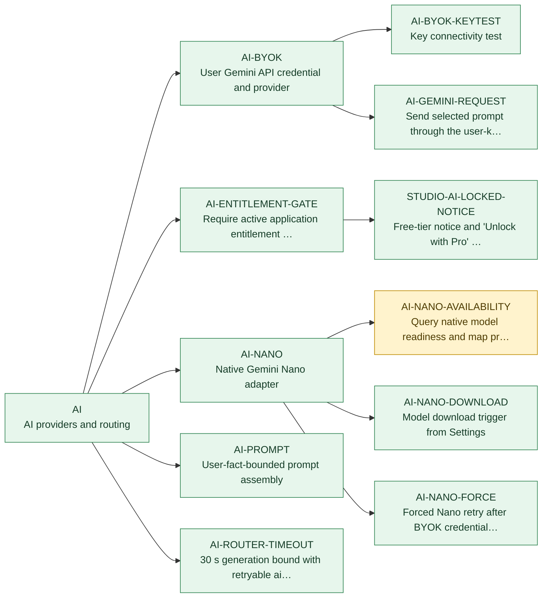

### AND-CFG-001 — Android flavors play/personal

Status **IMPLEMENTED** (HIGH); 0 descendant nodes.


### AND-CFG-002 — Release signing from android/key.properties else unsigned

Status **IMPLEMENTED** (HIGH); 0 descendant nodes.


### AND-CFG-003 — App Check = Play Integrity provider only

Status **IMPLEMENTED** (HIGH); 0 descendant nodes.


### APP-FIREBASE-BOOTSTRAP — Firebase and App Check (Play Integrity) initialisation

Status **IMPLEMENTED** (MEDIUM); 0 descendant nodes.

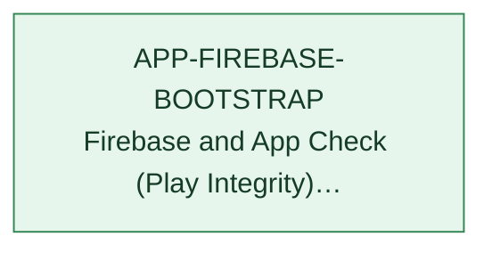

### APP-GLOBAL-ERROR-HANDLERS — Global error handlers (FlutterError.onError, PlatformDispatcher.onError)

Status **IMPLEMENTED** (HIGH); 0 descendant nodes.

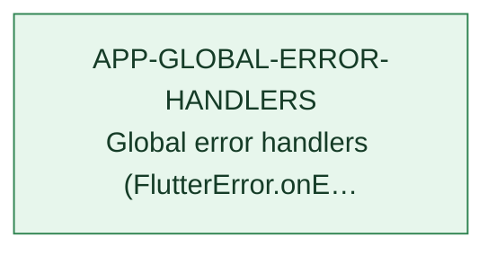

### AUTH — Google authentication and session renewal

Status **IMPLEMENTED** (HIGH); 4 descendant nodes.

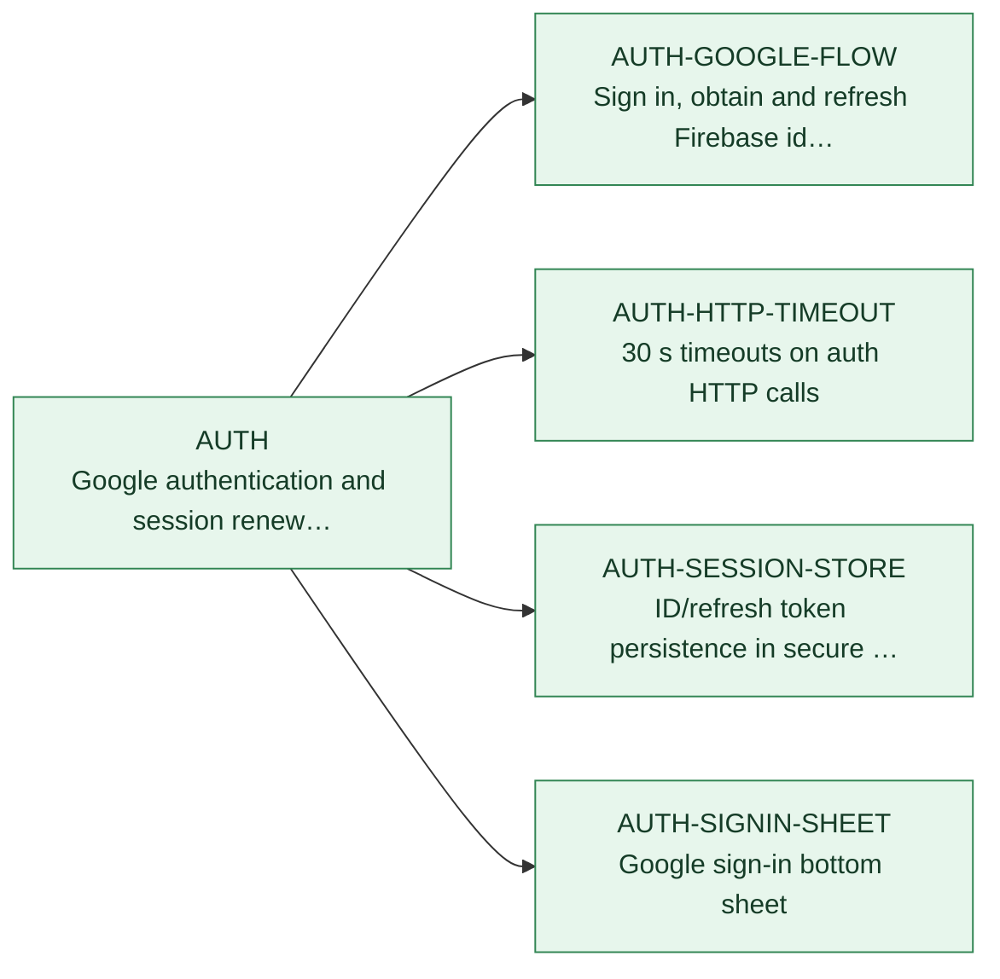

### AUTO-PREP — Consent-aware scheduled AI draft preparation

Status **NOT_IMPLEMENTED** (HIGH); 0 descendant nodes.

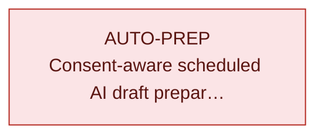

### BILL — Google Play subscription and entitlement

Status **IMPLEMENTED** (HIGH); 5 descendant nodes.

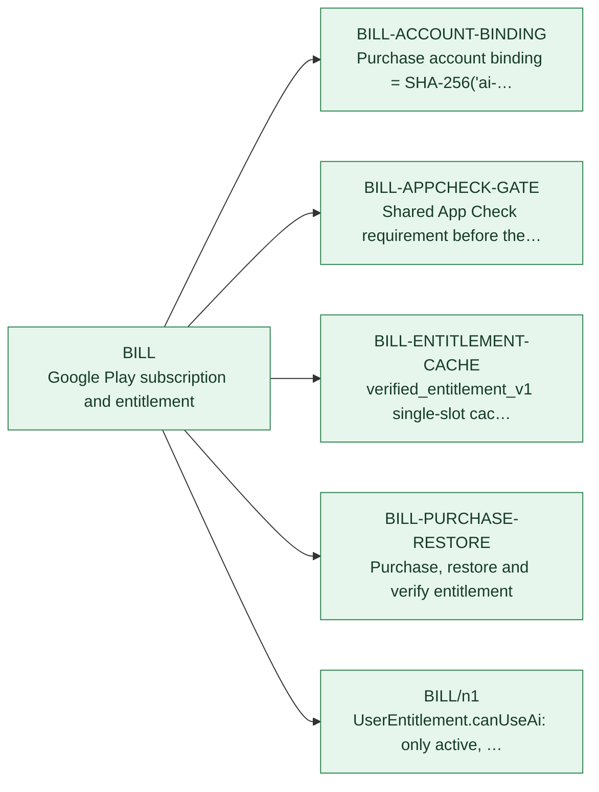

### BIRTH — Birthday recurrence and lifecycle

Status **IMPLEMENTED** (HIGH); 12 descendant nodes.

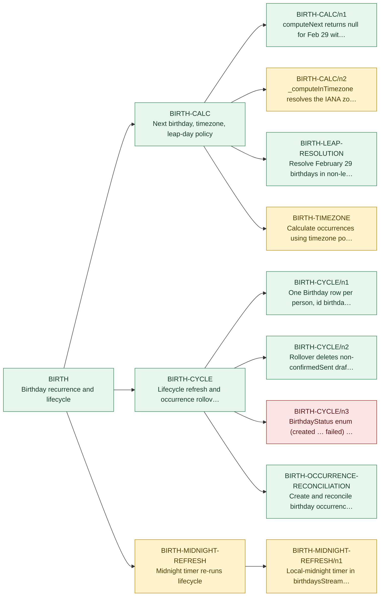

### CAL — Interactive calendar and day detail

Status **IMPLEMENTED** (MEDIUM); 3 descendant nodes.

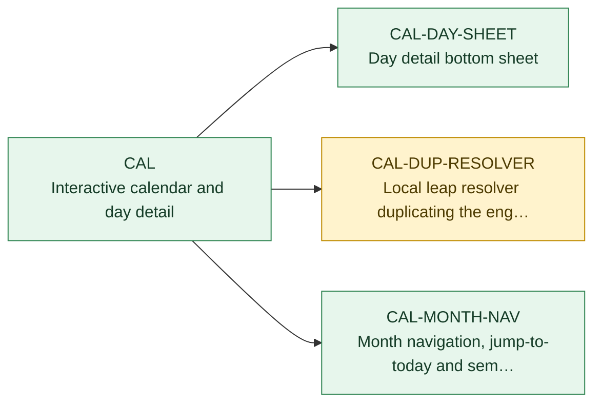

### CI-001 — CI jobs: flutter-quality-and-test, backend-verification, hosting-verification

Status **IMPLEMENTED** (HIGH); 1 descendant nodes.

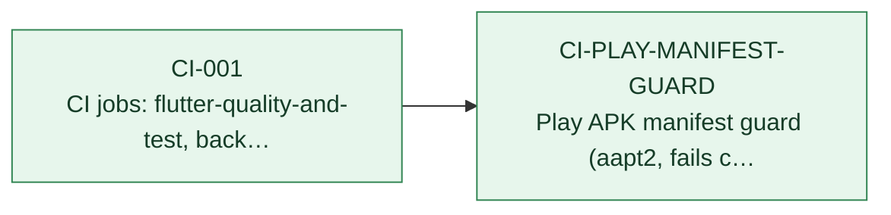

### CLOUD — Opt-in account-scoped cloud backup

Status **IMPLEMENTED** (HIGH); 12 descendant nodes.

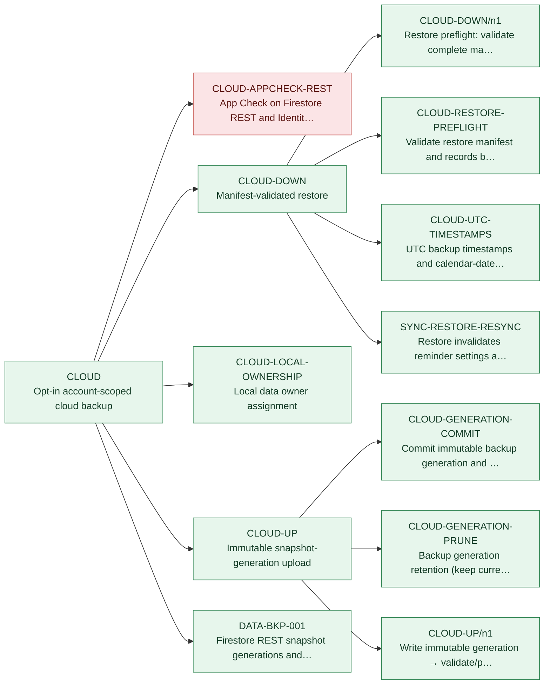

### CORE — Core platform services (database, security, logging, config)

Status **IMPLEMENTED** (MEDIUM); 9 descendant nodes.

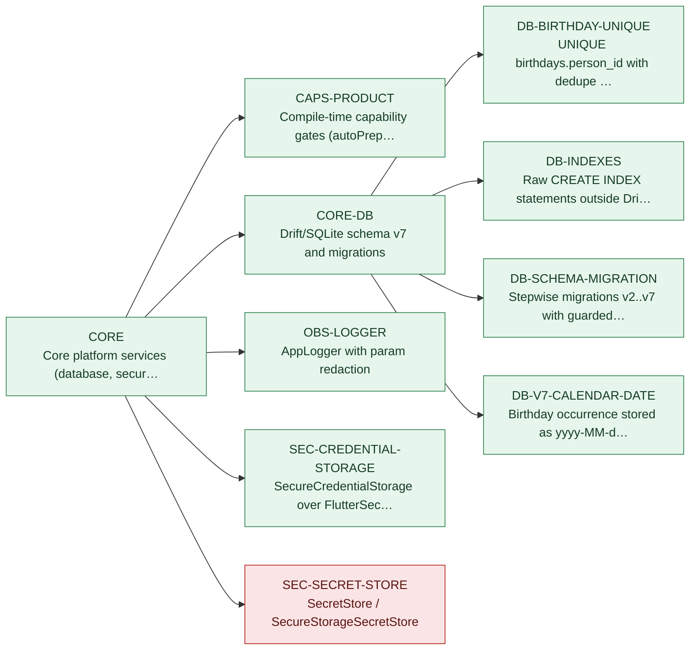

### CTRL — Isolated Firebase coordination control plane

Status **IMPLEMENTED** (MEDIUM); 16 descendant nodes.

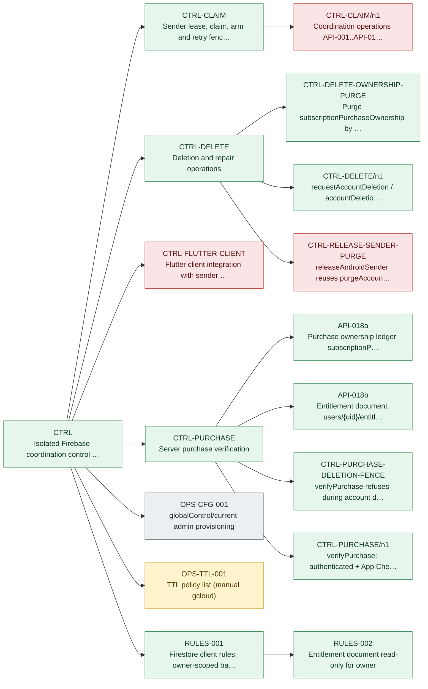

### DASH — Today, upcoming and action dashboard

Status **IMPLEMENTED** (HIGH); 2 descendant nodes.

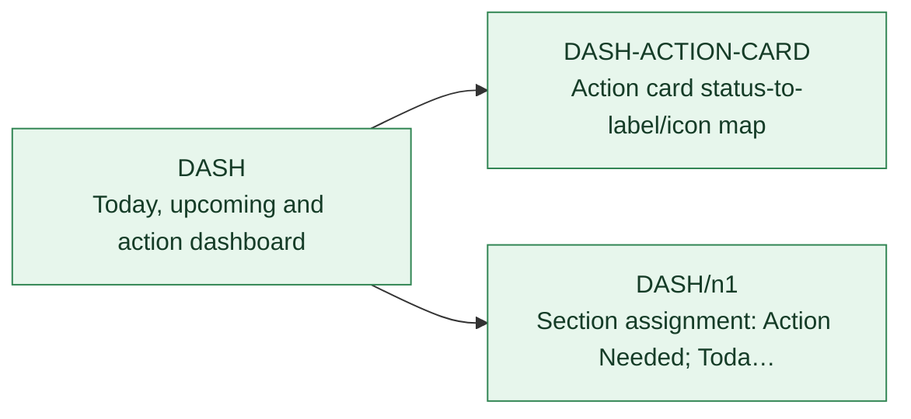

### DB-STARTUP-RECOVERY — Startup DB-open timeout and recovery screen

Status **IMPLEMENTED** (MEDIUM); 1 descendant nodes.

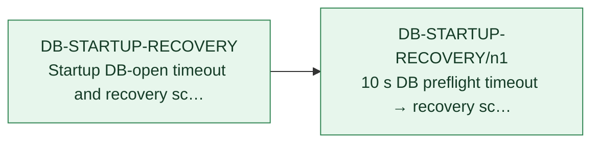

### HISTORY — Draft and delivery history

Status **IMPLEMENTED** (MEDIUM); 2 descendant nodes.

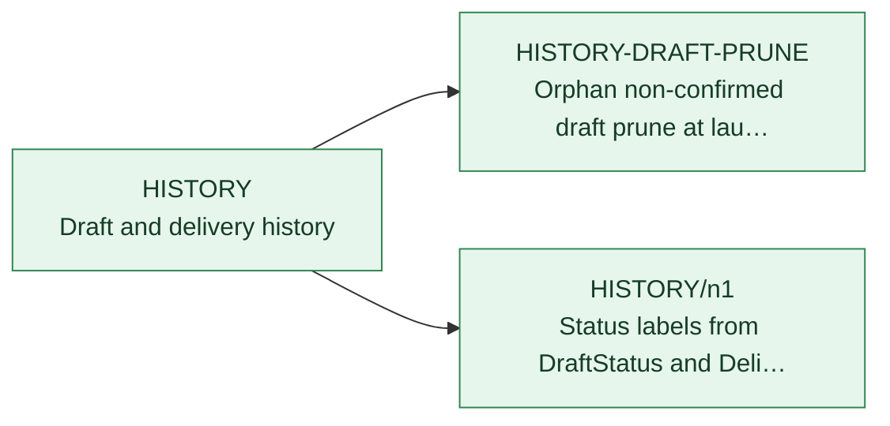

### IOS-APP-TARGET — Native iOS application target described by public copy

Status **NOT_IMPLEMENTED** (MEDIUM); 0 descendant nodes.

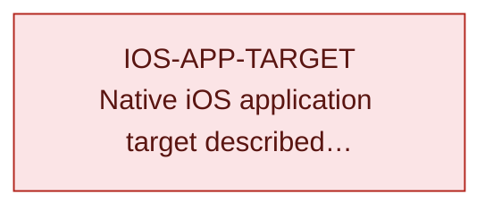

### JOBS — Durable background operation queue

Status **IMPLEMENTED** (HIGH); 8 descendant nodes.

```mermaid
flowchart LR
  n_JOBS["JOBS<br/>Durable background operation queue"]
  class n_JOBS impl;
  n_JOBS_CANCEL["JOBS-CANCEL<br/>Job cancel (repository + worker discard)"]
  n_JOBS --> n_JOBS_CANCEL
  class n_JOBS_CANCEL miss;
  n_JOBS_CLOUD_SYNC_HANDLER["JOBS-CLOUD-SYNC-HANDLER<br/>Backup/restore handler with account-own…"]
  n_JOBS --> n_JOBS_CLOUD_SYNC_HANDLER
  class n_JOBS_CLOUD_SYNC_HANDLER impl;
  n_JOBS_DEDUPE["JOBS-DEDUPE<br/>One active job per (type, subjectId)"]
  n_JOBS --> n_JOBS_DEDUPE
  class n_JOBS_DEDUPE impl;
  n_JOBS_EVENT_STREAM["JOBS-EVENT-STREAM<br/>In-process broadcast of job transitions"]
  n_JOBS --> n_JOBS_EVENT_STREAM
  class n_JOBS_EVENT_STREAM impl;
  n_JOBS_HANDLER_TIMEOUT["JOBS-HANDLER-TIMEOUT<br/>Per-handler timeout and guarded state t…"]
  n_JOBS --> n_JOBS_HANDLER_TIMEOUT
  class n_JOBS_HANDLER_TIMEOUT impl;
  n_JOBS_RETENTION["JOBS-RETENTION<br/>Keep newest terminal row per subject"]
  n_JOBS --> n_JOBS_RETENTION
  class n_JOBS_RETENTION impl;
  n_JOBS_RETRY_RECOVERY["JOBS-RETRY-RECOVERY<br/>Recover interrupted jobs and retry with…"]
  n_JOBS --> n_JOBS_RETRY_RECOVERY
  class n_JOBS_RETRY_RECOVERY impl;
  n_JOBS_SKIP_OUTCOME["JOBS-SKIP-OUTCOME<br/>JobSkipped outcome recorded as succeede…"]
  n_JOBS --> n_JOBS_SKIP_OUTCOME
  class n_JOBS_SKIP_OUTCOME impl;
  classDef impl fill:#e7f6ec,stroke:#318553,color:#153c27;
  classDef part fill:#fff3cd,stroke:#be8b00,color:#4d3b00;
  classDef miss fill:#fbe4e6,stroke:#b3261e,color:#5a1511;
  classDef unk fill:#eceff1,stroke:#66727a,color:#263238;
```

### L10N — Localisation (gen-l10n)

Status **PARTIALLY_IMPLEMENTED** (HIGH); 0 descendant nodes.

```mermaid
flowchart LR
  n_L10N["L10N<br/>Localisation (gen-l10n)"]
  class n_L10N part;
  classDef impl fill:#e7f6ec,stroke:#318553,color:#153c27;
  classDef part fill:#fff3cd,stroke:#be8b00,color:#4d3b00;
  classDef miss fill:#fbe4e6,stroke:#b3261e,color:#5a1511;
  classDef unk fill:#eceff1,stroke:#66727a,color:#263238;
```

### NAV — Navigation shell

Status **IMPLEMENTED** (MEDIUM); 3 descendant nodes.

```mermaid
flowchart LR
  n_NAV["NAV<br/>Navigation shell"]
  class n_NAV impl;
  n_NAV_NOT_FOUND["NAV-NOT-FOUND<br/>Unknown-route screen (_NotFoundScreen)"]
  n_NAV --> n_NAV_NOT_FOUND
  class n_NAV_NOT_FOUND impl;
  n_NAV_NOTIFICATION_DEEPLINK["NAV-NOTIFICATION-DEEPLINK<br/>Notification tap routes to Message Stud…"]
  n_NAV --> n_NAV_NOTIFICATION_DEEPLINK
  class n_NAV_NOTIFICATION_DEEPLINK part;
  n_NAV_ROUTE_COLLISION["NAV-ROUTE-COLLISION<br/>/message-studio/:birthdayId may also ma…"]
  n_NAV --> n_NAV_ROUTE_COLLISION
  class n_NAV_ROUTE_COLLISION unk;
  classDef impl fill:#e7f6ec,stroke:#318553,color:#153c27;
  classDef part fill:#fff3cd,stroke:#be8b00,color:#4d3b00;
  classDef miss fill:#fbe4e6,stroke:#b3261e,color:#5a1511;
  classDef unk fill:#eceff1,stroke:#66727a,color:#263238;
```

### ONB — Onboarding

Status **IMPLEMENTED** (MEDIUM); 3 descendant nodes.

```mermaid
flowchart LR
  n_ONB["ONB<br/>Onboarding"]
  class n_ONB impl;
  n_ONB_FLOW["ONB-FLOW<br/>Intro, skip and start flows"]
  n_ONB --> n_ONB_FLOW
  class n_ONB_FLOW impl;
  n_ONB_GATE["ONB-GATE<br/>First-run persistence and routing gate"]
  n_ONB --> n_ONB_GATE
  class n_ONB_GATE impl;
  n_ONB_GATE_n1["ONB-GATE/n1<br/>Router redirect to /onboarding; positiv…"]
  n_ONB_GATE --> n_ONB_GATE_n1
  class n_ONB_GATE_n1 impl;
  classDef impl fill:#e7f6ec,stroke:#318553,color:#153c27;
  classDef part fill:#fff3cd,stroke:#be8b00,color:#4d3b00;
  classDef miss fill:#fbe4e6,stroke:#b3261e,color:#5a1511;
  classDef unk fill:#eceff1,stroke:#66727a,color:#263238;
```

### PEOPLE — People management

Status **IMPLEMENTED** (MEDIUM); 39 descendant nodes.

```mermaid
flowchart LR
  n_PEOPLE["PEOPLE<br/>People management"]
  class n_PEOPLE impl;
  n_PEOPLE_CRUD["PEOPLE-CRUD<br/>Create, edit, soft-delete, undo"]
  n_PEOPLE --> n_PEOPLE_CRUD
  class n_PEOPLE_CRUD part;
  n_PEOPLE_DETAILS_MODAL["PEOPLE-DETAILS-MODAL<br/>Person details modal (_showPersonDetail…"]
  n_PEOPLE --> n_PEOPLE_DETAILS_MODAL
  class n_PEOPLE_DETAILS_MODAL impl;
  n_PEOPLE_EXPORT["PEOPLE-EXPORT<br/>CSV export and share sheet"]
  n_PEOPLE --> n_PEOPLE_EXPORT
  class n_PEOPLE_EXPORT impl;
  n_PEOPLE_FILTER["PEOPLE-FILTER<br/>Filter people by birthday and relations…"]
  n_PEOPLE --> n_PEOPLE_FILTER
  class n_PEOPLE_FILTER impl;
  n_PEOPLE_FORM["PEOPLE-FORM<br/>Create and edit recipient form"]
  n_PEOPLE --> n_PEOPLE_FORM
  class n_PEOPLE_FORM impl;
  n_PEOPLE_IMPORT["PEOPLE-IMPORT<br/>Import review and selection"]
  n_PEOPLE --> n_PEOPLE_IMPORT
  class n_PEOPLE_IMPORT impl;
  n_PEOPLE_LEAP_REPAIR["PEOPLE-LEAP-REPAIR<br/>'Choose celebration date' repair badge …"]
  n_PEOPLE --> n_PEOPLE_LEAP_REPAIR
  class n_PEOPLE_LEAP_REPAIR part;
  n_PEOPLE_POPUP_ACTIONS["PEOPLE-POPUP-ACTIONS<br/>Row popup menu actions"]
  n_PEOPLE --> n_PEOPLE_POPUP_ACTIONS
  class n_PEOPLE_POPUP_ACTIONS impl;
  n_PEOPLE_RELATIONSHIP_COERCE["PEOPLE-RELATIONSHIP-COERCE<br/>Relationship dropdown over Relationship…"]
  n_PEOPLE --> n_PEOPLE_RELATIONSHIP_COERCE
  class n_PEOPLE_RELATIONSHIP_COERCE impl;
  n_PEOPLE_REPO_DUP["PEOPLE-REPO-DUP<br/>Duplicate Drift people repository write…"]
  n_PEOPLE --> n_PEOPLE_REPO_DUP
  class n_PEOPLE_REPO_DUP miss;
  n_PEOPLE_SEARCH["PEOPLE-SEARCH<br/>Search people by name"]
  n_PEOPLE --> n_PEOPLE_SEARCH
  class n_PEOPLE_SEARCH impl;
  n_PEOPLE_SOFT_DELETE_PURGE["PEOPLE-SOFT-DELETE-PURGE<br/>Purge or 'recently deleted' handling of…"]
  n_PEOPLE --> n_PEOPLE_SOFT_DELETE_PURGE
  class n_PEOPLE_SOFT_DELETE_PURGE miss;
  n_PEOPLE_VALIDATE["PEOPLE-VALIDATE<br/>Form validation and normalized fields"]
  n_PEOPLE --> n_PEOPLE_VALIDATE
  class n_PEOPLE_VALIDATE part;
  n_PEOPLE_VALIDATE_n1["PEOPLE-VALIDATE/n1<br/>Name required, trimmed, ≤120 (BR-001)"]
  n_PEOPLE_VALIDATE --> n_PEOPLE_VALIDATE_n1
  class n_PEOPLE_VALIDATE_n1 impl;
  n_PEOPLE_VALIDATE_n2["PEOPLE-VALIDATE/n2<br/>Birthday month/day must form a real cal…"]
  n_PEOPLE_VALIDATE --> n_PEOPLE_VALIDATE_n2
  class n_PEOPLE_VALIDATE_n2 impl;
  n_PEOPLE_VALIDATE_n3["PEOPLE-VALIDATE/n3<br/>Birth year 1900–2199 when supplied (BR-…"]
  n_PEOPLE_VALIDATE --> n_PEOPLE_VALIDATE_n3
  class n_PEOPLE_VALIDATE_n3 impl;
  n_PEOPLE_VALIDATE_n4["PEOPLE-VALIDATE/n4<br/>Phone 6–20 chars of digits and + - ( ) …"]
  n_PEOPLE_VALIDATE --> n_PEOPLE_VALIDATE_n4
  class n_PEOPLE_VALIDATE_n4 impl;
  n_PEOPLE_VALIDATE_n5["PEOPLE-VALIDATE/n5<br/>Email address-shaped, ≤254 (BR-005)"]
  n_PEOPLE_VALIDATE --> n_PEOPLE_VALIDATE_n5
  class n_PEOPLE_VALIDATE_n5 impl;
  n_PEOPLE_VALIDATE_n6["PEOPLE-VALIDATE/n6<br/>Relationship ≤60; language non-empty ≤1…"]
  n_PEOPLE_VALIDATE --> n_PEOPLE_VALIDATE_n6
  class n_PEOPLE_VALIDATE_n6 part;
  n_PEOPLE_VALIDATE_n7["PEOPLE-VALIDATE/n7<br/>Supplied timezone must be a known IANA …"]
  n_PEOPLE_VALIDATE --> n_PEOPLE_VALIDATE_n7
  class n_PEOPLE_VALIDATE_n7 impl;
  n_PEOPLE_SEARCH_n1["PEOPLE-SEARCH/n1<br/>Literal case-insensitive substring over…"]
  n_PEOPLE_SEARCH --> n_PEOPLE_SEARCH_n1
  class n_PEOPLE_SEARCH_n1 impl;
  n_PEOPLE_CSV["PEOPLE-CSV<br/>CSV parse, diagnostics and duplicate hi…"]
  n_PEOPLE_IMPORT --> n_PEOPLE_CSV
  class n_PEOPLE_CSV part;
  n_PEOPLE_DEVICE["PEOPLE-DEVICE<br/>Permission-gated Android contacts import"]
  n_PEOPLE_IMPORT --> n_PEOPLE_DEVICE
  class n_PEOPLE_DEVICE impl;
  n_PEOPLE_IMPORT_BATCH["PEOPLE-IMPORT-BATCH<br/>Per-row validated import (importValidRo…"]
  n_PEOPLE_IMPORT --> n_PEOPLE_IMPORT_BATCH
  class n_PEOPLE_IMPORT_BATCH impl;
  n_PEOPLE_IMPORT_REVIEW["PEOPLE-IMPORT-REVIEW<br/>Review candidates and select rows befor…"]
  n_PEOPLE_IMPORT --> n_PEOPLE_IMPORT_REVIEW
  class n_PEOPLE_IMPORT_REVIEW impl;
  n_PEOPLE_IMPORT_n1["PEOPLE-IMPORT/n1<br/>importBatch strict all-or-nothing; impo…"]
  n_PEOPLE_IMPORT --> n_PEOPLE_IMPORT_n1
  class n_PEOPLE_IMPORT_n1 impl;
  n_PEOPLE_CSV_DATE_NORMALIZATION["PEOPLE-CSV-DATE-NORMALIZATION<br/>Normalize imported birthday fields"]
  n_PEOPLE_CSV --> n_PEOPLE_CSV_DATE_NORMALIZATION
  class n_PEOPLE_CSV_DATE_NORMALIZATION impl;
  n_PEOPLE_CSV_DIAGNOSTICS["PEOPLE-CSV-DIAGNOSTICS<br/>Report invalid rows and duplicate hints"]
  n_PEOPLE_CSV --> n_PEOPLE_CSV_DIAGNOSTICS
  class n_PEOPLE_CSV_DIAGNOSTICS impl;
  n_PEOPLE_CSV_QUOTE_PARSER["PEOPLE-CSV-QUOTE-PARSER<br/>Tokenize quoted CSV records"]
  n_PEOPLE_CSV --> n_PEOPLE_CSV_QUOTE_PARSER
  class n_PEOPLE_CSV_QUOTE_PARSER impl;
  n_PEOPLE_CSV_n1["PEOPLE-CSV/n1<br/>_parseCsvLine quote-aware tokenization …"]
  n_PEOPLE_CSV --> n_PEOPLE_CSV_n1
  class n_PEOPLE_CSV_n1 impl;
  n_PEOPLE_CSV_n2["PEOPLE-CSV/n2<br/>parseCsvWithResult date normalization a…"]
  n_PEOPLE_CSV --> n_PEOPLE_CSV_n2
  class n_PEOPLE_CSV_n2 impl;
  n_PEOPLE_CSV_n3["PEOPLE-CSV/n3<br/>Duplicate hinting; duplicates unselecte…"]
  n_PEOPLE_CSV --> n_PEOPLE_CSV_n3
  class n_PEOPLE_CSV_n3 impl;
  n_PEOPLE_EXPORT_n1["PEOPLE-EXPORT/n1<br/>Export 16 columns incl. Leap Day Policy…"]
  n_PEOPLE_EXPORT --> n_PEOPLE_EXPORT_n1
  class n_PEOPLE_EXPORT_n1 part;
  n_PEOPLE_CLEAR_SEMANTICS["PEOPLE-CLEAR-SEMANTICS<br/>Explicit clear semantics for optional p…"]
  n_PEOPLE_CRUD --> n_PEOPLE_CLEAR_SEMANTICS
  class n_PEOPLE_CLEAR_SEMANTICS impl;
  n_PEOPLE_CRUD_n1["PEOPLE-CRUD/n1<br/>PersonService.create validates then wri…"]
  n_PEOPLE_CRUD --> n_PEOPLE_CRUD_n1
  class n_PEOPLE_CRUD_n1 impl;
  n_PEOPLE_CRUD_n2["PEOPLE-CRUD/n2<br/>update validates with requireBirthday: …"]
  n_PEOPLE_CRUD --> n_PEOPLE_CRUD_n2
  class n_PEOPLE_CRUD_n2 impl;
  n_PEOPLE_CRUD_n3["PEOPLE-CRUD/n3<br/>Clamp autoPrepare and autoSendPolicy by…"]
  n_PEOPLE_CRUD --> n_PEOPLE_CRUD_n3
  class n_PEOPLE_CRUD_n3 impl;
  n_PEOPLE_CRUD_n4["PEOPLE-CRUD/n4<br/>remove → softDeleteAggregate: hard-dele…"]
  n_PEOPLE_CRUD --> n_PEOPLE_CRUD_n4
  class n_PEOPLE_CRUD_n4 part;
  n_PEOPLE_CRUD_n5["PEOPLE-CRUD/n5<br/>restoreAggregate restores the birthday …"]
  n_PEOPLE_CRUD --> n_PEOPLE_CRUD_n5
  class n_PEOPLE_CRUD_n5 part;
  classDef impl fill:#e7f6ec,stroke:#318553,color:#153c27;
  classDef part fill:#fff3cd,stroke:#be8b00,color:#4d3b00;
  classDef miss fill:#fbe4e6,stroke:#b3261e,color:#5a1511;
  classDef unk fill:#eceff1,stroke:#66727a,color:#263238;
```

### REM — Local birthday reminders

Status **PARTIALLY_IMPLEMENTED** (HIGH); 23 descendant nodes.

```mermaid
flowchart LR
  n_REM["REM<br/>Local birthday reminders"]
  class n_REM part;
  n_REM_ANNUAL_REPLAN["REM-ANNUAL-REPLAN<br/>Next-year reminders re-planned after a …"]
  n_REM --> n_REM_ANNUAL_REPLAN
  class n_REM_ANNUAL_REPLAN impl;
  n_REM_BOOT_RESTORE["REM-BOOT-RESTORE<br/>Kotlin re-arms persisted future trigger…"]
  n_REM --> n_REM_BOOT_RESTORE
  class n_REM_BOOT_RESTORE impl;
  n_REM_BOOTSTRAP["REM-BOOTSTRAP<br/>Reminder bootstrap at app start and on …"]
  n_REM --> n_REM_BOOTSTRAP
  class n_REM_BOOTSTRAP impl;
  n_REM_DEFER_QUIET["REM-DEFER-QUIET<br/>Quiet-hours deferral"]
  n_REM --> n_REM_DEFER_QUIET
  class n_REM_DEFER_QUIET impl;
  n_REM_EXACT_ALARM_REQUEST["REM-EXACT-ALARM-REQUEST<br/>Exact-alarm permission request"]
  n_REM --> n_REM_EXACT_ALARM_REQUEST
  class n_REM_EXACT_ALARM_REQUEST part;
  n_REM_NATIVE["REM-NATIVE<br/>Android alarm and notification adapter"]
  n_REM --> n_REM_NATIVE
  class n_REM_NATIVE impl;
  n_REM_PREFS["REM-PREFS<br/>Persisted reminder and privacy settings"]
  n_REM --> n_REM_PREFS
  class n_REM_PREFS impl;
  n_REM_RESUME_RECONCILE["REM-RESUME-RECONCILE<br/>Re-plan on app resume"]
  n_REM --> n_REM_RESUME_RECONCILE
  class n_REM_RESUME_RECONCILE impl;
  n_REM_RULES["REM-RULES<br/>Offset and quiet-hour schedule planning"]
  n_REM --> n_REM_RULES
  class n_REM_RULES impl;
  n_REM_STARTUP_RESYNC["REM-STARTUP-RESYNC<br/>Re-plan on cold start"]
  n_REM --> n_REM_STARTUP_RESYNC
  class n_REM_STARTUP_RESYNC impl;
  n_REM_SYNC_ERROR["REM-SYNC-ERROR<br/>Planning failure surfaced as ReminderSe…"]
  n_REM --> n_REM_SYNC_ERROR
  class n_REM_SYNC_ERROR impl;
  n_REM_TEST_NOTIFICATION["REM-TEST-NOTIFICATION<br/>Test notification"]
  n_REM --> n_REM_TEST_NOTIFICATION
  class n_REM_TEST_NOTIFICATION impl;
  n_REM_TIMEZONE_RECONCILE["REM-TIMEZONE-RECONCILE<br/>Re-plan on timezone/clock change"]
  n_REM --> n_REM_TIMEZONE_RECONCILE
  class n_REM_TIMEZONE_RECONCILE part;
  n_REM_QUIET_HOURS["REM-QUIET-HOURS<br/>Suppress or defer notifications during …"]
  n_REM_RULES --> n_REM_QUIET_HOURS
  class n_REM_QUIET_HOURS impl;
  n_REM_RULES_n1["REM-RULES/n1<br/>Plan emits at most one reminder per ena…"]
  n_REM_RULES --> n_REM_RULES_n1
  class n_REM_RULES_n1 impl;
  n_REM_RULES_n2["REM-RULES/n2<br/>Reject a reminder whose time is not aft…"]
  n_REM_RULES --> n_REM_RULES_n2
  class n_REM_RULES_n2 impl;
  n_REM_RULES_n3["REM-RULES/n3<br/>Reminder hour hardcoded to 09:00"]
  n_REM_RULES --> n_REM_RULES_n3
  class n_REM_RULES_n3 part;
  n_REM_QUIET_HOURS_n1["REM-QUIET-HOURS/n1<br/>Suppress inside quiet hours (default 22…"]
  n_REM_QUIET_HOURS --> n_REM_QUIET_HOURS_n1
  class n_REM_QUIET_HOURS_n1 impl;
  n_REM_ENSURE_LOADED["REM-ENSURE-LOADED<br/>Serialised replan; never plan from defa…"]
  n_REM_PREFS --> n_REM_ENSURE_LOADED
  class n_REM_ENSURE_LOADED impl;
  n_REM_HIDE_NAMES["REM-HIDE-NAMES<br/>Hide-names option"]
  n_REM_PREFS --> n_REM_HIDE_NAMES
  class n_REM_HIDE_NAMES impl;
  n_REM_NATIVE_PERMISSION_RECOVERY["REM-NATIVE-PERMISSION-RECOVERY<br/>Reconcile alarm and notification permis…"]
  n_REM_NATIVE --> n_REM_NATIVE_PERMISSION_RECOVERY
  class n_REM_NATIVE_PERMISSION_RECOVERY part;
  n_REM_PLAN_STAMP["REM-PLAN-STAMP<br/>Reminder plan stamp (timezone@offset + …"]
  n_REM_BOOTSTRAP --> n_REM_PLAN_STAMP
  class n_REM_PLAN_STAMP impl;
  n_REM_PLAN_STAMP_n1["REM-PLAN-STAMP/n1<br/>Plan stamp makes start/resume re-plan i…"]
  n_REM_PLAN_STAMP --> n_REM_PLAN_STAMP_n1
  class n_REM_PLAN_STAMP_n1 impl;
  classDef impl fill:#e7f6ec,stroke:#318553,color:#153c27;
  classDef part fill:#fff3cd,stroke:#be8b00,color:#4d3b00;
  classDef miss fill:#fbe4e6,stroke:#b3261e,color:#5a1511;
  classDef unk fill:#eceff1,stroke:#66727a,color:#263238;
```

### SEND — User-controlled delivery handoffs

Status **IMPLEMENTED** (MEDIUM); 20 descendant nodes.

```mermaid
flowchart LR
  n_SEND["SEND<br/>User-controlled delivery handoffs"]
  class n_SEND impl;
  n_SEND_SHARE["SEND-SHARE<br/>System share, copy and targeted platfor…"]
  n_SEND --> n_SEND_SHARE
  class n_SEND_SHARE impl;
  n_SEND_SMS["SEND-SMS<br/>SMS delivery handoff"]
  n_SEND --> n_SEND_SMS
  class n_SEND_SMS impl;
  n_SEND_TRUTH["SEND-TRUTH<br/>Handoff evidence and explicit sent conf…"]
  n_SEND --> n_SEND_TRUTH
  class n_SEND_TRUTH part;
  n_SEND_WA["SEND-WA<br/>WhatsApp click-to-chat URL"]
  n_SEND --> n_SEND_WA
  class n_SEND_WA impl;
  n_STUDIO_CHANNEL_PRIMARY["STUDIO-CHANNEL-PRIMARY<br/>Primary CTA by preferredDeliveryChannel…"]
  n_SEND --> n_STUDIO_CHANNEL_PRIMARY
  class n_STUDIO_CHANNEL_PRIMARY impl;
  n_SEND_WA_n1["SEND-WA/n1<br/>Sanitize to digits, strip 00, require 7…"]
  n_SEND_WA --> n_SEND_WA_n1
  class n_SEND_WA_n1 impl;
  n_DELIVERY_EVENT_LEDGER["DELIVERY-EVENT-LEDGER<br/>Append-only delivery events (launched/c…"]
  n_SEND_TRUTH --> n_DELIVERY_EVENT_LEDGER
  class n_DELIVERY_EVENT_LEDGER impl;
  n_SEND_EXPLICIT_CONFIRMATION["SEND-EXPLICIT-CONFIRMATION<br/>Require user confirmation before record…"]
  n_SEND_TRUTH --> n_SEND_EXPLICIT_CONFIRMATION
  class n_SEND_EXPLICIT_CONFIRMATION impl;
  n_SEND_TRUTH_n1["SEND-TRUTH/n1<br/>DeliveryEvents insert-only; outcomes la…"]
  n_SEND_TRUTH --> n_SEND_TRUTH_n1
  class n_SEND_TRUTH_n1 impl;
  n_STUDIO_HANDOFF_DIALOG["STUDIO-HANDOFF-DIALOG<br/>'Did you send it?' confirmation dialog"]
  n_SEND_TRUTH --> n_STUDIO_HANDOFF_DIALOG
  class n_STUDIO_HANDOFF_DIALOG impl;
  n_STUDIO_HANDOFF_RETRY_RECORD["STUDIO-HANDOFF-RETRY-RECORD<br/>Separate launch failure vs evidence-wri…"]
  n_SEND_TRUTH --> n_STUDIO_HANDOFF_RETRY_RECORD
  class n_STUDIO_HANDOFF_RETRY_RECORD impl;
  n_SEND_EXPLICIT_CONFIRMATION_n1["SEND-EXPLICIT-CONFIRMATION/n1<br/>Dialog 'Did you send the message?' → 'N…"]
  n_SEND_EXPLICIT_CONFIRMATION --> n_SEND_EXPLICIT_CONFIRMATION_n1
  class n_SEND_EXPLICIT_CONFIRMATION_n1 impl;
  n_SEND_SMS_AUTOMATION["SEND-SMS-AUTOMATION<br/>Schedule direct background SMS"]
  n_SEND_SMS --> n_SEND_SMS_AUTOMATION
  class n_SEND_SMS_AUTOMATION part;
  n_SEND_SMS_COMPOSER["SEND-SMS-COMPOSER<br/>Open the user-controlled SMS composer"]
  n_SEND_SMS --> n_SEND_SMS_COMPOSER
  class n_SEND_SMS_COMPOSER impl;
  n_SEND_SMS_n1["SEND-SMS/n1<br/>SMS composer URI: 3–15 digits, leading …"]
  n_SEND_SMS --> n_SEND_SMS_n1
  class n_SEND_SMS_n1 impl;
  n_SMS_NATIVE_BOOT_RESCHEDULE["SMS-NATIVE-BOOT-RESCHEDULE<br/>Boot/package-replace reschedule and 12 …"]
  n_SEND_SMS_AUTOMATION --> n_SMS_NATIVE_BOOT_RESCHEDULE
  class n_SMS_NATIVE_BOOT_RESCHEDULE impl;
  n_SMS_NATIVE_IDEMPOTENCY["SMS-NATIVE-IDEMPOTENCY<br/>Schedule token, claim-before-send and S…"]
  n_SEND_SMS_AUTOMATION --> n_SMS_NATIVE_IDEMPOTENCY
  class n_SMS_NATIVE_IDEMPOTENCY impl;
  n_STUDIO_AUTO_SMS_APPROVAL["STUDIO-AUTO-SMS-APPROVAL<br/>Approve/revoke a draft for automatic SM…"]
  n_SEND_SMS_AUTOMATION --> n_STUDIO_AUTO_SMS_APPROVAL
  class n_STUDIO_AUTO_SMS_APPROVAL part;
  n_NATIVE_SHARE["NATIVE-SHARE<br/>Share chooser and package-targeted soci…"]
  n_SEND_SHARE --> n_NATIVE_SHARE
  class n_NATIVE_SHARE impl;
  n_STUDIO_COPY_EVENT["STUDIO-COPY-EVENT<br/>Clipboard copy recorded as copied outco…"]
  n_SEND_SHARE --> n_STUDIO_COPY_EVENT
  class n_STUDIO_COPY_EVENT impl;
  classDef impl fill:#e7f6ec,stroke:#318553,color:#153c27;
  classDef part fill:#fff3cd,stroke:#be8b00,color:#4d3b00;
  classDef miss fill:#fbe4e6,stroke:#b3261e,color:#5a1511;
  classDef unk fill:#eceff1,stroke:#66727a,color:#263238;
```

### SETTINGS — Preferences, account, backup and AI settings

Status **PARTIALLY_IMPLEMENTED** (HIGH); 6 descendant nodes.

```mermaid
flowchart LR
  n_SETTINGS["SETTINGS<br/>Preferences, account, backup and AI set…"]
  class n_SETTINGS part;
  n_SETTINGS_DATA_OWNERSHIP_DIALOG["SETTINGS-DATA-OWNERSHIP-DIALOG<br/>Confirm account-versus-local-data owner…"]
  n_SETTINGS --> n_SETTINGS_DATA_OWNERSHIP_DIALOG
  class n_SETTINGS_DATA_OWNERSHIP_DIALOG impl;
  n_SETTINGS_DELETE_ACCOUNT_DATA["SETTINGS-DELETE-ACCOUNT-DATA<br/>In-app delete cloud backup / delete acc…"]
  n_SETTINGS --> n_SETTINGS_DELETE_ACCOUNT_DATA
  class n_SETTINGS_DELETE_ACCOUNT_DATA miss;
  n_SETTINGS_GEMINI_KEY["SETTINGS-GEMINI-KEY<br/>Gemini key entry, verify and remove"]
  n_SETTINGS --> n_SETTINGS_GEMINI_KEY
  class n_SETTINGS_GEMINI_KEY impl;
  n_SETTINGS_HELP_PRIVACY["SETTINGS-HELP-PRIVACY<br/>Privacy, support and version tiles"]
  n_SETTINGS --> n_SETTINGS_HELP_PRIVACY
  class n_SETTINGS_HELP_PRIVACY miss;
  n_SETTINGS_NANO["SETTINGS-NANO<br/>On-device Nano status/preparation secti…"]
  n_SETTINGS --> n_SETTINGS_NANO
  class n_SETTINGS_NANO impl;
  n_SETTINGS_PURCHASE_UI["SETTINGS-PURCHASE-UI<br/>Purchase UI state, localised price and …"]
  n_SETTINGS --> n_SETTINGS_PURCHASE_UI
  class n_SETTINGS_PURCHASE_UI impl;
  classDef impl fill:#e7f6ec,stroke:#318553,color:#153c27;
  classDef part fill:#fff3cd,stroke:#be8b00,color:#4d3b00;
  classDef miss fill:#fbe4e6,stroke:#b3261e,color:#5a1511;
  classDef unk fill:#eceff1,stroke:#66727a,color:#263238;
```

### STUDIO — Message Studio

Status **IMPLEMENTED** (MEDIUM); 20 descendant nodes.

```mermaid
flowchart LR
  n_STUDIO["STUDIO<br/>Message Studio"]
  class n_STUDIO impl;
  n_STUDIO_AI["STUDIO-AI<br/>AI generation and durable request"]
  n_STUDIO --> n_STUDIO_AI
  class n_STUDIO_AI impl;
  n_STUDIO_DRAFT["STUDIO-DRAFT<br/>Manual editing and autosave"]
  n_STUDIO --> n_STUDIO_DRAFT
  class n_STUDIO_DRAFT impl;
  n_STUDIO_EDIT["STUDIO-EDIT<br/>Rewrite, translate and variations"]
  n_STUDIO --> n_STUDIO_EDIT
  class n_STUDIO_EDIT part;
  n_STUDIO_EDIT_n1["STUDIO-EDIT/n1<br/>CTA ladder: Unlock with Pro → Add Phone…"]
  n_STUDIO_EDIT --> n_STUDIO_EDIT_n1
  class n_STUDIO_EDIT_n1 impl;
  n_STUDIO_REWRITE_ACTIONS["STUDIO-REWRITE-ACTIONS<br/>Shorten, translate and vary a draft"]
  n_STUDIO_EDIT --> n_STUDIO_REWRITE_ACTIONS
  class n_STUDIO_REWRITE_ACTIONS part;
  n_STUDIO_TRANSLATE["STUDIO-TRANSLATE<br/>Translate sheet with 6 hard-coded langu…"]
  n_STUDIO_EDIT --> n_STUDIO_TRANSLATE
  class n_STUDIO_TRANSLATE impl;
  n_STUDIO_VARIATIONS["STUDIO-VARIATIONS<br/>Three-tone variation picker (direct rou…"]
  n_STUDIO_EDIT --> n_STUDIO_VARIATIONS
  class n_STUDIO_VARIATIONS part;
  n_STUDIO_AUTOSAVE["STUDIO-AUTOSAVE<br/>Debounced draft save and lifecycle flush"]
  n_STUDIO_DRAFT --> n_STUDIO_AUTOSAVE
  class n_STUDIO_AUTOSAVE part;
  n_STUDIO_DRAFT_REVISION_GUARD["STUDIO-DRAFT-REVISION-GUARD<br/>Monotonic draft revision + expectedCurr…"]
  n_STUDIO_DRAFT --> n_STUDIO_DRAFT_REVISION_GUARD
  class n_STUDIO_DRAFT_REVISION_GUARD impl;
  n_STUDIO_REVISION_ON_EDIT["STUDIO-REVISION-ON-EDIT<br/>Editing a confirmedSent draft forks a r…"]
  n_STUDIO_DRAFT --> n_STUDIO_REVISION_ON_EDIT
  class n_STUDIO_REVISION_ON_EDIT impl;
  n_STUDIO_STALE_RESULT_GUARD["STUDIO-STALE-RESULT-GUARD<br/>Prevent stale AI output overwriting new…"]
  n_STUDIO_DRAFT --> n_STUDIO_STALE_RESULT_GUARD
  class n_STUDIO_STALE_RESULT_GUARD impl;
  n_STUDIO_STALE_RESULT_GUARD_n1["STUDIO-STALE-RESULT-GUARD/n1<br/>Draft revision column stops an older wr…"]
  n_STUDIO_STALE_RESULT_GUARD --> n_STUDIO_STALE_RESULT_GUARD_n1
  class n_STUDIO_STALE_RESULT_GUARD_n1 impl;
  n_STUDIO_AUTOSAVE_n1["STUDIO-AUTOSAVE/n1<br/>Debounced autosave; lifecycle flush on …"]
  n_STUDIO_AUTOSAVE --> n_STUDIO_AUTOSAVE_n1
  class n_STUDIO_AUTOSAVE_n1 part;
  n_STUDIO_AI_QUEUE["STUDIO-AI-QUEUE<br/>Persist AI generation request as a dura…"]
  n_STUDIO_AI --> n_STUDIO_AI_QUEUE
  class n_STUDIO_AI_QUEUE impl;
  n_STUDIO_AI_RECOVERY["STUDIO-AI-RECOVERY<br/>Surface generation failures and retry o…"]
  n_STUDIO_AI --> n_STUDIO_AI_RECOVERY
  class n_STUDIO_AI_RECOVERY impl;
  n_STUDIO_AI_RECOVERY_n1["STUDIO-AI-RECOVERY/n1<br/>ai_job_handler recovery of interrupted …"]
  n_STUDIO_AI_RECOVERY --> n_STUDIO_AI_RECOVERY_n1
  class n_STUDIO_AI_RECOVERY_n1 impl;
  n_STUDIO_ERROR_RECOVERY_BANNER["STUDIO-ERROR-RECOVERY-BANNER<br/>Error banner: Retry / Use Nano / Write …"]
  n_STUDIO_AI_RECOVERY --> n_STUDIO_ERROR_RECOVERY_BANNER
  class n_STUDIO_ERROR_RECOVERY_BANNER impl;
  n_STUDIO_AI_QUEUE_n1["STUDIO-AI-QUEUE/n1<br/>_enqueueGenerate enqueues an ai_generat…"]
  n_STUDIO_AI_QUEUE --> n_STUDIO_AI_QUEUE_n1
  class n_STUDIO_AI_QUEUE_n1 impl;
  n_STUDIO_AI_QUEUE_n2["STUDIO-AI-QUEUE/n2<br/>AiRouter gates on entitlement (BR-013) …"]
  n_STUDIO_AI_QUEUE --> n_STUDIO_AI_QUEUE_n2
  class n_STUDIO_AI_QUEUE_n2 impl;
  n_STUDIO_AI_QUEUE_n3["STUDIO-AI-QUEUE/n3<br/>_withTimeout bounds a provider call at …"]
  n_STUDIO_AI_QUEUE --> n_STUDIO_AI_QUEUE_n3
  class n_STUDIO_AI_QUEUE_n3 impl;
  classDef impl fill:#e7f6ec,stroke:#318553,color:#153c27;
  classDef part fill:#fff3cd,stroke:#be8b00,color:#4d3b00;
  classDef miss fill:#fbe4e6,stroke:#b3261e,color:#5a1511;
  classDef unk fill:#eceff1,stroke:#66727a,color:#263238;
```

### THEME — UI theme and shared design components

Status **PARTIALLY_IMPLEMENTED** (HIGH); 1 descendant nodes.

```mermaid
flowchart LR
  n_THEME["THEME<br/>UI theme and shared design components"]
  class n_THEME part;
  n_THEME_TOKENS["THEME-TOKENS<br/>Design tokens (duplicated systems)"]
  n_THEME --> n_THEME_TOKENS
  class n_THEME_TOKENS part;
  classDef impl fill:#e7f6ec,stroke:#318553,color:#153c27;
  classDef part fill:#fff3cd,stroke:#be8b00,color:#4d3b00;
  classDef miss fill:#fbe4e6,stroke:#b3261e,color:#5a1511;
  classDef unk fill:#eceff1,stroke:#66727a,color:#263238;
```

### WEB — Public support, legal and deletion site

Status **IMPLEMENTED** (MEDIUM); 9 descendant nodes.

```mermaid
flowchart LR
  n_WEB["WEB<br/>Public support, legal and deletion site"]
  class n_WEB impl;
  n_HOST_001["HOST-001<br/>Reserved /__/firebase/init.json web-con…"]
  n_WEB --> n_HOST_001
  class n_HOST_001 impl;
  n_HOST_002["HOST-002<br/>Release-config validator and runtime-co…"]
  n_WEB --> n_HOST_002
  class n_HOST_002 impl;
  n_HOST_003["HOST-003<br/>Security headers and CSP"]
  n_WEB --> n_HOST_003
  class n_HOST_003 impl;
  n_HOST_004["HOST-004<br/>Pending-receipt sessionStorage journal"]
  n_WEB --> n_HOST_004
  class n_HOST_004 impl;
  n_HOST_005["HOST-005<br/>Committed build output and duplicate TS…"]
  n_WEB --> n_HOST_005
  class n_HOST_005 impl;
  n_WEB_DELETE["WEB-DELETE<br/>Deletion reauthentication and receipt c…"]
  n_WEB --> n_WEB_DELETE
  class n_WEB_DELETE impl;
  n_WEB_PUBLIC_COPY["WEB-PUBLIC-COPY<br/>Public copy matches the shipped Flutter…"]
  n_WEB --> n_WEB_PUBLIC_COPY
  class n_WEB_PUBLIC_COPY part;
  n_WEB_RELEASE_CONFIG["WEB-RELEASE-CONFIG<br/>Provision approved public release confi…"]
  n_WEB --> n_WEB_RELEASE_CONFIG
  class n_WEB_RELEASE_CONFIG miss;
  n_WEB_RECEIPT_RECOVERY["WEB-RECEIPT-RECOVERY<br/>Recover and check private deletion rece…"]
  n_WEB_DELETE --> n_WEB_RECEIPT_RECOVERY
  class n_WEB_RECEIPT_RECOVERY impl;
  classDef impl fill:#e7f6ec,stroke:#318553,color:#153c27;
  classDef part fill:#fff3cd,stroke:#be8b00,color:#4d3b00;
  classDef miss fill:#fbe4e6,stroke:#b3261e,color:#5a1511;
  classDef unk fill:#eceff1,stroke:#66727a,color:#263238;
```

## Journey to data chains

Source-level chains from journeys through screens, actions, rules, services and data. They show call and data dependencies, not proof of successful external calls.

**Scope:** source-level dependencies in the 2026-11-25 checkout. The graph intentionally keeps the sender-coordination backend separate from Flutter delivery because no mobile registration/claim/arm caller was found. Edges do not imply successful external calls or deployed services.

```mermaid
flowchart LR
  J1["J-01 first launch"] --> UI1["SCR-001 onboarding"]
  UI1 --> SVC1["SVC-001 startup preflight"]
  SVC1 --> DB1[("DB-001..006 local Drift")]
  SVC1 --> SVC2["SVC-002 route/onboarding guard"]
  SVC2 --> UI2["SCR-002/003/005/006 four shell destinations"]

  J2["J-02 manage people"] --> UI3["SCR-003/004 People + form"]
  UI3 --> ACT2["ACT-002 save / ACT-004 import"]
  ACT2 --> RULE2["BR-001..007 input constraints"]
  RULE2 --> SVC3["SVC-003 PersonService"]
  SVC3 --> DB2[("DB-001 Persons")]
  DB2 --> SVC4["SVC-004 occurrence lifecycle"]
  SVC4 --> DB3[("DB-002 Birthdays")]

  J3["J-03 birthday to reminder"] --> DB3
  DB3 --> RULE3["BR-008..012 recurrence and reminder rules"]
  RULE3 --> SVC5["SVC-005 reminder planner/gateway"]
  SVC5 --> DB4[("DB-004 ReminderSettingsEntries")]
  SVC5 --> EXT3["EXT-003 Android alarm/notification"]
  EXT3 --> ACT25["ACT-025 notification tap/deep link"]
  ACT25 --> UI4["SCR-007 person-linked Studio"]

  J4["J-04 compose and hand off"] --> UI4
  UI4 --> ACT8["ACT-008 generate/retry"]
  ACT8 --> SVC6["SVC-006 AI router"]
  SVC6 --> RULEAI["BR-013..015 entitlement/provider/timeout"]
  SVC6 --> EXT5["EXT-005 user Gemini"]
  SVC6 --> EXT6["EXT-006 Gemini Nano"]
  ACT8 --> SVC7["SVC-007 durable job worker"]
  SVC7 --> DB5[("DB-006 Jobs")]
  SVC7 --> DB6[("DB-003 MessageDrafts")]
  DB6 --> ACT10["ACT-010 user-controlled handoff"]
  ACT10 --> EXT10["EXT-010 WhatsApp"]
  ACT10 --> EXT11["EXT-011 SMS composer / gated adapter"]
  ACT10 --> EXT12["EXT-012 share / clipboard"]
  ACT10 --> DB7[("DB-005 DeliveryEvents")]
  DB7 --> ACT11["ACT-011 explicit user sent confirmation"]
  ACT11 --> UI5["SCR-006 Activity"]

  J5["J-05 opt-in backup/restore"] --> UI6["SCR-008 Settings"]
  UI6 --> SVC7
  SVC7 --> SVC8["SVC-008 CloudSyncService"]
  SVC8 --> DB8[("DB-001..004 local snapshot data")]
  SVC8 --> EXT8["EXT-008 owner-scoped Firestore"]
  EXT8 --> RULEC["BR-021/022 access + generation publication"]

  J6["J-06 purchase/restore"] --> UI6
  UI6 --> EXT9["EXT-009 Play Billing"]
  EXT9 --> SVC9["SVC-009 SubscriptionService"]
  SVC9 --> API18["API-018 verifyPurchase"]
  API18 --> SVC10["SubscriptionVerificationService"]
  SVC10 --> PLAY["Google Play subscription API"]
  SVC10 --> ENT["Owner entitlement + purchase ownership"]
  ENT --> RULEAI

  J7["J-07 public deletion"] --> WEB["SCR-011 public deletion page"]
  WEB --> ACT18["ACT-018 request / ACT-019 receipt"]
  ACT18 --> API12["API-012/013 deletion callables"]
  API12 --> SVC11["SVC-011 deletion orchestrator"]
  SVC11 --> SERVERDB[("Server-owned Firestore + Auth")]
  WEB --> EXT13["EXT-013 App Check / reCAPTCHA"]

  CTRL["Separate sender control plane"] --> APICTRL["API-001..017, API-019..020"]
  APICTRL --> SVC12["SVC-010 coordination service"]
  SVC12 --> CTRLDB[("Server-only claims, leases, fences, receipts")]
  CTRL -. no Flutter caller path found .-> J4

  classDef journey fill:#e1efff,stroke:#3478c5,color:#173b63;
  classDef ui fill:#e8f4ff,stroke:#2476b9,color:#12324a;
  classDef service fill:#efe6ff,stroke:#7652a8,color:#34224d;
  classDef api fill:#fff0dd,stroke:#c16a16,color:#4f2c08;
  classDef data fill:#ddf4f1,stroke:#198a80,color:#10443f;
  classDef rule fill:#fff3cd,stroke:#be8b00,color:#4d3b00;
  classDef external fill:#fff0dd,stroke:#c16a16,color:#4f2c08;
  classDef boundary fill:#fbe4e6,stroke:#b3261e,color:#5a1511;
  class J1,J2,J3,J4,J5,J6,J7 journey;
  class UI1,UI2,UI3,UI4,UI5,UI6,WEB ui;
  class SVC1,SVC2,SVC3,SVC4,SVC5,SVC6,SVC7,SVC8,SVC9,SVC10,SVC11,SVC12 service;
  class API18,API12,APICTRL api;
  class DB1,DB2,DB3,DB4,DB5,DB6,DB7,DB8,ENT,SERVERDB,CTRLDB data;
  class RULE2,RULE3,RULEAI,RULEC rule;
  class EXT3,EXT5,EXT6,EXT8,EXT9,EXT10,EXT11,EXT12,EXT13,PLAY external;
  class CTRL boundary;
```

## Application flow and navigation

```mermaid
flowchart TD
  START(["App launch"]) --> PRE["Database preflight (bounded) — recovery screen with retry on failure"]
  PRE --> GUARD{"Onboarding complete? (BR-025)"}
  GUARD -- "no" --> R1["/onboarding"]
  GUARD -- "yes" --> SHELL["Shell: four destinations"]
  R1 --> SHELL
  SHELL --> D["/dashboard Today"]
  SHELL --> P["/people"]
  SHELL --> C["/calendar"]
  SHELL --> H["/history Activity"]
  D --> ST["/message-studio/:birthdayId"]
  P --> F["/people/add, /people/edit/:id"]
  P --> SP["/message-studio/person/:personId"]
  C --> ST
  H --> ST
  NOTIF(["Notification tap or cold start"]) --> SP
  D --> SET["/settings (pushed above shell)"]
  SET --> R1
  ANY["Unknown path"] --> NF["Not-found recovery screen"] --> D
```

| Route node | Pattern and purpose | Screen | Evidence |
|---|---|---|---|
| ROUTE-001 | /onboarding — Onboarding (outside shell; guarded by onboarding flag) | SCR-001 | `lib/app/router.dart` |
| ROUTE-002 | /dashboard — Shell branch 1: Today | SCR-002 | `lib/app/router.dart` |
| ROUTE-003 | /people — Shell branch 2: People | SCR-003 | `lib/app/router.dart` |
| ROUTE-004 | /calendar — Shell branch 3: Calendar | SCR-005 | `lib/app/router.dart` |
| ROUTE-005 | /history — Shell branch 4: Activity | SCR-006 | `lib/app/router.dart` |
| ROUTE-006 | /people/add — Person form (create), pushed above shell | SCR-004 | `lib/app/router.dart` |
| ROUTE-007 | /people/edit/:id — Person form (edit), pushed above shell | SCR-004 | `lib/app/router.dart` |
| ROUTE-008 | /message-studio/:birthdayId — Message Studio for an occurrence | SCR-007 | `lib/app/router.dart` |
| ROUTE-009 | /message-studio/person/:personId — Message Studio for a person (notification deep link) | SCR-007 | `lib/app/router.dart` |
| ROUTE-010 | /settings — Settings, pushed above the shell (not a fifth tab) | SCR-008 | `lib/app/router.dart` |
| ROUTE-011 | Router errorBuilder — unknown path shows not-found recovery screen | SCR-009 | `lib/app/router.dart` |
| ROUTE-012 | Onboarding redirect guard — incomplete onboarding redirects normal routes to /onboarding (BR-025) | BR-025 | `lib/app/router.dart` |

Public Hosting routes (SCR-010 … SCR-014): `/`, `/privacy/`, `/terms/`, `/support/`, `/delete/` — a separate Vite site, not a Flutter web target. Route-level behaviour, guards and deep links are specified in [PRODUCT.md §7](PRODUCT.md).

## API dependency map

Clients, callable exports, services and server data. The sender-coordination callables (API-001…API-011, API-014…API-017) have **no Flutter caller** in the inspected source; only API-012/API-013 (public Hosting) and API-018 (Flutter purchase verification) are called by a client. Details, schemas and error model: [ARCHITECTURE.md §8](ARCHITECTURE.md).

```mermaid
flowchart LR
  FL["Flutter app<br/>SubscriptionService"] -->|"Auth + App Check"| A18["API-018 verifyPurchase"]
  HS["Public Hosting site<br/>backend/hosting/src/app.ts"] -->|"recent Google auth + App Check"| A12["API-012 requestAccountDeletion"]
  HS -->|"signed-out App Check"| A13["API-013 accountDeletionReceipt"]
  NOCALL["No client path found"] -.-> SENDER["API-001..011, 014..017<br/>sender coordination callables"]
  SCHED["Scheduler every minute UTC"] --> A19["API-019 sweepDeletionDrains"]
  SCHED --> A20["API-020 sweepCoordinationOperations"]
  A18 --> SVC9["SubscriptionVerificationService"]
  SVC9 --> PLAY["Google Play subscription API"]
  SVC9 --> ENT[("users/{uid}/entitlement/status<br/>subscriptionPurchaseOwnership/{hash}")]
  A12 --> CP["SVC-010 ControlPlaneService"]
  A13 --> CP
  SENDER --> CP
  CP --> CPD[("accounts/{uid} tree, deletionTombstones,<br/>coordinationPresence, deletionReceipts")]
  A12 --> DEL["SVC-011 DeletionOrchestrator"]
  A19 --> DEL
  DEL --> CPD
  DEL --> ENT
  A20 --> COORD["CoordinationOperationOrchestrator"]
  COORD --> CPD
  FL2["Flutter CloudSyncService<br/>REST with ID token"] --> BK[("users/{uid}/backup, generations/*")]
  RULES["firestore.rules"] -.guards.-> BK
  RULES -.guards.-> ENT
```

## Cross-module dependencies

37 directed dependencies between feature modules, computed from Dart `import` statements under `lib/features/` (a module depends on another when any file imports from it). Evidence: the first importing file is recorded on each edge.

```mermaid
flowchart LR
  n_AI --> n_BILL
  n_AI --> n_PEOPLE
  n_BIRTH --> n_PEOPLE
  n_CAL --> n_BIRTH
  n_CAL --> n_PEOPLE
  n_CLOUD --> n_AUTH
  n_CLOUD --> n_BIRTH
  n_DASH --> n_BIRTH
  n_DASH --> n_PEOPLE
  n_HISTORY --> n_SEND
  n_HISTORY --> n_STUDIO
  n_JOBS --> n_AI
  n_JOBS --> n_AUTH
  n_JOBS --> n_BIRTH
  n_JOBS --> n_CLOUD
  n_JOBS --> n_PEOPLE
  n_JOBS --> n_STUDIO
  n_PEOPLE --> n_BIRTH
  n_PEOPLE --> n_REM
  n_PEOPLE --> n_SEND
  n_PEOPLE --> n_STUDIO
  n_REM --> n_BIRTH
  n_REM --> n_PEOPLE
  n_SEND --> n_BIRTH
  n_SEND --> n_PEOPLE
  n_SEND --> n_STUDIO
  n_SETTINGS --> n_AI
  n_SETTINGS --> n_AUTH
  n_SETTINGS --> n_BILL
  n_SETTINGS --> n_JOBS
  n_SETTINGS --> n_REM
  n_SETTINGS --> n_SEND
  n_STUDIO --> n_AI
  n_STUDIO --> n_BIRTH
  n_STUDIO --> n_JOBS
  n_STUDIO --> n_PEOPLE
  n_STUDIO --> n_SEND
  n_AI["AI"]
  n_AUTH["AUTH"]
  n_BILL["BILL"]
  n_BIRTH["BIRTH"]
  n_CAL["CAL"]
  n_CLOUD["CLOUD"]
  n_DASH["DASH"]
  n_HISTORY["HISTORY"]
  n_JOBS["JOBS"]
  n_PEOPLE["PEOPLE"]
  n_REM["REM"]
  n_SEND["SEND"]
  n_SETTINGS["SETTINGS"]
  n_STUDIO["STUDIO"]
```

| From | To | Importing files | Evidence |
|---|---|---:|---|
| DEP-001 | AI depends on BILL | 1 | `lib/features/ai/domain/ai_router.dart` |
| DEP-002 | AI depends on PEOPLE | 2 | `lib/features/ai/domain/ai_prompt_builder.dart` |
| DEP-003 | BIRTH depends on PEOPLE | 1 | `lib/features/birthdays/application/birthday_lifecycle_service.dart` |
| DEP-004 | CAL depends on BIRTH | 1 | `lib/features/calendar/presentation/calendar_screen.dart` |
| DEP-005 | CAL depends on PEOPLE | 2 | `lib/features/calendar/presentation/calendar_screen.dart` |
| DEP-006 | CLOUD depends on AUTH | 2 | `lib/features/sync/data/cloud_sync_service.dart` |
| DEP-007 | CLOUD depends on BIRTH | 1 | `lib/features/sync/data/cloud_sync_service.dart` |
| DEP-008 | DASH depends on BIRTH | 1 | `lib/features/dashboard/presentation/dashboard_screen.dart` |
| DEP-009 | DASH depends on PEOPLE | 2 | `lib/features/dashboard/presentation/dashboard_screen.dart` |
| DEP-010 | HISTORY depends on SEND | 2 | `lib/features/history/presentation/history_screen.dart` |
| DEP-011 | HISTORY depends on STUDIO | 1 | `lib/features/history/presentation/history_screen.dart` |
| DEP-012 | JOBS depends on AI | 2 | `lib/features/jobs/application/ai_job_handler.dart` |
| DEP-013 | JOBS depends on AUTH | 1 | `lib/features/jobs/application/cloud_job_handler.dart` |
| DEP-014 | JOBS depends on BIRTH | 2 | `lib/features/jobs/application/ai_job_handler.dart` |
| DEP-015 | JOBS depends on CLOUD | 1 | `lib/features/jobs/application/cloud_job_handler.dart` |
| DEP-016 | JOBS depends on PEOPLE | 2 | `lib/features/jobs/application/ai_job_handler.dart` |
| DEP-017 | JOBS depends on STUDIO | 2 | `lib/features/jobs/application/ai_job_handler.dart` |
| DEP-018 | PEOPLE depends on BIRTH | 12 | `lib/features/people/application/person_service.dart` |
| DEP-019 | PEOPLE depends on REM | 1 | `lib/features/people/data/person_providers.dart` |
| DEP-020 | PEOPLE depends on SEND | 8 | `lib/features/people/data/contact_csv_service.dart` |
| DEP-021 | PEOPLE depends on STUDIO | 1 | `lib/features/people/data/drift_people_repository.dart` |
| DEP-022 | REM depends on BIRTH | 1 | `lib/features/reminders/domain/reminder_schedule.dart` |
| DEP-023 | REM depends on PEOPLE | 2 | `lib/features/reminders/application/reminder_service.dart` |
| DEP-024 | SEND depends on BIRTH | 2 | `lib/features/delivery/application/birthday_sms_service.dart` |
| DEP-025 | SEND depends on PEOPLE | 2 | `lib/features/delivery/application/birthday_sms_service.dart` |
| DEP-026 | SEND depends on STUDIO | 1 | `lib/features/delivery/application/birthday_sms_service.dart` |
| DEP-027 | SETTINGS depends on AI | 1 | `lib/features/settings/presentation/settings_screen.dart` |
| DEP-028 | SETTINGS depends on AUTH | 3 | `lib/features/settings/presentation/settings_screen.dart` |
| DEP-029 | SETTINGS depends on BILL | 1 | `lib/features/settings/presentation/settings_screen.dart` |
| DEP-030 | SETTINGS depends on JOBS | 2 | `lib/features/settings/presentation/settings_screen.dart` |
| DEP-031 | SETTINGS depends on REM | 4 | `lib/features/settings/presentation/settings_screen.dart` |
| DEP-032 | SETTINGS depends on SEND | 1 | `lib/features/settings/presentation/widgets/automatic_sms_card.dart` |
| DEP-033 | STUDIO depends on AI | 1 | `lib/features/message_studio/presentation/message_studio_screen.dart` |
| DEP-034 | STUDIO depends on BIRTH | 2 | `lib/features/message_studio/domain/repositories/drafts_repository.dart` |
| DEP-035 | STUDIO depends on JOBS | 3 | `lib/features/message_studio/domain/repositories/drafts_repository.dart` |
| DEP-036 | STUDIO depends on PEOPLE | 4 | `lib/features/message_studio/domain/models/message_draft.dart` |
| DEP-037 | STUDIO depends on SEND | 3 | `lib/features/message_studio/presentation/message_studio_screen.dart` |

## Implementation status summary

| Feature and nano-unit status | Count |
|---|---:|
| IMPLEMENTED | 190 |
| NOT_IMPLEMENTED | 9 |
| PARTIALLY_IMPLEMENTED | 34 |
| UNKNOWN | 2 |
| UNREACHABLE | 5 |

| Audit issues | FIXED | PARTIAL | OPEN | UNCONFIRMED |
|---|---:|---:|---:|---:|
| P0 | 0 | 0 | 0 | 0 |
| P1 | 6 | 0 | 0 | 0 |
| P2 | 29 | 2 | 9 | 0 |
| P3 | 0 | 3 | 57 | 5 |
| P4 | 0 | 1 | 18 | 3 |

Open or partial P1/P2 issues:

- **A1-007** (P2, PARTIAL) — No receiver or Dart hook for TIMEZONE_CHANGED / TIME_SET / DATE_CHANGED / SCHEDULE_EXACT_ALARM_PERMISSION_STATE_CHANGED.
- **A1-008** (P2, OPEN) — Two Drift persistence stacks on persons: DriftPeopleStore (written by PersonService, read by personListProvider → Calendar) and DriftPeople…
- **A1-011** (P2, OPEN) — Soft delete keeps the Person row (name, phone, email, notes, facts) forever.
- **A2-012** (P2, PARTIAL) — _generateVariations bypasses the durable queue and fires 3 parallel aiRouter.generate calls via Future.wait (eager failure: one error disca…
- **A2-013** (P2, OPEN) — reconcileRecipientSms({globalSmsEnabled = true}) is fail-open by default;
- **A2-014** (P2, OPEN) — Kotlin persists the job as scheduled before the alarm is armed and does not call canScheduleExactAlarms() (the notification path does, Main…
- **A3-003** (P2, OPEN) — There is no in-app action to delete the cloud backup or the account.
- **A3-004** (P2, OPEN) — App Check tokens are attached only to verifyPurchase (X-Firebase-AppCheck).
- **A3-012** (P2, OPEN) — GAP-14 is not resolved.
- **A4-003** (P2, OPEN) — Release saga reuses purgeAccountTrees, which also recursiveDeletes users/{uid} (opt-in cloud backup and entitlement/status) although the co…
- **A4-007** (P2, OPEN) — Public pages describe a product that does not match the shipped Flutter app (see list below).

Statuses are source classifications; deployment, device behaviour and production data were not verified. See [IMPLEMENTATION.md](IMPLEMENTATION.md) §1 for what was executed.

## Journey traceability matrix

Full detail (feature, screen, action, rule, API, service, data and test per journey) is in [docs/graph/traceability-matrix.csv](docs/graph/traceability-matrix.csv).

| Journey | Name | Screens | Actions | Rules | APIs | Services | Status |
|---|---|---|---|---|---|---|---|
| J-01 | First launch and onboarding | SCR-001, SCR-002 | ACT-001, ACT-021, ACT-029 | BR-025 | — | — | IMPLEMENTED |
| J-02 | Create/import/search/edit/remove people | SCR-002, SCR-003, SCR-004 | ACT-002, ACT-003, ACT-004, ACT-005, ACT-024, ACT-026 | BR-001, BR-002, BR-003, BR-004, BR-005, BR-006, BR-007 | — | SVC-003, SVC-004 | IMPLEMENTED |
| J-03 | Birthday occurrence to reminder | SCR-002, SCR-005, SCR-007 | ACT-006, ACT-012, ACT-025 | BR-008, BR-009, BR-010, BR-011, BR-012 | — | SVC-004, SVC-005 | IMPLEMENTED |
| J-04 | Compose review and hand off greeting | SCR-002, SCR-003, SCR-005, SCR-006, SCR-007 | ACT-007, ACT-008, ACT-009, ACT-010, ACT-011, ACT-027 | BR-013, BR-014, BR-015, BR-016, BR-017, BR-018, BR-019, BR-020 | — | SVC-006, SVC-007 | IMPLEMENTED |
| J-05 | Opt-in cloud backup and restore | SCR-008 | ACT-015, ACT-016 | BR-021, BR-022 | — | SVC-007, SVC-008 | IMPLEMENTED |
| J-06 | Purchase or restore app entitlement | SCR-008 | ACT-014 | BR-013, BR-020 | API-018 | SVC-009 | IMPLEMENTED |
| J-07 | Public account deletion request and receipt | SCR-010, SCR-011 | ACT-018, ACT-019, ACT-020, ACT-030 | BR-024 | API-012, API-013 | SVC-011, SVC-012 | PARTIALLY_IMPLEMENTED |

## Legacy blueprint maps (preserved)

The earlier product blueprint contained separate diagram maps. Their unique content is preserved here and in the documents named; the diagrams themselves were superseded by the generated graph above.

- **Capability tree (product scope map).** Experience; relationship memory (people); birthday lifecycle; preparation (reminders, Studio, AI); user-controlled action (WhatsApp/SMS/share handoff); account and continuity (identity, billing, backup, deletion); reliability and operations (durable jobs); and a separate server control-plane surface. Mapped to registry modules in [PRODUCT.md §5](PRODUCT.md).
- **Domain ecosystem.** People → Birthday → Planning/Reminders/Studio; Account → AI → Studio → Delivery → History; backup covers People, Birthday, Studio and Reminder settings; Jobs feed AI, Reminders and Backup; policies govern all domains. Two invariants: delivery never changes state without explicit user confirmation, and no AI provider runs below entitlement (BR-013, BR-017).
- **Master product map.** Vision and problems solved (scattered birthdays, reminders without action, blank page, AI inventing facts, false "sent" claims), users, domain groups, conditional capabilities (automatic preparation, automatic SMS, public site, control plane) and boundaries (no autonomous WhatsApp, no campaign CRM). See [PRODUCT.md §1](PRODUCT.md) and [§14](PRODUCT.md).
- **Logical architecture.** Flutter client (UI, use cases, domain, repositories, jobs, AI router, delivery), device (SQLite, secure storage, Kotlin adapters, AlarmManager, Nano), optional cloud (identity, billing, owner backup, control plane, public site) and external Gemini/WhatsApp/SMS/share. Current form in [ARCHITECTURE.md §1](ARCHITECTURE.md).
- **Technical system map.** Client ports/adapters, device layer, backend (identity, store verification, continuity, deletion saga, public intake, conditional control plane), providers and redacted observability. The control-plane edge is "separately approved" and not connected to the Flutter delivery flow ([ARCHITECTURE.md §8](ARCHITECTURE.md)).
- **Entity-relationship sketch.** Person 1-N Occurrence; Occurrence 1-N Draft; Draft 1-N AI request and Delivery event; Person 1-N Reminder schedule; User 1-N Entitlement and Backup generation. The implemented schema (schema v7) is in [ARCHITECTURE.md §7](ARCHITECTURE.md). Note: the legacy domain map statements "schema v5" and "five navigation destinations" are obsolete (schema v7; four destinations plus Settings route).
- **Data/security map.** Data classes versus storage location versus backup inclusion; plaintext owner-scoped Firestore fields; secrets only in secure storage — see [SECURITY.md §2](SECURITY.md).
- **AI entitlement routing.** Entitlement check first; locked → upgrade state; entitled → forced Nano, or BYOK key present → Gemini, else Nano if ready, else unavailable; 30-second timeout; manual authoring always available. Rule BR-013 to BR-015 in [PRODUCT.md §9](PRODUCT.md); flow in [ARCHITECTURE.md §6](ARCHITECTURE.md).
- **Capability dependencies.** Hard prerequisites: person validation → birthday identity → cross-view occurrence → reminders/Studio; entitlement/store truth → AI; privacy/retention → backup/delete; release evidence → any production claim ([PRODUCT.md §12](PRODUCT.md)).
- **Roadmap map.** Phases PH-01…PH-14 and gated branches; the legacy flow P0 → P1 → {P2, P3} → P4 → P5 → P6 → {P7, P8} → P10 → {P9, P11}. A legacy inconsistency (release readiness before conditional automation versus phase 10 depending on all enabled phases) is recorded as an open decision in [PRODUCT.md §14](PRODUCT.md).
- **Testing map.** Layers, gates, evidence sources and ownership: [IMPLEMENTATION.md §6](IMPLEMENTATION.md).
- **Diagram set and reading order.** The blueprint required nine diagram types (product map, domain, journey, state, architecture, data, security, testing, roadmap) and a recommended reading order of its 12 definitive documents; this document and the generated graph cover those types.
- **Traceability and ID coverage.** Legacy IDs (DOM-, F-, JRN-, REQ-, BR-001…046, TST- groups) and their mapping to current IDs: [PRODUCT.md §16](PRODUCT.md). The legacy traceability chain FR → BR → acceptance criteria is preserved in [PRODUCT.md §8](PRODUCT.md).
- **Source inventories.** Birthday domain (engine, lifecycle, provider wiring) and people domain (domain/data/presentation) source and test file inventories are carried by feature `source` and `tests` fields in [docs/graph/feature-registry.json](docs/graph/feature-registry.json).
- **Documentation classification.** The earlier documentation audit classified current authority candidates (SSOT, ARCHITECTURE, README, DESIGN), high-value evidence (blueprint, audit, knowledge, package READMEs), historical documents (PROJECT.md, DESIGN-SUMMARY.md, plan.md, UI audit, archive) and duplicate-prone projections. This consolidation resolved that classification; the migration record is [docs/graph/migration-matrix.csv](docs/graph/migration-matrix.csv).

## Relationship and identity conventions

| Convention | Rule |
|---|---|
| Node IDs | Stable and unique: `ROLE-`, `J-`, `SCR-`, `ROUTE-`, `ACT-`, `BR-`, `API-`, `SVC-`, `DB-`, `FLOW-`, `STATE-`, `ERR-`, `EXT-`, `SEC-`, `INF-`, `TEST-`, `ISSUE-`/`A#-###`, `DEP-`, `PROJ-`; registry IDs such as `PEOPLE-VALIDATE` keep their original names. |
| Relationship types | `CONTAINS`, `DEPENDS_ON`, `TRIGGERS`, `CALLS`, `READS`, `WRITES`, `UPDATES`, `NAVIGATES_TO`, `VALIDATES`, `AUTHORIZES`, `REQUIRES`, `PRODUCES`, `CONSUMES`, `TRANSFORMS`, `TESTED_BY`, `FALLBACK_TO`, `BLOCKED_BY`. Every edge carries evidence. |
| Status | `IMPLEMENTED`, `PARTIALLY_IMPLEMENTED`, `NOT_IMPLEMENTED`, `BROKEN`, `MOCKED`, `UNREACHABLE`, `DEPRECATED`, `UNKNOWN`; issue nodes use `OPEN`, `PARTIAL`, `FIXED`, `UNCONFIRMED`. |
| Confidence | `HIGH` directly observed in source or execution; `MEDIUM` source-mapped, not fully exercised; `LOW` indirect. |
| Authority | Source code and execution evidence decide implementation status; PRODUCT.md decides intended behaviour; ARCHITECTURE.md and SECURITY.md decide intended technical design. Discrepancies are listed in IMPLEMENTATION.md. |
