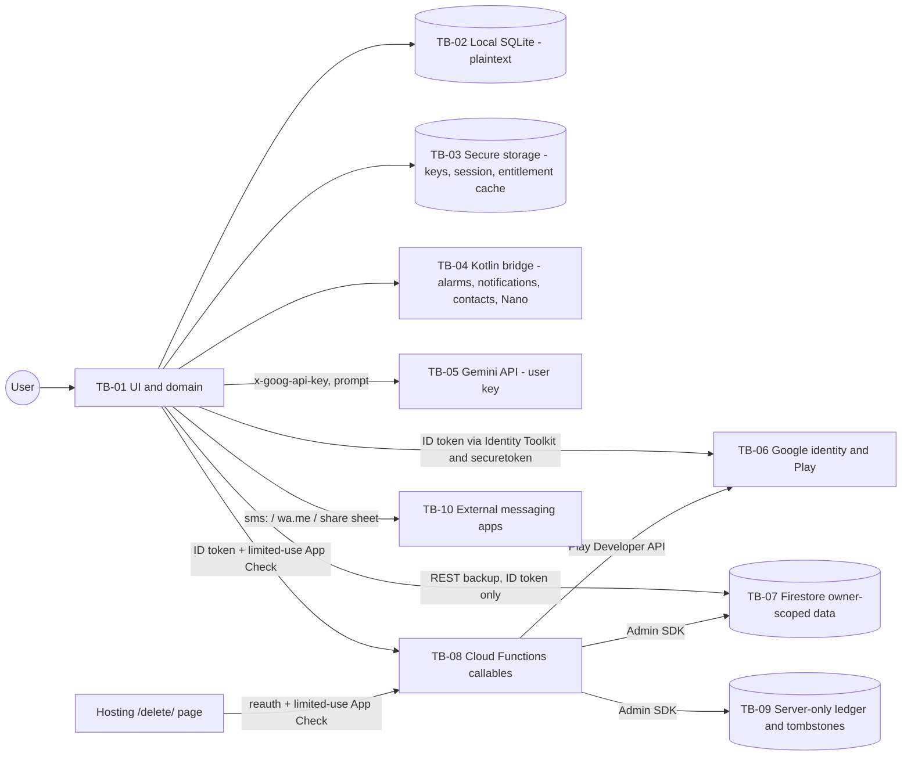

# AI-Birthday — Security, privacy and data protection

**Purpose.** Single authoritative reference for how AI-Birthday protects personal data, credentials, entitlement and message delivery: trust boundaries, data inventory, authentication, authorization (Firestore rules, callables, App Check), secrets, privacy and deletion, messaging safety, payment security, web/Android hardening, the threat model, verification status and the known-gap register.

**Scope.** Flutter/Android app (`lib/`, `android/`), Firebase backend (`backend/firestore.rules`, `backend/functions`), public Hosting site (`backend/hosting`, `backend/firebase.json`), CI (`.github/workflows/ci.yml`). Product behaviour, the general issue register, deployment and runbooks live elsewhere: see PRODUCT.md (business rules BR-*), ARCHITECTURE.md (deletion saga, backup design, control plane), IMPLEMENTATION.md (general gap/issue register — not duplicated here), OPERATIONS.md (deployment, release evidence, runbooks). Justification for a separate document: 93 security/privacy/threat/risk items from the legacy blueprint plus the A3/A4 audit findings needed one place with verified status.

**Status & evidence.** Snapshot: git HEAD `c4aace16` plus uncommitted fixes in the working tree (the working tree is the authority for every statement below). Tests at this snapshot: Flutter 653 passed / 0 failed (`flutter analyze` clean), backend/functions 91 unit tests + 22 emulator tests passed (emulator suites: Firestore rules 6 + control plane 16), backend/hosting 12 tests passed. **Not run:** device/emulator UI journeys, `npm audit`, AAB build, release APK build, browser test of the CSP, any live Firebase project check. The backend and Hosting are **not deployed**; nothing here proves live App Check enforcement, IAM, Secret Manager or TTL state.

Classification tags: `[IMPLEMENTED]` `[PARTIAL]` `[NOT IMPLEMENTED]` `[APPROVED]` `[PROPOSED]` `[OPEN]` `[DEPRECATED]`. `UNVERIFIED` = no code/runtime evidence available at this snapshot.

## Table of contents

1. [Security principles and trust boundaries](#1-security-principles-and-trust-boundaries)
2. [Data classification and inventory](#2-data-classification-and-inventory)
3. [Authentication and session handling](#3-authentication-and-session-handling)
4. [Authorization and access control](#4-authorization-and-access-control)
5. [Secrets, credentials and logging](#5-secrets-credentials-and-logging)
6. [Privacy: consent, minimisation, deletion and retention](#6-privacy-consent-minimisation-deletion-and-retention)
7. [Messaging safety](#7-messaging-safety)
8. [Payment and entitlement security](#8-payment-and-entitlement-security)
9. [Application and web security](#9-application-and-web-security)
10. [Threat model](#10-threat-model)
11. [Security controls verification status](#11-security-controls-verification-status)
12. [Known security gaps and open decisions](#12-known-security-gaps-and-open-decisions)
13. [Incident and vulnerability handling](#13-incident-and-vulnerability-handling)

---

## 1. Security principles and trust boundaries

### 1.1 Objectives and principles

Objective (`[APPROVED]`, legacy SSOT §20): protect birthday, contact, relationship and message data; prevent unauthorized cloud access, entitlement fraud, credential leakage and unintended message delivery; keep backup/deletion/retention claims accurate; minimise collection. Requirement forms: NFR-005 (secrets in platform secure storage; authorization enforced server-side for cloud resources) and F-094/F-093 (see §6).

| ID | Principle | Status | Evidence |
|---|---|---|---|
| SP-01 | Local-first: core workflows (people, birthdays, reminders, manual drafts) need no sign-in, cloud or AI. Cloud, AI, billing and backup fail closed when unavailable. | `[IMPLEMENTED]` | [main.dart](lib/main.dart) `bootstrapFirebase` (init/App Check failure logged, startup continues); [auth_controller.dart](lib/features/auth/application/auth_controller.dart) |
| SP-02 | Never trust client-supplied identity or entitlement: the server derives the owner UID from the verified token; Pro is granted only by server-side Play verification. | `[IMPLEMENTED]` for backend writes; `[PARTIAL]` for AI use — AI calls (Gemini key / Nano) run on the device, so the gate is a client check of a server-verified record (§8) | [index.ts](backend/functions/src/functions/index.ts) `requireAuthenticated`; [subscriptionVerification.ts](backend/functions/src/services/subscriptionVerification.ts); [entitlement.dart](lib/features/subscription/domain/entitlement.dart) |
| SP-03 | Secrets live only in OS secure storage (client) or managed secret stores (server); never in SQLite, SharedPreferences, Firestore, jobs, backups, logs or source control. | `[IMPLEMENTED]` (committed-secret scan: §5.3) | [credential_storage.dart](lib/core/security/credential_storage.dart); [flutter_secure_storage_driver.dart](lib/core/security/flutter_secure_storage_driver.dart) |
| SP-04 | No names, birthdays, phones, notes, facts, message bodies, prompts, tokens or keys in logs/analytics. | `[PARTIAL]` — param keys are redacted, message strings are not (§5.5) | [app_logger.dart](lib/core/logging/app_logger.dart) |
| SP-05 | Truthful claims: backup is not end-to-end encrypted; a launched external app is not a "sent" message; no pen-test/deployment/App Check-enforcement claim without evidence. | `[IMPLEMENTED]` in app copy; `[OPEN]` for public Hosting copy (A4-007, §6.7) | [cloud_backup_card.dart](lib/features/settings/presentation/widgets/cloud_backup_card.dart); [delivery_handoff.dart](lib/features/delivery/domain/models/delivery_handoff.dart) |
| SP-06 | External messaging is user-initiated handoff only; no autonomous personal-channel sending (§7). | `[IMPLEMENTED]` | [product_capabilities.dart](lib/core/config/product_capabilities.dart); [MainActivity.kt](android/app/src/main/kotlin/com/yashsomani/ai_birthday/MainActivity.kt) |
| SP-07 | Fail closed and least privilege: default-deny Firestore rules, server-only collections, strict Zod schemas, per-flavor permissions. | `[IMPLEMENTED]` (deployment of rules/IAM unverified) | [firestore.rules](backend/firestore.rules); [schemas.ts](backend/functions/src/transport/schemas.ts) |
| SP-08 | Validate every boundary crossing. | `[PARTIAL]` — callables strict; client-written backup and restore validation weak (§4.6, A3-017) | §4.6 |

### 1.2 Protected assets and threat classes

Assets (legacy SSOT §20, definitive/05): authentication identity and session, Gemini credential, contact/birthday facts, notes, message drafts, subscription/entitlement state and purchase-token evidence, permissions, cloud backup, deletion receipts and fence state, signing keys/server secrets. Threat classes: credential theft, authorization bypass, data leakage, prompt injection, forged subscription events, duplicate sends, malicious input, notification abuse (detail in §10).

### 1.3 Trust boundaries

| ID | Boundary | Rule at the boundary | Status |
|---|---|---|---|
| TB-01 | UI ↔ domain/use cases | Validate inputs (names ≤120 chars, phone digit rules); typed failures; no raw exception text to UI | `[IMPLEMENTED]` |
| TB-02 | Domain ↔ SQLite (Drift) | Plaintext SQLite; OS sandbox + `allowBackup=false` are the only at-rest protections (§2.4) | `[IMPLEMENTED]`, encryption `[OPEN]` DEC-046 |
| TB-03 | App ↔ OS secure storage | Gemini key, auth session, entitlement cache, bindings, owner/sync markers; read error ≠ missing | `[IMPLEMENTED]` |
| TB-04 | Dart ↔ Kotlin bridge | Automatic SMS disabled by compile-time constants on both sides; manual composer handoff only | `[IMPLEMENTED]` |
| TB-05 | App ↔ Gemini API | User's own key in header; entitlement checked first; only prompt content leaves (§6.2) | `[IMPLEMENTED]` |
| TB-06 | App ↔ Google identity / Play | Real Google Sign-In → Firebase IdP exchange; Play Billing; server verifies purchase | `[IMPLEMENTED]` |
| TB-07 | App ↔ Firestore backup | Owner-scoped rules; REST with ID token; no App Check on this path (§4.5) | `[IMPLEMENTED]` with `[OPEN]` hardening |
| TB-08 | Clients ↔ Functions / Hosting / App Check | Auth + enforced and consumed App Check on every callable; recent Google auth on sensitive ones | `[IMPLEMENTED]` in code, `[NOT DEPLOYED]` |
| TB-09 | Functions ↔ Firestore Admin SDK | Server-only collections bypass rules; every state change in a transaction; fences | `[IMPLEMENTED]` (emulator-tested) |
| TB-10 | App ↔ external messaging apps | Intent/URL launch only; delivery truth requires explicit user confirmation | `[IMPLEMENTED]` |
| TB-11 | Operator ↔ tooling | RBAC/MFA/audit for operator and support access | `[NOT IMPLEMENTED]` in repo (external gate, §3.5) |

The legacy blueprint names ten boundaries; definitive/05 adds operator↔tooling as the eleventh pair (TB-11).

### 1.4 Required control set (legacy security-architecture, ten controls)

| # | Control | Status at snapshot |
|---|---|---|
| 1 | Identity and recent re-authentication | `[PARTIAL]` — server-side recent Google auth on five callables and the Hosting delete page; no in-app re-auth gate for backup enable/switch (§3.3) |
| 2 | UID-ownership authorization | `[IMPLEMENTED]` rules + callables |
| 3 | Secrets in secure storage only | `[IMPLEMENTED]` |
| 4 | Data classification and encryption decision | `[PARTIAL]` — classification defined (§2.1); local/cloud encryption decision `[OPEN]` DEC-046 |
| 5 | Prompt instruction/data separation | `[PARTIAL]` — delimiters exist but are not escaped (RSK-007, §12) |
| 6 | Backup controls | `[PARTIAL]` — owner-scoped, atomic generations, pruning added; no rules-level validation (RSK-009) |
| 7 | Auditing without PII | `[PARTIAL]` — only two aggregate server log events; no audit log service |
| 8 | Abuse cases | `[PARTIAL]` — §10 |
| 9 | Supply chain | `[PARTIAL]` — `npm audit --omit=dev` for functions only; no secret scan/Dependabot (§11) |
| 10 | Privacy lifecycle / DSAR | `[PARTIAL]` — backend deletion saga exists; no in-app deletion/export-all (§6.3) |

Legacy statement: RSK-001/002/007/009 are release blockers for the affected scope. RSK-002 (local deletion leaves drafts, delivery events, PII and jobs; no whole-device purge — partially mitigated: `softDeleteAggregate` removes birthdays and jobs, not the person row, drafts or delivery events), RSK-007 (prompt delimiters) and RSK-009 (owner-write controls) remain open (§12).

### 1.5 Core invariants

| ID | Invariant | Status | Evidence |
|---|---|---|---|
| INV-01 | Secrets stay in secure storage; logs redact credential/PII keys | `[IMPLEMENTED]` (param keys only) | [app_logger.dart](lib/core/logging/app_logger.dart) |
| INV-02 | Backup is scoped by UID | `[IMPLEMENTED]` | [firestore.rules](backend/firestore.rules) |
| INV-03 | Entitlement is owner-read / server-write | `[IMPLEMENTED]` | rules `users/{uid}/entitlement` write false |
| INV-04 | AI entitlement is denied until a Play purchase token is server-verified | `[IMPLEMENTED]` | [subscriptionVerification.ts](backend/functions/src/services/subscriptionVerification.ts) |
| INV-05 | WhatsApp/SMS delivery is never reported without explicit user confirmation | `[IMPLEMENTED]` | [delivery_handoff.dart](lib/features/delivery/domain/models/delivery_handoff.dart) `DeliveryOutcome.confirmed` |
| INV-06 | Release builds never use the debug signing key | `[IMPLEMENTED]` | [build.gradle.kts](android/app/build.gradle.kts) |
| INV-07 | Callable requests never carry raw name, People ID, birthday, phone, message, prompt or approval hash | `[IMPLEMENTED]` | [schemas.ts](backend/functions/src/transport/schemas.ts) (strict); [privacy-architecture.test.ts](backend/functions/test/privacy-architecture.test.ts) |

Control inventory in one line (legacy security-control-evidence): Firebase Auth; App Check on all callables; owner-scoped Firestore rules with deletion fence; secrets in Secret Manager (server) / secure storage (client); deletion drains. Present in code; not verified live.

---

## 2. Data classification and inventory

### 2.1 Data classes and handling rules (`[PROPOSED]` legacy classes, applied here)

| Class | Examples | Handling rule |
|---|---|---|
| Public | Hosting pages, public Firebase web config (web API key, OAuth client id) | May be committed; still needs key restrictions (§5.3) |
| Internal operational | Job ids/states, aggregate logs, TTL policy, release config | No personal content |
| Personal | Recipient names, birthdays, phone numbers, email, relationship | Local by default; cloud only through opt-in backup; never logged |
| Sensitive content | Message drafts/bodies, private notes, "important facts", custom AI instructions | Never logged; transmitted only on a user-initiated feature with disclosure (backup, AI) |
| Secret / auth material | Gemini API key, Firebase ID/refresh tokens, Play purchase token, signing keys, HMAC keyring (server) | Secure storage / Secret Manager only; never synced, logged or exported |
| Security / audit evidence | Deletion receipts, tombstones, purchase-ownership hash ledger | Server-only; content-free; retention in §6.3 |

### 2.2 Inventory — what is stored where

Personal data of third parties (the user's contacts) is the dominant risk: names, birthdays (month/day/optional year), phone numbers, email, relationship, notes and "important facts".

| Data | Where | Class | Leaves the device? |
|---|---|---|---|
| People (name, birthday month/day/year, leap-day rule, phone, email, relationship, closeness, language, tone, important facts, notes, delivery channel, timezone, autoPrepare/autoSendPolicy, version, deletedAt) | Local SQLite `persons` ([app_database.dart](lib/core/database/app_database.dart)) | Personal + Sensitive | Yes, only via opt-in cloud backup (§2.3), CSV export through the share sheet, or per-use handoff/AI (§6.2) |
| Birthdays (calendar date text, cycle, status, draft link) | SQLite `birthdays` | Personal | Backup |
| Message drafts (body, tone, length, status, revision) | SQLite `message_drafts` | Sensitive | Backup; handoff text; AI request when rewriting |
| Delivery events (channel, outcome, timestamp — no body) | SQLite `delivery_events` | Personal | **Not** in backup |
| Durable jobs (AI payload incl. `existingMessage`, `customInstruction`; cloud-job payload) | SQLite `jobs` | Sensitive; no secrets | No (A2-022: payload outlives the draft, §12) |
| Reminder settings | SQLite `reminder_settings_entries` | Internal | Backup |
| Scheduled reminder JSON (person name in title unless "hide names" is on; default off) | Android SharedPreferences via native scheduler | Personal | No (A1-021, §12) |
| Gemini API key + "verified at" timestamp | Secure storage | Secret | Only to `generativelanguage.googleapis.com` as `x-goog-api-key` header |
| Auth session: Google subject, email, display name, photo URL, Firebase uid, ID token, refresh token | Secure storage (7 keys) | Secret + Personal | To Google/Firebase only |
| Entitlement cache `verified_entitlement_v1`, purchase binding, `cloud_last_sync_timestamp_<uid>`, `cloud_local_data_owner_v1`, onboarding flag | Secure storage | Internal/Personal | No |
| Cloud backup generations | Firestore `users/{uid}/…` | Personal + Sensitive | Yes (§2.3) |
| Entitlement record | Firestore `users/{uid}/entitlement/status` (server-written) | Internal | Owner-read |
| Purchase ownership ledger | Firestore `subscriptionPurchaseOwnership/{sha256(token)}` = `{uid, createdAt}` | Security evidence | Server-only |
| Coordination ledger (accounts, installations, aliases, claims, fences, receipts) | Firestore server-only collections | Security evidence, content-free | Server-only; not integrated with the app (no caller) |
| Native SMS job queue (phone number + message) | Android SharedPreferences `scheduled_sms_prefs` | Sensitive | Only if automatic SMS were enabled (disabled; §7) |
| Deletion-page pending receipt UUID | Browser `sessionStorage` (tab scope) | Security evidence | No (§9.4) |

### 2.3 Cloud backup — exact statement `[IMPLEMENTED]`

- Backup is **opt-in and user-initiated** ("Back Up Now" enqueues a durable `cloud_sync` job; restore is a separate action).
- Uploaded categories (see `_personFields`, `_birthdayFields`, `_draftFields`, `_reminderFields` in [cloud_sync_service.dart](lib/features/sync/data/cloud_sync_service.dart)): **people** (every person row **including soft-deleted/tombstoned rows with all their PII**), **birthdays** (with the person's name), **drafts** (full message body), **reminder settings**. Not included: Gemini key, auth tokens, delivery events, jobs, entitlement cache.
- **Storage is plaintext Firestore fields, scoped to the signed-in user's UID by security rules. It is NOT end-to-end encrypted, NOT zero-knowledge and NOT an encrypted envelope.** Confidentiality relies on Google/Firebase service controls and the owner-scoped rules only. Anyone with the Firebase project's admin access can read it.
- The app discloses this in the Settings card ("It is not end-to-end encrypted … Gemini keys and auth tokens are never included") — an 11 sp italic note; there is no consent dialog before the first upload, only the ownership confirmation when the local data owner changes (A3-018 `[OPEN]`).
- Retention: current + previous published generation are kept, older and orphaned generations are pruned best-effort (§6.5).
- Rules: BR-025 (legacy blueprint numbering; not the product BR-025) — backup records are owner-scoped and never include API credentials or auth secrets `[IMPLEMENTED]`; BR-026 `[APPROVED]` — backup must not be described as end-to-end encrypted unless encryption is implemented and independently verified. This also governs README/UI/Hosting copy and the prohibited-claims list in §11.4.

### 2.4 Local data at rest `[OPEN]` DEC-046

- The local database is plain SQLite with no encryption (A3-037); no foreign keys. Confidentiality relies on the Android app sandbox. Settings copy and docs must not claim encryption at rest, "permanent deletion" or E.164 normalisation.
- `android:allowBackup="false"` ([AndroidManifest.xml](android/app/src/main/AndroidManifest.xml)) so neither SQLite nor the secure-storage blobs enter Google auto-backup (legacy audit 02 C3 closed). Consequence: reinstall/new phone loses local data unless cloud backup was used (and motivated the deterministic purchase binding, §8).
- DEC-046 (Open; owner Security/Product): adopt local DB encryption or Android backup only after a measured threat/trade-off and a key-recovery design; until then no encryption claim. DEC-051 (Open; Privacy/Product, parent DEC-013): telemetry/analytics — default no private-content telemetry; approve event/consent/retention plan before any telemetry (§5.5). Neither has an approved resolution in the repo.

### 2.5 Server-side data minimisation `[IMPLEMENTED]`

Control-plane/coordination records must not contain raw recipient identity, birthday, phone, prompt or message content: recipient and destination values are fixed-length prehashes transformed into UID-, purpose-, version- and pepper-separated HMAC aliases; callable schemas are strict and reject raw content; a static test scans `domain/model.ts` for forbidden persisted fields, for embedded key material, and enforces exactly two approved aggregate log events (`deletion_sweep_completed`, `coordination_operation_sweep_completed`) ([privacy-architecture.test.ts](backend/functions/test/privacy-architecture.test.ts)). The control plane is dormant: no Flutter/Kotlin caller exists for API-001..011 and 014..017.

### 2.6 Safety rules for inventories, migrations and reports `[APPROVED]`

Applies to any data inventory, migration rehearsal or audit evidence: never upload raw personal databases, contact data, message bodies, credentials or tokens to GitHub, chat or reports; inventories are aggregate counts/rates only, run read-only on an authorised, restorable **copy**; never select IDs, names, birthdays, phone/email, notes, facts or draft bodies; report unknown conditions as unknown. Diagnostics follow the same rule (no names, birthdays, phone/email, notes, facts, CSV or draft contents). Device Contacts permission permits only user-initiated local import (§6.1).

### 2.7 History / rationale

- An AES-256-GCM hardware-derived crypto envelope for backup was specified (legacy PROJECT.md F8/F10) and **deferred**; shipped backup is owner-scoped plaintext opt-in with truthful disclosure and log redaction `[DEPRECATED]` as a design, kept as an explicit rejected/deferred decision. The envelope interface contract is not part of the product.
- "Zero-PII / encrypted" backup claims in older documents are wrong and must not be repeated (legacy definitive/11 "unresolved 3": plaintext owner-scoped backup is authoritative evidence).
- Legacy source: docs/product-blueprint/05-business-rules.md, 07-security-and-privacy.md, definitive/03, definitive/11, PROJECT.md (removed; recoverable from Git commit c4aace16).

---

## 3. Authentication and session handling

### 3.1 Sign-in flow `[IMPLEMENTED]`

Google Sign-In 7 (with the server client id) yields a Google credential that is exchanged through the Identity Toolkit REST endpoint `signInWithIdp` for a Firebase session ([live_google_auth_gateway.dart](lib/features/auth/data/live_google_auth_gateway.dart)). There is no demo/synthetic/fake auth path in production code; the "unavailable" gateway exists for tests only. Failures surface fixed sanitised messages. Sign-in is optional: the app is fully usable offline without an account; it is required for Pro purchase verification and for backup.

### 3.2 Token lifecycle

| Aspect | Behaviour | Status |
|---|---|---|
| Storage | Subject, email, name, photo, uid, ID token, refresh token in secure storage (7 keys) | `[IMPLEMENTED]` |
| Refresh | `getValidIdToken` calls securetoken `refresh` on every use (no local expiry check — extra requests but never stale) | `[IMPLEMENTED]` |
| Network timeouts | 30 s on every auth HTTP call (A3-008 fixed) | `[IMPLEMENTED]` |
| Revoked/invalid refresh | HTTP 400/401 clears all session keys and returns to signed-out; other errors keep the session (AUD-008) | `[IMPLEMENTED]` |
| Sign-out | Clears the 7 session keys; does **not** delete cloud backup or local data | `[IMPLEMENTED]` |
| Idle timeout / app lock | None; session persists until sign-out or revocation | `[NOT IMPLEMENTED]` — not a legacy requirement |
| Read failure | `readOrThrow` separates secure-storage failure from "not present"; key names (which embed subject/uid) are never logged | `[IMPLEMENTED]` (A3-010, A3-020) |

Secure-storage session state is wiped when Android uninstalls the app; `allowBackup=false` prevents a restore from stale auth on a new device.

### 3.3 Recent-authentication gates

- **Server-enforced** (`requireRecentGoogleAuth`, [index.ts](backend/functions/src/functions/index.ts)): `auth_time` within 5 minutes (≤60 s future skew), `firebase.sign_in_provider == google.com`, exactly one Google identity. Applied to `beginSenderTransfer`, `completeSenderTransfer`, `requestAccountDeletion`, `resetContactDerivedState`, `releaseAndroidSender`. `[IMPLEMENTED]`, not deployed.
- **Hosting delete page** forces a fresh popup reauthentication (`reauthenticateWithPopup`) before the delete callable; the Firebase Auth session is in-memory only.
- **Not recent-auth gated:** `verifyPurchase` (Google-account binding instead, §8); in-app cloud backup enable/disable and account switch. Legacy D2-006-02 requires recent-auth for sensitive actions "including enabling backup and switching accounts" — the in-app backup path has no such gate; account switch is protected only by the local-data-owner binding and a confirmation dialog (`cloud_local_data_owner_v1`). `[PARTIAL]` / `[OPEN]`.
- Operator/support access requires RBAC, MFA and audit logs per the legacy plan; **no operator tooling or RBAC exists in the repo** (`[NOT IMPLEMENTED]`, external release gate; owner OPEN).

### 3.4 Session after deletion

Once the deletion saga reaches `AUTH_DELETION_PENDING` the Auth user is deleted by the server; a tombstone then retains the Firestore fence for ≥24 h so any ID token still within its platform lifetime (≤1 h) cannot recreate data (§4.3). The platform token lifetime is a Firebase property not verifiable from the repository.

---

## 4. Authorization and access control

### 4.1 Firestore rules `[IMPLEMENTED]` (not deployed; emulator-tested)

[firestore.rules](backend/firestore.rules) (rules_version 2) — default deny with narrow owner exceptions:

| Path | Owner read | Owner write | Notes |
|---|---|---|---|
| `users/{uid}/entitlement/**` | yes | **never** | Server-written (INV-03) |
| `users/{uid}/backup/**` | yes | create/update/delete **if no deletion fence** | `backup/current` pointer + manifest |
| `users/{uid}/generations/{id}` | yes | create/delete fenced; **update denied** (immutable generation) | Sub-collections `people`, `birthdays`, `drafts`, `reminderSettings`: read yes, create/delete fenced, no update |
| Legacy flat `users/{uid}/{people,birthdays,drafts,reminderSettings}/**` | yes | fenced | Pre-generation layout, kept for restore compatibility |
| Everything else (`accounts/**`, coordination*, deletion*, `globalControl`, `subscriptionPurchaseOwnership`, …) | no | no | `read, write: false` — server only (Admin SDK bypasses rules) |

Reads are **not** fenced by the deletion fence (a signed-in owner can read until purge). Rules do **no** schema, size or field validation (RSK-009 / A4-019 / A3-017 `[OPEN]`): an authenticated owner can write arbitrary content, oversized documents or malformed backups under their own UID and restore validates defensively on the way back in.

### 4.2 Server-only collections `[IMPLEMENTED]`

Account lifecycle (`accounts/**`), installations, aliases, claims, attempts, sender fences/leases, global control, deletion drains/receipts/tombstones, coordination presence and the purchase-ownership ledger are written only by Cloud Functions using the Admin SDK; the rules deny every client read/write. The backend README's statement that "rules deny every direct client read/write" is stale (the owner paths above exist; A4-010 `[OPEN]` doc correction).

### 4.3 Deletion fence and tombstone `[IMPLEMENTED]`

`deletionInProgress(uid)` is true when **either** `deletionTombstones/{uid}` exists **or** `coordinationPresence/{uid}.state == "DELETING"`. All client writes (create/update/delete) to backup paths require it to be false. History: previously only the presence document was checked; markAuthDeleted removes presence but the tombstone is kept for 24 h (`VERIFYING`, `cleanupAtMs` = +24 h), leaving a window in which a still-valid ID token could recreate user data. A4-005 closed this; the emulator test "keeps the deletion fence while only the tombstone remains" covers it. The function-side `assertAccountNotDeleting` (tombstone or presence) gates `verifyPurchase` before and inside its transaction (A4-004).

### 4.4 Callable authorization matrix `[IMPLEMENTED]`

All 18 callables ([index.ts](backend/functions/src/functions/index.ts), region `asia-south1`) share options `enforceAppCheck: true, consumeAppCheckToken: true`; `requireAuthenticated` demands both `request.auth` and `request.app`; inputs are strict Zod schemas with a fixed `INVALID_REQUEST` error; non-`HttpsError` failures map to `unavailable COORDINATION_UNAVAILABLE` (unlogged, A4-014 `[OPEN]`).

| Callable | Auth | Extra gate |
|---|---|---|
| `verifyPurchase` | auth + App Check | none (no recent-auth); purchase-ownership + package/product checks |
| `requestAccountDeletion` | auth + App Check | **recent Google auth** |
| `accountDeletionReceipt` | App Check | caller must be **signed out** (`SIGNED_OUT_REQUIRED`) |
| `beginSenderTransfer`, `completeSenderTransfer`, `resetContactDerivedState`, `releaseAndroidSender` | auth + App Check | **recent Google auth** |
| `registerAndroidInstallation`, `renewSenderLease`, `changeAccountMode`, `claimOccurrence`, `claimTest`, `armAttempt`, `getArmStatus`, `reportTestOutcome`, `authorizeSafeRetry`, `coordinationLifecycleStatus`, `companionStatus` | auth + App Check | account/installation/lease state checks; HMAC keyring (Secret Manager) for claims |
| `sweepDeletionDrains`, `sweepCoordinationOperations` | scheduler (every minute, UTC) | service-account invoked |

Service identity: `CONTROL_PLANE_SERVICE_ACCOUNT` param; 30 s timeout, 256 MiB, max 20 instances. Of the 18 callables, only `verifyPurchase` (Flutter) and the two deletion callables (Hosting) have callers; the sender/coordination callables are dormant (automatic SMS disabled, §7). Latent bug A4-003: `releaseAndroidSender` reuses `purgeAccountTrees` and would wipe `users/{uid}` — unreachable today, `[OPEN]`.

### 4.4a Coordination abuse and timing limits `[IMPLEMENTED]` (not deployed)

Constants in [model.ts](backend/functions/src/domain/model.ts) and the policy functions bound the dormant sender-coordination control plane: claim authorization 10 minutes, sender lease at most 10 minutes, submit deadline 1 minute after Arm, 5-minute spacing between Arm attempts, rolling 24-hour caps of 20 Birthday and 3 TEST Arm events per UID, and one safe retry only (a third attempt is impossible). Retention windows are in [backend/README.md](backend/README.md#retention-model) and OPERATIONS.md §10.5. These limits are enforced by server policy functions and covered by `backend/functions/test/policies.test.ts`; they have no mobile caller today (A4 audit; ARCHITECTURE.md §8).

### 4.5 App Check coverage matrix (A3-004) `[PARTIAL]`

| Surface | App Check attached by client | Enforced server-side today |
|---|---|---|
| Cloud Functions callables (all 18) | Flutter: `verifyPurchase` (+ reachability probe) only; Hosting delete page: the two deletion callables | Yes **in code** (`enforceAppCheck`/`consumeAppCheckToken`); deployed state unverified |
| Firestore REST backup (Flutter) | **No** — `Authorization: Bearer <ID token>` and `?key=<web API key>` only | **No** — rules do not require App Check; console enforcement unknown |
| Identity Toolkit (`signInWithIdp`), securetoken | No | No (Google-managed) |
| Gemini API | No | Not applicable (user key; Google controls) |

Client App Check provider: `AndroidPlayIntegrityProvider` in release and `AndroidDebugProvider` in debug ([main.dart](lib/main.dart)); init failure is logged, not swallowed (A3-009). A sideloaded `personal` release cannot obtain Play Integrity tokens, so it cannot use purchase verification (A4-026). **Decision required** (owner: Security/Backend; `[OPEN]` A3-004/A4-012): either enforce App Check for Firestore in the console and attach tokens in the REST client, or accept and document the gap; state any "App Check enforced" claim only after a deployed-project check. Without it the only defences for backup are Google ID-token validity and owner-scoped rules, so a stolen/leaked token or scripted client could write garbage (RSK-009) or read the owner's backup.

### 4.6 Actor permission summary

| Actor | Can |
|---|---|
| Anonymous | Open the app offline; Hosting static pages; nothing against Firestore |
| Signed-in owner | Read/write own backup (unless fenced), read own entitlement, call callables with App Check |
| Cloud Function (service account) | Read/write all server-only collections and entitlement |
| Operator | No in-repo tooling; production console access is governed outside the repo (OPEN) |

---

## 5. Secrets, credentials and logging

### 5.1 Secret inventory `[IMPLEMENTED]` unless noted

| Secret | Location | Never in |
|---|---|---|
| User Gemini API key | Secure storage (`ai_birthday_user_gemini_api_key`) | SQLite, jobs, backup, logs, CSV, SharedPreferences |
| Auth session tokens | Secure storage | same |
| Entitlement cache | Secure storage (24 h max age) | same |
| Play purchase token | Memory → `verifyPurchase` only; server stores sha256 | client persistence, logs |
| Coordination HMAC keyring | Secret Manager (`COORDINATION_HMAC_KEYRING`) | repo/test fixtures (static test scans `src`) |
| Play Developer API credential | Cloud Functions runtime service identity (metadata token) | repo |
| Android release signing | Untracked `key.properties` + keystore | repo (git-ignored; `key.properties.example` only) |

The Gemini key is stored through `FlutterSecureStorageDriver` over `const FlutterSecureStorage()` (default Android options: Keystore-wrapped AES in app-private storage). It is **not** verified to be hardware-backed. Correction: the earlier statement that Gemini storage uses `encryptedSharedPreferences` is true only of the unused `SecureStorageSecretStore` class (dead code, A3-029). Settings copy says "hardware-backed encrypted storage" ([settings_screen.dart](lib/features/settings/presentation/settings_screen.dart)); that overclaims relative to default options and should be reworded (`[OPEN]`, copy decision). The key text field does not disable IME suggestions/autocorrect/learning (A3-021 `[OPEN]`). Entering a key is an explicit user action, key validation is a single header-authenticated request, and the key is removed by "remove key" and by app uninstall.

### 5.2 Never in jobs, backups, logs

`CloudJobPayload` carries no secrets; backup field lists exclude key/tokens/entitlement; the AI job stores prompt-input content but never the key (credential is read at execution time after the entitlement gate). `AiRouter` checks `entitlement.canUseAi` before touching credentials or selecting a provider, so Bring-your-own-key does not bypass Pro (BR-013).

### 5.3 Committed-secret findings (by location only; values deliberately not reproduced)

| Location | Finding | Assessment |
|---|---|---|
| `google-services.json`, `android/app/google-services.json` | Firebase client config incl. an API key | Public-by-design Firebase client identifiers; key restrictions unverifiable from the repo `[OPEN]` |
| `firebase/google-services.json`, `firebase/google-services-debug.json` | Different project and an extra package id; not consumed by Gradle | Confusing duplicates (A4-017 `[OPEN]`) |
| `lib/core/config/firebase_config.dart` | Web API key `defaultValue` and OAuth client id | Public identifiers; CI also supplies `FIREBASE_WEB_API_KEY` via dart-define |
| Git history only (commits `b3ea312e`, `e7505533`) | `android/app/debug.keystore` (public debug key) | Not at HEAD; no private release key tracked |
| Not found | Private keys, service-account JSON, release keystore, HMAC keyring, Stripe/Play secrets | `STRIPE_SECRET_KEY` and `stripeGatewayServiceProvider` are blocked in `lib/` by a CI guard |

Action: restrict the web API key (Android package + SHA-1, API allow-list) in the Google Cloud console — outside the repo, UNVERIFIED. No secret scanning, push protection, Dependabot or CODEOWNERS is configured in the repository (A4-016 `[OPEN]`).

### 5.4 Signing

`release` uses a signing config only when `key.properties` is complete; otherwise it is left unsigned and **never** falls back to the debug key (INV-06). `key.properties`, `*.jks`, `*.keystore`, `.env*` are git-ignored. No minification/obfuscation (A4-018 `[OPEN]`). Hosting `runtime-config.json` is **not** git-ignored despite the README (A4-011 `[OPEN]`; the file holds public config only, but release-gate evidence should not be committed).

### 5.5 Logging, redaction, telemetry

- [app_logger.dart](lib/core/logging/app_logger.dart): redaction applies to **parameter keys** matching `sub|subject|uid|user-id|credential|secret|token|api-key|password|key|phone|address|email|note|message|content|body|text|fact|quote`; free-text **message strings are not redacted** (A3-020 partially `[OPEN]`; legacy audit P2-17). Errors log only `runtimeType` plus the first stack frame. Release level is warning, output via `print` (visible in logcat on a debuggable device). Global handlers do not interpolate error messages. A code search found no `$e`/`$error` interpolation into logger calls (heuristic evidence only, D4-012-03 `[PARTIAL]`).
- Tests: [app_logger_test.dart](test/core/logging/app_logger_test.dart), `test/security/credential_storage_test.dart`, `test/features/auth/adversarial_auth_security_test.dart` (PII-logging audit group).
- Server: exactly two aggregate-count log events; error-handling logs nothing (observability gap A4-014).
- **Telemetry/analytics: none in the repo; DEC-051 `[OPEN]`.** Required before any telemetry: approved event list, consent, retention (§2.4). Crash reporting is likewise absent.

### 5.6 Coding rules (sentinel conventions)

Secure-storage helpers expose a fail-closed "missing vs read error" distinction; never use try/catch that converts a read error to "missing"; residual known case: onboarding flag read error is treated as complete (A3-010 residual, low). Key-name strings containing subject/uid must never reach logs. Test pattern: assert logger output contains no secret fixtures.

---

## 6. Privacy: consent, minimisation, deletion and retention

### 6.1 Consent and permission matrix

| Capability | Trigger | Consent shown | Status |
|---|---|---|---|
| Device contacts import | User taps import | Android runtime READ_CONTACTS prompt; import-only | `[IMPLEMENTED]` |
| Notifications / exact alarms | Reminder setup | Android prompts; settings status | `[IMPLEMENTED]` |
| Cloud backup | User-initiated | 11 sp note under the card; no consent dialog or per-field disclosure | `[PARTIAL]` A3-018 |
| Gemini via user key | User adds key and taps generate | Settings copy: key stays on device/sent directly to Google; no enumeration of categories sent (§6.2) | `[PARTIAL]` D1-I-0192 |
| Google Sign-In / Pro purchase | User action | Google/Play dialogs | `[IMPLEMENTED]` |
| CSV export (People) | User action via share sheet | No sensitive-content warning found | `[PARTIAL]` |
| Automatic SMS / READ_SMS / call-log | — | Not offered; manifest guard blocks | `[IMPLEMENTED]` (disabled) |

### 6.2 Minimisation and third-party recipient data sent to Gemini

When AI generation is used with the user's key, [ai_prompt_builder.dart](lib/features/ai/domain/ai_prompt_builder.dart) sends to Google's Gemini API: **recipient name, relationship + closeness, age (derived from birth year), important facts, tone/length/language, the existing draft and the custom instruction.** It does **not** send phone, email or notes. Third-party recipients have not consented; the user is the data controller for their contacts, and Google Gemini API terms for the user's key apply. Facts are wrapped in `<UNTRUSTED_USER_FACTS>`, the draft in `<UNTRUSTED_CURRENT_DRAFT>` and the instruction in `<USER_STYLE_REQUEST>`; the generator caps output (`maxOutputTokens` 256) and uses the `x-goog-api-key` header with a 30 s timeout. **Gaps `[OPEN]`:** user-supplied text is interpolated raw, so a closing delimiter in facts/draft/instruction can break out of the untrusted section (RSK-007 / legacy BR-053, verified); the UI discloses key handling but does not enumerate the data categories (D1-I-0192); on-device Gemini Nano keeps text on the device. Output is not auto-sent (§7). Prompt injection impact is limited to bad draft text, never autonomous actions.

### 6.3 Deletion and retention matrix

| Data | Delete trigger | Retention today | Status |
|---|---|---|---|
| Local people/drafts (hard delete) | none in UI | — | no hard-delete |
| Local person (soft delete) | "Delete person" | Person row kept with name/phone/email/notes/facts **indefinitely**; birthdays and jobs removed; message drafts and delivery events **not** removed; no purge or "recently deleted" screen (RSK-002) | `[OPEN]` A1-011 (decision) |
| Whole-device wipe | none | — | `[NOT IMPLEMENTED]` |
| Cloud backup | none in-app | Current + previous generation; includes soft-deleted people | `[PARTIAL]` (§6.5) |
| Firebase account + all server data | Hosting `/delete/` or `requestAccountDeletion` | Saga below | `[IMPLEMENTED]` backend, not deployed; no in-app entry (A3-003 `[OPEN]`) |
| Sign-out | Settings | Clears 7 keys only | `[IMPLEMENTED]` |
| Gemini key | "Remove key" | Immediate | `[IMPLEMENTED]` |
| Coordination records | TTL | per `model.ts`: receipts 30 d, deletion receipts 365 d, birthday claims 400 d, test 30 d, standby 90 d, revoked 30 d, never-armed 1 d | `[IMPLEMENTED]` in code; TTL policy enabling is a manual gcloud step, not in `firebase.json`; `deletionReceipts` index missing from `firestore.indexes.json` (A4-015 `[OPEN]`) |

Local data stays on the device until uninstall; uninstall removes SQLite and secure storage (`allowBackup=false`).

### 6.4 Account deletion saga `[IMPLEMENTED]` (emulator-tested; undeployed)

`requestAccountDeletion` (recent Google auth) → `DRAINING` (stops new claims) → `PURGING` (`recursiveDelete` of `accounts/{uid}` and `users/{uid}`; purchase-ownership docs by `where uid == …`; `coordinationOperationReceipts` by account key; latest receipt removed; verify-absent or `LedgerCorruptError`) → `AUTH_DELETION_PENDING` (Firebase Auth user deleted) → `VERIFYING` (tombstone retained 24 h) → finalise (tombstone deleted, `COMPLETED` receipt kept 365 d). A minute-by-minute scheduler resumes stuck drains. "Accepted" ≠ "completed": the delete page reports completion only from a signed-out `accountDeletionReceipt` lookup. Detailed state machine: ARCHITECTURE.md.

### 6.5 Purchase-ownership purge and its trade-off

`subscriptionPurchaseOwnership/{sha256(token)}` documents are now deleted in the purge (A4-002 fixed) so deleted users leave no ledger row. Trade-off (`[OPEN]` D4-024-06; product/legal approval pending): after deletion the same Play purchase token can be claimed by a different UID. Public privacy copy does not yet mention this ledger (A4-007).

### 6.6 Backup retention and pruning `[IMPLEMENTED]` (A3-002 / A4-006)

Every backup is a new immutable generation (`g<micros>`) of all rows; after publishing the pointer, the client keeps the current + previous published generation, deletes older ones and unpublished orphans older than 1 h (≤5 generations per run, best-effort, failures logged). Still open: server-side orphan GC, deletion of soft-deleted PII inside kept generations, no user-facing backup delete, last-writer-wins `backup/current` across devices (A3-016), no tombstones for drafts/birthdays on restore (A3-015). This supersedes the legacy claim "no pruning" (SEC-014).

### 6.7 Privacy-page claims vs behaviour `[OPEN]` A4-007 / GAP-15/19

The Hosting site (`backend/hosting`) is undeployed. Its draft copy contradicts the shipped app: describes unattended Android SMS, an iOS Companion, WorkManager and React Native (none shipped — automatic SMS is disabled and there is no iOS client), says contact data is "not copied into contact cloud" while the app offers opt-in Firestore backup of people/drafts, and omits the purchase-ownership ledger. It correctly describes the coordination-record retention periods and the Gemini paragraph. **Decision awaiting approval (product/legal):** align copy with the shipped scope or ship the features; no publication before approval. In-app "Privacy and local data" and "Verified support" tiles have no destination (A3-003).

### 6.8 Export, DSAR and support

Export is a People CSV via the OS share sheet (plaintext, no warning); there is no whole-account export. Deletion/exports are supported through the Hosting page (undeployed) and not in-app; the legacy statement that "export/deletion paths exist" (D1-I-0195) is therefore partly wrong. The support workflow (identity verification, ticketing, SLAs) is `[OPEN]` — owner/contact undefined.

---

## 7. Messaging safety

### 7.1 Principle `[IMPLEMENTED]`

Personal-channel messages are **user-initiated handoffs**; nothing is sent autonomously. The app prepares text, opens WhatsApp/SMS/share, and records only that the handoff was launched. No scraping, accessibility automation or background send of WhatsApp.

### 7.2 Channels

| Channel | Mechanism | Validation |
|---|---|---|
| SMS composer | `sms:<number>?body=` | 3–15 digits after stripping non-digits (and a leading `00`, which becomes `+`); national-format numbers and short codes are accepted. The destination is the person's stored number, which the person form accepts with 6–20 characters. |
| WhatsApp | `https://wa.me/<digits>?text=` | 7–15 digits after stripping non-digits and `00`, no leading `0`. This is **digit-length validation, not E.164 normalisation** (corrects legacy SEC-006) |
| SMS | `sms:` composer URI (`SmsDeliveryService`); no SEND_SMS permission in the Play flavor | recipient digits as above |
| Share | OS share sheet | none |
| Automatic SMS | disabled (below) | — |

`_performHandoff` saves the draft **before** launching, then records evidence (`launched` / `launchFailed`) separately; `DeliveryOutcome` ∈ launched, copied, launchFailed, notSent, confirmed. `confirmed` exists only after an explicit user action — the app never asserts delivery.

### 7.3 SMS gate (compile-time + native) `[IMPLEMENTED]`

`ProductCapabilities.automaticSms` (compile-time `ENABLE_AUTOMATIC_SMS`, default false) and Kotlin `AUTOMATIC_SMS_ENABLED = false` in `MainActivity.kt` and `BirthdaySmsReceiver.kt`: scheduling and permission methods return false, `reschedulePersisted` clears queued SMS jobs, the receiver cancels jobs. Only the `personal` source set declares `SEND_SMS`; CI inspects the **built APK** manifest (aapt2) and fails on `SEND_SMS`, `READ_SMS`, `RECEIVE_SMS`, `RECEIVE_MMS`, `RECEIVE_WAP_PUSH` and call-log permissions (A4-008) — that guard has not run (no APK build at this snapshot). The Play flavor still ships the `BirthdaySmsReceiver` class (not exported). If automatic SMS were ever enabled, phone+message would sit in plaintext SharedPreferences `scheduled_sms_prefs`.

### 7.4 Truthfulness rules

UI/copy must say "opened"/"launched", not "sent", until the user confirms; claims of delivery, "delivered", "read" or unattended sending are prohibited; SMS delivery receipts are not read. Unreachable server-side sender code (`claimOccurrence`/`armAttempt`) is not product capability until a client exists.

### 7.5 Messaging abuse controls

Server: per-account caps of 20 BIRTHDAY / 3 TEST arms per 24 h, 10-minute sender leases, safe-retry authorization, global kill switch (`globalControl`). Client: no bulk/unprompted send; AI output goes to an editable draft. Because the coordination backend is dormant, these are `[IMPLEMENTED]` in code but unreachable in the product.

---

## 8. Payment and entitlement security

### 8.1 Purchase verification `[IMPLEMENTED]` (server not deployed)

1. The client acquires a limited-use App Check token, then opens the Play sheet (App Check is required first; a reachability probe `POST {data:{}}` consumes one token).
2. After purchase, the client calls `verifyPurchase` (15 s timeout) with product id, token and binding.
3. The function ([subscriptionVerification.ts](backend/functions/src/services/subscriptionVerification.ts)) requires package `com.yashsomani.ai_birthday` and product `ai_birthday_pro_monthly`, verifies via the Play Developer API, denies when the account is being deleted, and writes `users/{uid}/entitlement/status`.
4. Entitled states: `ACTIVE`, `IN_GRACE_PERIOD`, `CANCELED` with expiry in the future. Play 400/404/410 writes "none" without erasing another active entitlement.
5. The client acknowledges the purchase only **after** a verified success, takes the entitlement from the callable response (not from a Firestore stream — the legacy F6 claim is superseded) and caches it in secure storage for at most 24 h; a stale (≥24 h) or expired cache means `canUseAi == false`.

### 8.2 Account binding and ownership claims

The client binding is `SHA-256("ai-birthday-purchase-binding:v1:" + uid)` — a pseudonymous integrity check (not a secret), deterministic so reinstall/new-device restore works without stored state (A3-001; a legacy stored UUID is still preferred if present). Server ownership doc `subscriptionPurchaseOwnership/{sha256(token)}` = `{uid, createdAt}`. First claim with a binding mismatch → `PURCHASE_ACCOUNT_MISMATCH`; a mismatch is tolerated only if the same UID already owns the token; another UID owning it → denied. Purchases are not transferable between Google accounts by this path (support/recovery process `[OPEN]`).

### 8.3 Fence and deletion interplay

`assertAccountNotDeleting` before and inside the transaction (A4-004) prevents a purchase from re-creating entitlement during deletion; ownership docs are purged with the account (§6.5).

### 8.4 Gaps

- **No refund/revocation reconciliation**: no RTDN/voided-purchase processing; an entitlement stays until its expiry or until the next successful verify, and a refund mid-period is not detected (A4-013 `[OPEN]`, D4-026-12 partially valid — claim of "voided purchase handling" cannot be supported).
- Pro gating of AI is a client-side check (Gemini calls are direct from the device). A modified client can bypass it; the server cannot protect a user-owned key. Accepted trade-off, documented.
- Stripe/web billing is not offered (`ProductCapabilities.stripeClientBilling = false`); CI prevents Stripe secrets in `lib/`; `setDevSandboxEntitlement` is debug-only and forbidden in release by a CI check.
- Sideloaded `personal` release cannot verify purchases (Play Integrity; A4-026).
- Contract drift (legacy open item, D1-I-0595): the purchase callable does not use the shared generated codecs of the target API contract, and the unintegrated control-plane callables and schedulers are exported (and scheduled once deployed) although their product scope is blocked; `verifyPurchase` is the only Flutter-to-backend callable. Decision: keep dormant endpoints undeployed, or gate/remove them before deployment (`[OPEN]`, §12).

---

## 9. Application and web security

### 9.1 Android hardening `[IMPLEMENTED]`

`allowBackup=false`; broadcast receivers `exported=false`; only the launcher activity is exported; no cleartext override (default `usesCleartextTraffic` for targetSdk ≥28 is false); permissions: INTERNET, POST_NOTIFICATIONS, SCHEDULE_EXACT_ALARM, RECEIVE_BOOT_COMPLETED, VIBRATE, READ_CONTACTS (user-initiated import only); `SEND_SMS` only in the `personal` flavor; release signing as §5.4; no code shrinking (A4-018). Native `cancelAll` clears unrelated notifications (open fix list).

### 9.2 Hosting headers and CSP

**Trade-off.** The popup sign-in flow needs `https://apis.google.com` in `script-src` (A4-001). That host serves JSONP-style endpoints and is a known CSP-bypass vector, so the allowance widens the script surface of the `/delete/` page; it is asserted by a header test but has not been verified in a browser. Prefer a redirect-based sign-in flow if the allowance is judged too broad.

`backend/firebase.json` headers: HSTS 1 y includeSubDomains, `X-Content-Type-Options: nosniff`, `X-Frame-Options: DENY`, `Referrer-Policy: no-referrer`, COOP `same-origin-allow-popups`, CORP `same-origin`, Permissions-Policy denying camera/geolocation/microphone/payment/usb. CSP:

`default-src 'self'; base-uri 'none'; object-src 'none'; frame-ancestors 'none'; form-action 'none'; script-src 'self' https://apis.google.com https://www.google.com/recaptcha/ https://www.gstatic.com/recaptcha/; style-src 'self'; img-src 'self' data: https://*.googleusercontent.com; font-src 'self'; connect-src 'self' https://*.googleapis.com https://*.firebaseapp.com https://*.cloudfunctions.net https://*.google.com https://*.gstatic.com; frame-src 'self' https://*.firebaseapp.com https://accounts.google.com https://www.google.com/recaptcha/ https://recaptcha.google.com/recaptcha/; worker-src 'none'; manifest-src 'none'; upgrade-insecure-requests`

Change in this snapshot (A4-001): `https://apis.google.com` was added to `script-src` because Firebase Auth popup reauthentication loads its `gapi` script from that origin; the hosting test asserts it plus no `unsafe-inline`/`unsafe-eval` and the `*.firebaseapp.com` frame source. **Unverified:** no browser test of the delete flow with this CSP has been run; `frame-src` may need the project's real `authDomain` if it is not `*.firebaseapp.com`; whether `**/*.html` `no-store` applies to clean-URL paths (A4-022) is unconfirmed. Caching: HTML and `/runtime-config.json` `no-store`; `/assets/**` immutable for 1 y. The site uses no analytics, cookies or service worker.

### 9.3 Hosting runtime config and release gating

The delete page reads `/runtime-config.json`. A normal build omits it, so deletion **fails closed**. `build:release` requires an out-of-repo release config with legal/privacy/Hindi approvals and tested booleans before producing a deployable bundle. `runtime-config.json` is not git-ignored although the README says so (A4-011). A duplicated `deletion-contract.ts`/`.js` could drift (A4-009 `[OPEN]`).

### 9.4 Receipt in sessionStorage `[IMPLEMENTED]` / accepted-risk

The pending deletion receipt UUID is stored in tab `sessionStorage` so a refresh can poll the signed-out receipt callable (A4-023, accepted low risk: the UUID is not a credential beyond a status lookup guarded by App Check). Auth persistence is in-memory. The page shows fixed error classes and never raw errors.

### 9.5 CI guards

[ci.yml](.github/workflows/ci.yml): format/analyze/test, banned-pattern checks (Stripe secret key, dev-sandbox entitlement, SMS permissions), built-APK manifest inspection, `npm audit --omit=dev --audit-level=high` (functions only), lint/build/Vitest/emulator tests, hosting `npm run check`. Missing: secret scanning, workflow `permissions`, action SHA pinning, Dependabot, Flutter/hosting dependency audit (A4-016 `[OPEN]`).

---

## 10. Threat model

STRIDE categories: **S**poofing, **T**ampering, **R**epudiation, **I**nformation disclosure, **D**enial of service, **E**levation of privilege. SEC-001..014 are the legacy blueprint threats (the original risk register); SEC-015..021 are derived here from the same sources and labelled `(derived)`. Likelihood/impact are not scored by any source; only the status of the control is reported.

| ID | Threat | STRIDE | Controls in the repo | Residual risk / status |
|---|---|---|---|---|
| SEC-001 | API key or session token leaked via logs, crash reports or backup | I | Secure storage; key-based log redaction; backup field allow-list; job payloads secret-free; Stripe/dev-sandbox CI guards | `[PARTIAL]` — message strings not redacted; no secret scanning; IME learning of key field (A3-021) |
| SEC-002 | Another user reads/modifies cloud records | I, T, E | Owner-scoped rules; server-derived UID; emulator rules tests (6); server-only collections | `[PARTIAL]` — no App Check on Firestore REST (A3-004), no field validation (RSK-009); deployment unverified |
| SEC-003 | Client forges Pro entitlement | S, E | Server-side Play verification; entitlement document write false; no local grant path in release; CI blocks `setDevSandboxEntitlement` | `[IMPLEMENTED]`; refund/RTDN gap (A4-013); client-side AI gating bypassable by a modified client |
| SEC-004 | BYOK path bypasses entitlement | E | `AiRouter` checks `entitlement.canUseAi` before credential access/provider selection | `[IMPLEMENTED]` (client-side check) |
| SEC-005 | Prompt injection or fabricated personal facts | T | Facts/drafts as untrusted data in delimiters; bounded output (256 tokens); no retrieval/tools; user reviews every draft; adversarial tests | `[PARTIAL]` — delimiters not escaped (RSK-007, BR-053 `[OPEN]`) |
| SEC-006 | Wrong recipient or malformed destination | T | Recipient display and review in the studio; digit-length validation for `wa.me` (7–15 digits, no leading `0`) and for the `sms:` composer (3–15 digits; national-format numbers and short codes are accepted) | `[PARTIAL]` — not E.164 validation; corrected claim |
| SEC-007 | App treats a WhatsApp launch as sent | R | Separate `launched`/`confirmed` outcomes; evidence recorded separately; confirmation only on explicit user action | `[IMPLEMENTED]` |
| SEC-008 | Duplicate automated SMS | T | Feature disabled on Dart and Kotlin sides; claim/arm idempotency, leases, caps in dormant backend | `[IMPLEMENTED]` (by disablement); end-to-end sender path unproven |
| SEC-009 | Restore overwrites newer local data | T | Pointer/manifest/count validation; apply only newer `updatedAt`; immutable generations | `[PARTIAL]` — last-writer-wins pointer (A3-016); no tombstones for drafts/birthdays (A3-015) |
| SEC-010 | Delete/undo leaves orphans or resurrects data | T, I | Tombstone fence in rules and functions; recursive deletion with verify; ownership purge | `[PARTIAL]` — soft-deleted PII kept locally/in backup (A1-011); restore resurrection of drafts (A3-015) |
| SEC-011 | Notification permission/alarm state changes silently | D | Permission checks; settings status; reconciliation at launch | `[IMPLEMENTED]` (device-level behaviour not re-verified here) |
| SEC-012 | Control-plane callable replay or race | S, T, D | Auth + App Check consumed (replay protection), leases, fences, transactional state, strict schemas, caps | `[IMPLEMENTED]` in code; emulator-tested; dormant/undeployed |
| SEC-013 | Hosting deletion page misreports acceptance as completion | R | Explicit receipt state; completion only from signed-out `accountDeletionReceipt`; fixed error classes | `[IMPLEMENTED]`; CSP effect unverified in a browser |
| SEC-014 | Sensitive data retained in backups/logs after deletion | I | Retention inventory (§6.3), tombstones, recursive deletion, pruning of old generations | `[PARTIAL]` — pruning added; soft-deleted PII persists locally and inside kept generations; no user-facing backup delete |
| SEC-015 (derived) | Forged/malformed data written to the owner's own backup, poisoning restore | T | Restore validates pointer/manifest/counts/records | `[OPEN]` RSK-009 / A3-017 (rules do not validate) |
| SEC-016 (derived) | Deletion-fence failure: writer recreates data after deletion | T | Tombstone + presence fence in rules and functions; concurrent tests | `[IMPLEMENTED]`; live ID-token lifetime assumption unverified |
| SEC-017 (derived) | Privileged operator misuse | E, R | None in repo | `[NOT IMPLEMENTED]` — RBAC/MFA/audit external gate (§3.3) |
| SEC-018 (derived) | Rooted/compromised device reads local SQLite or secure storage | I | OS sandbox; Keystore-wrapped secure storage; `allowBackup=false` | `[OPEN]` DEC-046; accepted for local plaintext DB |
| SEC-019 (derived) | XSS or script injection on the Hosting delete page | T, E | Strict CSP (no inline/eval), `frame-ancestors none`, `X-Frame-Options DENY`, no third-party scripts beyond Google/reCAPTCHA | `[PARTIAL]` — CSP change not browser-tested |
| SEC-020 (derived) | Stale entitlement after refund or voided purchase | E | 24 h cache TTL; entitlement expiry | `[OPEN]` A4-013 |
| SEC-021 (derived) | Public privacy copy misrepresents data handling | R | Prohibited-claims list; truthful app copy | `[OPEN]` A4-007 |

Scenarios with named control families (legacy threat-model 1–12): forged entitlement (store verification + tamper tests), cross-account backup access (UID rules + denial tests), secrets in logs/export/backup (denylist serialisers, scans), prompt injection (facts as data, no tool authority), wrong-recipient handoff (persistent recipient display, final review), launch recorded as sent (separate event model; kill/resume tests), duplicate automated SMS (revision approval, idempotency key, lease/fence), restore corruption/resurrection (manifest/hash, pre-validation, tombstones), notification/alarm state drift, malformed data (strict schema/fuzz), account-deletion fence failure (marker checked by writers; concurrent upload-vs-deletion tests), privileged operator misuse (RBAC/MFA/audit). Items not implemented as described: fuzz tests, operator RBAC/MFA, "kill/resume" device tests — `UNVERIFIED`.

Legacy security-control list (D4-002-31, `[APPROVED]` statement): secure storage, TLS, Firebase rules, backend verification, input validation, structured logs without secrets, least privilege, secure deletion, dependency scanning. Status today: TLS (platform default, no cleartext override) `[IMPLEMENTED]`; structured logs without secrets `[PARTIAL]` (§5.5); "secure deletion" and dependency scanning `[PARTIAL]` (§6, §9.5). The statement as a whole is therefore only partly true and must not be reused as a claim.

---

## 11. Security controls verification status

### 11.1 Tests that exist

| Area | Evidence | Result at snapshot |
|---|---|---|
| Whole Flutter suite | `flutter test` (excl. golden) | 653 passed, 0 failed; `flutter analyze` clean |
| Secure storage / credentials | `test/security/credential_storage_test.dart`, `onboarding_flag_resilience_test.dart` | pass |
| Logging redaction | `test/core/logging/app_logger_test.dart` | pass |
| Auth adversarial/PII logging | `test/features/auth/adversarial_auth_security_test.dart` | pass |
| Subscription / purchase binding | Flutter service tests + `backend/functions` purchase static test | pass |
| Functions unit (Vitest) | `backend/functions/test` incl. `privacy-architecture.test.ts` | 91 passed |
| Firestore rules emulator | rules suite incl. tombstone fence | 6 passed |
| Control plane emulator | deletion saga, claims, leases, fences | 16 passed (22/22 emulator total) |
| Hosting | `backend/hosting/test` incl. CSP and static contract | 12 passed |
| CI guards | manifest/permission, banned patterns | defined; **not executed** at this snapshot |

### 11.2 Unverified (no evidence in the repository)

- Any deployed behaviour: App Check enforcement state, Firestore rules deployment, IAM, Secret Manager, TTL policies, Play API credentials.
- Browser test of the CSP and the delete flow; `frame-src`/`authDomain` match.
- `npm audit` result, AAB and release-APK build, the APK-level manifest guard.
- Web API key restrictions in the Google Cloud console.
- Real-device flows: purchase against Play test tracks, restore on a second device, notification delivery, Play Integrity on a real install.
- Platform ID-token lifetime (≤1 h) assumed for the 24 h tombstone window.
- Pen-test: none; claiming one is prohibited.

### 11.3 Ten security release gates (legacy, `[PROPOSED]`)

No production release until (legacy security gates; each is `[PROPOSED]` and has no recorded sign-off):

| # | Gate | Status at snapshot |
|---|---|---|
| 1 | Threat model reviewed | §10 is the input; no review recorded |
| 2 | Permission manifest reviewed per flavor | CI built-APK guard defined, not executed |
| 3 | Firebase rules and callable authorization tests pass | Emulator: rules 6, control plane 16 pass; Flutter-side callable paths not covered end to end |
| 4 | Secrets scan and dependency audit pass | Functions `npm audit` only, not run; no secret scan |
| 5 | Purchase verification exercised in the supported store environment | Not performed |
| 6 | Backup/restore and deletion tested end to end | Unit/emulator only; no device e2e; no in-app deletion |
| 7 | Logging redaction tested with realistic payloads | Logger key redaction tested; message strings not redacted |
| 8 | Privacy policy matches actual data flows | Fails today (A4-007, §6.7) |
| 9 | External AI and messaging disclosures approved | Not approved (§6.2) |
| 10 | Control-plane and Hosting deployment gates separately satisfied | Neither deployed |

The definitive security/privacy checklist adds: threat scenarios with named tests and owners; retention/deletion scopes approved and exercisable; operator access least-privilege, MFA and audited; incident/backup-restore/rollback runbooks rehearsed; no unsupported encryption, deployment or send-state claim in UI/docs. Sign-off owner `[OPEN]`.

### 11.4 Prohibited claims until verified (`[APPROVED]` D3-I-050)

Do not state or imply: a penetration test occurred; backup is end-to-end encrypted; backup or database is encrypted at rest; deployment or production attestation exists; App Check is enforced live (any surface) — in particular for Firestore; Android hardware-backed key storage; unattended/automatic messaging; E.164 validation; delivery or read confirmation; "permanent deletion" of local data; zero-PII or "not copied into contact cloud".

---

## 12. Known security gaps and open decisions

General issue register: see IMPLEMENTATION.md (not duplicated). This table lists only items with a security/privacy dimension. Severity follows the audit's rating (High/Medium/Low) where one exists; blank means unrated.

| ID | Severity | Evidence (repo-verified) | Status |
|---|---|---|---|
| A3-004 / A4-012 | High | No App Check on Firestore REST/Identity Toolkit; rules do not require it (§4.5) | `[OPEN]` decision: enforce or accept |
| A4-007 / GAP-15/19 | High | Hosting copy contradicts shipped app and omits the ledger (§6.7) | `[OPEN]` awaiting product/legal approval |
| A1-011 | High | Soft-deleted person PII kept indefinitely; backed up (§6.3) | `[OPEN]` product decision |
| A3-003 | High | No in-app account/backup deletion; privacy/support tiles inert | `[OPEN]` |
| DEC-046 / A3-037 | Medium | Plain SQLite, no encryption | `[OPEN]` decision |
| DEC-051 | Medium | No telemetry; policy undecided | `[OPEN]` |
| RSK-007 / BR-053 | Medium | Prompt delimiters unescaped (`ai_prompt_builder.dart`) | `[OPEN]`, verified |
| RSK-009 / A4-019 / A3-017 | Medium | No Firestore field/size validation | `[OPEN]` |
| A4-013 / D4-026-12 | Medium | No RTDN/refund/voided reconciliation | `[OPEN]` |
| D4-024-06 | Medium | Ownership ledger purged on deletion; legal/product approval and re-claim trade-off pending | `[OPEN]` |
| A3-018 | Medium | No backup consent dialog; 11 sp note only | `[OPEN]` |
| A3-016 / A3-015 | Medium | Last-writer-wins pointer; no draft/birthday restore tombstones | `[OPEN]` |
| A4-003 | Medium (latent) | `releaseAndroidSender` would purge `users/{uid}` | `[OPEN]`, unreachable today |
| A4-011 / A4-010 / A4-009 | Low | `runtime-config.json` not ignored; stale backend README; duplicated deletion contract | `[OPEN]` |
| A4-014 | Low | Functions swallow non-HttpsError details unlogged | `[OPEN]` |
| A4-015 | Medium | TTL enabling manual; `deletionReceipts` index absent; not in `firebase.json` | `[OPEN]` |
| A4-016 | Medium | No secret scan, Dependabot, workflow permissions, SHA pinning, non-function dependency audit | `[OPEN]` |
| A4-017 / A4-018 | Low | Duplicate/other-project `google-services` files; no minification | `[OPEN]` |
| A4-022 / A4-023 | Low | `no-store` on clean URLs unconfirmed; receipt in `sessionStorage` | `[OPEN]` / accepted |
| A4-026 | Low | Sideloaded `personal` release cannot verify purchases | `[OPEN]` |
| A3-020 / A3-021 | Low | Log message strings not redacted; key field IME hints | `[OPEN]` |
| A1-021 / A2-022 | Low | Reminder JSON with names (default); AI job payload retention | `[OPEN]` |
| New: "hardware-backed" copy | Low | `settings_screen.dart` overclaims vs default options (§5.1) | `[OPEN]` copy decision |
| New: recent-auth for in-app backup enable/switch | Medium | §3.3 | `[OPEN]` decision |
| New: AI data-category disclosure | Medium | D1-I-0192 (§6.2) | `[OPEN]` |
| New: CSV export warning | Low | §6.8 | `[OPEN]` |
| New: dormant endpoints exported/scheduled (D1-I-0595) | Medium | §8.4 | `[OPEN]` |
| New: operator RBAC/MFA/audit, vulnerability contact, runbook owners | High (external) | §3.3, §13 | `[OPEN]` |
| D1-I-0593 (aggregate) | — | Legacy high-risk list: unbounded/partial backup generations (pruning now exists), incomplete deletion (saga exists, local deletion gap), owner-backup abuse (RSK-009), prompt injection, native SMS PII (disabled), AI-provider disclosure | `[PARTIAL]` — see rows above |

### 12.1 Resolved in this change set (security-relevant; no further action unless regressions)

A4-001 CSP `apis.google.com` (test-asserted, browser unverified); A4-002 purchase-ownership purge on deletion; A4-004 purchase vs deletion fence; A4-005 tombstone fence in rules; A4-006/A3-002 backup pruning; A4-008 built-APK SMS permission guard (unexecuted); A3-001 purchase restore on reinstall; A3-005; A3-008 auth timeouts; A3-009 App Check init failures logged; A3-010 secure-storage read vs missing; A3-014 UTC timestamps; A3-020 partially (key names no longer logged).

### 12.2 Superseded or corrected legacy claims

| Legacy claim | Correction |
|---|---|
| Gemini key stored with `encryptedSharedPreferences` | Only the unused `SecureStorageSecretStore`; production uses default `FlutterSecureStorage` options; "hardware-backed" not asserted (§5.1) |
| Destination "E.164 validation" | 7–15 digit validation (§7.2) |
| "Export/deletion paths exist" (D1-I-0195) and "in-app deletion" (D4-026-13) | Export = People CSV only; no whole-device wipe; deletion only via undeployed Hosting page — `[DEPRECATED]` claim (still_valid = no) |
| Entitlement read from a Firestore stream (legacy F6) | Client uses the `verifyPurchase` response (§8.1) |
| "Backup has no pruning" (SEC-014 era) | Pruning of generations added (§6.6) |
| Backend README: rules deny all direct client access, no logger | Owner paths exist; two aggregate log events (§4.2, §5.5) |
| Legacy blueprint BR-025/BR-026 | Numbering collides with the product BR-025 (onboarding gate); cite as "legacy blueprint BR-025/BR-026" |

---

## 13. Incident and vulnerability handling

Only what the legacy blueprint security-operations definition states; everything else is `[OPEN]`. No runbook, contact or SLA exists in the repository.

**Minimum runbooks (defined by the blueprint, none authored in the repo):** purchase verification outage/wrong grant or denial; cloud backup read/write/restore integrity failure; account deletion stalled or over-fenced; AI provider invalid/quota/outage; reminder/Nano/platform capability regression; suspected secret/token leak; malformed database migration or crash loop; cross-account authorization report; bad production release and rollback; public legal/deletion site outage.

**Required runbook fields:** trigger, owner, access prerequisites, severity, contain/disable steps, evidence preservation, customer/support message, recovery verification, post-incident actions. Recovery exercises must validate database migration, backup restore and deletion reconciliation before production reliance.

**Vulnerability intake:** a coordinated disclosure channel "if public distribution begins" is required; no channel, `SECURITY.md` policy file, contact address or response SLA is defined in the repository. **Owners, contacts, severity SLAs, user-notification obligations and breach-notification decisions are OPEN** (owner: Security/Product/Legal). Until decided, do not publish a security contact or promise response times. Operational runbooks, deployment, rollback and monitoring belong to OPERATIONS.md; this document supplies the security inputs only.
