# AI-Birthday — Architecture

**Purpose.** The canonical description of how AI-Birthday is built: system context, technology stack, module boundaries, runtime flows, data and API architecture, integrations, infrastructure, the decisions behind the current shape, and the architectural debt that remains.

**Scope.** Structure, boundaries, contracts and decisions. Product behaviour belongs in PRODUCT.md, security controls in SECURITY.md, the issue register and remediation status in IMPLEMENTATION.md, and runbooks in OPERATIONS.md. This document points to those instead of repeating them.

**Status & evidence (2026-11-28).** The working tree includes the responsive UI and delivery handoff updates described here. `flutter analyze` is clean; `flutter test --exclude-tags golden` passes 743 tests; shell goldens pass against the redesigned navigation. The Play debug APK built and launched on Android 15; full device journeys, release APK/AAB, `npm audit`, CSP browser testing, and backend/public-site deployment are not evidenced (see [§11](#11-infrastructure-and-deployment-architecture)).

**Conventions.**
- Tags: `[IMPLEMENTED]`, `[PARTIAL]`, `[NOT IMPLEMENTED]`, `[APPROVED]`, `[PROPOSED]`, `[OPEN]`, `[DEPRECATED]`.
- Stable IDs: `API-001..020`, `DB-001..006`, `FLOW-001..008`, `STATE-001..007`, `EXT-001..014`, `ERR-*`, `ADR-01..`, `GAP-*`, `A1-xxx..A4-xxx` (audit findings), `BR-*`, `DEC-*`.
- Item IDs such as `D1-I-0146` or `D2-027-01` are consolidation-inventory identifiers. Their legacy sources (the product blueprint, audit and knowledge documents, the former `SSOT.md`, `PROJECT.md` and root `ARCHITECTURE.md`) were removed and are recoverable from Git commit `c4aace16`.
- Code links are repository-relative.

## Contents

1. [System overview and context](#1-system-overview-and-context)
2. [Technology stack and versions](#2-technology-stack-and-versions)
3. [Repository and module structure](#3-repository-and-module-structure)
4. [Frontend architecture](#4-frontend-architecture)
5. [Native Android integration](#5-native-android-integration)
6. [Domain and application services](#6-domain-and-application-services)
7. [Data architecture](#7-data-architecture)
8. [API architecture](#8-api-architecture)
9. [Data flows and state machines](#9-data-flows-and-state-machines)
10. [External integrations](#10-external-integrations)
11. [Infrastructure and deployment architecture](#11-infrastructure-and-deployment-architecture)
12. [Architecture decision records](#12-architecture-decision-records)
13. [Technical constraints](#13-technical-constraints)
14. [Known architectural debt](#14-known-architectural-debt)
- [Appendix A — Superseded, rejected and unimplemented target statements](#appendix-a--superseded-rejected-and-unimplemented-target-statements)
- [Appendix B — Registered decisions and dependencies](#appendix-b--registered-decisions-and-dependencies)

---

## 1. System overview and context

AI-Birthday is an **Android-only Flutter application** that helps one person remember birthdays, prepare personal messages (optionally AI-assisted), and hand them off to WhatsApp, the SMS composer, Instagram, Snapchat, LinkedIn, the clipboard or the share sheet. WhatsApp and SMS use message-prefilled links; social targets use an Android package-targeted text-sharing intent where supported, not a promise of direct-message recipient selection. The user, not the app, sends the message. The product loop is *remember → prepare → personalize → review → send → confirm → complete → return* `[IMPLEMENTED]` (D4-004-10).

Four deployable parts exist:

| Part | Technology | Role | State |
|---|---|---|---|
| Mobile app | Flutter/Dart (`lib/`) | All user-facing behaviour, local database, reminders, AI routing, delivery handoff | `[IMPLEMENTED]` |
| Native layer | Kotlin (`android/app/src/main/kotlin/…`) | Notifications and exact alarms, boot recovery, Gemini Nano, contacts, share, gated SMS | `[IMPLEMENTED]`; SMS `[PARTIAL]` (compile-time gated off) |
| Firebase Functions control plane | Node 22 / TypeScript (`backend/functions`) | Purchase verification, account-deletion saga, sender-coordination (sender lease, claims, arm) | Source and tests complete; **not deployed** (evidence: `backend/README.md`) |
| Public Hosting site | Vite/TypeScript (`backend/hosting`) | Privacy, terms, support, `/delete/` account-deletion page | Source and tests complete; **undeployable without out-of-repo release config** |

### 1.1 Context diagram

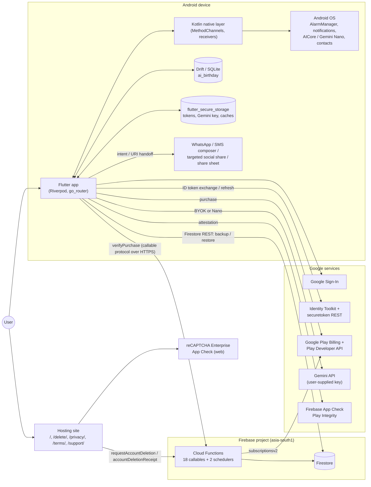

### 1.2 Local-first boundary

`[IMPLEMENTED]` (D3-I-026, D1-I-0493, D2-004-02, D2-004-09)

- **SQLite (Drift) is the operational source of truth** for people, occurrences, drafts, reminder settings, delivery events and jobs. Firestore is an **opt-in, owner-scoped backup target**, not a second primary store.
- **Secrets stay on the device**: the Google ID/refresh tokens and the user's Gemini API key live in secure storage. The Gemini key is never written to SQLite or to the backup.
- **Trust assignment**: the client owns local interaction state but *not* entitlement truth; the OS owns permissions and alarm scheduling; messaging apps own transport after handoff; only the server-side Play verification establishes a paid entitlement; the cloud owns authenticated account resources.
- **No application-owned AI proxy**: prompts go from the device straight to the user's Gemini endpoint or to on-device Nano. The backend is not an inference proxy and no callable may grant entitlement from client-supplied status, expiry or product (D1-I-0168, D2-004-09).
- **The control plane is not mobile automation.** The sender-coordination callables exist and are tested, but **no Flutter or Kotlin code calls them** (GAP-16, D3-I-012). Diagrams and statements in this document therefore distinguish *source present* from *integrated* and *deployed*.

### 1.3 Architecture principles

`[APPROVED]` / `[IMPLEMENTED]` unless noted (D1-I-0146, D2-029-02, D1-I-0514, D4-004-10, D1-I-0321).

1. Local-first with explicit cloud boundaries.
2. Domain logic independent of widgets and platform types.
3. One canonical owner per entity and per transition.
4. Durable operations (jobs, scheduling) rather than fire-and-forget; external effects happen outside SQLite transactions.
5. Typed boundary contracts (MethodChannel payloads, callable schemas, `AppFailure`).
6. Server-authoritative identity, purchase and cloud authorisation.
7. Explicit idempotency (stable IDs, compare-and-set, receipts).
8. No new service, state layer or cache unless it removes a demonstrated problem. System style is a **modular monolith with ports-and-adapters** in one client plus a minimal backend.
9. Every major decision gets an ADR (context, decision, status, consequences) — see [§12](#12-architecture-decision-records) (D1-I-0321).
10. Aggregate-only diagnostics: logs never carry names, messages, tokens or phone numbers.

---

## 2. Technology stack and versions

All values were read from `pubspec.yaml`, `pubspec.lock`, `android/**/*.kts`, `backend/*/package.json`, lock files and `.github/workflows/ci.yml` (D4-002-03).

### 2.1 Mobile client

| Area | Choice | Version evidence |
|---|---|---|
| Framework | Flutter / Dart | SDK `>=3.12.0 <4.0.0`, Flutter `>=3.44.0`; CI pins Flutter `3.47.6` stable |
| App version | `1.0.0+1` | `pubspec.yaml` |
| State management | `flutter_riverpod` | `^2.6.1` (locked 2.6.1) |
| Routing | `go_router` | `^14.8.1` (locked 14.8.1) |
| Local database | `drift` / `drift_flutter` | `^2.26.0` (locked 2.31.0) / `^0.2.4` (locked 0.2.8) |
| Secure storage | `flutter_secure_storage` | `^9.2.4` |
| Auth | `google_sign_in` `^7.2.0`; Identity Toolkit REST via `http` `^1.6.0` | |
| Firebase | `firebase_core` `^5.2.0`, `firebase_app_check` `^0.5.2` | No `cloud_firestore` or `firebase_auth` package: Firestore and Auth are used over REST |
| Billing | `in_app_purchase` | `^3.3.1` |
| Time | `timezone` `^0.10.1`, `clock`, `intl` `^0.20.2` | |
| Misc | `crypto ^3.0.6` (purchase binding hash; new), `uuid ^4.5.1`, `url_launcher ^6.3.1`, `file_picker 10.3.10`; override `xml 6.5.0` | |
| Dev | `drift_dev`, `build_runner`, `fake_async`, `flutter_lints ^6.0.0`, `integration_test` | |
| Fonts | Bricolage Grotesque (display) and Outfit (body), **bundled** in `assets/fonts`; `google_fonts` removed | |
| Localisation | ARB, English only (`lib/l10n/app_en.arb`) | |

### 2.2 Android native build

| Area | Choice |
|---|---|
| Build | AGP `9.1.0`, Kotlin plugin `2.4.0`, Gradle `9.3.1`, JVM `17` |
| SDK | `minSdk = max(flutter.minSdkVersion, 26)`; `applicationId` / namespace `com.yashsomani.ai_birthday` |
| Flavors | `play` and `personal` (dimension `distribution`) |
| Native libraries | `com.google.mlkit:genai-prompt:1.0.0-beta4`; `kotlinx-coroutines-android:1.11.0` (pinned because beta4 can fail with older coroutines) |
| Signing | Release signing only when `android/key.properties` is complete; the debug key is never used for release |
| Permissions (main) | `INTERNET`, `POST_NOTIFICATIONS`, `VIBRATE`, `SCHEDULE_EXACT_ALARM`, `READ_CONTACTS`, `RECEIVE_BOOT_COMPLETED` |
| Permissions (personal) | adds `SEND_SMS` via `src/personal/AndroidManifest.xml`. There is **no** `src/play` source set; `play` simply lacks `SEND_SMS` |

### 2.3 Backend and hosting

| Package | Key dependencies | Runtime |
|---|---|---|
| `backend/functions` (`birthday-autopilot-control-plane` 0.1.0) | `firebase-admin ^14.5.0`, `firebase-functions ^7.4.0`, `zod ^4.6.7`; dev: TypeScript 5.9.3, `vitest ^4.1.12`, ESLint 10.7.0, `fast-check 4.9.0` | Node `>=22 <25`, npm 11.6.0, Functions runtime `nodejs22`, region `asia-south1` |
| `backend/hosting` (`birthday-autopilot-public-site`) | Vite 8.1.4, `firebase ^13.1.0` (web SDK), TypeScript 5.9.3 | Node `>=24.18 <25` |

Firebase project id (default in the app and in `backend/.firebaserc`): `relateai-birthday-ysoman-a2372`; `FirebaseConfig` values are overridable by `--dart-define`.

### 2.4 Build and CI

`.github/workflows/ci.yml` runs three jobs:

| Job | Steps |
|---|---|
| Flutter | Java 17 (zulu); format check; `flutter analyze`; `flutter test --coverage --exclude-tags golden`; golden shell test; `play` release APK with capability check and an `aapt2`-based **Play manifest guard** (fails closed if `SEND_SMS` is present); `personal` APK; artifact upload |
| Functions | Node 22, npm 11.6.0; `npm audit --omit=dev --audit-level=high`; Java 21 (emulator); lint; build; purchase App Check static test; vitest; emulator tests |
| Hosting | Node 24; `npm run check` |

Golden tests are a deliberate local-only gate (`dart_test.yaml` tag `golden`).

---

## 3. Repository and module structure

### 3.1 Top-level layout

| Path | Contents | Boundary |
|---|---|---|
| `lib/` | Flutter app: `app/`, `core/`, `features/`, `shared/design_system`, `l10n/` | Client only |
| `android/` | Gradle build, manifests (`main`, `personal`), Kotlin sources | Native adapter; talks to Dart only through MethodChannels |
| `backend/functions` | Callables, schedulers, domain, persistence, transport schemas | Server only; no shared code with the client |
| `backend/hosting` | Public site source and release tooling | Calls only the two deletion callables |
| `backend/firestore.rules`, `firebase.json`, `ttl-policies.json`, `firestore.indexes.json` | Rules, hosting headers, TTL policy, index overrides | Server-side policy |
| `test/`, `integration_test/` | 85 Dart test files; one device journey test | |
| `assets/fonts/` | Bundled fonts and OFL licences | |
| `firebase/` | `google-services*.json` and `reference/*.kt` | The `.kt` files use package `com.yashsomani.birthdayautopilot.*` and are **not referenced by any Gradle source set**: reference material only. No Google-services Gradle plugin is applied; Firebase is initialised from `FirebaseConfig` in Dart |
| `.github/workflows/ci.yml` | CI | |
| `archive/`, `get_issue.sh`, `dummy.png`, `build-and-install-android.bat`, root `package.json` | Ad-hoc working files (several are tracked in Git; the former root `plan.md` was removed with the legacy documents) | Not part of the architecture; see [§14](#14-known-architectural-debt) |

### 3.2 Flutter feature modules

`lib/features/` holds 15 feature folders, each split into `presentation`, `application`, `domain` and `data` **where it needs the layer** (D1-I-0148, D2-004-03, D4-002-35):

| Feature | Layers present | Owns |
|---|---|---|
| `people` | application, data, domain, presentation | Recipient profile, validation, CSV/contact import |
| `birthdays` | application, domain | Birthday engine, occurrence status, lifecycle refresh |
| `reminders` | application, domain | Reminder planning, plan stamp, bootstrap, OS gateway port |
| `message_studio` | domain, presentation | Draft model, editor, handoff orchestration |
| `ai` | data, domain | `AiRouter`, providers (user Gemini, Nano) |
| `delivery` | application, data, domain | WhatsApp/SMS/share handoff builders, delivery events |
| `jobs` | application, data, domain | Durable job worker and handlers |
| `subscription` | application, domain | Entitlement, purchase and restore |
| `auth` | application, data, domain, presentation | Google sign-in, token lifecycle |
| `sync` | data | Cloud backup and restore |
| `dashboard`, `calendar`, `history`, `onboarding`, `settings` | presentation | Screens (read models over the above) |

`lib/core/` contains `config` (`FirebaseConfig`, `ProductCapabilities`), `database` (Drift schema and repositories), `errors` (`AppFailure`), `logging`, `platform` (typed MethodChannel adapters), `security` (secure storage), and `core_providers.dart`. `lib/shared/design_system` holds the shared UI kit. `lib/app/` composes everything (`app.dart`, `app_scaffold.dart`, `router.dart`, `providers.dart`, `theme/`).

The SSOT target layout (Pigeon-style typed bridge, Kotlin sub-packages `ai/`, `contacts/`, `notifications/`, `platform/`) is only partly realised: the Flutter layout broadly matches; Android Kotlin is a flat package with three files and hand-written `MethodChannel` handlers (D4-002-35, `[PARTIAL]`).

### 3.3 Layering and dependency rules

`[IMPLEMENTED]` as convention, enforced by review and tests rather than by a lint (D2-004-03, D1-I-0504, D2-031-01):

1. **Presentation** renders state and dispatches commands. It must not hold date policy, entitlement grants, or direct database/network calls.
2. **Application** orchestrates use-cases and transactions (`PersonService`, `BirthdayLifecycleService`, `ReminderService`, `JobWorker`, `SubscriptionNotifier`, `CloudSyncService`).
3. **Domain** is pure Dart (`BirthdayEngine`, models, validators, ports). No Flutter, Drift or OS types.
4. **Data / platform adapters** implement ports (Drift repositories, MethodChannel gateways, REST clients).
5. **Composition** is only `lib/app/providers.dart` and `lib/core/core_providers.dart`.
6. Features depend on each other only through domain models and ports; `shared/design_system` depends on nothing in `features`.
7. **Backend** layering is `transport` (zod schemas) → `functions` (callable wiring) → `services` (orchestrators) → `domain` (pure decisions) → `persistence` (paths, codecs). The client never imports backend code and vice-versa.
8. In-memory repositories exist only as test doubles (D4-004-01).

### 3.4 Source-of-truth ownership

`[IMPLEMENTED]` (D4-004-01)

| Concern | Single owner |
|---|---|
| Navigation | [router.dart](lib/app/router.dart) |
| Dependency graph | [providers.dart](lib/app/providers.dart), [core_providers.dart](lib/core/core_providers.dart) |
| Persistence | Drift repositories ([drift_repositories.dart](lib/core/database/drift_repositories.dart), [drift_people_repository.dart](lib/features/people/data/drift_people_repository.dart)) |
| Occurrence lifecycle | [birthday_lifecycle_service.dart](lib/features/birthdays/application/birthday_lifecycle_service.dart) |
| AI provider choice | [ai_router.dart](lib/features/ai/domain/ai_router.dart) — the only component that may select a provider (D4-004-07) |
| Gemini calls | `UserGeminiApiProvider` |
| Auth and token refresh | [live_google_auth_gateway.dart](lib/features/auth/data/live_google_auth_gateway.dart) |
| Cloud backup/restore | [cloud_sync_service.dart](lib/features/sync/data/cloud_sync_service.dart) |
| Entitlement | `SubscriptionNotifier` (client cache) + `verifyPurchase` (server truth) |
| WhatsApp URI | `WhatsAppHandoffBuilder` |
| Platform handoff plan | `PlatformHandoffBuilder`; native social text share |
| Logging | `AppLogger` / `ConsoleAppLogger` |

### 3.5 Domain catalog and cross-domain ownership contracts

The domain catalog (DOM-01..14, D1-I-0483) maps to code as: Entry/shell → `app/`; Relationship memory → `people`; Birthday engine and Planning → `birthdays`; Reminders → `reminders`; Message Studio → `message_studio`; AI assistance → `ai`, `jobs`; Delivery/history → `delivery`, `history`; Account/entitlement → `auth`, `subscription`; Continuity/privacy → `sync`; Reliability/automation → `jobs`, `reminders`; Platform operations → `android/`, CI; Public support/legal → `backend/hosting`; Autopilot control plane → `backend/functions` (integration and deployment gated). The catalog's `DOM-` and `DEP-` numbers collide with an alternate 2.0 numbering (see [Appendix B](#appendix-b--registered-decisions-and-dependencies)).

The eleven cross-domain ownership contracts (D1-I-0029, D2-031-01, D1-I-0031) are `[IMPLEMENTED]` except where noted:

1. People owns recipient identity.
2. Birthday owns occurrence and status.
3. Reminders consume resolved occurrences.
4. Message Studio owns the draft (and its `revision` counter, [§7.3](#73-migrations)).
5. The AI router does not own entitlement or recipients; it consumes `UserEntitlement` and `Person` read-only.
6. Delivery owns handoff events (handoff ≠ confirmation).
7. History is a **read model** over drafts and delivery events, not a second source of truth `[PARTIAL]` — it reads the same tables; no separate projection exists.
8. Subscription owns entitlement.
9. Cloud transports approved data only (people, birthdays, drafts, reminder settings).
10. Jobs never bypass consent, entitlement or cancellation checks.
11. Control-plane claims are **not** mobile automation (no client).

The domain boundary of Birthday specifically (D2-027-01): it owns birthday validation, Feb-29/timezone interpretation, next-occurrence calculation, the current-cycle row, status, refresh and reminder handoff. It does **not** own profile edits, draft generation, delivery truth, OS scheduling or UI layout.

---

## 4. Frontend architecture

### 4.1 Startup and bootstrap (FLOW-001, STATE-001)

`[IMPLEMENTED]` — [main.dart](lib/main.dart), [app.dart](lib/app/app.dart), [core_providers.dart](lib/core/core_providers.dart).

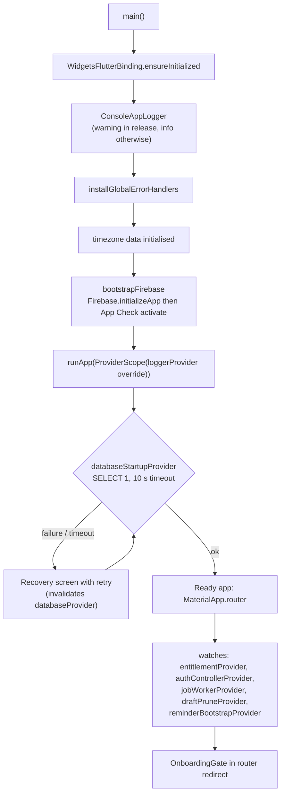

Startup rules:

- **Global error handlers** ([global_error_handlers.dart](lib/core/logging/global_error_handlers.dart), A3-009): `FlutterError.onError` and `PlatformDispatcher.onError` both log **only the error type and first stack frame — never the message**. The platform handler returns `true` so an uncaught async error does not terminate the app.
- **Firebase bootstrap** never blocks startup. `Firebase.initializeApp` is followed by App Check activation (`AndroidDebugProvider` in debug, **Play Integrity** otherwise). A failure is logged and every cloud feature then fails closed.
- **Database startup**: `databaseStartupProvider` probes with `SELECT 1` and a 10 s timeout. Failure shows a recovery screen; retry invalidates `databaseProvider`. Migration and open errors therefore surface to the user instead of a blank screen.
- **Ready app** watches `entitlementProvider`, `authControllerProvider` (restores purchases on sign-in), `jobWorkerProvider`, `draftPruneProvider` (removes orphaned drafts) and `reminderBootstrapProvider`. Themes are light, dark and system with `AppLocalizations`.
- **`reminderBootstrapProvider`** `[IMPLEMENTED]` (A1-002/003/010): `ReminderBootstrap` calls `replan(reason, onlyIfStale: true)` at startup and on every `AppLifecycleListener.onResume`. It is inert outside a `WidgetsFlutterBinding` (unit tests). Staleness is decided by the **plan stamp** `v1|ok|enabled|tzName@offsetMin|yyyy-MM-dd|plannedAtMs`, stored in `reminder_settings_entries` under key `plan_state`: stale if the last plan failed, the timezone name or offset changed, the calendar date changed, or the clock moved backwards. See [§6.3](#63-reminders).

### 4.2 Riverpod provider graph

`[IMPLEMENTED]` — providers are composed in [providers.dart](lib/app/providers.dart) and [core_providers.dart](lib/core/core_providers.dart).

| Layer | Providers (representative) |
|---|---|
| Core | `loggerProvider`, `databaseProvider`, `databaseStartupProvider`, `credentialStorageProvider` |
| Repositories | `peopleRepositoryProvider` (`DriftPeopleRepository`), `birthdaysRepositoryProvider`, `draftsRepositoryProvider`, `deliveryEventsRepositoryProvider`, `jobsRepositoryProvider` |
| People write side | `peopleStoreProvider` (`DriftPeopleStore`), `personServiceProvider`, `personListProvider`, `personByIdProvider` |
| Streams | `peopleStreamProvider`, `birthdaysStreamProvider`, `draftsStreamProvider`, `deliveryEventsStreamProvider`, `latestHandoffsForDraftsProvider` |
| Reminders | `reminderServiceProvider`, `reminderSettingsProvider` (controller), `remindersEnabledProvider`, `reminderBootstrapProvider`, `notificationSchedulerGatewayProvider` |
| AI | `aiRouterProvider`, `userGeminiApiProvider`, `geminiNanoPlatformProvider`, `geminiNanoProvider`, `hasOwnGeminiKeyProvider`, `aiJobHandlerProvider` |
| Jobs and sync | `jobWorkerProvider`, `cloudSyncServiceProvider`, `cloudJobHandlerProvider`, `draftPruneProvider` |
| Account | `authControllerProvider`, `googleAuthGatewayProvider`, `subscriptionNotifierProvider`, `entitlementProvider` |
| Delivery | `whatsappHandoffBuilderProvider`, `platformHandoffBuilderProvider`, `smsDeliveryServiceProvider`, `nativeShareServiceProvider`, `nativeSmsGatewayProvider`, `birthdaySmsServiceProvider`, `automaticSmsSettingsProvider` |
| Navigation | `routerProvider` |

Notable behaviours:

- `birthdaysStreamProvider` runs `BirthdayLifecycleService.refresh` **before** yielding `watchBirthdays`, and a **midnight timer** invalidates it so the date boundary re-derives status. Only the device-local midnight exists (multi-timezone refresh, DEC-033, is `[NOT IMPLEMENTED]`).
- `resyncReminderSchedule` (in [person_providers.dart](lib/features/people/data/person_providers.dart)) is the single entry for re-planning after person changes, imports and cloud restore.
- Widgets never touch Drift or HTTP directly; they use providers and services (D1-I-0504, `[IMPLEMENTED]` by convention).

### 4.3 Router, shell and OnboardingGate

`[IMPLEMENTED]` — [router.dart](lib/app/router.dart), [app_scaffold.dart](lib/app/app_scaffold.dart) (D3-I-092).

| Route | Navigator | Notes |
|---|---|---|
| `/onboarding` | root | Shown until `OnboardingGate` reports completion |
| `/dashboard`, `/people`, `/calendar`, `/history` | `StatefulShellRoute.indexedStack`, 4 branches | Bottom `NavigationBar`: Today, People, Calendar, Activity |
| `/settings` | root | Not a tab; pushed from the dashboard, studio and the shared settings action button |
| `/message-studio/:birthdayId`, `/message-studio/person/:personId` | root | The person variant is the notification-tap target |
| `/people/add`, `/people/edit/:id` | root | |

- `initialLocation` is `/dashboard`; unknown paths render `_NotFoundScreen`. Legacy route aliases were removed.
- **OnboardingGate** (A3-010): onboarding completion is a boolean in secure storage (`ai_birthday_onboarding_completed`). The gate **caches only a positive result**. If the read *throws*, the gate treats onboarding as **complete** (a returning user is never dropped back into onboarding by a storage fault); the first-run default when the key is absent is "not complete".
- The shell consumes notification taps: `AppScaffold` asks the notification gateway for the initial notification's `personId` on first frame and registers a handler, both routing to `/message-studio/person/:personId`.
- The shell grows the `NavigationBar` linearly with the text scale (`80 × scale`) so labels do not clip at large font sizes.
- Five tabs were once documented; the code has **four shell destinations plus a Settings route** (see [Appendix A](#appendix-a--superseded-rejected-and-unimplemented-target-statements)).

### 4.4 Design system

`[PARTIAL]` — [lib/shared/design_system](lib/shared/design_system) now exports a token-based Material 3 kit: `AppPalette`, `AppTypography`, `AppSpace`, `AppRadius`, `AppTone`, `AppResponsiveContainer`, `ResponsiveActionBar`, editorial cards, semantic empty/error/skeleton states, section headers, countdown chips and safe bottom sheets. The warm editorial visual language uses bundled Bricolage Grotesque display and Outfit body fonts; page content is constrained for wide layouts, and the shell uses a navigation bar on compact widths and a rail on expanded widths.

- `AppSectionHeader` wraps text in `Semantics(header: true)`.
- Status chips use `AppTone`; contrast ≥ 4.5:1 is asserted in `test/ui/contrast_test.dart`.
- Theme ([app_theme.dart](lib/app/theme/app_theme.dart)) is Material 3 with bundled fonts and no network font loading.
- **Migration debt:** older screens still use compatibility exports (`AppSpacing`, `AppColors`) alongside canonical `tokens/` values; the shared design-system module is not fully token-only and remains `[PARTIAL]`. `app_tokens.dart` is a deprecated compatibility export. `lib/ui/design_system` was deleted.

### 4.5 UI state and error rules

- State flows one way: command → application service/transaction → repository → stream → immutable UI state (D2-004-06). Durable state lives in aggregates and jobs, not controllers.
- Screens use Riverpod `AsyncValue` (loading/data/error) plus bespoke empty states. There is **no shared `ViewState` type** (Loading/Content/Empty/Failure/Stale/Unavailable/Locked, D1-I-0503) `[PARTIAL]`.
- Domain failures are `AppFailure(code: AppFailureCode…)`; the UI maps codes to copy in one place ([§6.10](#610-error-model)).
- Screens are large single files (message studio ≈ 2,060 lines; settings ≈ 2,080; people ≈ 1,320) — see [§14](#14-known-architectural-debt).

---

## 5. Native Android integration

Dart talks to Kotlin only through five MethodChannels (prefix `com.yashsomani.ai_birthday/`), all handled in [MainActivity.kt](android/app/src/main/kotlin/com/yashsomani/ai_birthday/MainActivity.kt) (D3-I-047). There is no Pigeon layer; payloads are hand-validated maps.

### 5.1 MethodChannels

| Channel | Methods | Dart adapter | Notes |
|---|---|---|---|
| `notifications` (8) | `getInitialNotification`, `hasPermission`, `requestPermission`, `hasExactAlarmPermission`, `requestExactAlarmPermission`, `apply`, `cancelAll`, `testNotification` | `NotificationSchedulerGateway` (`AndroidNotificationSchedulerGateway`) | `apply` replaces the persisted schedule; `cancelAll` also clears unrelated app notifications (known quirk) |
| `nano` (3) | `currentState`, `startDownload`, `generate` | `MethodChannelGeminiNanoPlatform` | See [§5.3](#53-gemini-nano) |
| `share` (2) | `shareText`, `shareToPlatform` | `NativeShareService` | The latter passes text to a selected package (`com.instagram.android`, `com.snapchat.android`, or `com.linkedin.android`) using Android `ACTION_SEND`; the platform controls recipient selection and whether it accepts text. |
| `contacts` (3) | `hasPermission`, `requestPermission`, `fetchDeviceContacts` | `DeviceContactsService` | There is no `isSupported` method (the legacy platform matrix was wrong) |
| `sms_automation` (8) | `isSupported`, `hasSmsPermission`, `requestSmsPermission`, `scheduleSmsJob`, `cancelSmsJob`, `cancelAllSmsJobs`, `cancelSmsJobsForPerson`, `getSmsAttemptsLog` | `NativeSmsGateway` | Gated off, see [§5.4](#54-flavors-and-the-gated-sms-path) |

### 5.2 Receivers and alarm recovery

`[IMPLEMENTED]` (D1-I-0161). Both receivers are `exported=false`.

| Receiver | Actions | Behaviour |
|---|---|---|
| `BirthdayNotificationReceiver` | `BIRTHDAY_REMINDER`, `BOOT_COMPLETED`, `MY_PACKAGE_REPLACED` | Posts a high-importance notification (title never logged); a tap passes `personId` to the app. On boot or package replace it re-registers persisted **future** triggers with `setExactAndAllowWhileIdle` when `canScheduleExactAlarms()`; schedule state is in SharedPreferences `scheduled_reminders_prefs` |
| `BirthdaySmsReceiver` | `SEND_BIRTHDAY_SMS`, `SMS_SENT_ACTION`, `SMS_DELIVERED_ACTION`, `BOOT_COMPLETED`, `MY_PACKAGE_REPLACED` | Dormant while the compile-time gate is false; prefs `scheduled_sms_prefs`; 12 h `MAX_STALE_WINDOW` |

There are **no `TIMEZONE_CHANGED` or `TIME_SET` receivers**. Timezone and clock changes are handled only by the Dart-side resume re-plan (`reminderBootstrapProvider`), so a change that happens while the app is not running is picked up at the next launch `[PARTIAL]` (A1-007, open).

### 5.3 Gemini Nano

`[IMPLEMENTED]` (EXT-006, D4-002-07, D1-I-0160). Kotlin wraps ML Kit GenAI Prompt (`genai-prompt:1.0.0-beta4`) over AICore. Native feature status is mapped to `ready`, `downloadable`, `downloading`, `unavailable` or `error` strings; the Dart side normalises these (and platform exceptions) into `NanoState` — `available`, `downloadable`, `downloading`, `notReady`, `unavailable`, `busy`, `quotaExceeded`, `error` — and `GeminiNanoStatus`. Native error codes: `NANO_NOT_READY`, `INVALID_PROMPT`, `NANO_EMPTY_RESPONSE`, `NANO_GENERATION_ERROR`, `NANO_DOWNLOAD_ERROR`. A template generator is never labelled Nano. The older "`NANO_UNAVAILABLE` thrown when not ready" contract is superseded by `NANO_NOT_READY` (D4-003-06). Device coverage of Nano and exact alarms across a device matrix is `[OPEN]` (D1-I-0172).

### 5.4 Flavors and the gated SMS path

`[PARTIAL]` (D3-I-137, D4-004-12, D1-I-0163, EXT-011). SMS automation is **triple-gated**:

1. **Flavor:** `play` omits `SEND_SMS` (user taps the SMS composer through `url_launcher`); `personal` declares it. A CI step uses `aapt2` on the built `play` APK and **fails closed** if `SEND_SMS` appears (A4-008).
2. **Dart capability flag:** `ProductCapabilities.automaticSms` (`--dart-define=ENABLE_AUTOMATIC_SMS`, default `false`); `autoPrepare` (`ENABLE_AUTO_PREPARE`) is likewise default `false`; `stripeClientBilling` is permanently `false`.
3. **Native constant:** `AUTOMATIC_SMS_ENABLED = false` in `MainActivity` and `BirthdaySmsReceiver`; `isSupported`, `hasSmsPermission`, `requestSmsPermission` and `scheduleSmsJob` return false.

Consequently the earlier "approved personal SMS midnight dispatch" description is **not** active in any shipped configuration.

---

## 6. Domain and application services

### 6.1 People

`[IMPLEMENTED]` — [person_service.dart](lib/features/people/application/person_service.dart), [drift_repositories.dart](lib/core/database/drift_repositories.dart), [drift_people_repository.dart](lib/features/people/data/drift_people_repository.dart) (D2-031-07, D2-030-06/07, D2-028-03).

Execution chain for create / update / import / remove / restore:

`UI → PersonService (validate via PersonInputValidator; resolve occurrence with BirthdayEngine) → DriftPeopleStore.saveAggregate | saveImportBatch | softDeleteAggregate | restoreAggregate (one Drift transaction: person + birthday + draft/job cleanup) → onChanged = resyncReminderSchedule (outside the transaction)`

- `saveAggregate` deletes non-`confirmedSent` drafts and jobs when the occurrence changed.
- `saveImportBatch` is one transaction and rejects duplicate or orphan records; `importValidRows` imports the valid rows and returns the invalid ones with reasons (A1-006). The legacy `importBatch` throws if any row is invalid.
- Soft delete sets `deletedAt` and hides linked rows; restore re-activates the same aggregate (Undo). Soft-deleted PII is retained indefinitely at present (A1-011, `[OPEN]`).
- `autoPrepare` and `autoSendPolicy` are clamped to off unless `ProductCapabilities` enables them.
- The person form's relationship is a dropdown (A1-005); clear-flags on edit allow clearing optional fields (A1-004).
- Person fields (D2-028-03, D4-002-09, DB-001): id, name, birthday month/day/year (nullable), `leapDayResolution`, phone, email, relationship, closeness, preferred language, tone, important facts, notes, preferred delivery channel, timezone, `autoPrepare`, `autoSendPolicy`, timestamps, `version`, `deletedAt`. The target field names `phoneE164`, `displayName`, `deliveryPolicy` do not exist (see [Appendix A](#appendix-a--superseded-rejected-and-unimplemented-target-statements)).
- **Two Drift people adapters still exist** (A1-008, DEC-020/025, `[OPEN]`): `DriftPeopleRepository` ([drift_repositories.dart](lib/core/database/drift_repositories.dart), used by `peopleRepositoryProvider` for reads, studio and sync) and `DriftPeopleStore` (used by `PersonService` for writes). There is **one `Person` model class** (the GAP-04/GAP-17 "duplicate model" claim is refuted; `people/domain/person.dart` re-exports `models/person.dart`).

### 6.2 Birthdays: engine and lifecycle

`[IMPLEMENTED]` — [birthday_engine.dart](lib/features/birthdays/domain/birthday_engine.dart), [birthday_lifecycle_service.dart](lib/features/birthdays/application/birthday_lifecycle_service.dart) (D2-027-xx, D2-031-04/05).

**Engine (pure, DST-safe).**
- A birthday is the (month, day) in the recipient's calendar. If a **valid recipient timezone** is stored, the reference instant is converted to that zone; otherwise the device-local calendar is used (a UTC reference is converted to local first, fixing a 00:30 IST off-by-one).
- `daysUntil` is a pure calendar-date difference on UTC-normalised dates; the same-day birthday is `isToday` with 0 days; past dates roll to next year. Birth year affects only "turns N".
- Gregorian leap rule; Feb 29 is valid regardless of birth year (D2-027-05). In non-leap years the **per-person** `leapDayResolution` (`feb28` | `mar1`) applies; with **no policy, `computeNext` returns null** (not schedulable) — there is no global default (BR-008).

**Lifecycle `refresh(now)`** (instance method with injected `now`; idempotent):
1. Load all birthdays once. For persons with duplicate rows keep the newest and delete the rest (no `StateError`; A1-009).
2. Skip people without a birthday and Feb-29 people with no leap policy.
3. `engine.computeNext` → create a missing row `birthday-{personId}` (`reminderDue` if today, else `upcoming`); promote `upcoming`/`created` → `reminderDue` on the day; **roll over** when `cycleYear` or the calendar date differs (`rolloverBirthday` clears the draft link and deletes non-confirmed drafts and jobs for that birthday in one transaction).
4. Workflow states (`messageDrafted`, `handedOff`, `completed`, …) are never reset by refresh within a cycle.

Triggers: stream subscription, midnight timer, create/edit, restore, and resume (via the stream). Birthday-date edits invalidate the current cycle status and attached draft (D4-004-03).

`BirthdayStatus` (code, D2-027-10): `created`, `upcoming`, `reminderDue`, `messageNotPrepared`, `messageDrafted`, `messageReviewed`, `readyForDelivery`, `handedOff`, `completed`, `failed`; `isActionNeeded` is true for `reminderDue`, `messageNotPrepared`, `messageDrafted`, `failed`. See STATE-003 ([§9.2](#92-state-machines)).

### 6.3 Reminders

`[IMPLEMENTED]` with `[PARTIAL]` native recovery — [reminder_service.dart](lib/features/reminders/application/reminder_service.dart), [reminder_settings_controller.dart](lib/features/reminders/application/reminder_settings_controller.dart), [reminder_plan_stamp.dart](lib/features/reminders/application/reminder_plan_stamp.dart), [reminder_bootstrap.dart](lib/features/reminders/application/reminder_bootstrap.dart).

Chain: `ReminderService.sync` → if disabled → `gateway.cancelAll()`; else `ReminderScheduler` (kinds `approaching` 7 d, `prepare` 2 d, `ready` 1 d, `birthday` 0 d; fixed hour 09:00; quiet hours and defer option) → `gateway.apply(plan, hideNames)` → Kotlin schedules exact alarms.

`ReminderSettingsController` (A1-002/003/010):
- `ensureLoaded` — never plans from defaults after a failed read.
- A **serialised replan queue** prevents concurrent plans.
- `cancelWhenDisabled` runs only for a `settings_changed` reason, so a transient read failure never cancels valid alarms.
- Persist failure rolls the in-memory setting back; `syncError` is exposed with a retry.

Settings keys in `reminder_settings_entries`: `default`, optionally `defer_quiet_hours`, `hide_names`, and `plan_state` (stamp in the `kinds` column). Reminder schedules are **computed, never stored** (no `ReminderSchedule` table, D2-005-05). Quiet-hours semantics (suppress vs defer, DEC-044) remain `[OPEN]`.

### 6.4 Message Studio and the AI router

`[IMPLEMENTED]` — [ai_router.dart](lib/features/ai/domain/ai_router.dart), [message_studio_screen.dart](lib/features/message_studio/presentation/message_studio_screen.dart).

**`AiRouter.generate` decision chain (entitlement first):**

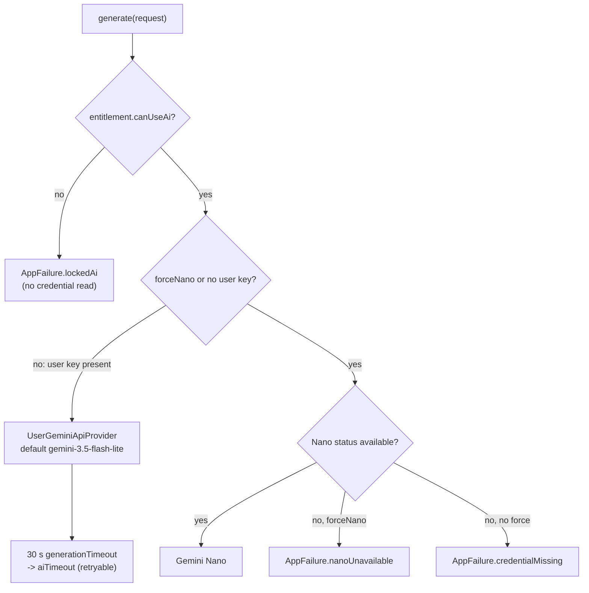

Nano is used when forced or when no user key is stored; otherwise the user key is used. Each router step (key check, Nano status, generation) is wrapped in the 30 s timeout. There is **no application-owned Gemini fallback**; Pro entitlement is required for any AI path including BYOK (earlier "BYOK without Pro" statements are superseded).

**Studio behaviour.**
- Autosave after 750 ms idle with `_editRevision` / `_enqueuedRevision` counters and a conflict banner when a generation result lands on a changed draft.
- AI work is **enqueued as a durable `ai_generate` job** (`maxAttempts: 3`) carrying `draftUpdatedAt` and `draftRevision` of the draft at enqueue time (A2-004). Variation generation is sequential and not itself a durable job `[PARTIAL]` (A2-012).
- Draft status vocabulary: `draft`, `ready`, `approvedForAutoSms`, `confirmedSent`. A `confirmedSent` draft is **immutable**; a later AI result or restored cloud copy is stored as a *new* revision row id (`…-revision-<micros>` / `…-restore-revision-<micros>`).
- `saveDraftAndUpdateBirthday(requireUnchanged, expectedCurrentDraft)` is a compare-and-set on `id + revision`; `revision` is monotonic (`existing + 1`).
- `_performHandoff` records handoff evidence (`DeliveryEvents`) separately from the launch result, with a retry record; WhatsApp URI `https://wa.me/<digits>?text=` (7–15 digits, `00` prefix stripped, leading `0` rejected, no `whatsapp://`), SMS URI keeps a leading `+` (or `00` → `+`), accepts national-format numbers and short codes (3–15 digits) and uses `%20` encoding (D3-I-109, D1-I-0162).
- WhatsApp and SMS are launched through their message-prefilled platform URIs. Instagram, Snapchat and LinkedIn do not expose a stable public arbitrary-recipient DM prefill contract; `PlatformHandoffBuilder` selects the native targeted-share fallback and `NativeShareService.shareToPlatform` sends the complete message in a package-restricted `ACTION_SEND` intent. No fallback fabricates a direct-chat URI. Platform absence or lack of a compatible text activity returns a failed handoff; the general share sheet and clipboard remain separate choices.

### 6.5 Jobs

`[IMPLEMENTED]` — [lib/features/jobs](lib/features/jobs), `JobWorker`.

- **Serial, event-driven worker** with a single retry timer. Types `ai_generate` and `cloud_sync`; statuses `queued`, `running`, `retrying`, `succeeded`, `failed`, `canceled`.
- Backoff `2 s × 2^n`; handler timeout 3 min (`handler.run(job).timeout(...)` stops waiting but does **not** cancel the handler, so a timed-out AI or cloud-sync handler can overlap its retry; the stale-result, revision and idempotency guards mitigate this, and A2-020 records the related BYOK socket limitation); error re-arm delay 30 s; `resetRunningAtStartup` re-queues interrupted rows; `resetStale` grace 2 min; exhausted rows become `failed`; a cancel flag discards late results. `enqueue` de-duplicates against an active job for the same subject.
- Handler outcomes: `JobSucceeded`, `JobSkipped('dropped:<reason>')` with reasons `canceled`, `cycleChanged`, `stale`, `conflict`, or `JobFailed`.
- `AiGenerationJobHandler`: generate → discard if canceled → discard if the birthday no longer exists or its `cycleYear` changed → discard if the draft is newer than `draftUpdatedAt` or its `revision` differs → apply via `saveDraftAndUpdateBirthday`. A duplicate delivery after a crash is safe because the apply is an idempotent upsert guarded by compare-and-set (D1-I-0169).
- `CloudSyncJobHandler`: payload `operation` = `backup` | `restore`; auth state is resolved at run time; `onRestored` invalidates reminder settings and calls `resyncReminderSchedule`.
- The formal job/reminder recovery contract (attempt deadlines, heartbeat, annual recovery, DEC-047) is `[PROPOSED]`.

### 6.6 Delivery

`[IMPLEMENTED]` — handoff channels `whatsapp`, `sms`, `instagram`, `snapchat`, `linkedin`, `clipboard`, `share`; outcomes `launched`, `copied`, `launchFailed`, `notSent`, `confirmed`.

- `recordHandoffAndMarkHandedOff` (one transaction) writes a `DeliveryEvents` row and sets the birthday to `handedOff`.
- `confirmHandoff` (one transaction) requires a matching `launched` handoff, sets the birthday to `completed`, the draft to `confirmedSent`, and writes a `confirmed` event. Only an explicit user action confirms.
- Delivery handoff is not delivery proof; the app never claims a message was received (EXT-010..012, EXT-014). A social `ACTION_SEND` handoff contains the full text and targets the selected app but cannot select a recipient or observe whether the external app sent the message.
- Missing from the target event model: `userConfirmation`, `confirmationAt`, `idempotencyKey`, append-only history (D2-005-07, [Appendix A](#appendix-a--superseded-rejected-and-unimplemented-target-statements)).

### 6.7 Auth

`[IMPLEMENTED]` — `LiveGoogleAuthGateway` (D4-004-02, D1-I-0155). `GoogleSignIn` 7.x `authenticate` (server client id from `FirebaseConfig`) → Google ID token → Identity Toolkit `accounts:signInWithIdp` → Firebase ID + refresh tokens in secure storage. Refresh uses `securetoken.googleapis.com`; **HTTP 400/401 on refresh invalidates credentials and signs the user out**. All auth HTTP calls have **30 s timeouts** (A3-008). `AuthController.freshIdToken` refreshes when needed and flips state to signed-out if the gateway cleared credentials.

### 6.8 Subscription

`[IMPLEMENTED]` — [subscription_service.dart](lib/features/subscription/application/subscription_service.dart) (D4-004-06, D3-I-022, D1-I-0156). See the purchase sequence in [§9.3](#93-sequence-diagrams).

- `SubscriptionNotifier` (`StateNotifier<UserEntitlement>`) caches the last server verification in secure storage (`verified_entitlement_v1`); a cache survives failed re-verification for **24 h** (`_kPreserveTtl`) and a boundary timer downgrades at the earlier of expiry and staleness. Sign-out or account switch resets to free.
- Client status vocabulary `active | trial | grace | expired | none`; backend vocabulary `active | expired | none`.
- Purchase binding sent to Play (`applicationUserName`) and the server is `SHA-256('ai-birthday-purchase-binding:v1:' + uid)` — non-PII, stable across reinstall (A3-001). A legacy random per-device binding already in storage is still honoured.
- Before opening the Play sheet the client obtains an App Check token (A3-005) and runs a **reachability probe** (POST `{data:{}}`; HTTP 200 or 400 = reachable; anything else blocks billing). Verification has a 15 s client timeout.
- Prices come from `ProductDetails.price`, never hard-coded. Pending verification leaves the purchase unacknowledged so Play re-emits it; Restore retries.
- Stripe client billing is not part of the architecture (`stripeClientBilling = false`).

### 6.9 Cloud sync

`[IMPLEMENTED]` — [cloud_sync_service.dart](lib/features/sync/data/cloud_sync_service.dart) (D4-004-04, D4-024-01, D2-005-10/18/19, D1-I-0158, A3-002/A4-006). Firestore **REST** `documents:commit`, 500-write limit, ID token refreshed through `freshIdToken`.

**Backup** (owner decision: snapshot model, multi-device sync out of scope):
1. Snapshot persons (including tombstones), birthdays, drafts and reminder settings (including `plan_state`) into an **immutable generation** `users/{uid}/generations/{id}/{people,birthdays,drafts,reminderSettings}`; flush.
2. In one commit publish the manifest (`schemaVersion` 1 + counts) **and** the `backup/current` pointer `{schemaVersion, generationId, publishedAt}`.
3. **Prune**: keep current + previous; delete older generations and orphan generations older than 1 h; best-effort, at most 5 per run.
4. Last-sync time is stored per account (`cloud_last_sync_timestamp_<uid>`, UTC); the local data owner is recorded in `cloud_local_data_owner_v1` (a mismatch raises an ownership failure instead of mixing accounts).

**Restore:** read pointer → manifest → collections; counts must equal the manifest; pre-validate every record; then **one local transaction**. Merge rules: newer `updatedAt` wins; a local tombstone outranks a live cloud copy; a cloud tombstone applies; birthdays/drafts of non-active persons are skipped; a `UNIQUE(person_id)` conflict is skipped and reported; a local `confirmedSent` draft is preserved and the cloud content stored as a separate restore-revision draft; reminder settings keep the device-local copy. The result carries skipped and conflict lists.

**Not backed up:** `DeliveryEvents`, `Jobs`, secrets. **Plaintext owner-scoped Firestore fields, not end-to-end encrypted**; the earlier "AES-GCM backup/envelope" claim is superseded (ADR-04). Server-side orphan-generation garbage collection and carrying draft `revision` across restore are `[OPEN]`.

### 6.10 Error model

`AppFailure` (`code`, `message`, `detail`, `action`, `operationId`) with 16 `AppFailureCode`s (D4-026-08): `aiLocked`, `aiCredentialMissing`, `aiCredentialInvalid`, `aiNanoUnavailable`, `aiBusy`, `aiQuotaExceeded`, `aiTimeout`, `aiProviderError`, `permissionDenied`, `networkUnavailable`, `syncConflict`, `deliveryUnavailable`, `deliveryFailed`, **`validation`, `notFound`, `unknown`** (the last three are additions beyond the specification's 13). Callers switch on `code`; the UI maps codes to copy in one place.

Concurrency guards (D4-026-09, `[PARTIAL]`): duplicate sends are prevented by `confirmHandoff` requiring a launched event; concurrent generations by active-job de-duplication and the revision compare-and-set; concurrent imports by transactions; duplicate reminders by plan replacement and the serialised queue; stale sync overwrites by newer-wins plus generation immutability. DB-level uniqueness exists only for `birthdays.person_id`.

---

## 7. Data architecture

### 7.1 Local database (Drift schema v7)

`[IMPLEMENTED]` — [app_database.dart](lib/core/database/app_database.dart); `schemaVersion = 7`. `AppDatabase.open` uses an in-memory database under `FLUTTER_TEST`, otherwise `driftDatabase(name: 'ai_birthday')`. **Six tables** (D3-I-029, D1-I-0493):

| ID | Table | Columns (type, notes) |
|---|---|---|
| DB-001 | `persons` | `id`; `name`; `birthday_month`, `birthday_day`, `birthday_year` (all nullable); `leap_day_resolution` (nullable text `feb28`\|`mar1`); `phone_number`; `email`; `relationship`; `relationship_closeness`; `preferred_language`; `preferred_tone`; `important_facts`; `notes`; `preferred_delivery_channel`; `timezone`; `auto_prepare` (default false); `auto_send_policy`; `created_at`; `updated_at`; **`version`**; **`deleted_at`**. Only this table carries `version`/`deleted_at` |
| DB-002 | `birthdays` | `id` (`birthday-{personId}`), `person_id`, `cycle_year`, **`date` — calendar text `yyyy-MM-dd`** (A1-001), `status`, `draft_id`, `created_at`, `updated_at` |
| DB-003 | `message_drafts` | `id`, `birthday_id`, `person_id`, `body`, `tone`, `length`, `status`, `provider_type`, `variation_index`, **`revision`** (int, default 0, monotonic), `created_at`, `updated_at` |
| DB-004 | `reminder_settings_entries` | key/value rows: `key`, `enabled`, `kinds`, `quiet_hours_start_minutes`, `quiet_hours_end_minutes`. Keys: `default`, optional `defer_quiet_hours`, `hide_names`, `plan_state` (plan stamp in `kinds`) |
| DB-005 | `delivery_events` | `id`, `birthday_id`, `draft_id` (nullable), `channel`, `outcome` (default `launched`), `handed_off_at` |
| DB-006 | `jobs` | `id`, `type` (`ai_generate`\|`cloud_sync`), `status`, `subject_id`, `payload`, `attempts`, `max_attempts`, `error_code`, `error_message`, `result_ref`, `created_at`, `started_at`, `finished_at`, `next_retry_at` |

Conventions (D2-005-01): timestamps are UTC instants; the **birthday date is a calendar string, not an instant**, so a timezone or DST change can never shift it (the pre-v7 instant column corrupted dates for recipient-timezone persons — A1-001). Enumerations are stored as their names. Birthday ids are *derived* (`birthday-{personId}`), not opaque; the spec's opaque-ID rule is not met by design (see ADR-08).

Enumerations: `BirthdayStatus` (10 values, [§6.2](#62-birthdays-engine-and-lifecycle)); `DraftStatus` `draft|ready|approvedForAutoSms|confirmedSent`; `DeliveryChannel` `whatsapp|sms|clipboard|share`; `DeliveryOutcome` `launched|copied|launchFailed|notSent|confirmed`; `JobStatus` `queued|running|retrying|succeeded|failed|canceled`; `ReminderKind` `approaching|prepare|ready|birthday`.

### 7.2 Entity-relationship diagram

There are **no SQL foreign keys** (no `references()`); relationships below are enforced by the application and transactions (D3-I-030, GAP-006). The sole physical uniqueness constraint is `UNIQUE INDEX (birthdays.person_id)`.

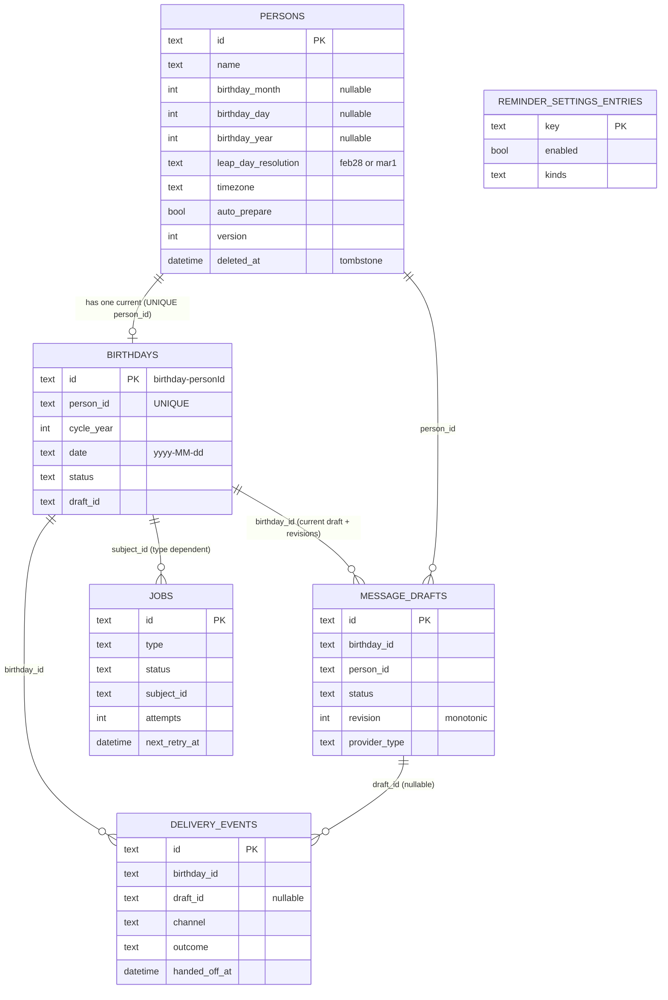

`reminder_settings_entries` is standalone key/value state. `jobs.subject_id` is a birthday id for `ai_generate` and the account id for `cloud_sync`.

### 7.3 Migrations

`[IMPLEMENTED]`, stepwise `onUpgrade`; indexes are created in `beforeOpen` (D3-I-031). A rule that every shipped schema version must stay upgradable is a standing constraint.

| From → to | Change |
|---|---|
| ≤1 → 2 | Creates `birthdays`, `message_drafts`, `reminder_settings_entries` |
| 2 → 3 | `alterTable(persons)` (non-destructive) |
| 3 → 4 | Adds `delivery_events` |
| 4 → 5 | Adds `jobs` |
| 5 → 6 | `persons.leap_day_resolution`; `delivery_events.draft_id` and `outcome` (idempotent, guarded) |
| **6 → 7** | `_migrateToV7` (idempotent): add `message_drafts.revision`; `_dedupeBirthdaysPerPerson` — keep the newest row per person (by `updated_at`, `created_at`, `id`), **re-point** drafts and delivery events to the survivor, delete the duplicates' jobs and rows; **re-derive the calendar date** from the person's month/day and `cycle_year` (Feb 29 in a non-leap year → `mar1` or Feb 28 per policy), falling back to the device-local day of the stored instant; then `alterTable` converting the column to text via `strftime` |

`beforeOpen` creates four indexes: `idx_delivery_events_birthday_id`, `idx_birthdays_person_id_unique` (and drops the superseded non-unique `idx_birthdays_person_id`), `idx_message_drafts_birthday_id`, `idx_jobs_status`.

The five-stage staged-migration plan (inventory → additive → compat layer → user repair → enforce constraints → cleanup) is only partly executed: stages 0–2 equivalents exist; stages 3–5 (Needs-birthday repair UI, enforcing NOT NULL/FK, cleanup) are `[NOT IMPLEMENTED]` (D2-030-08..13, [Appendix A](#appendix-a--superseded-rejected-and-unimplemented-target-statements)).

### 7.4 Transaction boundaries and invariants

| Operation | Boundary (single Drift transaction) |
|---|---|
| Person create/update | person + its birthday + cleanup of non-confirmed drafts/jobs if the occurrence changed |
| Import | whole accepted batch; rejects duplicates and orphans |
| Soft delete | tombstone person, **hard-delete** that person's birthday rows and jobs |
| Restore (undo) | clear `deleted_at`, re-insert the birthday |
| `rolloverBirthday` | delete non-`confirmedSent` drafts + jobs for the birthday, upsert row with `draft_id = null` |
| `saveDraftAndUpdateBirthday` | compare-and-set on `id + revision`, `revision = existing + 1`; `confirmedSent` rows immutable (`StateError`) |
| `recordHandoffAndMarkHandedOff`, `confirmHandoff` | event + birthday (+ draft) status |
| Cloud restore | pre-validated, then all rows in one transaction |

Invariants at HEAD (D2-030-01/02, D2-027-02): at most **one current occurrence per person** (DB-enforced, duplicate rows deduplicated by lifecycle refresh and migration); drafts and events reference an existing birthday by convention; orphan drafts are removed at startup by `pruneOrphanedDrafts` (confirmed-sent history is kept); reminder planning and jobs run **after** the commit (`resyncReminderSchedule`), with no persisted reconciliation request (DEC-019, `[PARTIAL]`).

### 7.5 CRUD, ownership and retention matrix

| Data | Create / update | Read | Delete / retention | Owner |
|---|---|---|---|---|
| `persons` | `PersonService` → `DriftPeopleStore`; cloud restore | people, dashboard, calendar, studio | Soft delete (`deleted_at`); **retained indefinitely** (no purge; A1-011 `[OPEN]`); included in backup including tombstones | People |
| `birthdays` | lifecycle refresh, person save, studio status updates | dashboard, calendar, history | Hard-deleted with the person; rolled over each cycle (one mutable row) | Birthday |
| `message_drafts` | studio autosave, AI job, restore | studio, history | Unconfirmed drafts removed on rollover/orphaning; `confirmedSent` kept as history | Studio |
| `reminder_settings_entries` | settings controller, bootstrap (`plan_state`) | reminders | Kept; device-local copy wins on restore | Reminders |
| `delivery_events` | delivery service | history | Kept; **not backed up** | Delivery |
| `jobs` | `JobWorker.enqueue` | worker, studio | Terminal rows stay; cleared on rollover/person delete; **not backed up** | Jobs |
| Secure storage | auth gateway: `auth_session_*` (subject, email, name, photo, uid, ID token, refresh token); credential storage: `ai_birthday_user_gemini_api_key` (+ verified-at), `ai_birthday_onboarding_completed`; subscription: `verified_entitlement_v1`, `purchase_binding_<subject>`; sync: `cloud_last_sync_timestamp_<uid>`, `cloud_local_data_owner_v1` | owning service | Cleared on sign-out where account-scoped (entitlement reset, credentials invalidated); Gemini key removed by user | owning service |
| SharedPreferences (native) | `scheduled_reminders_prefs`, `scheduled_sms_prefs` | receivers | Overwritten by `apply`; cleared by `cancelAll` | Native |
| Firestore `users/{uid}/…` | client backup (generations, pointer); server (entitlement) | owner | Generations pruned to current+previous; whole tree purged by the deletion saga | Sync / Functions |
| Firestore `accounts/{uid}/…`, root coordination docs | server only | server only | TTL `cleanupAt` (physical) + saga purge | Control plane |
| Firestore `subscriptionPurchaseOwnership/{sha256(token)}` | `verifyPurchase` | server only | Purged by uid on deletion (A4-002) | Functions |

Retention and deletion policy across **all** stores (local DB, backup generations, logs, hosting receipts, control-plane records) is not yet defined as one policy (D1-I-0154, D1-I-0500, `[OPEN]`; SECURITY.md §6.3 holds the deletion and retention matrix).

### 7.6 Firestore path-template inventory (28 templates)

Source: `backend/functions/src/persistence/paths.ts`, `backend/firestore.rules`, `backend/ttl-policies.json`. The client never reads the control-plane trees; the rules deny everything not listed.

| Group | Path template | Written by | Client access (rules) |
|---|---|---|---|
| Server coordination (16) | `accounts/{uid}` | Functions | none |
| | `accounts/{uid}/installations`, `occurrenceClaims`, `testClaims`, `occurrenceKeys`, `destinationGuards`, `claimRequests`, `armOutcomes`, `armBudgets` (8 subcollections) | Functions | none |
| | `deletionTombstones/{…}`, `coordinationPresence/{…}`, `coordinationOperationFences/{…}`, `coordinationOperationReceipts/{…}`, `coordinationLatestReceipts/{…}` (5 root collections) | Functions | none |
| | `globalControl/current`; `deletionReceipts/{key}` | Functions | none |
| Purchase (1) | `subscriptionPurchaseOwnership/{sha256(purchaseToken)}` → `{uid, createdAt}` | Functions | none |
| User (11) | `users/{uid}/entitlement/status` | Functions | owner **read**; write `false` |
| | `users/{uid}/backup/current` (pointer) | client | owner read/write; **write blocked while `deletionInProgress`** |
| | `users/{uid}/generations/{id}` (manifest) | client | owner read; create/delete if owner and not deleting; **update false** (immutable) |
| | `users/{uid}/generations/{id}/{people,birthdays,drafts,reminderSettings}/{doc}` (4) | client | owner read; create/delete if not deleting; update false |
| | `users/{uid}/{people,birthdays,drafts,reminderSettings}/{doc}` (4, legacy direct children) | client | owner read/write; write blocked when deleting |

`deletionInProgress(uid)` is true when a deletion **tombstone exists** OR the presence document has `state == 'DELETING'` (A4-005, covers the window before the fence settles). Every other path, and any collection other than the four listed under generations, is denied. TTL policy (`ttl-policies.json`) applies `cleanupAt` to **12 collection groups** and is only physical cleanup; logical expiry is checked transactionally in code. `firestore.indexes.json` carries field overrides only (no composite indexes).

This reverses an older statement that "rules deny every direct client read/write": the owner backup and entitlement paths above are intentionally client-reachable (rules details: SECURITY.md §4.1–§4.3).

### 7.7 Backup data model

A backup is an **immutable complete generation** plus an atomically switched pointer (D4-024-01, D2-005-10):

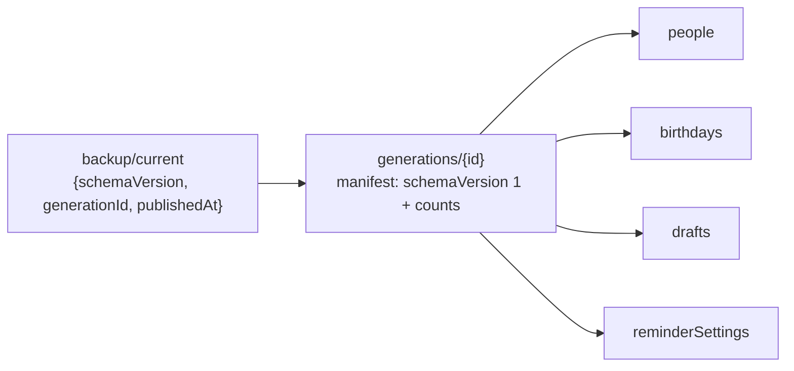

The manifest carries counts only (no hash); restore validates counts and every record. The target contract (`partHash`, `manifestHash`, `integrity`, `baseSchemaVersion`, chunked parts, D2-005-18) is not implemented because the client writes directly to Firestore over REST instead of calling a backup callable. Backup is **plaintext, owner-scoped** (ADR-04).

### 7.8 Target data model versus implemented

The logical target model (D1-I-0149, D1-I-0494, D2-005-xx) differs from the implementation in recorded ways: per-cycle durable occurrences (implemented as one mutable row per person), append-only draft revisions (implemented as one mutable draft row with a monotonic `revision` counter), append-only delivery events with user-confirmation facts (confirmation is a `confirmed` outcome event **and** `confirmedSent` on the draft), a materialised `ReminderSchedule` (computed only), an `AiJob`-specific table (generic `jobs`), and an `EntitlementSnapshot` with `PENDING`/`REVOKED` (client cache; server `active|expired|none`). These are decision items — see [Appendix A](#appendix-a--superseded-rejected-and-unimplemented-target-statements) and [Appendix B](#appendix-b--registered-decisions-and-dependencies).

---

## 8. API architecture

### 8.1 Surface and conventions

`[IMPLEMENTED]` — [backend/functions/src/functions/index.ts](backend/functions/src/functions/index.ts) exports **20** functions in region `asia-south1`: **18 `onCall` callables and 2 `onSchedule` sweepers** (D3-I-020, D1-I-0489). Earlier documents said "19 callables + 2 schedulers" (wrong) or listed 17 (wrong); the code is authoritative.

Conventions shared by every callable (`commonOptions`):

| Setting | Value |
|---|---|
| App Check | `enforceAppCheck: true`, `consumeAppCheckToken: true` (replay protection; **no production bypass**, including `verifyPurchase`) |
| Limits | timeout 30 s, 256 MiB, `maxInstances: 20`, `concurrency: 20`, `minInstances: 0` |
| Identity | service account from param `CONTROL_PLANE_SERVICE_ACCOUNT` |
| Secret | `claimOccurrence` and `claimTest` additionally bind the JSON secret `COORDINATION_HMAC_KEYRING` (`secretOptions`) |
| Validation | every request is parsed by a **strict zod schema** (`contractVersion` literal `1`, unknown keys rejected) → `invalid-argument: INVALID_REQUEST` |
| Failure mapping | `safeCall` passes `HttpsError` through; any other error becomes `unavailable: COORDINATION_UNAVAILABLE` and is deliberately ambiguous (never a "no write" proof) |
| Schedulers | `every 1 minutes`, `Etc/UTC`, 300 s timeout, `maxInstances: 1` |

### 8.2 Export inventory and auth matrix

Auth levels: **A** = Firebase Auth + App Check (`requireAuthenticated`: error `unauthenticated: AUTHENTICATION_REQUIRED`); **A+R** = A plus **recent Google re-authentication**; **S** = signed-out + App Check; **—** = scheduler (no caller).

| ID | Export | Request schema | Auth | Caller in this repo |
|---|---|---|---|---|
| API-001 | `registerAndroidInstallation` | `registrationSchema` | A | none |
| API-002 | `renewSenderLease` | `leaseSchema` | A | none |
| API-003 | `changeAccountMode` | `accountModeSchema` (`PAUSE_FOR_REPAIR` \| `ACTIVATE_AUTOMATION`) | A | none |
| API-004 | `claimOccurrence` | `birthdayClaimSchema` (+HMAC secret) | A | none |
| API-005 | `claimTest` | `testClaimSchema` (+HMAC secret) | A | none |
| API-006 | `armAttempt` | `armSchema` | A | none |
| API-007 | `getArmStatus` | `armSchema` | A | none |
| API-008 | `reportTestOutcome` | `testReportSchema` | A | none |
| API-009 | `authorizeSafeRetry` | `retrySchema` | A | none |
| API-010 | `beginSenderTransfer` | `transferSchema` | A+R | none |
| API-011 | `completeSenderTransfer` | `transferSchema` | A+R | none |
| API-012 | `requestAccountDeletion` | `deletionSchema` `{contractVersion, requestId(UUIDv4)}` | A+R | Hosting `/delete/` |
| API-013 | `accountDeletionReceipt` | `deletionReceiptSchema` `{contractVersion, receiptId(UUIDv4)}` | **S** (`failed-precondition: SIGNED_OUT_REQUIRED` if signed in) | Hosting `/delete/` |
| API-014 | `resetContactDerivedState` | `contactDerivedResetSchema` | A+R | none |
| API-015 | `releaseAndroidSender` | `senderReleaseSchema` | A+R | none |
| API-016 | `coordinationLifecycleStatus` | `coordinationLifecycleStatusSchema` | A | none |
| API-017 | `companionStatus` | `companionStatusSchema` | A | none |
| API-018 | `verifyPurchase` | `verifyPurchaseSchema` | A | Flutter `SubscriptionNotifier` |
| API-019 | `sweepDeletionDrains` | — | — | scheduler (`DeletionOrchestrator.sweep`) |
| API-020 | `sweepCoordinationOperations` | — | — | scheduler (`CoordinationOperationOrchestrator.sweep`) |

**Recent-authentication rule (A+R).** `auth_time` within 5 minutes (plus 60 s clock skew), `sign_in_provider == google.com`, and **exactly one** `google.com` identity. Errors: `failed-precondition: RECENT_AUTHENTICATION_REQUIRED` or `RECENT_GOOGLE_REAUTHENTICATION_REQUIRED`. Security reasoning for these checks lives in SECURITY.md §3.3 and §4.4.

### 8.3 Request schemas

All strict; `ledgerGeneration` 8–64 chars `[A-Za-z0-9._-]`; `installationId` 32 lowercase hex; `senderEpoch`/`resetGeneration` positive safe integers; `distributionChannel` ∈ `DEV|STAGING|RESTRICTED_LAB|PLAY|DIRECT_MANAGED`; hashed identifiers are 64-hex SHA-256 pre-hashes (the server derives HMAC aliases — raw contacts and destinations never reach the backend).

| Schema | Fields beyond the shared "binding" (`contractVersion, ledgerGeneration, installationId, senderEpoch, resetGeneration, appBuildNumber, policyVersion, distributionChannel`) |
|---|---|
| `registrationSchema` | binding subset only (no epoch/reset) |
| `leaseSchema` | `purpose` ∈ `BIRTHDAY|TEST` |
| `birthdayClaimSchema` | `purpose: BIRTHDAY`, `claimRequestId` (uuid), `recipientPrehashAliases` 1–2, `destinationPrehashAliases` 1–2 |
| `testClaimSchema` | `purpose: TEST`, `testRequestId`, `testConfigurationPrehash`, `testDestinationPrehash` |
| `armSchema` | `purpose`, `claimId`, `armRequestId`, `attempt` ∈ {1,2} |
| `retrySchema` | `purpose: BIRTHDAY`, `claimId`, `retryRequestId`, `proof` ∈ `ALL_PARTS_RADIO_OFF|ALL_PARTS_NO_SERVICE|OTHER` |
| `accountModeSchema` | `action: PAUSE_FOR_REPAIR`, or `ACTIVATE_AUTOMATION` + `testClaimId`, `boundTestReceiptPrehash`, `readinessContractVersion` |
| `testReportSchema` | `purpose: TEST`, `testClaimId`, `armRequestId`, `result` ∈ `SENT_ALL_PARTS|FAILED_ZERO_ACCEPTED|FAILED_OR_UNKNOWN|CLEANUP_CANCELLED` |
| `transferSchema` | `targetInstallationId` |
| `deletionSchema` / `deletionReceiptSchema` | `requestId` / `receiptId` (canonical lowercase UUIDv4) |
| `contactDerivedResetSchema` | `requestId` (UUID v1–8) |
| `senderReleaseSchema` | `requestId`, `installationId`, `senderEpoch`, `resetGeneration` |
| `verifyPurchaseSchema` | `contractVersion: 1`, `purchaseToken` 1–1024, `productId` 1–128, `packageName` 1–128, `accountBinding` 16–128 chars `^[A-Za-z0-9._-]+$` |

### 8.4 Response contracts

| Callable | Response |
|---|---|
| `verifyPurchase` | `{status: 'active'|'expired'|'none', productId, expiryDateMs, canUseAi, isAutoRenewing}` — flat object, no `operationId`, no `PENDING`/`REVOKED` |
| `requestAccountDeletion` | Union discriminated by `kind`: `STARTED` \| `REPLAYED` → `{receiptId, tombstone{schemaVersion, requestKey, stage, drainUntilMs, createdAtMs, updatedAtMs, cleanupAtMs?}, fence{mode:'DELETING', senderEpoch, resetGeneration, deletionDrainUntilMs}|null}`; or `REFUSED` → `{reason: COORDINATION_OPERATION_IN_PROGRESS|REQUEST_MISMATCH}` |
| `accountDeletionReceipt` | `IN_PROGRESS{requestedAtMs, updatedAtMs}` \| `COMPLETED{requestedAtMs, completedAtMs, appAccountDeleted:true, serverDataDeleted:true, externalCopiesNotDeleted:true}` \| `NOT_FOUND` |
| Coordination callables | Decision unions defined in `services/controlPlane.ts` / `domain/*`; because no client consumes them they are **not frozen public contracts** |

`accepted ≠ completed`: the first deletion response only accepts the request; completion is proven only by `COMPLETED` (and the Hosting page says so). `NOT_FOUND` is treated as unknown, not success or failure.

### 8.5 Error model

Errors are Firebase `HttpsError` with a **code** and a fixed **message token**; clients map only these fixed classes (never raw provider text).

| HttpsError code | Message tokens |
|---|---|
| `unauthenticated` | `AUTHENTICATION_REQUIRED`, `APP_CHECK_REQUIRED` |
| `failed-precondition` | `RECENT_AUTHENTICATION_REQUIRED`, `RECENT_GOOGLE_REAUTHENTICATION_REQUIRED`, `SIGNED_OUT_REQUIRED`, `ACCOUNT_DELETION_IN_PROGRESS` (purchase) |
| `invalid-argument` | `INVALID_REQUEST`, `PACKAGE_MISMATCH`, `INVALID_PRODUCT` (purchase) |
| `permission-denied` | `PURCHASE_ACCOUNT_MISMATCH` |
| `unavailable` | `COORDINATION_UNAVAILABLE`, `GOOGLE_PLAY_VERIFICATION_UNAVAILABLE`, `SUBSCRIPTION_OWNERSHIP_STORE_UNAVAILABLE` |

The target error envelope `{error:{code,message,retryable,operationId}}`, the category set (`RECENT_AUTH_REQUIRED`, `RATE_LIMITED`, `CONFLICT`, …), `operationId`, response `contractVersion` and `retryAfterMs` (D2-004-10, D2-005-15/16, D1-I-0486) are **`[NOT IMPLEMENTED]`**: the backend uses `HttpsError` codes, and the earlier suggestion to either adopt the envelope or document the mapping is resolved here by documenting the mapping above. Rate limits exist only as the platform's `maxInstances`/`concurrency` and sender-coordination budgets (`armBudgets`); no general per-user API rate limit exists (D1-I-0488, `[OPEN]`).

### 8.6 Purchase verification contract (API-018)

`[IMPLEMENTED]` — [subscriptionVerification.ts](backend/functions/src/services/subscriptionVerification.ts) (D1-I-0157, D3-I-022, D4-004-06).

1. Require Auth + App Check; parse the strict schema.
2. `packageName == com.yashsomani.ai_birthday` else `invalid-argument: PACKAGE_MISMATCH`; `productId == ai_birthday_pro_monthly` else `INVALID_PRODUCT`.
3. Refuse if the account is being deleted: `failed-precondition: ACCOUNT_DELETION_IN_PROGRESS` (A4-004).
4. Query Google Play `subscriptionsv2` for the token. Entitled states: `ACTIVE`, `IN_GRACE_PERIOD`, and `CANCELED` **with a future expiry**. Play HTTP 400/404/410 → record `none`; other Play errors → `unavailable: GOOGLE_PLAY_VERIFICATION_UNAVAILABLE` (fail closed, no entitlement change).
5. **Ownership and binding (one fenced transaction, shared with the deletion check):** if `subscriptionPurchaseOwnership/{sha256(token)}` exists and belongs to a **different uid** → `permission-denied: PURCHASE_ACCOUNT_MISMATCH`; if it belongs to the **same uid**, a changed Play binding is tolerated (reinstall/restore); if it does not exist, an `accountBinding` that differs from Play's `obfuscatedExternalAccountId` (when Play supplies one) is denied, otherwise the ownership document `{uid, createdAt}` is created.
6. Unless the token is entitled, an already-active entitlement from a **different** token is preserved and returned. Otherwise `users/{uid}/entitlement/status` is merged with `{status, productId, expiryDateMs, canUseAi, isAutoRenewing, acknowledgementState, accountBinding, purchaseTokenHash, verifiedAtMs, updatedAt}`. Failures of the transaction surface as `SUBSCRIPTION_OWNERSHIP_STORE_UNAVAILABLE`.
7. `canUseAi` is derived server-side; the client's claimed status is never trusted.

### 8.7 Caller matrix and the client transport

| Caller | Calls | Transport |
|---|---|---|
| Flutter app | `verifyPurchase` only | Raw HTTPS POST using the callable wire protocol (no Firebase Functions SDK): body `{data: {…}}` to `https://asia-south1-<project>.cloudfunctions.net/verifyPurchase` with `Authorization: Bearer <Firebase ID token>` and `X-Firebase-AppCheck: <limited-use token>`; response `result` (legacy `data` also accepted) |
| Hosting `/delete/` | `requestAccountDeletion`, `accountDeletionReceipt` | Firebase web SDK `httpsCallable` in `asia-south1`, reCAPTCHA Enterprise App Check, limited-use tokens |
| Android native | none | `firebase/reference/*.kt` clients are reference material only |
| Operators / future automation | API-001..011, 014..017 | none today (GAP-16; D3-I-012, D3-I-023) |

The pre-purchase **probe** (`POST {data: {}}`; HTTP 200 or 400 = reachable; anything else blocks billing) prevents charging a user when the verifier is unreachable (D4-004-06).

### 8.8 Hosting-to-callable calls

The public site (`backend/hosting/src/app.ts`, `deletion-contract.ts`) obtains Firebase web config from `/__/firebase/init.json`, activates reCAPTCHA Enterprise App Check **before** Auth/Functions, keeps Auth in memory only, calls `reauthenticateWithPopup` immediately before deletion, and submits `{contractVersion: 1, requestId: <UUIDv4>}`. A pending request id is journalled only in tab `sessionStorage` so an ambiguous result can be recovered; the response is validated strictly (exact key sets, echoed receipt, WebCrypto-derived request hash, ordered timestamps) before the UI reports "accepted". It signs out only when the SDK resolves with `currentUser === null`, then polls `accountDeletionReceipt` signed-out. UI and CSP details: SECURITY.md §9.2–§9.4; release gates: [§11](#11-infrastructure-and-deployment-architecture).

### 8.9 API governance

Each endpoint's method/path/auth/schema/errors/idempotency/PII class/retry/test coverage is tabulated above or in the sections referenced; **no contract is invented for code that was not inspected** and a callable's existence does not approve it as a core product endpoint (D1-I-0166, D2-005-21). Control-plane operations carry strict authorisation, App Check, per-installation identity, fencing by `senderEpoch`/`resetGeneration`, lease expiry and replay-safe idempotency keys (`claimRequestId`, `armRequestId`, `retryRequestId`, `requestId`); coordination design (D4-008-02): one active Android installation with monotonically increasing sender epochs, modes `TEST_ONLY`, `PAUSED_REPAIR`, `AUTOMATION_ACTIVE`, `TRANSFER_PENDING`, `DELETING`, HMAC-aliased recipient/destination guards and a separate `TEST` namespace — **built and tested, not called by the app** (CF-D4-006). Required contract list and API-document template (D1-I-0487, D2-005-21): purchase verification, backup manifest, account deletion, AI (BYOK direct, no backend proxy), messaging handoff, platform capability — of these, only purchase verification and account deletion are server APIs; backup is a client-to-Firestore REST contract ([§6.9](#69-cloud-sync)).

---

## 9. Data flows and state machines

### 9.1 Data flows (FLOW-001 … FLOW-008)

| ID | Flow | Execution chain | Failure behaviour (ERR) |
|---|---|---|---|
| FLOW-001 | Launch → database preflight → onboarding guard → shell | `main()` → global error handlers → timezone → `bootstrapFirebase` → `databaseStartupProvider` (`SELECT 1`, 10 s) → router redirect through `OnboardingGate` → shell → `reminderBootstrapProvider` replans if stale ([§4.1](#41-startup-and-bootstrap-flow-001-state-001)) | **ERR-001** database timeout/open failure → recovery screen with retry; Firebase failure never blocks startup |
| FLOW-002 | Person form/import → validation → application service → repository → SQLite | `PersonInputValidator` → `PersonService` (engine resolves occurrence) → `DriftPeopleStore` transaction → `resyncReminderSchedule` ([§6.1](#61-people)) | **ERR-002** field/row diagnostics; `importValidRows` keeps valid rows and reports invalid ones |
| FLOW-003 | Person → occurrence → reminder plan → Android notification | `BirthdayLifecycleService.refresh` → `ReminderService.sync` → `ReminderScheduler` → `NotificationSchedulerGateway.apply` → `AlarmManager` → `BirthdayNotificationReceiver` → tap → `/message-studio/person/:id` ([§6.3](#63-reminders), [§5.2](#52-receivers-and-alarm-recovery)) | **ERR-003** missing person/birthday or stale route → recoverable `_NotFoundScreen`/studio message; denied permission → reminders degrade to in-app only |
| FLOW-004 | Studio request → durable AI job → provider → draft → user review | Studio enqueues `ai_generate` → `JobWorker` → `AiGenerationJobHandler` → `AiRouter` (entitlement → Nano / user key) → guarded apply (`saveDraftAndUpdateBirthday`) → studio stream shows the draft; the user reviews and edits ([§6.4](#64-message-studio-and-the-ai-router), [§6.5](#65-jobs)) | **ERR-004** locked/unavailable/timeout → typed `AppFailure`, retry or manual draft; stale results dropped and surfaced as "not applied" |
| FLOW-005 | Reviewed draft → handoff → delivery event → explicit confirmation | `_performHandoff` → URI builder → `url_launcher`/share/clipboard → `recordHandoffAndMarkHandedOff` → user returns → `confirmHandoff` → `completed` ([§6.6](#66-delivery)) | **ERR-005** handoff unavailable → report failure, never infer "sent"; retry record kept |
| FLOW-006 | User-initiated backup → immutable generation → manifest/pointer | Settings → `cloud_sync` job → `CloudSyncService.backup` ([§9.3](#93-sequence-diagrams)) | **ERR-006** auth/network/manifest failure → error surfaced, **local data preserved**, nothing published (pointer unchanged) |
| FLOW-007 | Play purchase → authenticated App Check verifier → entitlement | `SubscriptionNotifier` → probe → Play sheet → `verifyPurchase` → Play API → Firestore transaction → client cache ([§9.3](#93-sequence-diagrams)) | Verifier unreachable → billing blocked before purchase; verification failure → purchase left unacknowledged, retried via Restore |
| FLOW-008 | Public deletion request → reauthentication/App Check → deletion saga → private receipt | Hosting `/delete/` → `requestAccountDeletion` → saga stages → `accountDeletionReceipt` ([§9.3](#93-sequence-diagrams)) | **ERR-008** missing public release config → deletion control disabled with warning; **ERR-007** SMS capability/permission/gate unavailable → automation disabled or cancelled |

### 9.2 State machines

Each state machine lists what changed with the recent fixes.

#### STATE-001 — Application startup

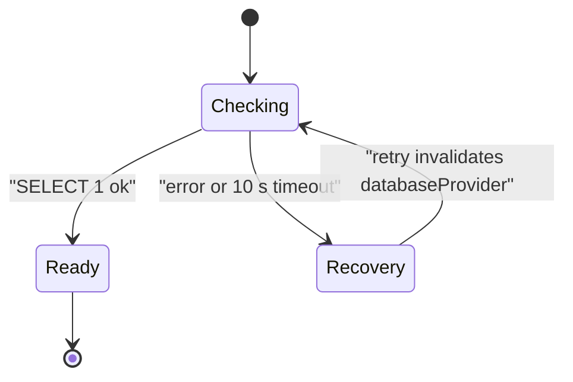

Changed: global error handlers are installed before everything else (A3-009); Firebase bootstrap failure is non-fatal.

#### STATE-002 — Onboarding

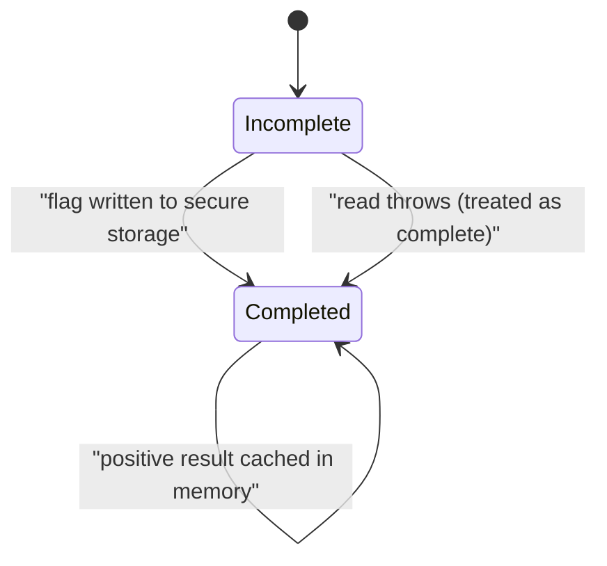

Changed (A3-010): a storage read error counts as complete; only a positive result is cached. The first-run default is "incomplete".

#### STATE-003 — Birthday occurrence status

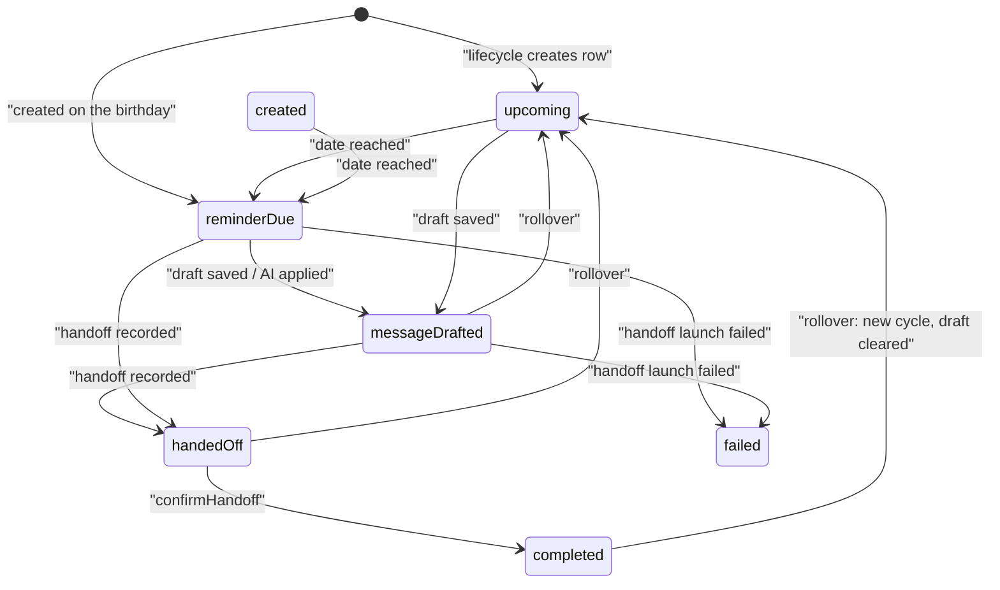

Notes: `isActionNeeded` ⇒ `reminderDue`, `messageNotPrepared`, `messageDrafted`, `failed`. The enum values `created`, `messageNotPrepared`, `messageReviewed` and `readyForDelivery` are **declared and rendered but no production code path assigns them** (found by static search of `BirthdayStatus.<value>` writes); they are reserved vocabulary, and the specification's `skipped`/`confirmedSent` states do not exist (delivery confirmation lives in `DeliveryEvents` and on the draft). The three lifecycle vocabularies (specification, proposed model, code) are reconciled to the code enum here (CF-D1-005, D2-027-13). Refresh only auto-promotes date-derived states and never resets workflow states inside a cycle (D2-027-12, `[IMPLEMENTED]`).

Changed: the stored `date` is calendar text, so refresh no longer misreads a recipient-timezone date as a new cycle on every run (A1-001); duplicate person rows are collapsed instead of throwing (A1-009).

#### STATE-004 — Draft, AI job, handoff and sent status

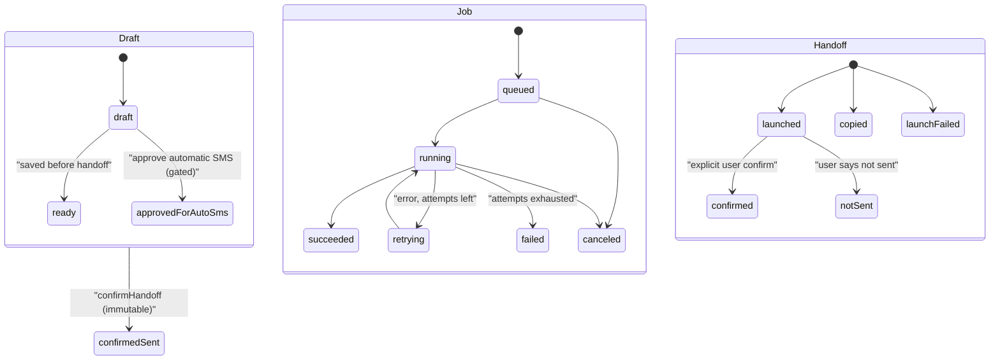

Rules: handoff ≠ confirmation; only an explicit user action writes `confirmed`/`notSent`; a `confirmedSent` draft is immutable and any later content becomes a new revision row. A job result is dropped (`JobSkipped`) when canceled, the cycle changed, the draft is newer, or the compare-and-set loses.

Changed (A2-004): `message_drafts.revision` plus `expectedCurrentDraft` make "AI overwrote a newer edit" impossible; AI payload carries `draftRevision`.

#### STATE-005 — Reminder preference versus OS alarm

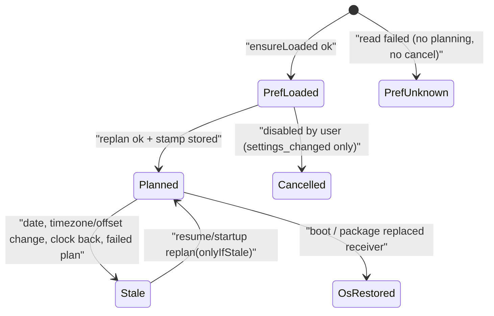

Preference state (SQLite) and OS state (AlarmManager + `scheduled_reminders_prefs`) are separate; the plan stamp is the reconciliation evidence. Changed (A1-002/003/010): bootstrap provider, stamp, `ensureLoaded`, serialised replan, `syncError`. Still open: native `TIMEZONE_CHANGED`/`TIME_SET` receivers (A1-007) and exact-alarm re-grant recovery.

#### STATE-006 — Cloud job and backup generation

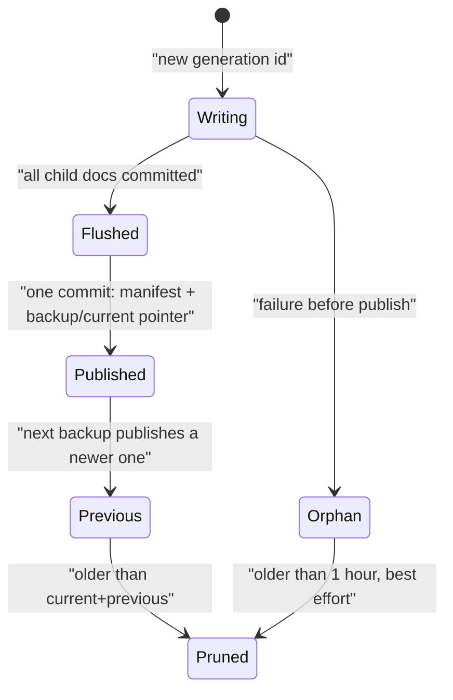

Job states follow STATE-004's `Job`; `cloud_sync` auth state is resolved at run time. Changed (A3-002/A4-006): retention pruning (keep current+previous, delete older and orphans >1 h, ≤5 per run, best-effort); backup timestamps are UTC (A3-014).

#### STATE-007 — Server sender lease, claim, arm and deletion

Account modes: `TEST_ONLY`, `PAUSED_REPAIR`, `AUTOMATION_ACTIVE`, `TRANSFER_PENDING`, `DELETING`.

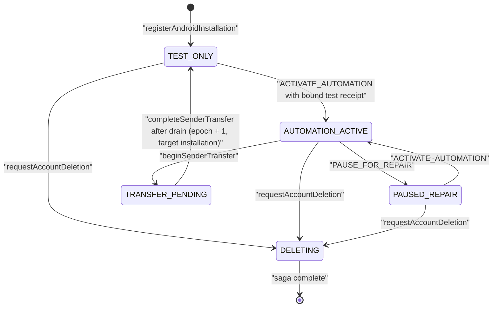

Deletion tombstone stages: `DRAINING → PURGING → AUTH_DELETION_PENDING → VERIFYING → finalized` (the tombstone is removed after its `cleanupAt`). Claim → arm → outcome handling is fenced by `(senderEpoch, resetGeneration)` and idempotent request ids. Changed (A4-002/004/005): deletion purges `subscriptionPurchaseOwnership` by uid; `verifyPurchase` refuses while deleting; Firestore rules consult the tombstone as well as presence. Initial registration creates the fence in `TEST_ONLY` (epoch 1); `ACTIVATE_AUTOMATION` is accepted only from `TEST_ONLY` or `PAUSED_REPAIR`; a completed transfer returns the account to `TEST_ONLY` with `senderEpoch + 1`. Edges from other modes into `PAUSED_REPAIR` and `DELETING` were not traced exhaustively.

### 9.3 Sequence diagrams

#### Purchase (FLOW-007)

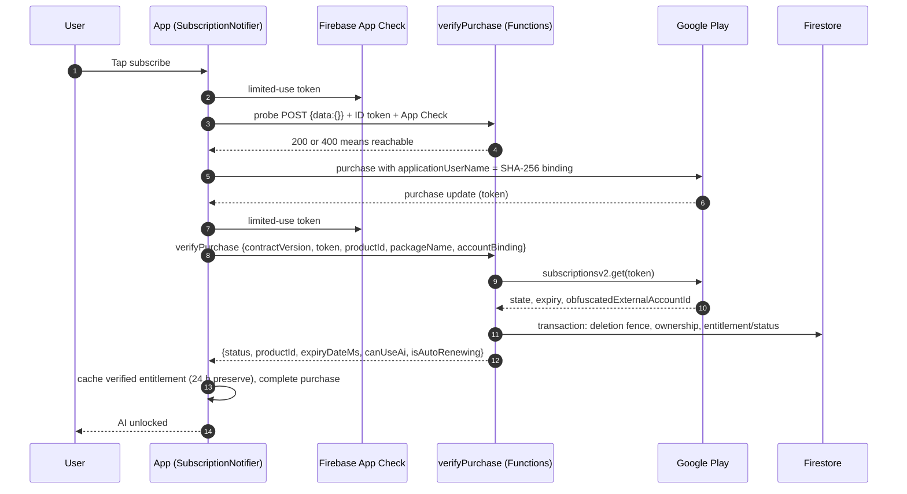

If any step before 13 fails, the purchase stays unacknowledged so Play re-emits it, and Restore retries. A probe failure blocks the Play sheet entirely.

#### Backup (FLOW-006)

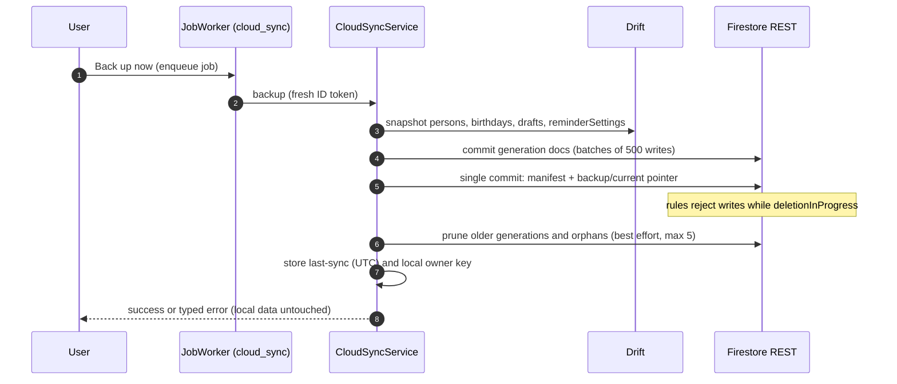

Restore reverses it: read pointer → manifest → children, validate counts and every record, then apply in one local transaction using the merge rules in [§6.9](#69-cloud-sync).

#### Account deletion (FLOW-008)

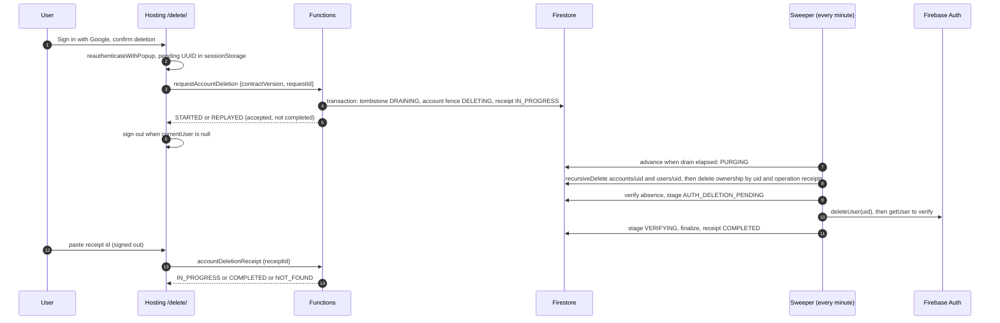

The saga is **asynchronous and repairable**: each stage is re-entrant and the sweeper records `nextSweepAtMs`/attempt counts. External copies (Google account, Play purchase history, other backups) are not deleted, which the `COMPLETED` response states explicitly (`externalCopiesNotDeleted: true`). **No in-app delete-backup or delete-account control exists** (A3-003) — deletion is reachable only through the public page or an operator.

---

## 10. External integrations

Each integration lists its trust boundary and the **failure fallback** (the app never blocks core local functionality because an external system is unavailable). Verified at the working tree.

| ID | Integration | Boundary and contract | Failure fallback | Status |
|---|---|---|---|---|
| EXT-001 | SQLite via Drift | In-process; `ai_birthday` database; schema v7 ([§7](#7-data-architecture)) | Startup probe → recovery screen with retry (ERR-001); migrations idempotent | `[IMPLEMENTED]` |
| EXT-002 | Secure storage (`flutter_secure_storage`) | Android Keystore-backed store for tokens, Gemini key, caches ([§7.5](#75-crud-ownership-and-retention-matrix)) | Read failure: onboarding treated as complete; entitlement cache ignored (free tier); auth state unauthenticated | `[IMPLEMENTED]` |
| EXT-003 | Android notifications and exact alarms | MethodChannel `notifications`; `AlarmManager`; `POST_NOTIFICATIONS`, `SCHEDULE_EXACT_ALARM` ([§5](#5-native-android-integration)) | Permission denied → reminders unavailable but data intact; exact alarm denied → permission request flow in settings; boot/replace receiver restores future triggers | `[PARTIAL]` — no timezone/time-set receivers |
| EXT-004 | Contacts | MethodChannel `contacts` (`fetchDeviceContacts`), `READ_CONTACTS`; CSV import via `file_picker` | Permission denied → manual add / CSV; import review reports invalid rows | `[IMPLEMENTED]` |
| EXT-005 | User Gemini API (BYOK) | HTTPS to `https://generativelanguage.googleapis.com/v1beta`, default model `gemini-3.5-flash-lite`, key in secure storage, 30 s timeout; requires Pro entitlement | Timeout → `aiTimeout` (retryable); invalid key → `aiCredentialInvalid`; no key and no Nano → `aiCredentialMissing`; manual drafting always available | `[IMPLEMENTED]` |
| EXT-006 | AICore / Gemini Nano | MethodChannel `nano`; ML Kit GenAI Prompt `1.0.0-beta4` ([§5.3](#53-gemini-nano)) | `unavailable`/`downloadable`/`error` states shown; forced-Nano request fails with `aiNanoUnavailable`; otherwise falls through to the user key | `[IMPLEMENTED]` (device matrix `[OPEN]`) |
| EXT-007 | Firebase Auth / Google Sign-In | `google_sign_in` 7.x → Identity Toolkit `accounts:signInWithIdp` → `securetoken` refresh; 30 s timeouts; App Check not applied to these REST calls (A3-004, `[OPEN]`) | 400/401 on refresh → credentials invalidated, signed out; other failures surface as `networkUnavailable` and keep the stored session | `[IMPLEMENTED]` |
| EXT-008 | Firestore backup | REST `documents:commit` under `users/{uid}/…` ([§6.9](#69-cloud-sync), [§7.6](#76-firestore-path-template-inventory-28-templates)) | Failure → typed error, **local data preserved**, previous generation remains current; rules block writes while deletion is in progress | `[IMPLEMENTED]` |
| EXT-009 | Google Play Billing (client) and Play Developer API (server) | `in_app_purchase` product `ai_birthday_pro_monthly`; server `subscriptionsv2` ([§8.6](#86-purchase-verification-contract-api-018)) | Store unavailable / probe fails → billing blocked with a specific `PurchaseFailure`; verification fails → purchase left unacknowledged, Restore retries; 24 h cached entitlement then downgrade | `[IMPLEMENTED]` |
| EXT-010 | WhatsApp Click-to-Chat | `https://wa.me/<digits>?text=<encoded>` via `url_launcher`; handoff only | Launch failure → `launchFailed` event, birthday `failed`, user can copy or share instead; number without 7–15 valid digits is rejected | `[IMPLEMENTED]` |
| EXT-011 | SMS composer and gated `SmsManager` | `sms:` URI via `url_launcher` (all flavors); direct `SmsManager` only in `personal` flavor behind `ENABLE_AUTOMATIC_SMS` **and** the native constant ([§5.4](#54-flavors-and-the-gated-sms-path)) | Composer failure → `launchFailed`; gated path unavailable → automation hidden/cancelled (ERR-007) | `[PARTIAL]` — automation gated off |
| EXT-012 | Share sheet and clipboard | MethodChannel `share`; `Clipboard` | Failure reported as a delivery failure; clipboard records `copied`, never "sent" | `[IMPLEMENTED]` |
| EXT-013 | App Check, plus reCAPTCHA Enterprise on Hosting | Mobile: Play Integrity (`AndroidDebugProvider` in debug); web: `ReCaptchaEnterpriseProvider` with a site key from runtime config; functions enforce and consume tokens | Missing/failed attestation → callable rejects (`unauthenticated`), cloud features fail closed; missing site key → deletion control disabled (ERR-008) | `[PARTIAL]` — not on Firestore REST/Identity Toolkit; site key and Enterprise registration are out-of-repo release gates |
| EXT-014 | Targeted social-app text handoff | Android `ACTION_SEND` with `text/plain`, full message and explicit package target for Instagram, Snapchat or LinkedIn; package visibility queries in `AndroidManifest.xml` | Platforms may reject text-only sharing and do not provide a public arbitrary-recipient DM prefill contract. No compatible activity → failed handoff; device-level behavior is unverified. | `[IMPLEMENTED]` source and channel tests; device compatibility unverified |

Integration contracts summarised from the integration register (D1-I-0155..0165, D2-005-22): Google identity (scopes, token exchange, refresh, revocation, sign-out); Play (product id, token handling, acknowledgement, restore, pending/expired states); purchase verifier (Auth + App Check, schema, package/product binding, idempotency, error taxonomy); Firestore backup (UID authorisation, opt-in, manifest, atomic generation, deletion propagation); Gemini BYOK (entitlement first, key in secure storage, timeout/quota handling, no key logging); Nano (capability discovery, download/readiness, busy/quota/error, cancellation); alarms (permission, exact alarm, reboot, timezone, cancellation); WhatsApp (digit normalisation, URI encoding, no send confirmation — the app does **not** normalise to E.164 and relies on digits-only validation, DEC-028 `[OPEN]`); SMS (flavor capability, permission, consent, stale guard, duplicate protection); Hosting (release config, legal review, identity, App Check, CSP, verified deletion status); Autopilot callables (strict schemas, auth/App Check, fencing, replay protection, rate limits, deployment proof — the last is missing).

---

## 11. Infrastructure and deployment architecture

**This section describes what the repository evidences. Deployment itself is not evidenced**: `backend/README.md` states the control plane is not deployed, and the Hosting site is deliberately undeployable without an out-of-repo release configuration. Nothing here should be read as "live".

### 11.1 What exists in the repository

| Component | Evidence |
|---|---|
| Firebase project | Default id `relateai-birthday-ysoman-a2372` (`backend/.firebaserc`, `FirebaseConfig`); region `asia-south1`; Functions runtime `nodejs22` |
| Functions configuration | `CONTROL_PLANE_SERVICE_ACCOUNT` param; `COORDINATION_HMAC_KEYRING` JSON secret (not in repo); App Check enforced and consumed ([§8.1](#81-surface-and-conventions)) |
| Firestore policy | `backend/firestore.rules` (deny by default), `ttl-policies.json` (12 groups on `cleanupAt`), `firestore.indexes.json` (field overrides only) |
| Hosting policy (`firebase.json`) | CSP, COOP, CORP, Permissions-Policy, Referrer-Policy, HSTS, `X-Frame-Options`, `nosniff`; `cleanUrls`, `trailingSlash`; `no-store` for HTML and `runtime-config.json`; immutable cache for `/assets/**`; routes `/`, `/delete/`, `/privacy/`, `/terms/`, `/support/`; predeploy `build:release`. Header rationale: SECURITY.md §9.2–§9.3 |
| CI | Three jobs ([§2.4](#24-build-and-ci)); the Functions job runs emulator tests; artifacts: `play` and `personal` APKs |
| Android release | Signing only from a complete `android/key.properties` (template `key.properties.example`); flavors `play`/`personal`; `build-and-install-android.bat` helper |
| Local development | Firebase emulators for the Functions emulator suites; `flutter test`; Hosting `npm run check` |

### 11.2 Hosting release gate

`npm run build` produces a fail-closed preview (no `runtime-config.json`, deletion control disabled). `build:release` (invoked by Firebase predeploy) refuses unless a private config at `BIRTHDAY_HOSTING_RELEASE_CONFIG_PATH` satisfies the contract: `schemaVersion: 1`; `publicBaseUrl`, `developerDisplayName`, `supportUrl` (different origin from the static site), `recaptchaEnterpriseSiteKey`, `privacyEffectiveDate`, `termsEffectiveDate`; private evidence references for legal, privacy, Hindi copy and admin-deletion runbook; and two booleans — `verifiedAdminDeletionWorkflowTested` and `productionFirebaseDeletionSagaTested` — that may be set only after those flows are proven end-to-end. Only a fixed public subset is emitted as `/runtime-config.json`; no secret, token, service account, HMAC pepper or user identity may appear in it.

### 11.3 Not evidenced (release gates owned outside the repository)

- A deployed Functions project, deployed Hosting site and public URL; production Firebase tier; authorised sign-in domain.
- Provisioned secrets (`COORDINATION_HMAC_KEYRING`), App Check registration (Play Integrity, reCAPTCHA Enterprise), Play Console app/product, service-account Play API access.
- Release signing keystore, AAB build, store listing, `npm audit` result, CSP browser test, on-device UI run (fix ledger "not run").
- Monitoring, alerting, backup/restore drills for Firestore, incident runbooks — see OPERATIONS.md for the operating procedures that exist.
- A verified admin-deletion workflow for users who lost Google access.

### 11.4 Component diagram

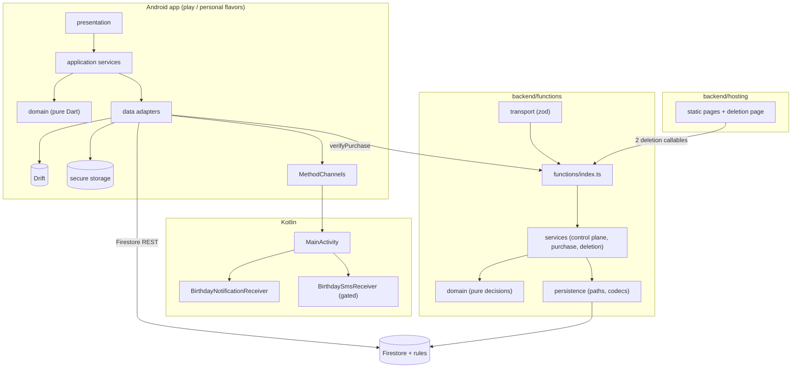

---

## 12. Architecture decision records

Format per ADR: **Context → Decision → Status → Consequences**. Status values: *Accepted* (in force and implemented), *Accepted (observed)* (in force; rationale not recorded in the sources), *Superseded*, *Open*. Reversal triggers are listed where a decision is conditional. "Resolved contradiction" marks ADRs that settle a disagreement between legacy documents and the code (details in the notes file and [Appendix A](#appendix-a--superseded-rejected-and-unimplemented-target-statements)).

### ADR-01 — Flutter UI with a thin Kotlin adapter
- **Context:** One developer, Android-first product needing OS alarms, contacts, on-device AI and optional SMS.
- **Decision:** Flutter/Dart for all UI and logic; Riverpod for state and wiring, go_router for navigation, Drift for storage; Kotlin only where Flutter cannot reach the OS (five MethodChannels).
- **Status:** Accepted (D4-002-03).
- **Consequences:** Dart owns almost all behaviour and is unit-testable; native code stays small but hand-wired (no Pigeon, flat Kotlin package); iOS is not built (no `ios/` directory).

### ADR-02 — Local-first: SQLite is the source of truth
- **Context:** Birthdays and message drafts are personal data; the app must work offline and without an account.
- **Decision:** All operational data lives in Drift/SQLite; Firestore is an opt-in, owner-scoped backup; secrets live in secure storage (D3-I-026, D1-I-0493).
- **Status:** Accepted.
- **Consequences:** Core features need no network or account; cloud features fail closed; restore must merge into an existing local store, which drives the conflict rules in [§6.9](#69-cloud-sync).

### ADR-03 — Snapshot-generation backup, not bidirectional sync
- **Context:** Early drafts proposed record-level sync with tombstones; partial writes could leave an inconsistent cloud state (D4-024-01).
- **Decision:** Each backup is an **immutable complete generation** published by switching the `backup/current` pointer in the same commit as the manifest; restore validates everything then applies in one local transaction; multi-device sync is out of scope. Retention keeps current + previous generation.
- **Status:** Accepted; retention implemented in the working tree (A3-002/A4-006).
- **Consequences:** Atomic, easy to reason about; backup size grows with data (whole snapshot each time); restore needs explicit merge rules (newer-wins, tombstones, `confirmedSent` preservation). DEC-034/DEC-039 (sync of occurrences) stays `[OPEN]` and would reverse this.

### ADR-04 — Plaintext, owner-scoped backup (resolved contradiction)
- **Context:** One legacy description claimed an AES-GCM "backup/envelope" and zero-PII storage; the audits and the code show otherwise.
- **Decision:** Backup stores people, birthdays, drafts and reminder settings as **plaintext Firestore fields** under `users/{uid}`, protected by owner-only security rules, not end-to-end encryption. Secrets and the Gemini key are never included (D3-I-027).
- **Status:** Accepted; the AES-GCM claim is **superseded**.
- **Consequences:** The privacy copy must say backups are not end-to-end encrypted; Firestore holds recipient PII and message bodies, so deletion, retention and rules are critical (SECURITY.md §2.3, §6.3). Adding client-side encryption would be a new decision (key management, restore on a new device).

### ADR-05 — Entitlement-first AI routing; BYOK and Nano; no application Gemini proxy
- **Context:** AI is a paid feature, but the product must not hold users' prompts or fund inference.
- **Decision:** `AiRouter` checks `entitlement.canUseAi` before reading any credential or probing devices; then routes to Nano (if forced or no key) or the user's own Gemini key; there is no app-owned fallback and the backend is not an inference proxy (D1-I-0168, D4-004-07).
- **Status:** Accepted. Supersedes earlier "BYOK works without Pro" statements.
- **Consequences:** No inference cost or prompt custody; AI needs both Pro and either a key or Nano; failures are typed (`AppFailure`) and manual drafting always remains.

### ADR-06 — Server-verified entitlement; App Check always enforced
- **Context:** Client-side entitlement can be forged; an earlier design made purchase App Check conditional (`enforceAppCheckOnPurchase`).
- **Decision:** `verifyPurchase` requires Firebase Auth **and** a consumed App Check token on every call; the server alone writes `users/{uid}/entitlement/status` (rules deny client writes); the client only caches (24 h preserve) (D1-I-0157; A3-005 requires the client to obtain App Check before showing the Play sheet).
- **Status:** Accepted; the conditional flag is **superseded**.
- **Consequences:** Attestation failure blocks purchase; devices without Play Integrity cannot buy; App Check is not yet applied to the Firestore REST and Identity Toolkit calls (A3-004 open).

### ADR-07 — Purchase binding is a SHA-256 hash of the Firebase uid
- **Context:** A random per-device binding broke restores after reinstall and device change; a raw uid would be PII in Play.
- **Decision:** `accountBinding = SHA-256('ai-birthday-purchase-binding:v1:' + uid)` (64 hex), sent as Play's `applicationUserName` and verified against `obfuscatedExternalAccountId`; ownership of a token is pinned to the first uid in `subscriptionPurchaseOwnership/{sha256(token)}` (A3-001, A4-004).
- **Status:** Accepted; legacy stored random bindings are still honoured.
- **Consequences:** Stable across devices; the same uid may re-verify a token even if the binding changed; a token cannot move to another uid; ownership documents must be purged on account deletion (A4-002).

### ADR-08 — One mutable occurrence row per person with a unique index
- **Context:** The specification recommended one durable row per `(personId, cycleYear)` (DEC-026). The implementation used a single row `birthday-{personId}` that rolls over each year, and duplicate rows could exist.
- **Decision:** Keep one mutable row per person (`UNIQUE INDEX` on `birthdays.person_id`, schema v7); refresh de-duplicates by keeping the newest; rollover clears the draft link and deletes non-confirmed drafts/jobs for that row.
- **Status:** Accepted for now; DEC-026 **remains `[OPEN]`** (awaiting Product + Data approval) and DEC-032 (FK `ON DELETE RESTRICT`, NOT NULL birthday) is not implemented.
- **Consequences:** Simple queries and no per-year growth; historical occurrences (earlier years) are not distinguishable, and draft/delivery history is only as durable as `confirmedSent` rows. Reversal trigger: a requirement for per-year history, analytics, or occurrence sync.

### ADR-09 — Birthday date stored as calendar text (`yyyy-MM-dd`)
- **Context:** The `date` column stored an instant; reading it back converted through timezones and corrupted dates and cycles for recipient-timezone people (A1-001).
- **Decision:** Schema v7 stores a calendar string (`CalendarDateConverter`) and the migration re-derives dates from month/day/cycle.
- **Status:** Accepted. Supersedes the instant representation.
- **Consequences:** Dates are timezone-immune; any consumer must treat the value as a calendar date; timestamps elsewhere remain UTC instants.

### ADR-10 — Draft `revision` counter with compare-and-set (not append-only revisions)
- **Context:** Concurrent AI jobs and user edits could overwrite each other (A2-004); full append-only revisioning (DraftRevision) was specified but is large.
- **Decision:** Keep one mutable draft row per birthday plus a monotonic `revision`; every writer supplies `expectedCurrentDraft`; `confirmedSent` rows are immutable and later content becomes a new row id.
- **Status:** Accepted (interim); append-only history `[OPEN]`.
- **Consequences:** Eliminates silent overwrite; cloud restore does not yet carry `revision`; history of edits is not retained.

### ADR-11 — Durable serial job queue for AI generation and cloud sync
- **Context:** In-memory futures lost work on process death and could double-apply.
- **Decision:** A Drift `jobs` table with a serial event-driven worker, bounded retries (`maxAttempts`), backoff, timeout, startup recovery and cancel flags; results applied only through guarded writes (D1-I-0169).
- **Status:** Accepted; variations are sequential and not themselves durable (A2-012 `[PARTIAL]`).
- **Consequences:** Crash-safe and idempotent; single-flight throughput; formal heartbeat/deadline recovery (DEC-047) not yet adopted.

### ADR-12 — On-device reminder planning, recomputed idempotently
- **Context:** Alarms must survive reboots, timezone changes and app updates without a server.
- **Decision:** Plans are computed (never persisted as rows), registered with Android via one `apply` call, and protected by a **plan stamp** and a bootstrap that re-plans on startup/resume when stale; native receivers re-register persisted triggers after boot and package replace (A1-002/003/010).
- **Status:** Accepted; `[PARTIAL]` — no native time-zone/time-set receivers (A1-007).
- **Consequences:** No reminder table to keep in sync; a timezone change while the app is closed is corrected only at next launch.

### ADR-13 — Handoff-first delivery; SMS automation gated three ways
- **Context:** Play policy restricts `SEND_SMS`; unattended sending risks wrong or duplicate messages.
- **Decision:** The user sends; the app records handoff and requires explicit confirmation. Direct SMS exists only in the `personal` flavor behind a Dart flag **and** a native constant, both off; CI verifies the `play` APK manifest (D3-I-137, D4-004-12).
- **Status:** Accepted; automation `[PARTIAL]` (dormant).
- **Consequences:** Play-compliant by default; public marketing copy that promises unattended SMS conflicts with the shipped behaviour (A4-007 `[OPEN]`).

### ADR-14 — Firebase Auth and Firestore over REST, not client SDKs
- **Context:** The app depends only on `firebase_core` and `firebase_app_check`; Auth uses `google_sign_in` + Identity Toolkit REST and Firestore uses `documents:commit`.
- **Decision:** Direct REST calls with the Firebase ID token and explicit 30 s timeouts. The original rationale is not recorded in the sources.
- **Status:** Accepted (observed).
- **Consequences:** Small dependency surface and full control of batching and timeouts; App Check is not attached to these requests (A3-004), and rules rather than SDK behaviour carry all authorisation.

### ADR-15 — Control plane built ahead of any client
- **Context:** An "autopilot" sender-coordination design (one active installation, epochs, fenced claims, safe retry) was specified for unattended SMS.
- **Decision:** Implement and test the server side (15 sender/coordination callables with no client, plus the sweepers) while the client and deployment stay gated (D4-008-02, D1-I-0165).
- **Status:** Accepted (scope approved, integration and deployment gated).
- **Consequences:** Ships dormant server code and tests without a caller; diagrams must not imply it is live (D3-I-012); retained cost of maintaining unused code.

### ADR-16 — Account deletion as an asynchronous, fenced, repairable saga
- **Context:** Deletion spans Auth, backup, coordination state, purchase ownership and receipts, and must be safe against concurrent writes.
- **Decision:** A tombstone/fence (`DRAINING → PURGING → AUTH_DELETION_PENDING → VERIFYING → finalized`) driven by a one-minute sweeper; rules and `verifyPurchase` refuse writes while deleting; receipts distinguish accepted from completed; the public page is the user entry point (D2-005-20).
- **Status:** Accepted; production proof and an in-app entry point are missing (A3-003, release gates).
- **Consequences:** Safe and resumable; completion is eventual; account-less (lost Google) deletion needs an operator workflow.

### ADR-17 — Modular monolith; no new service without measured need
- **Context:** Small team, one client, a minimal backend.
- **Decision:** One Flutter client with feature modules and ports-and-adapters, one Functions codebase; no microservice or extra cache/state layer unless it solves a demonstrated problem (D1-I-0514, D4-004-10).
- **Status:** Accepted.
- **Consequences:** Low operational surface; very large screen files accumulate logic ([§14](#14-known-architectural-debt)).

### ADR-18 — Device-local date boundary and resume-based reconciliation
- **Context:** DEC-033 recommended an event-driven reconcile with one timer for the earliest recipient-timezone midnight.
- **Decision:** Implemented: a device-local midnight timer (`birthdaysStreamProvider`) plus resume/startup replans; not implemented: per-recipient-timezone timers.
- **Status:** Accepted (interim); DEC-033 `[OPEN]`.
- **Consequences:** Recipients in other timezones may flip status up to a day later than their local midnight; engine math is timezone-correct, only the trigger is device-local.

### ADR-19 — Onboarding gate fails open; global handlers are privacy-preserving
- **Context:** A secure-storage read exception previously sent returning users back to onboarding; uncaught errors could log personal data.
- **Decision:** A read failure is treated as "onboarding complete" and only a positive result is cached; global error handlers log error type and first frame only (A3-009, A3-010).
- **Status:** Accepted.
- **Consequences:** A user whose flag genuinely cannot be read skips onboarding once; diagnostics are less detailed but safe.

### ADR-20 — Bundled fonts and no runtime font download
- **Context:** `google_fonts` fetched fonts at runtime (privacy and offline concerns).
- **Decision:** Bundle Bricolage Grotesque and Outfit in `assets/fonts` with OFL licences and remove `google_fonts`.
- **Status:** Accepted.
- **Consequences:** Deterministic rendering and golden tests; larger asset size.

---

## 13. Technical constraints

| Area | Constraint |
|---|---|
| Platform | Android only (`minSdk = max(flutter.minSdkVersion, 26)`); no `ios/`; Hosting copy that implies an iOS companion is unsupported by the repo (A4-007) |
| Toolchain | Flutter ≥ 3.44 / Dart ≥ 3.12 (CI 3.47.6), JVM 17, AGP 9.1.0, Node 22 (Functions) and 24 (Hosting), npm 11.6.0 |
| On-device AI | Gemini Nano needs AICore-capable hardware and a model download; beta library `genai-prompt:1.0.0-beta4` needs `kotlinx-coroutines 1.11.0` |
| OS limits | Exact alarms need `SCHEDULE_EXACT_ALARM`; notification permission on Android 13+; doze/OEM restrictions may delay alarms; one persisted plan only |
| Play policy | `play` flavor must not declare `SEND_SMS`; unattended SMS is not shippable there |
| Billing | One product (`ai_birthday_pro_monthly`), package `com.yashsomani.ai_birthday`; Play Developer API required; no client-side Stripe |
| Firestore | REST commit limit 500 writes/batch; owner-only rules; whole-snapshot backups; physical TTL is eventual |
| Auth | Google sign-in only; exactly one `google.com` identity for sensitive callables; recent-auth window 5 min |
| Cloud functions | Region `asia-south1`; 30 s timeout; 256 MiB; schedulers every minute with a single instance |
| Data | One occurrence row per person; no SQL foreign keys; only `persons` has `version`/`deleted_at` |
| Localisation | English only (ARB infrastructure present) |
| Privacy | No analytics or ads; logs carry no names, messages, tokens or phone numbers; the Gemini key never leaves secure storage except in the request to Google |
| Release | Deployment of backend/Hosting requires out-of-repo configuration and approvals ([§11](#11-infrastructure-and-deployment-architecture)) |

---

## 14. Known architectural debt

The issue register, severities and remediation status live in IMPLEMENTATION.md; this list names only structural items and links decisions to [Appendix B](#appendix-b--registered-decisions-and-dependencies).

1. **Two Drift people adapters** (`DriftPeopleRepository` and `DriftPeopleStore`) — A1-008, DEC-020/025.
2. **Occurrence identity and constraints** — one mutable row per person (ADR-08); no FKs, no NOT NULL birthday, no per-cycle history (DEC-026/032).
3. **Declared but unassigned `BirthdayStatus` values** (`created`, `messageNotPrepared`, `messageReviewed`, `readyForDelivery`) — dead vocabulary or missing transitions ([§9.2](#92-state-machines)).
4. **Native reminder recovery gaps** — no time-zone/time-set receivers (A1-007); `cancelAll` clears unrelated notifications.
5. **Dormant control plane** — 15 callables with no client, not deployed (ADR-15, GAP-16).
6. **Backend contract gaps versus the target standard** — no `operationId`, response `contractVersion`, common error envelope or general rate limiting ([§8.5](#85-error-model)).
7. **Two design-token systems** (`app_spacing.dart` vs `app_tokens.dart`) — A3-012; GAP-14 "resolved" is wrong.
8. **Very large screen files** (studio ≈ 2.0k lines, settings ≈ 2.1k, people ≈ 1.3k) and no shared `ViewState`.
9. **Retention/deletion** — soft-deleted PII kept indefinitely (A1-011); no in-app delete-backup/account action (A3-003); no unified retention policy; server-side orphan-generation GC absent.
10. **Backup fidelity** — draft `revision` not carried by restore; delivery events and jobs not backed up; plaintext backup (ADR-04).
11. **App Check coverage** — not on Firestore REST or Identity Toolkit (A3-004).
12. **Job durability** — variation generation not a durable job (A2-012); no formal heartbeat/deadline contract (DEC-047).
13. **Date boundary** — device-local midnight only (DEC-033).
14. **Public copy versus shipped behaviour** — Android unattended SMS, iOS companion, WorkManager and React Native claims (A4-007).
15. **Repository hygiene** — ad-hoc root files (`archive/`, `get_issue.sh`, `dummy.png`, root `package.json` with `body-parser`), tracked `google-services*.json` not consumed by a Gradle plugin, and `firebase/reference/*.kt` outside any build.
16. **Unrun verification** — device UI, `npm audit`, AAB, release APK, CSP browser test (fix ledger).

---

## Appendix A — Superseded, rejected and unimplemented target statements

Rows whose legacy claim is **not true at the working tree**, or whose target is **not implemented**, with the current reality. Items marked *decision* remain open in [Appendix B](#appendix-b--registered-decisions-and-dependencies).

### A.1 Inventory items marked not valid

| Item | Legacy statement | Current reality |
|---|---|---|
| D1-I-0141 | Proposed occurrence model `UPCOMING > REMINDER_DUE/PREPARATION_NEEDED/EXPIRED > DRAFTED > … > COMPLETED`; failure stored separately | Three vocabularies existed (CF-D1-005). Code enum is `BirthdayStatus` ([§6.2](#62-birthdays-engine-and-lifecycle)); failure is the `failed` status; no `EXPIRED`/`USER_CONFIRMED_*` states |
| D1-I-0142 | Draft lifecycle `EMPTY>EDITING>SAVED>READY_FOR_REVIEW>SUPERSEDED`; handoff must not mutate draft to "sent" | Code stores `confirmedSent` on the draft row **and** a `confirmed` event; only after explicit user confirmation (CF-D1-006) |
| D1-I-0151 | Explicit PK/FK/cascade semantics, append-only drafts, versioned records, idempotency keys | Not met: no SQL FKs; only `persons` versioned; one `UNIQUE` index; revision counter instead of append-only |
| D2-030-11 | Migration stage 3 — user repair (Needs birthday, Feb-29 prompt, duplicate repair) | `[NOT IMPLEMENTED]`; migration v7 dedupes automatically, no repair UI |
| D2-030-12 | Migration stage 4 — enforce constraints after zero-violation preflight | `[NOT IMPLEMENTED]` (only the unique index) |
| D2-030-13 | Migration stage 5 — cleanup/retire compatibility | `[NOT IMPLEMENTED]` |
| D2-031-02 | Single People write boundary; no direct writes elsewhere | Partly met: writes go through `PersonService`, but two adapters exist (A1-008) |
| D2-034-06 | DEC-026 per-cycle durable occurrence, unique `(personId, cycleYear)` | *Decision, open.* Implemented as unique `person_id` with one mutable row (ADR-08) |
| D2-034-12 | DEC-032 NOT NULL birthday, `UNIQUE(personId, cycleYear)`, FK `ON DELETE RESTRICT` | *Decision, open.* Not implemented |
| D2-034-13 | DEC-033 per-recipient-timezone midnight timer | *Decision, open.* Only device-local midnight (ADR-18) |
| D2-039-02 | Schema v5 facts, no leap-day column | Outdated: schema is **v7** with `leap_day_resolution`, `draft_id`/`outcome`, `revision`, text `date`, unique `person_id` index. "Six tables" remains true |
| D2-004-04 | Aggregate ownership table with per-cycle occurrence, immutable draft revisions, reminder plan with idempotent key, distinct delivery facts | Ownership boundaries hold ([§3.5](#35-domain-catalog-and-cross-domain-ownership-contracts)); per-cycle occurrence, revisions and persisted reminder plan are not implemented (CF-D2-006/014/015) |
| D2-004-07 | Required: FKs enabled, `UNIQUE(person_id, cycle_year)`, restrict purge, compatibility tests per version | Constraints not implemented; `UNIQUE(person_id)` instead; this "required" list was only recommended (DEC-032) |
| D2-004-10 | API standards: operation IDs, exact error envelope, idempotency keys, rate limits, deprecation window | Backend uses `HttpsError` code + message token and request-id idempotency for coordination/deletion; no operationId/envelope ([§8.5](#85-error-model)) |
| D2-005-02 | Target Person entity with `displayName`, `phoneE164`, `closeness`, `deliveryPolicy`, `leapDayPolicy` | Code: `name`, `phone_number`, `relationship_closeness`, `preferred_delivery_channel`, `leap_day_resolution`; invalid legacy timezone not distinguishable from absent |
| D2-005-03 | `BirthdayOccurrence` with `localTimezone`, `leapDayPolicySnapshot`, `revision`, unique `(personId, cycleYear)` | `birthdays` lacks those columns; unique on `person_id` only |
| D2-005-05 | `ReminderSchedule` entity/table with deterministic schedule key and OS state | None; schedules are computed and applied; plan stamp records evidence |
| D2-005-06 | Append-only `DraftRevision` | One mutable row + `revision` counter (ADR-10) |
| D2-005-07 | `DeliveryEvent` with `userConfirmation`, `confirmationAt`, `idempotencyKey`, append-only | Table has `outcome` incl. `confirmed`; no idempotency key; not append-only enforced |
| D2-005-08 | `AiJob` entity with fingerprint, deadline, result revision | Generic `jobs` table; payload JSON carries cycle/revision guards |
| D2-005-09 | `EntitlementSnapshot` with `PENDING`/`REVOKED`, `verificationId` | Client `UserEntitlement` (active/trial/grace/expired/none) is a cache; server `active|expired|none` |
| D2-005-13 | Required logical indexes (name, deleted/name, `(resolved_date, status)`, reminder schedule, job `(status, next_attempt)`, event times, generation) | Only four indexes exist ([§7.3](#73-migrations)); the unique person index replaced `idx_birthdays_person_id` |
| D2-005-15 | Common response fields `X-Request-Id`/`operationId`, `contractVersion`, `retryAfterMs` | Not present in backend responses |
| D2-005-16 | Error envelope and category set | Not adopted; `HttpsError` mapping documented in [§8.5](#85-error-model) |
| D2-005-17 | Purchase request/response with `operationId`, `PENDING`/`REVOKED`, `expiresAt`, `verificationId` | Actual: `accountBinding` required, no `operationId`; response `{status, productId, expiryDateMs, canUseAi, isAutoRenewing}` ([§8.4](#84-response-contracts)) |

### A.2 Other resolved or superseded claims

| Topic | Superseded statement | Resolution |
|---|---|---|
| Callable count | "19 callables + 2 schedulers"; "17 callables" | **18 callables + 2 schedulers** (API-001..020) |
| Backup encryption | AES-GCM backup/envelope; zero-PII cloud | Plaintext owner-scoped (ADR-04) |
| Schema version | v5/v6 "no unique constraint" | v7 with unique `person_id` index |
| Navigation | Five tabs | Four shell destinations + Settings route |
| BYOK | Works without Pro | Entitlement checked first (ADR-05) |
| Purchase App Check | Conditional on `enforceAppCheckOnPurchase` | Always enforced (ADR-06) |
| Person model duplication (GAP-04/17) | Two `Person` classes | One class; duplicate is the two Drift people adapters |
| Design tokens (GAP-14) | Resolved to one source | Two systems remain (A3-012) |
| Cloud rules | "rules deny every direct client read/write" | Owner paths for `backup`, `generations`, direct children and `entitlement` (read) are client-reachable ([§7.6](#76-firestore-path-template-inventory-28-templates)) |
| SMS dispatch | Approved personal-flavor midnight dispatch | Gated off in Dart and Kotlin (ADR-13) |
| Nano contract | `NANO_UNAVAILABLE`; old state strings | `NANO_NOT_READY` and the strings in [§5.3](#53-gemini-nano) |
| Contacts channel | `contacts.isSupported` | Methods are `hasPermission`, `requestPermission`, `fetchDeviceContacts` |
| Flavor manifests | `android/app/src/{play,personal}/AndroidManifest.xml` | Only `src/personal` exists; `play` has no override |
| Platform scope | iOS companion, WorkManager, React Native in public copy | Android-only Flutter app (A4-007 open) |
| Legacy root doc | Stray diff markers in the old `ARCHITECTURE.md` | Document replaced by this one |

---

## Appendix B — Registered decisions and dependencies

### B.1 Decisions

| DEC | Statement | Items | Status |
|---|---|---|---|
| DEC-019 | One SQLite UnitOfWork per Person mutation; OS/network effects after commit via a persisted reconciliation request | D1-I-0245, D2-034-01, D2-030-02 | `[PARTIAL]` — transaction exists; persisted request does not |
| DEC-020 / DEC-025 | One `PersonRepository` port, one Drift adapter, one People write boundary | D1-I-0246, D2-034-02 | `[PROPOSED]`, not implemented (two adapters) |
| DEC-026 | Durable occurrence per `(personId, cycleYear)` | D1-I-0252, D2-034-06, D2-027-03 | `[OPEN]` (ADR-08) |
| DEC-032 | NOT NULL birthday, unique `(personId, cycleYear)`, FK restrict | D1-I-0258, D2-034-12 | `[OPEN]` |
| DEC-033 | Recompute on resume/timezone change and next recipient-local midnight | D1-I-0259, D2-034-13, D2-027-14 | `[PARTIAL]` — resume and device midnight only (ADR-18) |
| DEC-034 | Occurrence is durable local workflow state; do not sync until DEC-015 | D1-I-0260, D2-034-14 | `[OPEN]` — consistent with current behaviour (occurrences are backed up as a snapshot, not synced) |
| DEC-047 | Stable job and reminder recovery contract | D1-I-0369 | `[PROPOSED]` |
| — | Android-only vs multi-platform; backup vs sync; append-only delivery history; Nano/exact-alarm device matrix; Hosting owner/deployment | D1-I-0172 | `[OPEN]` |
| — | Retention/deletion policy across all stores | D1-I-0154, D1-I-0500 | `[OPEN]` |

### B.2 Dependencies (blueprint numbering, DEP-001..013)

| DEP | Dependency | Item | State at the working tree |
|---|---|---|---|
| DEP-001 | Person model and validation → occurrence | D1-I-0281 | Satisfied |
| DEP-002 | Occurrence policy → dashboard, calendar, reminders, studio, history | D1-I-0282 | Satisfied (one engine; one mutable row) |
| DEP-003 | Draft persistence/revision → AI and delivery | D1-I-0283 | Partial (revision counter) |
| DEP-006 | Delivery event model → history and dashboard | D1-I-0286 | Partial (handoff ≠ confirmation implemented; no idempotency key) |
| DEP-007 | Schema versioning → backup/restore | D1-I-0287 | Satisfied for v7 and manifest `schemaVersion 1` |
| DEP-008 | Auth and UID authorisation → backup and deletion | D1-I-0288 | Satisfied |
| DEP-012 | Canonical person persistence boundary and transaction → CRUD and Undo | D1-I-0292 | Partial (two adapters) |
| DEP-013 | Shared validation and resolver → imports, dashboard, calendar, reminders | D1-I-0293 | Satisfied for write paths |

### B.3 Dependencies (2.0 numbering — collides with B.2)

The 2.0 register reuses `DEP-002..007` with different meanings (CF-D1-016). To avoid ambiguity, refer to them as **DEP2-nnn**.

| DEP2 | Dependency | Item | State |
|---|---|---|---|
| DEP2-002 | Person aggregate and validation → birthday/import/restore/studio; quarantine invalid input | D1-I-0553 | Satisfied (import review reports invalid rows) |
| DEP2-003 | Durable occurrence identity and date-zone model → planning, reminders, history, sync | D1-I-0554 | Partial (calendar-text date; identity is per person) |
| DEP2-004 | Draft revision/event model → AI, delivery, history, retention | D1-I-0555 | Partial |
| DEP2-005 | Server/store entitlement and App Check → AI and purchase UX; fail closed | D1-I-0556 | Satisfied |
| DEP2-006 | Capability/permission state → Nano, reminders, contacts, SMS | D1-I-0557 | Partial (device matrix open) |
| DEP2-007 | Backup manifest/retention/restore/delete → continuity and privacy | D1-I-0558 | Partial (retention implemented; no in-app delete) |

### B.4 Failure matrix, reliability and production API requirements

The failure matrix (D1-I-0510) maps as follows: provider unavailable/quota/invalid/timeout → `AppFailureCode` with retry or manual path ([§6.10](#610-error-model)); network → `networkUnavailable` and job retry; Firebase/Play → fail closed ([§10](#10-external-integrations)); DB locked/full/corrupt/migration → startup recovery (ERR-001); alarm/permission/reboot → receivers and bootstrap ([§5.2](#52-receivers-and-alarm-recovery)); stale update → compare-and-set; process death → `resetRunningAtStartup`; account switch → entitlement and ownership guards; cloud deletion/backup race → rules fence ([§7.6](#76-firestore-path-template-inventory-28-templates)). Production API requirements — pagination bounds, quotas, audit logging, contract tests (D1-I-0488) — are met only by schema validation and Functions tests; pagination, quotas and audit logging are `[NOT IMPLEMENTED]`. Backend logical services stay minimal with idempotent, authorised commands (D1-I-0490), data lifecycle requirements (D1-I-0500) are partly met by tombstones and deletion propagation and otherwise `[OPEN]`, and the layering rules of [§3.3](#33-layering-and-dependency-rules) are the frontend rules (D1-I-0503, D1-I-0504).
