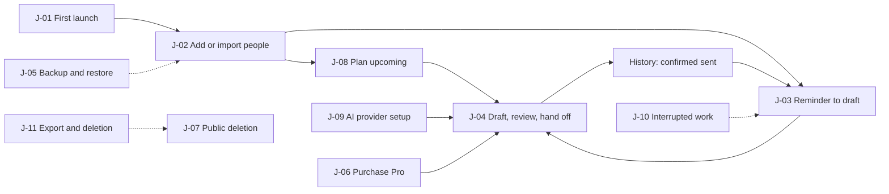
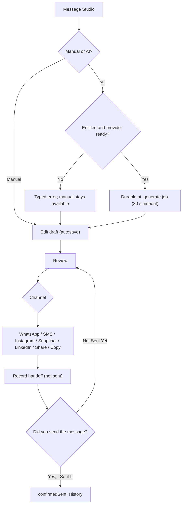
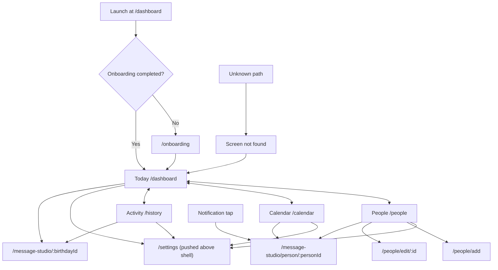

# AI-Birthday — Product specification

> **Single source of truth for intended product behaviour**: vision, users, journeys, features, requirements, UX, business rules, subscription and permission rules, non-functional requirements, roadmap, decisions and open decisions. Architecture is in [ARCHITECTURE.md](ARCHITECTURE.md), security and privacy in [SECURITY.md](SECURITY.md), verified implementation status in [IMPLEMENTATION.md](IMPLEMENTATION.md), operations in [OPERATIONS.md](OPERATIONS.md), and the connected project graph in [PROJECT_MINDMAP.md](PROJECT_MINDMAP.md).

## Contents

- 1. [Product vision and problem](#1-product-vision-and-problem)
- 2. [Target users and personas](#2-target-users-and-personas)
- 3. [Product goals and success measures](#3-product-goals-and-success-measures)
- 4. [User journeys](#4-user-journeys)
- 5. [Modules and features](#5-modules-and-features)
- 6. [Functional requirements](#6-functional-requirements)
- 7. [UX and accessibility requirements](#7-ux-and-accessibility-requirements)
- 8. [Acceptance criteria and user stories](#8-acceptance-criteria-and-user-stories)
- 9. [Business rules](#9-business-rules)
- 10. [Subscription, entitlement and permission rules](#10-subscription-entitlement-and-permission-rules)
- 11. [Non-functional requirements](#11-non-functional-requirements)
- 12. [Roadmap](#12-roadmap)
- 13. [Approved product decisions](#13-approved-product-decisions)
- 14. [Open decisions and unresolved questions](#14-open-decisions-and-unresolved-questions)
- 15. [Assumptions, constraints and governance](#15-assumptions-constraints-and-governance)
- 16. [Glossary and legacy identifier crosswalk](#16-glossary-and-legacy-identifier-crosswalk)

## 1. Product vision and problem

### 1.1 Scope, status and evidence conventions

**Purpose.** This is Part A (§1–§8) of the canonical product document. It defines what AI-Birthday is for, who it serves, what it must do, how it should feel to use, and how acceptance is judged. Part B (PRODUCT.md §9 onward) holds business rules, subscription and permission rules, non-functional requirements, roadmap, decisions, open decisions, assumptions and glossary; this part cross-references it instead of repeating it. Architecture, data model and API detail live in ARCHITECTURE.md; security and privacy controls in SECURITY.md; build and test detail in IMPLEMENTATION.md; release and operations in OPERATIONS.md.

**Status & evidence (2026-11-28).** The current working tree includes the responsive editorial UI and selected-platform messaging handoffs described here. `flutter analyze` is clean; `flutter test --exclude-tags golden` passes 743 tests; the shell goldens pass against the redesigned navigation. **Not run:** Android/Kotlin compilation (Java runtime unavailable), device UI journeys, `npm audit`, release APK/AAB builds, browser CSP test, or deployment. "Implemented" means source-backed; it does not mean device-verified or production-proven. Cloud Functions/Hosting deployment remains unproven.

**Classification tags** used throughout: `[IMPLEMENTED]` present in source with tests; `[PARTIAL]` present with a named defect or missing branch; `[NOT IMPLEMENTED]` absent from the working tree; `[APPROVED]` approved product rule; `[PROPOSED]` proposed, not approved; `[OPEN]` unresolved decision (register in Part B); `[DEPRECATED]` superseded. `UNRESOLVED ASSUMPTION` marks a statement whose truth (usage, demand, price, policy) is unknown from the sources.

**ID conventions.** Feature IDs come from [docs/graph/feature-registry.json](docs/graph/feature-registry.json). Journeys `J-01..J-07`, screens `SCR-001..014`, interactions `ACT-001..030`, flows `FLOW-*`, states `STATE-*`, errors `ERR-*`, gaps `ISSUE-*`/`GAP-*`, audit issues `A1-xxx..A4-xxx`, APIs `API-001..020`, tables `DB-001..006` are stable. Business rules `BR-001..025` are the canonical code-derived rules in PRODUCT.md §9. The legacy product blueprint used a *different* `BR-001..037` numbering; where this part cites one it is written `bp:BR-nnn` (blueprint numbering). Legacy requirement, decision and acceptance IDs (`PRD-`, `FR-`, `NFR-`, `F-`, `REQ-`, `DEC-`, `PPL-AC-`, `BDY-AC-`) are kept because they are used for traceability; legacy sources are cited in prose only (legacy source: `docs/product-blueprint/**`, removed; recoverable from Git commit c4aace16).

### 1.2 Problem statement

People forget birthdays, or prepare poorly for them. Birthday information is scattered across contacts, calendars and messages; reminders stop at awareness and give no next action; AI tools invent personal facts; and messaging tools misreport whether a message was actually sent. The product answers with one private place for the birthday record, a reminder that leads to an exact next action, a draft grounded only in facts the user supplied, and user-controlled delivery that never claims more than it knows.

### 1.3 Vision, mission and value proposition

| Element | Statement | Status |
|---|---|---|
| Thesis | A private, local-first birthday relationship assistant. AI is an optional preparation engine, not the product. | [PROPOSED] (blueprint DEC-036 pending); behaviour matches code |
| Value loop | REMEMBER → PLAN → PREPARE → REVIEW → HAND OFF → USER CONFIRMS → HISTORY → RETURN next year | [IMPLEMENTED] as a flow (FLOW-003..005) |
| Vision | Make celebrating important people dependable, personal and low-friction without surrendering control of data or message. | [PROPOSED] |
| Mission | Turn trusted birthday facts into timely, user-approved actions while preserving privacy, truthful state and recoverability. | [PROPOSED] |
| Value proposition | A private, user-controlled birthday workflow that helps you remember, prepare and send personal wishes without surprising automation. | [PROPOSED] |
| Outcome hypotheses | Fewer missed birthdays, less preparation time, higher trust. No targets approved and no baseline exists. | UNRESOLVED ASSUMPTION |

*History / rationale.* The archived final specification (legacy source: `docs/archive/AI-Birthday-FINAL-SPECIFICATION.md`, removed) phrased the same intent as "Make remembering birthdays effortless without making messages feel robotic" and "Turn 'I almost forgot' into 'I already prepared something that sounds like me'", with the golden user story *"when a birthday is approaching, I want AI-Birthday to remind me and prepare a personalized draft so that I can review it and send it from my own messaging account."* The guardrail is unchanged: **AI-Birthday assists; the user remains responsible for the final message and the personal-account send.** The "prepare a draft automatically" half of the golden story is not reachable today ([NOT IMPLEMENTED]: AUTO-PREP, §5.3).

### 1.4 Product invariants

Invariants that every requirement and screen must respect. Rule detail is in PRODUCT.md §9; subscription gates in PRODUCT.md §9 (subscription and permission rules).

| ID | Invariant | Rule refs | Status |
|---|---|---|---|
| INV-1 | **Local-first.** People, birthdays, calendar, existing drafts, reminders and manual drafting work without sign-in or connectivity. Optional AI, backup or sign-in availability must never block manual workflows. | BR-025 | [IMPLEMENTED] (data in on-device SQLite via Drift; `AppDatabase.open` falls back to memory only under `FLUTTER_TEST`) |
| INV-2 | **Manual path is always complete.** Provider unavailable, locked or failing never blocks writing, saving or handing off a message. | BR-014, BR-017 | [IMPLEMENTED] |
| INV-3 | **Entitlement-first AI.** An active application entitlement is required before either BYOK or Nano is selected or called; a personal Gemini key is a provider credential, not an entitlement bypass. | BR-013, BR-014, BR-020 | [IMPLEMENTED] ([ai_router.dart](lib/features/ai/domain/ai_router.dart), [ai_router_test.dart](test/ai/ai_router_test.dart)) |
| INV-4 | **Grounded AI.** Prompts use only recipient facts the user supplied; AI output is always an editable draft and never sends or confirms. | AI-PROMPT (feature registry) | [IMPLEMENTED] (output safety of third-party models is not provable from source) |
| INV-5 | **Handoff is not send.** Opening a messaging app, its targeted share entry point, the SMS composer or the share sheet records a handoff; only an explicit user action records "user confirmed sent"; unknown stays unknown; "Delivered" is never claimed. | BR-016, BR-017 | [IMPLEMENTED] |
| INV-6 | **Truthful capability and state.** The UI never shows an unavailable or gated capability as working, never says "scheduled" when the OS rejected a reminder, and never reports false success. | — | [PARTIAL] (see FR-029) |
| INV-7 | **Opt-in, owner-scoped cloud.** Backup is off until explicit opt-in, owner-scoped, excludes secrets, and is not described as end-to-end encrypted. | BR-021, BR-022 | [IMPLEMENTED] |
| INV-8 | **No unrequested automation.** No autonomous or bulk WhatsApp, no unattended personal-account send without explicit opt-in. Opt-in automatic pre-drafting (`AUTO-PREP`) and opt-in scheduled SMS (`personal` flavor only) require explicit user configuration and entitlement/permission gates. | — | [APPROVED] target; currently gated off in source |

### 1.5 Scope and non-goals

**Committed core scope** (all [IMPLEMENTED] in source unless noted): People and recipient context; recurring birthday occurrence lifecycle; Dashboard, Calendar and History; native Android reminders; manual Message Studio with durable drafts; subscription-gated AI (BYOK Gemini and on-device Nano); user-controlled, message-prefilled WhatsApp and SMS composer handoffs; targeted Android text-sharing handoffs for Instagram, Snapchat and LinkedIn where the app exposes a compatible share activity; copy/share fallbacks with explicit confirmation; truthful delivery history; settings, privacy and accessibility; optional identity, backup/restore, export and deletion; reliable durable jobs.

**Target ideal-product scope (reassessed):**
- **Committed core + target enhancements:** Local-first People/birthday/Dashboard/Calendar/History; native Android alarms and notifications; manual Studio with durable drafts; WhatsApp click-to-chat, SMS composer, copy and share with truthful handoff ("I Sent It"); Play purchase verification with App Check; hybrid AI (on-device Gemini Nano + BYOK + server-side Pro AI) after entitlement; opt-in automatic pre-drafting (`AUTO-PREP`, 1–3 days before birthday) with manual review; opt-in scheduled/automated SMS sending on Android (`personal` flavor only, while keeping WhatsApp strictly manual handoff); opt-in owner-scoped backup with a non-E2E disclosure; sign-in, export, backup/restore and a deletion service; active `apps/` + `packages/` monorepo components.

**Conditional scope** (exists only behind a gate or external approval): production cloud backup (needs deployed Firebase project); on-device Gemini Nano (needs supported hardware and AICore; platform decision DEC-037 `[OPEN]`); public legal/support/deletion Hosting site (supporting surface; release blocked until identity, legal, privacy, support, reCAPTCHA and deployment configuration gates are met; DEC-049 `[OPEN]`, blocked); automated SMS (personal flavor only, compiled off); automatic preparation (flag default off, DEC-047 blocked); additional import formats; localisation beyond the launch language; any orchestration control plane (backend only, dormant).

**Explicit non-goals** unless separately approved (fuller of two legacy lists retained): autonomous WhatsApp sending; bulk or campaign sending; public profiles or any social network or directory; CRM or collaboration; contact or message scraping; general chat or a broad AI-agent platform; multi-user or team tenancy; social-network APIs or unrequested calendar/email/social integrations (the approved exception is a user-initiated OS handoff to a selected messaging app); private-content analytics; a backend AI proxy by default; an application-owned Gemini cloud fallback; iOS parity claims; monetisation promises beyond approved decisions. Public retention, deletion, support and legal commitments need approved policies before publication (legacy BIZ-006, `[APPROVED]`).

**Product domains.** The legacy taxonomy DOM-01..DOM-14 is kept as the business grouping; the registry modules it maps to are assigned in this consolidation.

| Domain | Name | Registry modules |
|---|---|---|
| DOM-01 | Entry and shell | ONB, NAV, THEME, L10N, DB-STARTUP-RECOVERY, APP-GLOBAL-ERROR-HANDLERS, APP-FIREBASE-BOOTSTRAP |
| DOM-02 | Relationship memory | PEOPLE |
| DOM-03 | Birthday engine | BIRTH |
| DOM-04 | Planning | DASH, CAL |
| DOM-05 | Reminders | REM |
| DOM-06 | Message Studio | STUDIO |
| DOM-07 | AI | AI |
| DOM-08 | Delivery and history | SEND, HISTORY |
| DOM-09 | Account and subscription | AUTH, BILL |
| DOM-10 | Continuity and privacy | CLOUD, SETTINGS |
| DOM-11 | Automation | AUTO-PREP, SEND-SMS-AUTOMATION |
| DOM-12 | Platform operations | JOBS, CORE, CI-001, AND-CFG-001..003, IOS-APP-TARGET |
| DOM-13 | Public support | WEB |
| DOM-14 | Autopilot control plane | CTRL |

### 1.6 Platform and distribution reality

- The shipped product is a **Flutter Android app** (package `com.yashsomani.ai_birthday`; flavors `play` and `personal`; the `personal` flavor adds `SEND_SMS` but the feature is compiled off). There is **no iOS target** (IOS-APP-TARGET `[NOT IMPLEMENTED]`, ISSUE-006).
- Public Hosting copy (home and Terms) describes unattended Android SMS, an iPhone companion, WorkManager and React Native. That conflicts with the shipped app, with the compiled-off automation gates and with the absence of an iOS target. **Decision awaiting product/legal approval** (A4-007, ISSUE-001, GAP-15, GAP-19); until resolved, treat public wording as unverified and do not use it as product truth.
- The coordination control plane (API-001..017) is backend-only and **dormant**: no Dart or Kotlin caller exists, the native sender path is hard-disabled, and the backend is not deployed (ISSUE-002, ISSUE-005, CTRL-FLUTTER-CLIENT `[NOT IMPLEMENTED]`). The mobile app uses only `verifyPurchase` (API-018); the Hosting site uses `requestAccountDeletion` and `accountDeletionReceipt` (API-012, API-013).

## 2. Target users and personas

### 2.1 Primary persona and jobs to be done

**Primary persona — the birthday organiser:** an individual who must remember birthdays for family, friends and colleagues, prepare in time, use private relationship context safely, keep final control of the message, and recover data when a device or account changes. No demographics are asserted; the persona is `UNRESOLVED ASSUMPTION` (blueprint ASM-001, unvalidated). Archived secondary and advanced users (busy professionals wanting fast personalisation; users comfortable with their own Gemini credential) are variants of the same persona, not separate products.

| Job to be done | Where served | Status |
|---|---|---|
| Record a birthday with its context | People / Person form (J-02) | [IMPLEMENTED] |
| Remind me early, with a next action | Reminders → Studio (J-03) | [IMPLEMENTED]; device behaviour unverified |
| Start from a draft; help me decide what to write | Studio manual + AI (J-04) | [IMPLEMENTED]; AI needs entitlement |
| Personalise with facts I provide; let me edit AI drafts | AI-PROMPT, Studio (J-04) | [IMPLEMENTED] |
| Help me send through my own account | WhatsApp / SMS / share handoff (J-04) | [IMPLEMENTED] |
| Tell me honestly when something failed; keep backup/recovery understandable | Typed errors, History, backup (J-04, J-05) | [PARTIAL] (see §5.4 open defects) |

### 2.2 Actors and roles

| Actor | Role in the product | Evidence / status |
|---|---|---|
| ROLE-001 Local app user | Manages personal birthdays, drafts and settings on-device; cannot grant AI entitlement or infer an external send | [IMPLEMENTED] |
| ROLE-002 Authenticated account owner | Uses optional sign-in, Cloud Backup, Play subscription and cloud deletion; sensitive actions require recent authentication | [IMPLEMENTED] source; live provisioning unverified |
| ROLE-003 Public-site visitor | Reads privacy, terms, support; starts deletion or checks a receipt on the Hosting site | [PARTIAL] (Hosting not deployed, release-config gate) |
| Recipient | The person celebrated; has no app access; delivery to them is unknowable to the app | by design |
| Android OS | Notifications, exact alarms, contacts, share, AICore | platform |
| AI provider | User Gemini API (BYOK) or on-device Nano; produces draft text only, holds no authority | EXT-005, EXT-006 |
| Google identity / Firebase | Sign-in (Identity Toolkit REST), Firestore backup, App Check | EXT-007, EXT-008, EXT-013 |
| Google Play / store authority | Billing and purchase verification | EXT-009 |
| WhatsApp, SMS app, share target | External delivery clients; delivery status is not observable | EXT-010..012 |
| Support operator | Least-privilege, no private content by default | [PROPOSED]; no support tooling exists |
| Release/operations operator | Deployment, config and incident response | [PROPOSED]; see OPERATIONS.md |
| Autopilot service operator | Restricted service role; never a source of message content or phone numbers | [PROPOSED]; backend only, dormant |

### 2.3 Role and permission experience

A local user cannot grant AI entitlement and cannot infer an external send. An authenticated owner gets backup, restore, subscription and cloud deletion, with recent authentication for sensitive actions. OS permission prompts (notifications, exact alarms, contacts) are explained first and always leave a manual alternative. A future operator has no private content by default. Detailed permission and subscription gating rules: PRODUCT.md §9 (subscription and permission rules).

## 3. Product goals and success measures

### 3.1 Objectives

Only objectives present in sources are listed; none has a numeric target (no baseline, no approved SLO, telemetry not authorised).

| ID | Objective | Primary requirements | Status |
|---|---|---|---|
| OBJ-001 | Trustworthy, reliable personal record | FR-001..005 | [PARTIAL] |
| OBJ-002 | Consistent next annual occurrence everywhere | FR-006, FR-007, FR-010 | [PARTIAL] |
| OBJ-003 | Offline and manual workflow regardless of AI or network | FR-011, INV-1, INV-2 | [IMPLEMENTED] |
| OBJ-004 | Reduced drafting effort via grounded, entitled, editable AI | FR-012..016 | [IMPLEMENTED] |
| OBJ-005 | Truthful delivery status (handoff vs confirmed vs delivered) | FR-017..020 | [IMPLEMENTED] |
| OBJ-006 | Understandable backup, restore, export and deletion | FR-005, FR-024, FR-025, FR-027 | [PARTIAL] (no in-app deletion; full export absent) |
| OBJ-007 | Safe operation; accessible lifecycle; evidence-backed claims only | NFR (Part B), FR-028, FR-029 | [PARTIAL] |

The eight product outcomes in the legacy discovery document (reliable records; know who needs attention; prepare a message with or without AI; AI grounded in user facts; user reviews every message; truthful records; local use without sign-in; export/backup/delete) are the same set, regrouped. The legacy outcome layer PRD-001..014 is in §6.2.

### 3.2 Success measures

Measures that appear in sources, none approved, none implemented:

| Candidate measure (source) | Condition | Status |
|---|---|---|
| People with a valid birthday; cross-view date consistency; draft completion without AI; AI output edited versus abandoned (no body tracking); user-confirmed action rate; restore/export/deletion success; reminder reconciliation; support and accessibility outcomes (legacy definitive product definition) | Only after privacy and event design are approved (telemetry policy DEC-051 `[OPEN]`) | [PROPOSED]; not measurable today |
| Birthdays captured; birthdays with prepared messages; reviewed messages reaching a delivery action; successful WhatsApp handoffs; reminder engagement; AI generation success rate; subscription lifecycle reliability (archived final specification) | Same | [PROPOSED]; not measurable today |
| Proposed responsiveness budget (e.g. 100 ms interaction) | Needs baseline and approval; NFR-003 has no approved numbers | [PROPOSED] |

The app ships **no analytics or crash-reporting SDK** (`pubspec.yaml`); none is declared in the source. Engineering health measures that do exist are quality gates, not product success measures: analyze clean, 743 Flutter tests in the current suite, earlier 91 Functions tests and 12 Hosting tests, and CI jobs `flutter-quality-and-test`, `backend-verification`, `hosting-verification` (see IMPLEMENTATION.md).

### 3.3 Unresolved assumptions

The assumption register is PRODUCT.md §9 onward (Part B); the product-level assumptions this part depends on are:

- UNRESOLVED ASSUMPTION: the primary persona (birthday organiser) matches real demand; no user research is in the sources.
- UNRESOLVED ASSUMPTION: users value the outcome hypotheses (fewer missed birthdays, less preparation time, higher trust); no targets or usage data exist.
- UNRESOLVED ASSUMPTION: willingness to pay for the app subscription; no price, conversion or retention data exist (store price is read live from `ProductDetails`).
- UNRESOLVED ASSUMPTION: target Android versions, devices, geographies and launch languages are not approved (DEC-037 `[OPEN]`); the app has only `en` navigation strings.
- UNRESOLVED ASSUMPTION: no usage, crash or funnel measurement exists; any claim about adoption is unsupported.

## 4. User journeys

### 4.1 Journey catalogue and legacy crosswalk

Journeys are described as **entry → action → screen → validation → rule → API/integration → data → response**, then alternative and error paths. `J-01..J-07` are the canonical source-traced journeys; `J-08..J-12` are **IDs assigned in this consolidation** (marked `[PROPOSED ID]`) to carry legacy journeys that had no canonical ID. Statuses are per current code and the FIX LEDGER; none of the journeys has been executed on a device or against a deployed backend (IMPLEMENTATION.md for the test inventory).

| ID | Journey | Primary screens | Status |
|---|---|---|---|
| J-01 | First launch and onboarding | SCR-001, SCR-002 | [IMPLEMENTED]; write-failure branch [PARTIAL] |
| J-02 | Add, edit or import people and birthdays | SCR-003, SCR-004 | [IMPLEMENTED]; legacy-person repair [NOT IMPLEMENTED] |
| J-03 | Birthday reminder to draft | notification → SCR-007 | [PARTIAL] (device behaviour unverified; A1-007) |
| J-04 | Generate, review and hand off a greeting | SCR-007, SCR-006 | [IMPLEMENTED] (automatic preparation not reachable) |
| J-05 | Backup and restore | SCR-008 | [PARTIAL] (restore drops draft revision; no in-app backup delete) |
| J-06 | Purchase or restore Pro | SCR-008 | [IMPLEMENTED] source; live Play and deployed verifier unverified |
| J-07 | Public-site account deletion | SCR-011 (Hosting, separate app) | [PARTIAL] (source and tests exist; not deployed; release config gate) |
| J-08 | Plan upcoming birthdays from Dashboard, Calendar or search `[PROPOSED ID]` | SCR-002, SCR-003, SCR-005 | [IMPLEMENTED] |
| J-09 | Configure AI provider (own key or on-device) `[PROPOSED ID]` | SCR-008 | [IMPLEMENTED] |
| J-10 | Interrupted work: kill, permission revoked, reboot, timezone change `[PROPOSED ID]` | all | [PARTIAL] |
| J-11 | In-app export, deletion and data ownership `[PROPOSED ID]` | SCR-008 | [PARTIAL]/[NOT IMPLEMENTED] |
| J-12 | Support and diagnostics `[PROPOSED ID]` | SCR-008 | [NOT IMPLEMENTED] |

**Legacy crosswalk** (legacy sources: `docs/product-blueprint/02-user-experience…` journey list and `docs/product-blueprint/definitive/` journey set; removed; recoverable from Git commit c4aace16). Legacy blueprint JRN-nnn (D1) / definitive JRN-nnn (D2) map as follows; UJ-nnn are the legacy unified-journey IDs.

| Legacy | Canonical |
|---|---|
| D1 JRN-001 first launch · D2 JRN-001 first launch to first value | J-01 |
| D1 JRN-002 add/edit person · D2 JRN-002 add/edit · D2 JRN-003 import contacts/CSV | J-02 |
| D1 JRN-003 reminder · D2 JRN-006 reminder creation/response | J-03 |
| D1 JRN-004 manual · JRN-005 AI · JRN-006 WhatsApp · D2 JRN-007 manual Studio · JRN-008 AI Studio · JRN-009 handoff | J-04 |
| D1 JRN-007 backup · D2 JRN-011 backup/restore | J-05 |
| D1 JRN-008 subscription · D2 JRN-010 subscription/provider (purchase half) | J-06 |
| D1 JRN-009 export/deletion · D2 JRN-012 account/privacy/export/deletion | J-07 (public deletion), J-11 (in-app) |
| D2 JRN-004 dashboard · JRN-005 calendar · D1 UJ-003 | J-08 |
| D2 JRN-010 (provider half) | J-09 |
| D1 UJ-010 | J-10 |
| D2 JRN-013 support/diagnostics | J-12 |

### 4.2 J-01 First launch and onboarding

| Stage | Content |
|---|---|
| Entry | App launch at `/dashboard` (`initialLocation`); the router redirect sends the user to `/onboarding` while the onboarding flag is unset (FLOW-001, STATE-001, STATE-002). Replay from Settings → Help & Guide → "Replay app onboarding". |
| Action | Database preflight; read onboarding flag; user steps through 3 pages (local-by-default value; "Bring in your birthdays"; "Prepared ahead of time": 7 days, 2 days, today) with Skip / Next / Get Started; or taps "Add Birthday Manually" (→ `/people/add`) or "Open Phone Contact Import" (→ `/people`). |
| Screen | Startup/recovery state (STATE-001; no SCR ID); SCR-001 Onboarding; then SCR-002 Dashboard. |
| Validation | Preflight must open the DB within 10 s; a positive onboarding result is cached for the session. No OS permission is requested during onboarding (asked at point of use). |
| Rule | BR-025 first-run routing: a flag read error lets the user through rather than trapping them. Local-first (INV-1). |
| API / integration | None (EXT-001 SQLite, EXT-002 secure storage for the flag). |
| Data | Onboarding-completed flag in secure storage; DB opened and migrated (schema v7). |
| Response | Dashboard empty-state "Let's add your first birthday". |

| Alternative / error | Response | Status |
|---|---|---|
| DB open fails or times out (ERR-001) | `_StartupRecoveryScreen` with "Retry database initialization"; no writes possible; user data is not silently discarded | [IMPLEMENTED] |
| Skip pressed | Same completion write as Get Started | [IMPLEMENTED] |
| Secure-storage **write** fails on finish | Unhandled: `_finishOnboarding` awaits the write with no try/catch, no message | [PARTIAL] |
| Secure-storage **read** error | Treated as onboarding complete and let through (residual of A3-010) | [PARTIAL] |
| User replays onboarding | `/onboarding` pushed over Settings | [IMPLEMENTED] |

Evidence: [router.dart](lib/app/router.dart), [onboarding_screen.dart](lib/features/onboarding/presentation/onboarding_screen.dart), [core_providers.dart](lib/core/core_providers.dart), [onboarding_screen_test.dart](test/features/onboarding/presentation/onboarding_screen_test.dart).

### 4.3 J-02 Add, edit or import people and birthdays

| Stage | Content |
|---|---|
| Entry | People tab "Add" button or Dashboard/Calendar/empty-state "Add Birthday Contact" → `/people/add`; row tap/edit → `/people/edit/:id`; import menu on People; Onboarding page 2. |
| Action | Fill the Person form (Name, Month, Day, leap-day policy "In non-leap years, celebrate on", optional Birth year, Relationship, Preferred tone, Closeness, Preferred language, optional Phone, optional Email, Preferred delivery channel, optional IANA Timezone, Facts, Notes) and Save; or Import: contacts (rationale dialog → OS permission → review list) or CSV (pasted text; 16-column export format). |
| Screen | SCR-003 People list; SCR-004 Person form; import and review sheet (ACT-004). A `PopScope` "Discard changes?" prompt protects dirty forms. |
| Validation | Name required ≤120; month/day a real calendar date; year 1900–2199 if given; phone 6–20 chars of digits and `+ - ( ) .` space; email address-shaped ≤254; language ≤10, ≤20 facts of ≤200 chars, notes ≤2000; supplied timezone must be a known IANA zone (≤64); Feb 29 requires a leap-day choice. Updating a legacy person without a birthday does not force one (`requireBirthday: existing.hasBirthday`). CSV: ≤1000 rows, ≤1 MiB, per-row diagnostics, duplicates flagged and left **unselected** by default. |
| Rule | BR-001..007 validation; BR-008 leap-day; BR-009 timezone; approved DEC-016 (birthday required on every intake path), DEC-012 (per-person leap choice), DEC-021 (recipient IANA zone, then device-local). |
| API / integration | EXT-004 Android contacts (permission only on selection); no network. |
| Data | `persons` (DB-001) and exactly one `birthdays` row per person (DB-002; id `birthday-{personId}`; `date` is `yyyy-MM-dd`; unique index on `person_id`) written by `PersonService` + `BirthdayLifecycleService`; reminders re-planned by the reminder bootstrap. |
| Response | Person appears in People, Calendar, Dashboard; snackbar counts for imports (imported/skipped/failed). |

| Alternative / error | Response | Status |
|---|---|---|
| Validation error (ERR-002) | Field-level message; form content preserved | [IMPLEMENTED] |
| Contacts permission denied | Snackbar; manual and CSV paths remain | [IMPLEMENTED] |
| Duplicate rows in import | Flagged; unselected; no silent merge by name | [IMPLEMENTED] |
| CSV has invalid rows | Valid rows importable via `importValidRows`; invalid rows listed with reasons | [IMPLEMENTED] |
| Empty selection | Import button disabled/no-op | [IMPLEMENTED] |
| Unknown enum value in stored/imported row | Silently defaults (relationship → other, tone → warm, length → standard); no warning | [PARTIAL] |
| Legacy person with no birthday or Feb 29 without policy | List shows "No birthday set" / "Feb 29 • choose celebration date"; no filter or repair flow; row is skipped by lifecycle, dashboard, calendar and reminders (A1-013, DEC-023/035/024 `[OPEN]`) | [PARTIAL] |
| Invalid stored timezone | Engine throws (`tz.getLocation` unguarded); DEC-029 `[OPEN]` | [NOT IMPLEMENTED] |
| Save failure | Error surfaced; form kept | [IMPLEMENTED] |

Evidence: [person_service.dart](lib/features/people/application/person_service.dart), [person_form_screen.dart](lib/features/people/presentation/person_form_screen.dart), [contact_csv_service.dart](lib/features/people/data/contact_csv_service.dart), [birthday_lifecycle_service.dart](lib/features/birthdays/application/birthday_lifecycle_service.dart).

### 4.4 J-03 Birthday reminder to draft

| Stage | Content |
|---|---|
| Entry | Reminders enabled in Settings (default **disabled**); OS notification tap. |
| Action | `ReminderBootstrap` (app start and resume) computes a plan from the next occurrence and offsets (approaching 7 d, prepare 2 d, ready 1 d, birthday day) and hands it to the native gateway; user taps a notification. |
| Screen | Notification → SCR-007 Message Studio at `/message-studio/person/:personId`. |
| Validation | Quiet hours (default 22:00–08:00) apply with a "defer" option; "hide names" suppresses names in notification text; notification/exact-alarm capability is checked before claiming a schedule. |
| Rule | BR-010..012 reminders; BR-008 leap-day; BR-009 timezone. Reminder hour is hardcoded to 09:00 and quiet hours are evaluated in the recipient's frame (A1-015). |
| API / integration | EXT-003 Android notifications and exact alarms. |
| Data | `reminder_settings_entries` (DB-004); person and birthday rows; plan stamp for idempotent replan. |
| Response | Studio opens for the person; draft loads or a new one begins. |

| Alternative / error | Response | Status |
|---|---|---|
| Notification permission denied | Settings states reminders are unavailable (truthful state; FR-029) | [IMPLEMENTED] source; device unverified |
| Exact alarm not granted / rejected by OS | No "scheduled" claim; D4-029-02 recovery path remains a contract gap | [PARTIAL] |
| Reboot / timezone / clock change | Dart-side re-plan on next start/resume only; no Kotlin `TIMEZONE_CHANGED` receiver (A1-007 partial) | [PARTIAL] |
| Person deleted or birthday missing when tapped (ERR-003) | Not-found / recoverable screen | [IMPLEMENTED] |
| Cold-start notification tap | Source-reviewed; unverified on device | UNVERIFIED |

Evidence: [reminder_schedule.dart](lib/features/reminders/domain/reminder_schedule.dart), [app_scaffold.dart](lib/app/app_scaffold.dart), [app.dart](lib/app/app.dart).

### 4.5 J-04 Generate, review and hand off a greeting

| Stage | Content |
|---|---|
| Entry | Dashboard card, People row, Calendar day, History row, or a reminder notification → Studio for a birthday cycle (`/message-studio/:birthdayId`) or person (`/message-studio/person/:personId`). |
| Action | Edit text manually (autosave) or generate with AI (tone, length, relationship; Translate sheet; variations); choose a channel (WhatsApp, Messages/SMS, Instagram, Snapchat, LinkedIn, copy or share). WhatsApp and SMS open a pre-filled target conversation/composer. Instagram, Snapchat and LinkedIn use a package-targeted Android text-share handoff where supported; the recipient may still need to be chosen in the external app. The user reviews and sends there, then returns and answers "Did you send the message?". |
| Screen | SCR-007 Message Studio, then SCR-006 History (Activity). |
| Validation | Entitlement before provider (BR-013, BR-014); AI timeout 30 s (BR-015); WhatsApp destination 7–15 digits and official click-to-chat URI (BR-016); empty draft blocked; stale write cannot overwrite a newer revision (revision column, A2-004). |
| Rule | BR-017 delivery truthfulness: handoff is not send; only "Yes, I Sent It" records user-confirmed; BR-018/019 jobs. |
| API / integration | AI: user Gemini API (EXT-005) or on-device Nano (EXT-006) via `AiRouter`; handoff: EXT-010..012 and targeted social text-share via EXT-014. |
| Data | `message_drafts` (DB-003, `revision`), `jobs` (DB-006; `ai_generate`), `delivery_events` (DB-005; insert-only: launched, copied, launchFailed, notSent, confirmed). |
| Response | Draft saved; History records the selected handoff channel ("Opened in Instagram", "Opened in LinkedIn", etc.), "Copied to Clipboard", "Share Sheet Opened" or "User Confirmed Sent"; the confirmation remains separate from launch. |

| Alternative / error | Response | Status |
|---|---|---|
| No entitlement | CTA ladder "Unlock with Pro"; manual drafting continues (ERR-004) | [IMPLEMENTED] |
| BYOK key missing | AI Settings link; manual available | [IMPLEMENTED] |
| Invalid BYOK key | Typed error; DEC-005 `[OPEN]` (error vs missing); DEC-043 `[OPEN]` (Nano fallback on invalid key) | [OPEN] |
| Provider timeout / failure | Error banner: Save now, Retry, Use on-device AI (Gemini Nano), Write manually, AI Settings | [IMPLEMENTED] |
| Nano busy, quota or not-ready | Types exist but are never produced (A2-019) | [PARTIAL] |
| Phone missing/invalid for SMS or WhatsApp | CTA "Add Phone Number" / "Fix Phone Number"; send disabled | [IMPLEMENTED] |
| External launch fails (ERR-005) | "<channel> could not be opened"; nothing inferred as sent; "Retry record" if evidence write fails | [IMPLEMENTED] |
| Selected social app has no compatible Android text-share activity | Report the app handoff as unavailable; keep the draft, offer the separate share sheet/copy paths; do not silently open another app or claim a direct chat was opened | [IMPLEMENTED] in source; device behavior unverified |
| App paused with unsaved edits | Autosave flush on pause/inactive; **not** on dispose (A2-024 open) | [PARTIAL] |
| App killed mid-generation | Durable job recovered at startup; variations are sequential and not durable (A2-012 open) | [PARTIAL] |
| Birthday cycle rolls over | Non-confirmed drafts and jobs for the old cycle are deleted; `confirmedSent` kept (DEC-022 `[OPEN]`, BDY-AC-017 conflict) | [PARTIAL] |
| Automatic preparation | Flag `ENABLE_AUTO_PREPARE` default off; no consumer of `autoPrepare` (DEC-047 `[OPEN]`) | [NOT IMPLEMENTED] |

Evidence: [message_studio_screen.dart](lib/features/message_studio/presentation/message_studio_screen.dart), [ai_router.dart](lib/features/ai/domain/ai_router.dart), [whatsapp_handoff_builder.dart](lib/features/delivery/data/whatsapp_handoff_builder.dart), [history_screen.dart](lib/features/history/presentation/history_screen.dart).

### 4.6 J-05 Backup and restore

| Stage | Content |
|---|---|
| Entry | Settings → Cloud Backup (requires sign-in; off until explicit opt-in). |
| Action | Back up now: queue a durable cloud job. Restore: explicit confirmation. |
| Screen | SCR-008 Settings. |
| Validation | Disclosure of data categories and non-end-to-end-encrypted status; refreshed ID token; ownership check of local data versus uid (BR-021); restore validates the complete manifest and every record, then applies in **one local transaction** (no partial destructive restore). |
| Rule | BR-021 backup ownership; BR-022 atomic publication (immutable generation → manifest → advance `current` pointer). |
| API / integration | EXT-007 Identity Toolkit REST (no `firebase_auth` SDK); EXT-008 Firestore REST (no `cloud_firestore` SDK). App Check is attached only to `verifyPurchase`, not to Firestore REST or Identity Toolkit (A3-004 open). |
| Data | Cloud generation collections; `users/{uid}` backup pointers; secrets excluded. Retention keeps current and previous generations (A3-002/A4-006 fixed). |
| Response | Result summary (counts, conflicts) in Settings; reminders re-planned after restore. |

| Alternative / error | Response | Status |
|---|---|---|
| Not signed in / token expired (ERR-006) | Error; local data untouched | [IMPLEMENTED] |
| Upload partially fails | "Backup finished with failures." with failed count; `current` pointer is not advanced | [IMPLEMENTED] |
| Incomplete manifest / malformed record | Restore aborts before any local write | [IMPLEMENTED] |
| Local data belongs to another account | Blocked by ownership check | [IMPLEMENTED] |
| Restore of drafts | Draft `revision` is not carried by cloud restore | [PARTIAL] |
| Delete backup / sign-out of cloud from the app | No in-app delete-backup action (A3-003 open) | [NOT IMPLEMENTED] |
| Real Firebase deployment | Not deployed; unverified | UNVERIFIED |

Evidence: [cloud_sync_service.dart](lib/features/sync/data/cloud_sync_service.dart), [cloud_job_handler.dart](lib/features/jobs/application/cloud_job_handler.dart), [settings_screen.dart](lib/features/settings/presentation/settings_screen.dart). Architecture and security detail: ARCHITECTURE.md, SECURITY.md.

### 4.7 J-06 Purchase or restore Pro

| Stage | Content |
|---|---|
| Entry | Settings → Subscription & Entitlement ("Unlock with Pro", restore). |
| Action | Sign in with Google/Firebase → Play Billing purchase or restore → send purchase token to the server verifier. |
| Screen | SCR-008 Settings. |
| Validation | Server authoritative: Play Developer API verification; App Check required; the purchase is bound to the uid by `SHA-256('ai-birthday-purchase-binding:v1:' + uid)` (A3-001 fixed; a legacy random per-device binding already stored in secure storage is still sent in preference to the deterministic value, and the server tolerates a binding mismatch only for a purchase whose token hash is already owned by the same uid); refused with `ACCOUNT_DELETION_IN_PROGRESS` while a deletion tombstone exists (A4-004 fixed). |
| Rule | BR-013 entitlement-first; BR-020 entitlement states (fail closed). Price shown is the live `ProductDetails` value. |
| API / integration | API-018 `verifyPurchase`; API-018a purchase ownership ledger; API-018b entitlement document (FLOW-007). |
| Data | `users/{uid}/entitlement/status`; local entitlement cache. |
| Response | Entitlement state refreshes; AI features unlock; manual drafting is unaffected. |

| Alternative / error | Response | Status |
|---|---|---|
| Store unavailable, cancelled, pending, expired | Specific settings message (D3-I-091 messages); AI stays locked | [IMPLEMENTED] |
| Verification fails / backend unreachable | Fail closed for AI; manual remains | [IMPLEMENTED] |
| Offline with a previously granted entitlement | Behaviour undecided (DEC-042 `[OPEN]`) | [OPEN] |
| Live Play purchase | Never exercised | UNVERIFIED |

Evidence: [subscription_service.dart](lib/features/subscription/application/subscription_service.dart), [subscriptionVerification.ts](backend/functions/src/services/subscriptionVerification.ts).

### 4.8 J-07 Public-site account deletion

| Stage | Content |
|---|---|
| Entry | Hosting `/delete/` (separate web app; also `/support/`, `/privacy/`, `/terms/`). |
| Action | Initialise Firebase web config; fresh Google re-authentication; limited-use App Check token (reCAPTCHA Enterprise); call deletion callable; poll receipt. |
| Screen | SCR-011 Public deletion (web). |
| Validation | Release config must be present; otherwise controls are disabled with a warning (ERR-008). |
| Rule | BR-023/024 control plane; the deletion saga purges ownership ledgers by uid (A4-002) and Firestore rules deny writes while a tombstone exists (A4-005). |
| API / integration | API-012 `requestAccountDeletion`, API-013 `accountDeletionReceipt`, API-019 `sweepDeletionDrains`. |
| Data | `deletionTombstones/{uid}`, private receipts, deletion drains. |
| Response | Deterministic receipt states: accepted, processing, completed, unknown. |

| Alternative / error | Response | Status |
|---|---|---|
| Missing release config | Controls disabled | [IMPLEMENTED] |
| Auth failure / App Check unavailable / ambiguous result | Honest unknown state; retry via receipt | [IMPLEMENTED] |
| CSP blocks Google sign-in | `apis.google.com` now allowed (A4-001 fixed; browser test not run) | [PARTIAL] |
| Deployment | Hosting and backend not deployed; DEC-049 `[OPEN]` blocked | UNVERIFIED |

Evidence: backend/hosting/README.md, [app.ts](backend/hosting/src/app.ts), [deletionOrchestrator.ts](backend/functions/src/services/deletionOrchestrator.ts).

### 4.9 J-08 Plan upcoming birthdays `[PROPOSED ID]`

| Stage | Content |
|---|---|
| Entry | Dashboard, Calendar, People search/filter. |
| Action | Read sections; tap a card, calendar day or row; filter by relationship and birthday month; search by name/relationship. |
| Screen | SCR-002 Dashboard, SCR-003 People, SCR-005 Calendar (§7.9). |
| Validation | Search is a literal case-insensitive substring over name and relationship; headline counts come from the same birthday stream as Calendar and reminders. |
| Rule | Dashboard sections: **Action Needed**; "Today's Birthdays" (only completed items; non-completed today appear in Action Needed); **Upcoming Birthdays** (≤30 days; 1–7 days with an actionable status, including `handedOff`, moves to Action Needed). |
| API / integration | None. |
| Data | `birthdaysStreamProvider` (refreshes at **local** midnight; no recipient-midnight refresh, DEC-033 `[OPEN]`). |
| Response | Studio opens for the chosen occurrence; headline "N Birthdays Today", "All Celebrations On Track" or "Let's add your first birthday". |

| Alternative / error | Response | Status |
|---|---|---|
| Load fails | "Could not load contacts" with "Try again" | [IMPLEMENTED] |
| No upcoming in 30 days | "No birthdays in the next 30 days" | [IMPLEMENTED] |
| Calendar empty | "No birthdays yet" + "Add Birthday Contact"; jump-to-today | [IMPLEMENTED] |
| Stale/deleted/orphan item | Recoverable screen (ERR-003); History shows "Removed contact" | [IMPLEMENTED] |
| Loading skeleton / fake-zero avoidance | Skeleton/shimmer is not implemented (D3-I-153); spinner only | [NOT IMPLEMENTED] |

### 4.10 J-09 Configure the AI provider `[PROPOSED ID]`

| Stage | Content |
|---|---|
| Entry | Settings → AI provider; Studio error banner → AI Settings. |
| Action | Paste a personal Gemini key, test, save or remove; or enable on-device Nano (conditional section). |
| Screen | SCR-008 Settings. |
| Validation | Key stored in platform secure storage; entitlement is required before any AI call (BR-013) even with a valid key; provider readiness and entitlement are separate facts. |
| Rule | BR-013, BR-014 (Nano selection), BR-020. |
| API / integration | EXT-005 Gemini; EXT-006 AICore. |
| Data | Secure storage (never in backups). |
| Response | Provider status shown; Remove Key styled with the error colour. |

| Alternative / error | Response | Status |
|---|---|---|
| Key test without entitlement | Settings key-test calls BYOK directly (A2-035, UNCONFIRMED) | [PARTIAL] |
| Nano hardware unsupported | Section hidden/unavailable; Nano busy/quota never produced (A2-019) | [PARTIAL] |
| Invalid key | DEC-005/DEC-043 `[OPEN]` | [OPEN] |

### 4.11 J-10 Interrupted work `[PROPOSED ID]`

| Interruption | Expected | Current | Status |
|---|---|---|---|
| App killed during AI generation | Resume or fail honestly, no duplicate effects | Durable job recovered at startup (BR-018/019); variations not durable (A2-012) | [PARTIAL] |
| App backgrounded with unsaved draft | No loss | Autosave flush on pause/inactive; not on dispose (A2-024) | [PARTIAL] |
| Permission revoked in OS | State shown truthfully | Settings reflects capability; device behaviour unverified | UNVERIFIED |
| Device reboot | Alarms restored | Dart re-plan on next start only (A1-007) | [PARTIAL] |
| Timezone change | Re-plan | Re-plan on resume only (A1-007) | [PARTIAL] |
| Day rollover while app open | Views update | Local-midnight refresh only | [PARTIAL] |

### 4.12 J-11 In-app export, deletion and data ownership `[PROPOSED ID]`

| Stage | Content |
|---|---|
| Entry | Settings (data and privacy area). |
| Action | Export people as CSV (16 columns incl. Leap Day Policy; unversioned; omits id/version/tombstone); delete one person with undo; request account deletion (public site only, J-07). |
| Validation / rule | Export limited to person fields; soft-deleted persons retain PII until purged (A1-011 open); BR-021 ownership. |
| Data / response | CSV text; no full-data export (drafts, history, settings are not exported); no in-app account or backup deletion, and the "Privacy and local data" tile has no `onTap` (A3-003 open). |

Status: person CSV export [IMPLEMENTED]; full data export, in-app deletion, deletion receipts in app [NOT IMPLEMENTED]. Person delete dialog says "Their birthday will be hidden. You can undo this at any time." but undo exists only on the snackbar; delete/undo scope is DEC-027 `[OPEN]`.

### 4.13 J-12 Support and diagnostics `[PROPOSED ID]`

Legacy JRN-013 expects: choose issue, local redacted diagnostics, show attached data, submit via an approved channel only. **[NOT IMPLEMENTED]**: the "Verified support" tile in Help & Guide has no `onTap`, and there is no diagnostics export. Public `/support/` page exists on Hosting source only.

### 4.14 Cross-journey error catalogue

| ERR | Condition | User-visible response | Journeys |
|---|---|---|---|
| ERR-001 | DB preflight timeout/open failure | Recovery screen with retry | J-01 |
| ERR-002 | Invalid person fields or import rows | Field/row diagnostics | J-02 |
| ERR-003 | Missing person/birthday or stale route | Recoverable / not-found screen | J-03, J-08 |
| ERR-004 | AI unavailable, locked or timeout | Typed error; retry or manual | J-04, J-09 |
| ERR-005 | External handoff unavailable | Report failure; do not infer send | J-04 |
| ERR-006 | Auth/network/manifest failure | Backup/restore error; local data preserved | J-05 |
| ERR-007 | SMS capability/permission/gate unavailable | Disable/cancel automation | J-04 (gated) |
| ERR-008 | Missing public release config | Controls disabled with warning | J-07 |

State machines (STATE-001..007) and data flows (FLOW-001..008) are specified in ARCHITECTURE.md.

## 5. Modules and features

### 5.1 Hierarchy conventions and status legend

The feature hierarchy is the machine-readable [feature registry](docs/graph/feature-registry.json) (191 nodes, snapshot `c4aace16` plus uncommitted fixes). This section renders it as tables and adds the nano level. Registry IDs are stable; do not rename them.

| Level | Registry depth | Meaning | Count |
|---|---|---|---|
| product | 1 | `APP` root | 1 |
| module | 2 | A product capability area (children of `APP`), including platform and configuration nodes registered directly under `APP` | 30 |
| feature | 3 | A user-visible or system feature of a module | 101 |
| sub | 4 | A behaviour or rule-bearing unit of a feature | 52 |
| micro | 5 | A functional unit inside a sub-feature | 7 |
| nano | below the registry | Smallest verifiable functional unit (validation rule, parser step, state transition); listed in §5.5 with a `<registry-ID>/n<k>` handle `[PROPOSED ID]` | see §5.5 |

Status per node is the registry `implementation_status`, which already reflects the code audits A1–A4 and the FIX LEDGER: `[IMPLEMENTED]` source present with tests; `[PARTIAL]` source present with a named defect; `[NOT IMPLEMENTED]` absent; `[UNREACHABLE]` code exists but no production path reaches it (dead, gated off or backend-only); `[UNKNOWN]` cannot be confirmed from source (external gate or unconfirmed). **Δ** after an ID marks a node **added from the audit "feature-inventory deltas"** (not in the original 82-node knowledge-base registry). Status is source-level evidence, not deployment or device proof. Registry statuses used here are a snapshot of the working tree; the "Issues" column lists A1–A4 audit IDs whose status (fixed / open) is rolled up in §5.7.

Note on level naming: an earlier registry summary labelled depth 4 "micro" and depth 5 "nano"; this document names depth 2 "module", so that the module → feature → sub → micro → nano chain starts at a real product capability. The IDs and depths are unchanged.

### 5.2 Module map

| Module | Name | Domain | Module status | Nodes | Implemented | Partial | Not impl. | Unreachable / unknown |
|---|---|---|---|---|---|---|---|---|
| `ONB` | Onboarding | DOM-01 | [IMPLEMENTED] | 3 | 3 | 0 | 0 | 0 |
| `NAV` | Navigation shell | DOM-01 | [IMPLEMENTED] | 4 | 2 | 1 | 0 | 1 |
| `DASH` | Today, upcoming and action dashboard | DOM-04 | [IMPLEMENTED] | 2 | 2 | 0 | 0 | 0 |
| `PEOPLE` | People management | DOM-02 | [IMPLEMENTED] | 22 | 16 | 4 | 1 | 1 |
| `BIRTH` | Birthday recurrence and lifecycle | DOM-03 | [IMPLEMENTED] | 7 | 5 | 2 | 0 | 0 |
| `CAL` | Interactive calendar and day detail | DOM-04 | [IMPLEMENTED] | 4 | 3 | 1 | 0 | 0 |
| `REM` | Local birthday reminders | DOM-05 | [PARTIAL] | 19 | 15 | 4 | 0 | 0 |
| `STUDIO` | Message Studio | DOM-06 | [IMPLEMENTED] | 14 | 10 | 4 | 0 | 0 |
| `AI` | AI providers and routing | DOM-07 | [IMPLEMENTED] | 12 | 11 | 1 | 0 | 0 |
| `SEND` | User-controlled delivery handoffs | DOM-08 | [IMPLEMENTED] | 17 | 14 | 3 | 0 | 0 |
| `HISTORY` | Draft and delivery history | DOM-08 | [IMPLEMENTED] | 2 | 2 | 0 | 0 | 0 |
| `AUTH` | Google authentication and session renewal | DOM-09 | [IMPLEMENTED] | 5 | 5 | 0 | 0 | 0 |
| `BILL` | Google Play subscription and entitlement | DOM-09 | [IMPLEMENTED] | 5 | 5 | 0 | 0 | 0 |
| `CLOUD` | Opt-in account-scoped cloud backup | DOM-10 | [IMPLEMENTED] | 11 | 10 | 0 | 1 | 0 |
| `JOBS` | Durable background operation queue | DOM-12 | [IMPLEMENTED] | 9 | 8 | 0 | 0 | 1 |
| `SETTINGS` | Preferences, account, backup and AI settings | DOM-10 | [PARTIAL] | 7 | 4 | 1 | 2 | 0 |
| `THEME` | UI theme and shared design components | DOM-01 | [PARTIAL] | 2 | 0 | 2 | 0 | 0 |
| `AUTO-PREP` | Consent-aware scheduled AI draft preparation | DOM-11 | [NOT IMPLEMENTED] | 1 | 0 | 0 | 1 | 0 |
| `WEB` | Public support, legal and deletion site | DOM-13 | [IMPLEMENTED] | 10 | 8 | 1 | 1 | 0 |
| `CTRL` | Isolated Firebase coordination control plane | DOM-14 | [IMPLEMENTED] | 14 | 10 | 1 | 1 | 2 |
| `IOS-APP-TARGET` | Native iOS application target described by public copy | DOM-12 | [NOT IMPLEMENTED] | 1 | 0 | 0 | 1 | 0 |
| `DB-STARTUP-RECOVERY` | Startup DB-open timeout and recovery screen | DOM-01 | [IMPLEMENTED] | 1 | 1 | 0 | 0 | 0 |
| `APP-GLOBAL-ERROR-HANDLERS` | Global error handlers (FlutterError.onError, PlatformDispatcher.onError) | DOM-01 | [IMPLEMENTED] | 1 | 1 | 0 | 0 | 0 |
| `APP-FIREBASE-BOOTSTRAP` | Firebase and App Check (Play Integrity) initialisation | DOM-01 | [IMPLEMENTED] | 1 | 1 | 0 | 0 | 0 |
| `L10N` | Localisation (gen-l10n) | DOM-01 | [PARTIAL] | 1 | 0 | 1 | 0 | 0 |
| `CORE` | Core platform services (database, security, logging, config) | DOM-12 | [IMPLEMENTED] | 10 | 9 | 0 | 0 | 1 |
| `CI-001` | CI jobs: flutter-quality-and-test, backend-verification, hosting-verification | DOM-12 | [IMPLEMENTED] | 2 | 2 | 0 | 0 | 0 |
| `AND-CFG-001` | Android flavors play/personal | DOM-12 | [IMPLEMENTED] | 1 | 1 | 0 | 0 | 0 |
| `AND-CFG-002` | Release signing from android/key.properties else unsigned | DOM-12 | [IMPLEMENTED] | 1 | 1 | 0 | 0 | 0 |
| `AND-CFG-003` | App Check = Play Integrity provider only | DOM-12 | [IMPLEMENTED] | 1 | 1 | 0 | 0 | 0 |
| **Total** (incl. root `APP`) | | | | 191 | 151 | 26 | 8 | 6 |

### 5.3 Feature hierarchy

Root node:

| ID | Level | Feature / function | Status | Evidence | Issues | Note |
|---|---|---|---|---|---|---|
| `APP` | product | AI-Birthday Android application | [IMPLEMENTED] | [main.dart](lib/main.dart), [app.dart](lib/app/app.dart) · tests: [widget_test.dart](test/widget_test.dart) +1 | A1-026, A3-009, A3-028, A3-034, A3-036, A4-025 | Flutter entry point; main.dart installs global error handlers (A3-009 fixed) and initialises Firebase/App Check with failures logged. See APP-GLOBAL-ERROR-HANDLERS, APP-FIREBASE-BOOTSTRAP, DB-STARTUP-RECOVERY. |

Module sub-tables follow in registry order. Level labels: module, feature, sub, micro; ↳ marks nesting.

#### ONB — Onboarding

| ID | Level | Feature / function | Status | Evidence | Issues | Note |
|---|---|---|---|---|---|---|
| `ONB` | module | Onboarding | [IMPLEMENTED] | [onboarding_screen.dart](lib/features/onboarding/presentation/onboarding_screen.dart) · tests: [onboarding_screen_test.dart](test/features/onboarding/presentation/onboarding_screen_test.dart) | A1-018, A1-025 | Onboarding copy says reminders are scheduled but reminders are off by default and onboarding requests no permission (A1-018, open). Page dots have no semantics (A1-025). |
| `ONB-FLOW` | feature | ↳ Intro, skip and start flows | [IMPLEMENTED] | [onboarding_screen.dart](lib/features/onboarding/presentation/onboarding_screen.dart) · tests: none | A1-018, A1-025 |  |
| `ONB-GATE` | feature | ↳ First-run persistence and routing gate | [IMPLEMENTED] | [router.dart](lib/app/router.dart), [credential_storage.dart](lib/core/security/credential_storage.dart) +1 · tests: [widget_test.dart](test/widget_test.dart) +2 | A1-023, A3-010, A3-026 | Registry test mapping corrected: shell_test.dart does not test the redirect; coverage is the widget_test "redirects to onboarding on first run" case and onboarding_flag_resilience_test (A3 audit delta). … |

#### NAV — Navigation shell

| ID | Level | Feature / function | Status | Evidence | Issues | Note |
|---|---|---|---|---|---|---|
| `NAV` | module | Navigation shell | [IMPLEMENTED] | [router.dart](lib/app/router.dart) · tests: [router_not_found_test.dart](test/app/router_not_found_test.dart) +2 | A1-023, A3-026, A3-027, A3-033 | Unknown routes hit _NotFoundScreen (English only). No inbound deep-link intent filters. See NAV-NOTIFICATION-DEEPLINK, NAV-ROUTE-COLLISION. |
| `NAV-NOTIFICATION-DEEPLINK` Δ | feature | ↳ Notification tap routes to Message Studio | [PARTIAL] | [app_scaffold.dart](lib/app/app_scaffold.dart), [BirthdayNotificationReceiver.kt](android/app/src/main/kotlin/com/yashsomani/ai_birthday/BirthdayNotificationReceiver.kt) · tests: none | A1-023 | Not registered if redirected to onboarding; handler never cleared (A1-023). Also called NAV-NOTIFICATION-OPEN in A3. |
| `NAV-NOT-FOUND` Δ | feature | ↳ Unknown-route screen (_NotFoundScreen) | [IMPLEMENTED] | [router.dart](lib/app/router.dart) · tests: [router_not_found_test.dart](test/app/router_not_found_test.dart) | A3-027 | English only. |
| `NAV-ROUTE-COLLISION` Δ | feature | ↳ /message-studio/:birthdayId may also match /message-studio/person | [UNKNOWN] | [router.dart](lib/app/router.dart) · tests: none | — | UNCONFIRMED (A1 a.2); no test. |

#### DASH — Today, upcoming and action dashboard

| ID | Level | Feature / function | Status | Evidence | Issues | Note |
|---|---|---|---|---|---|---|
| `DASH` | module | Today, upcoming and action dashboard | [IMPLEMENTED] | [dashboard_screen.dart](lib/features/dashboard/presentation/dashboard_screen.dart) · tests: [dashboard_visibility_test.dart](test/features/dashboard/presentation/dashboard_visibility_test.dart) | A1-001, A1-009, A1-012, A1-013, A1-025, A1-028, A1-032, A1-033 | Birthday occurrence is now a yyyy-MM-dd calendar date (schema v7, A1-001 fixed) so rebuilds no longer trigger perpetual rollover; duplicate birthday rows self-heal (A1-009). … |
| `DASH-ACTION-CARD` Δ | feature | ↳ Action card status-to-label/icon map | [IMPLEMENTED] | [dashboard_screen.dart](lib/features/dashboard/presentation/dashboard_screen.dart) · tests: [dashboard_visibility_test.dart](test/features/dashboard/presentation/dashboard_visibility_test.dart) | A1-032 | completed branch unreachable (A1-032). |

#### PEOPLE — People management

| ID | Level | Feature / function | Status | Evidence | Issues | Note |
|---|---|---|---|---|---|---|
| `PEOPLE` | module | People management | [IMPLEMENTED] | [people_screen.dart](lib/features/people/presentation/people_screen.dart) · tests: [people_screen_delete_test.dart](test/features/people/presentation/people_screen_delete_test.dart) +2 | A1-004, A1-005, A1-006, A1-008, A1-011, A1-019, A1-020, A1-024, A1-025 | Parent feature; see children for per-capability status. Two Drift people persistence stacks remain (A1-008, open). |
| `PEOPLE-CRUD` | feature | ↳ Create, edit, soft-delete, undo | [PARTIAL] | [person_service.dart](lib/features/people/application/person_service.dart), [drift_repositories.dart](lib/core/database/drift_repositories.dart) +1 · tests: [person_service_test.dart](test/features/people/application/person_service_test.dart) +3 | A1-004, A1-008, A1-009, A1-010, A1-011, A1-019, A1-022 | Clear semantics for phone/email/notes/facts fixed (A1-004) incl. DriftPeopleStore.save null-column upsert. Gaps: undo exists only on the SnackBar although the delete dialog says undo is available at any time (A1-011/A1-019); … |
| `PEOPLE-CLEAR-SEMANTICS` Δ | sub | ↳ ↳ Explicit clear semantics for optional person fields | [IMPLEMENTED] | [person.dart](lib/features/people/domain/models/person.dart), [person_input.dart](lib/features/people/domain/person_input.dart) +1 · tests: [person_service_clear_and_import_test.dart](test/features/people/application/person_service_clear_and_import_test.dart) | A1-004 | copyWith clear flags; fixed DriftPeopleStore.save null-column upsert (A1-004). |
| `PEOPLE-VALIDATE` | feature | ↳ Form validation and normalized fields | [PARTIAL] | [person_input_validator.dart](lib/features/people/domain/person_input_validator.dart) · tests: [person_input_validator_test.dart](test/features/people/domain/person_input_validator_test.dart) | A1-006, A1-020, A1-030 | BR-006 relationship<=60 rule is dead: validator compares d.relationship.name.length (enum name), so relationshipTooLong cannot fire (A1-030, open); form maxLength 60 is the only guard. … |
| `PEOPLE-IMPORT` | feature | ↳ Import review and selection | [IMPLEMENTED] | [people_screen.dart](lib/features/people/presentation/people_screen.dart), [person_service.dart](lib/features/people/application/person_service.dart) · tests: [person_service_clear_and_import_test.dart](test/features/people/application/person_service_clear_and_import_test.dart) +2 | A1-006, A1-012 | PersonService.importValidRows imports valid rows and reports per-row failures (A1-006 fixed); see PEOPLE-IMPORT-BATCH. … |
| `PEOPLE-CSV` | sub | ↳ ↳ CSV parse, diagnostics and duplicate hints | [PARTIAL] | [contact_csv_service.dart](lib/features/people/data/contact_csv_service.dart) · tests: [contact_csv_service_test.dart](test/features/people/data/contact_csv_service_test.dart) | A1-024 |  |
| `PEOPLE-CSV-QUOTE-PARSER` | micro | ↳ ↳ ↳ Tokenize quoted CSV records | [IMPLEMENTED] | [contact_csv_service.dart](lib/features/people/data/contact_csv_service.dart) · tests: [contact_csv_service_test.dart](test/features/people/data/contact_csv_service_test.dart) | — | Atomic parser behavior; the cited suite must be inspected for exact edge-case assertions. |
| `PEOPLE-CSV-DATE-NORMALIZATION` | micro | ↳ ↳ ↳ Normalize imported birthday fields | [IMPLEMENTED] | [contact_csv_service.dart](lib/features/people/data/contact_csv_service.dart), [person_input_validator.dart](lib/features/people/domain/person_input_validator.dart) · tests: [contact_csv_service_test.dart](test/features/people/data/contact_csv_service_test.dart) | A1-013 | Malformed rows are diagnostics, not successful imports. |
| `PEOPLE-CSV-DIAGNOSTICS` | micro | ↳ ↳ ↳ Report invalid rows and duplicate hints | [IMPLEMENTED] | [contact_csv_service.dart](lib/features/people/data/contact_csv_service.dart) · tests: [contact_csv_service_test.dart](test/features/people/data/contact_csv_service_test.dart) | A1-024 | Duplicate hints do not establish identity equivalence. |
| `PEOPLE-DEVICE` | sub | ↳ ↳ Permission-gated Android contacts import | [IMPLEMENTED] | [device_contacts_service.dart](lib/features/people/data/device_contacts_service.dart) · tests: [device_contacts_service_test.dart](test/features/people/data/device_contacts_service_test.dart) | A1-006, A1-012 | Device phone regex rejects #, * and values >20 chars (A1-006 residual). |
| `PEOPLE-IMPORT-REVIEW` | sub | ↳ ↳ Review candidates and select rows before import | [IMPLEMENTED] | [people_screen.dart](lib/features/people/presentation/people_screen.dart), [contact_csv_service.dart](lib/features/people/data/contact_csv_service.dart) · tests: [contact_csv_service_test.dart](test/features/people/data/contact_csv_service_test.dart) | A1-006 | Only selected candidates are passed to persistence. |
| `PEOPLE-IMPORT-BATCH` Δ | sub | ↳ ↳ Per-row validated import (importValidRows) | [IMPLEMENTED] | [person_service.dart](lib/features/people/application/person_service.dart), [people_screen.dart](lib/features/people/presentation/people_screen.dart) · tests: [person_service_clear_and_import_test.dart](test/features/people/application/person_service_clear_and_import_test.dart) | A1-006 | Was all-or-nothing (A1 PARTIAL); now valid rows are imported and failures reported per row. |
| `PEOPLE-EXPORT` | feature | ↳ CSV export and share sheet | [IMPLEMENTED] | [contact_csv_service.dart](lib/features/people/data/contact_csv_service.dart) · tests: [contact_csv_service_test.dart](test/features/people/data/contact_csv_service_test.dart) | A1-024 | "Lossless" export joins facts with "; " and splits on ";" so facts containing ";" are corrupted (A1-024, open). |
| `PEOPLE-SEARCH` | feature | ↳ Search people by name | [IMPLEMENTED] | [people_screen.dart](lib/features/people/presentation/people_screen.dart) · tests: [people_screen_search_test.dart](test/features/people/presentation/people_screen_search_test.dart) | — | Search state is presentation-local and filters the live repository stream. |
| `PEOPLE-FILTER` | feature | ↳ Filter people by birthday and relationship state | [IMPLEMENTED] | [people_screen.dart](lib/features/people/presentation/people_screen.dart) · tests: [people_screen_visibility_test.dart](test/features/people/presentation/people_screen_visibility_test.dart) | — | Exact filter dimensions are in the screen; no claim of server-side filtering. |
| `PEOPLE-FORM` | feature | ↳ Create and edit recipient form | [IMPLEMENTED] | [person_form_screen.dart](lib/features/people/presentation/person_form_screen.dart), [person_service.dart](lib/features/people/application/person_service.dart) · tests: [person_form_discard_test.dart](test/features/people/presentation/person_form_discard_test.dart) +2 | A1-004, A1-005, A1-010, A1-019, A1-020 | Relationship is a RelationshipCategory dropdown (A1-005 fixed); phone/email/notes can be cleared (A1-004 fixed). See PEOPLE-VALIDATE for field constraints and PEOPLE-CRUD for persistence. … |
| `PEOPLE-POPUP-ACTIONS` Δ | feature | ↳ Row popup menu actions | [IMPLEMENTED] | [people_screen.dart](lib/features/people/presentation/people_screen.dart) · tests: [people_screen_delete_test.dart](test/features/people/presentation/people_screen_delete_test.dart) | A1-019 |  |
| `PEOPLE-DETAILS-MODAL` Δ | feature | ↳ Person details modal (_showPersonDetailsModal) | [IMPLEMENTED] | [people_screen.dart](lib/features/people/presentation/people_screen.dart) · tests: none | A1-025 |  |
| `PEOPLE-LEAP-REPAIR` Δ | feature | ↳ "Choose celebration date" repair badge for Feb 29 rows | [PARTIAL] | [people_screen.dart](lib/features/people/presentation/people_screen.dart) · tests: none | A1-013 | Shown on People only; dashboard/calendar/lifecycle/reminders silently skip rows without a leap policy (A1-013). |
| `PEOPLE-RELATIONSHIP-COERCE` Δ | feature | ↳ Relationship dropdown over RelationshipCategory (was free text coerced to enum) | [IMPLEMENTED] | [person_form_screen.dart](lib/features/people/presentation/person_form_screen.dart), [relationship.dart](lib/features/people/domain/models/relationship.dart) · tests: [person_form_relationship_test.dart](test/features/people/presentation/person_form_relationship_test.dart) | A1-005, A1-030 | ID kept from A1 proposal (status was BROKEN); fixed by dropdown (A1-005). |
| `PEOPLE-REPO-DUP` Δ | feature | ↳ Duplicate Drift people repository write paths (DriftPeopleRepository.savePerson/saveImportBatch/deletePerson) | [UNREACHABLE] | [drift_repositories.dart](lib/core/database/drift_repositories.dart), [drift_people_repository.dart](lib/features/people/data/drift_people_repository.dart) · tests: [drift_repositories_test.dart](test/core/database/drift_repositories_test.dart) | A1-008, A1-022 | Two persistence stacks on persons: DriftPeopleStore (written by PersonService, read by Calendar) and DriftPeopleRepository (reads for Dashboard/People/History/Studio). Repository write paths are not called from lib (tests only). … |
| `PEOPLE-SOFT-DELETE-PURGE` Δ | feature | ↳ Purge or "recently deleted" handling of soft-deleted person data | [NOT IMPLEMENTED] | [drift_repositories.dart](lib/core/database/drift_repositories.dart) · tests: none | A1-011 | Soft delete retains name/phone/email/notes/facts, drafts and delivery events indefinitely; no purge, no recently-deleted UI. Product decision outstanding (A1-011). |

#### BIRTH — Birthday recurrence and lifecycle

| ID | Level | Feature / function | Status | Evidence | Issues | Note |
|---|---|---|---|---|---|---|
| `BIRTH` | module | Birthday recurrence and lifecycle | [IMPLEMENTED] | [birthday_engine.dart](lib/features/birthdays/domain/birthday_engine.dart) · tests: none | A1-001, A1-013, A1-014, A1-027, A1-028 | Occurrence date persisted as yyyy-MM-dd text (schema v7); lifecycle compares calendar y/m/d (A1-001 fixed). … |
| `BIRTH-CALC` | feature | ↳ Next birthday, timezone, leap-day policy | [IMPLEMENTED] | [birthday_engine.dart](lib/features/birthdays/domain/birthday_engine.dart) · tests: [birthday_engine_test.dart](test/features/birthdays/domain/birthday_engine_test.dart) | A1-001, A1-014 | Engine has no global leap default: Feb 29 with leapDay==null returns null. Birthday.calculateOccurrenceDate/nextBirthdayDate is a second API defaulting to Feb 28 that production never calls (A1-014). |
| `BIRTH-TIMEZONE` | sub | ↳ ↳ Calculate occurrences using timezone policy | [PARTIAL] | [birthday_engine.dart](lib/features/birthdays/domain/birthday_engine.dart) · tests: [birthday_engine_test.dart](test/features/birthdays/domain/birthday_engine_test.dart) +1 | A1-001, A1-007, A1-015, A1-027 | Stored-date round-trip bug fixed (A1-001; timezone matrix tested for UTC/America/New_York/Asia/Kolkata). BR-009 device-local fallback now persists correctly. … |
| `BIRTH-LEAP-RESOLUTION` | sub | ↳ ↳ Resolve February 29 birthdays in non-leap years | [IMPLEMENTED] | [birthday_engine.dart](lib/features/birthdays/domain/birthday_engine.dart), [person.dart](lib/features/people/domain/models/person.dart) +2 · tests: [birthday_engine_test.dart](test/features/birthdays/domain/birthday_engine_test.dart) +1 | A1-013, A1-014 | Status corrected from partially-implemented (A1 delta): per-person policy implemented end to end (column, validator leapDayPolicyRequired, form, import review, engine, lifecycle, reminders, calendar, dashboard, SMS); … |
| `BIRTH-CYCLE` | feature | ↳ Lifecycle refresh and occurrence rollover | [IMPLEMENTED] | [birthday_lifecycle_service.dart](lib/features/birthdays/application/birthday_lifecycle_service.dart), [birthday.dart](lib/features/birthdays/domain/models/birthday.dart) · tests: [birthday_lifecycle_service_test.dart](test/features/birthdays/application/birthday_lifecycle_service_test.dart) +2 | A1-001, A1-009, A1-028 | Was BROKEN for persons with a timezone (date round-trip rolled over on every refresh, deleting drafts). Fixed in working tree: calendar-date text column + y/m/d comparison; … |
| `BIRTH-OCCURRENCE-RECONCILIATION` | sub | ↳ ↳ Create and reconcile birthday occurrences | [IMPLEMENTED] | [birthday_lifecycle_service.dart](lib/features/birthdays/application/birthday_lifecycle_service.dart), [drift_repositories.dart](lib/core/database/drift_repositories.dart) · tests: [birthday_lifecycle_service_test.dart](test/features/birthdays/application/birthday_lifecycle_service_test.dart) +2 | A1-001, A1-009 | Was BROKEN (A1-001); fixed with v6->v7 migration and calendar-date comparison; PersonService._birthdayFor/DriftPeopleStore occurrenceChanged compare calendar days. |
| `BIRTH-MIDNIGHT-REFRESH` Δ | feature | ↳ Midnight timer re-runs lifecycle | [PARTIAL] | [providers.dart](lib/app/providers.dart) · tests: [midnight_refresh_test.dart](test/app/midnight_refresh_test.dart) | A1-027 | Timer is set once at provider build; no resume or timezone trigger (A1-027). |

#### CAL — Interactive calendar and day detail

| ID | Level | Feature / function | Status | Evidence | Issues | Note |
|---|---|---|---|---|---|---|
| `CAL` | module | Interactive calendar and day detail | [IMPLEMENTED] | [calendar_screen.dart](lib/features/calendar/presentation/calendar_screen.dart) · tests: [calendar_screen_test.dart](test/features/calendar/presentation/calendar_screen_test.dart) | A1-014, A1-025, A1-031 | Local _resolvedDate duplicates engine leap logic (A1-014); shows "turns N" with N<=0 for years before birth (A1-031). |
| `CAL-MONTH-NAV` Δ | feature | ↳ Month navigation, jump-to-today and semantics labels | [IMPLEMENTED] | [calendar_screen.dart](lib/features/calendar/presentation/calendar_screen.dart) · tests: [calendar_screen_test.dart](test/features/calendar/presentation/calendar_screen_test.dart) | A1-025, A1-031 |  |
| `CAL-DAY-SHEET` Δ | feature | ↳ Day detail bottom sheet | [IMPLEMENTED] | [calendar_screen.dart](lib/features/calendar/presentation/calendar_screen.dart) · tests: [calendar_screen_test.dart](test/features/calendar/presentation/calendar_screen_test.dart) | — |  |
| `CAL-DUP-RESOLVER` Δ | feature | ↳ Local leap resolver duplicating the engine | [PARTIAL] | [calendar_screen.dart](lib/features/calendar/presentation/calendar_screen.dart) · tests: none | A1-014 | Duplicate logic (A1-014). |

#### REM — Local birthday reminders

| ID | Level | Feature / function | Status | Evidence | Issues | Note |
|---|---|---|---|---|---|---|
| `REM` | module | Local birthday reminders | [PARTIAL] | [reminder_service.dart](lib/features/reminders/application/reminder_service.dart), [reminder_bootstrap.dart](lib/features/reminders/application/reminder_bootstrap.dart) +1 · tests: [reminder_replan_test.dart](test/features/reminders/application/reminder_replan_test.dart) +1 | A1-002, A1-003, A1-007, A1-010, A1-015, A1-021, A1-027 | Status corrected from implemented (A1 delta). Cold-start/resume/annual re-plan is now implemented (reminderBootstrapProvider + AppLifecycleListener + plan stamp; A1-002/003/010 fixed). … |
| `REM-RULES` | feature | ↳ Offset and quiet-hour schedule planning | [IMPLEMENTED] | [reminder_schedule.dart](lib/features/reminders/domain/reminder_schedule.dart) · tests: [reminder_scheduler_test.dart](test/features/reminders/domain/reminder_scheduler_test.dart) | A1-015 |  |
| `REM-QUIET-HOURS` | sub | ↳ ↳ Suppress or defer notifications during quiet hours | [IMPLEMENTED] | [quiet_hours.dart](lib/features/reminders/domain/quiet_hours.dart), [reminder_schedule.dart](lib/features/reminders/domain/reminder_schedule.dart) · tests: [quiet_hours_test.dart](test/features/reminders/domain/quiet_hours_test.dart) +1 | A1-015 | Permission and OS delivery behavior is separate from scheduler decisions. |
| `REM-PREFS` | feature | ↳ Persisted reminder and privacy settings | [IMPLEMENTED] | [reminder_settings_controller.dart](lib/features/reminders/application/reminder_settings_controller.dart) · tests: [reminder_settings_controller_persistence_test.dart](test/features/reminders/application/reminder_settings_controller_persistence_test.dart) +1 | A1-003, A1-010, A1-021 | ReminderSettingsController.ensureLoaded() prevents planning from defaults; plan_state row stores the plan stamp. Reminder JSON in SharedPreferences contains the person name unless hideNames is on (A1-021). |
| `REM-ENSURE-LOADED` Δ | sub | ↳ ↳ Serialised replan; never plan from default settings | [IMPLEMENTED] | [reminder_settings_controller.dart](lib/features/reminders/application/reminder_settings_controller.dart), [person_providers.dart](lib/features/people/data/person_providers.dart) · tests: [reminder_replan_test.dart](test/features/reminders/application/reminder_replan_test.dart) | A1-003 | ensureLoaded(); unreadable settings never cancel or plan; no cancelAll when nothing scheduled (A1-003 fixed). |
| `REM-HIDE-NAMES` Δ | sub | ↳ ↳ Hide-names option | [IMPLEMENTED] | [reminder_settings_controller.dart](lib/features/reminders/application/reminder_settings_controller.dart) · tests: none | A1-021 | Stored as opt: tokens in the kinds column. Reminder JSON contains the person name unless enabled (A1-021). |
| `REM-NATIVE` | feature | ↳ Android alarm and notification adapter | [IMPLEMENTED] | [BirthdayNotificationReceiver.kt](android/app/src/main/kotlin/com/yashsomani/ai_birthday/BirthdayNotificationReceiver.kt) · tests: [android_notification_scheduler_gateway_test.dart](test/features/reminders/application/android_notification_scheduler_gateway_test.dart) | A1-003, A1-007 | Adapter works for scheduling; boot/package-replace receiver only re-arms persisted future triggers. No TIMEZONE_CHANGED/TIME_SET/DATE_CHANGED/exact-alarm-permission-change receivers (A1-007; … |
| `REM-NATIVE-PERMISSION-RECOVERY` | sub | ↳ ↳ Reconcile alarm and notification permissions | [PARTIAL] | [android_notification_scheduler_gateway.dart](lib/features/reminders/application/android_notification_scheduler_gateway.dart), [MainActivity.kt](android/app/src/main/kotlin/com/yashsomani/ai_birthday/MainActivity.kt) +1 · tests: [android_notification_scheduler_gateway_test.dart](test/features/reminders/application/android_notification_scheduler_gateway_test.dart) | A1-007 | Status corrected from implemented (A1 delta): scheduleTriggers returns false and keeps the old schedule when exact-alarm permission is missing; no receiver re-arms after permission regrant (A1-007, open). … |
| `REM-BOOTSTRAP` Δ | feature | ↳ Reminder bootstrap at app start and on resume | [IMPLEMENTED] | [reminder_bootstrap.dart](lib/features/reminders/application/reminder_bootstrap.dart), [app.dart](lib/app/app.dart) · tests: [reminder_replan_test.dart](test/features/reminders/application/reminder_replan_test.dart) | A1-002, A1-027 | reminderBootstrapProvider watched in app.dart; AppLifecycleListener.onResume re-plan; throwing reconcile is contained and logged (A1-002 fixed). |
| `REM-PLAN-STAMP` Δ | sub | ↳ ↳ Reminder plan stamp (timezone@offset + date + ok flag) | [IMPLEMENTED] | [reminder_plan_stamp.dart](lib/features/reminders/application/reminder_plan_stamp.dart), [reminder_settings_controller.dart](lib/features/reminders/application/reminder_settings_controller.dart) · tests: [reminder_replan_test.dart](test/features/reminders/application/reminder_replan_test.dart) | A1-002, A1-007 | Persisted as plan_state row in ReminderSettingsEntries; forces re-plan on timezone/offset change, date change, clock moved backwards or unconfirmed schedule. |
| `REM-SYNC-ERROR` Δ | feature | ↳ Planning failure surfaced as ReminderSettings.syncError and retried | [IMPLEMENTED] | [reminder_settings_controller.dart](lib/features/reminders/application/reminder_settings_controller.dart) · tests: [reminder_replan_test.dart](test/features/reminders/application/reminder_replan_test.dart) | A1-010 | Retried on next start/resume (A1-010 fixed). |
| `REM-DEFER-QUIET` Δ | feature | ↳ Quiet-hours deferral | [IMPLEMENTED] | [reminder_schedule.dart](lib/features/reminders/domain/reminder_schedule.dart) · tests: [quiet_hours_test.dart](test/features/reminders/domain/quiet_hours_test.dart) | A1-015 | Evaluated in recipient frame; fallback/device timezone not passed (A1-015, UNCONFIRMED). |
| `REM-TEST-NOTIFICATION` Δ | feature | ↳ Test notification | [IMPLEMENTED] | [MainActivity.kt](android/app/src/main/kotlin/com/yashsomani/ai_birthday/MainActivity.kt) · tests: none | — |  |
| `REM-EXACT-ALARM-REQUEST` Δ | feature | ↳ Exact-alarm permission request | [PARTIAL] | [MainActivity.kt](android/app/src/main/kotlin/com/yashsomani/ai_birthday/MainActivity.kt), [AndroidManifest.xml](android/app/src/main/AndroidManifest.xml) · tests: none | A1-007 | No receiver for SCHEDULE_EXACT_ALARM_PERMISSION_STATE_CHANGED (A1-007). |
| `REM-BOOT-RESTORE` Δ | feature | ↳ Kotlin re-arms persisted future triggers on BOOT / package replace | [IMPLEMENTED] | [BirthdayNotificationReceiver.kt](android/app/src/main/kotlin/com/yashsomani/ai_birthday/BirthdayNotificationReceiver.kt) · tests: none | A1-007 | Re-arm only; no re-plan in Kotlin. |
| `REM-ANNUAL-REPLAN` Δ | feature | ↳ Next-year reminders re-planned after a birthday passes | [IMPLEMENTED] | [reminder_bootstrap.dart](lib/features/reminders/application/reminder_bootstrap.dart) · tests: [reminder_replan_test.dart](test/features/reminders/application/reminder_replan_test.dart) | A1-002 | Was BROKEN/NOT_IMPLEMENTED (A1-002); delivered by bootstrap + resume + plan stamp. |
| `REM-STARTUP-RESYNC` Δ | feature | ↳ Re-plan on cold start | [IMPLEMENTED] | [reminder_bootstrap.dart](lib/features/reminders/application/reminder_bootstrap.dart), [app.dart](lib/app/app.dart) · tests: [reminder_replan_test.dart](test/features/reminders/application/reminder_replan_test.dart) | A1-002 | Was NOT_IMPLEMENTED (A1-002). |
| `REM-RESUME-RECONCILE` Δ | feature | ↳ Re-plan on app resume | [IMPLEMENTED] | [reminder_bootstrap.dart](lib/features/reminders/application/reminder_bootstrap.dart) · tests: [reminder_replan_test.dart](test/features/reminders/application/reminder_replan_test.dart) | A1-002, A1-027 | Was NOT_IMPLEMENTED (A1-002/A1-027). |
| `REM-TIMEZONE-RECONCILE` Δ | feature | ↳ Re-plan on timezone/clock change | [PARTIAL] | [reminder_plan_stamp.dart](lib/features/reminders/application/reminder_plan_stamp.dart), [reminder_bootstrap.dart](lib/features/reminders/application/reminder_bootstrap.dart) · tests: [reminder_replan_test.dart](test/features/reminders/application/reminder_replan_test.dart) | A1-007 | Dart side: stamp mismatch on resume forces re-plan. Native TIMEZONE_CHANGED/TIME_SET/DATE_CHANGED receivers are absent (A1-007 partial, open): nothing runs while the app is not resumed. |

#### STUDIO — Message Studio

| ID | Level | Feature / function | Status | Evidence | Issues | Note |
|---|---|---|---|---|---|---|
| `STUDIO` | module | Message Studio | [IMPLEMENTED] | [message_studio_screen.dart](lib/features/message_studio/presentation/message_studio_screen.dart) · tests: [message_studio_a2_test.dart](test/features/message_studio/presentation/message_studio_a2_test.dart) | A2-023, A2-028, A2-029, A2-030, A2-034 | message_studio_screen.dart is 2,059 lines in the working tree (GAP-03 figure ~1,487 stale; 1,873 at HEAD per A2). |
| `STUDIO-DRAFT` | feature | ↳ Manual editing and autosave | [IMPLEMENTED] | [message_studio_screen.dart](lib/features/message_studio/presentation/message_studio_screen.dart) · tests: [message_studio_durable_test.dart](test/features/message_studio/presentation/message_studio_durable_test.dart) +1 | A2-001, A2-003, A2-004, A2-024 | Draft revision guard added (message_drafts.revision, schema v7); see STUDIO-DRAFT-REVISION-GUARD. No empty-body draft is created on open/pause (A2-003 fixed). |
| `STUDIO-AUTOSAVE` | sub | ↳ ↳ Debounced draft save and lifecycle flush | [PARTIAL] | [message_studio_screen.dart](lib/features/message_studio/presentation/message_studio_screen.dart), [drafts_repository.dart](lib/features/message_studio/domain/repositories/drafts_repository.dart) · tests: [message_studio_durable_test.dart](test/features/message_studio/presentation/message_studio_durable_test.dart) +2 | A2-001, A2-003, A2-024 | Status corrected from implemented (A2 delta). Lifecycle flush now skips when there are no unsaved changes (A2-001 fixed) but dispose() still does not flush (A2-024, open). |
| `STUDIO-STALE-RESULT-GUARD` | sub | ↳ ↳ Prevent stale AI output overwriting newer edits | [IMPLEMENTED] | [message_studio_screen.dart](lib/features/message_studio/presentation/message_studio_screen.dart), [ai_job_handler.dart](lib/features/jobs/application/ai_job_handler.dart) · tests: [message_studio_optimistic_test.dart](test/features/message_studio/presentation/message_studio_optimistic_test.dart) +2 | A2-001, A2-002, A2-004 | Guard now compares the repository-owned monotonic revision (expectedCurrentDraft) instead of 1 s timestamps (A2-004 fixed); a dropped result returns JobSkipped, shown neutrally (A2-002 fixed). |
| `STUDIO-REVISION-ON-EDIT` Δ | sub | ↳ ↳ Editing a confirmedSent draft forks a revision (<birthdayId>-revision-<micros>) | [IMPLEMENTED] | [message_studio_screen.dart](lib/features/message_studio/presentation/message_studio_screen.dart), [drift_repositories.dart](lib/core/database/drift_repositories.dart) +1 · tests: [ai_job_handler_test.dart](test/features/jobs/application/ai_job_handler_test.dart) +1 | — | Repository throws StateError when saving over a confirmedSent draft; handler uses startsNewRevision. |
| `STUDIO-DRAFT-REVISION-GUARD` Δ | sub | ↳ ↳ Monotonic draft revision + expectedCurrentDraft compare-and-set + conflict banner | [IMPLEMENTED] | [app_database.dart](lib/core/database/app_database.dart), [drift_repositories.dart](lib/core/database/drift_repositories.dart) +3 · tests: [drift_repositories_test.dart](test/core/database/drift_repositories_test.dart) +2 | A2-001, A2-004 | message_drafts.revision (schema v7) incremented by saveDraftAndUpdateBirthday; stale check uses revision (A2-004). Cloud restore does not carry draft revision. |
| `STUDIO-AI` | feature | ↳ AI generation and durable request | [IMPLEMENTED] | [ai_job_handler.dart](lib/features/jobs/application/ai_job_handler.dart) · tests: [ai_job_handler_test.dart](test/features/jobs/application/ai_job_handler_test.dart) | A2-002, A2-012, A2-022 | Handler returns JobSkipped (dropped:<reason>) when a result is not applied; see JOBS-SKIP-OUTCOME. Message text/instruction persisted in job payload (A2-022, open). |
| `STUDIO-AI-QUEUE` | sub | ↳ ↳ Persist AI generation request as a durable job | [IMPLEMENTED] | [message_studio_screen.dart](lib/features/message_studio/presentation/message_studio_screen.dart), [ai_job_handler.dart](lib/features/jobs/application/ai_job_handler.dart) +1 · tests: [ai_job_handler_test.dart](test/features/jobs/application/ai_job_handler_test.dart) +2 | A2-012, A2-022 | Shorten/expand/translate/generate are durable; variations are not (STUDIO-VARIATIONS). Not a platform-scheduled job. |
| `STUDIO-AI-RECOVERY` | sub | ↳ ↳ Surface generation failures and retry or fallback | [IMPLEMENTED] | [message_studio_screen.dart](lib/features/message_studio/presentation/message_studio_screen.dart), [job_worker.dart](lib/features/jobs/application/job_worker.dart) · tests: [job_worker_test.dart](test/features/jobs/application/job_worker_test.dart) +1 | A2-002, A2-025 | JobSkipped outcomes show a neutral message rather than success. Manual authoring remains available when AI is unavailable. |
| `STUDIO-ERROR-RECOVERY-BANNER` Δ | micro | ↳ ↳ ↳ Error banner: Retry / Use Nano / Write manually / AI Settings / Save now | [IMPLEMENTED] | [message_studio_screen.dart](lib/features/message_studio/presentation/message_studio_screen.dart) · tests: [message_studio_visibility_test.dart](test/features/message_studio/presentation/message_studio_visibility_test.dart) | A2-025 |  |
| `STUDIO-EDIT` | feature | ↳ Rewrite, translate and variations | [PARTIAL] | [message_studio_screen.dart](lib/features/message_studio/presentation/message_studio_screen.dart) · tests: [message_studio_optimistic_test.dart](test/features/message_studio/presentation/message_studio_optimistic_test.dart) | A2-012 | Shorten/expand/translate use the durable job queue; variations do not (see STUDIO-VARIATIONS, A2-012 partial). |
| `STUDIO-REWRITE-ACTIONS` | sub | ↳ ↳ Shorten, translate and vary a draft | [PARTIAL] | [message_studio_screen.dart](lib/features/message_studio/presentation/message_studio_screen.dart), [ai_prompt_builder.dart](lib/features/ai/domain/ai_prompt_builder.dart) · tests: [message_studio_visibility_test.dart](test/features/message_studio/presentation/message_studio_visibility_test.dart) +1 | A2-012 | Provider invocation is still constrained by the active entitlement gate. |
| `STUDIO-VARIATIONS` Δ | sub | ↳ ↳ Three-tone variation picker (direct router calls, not durable) | [PARTIAL] | [message_studio_screen.dart](lib/features/message_studio/presentation/message_studio_screen.dart) · tests: none | A2-012 | _generateVariations calls aiRouter.generate 3x directly: sequential and tolerant of partial failure after fix, but still not a durable job type (A2-012 partial, open). |
| `STUDIO-TRANSLATE` Δ | sub | ↳ ↳ Translate sheet with 6 hard-coded languages | [IMPLEMENTED] | [message_studio_screen.dart](lib/features/message_studio/presentation/message_studio_screen.dart) · tests: none | A2-034 |  |

#### AI — AI providers and routing

| ID | Level | Feature / function | Status | Evidence | Issues | Note |
|---|---|---|---|---|---|---|
| `AI` | module | AI providers and routing | [IMPLEMENTED] | [ai_router.dart](lib/features/ai/domain/ai_router.dart) · tests: [ai_router_test.dart](test/ai/ai_router_test.dart) | A2-019, A2-020, A2-021, A2-033, A2-035 |  |
| `AI-BYOK` | feature | ↳ User Gemini API credential and provider | [IMPLEMENTED] | [user_gemini_api_provider.dart](lib/features/ai/data/user_gemini_api_provider.dart) · tests: [user_gemini_api_provider_test.dart](test/ai/user_gemini_api_provider_test.dart) | A2-020, A2-035, A3-021 | Gemini key sent only in x-goog-api-key header; never logged or put in job payloads/backups (A2/A3 verified). Underlying HttpClient request not cancelled on timeout (A2-020). … |
| `AI-GEMINI-REQUEST` | sub | ↳ ↳ Send selected prompt through the user-key Gemini provider | [IMPLEMENTED] | [user_gemini_api_provider.dart](lib/features/ai/data/user_gemini_api_provider.dart), [credential_storage.dart](lib/core/security/credential_storage.dart) · tests: [user_gemini_api_provider_test.dart](test/ai/user_gemini_api_provider_test.dart) +1 | A2-020, A2-021 | A personal key is not an entitlement bypass; avoid including secret values in traces. |
| `AI-BYOK-KEYTEST` Δ | sub | ↳ ↳ Key connectivity test | [IMPLEMENTED] | [user_gemini_api_provider.dart](lib/features/ai/data/user_gemini_api_provider.dart), [settings_screen.dart](lib/features/settings/presentation/settings_screen.dart) · tests: [user_gemini_api_provider_test.dart](test/ai/user_gemini_api_provider_test.dart) | A2-035 | Calls the BYOK endpoint without entitlement check (A2-035, UNCONFIRMED vs BR-013). |
| `AI-NANO` | feature | ↳ Native Gemini Nano adapter | [IMPLEMENTED] | [gemini_nano_provider.dart](lib/features/ai/data/gemini_nano_provider.dart) · tests: none | A2-019 | Runtime availability depends on supported device/AICore/model. No unit tests for GeminiNanoProvider, MethodChannelGeminiNanoPlatform or Kotlin; only e2e fakes (test/e2e/harness/fake_aicore_platform.dart) and router tests. |
| `AI-NANO-AVAILABILITY` | sub | ↳ ↳ Query native model readiness and map provider errors | [PARTIAL] | [gemini_nano_platform.dart](lib/core/platform/gemini_nano_platform.dart), [gemini_nano_provider.dart](lib/features/ai/data/gemini_nano_provider.dart) +1 · tests: [ai_router_test.dart](test/ai/ai_router_test.dart) | A2-019 | Native side emits only ready/downloadable/downloading/unavailable/error; Dart busy/quotaExceeded/notReady are never produced and PlatformException codes collapse to providerError (A2-019). … |
| `AI-NANO-FORCE` Δ | sub | ↳ ↳ Forced Nano retry after BYOK credential failure | [IMPLEMENTED] | [ai_router.dart](lib/features/ai/domain/ai_router.dart), [message_studio_screen.dart](lib/features/message_studio/presentation/message_studio_screen.dart) · tests: [ai_router_test.dart](test/ai/ai_router_test.dart) | — |  |
| `AI-NANO-DOWNLOAD` Δ | sub | ↳ ↳ Model download trigger from Settings | [IMPLEMENTED] | [settings_screen.dart](lib/features/settings/presentation/settings_screen.dart), [MainActivity.kt](android/app/src/main/kotlin/com/yashsomani/ai_birthday/MainActivity.kt) · tests: none | — | No automated test. |
| `AI-PROMPT` | feature | ↳ User-fact-bounded prompt assembly | [IMPLEMENTED] | [ai_prompt_builder.dart](lib/features/ai/domain/ai_prompt_builder.dart) · tests: [ai_prompt_builder_test.dart](test/ai/ai_prompt_builder_test.dart) | A2-033 |  |
| `AI-ENTITLEMENT-GATE` | feature | ↳ Require active application entitlement before provider selection | [IMPLEMENTED] | [ai_router.dart](lib/features/ai/domain/ai_router.dart) · tests: [ai_router_test.dart](test/ai/ai_router_test.dart) | A2-032, A2-035 | Stale-comment note removed (A2 delta): ai_router.dart header already describes entitlement-first flow (commit 76b2dd92, ancestor of the registry snapshot); GAP-01 resolved, residue = inline step numbering (A2-032). … |
| `STUDIO-AI-LOCKED-NOTICE` Δ | sub | ↳ ↳ Free-tier notice and "Unlock with Pro" replacing AI controls | [IMPLEMENTED] | [message_studio_screen.dart](lib/features/message_studio/presentation/message_studio_screen.dart) · tests: [message_studio_visibility_test.dart](test/features/message_studio/presentation/message_studio_visibility_test.dart) | — |  |
| `AI-ROUTER-TIMEOUT` Δ | feature | ↳ 30 s generation bound with retryable aiTimeout | [IMPLEMENTED] | [ai_router.dart](lib/features/ai/domain/ai_router.dart) · tests: [ai_router_test.dart](test/ai/ai_router_test.dart) | A2-007, A2-020 | Bounds the provider call only; HTTP request not cancelled (A2-020). BR-015 wording narrowed. |

#### SEND — User-controlled delivery handoffs

| ID | Level | Feature / function | Status | Evidence | Issues | Note |
|---|---|---|---|---|---|---|
| `SEND` | module | User-controlled delivery handoffs | [IMPLEMENTED] | [whatsapp_handoff_builder.dart](lib/features/delivery/data/whatsapp_handoff_builder.dart) · tests: none | A2-011, A2-026 |  |
| `SEND-WA` | feature | ↳ WhatsApp click-to-chat URL | [IMPLEMENTED] | [whatsapp_handoff_builder.dart](lib/features/delivery/data/whatsapp_handoff_builder.dart) · tests: [whatsapp_handoff_test.dart](test/delivery/whatsapp_handoff_test.dart) | A2-011 | Launch failure vs evidence-write failure are separate outcomes with a retry record (A2-011 fixed via _performHandoff). |
| `SEND-SMS` | feature | ↳ SMS delivery handoff | [IMPLEMENTED] | [sms_delivery_service.dart](lib/features/delivery/data/sms_delivery_service.dart) · tests: [sms_delivery_service_test.dart](test/delivery/sms_delivery_service_test.dart) | A2-011, A2-018 | SMS URI keeps + and percent-encodes spaces as %20; number validation rejects invalid input before launch (A2-018 fixed). |
| `SEND-SMS-COMPOSER` | sub | ↳ ↳ Open the user-controlled SMS composer | [IMPLEMENTED] | [sms_delivery_service.dart](lib/features/delivery/data/sms_delivery_service.dart), [message_studio_screen.dart](lib/features/message_studio/presentation/message_studio_screen.dart) · tests: [message_studio_visibility_test.dart](test/features/message_studio/presentation/message_studio_visibility_test.dart) +1 | A2-018 | URI-builder defect fixed: + kept, spaces %20 (A2-018). Composer launch is not a delivery receipt. |
| `SEND-SMS-AUTOMATION` | sub | ↳ ↳ Schedule direct background SMS | [PARTIAL] | [product_capabilities.dart](lib/core/config/product_capabilities.dart), [birthday_sms_service.dart](lib/features/delivery/application/birthday_sms_service.dart) +3 · tests: [birthday_sms_service_test.dart](test/features/delivery/birthday_sms_service_test.dart) +1 | A1-017, A2-013, A2-014, A2-015, A2-016, A2-017 | Default build is fail-closed: Dart ENABLE_AUTOMATIC_SMS=false AND two hard-coded native consts (MainActivity.kt, BirthdaySmsReceiver.kt) AUTOMATIC_SMS_ENABLED=false; … |
| `STUDIO-AUTO-SMS-APPROVAL` Δ | micro | ↳ ↳ ↳ Approve/revoke a draft for automatic SMS (capability-gated) | [PARTIAL] | [message_studio_screen.dart](lib/features/message_studio/presentation/message_studio_screen.dart), [message_draft.dart](lib/features/message_studio/domain/models/message_draft.dart) · tests: none | A2-015 | Gated by ProductCapabilities.automaticSms (default false). |
| `SMS-NATIVE-IDEMPOTENCY` Δ | micro | ↳ ↳ ↳ Schedule token, claim-before-send and SENT/DELIVERED callbacks | [IMPLEMENTED] | [BirthdaySmsReceiver.kt](android/app/src/main/kotlin/com/yashsomani/ai_birthday/BirthdaySmsReceiver.kt) · tests: none | A2-014, A2-016 | Gated off (AUTOMATIC_SMS_ENABLED=false); unreachable in the default build. No Kotlin tests. |
| `SMS-NATIVE-BOOT-RESCHEDULE` Δ | micro | ↳ ↳ ↳ Boot/package-replace reschedule and 12 h late-fire window | [IMPLEMENTED] | [BirthdaySmsReceiver.kt](android/app/src/main/kotlin/com/yashsomani/ai_birthday/BirthdaySmsReceiver.kt) · tests: none | A2-014 | Gated off (MAX_STALE_WINDOW_MS). |
| `SEND-SHARE` | feature | ↳ System share, copy and selected social-platform text handoff | [IMPLEMENTED] | [native_share_service.dart](lib/features/delivery/data/native_share_service.dart), [platform_handoff_builder.dart](lib/features/delivery/data/platform_handoff_builder.dart) · tests: [native_share_service_test.dart](test/delivery/native_share_service_test.dart), [platform_handoff_builder_test.dart](test/delivery/platform_handoff_builder_test.dart) | A2-011 | WhatsApp/SMS use prefilled URIs; Instagram/Snapchat/LinkedIn use package-targeted Android `ACTION_SEND`; recipient selection remains external. |
| `STUDIO-COPY-EVENT` Δ | sub | ↳ ↳ Clipboard copy recorded as copied outcome | [IMPLEMENTED] | [message_studio_screen.dart](lib/features/message_studio/presentation/message_studio_screen.dart), [delivery_handoff.dart](lib/features/delivery/domain/models/delivery_handoff.dart) · tests: none | — |  |
| `NATIVE-SHARE` Δ | sub | ↳ ↳ ACTION_SEND chooser via MethodChannel | [IMPLEMENTED] | [native_share_service.dart](lib/features/delivery/data/native_share_service.dart), [MainActivity.kt](android/app/src/main/kotlin/com/yashsomani/ai_birthday/MainActivity.kt) · tests: none | — |  |
| `SEND-TRUTH` | feature | ↳ Handoff evidence and explicit sent confirmation | [PARTIAL] | [message_studio_screen.dart](lib/features/message_studio/presentation/message_studio_screen.dart) · tests: [drift_repositories_test.dart](test/core/database/drift_repositories_test.dart) | A2-011, A2-026, A2-036 | Draft status staying ready after handoff is by design (handedOff removed; evidence = DeliveryHandoff). Real gap: post-handoff edit/confirm is not bound to the handed-off body (A2-026, open). |
| `SEND-EXPLICIT-CONFIRMATION` | sub | ↳ ↳ Require user confirmation before recording sent | [IMPLEMENTED] | [message_studio_screen.dart](lib/features/message_studio/presentation/message_studio_screen.dart), [app_database.dart](lib/core/database/app_database.dart) · tests: [message_studio_visibility_test.dart](test/features/message_studio/presentation/message_studio_visibility_test.dart) +1 | A2-026 | External app return and SMS provider callbacks are not conflated with user-confirmed sending. |
| `STUDIO-HANDOFF-DIALOG` Δ | sub | ↳ ↳ "Did you send it?" confirmation dialog | [IMPLEMENTED] | [message_studio_screen.dart](lib/features/message_studio/presentation/message_studio_screen.dart) · tests: [message_studio_visibility_test.dart](test/features/message_studio/presentation/message_studio_visibility_test.dart) | A2-026 | Not Sent / Yes; copy fallback on launch failure. |
| `STUDIO-HANDOFF-RETRY-RECORD` Δ | sub | ↳ ↳ Separate launch failure vs evidence-write failure with retry record (_performHandoff) | [IMPLEMENTED] | [message_studio_screen.dart](lib/features/message_studio/presentation/message_studio_screen.dart) · tests: [message_studio_a2_test.dart](test/features/message_studio/presentation/message_studio_a2_test.dart) | A2-011 | Applies to SMS/share/WhatsApp handoffs (A2-011 fixed). |
| `DELIVERY-EVENT-LEDGER` Δ | sub | ↳ ↳ Append-only delivery events (launched/copied/launchFailed/notSent/confirmed) | [IMPLEMENTED] | [drift_repositories.dart](lib/core/database/drift_repositories.dart), [delivery_events_repository.dart](lib/features/delivery/domain/repositories/delivery_events_repository.dart) · tests: [drift_repositories_test.dart](test/core/database/drift_repositories_test.dart) | A2-027 |  |
| `STUDIO-CHANNEL-PRIMARY` Δ | feature | ↳ Primary CTA by preferredDeliveryChannel and phone usability | [IMPLEMENTED] | [message_studio_screen.dart](lib/features/message_studio/presentation/message_studio_screen.dart) · tests: [message_studio_visibility_test.dart](test/features/message_studio/presentation/message_studio_visibility_test.dart) | — |  |

#### HISTORY — Draft and delivery history

| ID | Level | Feature / function | Status | Evidence | Issues | Note |
|---|---|---|---|---|---|---|
| `HISTORY` | module | Draft and delivery history | [IMPLEMENTED] | [history_screen.dart](lib/features/history/presentation/history_screen.dart) · tests: [history_screen_test.dart](test/features/history/presentation/history_screen_test.dart) | A1-011 | Confirmed drafts with message bodies remain in History after the recipient is soft-deleted (A1-011, open). |
| `HISTORY-DRAFT-PRUNE` Δ | feature | ↳ Orphan non-confirmed draft prune at launch | [IMPLEMENTED] | [providers.dart](lib/app/providers.dart), [drift_repositories.dart](lib/core/database/drift_repositories.dart) · tests: none | A1-011, A1-028 | draftPruneProvider at app start. |

#### AUTH — Google authentication and session renewal

| ID | Level | Feature / function | Status | Evidence | Issues | Note |
|---|---|---|---|---|---|---|
| `AUTH` | module | Google authentication and session renewal | [IMPLEMENTED] | [live_google_auth_gateway.dart](lib/features/auth/data/live_google_auth_gateway.dart) · tests: [live_google_auth_gateway_test.dart](test/features/auth/data/live_google_auth_gateway_test.dart) +1 | A3-008, A3-020 | Auth HTTP calls (signInWithIdp, securetoken refresh) now have 30 s timeouts (A3-008 fixed). |
| `AUTH-GOOGLE-FLOW` | feature | ↳ Sign in, obtain and refresh Firebase identity | [IMPLEMENTED] | [auth_controller.dart](lib/features/auth/application/auth_controller.dart), [live_google_auth_gateway.dart](lib/features/auth/data/live_google_auth_gateway.dart) · tests: [auth_controller_test.dart](test/features/auth/application/auth_controller_test.dart) +2 | A3-008, A3-020 | HTTP timeouts 30 s (A3-008 fixed). Live Google/Firebase provisioning and account recovery remain external verification. |
| `AUTH-SIGNIN-SHEET` Δ | feature | ↳ Google sign-in bottom sheet | [IMPLEMENTED] | [auth_bottom_sheet.dart](lib/features/auth/presentation/auth_bottom_sheet.dart) · tests: [settings_auth_test.dart](test/features/settings/presentation/settings_auth_test.dart) | — |  |
| `AUTH-SESSION-STORE` Δ | feature | ↳ ID/refresh token persistence in secure storage with revoke handling | [IMPLEMENTED] | [auth_controller.dart](lib/features/auth/application/auth_controller.dart), [live_google_auth_gateway.dart](lib/features/auth/data/live_google_auth_gateway.dart) · tests: [auth_controller_test.dart](test/features/auth/application/auth_controller_test.dart) +1 | A3-020 | Tokens in Keystore-backed secure storage; allowBackup=false. |
| `AUTH-HTTP-TIMEOUT` Δ | feature | ↳ 30 s timeouts on auth HTTP calls | [IMPLEMENTED] | [live_google_auth_gateway.dart](lib/features/auth/data/live_google_auth_gateway.dart) · tests: [live_google_auth_gateway_timeout_test.dart](test/features/auth/data/live_google_auth_gateway_timeout_test.dart) | A3-008 | A3-008 fixed. |

#### BILL — Google Play subscription and entitlement

| ID | Level | Feature / function | Status | Evidence | Issues | Note |
|---|---|---|---|---|---|---|
| `BILL` | module | Google Play subscription and entitlement | [IMPLEMENTED] | [subscription_service.dart](lib/features/subscription/application/subscription_service.dart) · tests: [subscription_service_test.dart](test/features/subscription/subscription_service_test.dart) +2 | A3-001, A3-004, A3-005, A3-006, A3-007, A3-024, A3-025, A3-030 | Purchase binding is now deterministic SHA-256 of uid (A3-001 fixed; reinstall/new-device restore works); shared App Check precondition before Play sheet (A3-005); localised ProductDetails.price (A3-006); purchaseUiState (A3-007). … |
| `BILL-PURCHASE-RESTORE` | feature | ↳ Purchase, restore and verify entitlement | [IMPLEMENTED] | [subscription_service.dart](lib/features/subscription/application/subscription_service.dart), [index.ts](backend/functions/src/functions/index.ts) +1 · tests: [subscription_service_test.dart](test/features/subscription/subscription_service_test.dart) +3 | A3-001, A3-005, A3-007 | Restore after reinstall/new device now works via deterministic binding (A3-001 fixed). Reachability probe POST {data:{}} consumes a limited-use App Check token (A4 W7). No claim about a real Play purchase or deployed verifier. |
| `BILL-ENTITLEMENT-CACHE` Δ | feature | ↳ verified_entitlement_v1 single-slot cache, 24 h TTL and expiry timer | [IMPLEMENTED] | [subscription_service.dart](lib/features/subscription/application/subscription_service.dart) · tests: [subscription_service_test.dart](test/features/subscription/subscription_service_test.dart) | A3-024, A3-025 |  |
| `BILL-ACCOUNT-BINDING` Δ | feature | ↳ Purchase account binding = SHA-256("ai-birthday-purchase-binding:v1:"+uid) | [IMPLEMENTED] | [subscription_service.dart](lib/features/subscription/application/subscription_service.dart), [controlPlane.ts](backend/functions/src/services/controlPlane.ts) +1 · tests: [purchase_binding_and_ui_test.dart](test/features/subscription/purchase_binding_and_ui_test.dart) +1 | A3-001 | Was DEFECTIVE (device-local random UUID, A3-001). Legacy stored UUID is still sent; backend tolerates mismatch only if the ownership doc already belongs to the same uid. |
| `BILL-APPCHECK-GATE` Δ | feature | ↳ Shared App Check requirement before the Play purchase sheet | [IMPLEMENTED] | [subscription_service.dart](lib/features/subscription/application/subscription_service.dart) · tests: [purchase_binding_and_ui_test.dart](test/features/subscription/purchase_binding_and_ui_test.dart) | A3-005 | Missing/empty App Check token refuses before the sheet (A3-005 fixed). |

#### CLOUD — Opt-in account-scoped cloud backup

| ID | Level | Feature / function | Status | Evidence | Issues | Note |
|---|---|---|---|---|---|---|
| `CLOUD` | module | Opt-in account-scoped cloud backup | [IMPLEMENTED] | [cloud_sync_service.dart](lib/features/sync/data/cloud_sync_service.dart) · tests: [cloud_sync_service_test.dart](test/features/sync/data/cloud_sync_service_test.dart) +1 | A3-002, A3-003, A3-004, A3-014, A3-015, A3-016, A3-017, A3-018, A3-019, A4-006, A4-012 | Uses Firestore REST + Identity Toolkit REST (no firebase_auth/cloud_firestore SDK; only firebase_core and firebase_app_check). Backup is plaintext PII (A3-018). Client-side generation retention added (A3-002/A4-006); … |
| `CLOUD-UP` | feature | ↳ Immutable snapshot-generation upload | [IMPLEMENTED] | [cloud_sync_service.dart](lib/features/sync/data/cloud_sync_service.dart) · tests: [cloud_sync_service_test.dart](test/features/sync/data/cloud_sync_service_test.dart) +2 | A3-002, A3-016, A4-006 | Test mapping corrected (A3 delta: tests existed). Publish ordering correct; pruning keeps current+previous, deletes older and orphan generations (>1 h) best-effort, max 5 per run. … |
| `CLOUD-GENERATION-COMMIT` | sub | ↳ ↳ Commit immutable backup generation and current pointer | [IMPLEMENTED] | [cloud_sync_service.dart](lib/features/sync/data/cloud_sync_service.dart), [firestore.rules](backend/firestore.rules) · tests: [cloud_sync_service_test.dart](test/features/sync/data/cloud_sync_service_test.dart) +2 | A3-002, A3-016, A4-006 | Source guarantee is not evidence that live Firestore rules or a deployed project match. |
| `CLOUD-GENERATION-PRUNE` Δ | sub | ↳ ↳ Backup generation retention (keep current + previous) | [IMPLEMENTED] | [cloud_sync_service.dart](lib/features/sync/data/cloud_sync_service.dart) · tests: [cloud_sync_retention_and_time_test.dart](test/features/sync/data/cloud_sync_retention_and_time_test.dart) | A3-002, A4-006 | Deletes older generations and orphans >1 h, best-effort, max 5 per run; prune failure never fails the backup (A3-002/A4-006 fixed). Server-side orphan GC not implemented; no TTL on generations. |
| `CLOUD-DOWN` | feature | ↳ Manifest-validated restore | [IMPLEMENTED] | [cloud_sync_service.dart](lib/features/sync/data/cloud_sync_service.dart) · tests: [cloud_sync_service_test.dart](test/features/sync/data/cloud_sync_service_test.dart) +2 | A3-014, A3-015, A3-017 | Test mapping corrected (A3 delta). Backup timestamps are now UTC offset strings; legacy zone-less strings read as local time (A3-014 fixed). Restore validates required-string presence only (A3-017); … |
| `CLOUD-RESTORE-PREFLIGHT` | sub | ↳ ↳ Validate restore manifest and records before local write | [IMPLEMENTED] | [cloud_sync_service.dart](lib/features/sync/data/cloud_sync_service.dart), [drift_repositories.dart](lib/core/database/drift_repositories.dart) · tests: [cloud_sync_service_test.dart](test/features/sync/data/cloud_sync_service_test.dart) +1 | A3-015, A3-017 | Preflight checks required-string presence only; no length/range/enum checks (A3-017). Failure atomicity and real-project recovery remain separate checks. |
| `SYNC-RESTORE-RESYNC` Δ | sub | ↳ ↳ Restore invalidates reminder settings and re-syncs reminders | [IMPLEMENTED] | [providers.dart](lib/app/providers.dart), [reminder_settings_controller.dart](lib/features/reminders/application/reminder_settings_controller.dart) · tests: [reminder_replan_test.dart](test/features/reminders/application/reminder_replan_test.dart) | A1-003 | Race with default settings (A1-003) fixed by ensureLoaded. |
| `CLOUD-UTC-TIMESTAMPS` Δ | sub | ↳ ↳ UTC backup timestamps and calendar-date-safe restore | [IMPLEMENTED] | [cloud_sync_service.dart](lib/features/sync/data/cloud_sync_service.dart) · tests: [cloud_sync_retention_and_time_test.dart](test/features/sync/data/cloud_sync_retention_and_time_test.dart) | A3-014 | A3-014 fixed. |
| `CLOUD-LOCAL-OWNERSHIP` Δ | feature | ↳ Local data owner assignment | [IMPLEMENTED] | [cloud_sync_service.dart](lib/features/sync/data/cloud_sync_service.dart) · tests: [cloud_sync_service_test.dart](test/features/sync/data/cloud_sync_service_test.dart) | — |  |
| `CLOUD-APPCHECK-REST` Δ | feature | ↳ App Check on Firestore REST and Identity Toolkit calls | [NOT IMPLEMENTED] | [cloud_sync_service.dart](lib/features/sync/data/cloud_sync_service.dart), [live_google_auth_gateway.dart](lib/features/auth/data/live_google_auth_gateway.dart) · tests: none | A3-004, A4-012 | App Check token only attached to verifyPurchase; protection relies on rules and unverifiable console enforcement (A3-004, A4-012; decision outstanding). |
| `DATA-BKP-001` Δ | feature | ↳ Firestore REST snapshot generations and backup/current pointer | [IMPLEMENTED] | [cloud_sync_service.dart](lib/features/sync/data/cloud_sync_service.dart), [firestore.rules](backend/firestore.rules) · tests: [cloud_sync_service_test.dart](test/features/sync/data/cloud_sync_service_test.dart) | A3-002, A4-006 | Client-writable tree users/{uid}/backup and users/{uid}/generations/*. Retention now client-side (see CLOUD-GENERATION-PRUNE). |

#### JOBS — Durable background operation queue

| ID | Level | Feature / function | Status | Evidence | Issues | Note |
|---|---|---|---|---|---|---|
| `JOBS` | module | Durable background operation queue | [IMPLEMENTED] | [job_worker.dart](lib/features/jobs/application/job_worker.dart) · tests: [job_worker_test.dart](test/features/jobs/application/job_worker_test.dart) | A2-005, A2-006, A2-007, A2-008, A2-009, A2-010, A2-022, A2-027 | Only two handlers registered (ai_generate, cloud_sync); no irreversible delivery runs in the worker. Retry timer + dirty flag, exhausted-row failure on claim/recovery, handler timeout and guarded transitions added (A2-005..008 … |
| `JOBS-RETRY-RECOVERY` | feature | ↳ Recover interrupted jobs and retry within bounds | [IMPLEMENTED] | [job_worker.dart](lib/features/jobs/application/job_worker.dart), [jobs_repository.dart](lib/features/jobs/data/jobs_repository.dart) · tests: [job_worker_test.dart](test/features/jobs/application/job_worker_test.dart) +1 | A2-005, A2-006, A2-007, A2-008 | Registry status was downgraded to partially-implemented by A2 (retrying rows not re-armed; crash-loop uncapped); both fixed in working tree. Worker runs in the app process; platform background execution is not implied. |
| `JOBS-DEDUPE` Δ | feature | ↳ One active job per (type, subjectId) | [IMPLEMENTED] | [jobs_repository.dart](lib/features/jobs/data/jobs_repository.dart) · tests: [jobs_repository_test.dart](test/features/jobs/data/jobs_repository_test.dart) | A2-010 |  |
| `JOBS-RETENTION` Δ | feature | ↳ Keep newest terminal row per subject | [IMPLEMENTED] | [jobs_repository.dart](lib/features/jobs/data/jobs_repository.dart) · tests: [jobs_repository_test.dart](test/features/jobs/data/jobs_repository_test.dart) | — |  |
| `JOBS-EVENT-STREAM` Δ | feature | ↳ In-process broadcast of job transitions | [IMPLEMENTED] | [job_worker.dart](lib/features/jobs/application/job_worker.dart) · tests: [job_worker_test.dart](test/features/jobs/application/job_worker_test.dart) | — |  |
| `JOBS-CLOUD-SYNC-HANDLER` Δ | feature | ↳ Backup/restore handler with account-ownership guard | [IMPLEMENTED] | [cloud_job_handler.dart](lib/features/jobs/application/cloud_job_handler.dart) · tests: [cloud_job_handler_test.dart](test/features/jobs/application/cloud_job_handler_test.dart) | — | Payload carries operation and subjectId (uid) only; no secrets. |
| `JOBS-CANCEL` Δ | feature | ↳ Job cancel (repository + worker discard) | [UNREACHABLE] | [jobs_repository.dart](lib/features/jobs/data/jobs_repository.dart), [job_worker.dart](lib/features/jobs/application/job_worker.dart) · tests: [jobs_repository_test.dart](test/features/jobs/data/jobs_repository_test.dart) | A2-009 | No UI or production caller; only tests call cancel (A2-009). |
| `JOBS-SKIP-OUTCOME` Δ | feature | ↳ JobSkipped outcome recorded as succeeded with resultRef dropped:<reason> | [IMPLEMENTED] | [job_worker.dart](lib/features/jobs/application/job_worker.dart), [ai_job_handler.dart](lib/features/jobs/application/ai_job_handler.dart) +1 · tests: [ai_job_handler_test.dart](test/features/jobs/application/ai_job_handler_test.dart) +1 | A2-002 | Reasons: canceled, cycleChanged, stale, conflict. Studio shows neutral message (A2-002 fixed). |
| `JOBS-HANDLER-TIMEOUT` Δ | feature | ↳ Per-handler timeout and guarded state transitions | [IMPLEMENTED] | [job_worker.dart](lib/features/jobs/application/job_worker.dart), [jobs_repository.dart](lib/features/jobs/data/jobs_repository.dart) · tests: [job_worker_test.dart](test/features/jobs/application/job_worker_test.dart) | A2-007, A2-008 | handler.run(job).timeout(handlerTimeout) -> retryable (A2-007/A2-008 fixed). |

#### SETTINGS — Preferences, account, backup and AI settings

| ID | Level | Feature / function | Status | Evidence | Issues | Note |
|---|---|---|---|---|---|---|
| `SETTINGS` | module | Preferences, account, backup and AI settings | [PARTIAL] | [settings_screen.dart](lib/features/settings/presentation/settings_screen.dart) · tests: [settings_reminders_test.dart](test/features/settings/presentation/settings_reminders_test.dart) +6 | A3-003, A3-021, A3-022, A3-023, A3-031, A3-032 | Test mapping corrected (A3 delta: six more suites). Partial: no in-app delete-cloud-backup/account action; support/privacy/version tiles have no onTap (A3-003 open). settings_screen.dart is 2,083 lines (A3-031). |
| `SETTINGS-GEMINI-KEY` Δ | feature | ↳ Gemini key entry, verify and remove | [IMPLEMENTED] | [settings_screen.dart](lib/features/settings/presentation/settings_screen.dart), [credential_storage.dart](lib/core/security/credential_storage.dart) · tests: [settings_gemini_onboarding_test.dart](test/features/settings/presentation/settings_gemini_onboarding_test.dart) +1 | A3-021 | Key field lacks enableSuggestions/autocorrect false (A3-021). |
| `SETTINGS-NANO` Δ | feature | ↳ On-device Nano status/preparation section | [IMPLEMENTED] | [settings_screen.dart](lib/features/settings/presentation/settings_screen.dart) · tests: none | — | Dead fallback branches (A3 evidence). |
| `SETTINGS-DATA-OWNERSHIP-DIALOG` Δ | feature | ↳ Confirm account-versus-local-data ownership | [IMPLEMENTED] | [settings_screen.dart](lib/features/settings/presentation/settings_screen.dart), [cloud_sync_service.dart](lib/features/sync/data/cloud_sync_service.dart) · tests: [settings_cloud_job_test.dart](test/features/settings/presentation/settings_cloud_job_test.dart) | — |  |
| `SETTINGS-HELP-PRIVACY` Δ | feature | ↳ Privacy, support and version tiles | [NOT IMPLEMENTED] | [settings_screen.dart](lib/features/settings/presentation/settings_screen.dart) · tests: none | A3-003, A3-032 | Display-only ListTiles with no onTap; needs deployed URLs and product decision (A3-003). Version string hard-coded (A3-032). |
| `SETTINGS-DELETE-ACCOUNT-DATA` Δ | feature | ↳ In-app delete cloud backup / delete account action | [NOT IMPLEMENTED] | [settings_screen.dart](lib/features/settings/presentation/settings_screen.dart), [README.md](backend/hosting/README.md) · tests: none | A3-003 | No Flutter entry or call to requestAccountDeletion; deletion is only reachable via the public Hosting /delete/ page (A3-003, A4 W3). Outstanding product decision. |
| `SETTINGS-PURCHASE-UI` Δ | feature | ↳ Purchase UI state, localised price and visible restore result | [IMPLEMENTED] | [settings_screen.dart](lib/features/settings/presentation/settings_screen.dart), [subscription_service.dart](lib/features/subscription/application/subscription_service.dart) · tests: [settings_purchase_ui_test.dart](test/features/settings/presentation/settings_purchase_ui_test.dart) +1 | A3-006, A3-007 | ValueListenable<PurchaseUiState> from subscription notifier replaces _isPurchasing; real ProductDetails.price (A3-006/007 fixed). |

#### THEME — UI theme and shared design components

| ID | Level | Feature / function | Status | Evidence | Issues | Note |
|---|---|---|---|---|---|---|
| `THEME` | module | UI theme and shared design components | [PARTIAL] | [app_theme.dart](lib/app/theme/app_theme.dart), [app_colors.dart](lib/shared/design_system/app_colors.dart) +1 · tests: [contrast_test.dart](test/ui/contrast_test.dart) +2 | A3-011, A3-012, A3-013, A3-027 | GAP-14 NOT resolved: two overlapping token systems with different values (AppColors/AppSpacing vs AppPalette/AppSpace/AppRadius, A3-012, open); design_system.dart only re-exports. … |
| `THEME-TOKENS` Δ | feature | ↳ Design tokens (duplicated systems) | [PARTIAL] | [app_colors.dart](lib/shared/design_system/app_colors.dart), [app_spacing.dart](lib/shared/design_system/app_spacing.dart) +2 · tests: [contrast_test.dart](test/ui/contrast_test.dart) +1 | A3-012 | GAP-14 not resolved (A3-012). A3 referenced lib/ui/**, which does not exist in the tree. |

#### AUTO-PREP — Consent-aware scheduled AI draft preparation

| ID | Level | Feature / function | Status | Evidence | Issues | Note |
|---|---|---|---|---|---|---|
| `AUTO-PREP` | module | Consent-aware scheduled AI draft preparation | [NOT IMPLEMENTED] | [person_form_screen.dart](lib/features/people/presentation/person_form_screen.dart), [product_capabilities.dart](lib/core/config/product_capabilities.dart) +1 · tests: none | A1-012, A2-015 | Status corrected from partially-implemented (A1 delta): compile-time ProductCapabilities.autoPrepare default false, toggle hidden, PersonService clamps to false, and no code in lib/ enqueues generation from person.autoPrepare. … |

#### WEB — Public support, legal and deletion site

| ID | Level | Feature / function | Status | Evidence | Issues | Note |
|---|---|---|---|---|---|---|
| `WEB` | module | Public support, legal and deletion site | [IMPLEMENTED] | [app.ts](backend/hosting/src/app.ts) · tests: [static-contract.test.mjs](backend/hosting/test/static-contract.test.mjs) | A4-001, A4-007, A4-009, A4-011, A4-022 | Separate hosting package: release gated; deployment unverified. CSP script-src now allows https://apis.google.com for Firebase popup auth (A4-001 fixed, NOT browser-tested). … |
| `WEB-DELETE` | feature | ↳ Deletion reauthentication and receipt contract | [IMPLEMENTED] | [deletion-contract.ts](backend/hosting/src/deletion-contract.ts) · tests: [deletion-contract.test.mjs](backend/hosting/test/deletion-contract.test.mjs) | A4-001, A4-023 | Popup reauth depends on CSP allowing apis.google.com (hosting static-contract test added; not browser-tested; frame-src may need authDomain if not *.firebaseapp.com). Pending receipt kept in sessionStorage (A4-023). |
| `WEB-RECEIPT-RECOVERY` | sub | ↳ ↳ Recover and check private deletion receipts | [IMPLEMENTED] | [app.ts](backend/hosting/src/app.ts), [deletion-contract.ts](backend/hosting/src/deletion-contract.ts) · tests: [deletion-contract.test.mjs](backend/hosting/test/deletion-contract.test.mjs) | A4-023 | Preview has no runtime config; no account or deletion request was made. |
| `WEB-RELEASE-CONFIG` | feature | ↳ Provision approved public release configuration | [NOT IMPLEMENTED] | [README.md](backend/hosting/README.md), [app.ts](backend/hosting/src/app.ts) · tests: [release-config.test.mjs](backend/hosting/test/release-config.test.mjs) | A4-011 | Release config is an out-of-repository approval gate, not a local fallback. README claims generated public/runtime-config.json is git-ignored but no ignore rule exists (A4-011). |
| `HOST-001` Δ | feature | ↳ Reserved /__/firebase/init.json web-config bootstrap | [IMPLEMENTED] | [app.ts](backend/hosting/src/app.ts) · tests: [static-contract.test.mjs](backend/hosting/test/static-contract.test.mjs) | — |  |
| `HOST-002` Δ | feature | ↳ Release-config validator and runtime-config.json writer | [IMPLEMENTED] | [release-config.mjs](backend/hosting/tools/release-config.mjs), [write-release-config.mjs](backend/hosting/tools/write-release-config.mjs) · tests: [release-config.test.mjs](backend/hosting/test/release-config.test.mjs) | A4-011 |  |
| `HOST-003` Δ | feature | ↳ Security headers and CSP | [IMPLEMENTED] | [firebase.json](backend/firebase.json) · tests: [static-contract.test.mjs](backend/hosting/test/static-contract.test.mjs) | A4-001, A4-022 | script-src now includes https://apis.google.com (A4-001 fixed; not browser-tested). the **/*.html no-store header interacts with cleanUrls/trailingSlash (A4-022). |
| `HOST-004` Δ | feature | ↳ Pending-receipt sessionStorage journal | [IMPLEMENTED] | [app.ts](backend/hosting/src/app.ts) · tests: [deletion-contract.test.mjs](backend/hosting/test/deletion-contract.test.mjs) | A4-023 |  |
| `HOST-005` Δ | feature | ↳ Committed build output and single TS deletion contract | [IMPLEMENTED] | [deletion-contract.ts](backend/hosting/src/deletion-contract.ts) · tests: [deletion-contract.test.mjs](backend/hosting/test/deletion-contract.test.mjs) | A4-009 | hosting/public/** is tracked; duplicate JS copy removed (A4-009). |
| `WEB-PUBLIC-COPY` Δ | feature | ↳ Public copy matches the shipped Flutter app | [PARTIAL] | [index.html](backend/hosting/index.html), [index.html](backend/hosting/terms/index.html) +1 · tests: none | A4-007 | Copy describes Android unattended SMS, iOS companion, WorkManager and React Native, which conflict with the shipped Flutter app; DECISION AWAITING APPROVAL (product/legal) (A4-007, open). |

#### CTRL — Isolated Firebase coordination control plane

| ID | Level | Feature / function | Status | Evidence | Issues | Note |
|---|---|---|---|---|---|---|
| `CTRL` | module | Isolated Firebase coordination control plane | [IMPLEMENTED] | [index.ts](backend/functions/src/functions/index.ts) · tests: [controlPlane.emulator.test.ts](backend/functions/test/controlPlane.emulator.test.ts) | A4-003, A4-014, A4-019, A4-020 | Backend-only and dormant (A4 W2): only verifyPurchase has a Flutter caller; sender-path callables have zero Dart/Kotlin callers (AUTOMATIC_SMS_ENABLED=false hard-coded in both Kotlin files). … |
| `CTRL-CLAIM` | feature | ↳ Sender lease, claim, arm and retry fencing | [IMPLEMENTED] | [controlPlane.ts](backend/functions/src/services/controlPlane.ts) · tests: [decisions.test.ts](backend/functions/test/decisions.test.ts) | A4-020 | No client caller; dormant. |
| `CTRL-DELETE` | feature | ↳ Deletion and repair operations | [IMPLEMENTED] | [deletionOrchestrator.ts](backend/functions/src/services/deletionOrchestrator.ts) · tests: [deletionReceipt.test.ts](backend/functions/test/deletionReceipt.test.ts) +2 | A4-002, A4-003, A4-005, A4-020 | Account deletion now purges subscriptionPurchaseOwnership by uid (A4-002 fixed, emulator-tested). Open: releaseAndroidSender reuses purgeAccountTrees and would delete users/{uid} backup (A4-003; no client caller today). … |
| `CTRL-DELETE-OWNERSHIP-PURGE` Δ | sub | ↳ ↳ Purge subscriptionPurchaseOwnership by uid on deletion | [IMPLEMENTED] | [controlPlane.ts](backend/functions/src/services/controlPlane.ts), [deletionOrchestrator.ts](backend/functions/src/services/deletionOrchestrator.ts) · tests: [controlPlane.emulator.test.ts](backend/functions/test/controlPlane.emulator.test.ts) | A4-002 | A4-002 fixed; emulator-tested. |
| `CTRL-RELEASE-SENDER-PURGE` Δ | sub | ↳ ↳ releaseAndroidSender reuses purgeAccountTrees (would delete users/{uid}) | [UNREACHABLE] | [controlPlane.ts](backend/functions/src/services/controlPlane.ts), [index.ts](backend/functions/src/functions/index.ts) · tests: none | A4-003 | No client caller today; latent P0 once wired (A4-003, open). |
| `CTRL-PURCHASE` | feature | ↳ Server purchase verification | [IMPLEMENTED] | [subscriptionVerification.ts](backend/functions/src/services/subscriptionVerification.ts) · tests: [subscriptionVerification.test.ts](backend/functions/test/subscriptionVerification.test.ts) +1 | A4-004, A4-013, A4-014 | verifyPurchase refuses with ACCOUNT_DELETION_IN_PROGRESS when a tombstone/DELETING exists; ownership and entitlement are written in one fenced transaction (A4-004 fixed). … |
| `API-018a` Δ | sub | ↳ ↳ Purchase ownership ledger subscriptionPurchaseOwnership/{sha256(token)} | [IMPLEMENTED] | [subscriptionVerification.ts](backend/functions/src/services/subscriptionVerification.ts), [controlPlane.ts](backend/functions/src/services/controlPlane.ts) · tests: [subscriptionVerification.test.ts](backend/functions/test/subscriptionVerification.test.ts) | A4-002, A4-004 | Now purged on account deletion (A4-002 fixed). Not in ttl-policies.json. |
| `API-018b` Δ | sub | ↳ ↳ Entitlement document users/{uid}/entitlement/status | [IMPLEMENTED] | [subscriptionVerification.ts](backend/functions/src/services/subscriptionVerification.ts) · tests: [subscriptionVerification.test.ts](backend/functions/test/subscriptionVerification.test.ts) | A4-013 | Requires expiry>now even for grace period (A4-013). |
| `CTRL-PURCHASE-DELETION-FENCE` Δ | sub | ↳ ↳ verifyPurchase refuses during account deletion | [IMPLEMENTED] | [subscriptionVerification.ts](backend/functions/src/services/subscriptionVerification.ts), [controlPlane.ts](backend/functions/src/services/controlPlane.ts) · tests: [subscriptionVerification.test.ts](backend/functions/test/subscriptionVerification.test.ts) +1 | A4-004 | ACCOUNT_DELETION_IN_PROGRESS when tombstone/DELETING; ownership+entitlement in one fenced transaction (A4-004 fixed). |
| `CTRL-FLUTTER-CLIENT` | feature | ↳ Flutter client integration with sender coordination APIs | [NOT IMPLEMENTED] | [providers.dart](lib/app/providers.dart), [index.ts](backend/functions/src/functions/index.ts) · tests: none | A4-007 | Only verifyPurchase is invoked by the app (HTTP, with a reachability probe). No sender-registration/claim/arm client and no requestAccountDeletion call exist in lib/ (A4 W2/W3). |
| `RULES-001` Δ | feature | ↳ Firestore client rules: owner-scoped backup, immutable generations, deletion fence | [IMPLEMENTED] | [firestore.rules](backend/firestore.rules) · tests: [firestore.rules.emulator.test.ts](backend/functions/test/firestore.rules.emulator.test.ts) | A4-005, A4-019 | deletionInProgress() also denies when deletionTombstones/{uid} exists (A4-005 fixed, emulator-verified). Owner writes have no schema/size validation (A4-019). |
| `RULES-002` Δ | sub | ↳ ↳ Entitlement document read-only for owner | [IMPLEMENTED] | [firestore.rules](backend/firestore.rules) · tests: [firestore.rules.emulator.test.ts](backend/functions/test/firestore.rules.emulator.test.ts) | — |  |
| `OPS-TTL-001` Δ | feature | ↳ TTL policy list (manual gcloud) | [PARTIAL] | [ttl-policies.json](backend/ttl-policies.json), [firestore.indexes.json](backend/firestore.indexes.json) +1 · tests: none | A4-015 | Not declared in firebase.json or indexes (A4-015); manual step. |
| `OPS-CFG-001` Δ | feature | ↳ globalControl/current admin provisioning | [UNKNOWN] | [paths.ts](backend/functions/src/persistence/paths.ts), [README.md](backend/README.md) · tests: none | — | External gate: claims fail closed without it; provisioning not verifiable from the repo. |

#### IOS-APP-TARGET — Native iOS application target described by public copy

| ID | Level | Feature / function | Status | Evidence | Issues | Note |
|---|---|---|---|---|---|---|
| `IOS-APP-TARGET` | module | Native iOS application target described by public copy | [NOT IMPLEMENTED] | [app.ts](backend/hosting/src/app.ts), [index.ts](backend/functions/src/functions/index.ts) · tests: none | A4-007 | Hosting terms/help contain iPhone behavior and the backend has a companionStatus callable; that does not implement a Flutter iOS app. |

#### DB-STARTUP-RECOVERY — Startup DB-open timeout and recovery screen

| ID | Level | Feature / function | Status | Evidence | Issues | Note |
|---|---|---|---|---|---|---|
| `DB-STARTUP-RECOVERY` Δ | module | Startup DB-open timeout and recovery screen | [IMPLEMENTED] | [app.dart](lib/app/app.dart), [main.dart](lib/main.dart) · tests: none | — | _StartupRecoveryScreen with 10 s DB-open timeout (ACT-029). No dedicated test found. |

#### APP-GLOBAL-ERROR-HANDLERS — Global error handlers (FlutterError.onError, PlatformDispatcher.onError)

| ID | Level | Feature / function | Status | Evidence | Issues | Note |
|---|---|---|---|---|---|---|
| `APP-GLOBAL-ERROR-HANDLERS` Δ | module | Global error handlers (FlutterError.onError, PlatformDispatcher.onError) | [IMPLEMENTED] | [global_error_handlers.dart](lib/core/logging/global_error_handlers.dart), [main.dart](lib/main.dart) · tests: [global_error_handlers_test.dart](test/core/logging/global_error_handlers_test.dart) | A3-009 | New in working tree (A3-009 fixed); init failures are logged. |

#### APP-FIREBASE-BOOTSTRAP — Firebase and App Check (Play Integrity) initialisation

| ID | Level | Feature / function | Status | Evidence | Issues | Note |
|---|---|---|---|---|---|---|
| `APP-FIREBASE-BOOTSTRAP` Δ | module | Firebase and App Check (Play Integrity) initialisation | [IMPLEMENTED] | [main.dart](lib/main.dart) · tests: none | A3-004, A4-026 | Failures are logged, not fatal (weak). AndroidPlayIntegrityProvider is used for all builds incl. personal sideload and debug, which cannot obtain tokens (A4-026). App Check attaches only to verifyPurchase (A3-004). |

#### L10N — Localisation (gen-l10n)

| ID | Level | Feature / function | Status | Evidence | Issues | Note |
|---|---|---|---|---|---|---|
| `L10N` Δ | module | Localisation (gen-l10n) | [PARTIAL] | [app_en.arb](lib/l10n/app_en.arb), [app_localizations.dart](lib/l10n/app_localizations.dart) +1 · tests: none | A2-034, A3-027 | Only 4 navigation strings localised; almost all UI copy hard-coded in English (A3-027, A2-034). |

#### CORE — Core platform services (database, security, logging, config)

| ID | Level | Feature / function | Status | Evidence | Issues | Note |
|---|---|---|---|---|---|---|
| `CORE` Δ | module | Core platform services (database, security, logging, config) | [IMPLEMENTED] | [core_providers.dart](lib/core/core_providers.dart) · tests: none | — | Grouping node for lib/core/**. Added so audit-proposed core nodes have a parent. |
| `CORE-DB` Δ | feature | ↳ Drift/SQLite schema v7 and migrations | [IMPLEMENTED] | [app_database.dart](lib/core/database/app_database.dart) · tests: [app_database_test.dart](test/core/database/app_database_test.dart) +1 | A1-016, A1-029, A3-037 | Schema version 7 (was 6 in audit baseline). Unencrypted plain SQLite (A3-037). |
| `DB-SCHEMA-MIGRATION` Δ | sub | ↳ ↳ Stepwise migrations v2..v7 with guarded column adds | [IMPLEMENTED] | [app_database.dart](lib/core/database/app_database.dart) · tests: [app_database_migration_test.dart](test/core/database/app_database_migration_test.dart) | A1-001, A1-009, A1-029 | v7 adds message_drafts.revision, birthdays.date as yyyy-MM-dd text and a UNIQUE index; migration tested with real v6 rows. from<3 uses experimental alterTable(TableMigration) (A1-029, UNCONFIRMED). |
| `DB-INDEXES` Δ | sub | ↳ ↳ Raw CREATE INDEX statements outside Drift schema | [IMPLEMENTED] | [app_database.dart](lib/core/database/app_database.dart) · tests: none | A1-016 | Created in beforeOpen/migration, not declared in Drift tables (A1-016). |
| `DB-V7-CALENDAR-DATE` Δ | sub | ↳ ↳ Birthday occurrence stored as yyyy-MM-dd calendar date | [IMPLEMENTED] | [app_database.dart](lib/core/database/app_database.dart), [birthday.dart](lib/features/birthdays/domain/models/birthday.dart) +1 · tests: [birthday_lifecycle_timezone_test.dart](test/features/birthdays/application/birthday_lifecycle_timezone_test.dart) +1 | A1-001 | Replaces instant storage that shifted the calendar day (A1-001 fixed). |
| `DB-BIRTHDAY-UNIQUE` Δ | sub | ↳ ↳ UNIQUE birthdays.person_id with dedupe migration | [IMPLEMENTED] | [app_database.dart](lib/core/database/app_database.dart), [birthday_lifecycle_service.dart](lib/features/birthdays/application/birthday_lifecycle_service.dart) · tests: [app_database_migration_test.dart](test/core/database/app_database_migration_test.dart) +1 | A1-009, A3-037 | Dedupe keeps newest row; drafts/events moved; queued jobs of removed rows deleted. No foreign keys / PRAGMA foreign_keys (A3-037). |
| `CAPS-PRODUCT` Δ | feature | ↳ Compile-time capability gates (autoPrepare, automaticSms, stripeClientBilling) | [IMPLEMENTED] | [product_capabilities.dart](lib/core/config/product_capabilities.dart) · tests: [birthday_sms_service_test.dart](test/features/delivery/birthday_sms_service_test.dart) | A1-012, A1-017, A2-017 | All default false. Two additional native consts gate automatic SMS (A2-017). |
| `SEC-CREDENTIAL-STORAGE` Δ | feature | ↳ SecureCredentialStorage over FlutterSecureStorageDriver | [IMPLEMENTED] | [credential_storage.dart](lib/core/security/credential_storage.dart), [flutter_secure_storage_driver.dart](lib/core/security/flutter_secure_storage_driver.dart) · tests: [credential_storage_test.dart](test/security/credential_storage_test.dart) +1 | A3-010, A3-020 | Read error distinguished from missing via readOrThrow (A3-010). |
| `SEC-SECRET-STORE` Δ | feature | ↳ SecretStore (removed dead code; replaced by CredentialStorage) | [DEPRECATED] | [credential_storage.dart](lib/core/security/credential_storage.dart) · tests: [credential_storage_test.dart](test/security/credential_storage_test.dart) | A3-029 | Dead `secret_store.dart` removed; `CredentialStorage` is authoritative (A3-029). |
| `OBS-LOGGER` Δ | feature | ↳ AppLogger with param redaction | [IMPLEMENTED] | [app_logger.dart](lib/core/logging/app_logger.dart) · tests: [app_logger_test.dart](test/core/logging/app_logger_test.dart) | A3-020 | Redacts params only, not message strings (A3-020). |

#### CI-001 — CI jobs: flutter-quality-and-test, backend-verification, hosting-verification

| ID | Level | Feature / function | Status | Evidence | Issues | Note |
|---|---|---|---|---|---|---|
| `CI-001` Δ | module | CI jobs: flutter-quality-and-test, backend-verification, hosting-verification | [IMPLEMENTED] | [ci.yml](.github/workflows/ci.yml) · tests: none | A4-016 | No permissions block, tag-pinned actions (A4-016). |
| `CI-PLAY-MANIFEST-GUARD` Δ | feature | ↳ Play APK manifest guard (aapt2, fails closed) | [IMPLEMENTED] | [ci.yml](.github/workflows/ci.yml) · tests: none | A4-008 | Inspects the built APK; forbids SEND_SMS/call-log permissions (A4-008 fixed). Not run in CI during this transformation. |

#### AND-CFG-001 — Android flavors play/personal

| ID | Level | Feature / function | Status | Evidence | Issues | Note |
|---|---|---|---|---|---|---|
| `AND-CFG-001` Δ | module | Android flavors play/personal | [IMPLEMENTED] | [build.gradle.kts](android/app/build.gradle.kts), [AndroidManifest.xml](android/app/src/personal/AndroidManifest.xml) · tests: none | A4-017 | personal adds SEND_SMS but the feature is compiled off (inert). |

#### AND-CFG-002 — Release signing from android/key.properties else unsigned

| ID | Level | Feature / function | Status | Evidence | Issues | Note |
|---|---|---|---|---|---|---|
| `AND-CFG-002` Δ | module | Release signing from android/key.properties else unsigned | [IMPLEMENTED] | [build.gradle.kts](android/app/build.gradle.kts), [key.properties.example](android/key.properties.example) · tests: none | A4-018 | No minify/shrink/ProGuard (A4-018). |

#### AND-CFG-003 — App Check = Play Integrity provider only

| ID | Level | Feature / function | Status | Evidence | Issues | Note |
|---|---|---|---|---|---|---|
| `AND-CFG-003` Δ | module | App Check = Play Integrity provider only | [IMPLEMENTED] | [main.dart](lib/main.dart) · tests: none | A4-026 | A4-026. |

### 5.4 Nodes proposed as missing in audit reports A1–A4

Each audit report ended with a "feature-inventory deltas" section listing nodes absent from the 82-node registry. All were evidenced in source and have been added to the registry above (marked Δ); duplicates across reports were merged: A3's `NAV-NOTIFICATION-OPEN` and `APP-STARTUP-RECOVERY` are the same behaviours as `NAV-NOTIFICATION-DEEPLINK` and `DB-STARTUP-RECOVERY`; A1's `DB-SCHEMA-MIGRATION` and A3's `CORE-DB` are covered by `CORE-DB`; proposed parents that did not exist were re-parented (`DB`→`CORE-DB`, `SYNC`→`CLOUD-DOWN`, `Backend`→`CTRL`, `API-018`→`CTRL-PURCHASE`, `Hosting`→`WEB`, `Cloud backup`→`CLOUD`, `CI`/`Android`→`APP`, `UI`→`THEME`). Statuses are the registry's post-fix statuses (for example the A1 reminder nodes `REM-ANNUAL-REPLAN`, `REM-STARTUP-RESYNC`, `REM-RESUME-RECONCILE` and `PEOPLE-RELATIONSHIP-COERCE` are implemented after the FIX LEDGER fixes, while `REM-TIMEZONE-RECONCILE` stays partial).
**Report A1** — 24 proposed nodes.

| Proposed ID | Registry node | Parent (registry) | Level | Status | Name |
|---|---|---|---|---|---|
| `DB-STARTUP-RECOVERY` | `DB-STARTUP-RECOVERY` | `APP` | module | [IMPLEMENTED] | Startup DB-open timeout and recovery screen |
| `BIRTH-MIDNIGHT-REFRESH` | `BIRTH-MIDNIGHT-REFRESH` | `BIRTH` | feature | [PARTIAL] | Midnight timer re-runs lifecycle |
| `HISTORY-DRAFT-PRUNE` | `HISTORY-DRAFT-PRUNE` | `HISTORY` | feature | [IMPLEMENTED] | Orphan non-confirmed draft prune at launch |
| `NAV-NOTIFICATION-DEEPLINK` | `NAV-NOTIFICATION-DEEPLINK` | `NAV` | feature | [PARTIAL] | Notification tap routes to Message Studio |
| `NAV-NOT-FOUND` | `NAV-NOT-FOUND` | `NAV` | feature | [IMPLEMENTED] | Unknown-route screen (_NotFoundScreen) |
| `NAV-ROUTE-COLLISION` | `NAV-ROUTE-COLLISION` | `NAV` | feature | [UNKNOWN] | /message-studio/:birthdayId may also match /message-studio/person |
| `PEOPLE-LEAP-REPAIR` | `PEOPLE-LEAP-REPAIR` | `PEOPLE` | feature | [PARTIAL] | "Choose celebration date" repair badge for Feb 29 rows |
| `PEOPLE-RELATIONSHIP-COERCE` | `PEOPLE-RELATIONSHIP-COERCE` | `PEOPLE` | feature | [IMPLEMENTED] | Relationship dropdown over RelationshipCategory (was free text coerced to enum) |
| `PEOPLE-REPO-DUP` | `PEOPLE-REPO-DUP` | `PEOPLE` | feature | [UNREACHABLE] | Duplicate Drift people repository write paths (DriftPeopleRepository.savePerson/saveImportBatch/deletePerson) |
| `REM-HIDE-NAMES` | `REM-HIDE-NAMES` | `REM-PREFS` | sub | [IMPLEMENTED] | Hide-names option |
| `REM-DEFER-QUIET` | `REM-DEFER-QUIET` | `REM` | feature | [IMPLEMENTED] | Quiet-hours deferral |
| `REM-TEST-NOTIFICATION` | `REM-TEST-NOTIFICATION` | `REM` | feature | [IMPLEMENTED] | Test notification |
| `REM-EXACT-ALARM-REQUEST` | `REM-EXACT-ALARM-REQUEST` | `REM` | feature | [PARTIAL] | Exact-alarm permission request |
| `REM-BOOT-RESTORE` | `REM-BOOT-RESTORE` | `REM` | feature | [IMPLEMENTED] | Kotlin re-arms persisted future triggers on BOOT / package replace |
| `REM-ANNUAL-REPLAN` | `REM-ANNUAL-REPLAN` | `REM` | feature | [IMPLEMENTED] | Next-year reminders re-planned after a birthday passes |
| `REM-TIMEZONE-RECONCILE` | `REM-TIMEZONE-RECONCILE` | `REM` | feature | [PARTIAL] | Re-plan on timezone/clock change |
| `REM-RESUME-RECONCILE` | `REM-RESUME-RECONCILE` | `REM` | feature | [IMPLEMENTED] | Re-plan on app resume |
| `REM-STARTUP-RESYNC` | `REM-STARTUP-RESYNC` | `REM` | feature | [IMPLEMENTED] | Re-plan on cold start |
| `CAL-DUP-RESOLVER` | `CAL-DUP-RESOLVER` | `CAL` | feature | [PARTIAL] | Local leap resolver duplicating the engine |
| `DASH-ACTION-CARD` | `DASH-ACTION-CARD` | `DASH` | feature | [IMPLEMENTED] | Action card status-to-label/icon map |
| `DB-INDEXES` | `DB-INDEXES` | `CORE-DB` | sub | [IMPLEMENTED] | Raw CREATE INDEX statements outside Drift schema |
| `DB-SCHEMA-MIGRATION` | `DB-SCHEMA-MIGRATION` | `CORE-DB` | sub | [IMPLEMENTED] | Stepwise migrations v2..v7 with guarded column adds |
| `PEOPLE-IMPORT-BATCH` | `PEOPLE-IMPORT-BATCH` | `PEOPLE-IMPORT` | sub | [IMPLEMENTED] | Per-row validated import (importValidRows) |
| `SYNC-RESTORE-RESYNC` | `SYNC-RESTORE-RESYNC` | `CLOUD-DOWN` | sub | [IMPLEMENTED] | Restore invalidates reminder settings and re-syncs reminders |

**Report A2** — 23 proposed nodes.

| Proposed ID | Registry node | Parent (registry) | Level | Status | Name |
|---|---|---|---|---|---|
| `STUDIO-VARIATIONS` | `STUDIO-VARIATIONS` | `STUDIO-EDIT` | sub | [PARTIAL] | Three-tone variation picker (direct router calls, not durable) |
| `STUDIO-TRANSLATE` | `STUDIO-TRANSLATE` | `STUDIO-EDIT` | sub | [IMPLEMENTED] | Translate sheet with 6 hard-coded languages |
| `STUDIO-REVISION-ON-EDIT` | `STUDIO-REVISION-ON-EDIT` | `STUDIO-DRAFT` | sub | [IMPLEMENTED] | Editing a confirmedSent draft forks a revision (<birthdayId>-revision-<micros>) |
| `STUDIO-HANDOFF-DIALOG` | `STUDIO-HANDOFF-DIALOG` | `SEND-TRUTH` | sub | [IMPLEMENTED] | "Did you send it?" confirmation dialog |
| `STUDIO-COPY-EVENT` | `STUDIO-COPY-EVENT` | `SEND-SHARE` | sub | [IMPLEMENTED] | Clipboard copy recorded as copied outcome |
| `STUDIO-ERROR-RECOVERY-BANNER` | `STUDIO-ERROR-RECOVERY-BANNER` | `STUDIO-AI-RECOVERY` | micro | [IMPLEMENTED] | Error banner: Retry / Use Nano / Write manually / AI Settings / Save now |
| `STUDIO-AI-LOCKED-NOTICE` | `STUDIO-AI-LOCKED-NOTICE` | `AI-ENTITLEMENT-GATE` | sub | [IMPLEMENTED] | Free-tier notice and "Unlock with Pro" replacing AI controls |
| `STUDIO-AUTO-SMS-APPROVAL` | `STUDIO-AUTO-SMS-APPROVAL` | `SEND-SMS-AUTOMATION` | micro | [PARTIAL] | Approve/revoke a draft for automatic SMS (capability-gated) |
| `STUDIO-CHANNEL-PRIMARY` | `STUDIO-CHANNEL-PRIMARY` | `SEND` | feature | [IMPLEMENTED] | Primary CTA by preferredDeliveryChannel and phone usability |
| `AI-ROUTER-TIMEOUT` | `AI-ROUTER-TIMEOUT` | `AI` | feature | [IMPLEMENTED] | 30 s generation bound with retryable aiTimeout |
| `AI-NANO-FORCE` | `AI-NANO-FORCE` | `AI-NANO` | sub | [IMPLEMENTED] | Forced Nano retry after BYOK credential failure |
| `AI-NANO-DOWNLOAD` | `AI-NANO-DOWNLOAD` | `AI-NANO` | sub | [IMPLEMENTED] | Model download trigger from Settings |
| `AI-BYOK-KEYTEST` | `AI-BYOK-KEYTEST` | `AI-BYOK` | sub | [IMPLEMENTED] | Key connectivity test |
| `JOBS-DEDUPE` | `JOBS-DEDUPE` | `JOBS` | feature | [IMPLEMENTED] | One active job per (type, subjectId) |
| `JOBS-RETENTION` | `JOBS-RETENTION` | `JOBS` | feature | [IMPLEMENTED] | Keep newest terminal row per subject |
| `JOBS-EVENT-STREAM` | `JOBS-EVENT-STREAM` | `JOBS` | feature | [IMPLEMENTED] | In-process broadcast of job transitions |
| `JOBS-CLOUD-SYNC-HANDLER` | `JOBS-CLOUD-SYNC-HANDLER` | `JOBS` | feature | [IMPLEMENTED] | Backup/restore handler with account-ownership guard |
| `JOBS-CANCEL` | `JOBS-CANCEL` | `JOBS` | feature | [UNREACHABLE] | Job cancel (repository + worker discard) |
| `SMS-NATIVE-IDEMPOTENCY` | `SMS-NATIVE-IDEMPOTENCY` | `SEND-SMS-AUTOMATION` | micro | [IMPLEMENTED] | Schedule token, claim-before-send and SENT/DELIVERED callbacks |
| `SMS-NATIVE-BOOT-RESCHEDULE` | `SMS-NATIVE-BOOT-RESCHEDULE` | `SEND-SMS-AUTOMATION` | micro | [IMPLEMENTED] | Boot/package-replace reschedule and 12 h late-fire window |
| `CAPS-PRODUCT` | `CAPS-PRODUCT` | `CORE` | feature | [IMPLEMENTED] | Compile-time capability gates (autoPrepare, automaticSms, stripeClientBilling) |
| `NATIVE-SHARE` | `NATIVE-SHARE` | `SEND-SHARE` | sub | [IMPLEMENTED] | ACTION_SEND chooser via MethodChannel |
| `DELIVERY-EVENT-LEDGER` | `DELIVERY-EVENT-LEDGER` | `SEND-TRUTH` | sub | [IMPLEMENTED] | Append-only delivery events (launched/copied/launchFailed/notSent/confirmed) |

**Report A3** — 19 proposed nodes.

| Proposed ID | Registry node | Parent (registry) | Level | Status | Name |
|---|---|---|---|---|---|
| `SETTINGS-GEMINI-KEY` | `SETTINGS-GEMINI-KEY` | `SETTINGS` | feature | [IMPLEMENTED] | Gemini key entry, verify and remove |
| `SETTINGS-NANO` | `SETTINGS-NANO` | `SETTINGS` | feature | [IMPLEMENTED] | On-device Nano status/preparation section |
| `SETTINGS-DATA-OWNERSHIP-DIALOG` | `SETTINGS-DATA-OWNERSHIP-DIALOG` | `SETTINGS` | feature | [IMPLEMENTED] | Confirm account-versus-local-data ownership |
| `SETTINGS-HELP-PRIVACY` | `SETTINGS-HELP-PRIVACY` | `SETTINGS` | feature | [NOT IMPLEMENTED] | Privacy, support and version tiles |
| `AUTH-SIGNIN-SHEET` | `AUTH-SIGNIN-SHEET` | `AUTH` | feature | [IMPLEMENTED] | Google sign-in bottom sheet |
| `AUTH-SESSION-STORE` | `AUTH-SESSION-STORE` | `AUTH` | feature | [IMPLEMENTED] | ID/refresh token persistence in secure storage with revoke handling |
| `BILL-ENTITLEMENT-CACHE` | `BILL-ENTITLEMENT-CACHE` | `BILL` | feature | [IMPLEMENTED] | verified_entitlement_v1 single-slot cache, 24 h TTL and expiry timer |
| `BILL-ACCOUNT-BINDING` | `BILL-ACCOUNT-BINDING` | `BILL` | feature | [IMPLEMENTED] | Purchase account binding = SHA-256("ai-birthday-purchase-binding:v1:"+uid) |
| `CLOUD-LOCAL-OWNERSHIP` | `CLOUD-LOCAL-OWNERSHIP` | `CLOUD` | feature | [IMPLEMENTED] | Local data owner assignment |
| `NAV-NOT-FOUND` | `NAV-NOT-FOUND` | `NAV` | feature | [IMPLEMENTED] | Unknown-route screen (_NotFoundScreen) |
| `NAV-NOTIFICATION-OPEN` (merged into `NAV-NOTIFICATION-DEEPLINK`) | `NAV-NOTIFICATION-DEEPLINK` | `NAV` | feature | [PARTIAL] | Notification tap routes to Message Studio |
| `APP-STARTUP-RECOVERY` (merged into `DB-STARTUP-RECOVERY`) | `DB-STARTUP-RECOVERY` | `APP` | module | [IMPLEMENTED] | Startup DB-open timeout and recovery screen |
| `APP-FIREBASE-BOOTSTRAP` | `APP-FIREBASE-BOOTSTRAP` | `APP` | module | [IMPLEMENTED] | Firebase and App Check (Play Integrity) initialisation |
| `SEC-CREDENTIAL-STORAGE` | `SEC-CREDENTIAL-STORAGE` | `CORE` | feature | [IMPLEMENTED] | SecureCredentialStorage over FlutterSecureStorageDriver |
| `SEC-SECRET-STORE` | `SEC-SECRET-STORE` | `CORE` | feature | [UNREACHABLE] | SecretStore / SecureStorageSecretStore |
| `OBS-LOGGER` | `OBS-LOGGER` | `CORE` | feature | [IMPLEMENTED] | AppLogger with param redaction |
| `CORE-DB` | `CORE-DB` | `CORE` | feature | [IMPLEMENTED] | Drift/SQLite schema v7 and migrations |
| `THEME-TOKENS` | `THEME-TOKENS` | `THEME` | feature | [PARTIAL] | Design tokens (duplicated systems) |
| `L10N` | `L10N` | `APP` | module | [PARTIAL] | Localisation (gen-l10n) |

**Report A4** — 16 proposed nodes.

| Proposed ID | Registry node | Parent (registry) | Level | Status | Name |
|---|---|---|---|---|---|
| `RULES-001` | `RULES-001` | `CTRL` | feature | [IMPLEMENTED] | Firestore client rules: owner-scoped backup, immutable generations, deletion fence |
| `RULES-002` | `RULES-002` | `RULES-001` | sub | [IMPLEMENTED] | Entitlement document read-only for owner |
| `DATA-BKP-001` | `DATA-BKP-001` | `CLOUD` | feature | [IMPLEMENTED] | Firestore REST snapshot generations and backup/current pointer |
| `API-018a` | `API-018a` | `CTRL-PURCHASE` | sub | [IMPLEMENTED] | Purchase ownership ledger subscriptionPurchaseOwnership/{sha256(token)} |
| `API-018b` | `API-018b` | `CTRL-PURCHASE` | sub | [IMPLEMENTED] | Entitlement document users/{uid}/entitlement/status |
| `OPS-TTL-001` | `OPS-TTL-001` | `CTRL` | feature | [PARTIAL] | TTL policy list (manual gcloud) |
| `OPS-CFG-001` | `OPS-CFG-001` | `CTRL` | feature | [UNKNOWN] | globalControl/current admin provisioning |
| `HOST-001` | `HOST-001` | `WEB` | feature | [IMPLEMENTED] | Reserved /__/firebase/init.json web-config bootstrap |
| `HOST-002` | `HOST-002` | `WEB` | feature | [IMPLEMENTED] | Release-config validator and runtime-config.json writer |
| `HOST-003` | `HOST-003` | `WEB` | feature | [IMPLEMENTED] | Security headers and CSP |
| `HOST-004` | `HOST-004` | `WEB` | feature | [IMPLEMENTED] | Pending-receipt sessionStorage journal |
| `HOST-005` | `HOST-005` | `WEB` | feature | [IMPLEMENTED] | Committed build output and duplicate TS/JS deletion contract |
| `CI-001` | `CI-001` | `APP` | module | [IMPLEMENTED] | CI jobs: flutter-quality-and-test, backend-verification, hosting-verification |
| `AND-CFG-001` | `AND-CFG-001` | `APP` | module | [IMPLEMENTED] | Android flavors play/personal |
| `AND-CFG-002` | `AND-CFG-002` | `APP` | module | [IMPLEMENTED] | Release signing from android/key.properties else unsigned |
| `AND-CFG-003` | `AND-CFG-003` | `APP` | module | [IMPLEMENTED] | App Check = Play Integrity provider only |

### 5.5 Nano-level functional units

Units below registry depth. Handle = `<registry-ID>/n<k>` `[PROPOSED ID]`. Evidence is the working-tree source; rule numbers BR-001..025 are specified in PRODUCT.md §9.

| Handle | Nano unit | Status | Evidence / note |
|---|---|---|---|
| `PEOPLE-VALIDATE/n1` | Name required, trimmed, ≤120 (BR-001) | [IMPLEMENTED] | [person_input_validator.dart](lib/features/people/domain/person_input_validator.dart) |
| `PEOPLE-VALIDATE/n2` | Birthday month/day must form a real calendar date; required by default (BR-002, DEC-016) | [IMPLEMENTED] | same |
| `PEOPLE-VALIDATE/n3` | Birth year 1900–2199 when supplied (BR-003) | [IMPLEMENTED] | same |
| `PEOPLE-VALIDATE/n4` | Phone 6–20 chars of digits and `+ - ( ) .` space (BR-004) | [IMPLEMENTED] | same; stricter WhatsApp rule is separate (SEND-WA/n1) |
| `PEOPLE-VALIDATE/n5` | Email address-shaped, ≤254 (BR-005) | [IMPLEMENTED] | same |
| `PEOPLE-VALIDATE/n6` | Relationship ≤60; language non-empty ≤10; ≤20 facts of ≤200; notes ≤2000 (BR-006) | [PARTIAL] | the relationship check compares the enum name length and is dead (A1-030); the form `maxLength: 60` is the only guard |
| `PEOPLE-VALIDATE/n7` | Supplied timezone must be a known IANA zone, ≤64 (BR-007) | [IMPLEMENTED] | `BirthdayEngine.isKnownTimezone` |
| `PEOPLE-CRUD/n1` | `PersonService.create` validates then writes Person and Birthday | [IMPLEMENTED] | [person_service.dart](lib/features/people/application/person_service.dart) |
| `PEOPLE-CRUD/n2` | `update` validates with `requireBirthday: existing.hasBirthday` (legacy persons without a birthday can still be edited) | [IMPLEMENTED] | same |
| `PEOPLE-CRUD/n3` | Clamp `autoPrepare` and `autoSendPolicy` by `ProductCapabilities` (both flags default off) | [IMPLEMENTED] | no consumer reads `person.autoPrepare` (see AUTO-PREP) |
| `PEOPLE-CRUD/n4` | `remove` → `softDeleteAggregate`: hard-deletes the person's Birthday rows and jobs; drafts untouched | [PARTIAL] | person row soft-deleted; PII not purged (A1-011) |
| `PEOPLE-CRUD/n5` | `restoreAggregate` restores the birthday from a UI-held snapshot; jobs are not restored | [PARTIAL] | undo exists only on the snackbar; DEC-027 `[OPEN]` |
| `PEOPLE-IMPORT/n1` | `importBatch` strict all-or-nothing; `importValidRows` per-row failures | [IMPLEMENTED] | A1-006 fixed |
| `PEOPLE-CSV/n1` | `_parseCsvLine` quote-aware tokenization (registry micro `PEOPLE-CSV-QUOTE-PARSER`) | [IMPLEMENTED] | [contact_csv_service.dart](lib/features/people/data/contact_csv_service.dart) |
| `PEOPLE-CSV/n2` | `parseCsvWithResult` date normalization and `CsvParseResult.invalidRows` | [IMPLEMENTED] | same; limits 1000 rows, 1 MiB |
| `PEOPLE-CSV/n3` | Duplicate hinting; duplicates unselected in review (`_reviewAndImportCandidates`) | [IMPLEMENTED] | `lib/features/people/presentation/` |
| `PEOPLE-EXPORT/n1` | Export 16 columns incl. Leap Day Policy; unversioned; omits id/version/tombstone | [PARTIAL] | no format version (legacy documents disagreed on the export header) |
| `PEOPLE-SEARCH/n1` | Literal case-insensitive substring over name and relationship label (`RegExp.escape`) | [IMPLEMENTED] | accent/script-insensitive matching not verified (F-012) |
| `BIRTH-CALC/n1` | `computeNext` returns null for Feb 29 with no leap-day choice | [IMPLEMENTED] | legacy Feb-29 persons are skipped (A1-013) |
| `BIRTH-CALC/n2` | `_computeInTimezone` resolves the IANA zone with an unguarded `tz.getLocation` | [PARTIAL] | invalid stored zone throws (DEC-029 `[OPEN]`) |
| `BIRTH-CYCLE/n1` | One Birthday row per person, id `birthday-{personId}`, unique index on `person_id`; date stored as `yyyy-MM-dd` | [IMPLEMENTED] | A1-001, A1-009 fixed; schema v7 |
| `BIRTH-CYCLE/n2` | Rollover deletes non-`confirmedSent` drafts and jobs of the old cycle and clears `draftId` | [IMPLEMENTED] | conflicts with BDY-AC-017; DEC-022 `[OPEN]` |
| `BIRTH-CYCLE/n3` | `BirthdayStatus` enum (created … failed) with no transition-legality guard | [NOT IMPLEMENTED] | FR-008; job transitions are guarded (BR-018) |
| `BIRTH-MIDNIGHT-REFRESH/n1` | Local-midnight timer in `birthdaysStreamProvider` | [PARTIAL] | no recipient-midnight or resume refresh (DEC-033 `[OPEN]`) |
| `REM-RULES/n1` | Plan emits at most one reminder per enabled kind per person (BR-010) | [IMPLEMENTED] | [reminder_schedule.dart](lib/features/reminders/domain/reminder_schedule.dart) |
| `REM-RULES/n2` | Reject a reminder whose time is not after the reference instant (BR-011) | [IMPLEMENTED] | same |
| `REM-QUIET-HOURS/n1` | Suppress inside quiet hours (default 22:00–08:00) or defer to before the end of the birthday day (BR-012) | [IMPLEMENTED] | quiet hours evaluated in the recipient frame (A1-015) |
| `REM-PLAN-STAMP/n1` | Plan stamp makes start/resume re-plan idempotent; replan is serialised | [IMPLEMENTED] | A1-002/003/010 fixed |
| `REM-RULES/n3` | Reminder hour hardcoded to 09:00 | [PARTIAL] | A1-015 open |
| `STUDIO-AI-QUEUE/n1` | `_enqueueGenerate` enqueues an `ai_generate` job | [IMPLEMENTED] | [message_studio_screen.dart](lib/features/message_studio/presentation/message_studio_screen.dart) |
| `STUDIO-AI-QUEUE/n2` | `AiRouter` gates on entitlement (BR-013) then selects BYOK or Nano (BR-014) | [IMPLEMENTED] | [ai_router.dart](lib/features/ai/domain/ai_router.dart) |
| `STUDIO-AI-QUEUE/n3` | `_withTimeout` bounds a provider call at 30 s (BR-015) → retryable typed failure | [IMPLEMENTED] | same |
| `STUDIO-AI-RECOVERY/n1` | `ai_job_handler` recovery of interrupted jobs at startup; retry with backoff and jitter (BR-018/019) | [IMPLEMENTED] | `JOBS-CANCEL` has no production caller (`[UNREACHABLE]`) |
| `STUDIO-AUTOSAVE/n1` | Debounced autosave; lifecycle flush on pause/inactive when dirty | [PARTIAL] | `dispose()` does not flush (A2-024) |
| `STUDIO-STALE-RESULT-GUARD/n1` | Draft `revision` column stops an older write overwriting a newer revision | [IMPLEMENTED] | A2-004 fixed; cloud restore does not carry revision |
| `SEND-SMS/n1` | SMS composer URI: 3–15 digits, leading `+` or `00` preserved as `+`, national-format numbers and short codes accepted, body percent-encoded (`%20`) — deliberately less strict than WhatsApp (A2-018) | [IMPLEMENTED] | [sms_delivery_service.dart](lib/features/delivery/data/sms_delivery_service.dart) |
| `SEND-WA/n1` | Sanitize to digits, strip `00`, require 7–15 digits, no leading 0, reject empty text, URL-encode (BR-016) | [IMPLEMENTED] | [whatsapp_handoff_builder.dart](lib/features/delivery/data/whatsapp_handoff_builder.dart) |
| `SEND-TRUTH/n1` | `DeliveryEvents` insert-only; outcomes launched, copied, launchFailed, notSent, confirmed | [IMPLEMENTED] | BR-017 |
| `SEND-EXPLICIT-CONFIRMATION/n1` | Dialog "Did you send the message?" → "Not Sent Yet" / "Yes, I Sent It" → `confirmedSent` | [IMPLEMENTED] | handoff-evidence failure offers "Retry record" |
| `STUDIO-EDIT/n1` | CTA ladder: Unlock with Pro → Add Phone Number → Fix Phone Number → Send via SMS → View in History | [IMPLEMENTED] | §7.6 |
| `BILL/n1` | `UserEntitlement.canUseAi`: only active, trial or grace with no passed expiry (BR-020) | [IMPLEMENTED] | `lib/features/subscription/` |
| `CTRL-PURCHASE/n1` | `verifyPurchase`: authenticated + App Check → Play verification → uid binding (SHA-256 of `ai-birthday-purchase-binding:v1:` + uid) → fenced transaction (ownership ledger + entitlement) | [IMPLEMENTED] | A3-001, A4-004; not deployed |
| `CLOUD-UP/n1` | Write immutable generation → validate/publish manifest → advance `current` only after all writes (BR-022) | [IMPLEMENTED] | retention keeps current + previous |
| `CLOUD-DOWN/n1` | Restore preflight: validate complete manifest and every record, then one local transaction, then reminder re-plan | [IMPLEMENTED] | draft revision not carried |
| `CTRL-CLAIM/n1` | Coordination operations API-001..API-017 (installation registration, sender lease, claim, arm, outcome, retry, transfer, release, status) | [UNREACHABLE] | backend-only, no client caller, dormant (ISSUE-002) |
| `CTRL-DELETE/n1` | `requestAccountDeletion` / `accountDeletionReceipt` / `sweepDeletionDrains` saga (API-012, 013, 019) | [IMPLEMENTED] | not deployed |
| `DASH/n1` | Section assignment: Action Needed; Today's Birthdays (completed only); Upcoming ≤30 days; 1–7 days actionable → Action Needed | [IMPLEMENTED] | [dashboard_screen.dart](lib/features/dashboard/presentation/dashboard_screen.dart) |
| `HISTORY/n1` | Status labels from `DraftStatus` and `DeliveryOutcome`; deleted persons render "Removed contact" | [IMPLEMENTED] | [history_screen.dart](lib/features/history/presentation/history_screen.dart) |
| `ONB-GATE/n1` | Router redirect to `/onboarding`; positive result cached; read error lets the user through (BR-025) | [IMPLEMENTED] | A3-010 residual |
| `DB-STARTUP-RECOVERY/n1` | 10 s DB preflight timeout → recovery screen → retry (ACT-029) | [IMPLEMENTED] | [core_providers.dart](lib/core/core_providers.dart) |

### 5.6 Corrections to earlier inventories

| Earlier claim (knowledge base or audits) | Correction | Evidence |
|---|---|---|
| GAP-17: "two recipient model types" and GAP-04 "unified / resolved" | There is one `Person` class (`people/domain/person.dart` re-exports `models/person.dart`). The real duplication is two Drift people repositories (`DriftPeopleStore` and `DriftPeopleRepository`) persisting `persons`: `PEOPLE-REPO-DUP` `[UNREACHABLE]`, A1-008 open | A1 §a.1 |
| GAP-14 token systems resolved | Not resolved: `AppColors` and `AppPalette`/`AppSpace`/`AppRadius`/`AppSpacing` coexist (`THEME` `[PARTIAL]`, A3-012 open) | A3 |
| BIRTH-LEAP-RESOLUTION partially implemented | Implemented end to end (column, validator, form, import, engine, lifecycle, reminders, calendar, dashboard) | A1 |
| AUTO-PREP partially implemented; ACT-028 | `[NOT IMPLEMENTED]`: flag only, no consumer (A1-012) | A1 |
| REM, REM-NATIVE-PERMISSION-RECOVERY implemented | `[PARTIAL]`: Dart re-plan on start and resume only; no Kotlin timezone, time-change or exact-alarm-regrant receivers (A1-007) | A1, FIX LEDGER |
| PEOPLE-CRUD "undo" implemented | `[PARTIAL]`: snackbar only; dialog copy says "any time" | A1 |
| PEOPLE-VALIDATE BR-006 relationship ≤60 enforced | Dead rule (A1-030) | A1 |
| SETTINGS complete | `[PARTIAL]`: no in-app backup/account deletion; "Privacy and local data" and "Verified support" tiles have no `onTap` (A3-003) | A3 |
| STUDIO-AUTOSAVE implemented | `[PARTIAL]`: `dispose()` does not flush (A2-024); lifecycle flush fixed | A2 |
| API-001..API-017 shown as app features | Re-classified backend-only, no client, dormant | A4, ISSUE-002 |
| App Check protects all REST calls | Only `verifyPurchase` carries App Check; Firestore REST and Identity Toolkit do not (A3-004) | A3 |
| `firebase_auth` / `cloud_firestore` SDK integration | REST clients only; no SDK dependency | A3 |
| Birthday reconciliation fires on every refresh for recipient-timezone persons (A1-001) | Fixed by storing `yyyy-MM-dd` (schema v7); registry status kept at implemented | FIX LEDGER |
| Test mapping for ONB-GATE, CLOUD-*, SETTINGS, BIRTH-*, REM, STUDIO-*, SEND-SMS*, AUTH, BILL, THEME, CTRL-*; AI-NANO | Corrected in the registry; AI-NANO has no unit tests | registry update |
| `lib/ui/**` design-token evidence (A3) | Path does not exist; token evidence is `lib/shared/design_system` and `lib/app/theme` | working tree |

### 5.7 Audit-issue status rollup (FIX LEDGER)

The audits A1–A4 (legacy source: `docs/audit/**`, removed; recoverable from Git commit c4aace16) recorded the defects below; statuses are as of the working tree. Re-verification evidence: `flutter analyze` clean and 743 Flutter tests pass; backend counts are from the earlier recorded snapshot.

| Status | Issues |
|---|---|
| Fixed (uncommitted on `main`) | A1-001 (date stored `yyyy-MM-dd`, schema v7), A1-002, A1-003, A1-010 (reminder bootstrap on start and resume, serialised re-plan, plan stamp), A1-004 (clear semantics), A1-005 (relationship dropdown), A1-006 (`importValidRows`), A1-009 (unique `person_id` index, lifecycle dedupe), A2-001, 002, 003, 005, 006, 007, 008, 011, 018, A2-004 (draft `revision`), A3-001 (purchase binding), A3-002 and A4-006 (backup retention), A3-005..011, A3-013, A3-014, A4-001 (CSP allows `apis.google.com`), A4-002, A4-004, A4-005, A4-008 |
| Partial or open | A1-007 (no Kotlin time/timezone receivers), A2-012 (variations not durable), A1-008 (duplicate Drift people repositories), A1-011 (soft-deleted PII purge), A3-003 (no in-app deletion; stub tiles), A3-004 (no App Check on Firestore/Identity REST), A3-012 (two token systems), A4-007 (public copy conflict awaiting approval), A2-024 (dispose does not flush), A2-019 (Nano busy/quota/notReady never produced), A2-035 (key test without entitlement; UNCONFIRMED), cloud restore omits draft revision, `JOBS-CANCEL` has no production caller, `SEC-SECRET-STORE` dead code, residual A3-010 (secure-storage read error counts as onboarding complete) |
| Not run | device/emulator UI journeys, `npm audit`, AAB and release APK builds, browser test of the CSP change |

## 6. Functional requirements

### 6.1 Requirement conventions

Requirements keep their legacy IDs so that tests, audits and the traceability matrix ([docs/graph/traceability-matrix.csv](docs/graph/traceability-matrix.csv)) continue to resolve. Each row states a **status per the current code and FIX LEDGER** and **evidence**. `[IMPLEMENTED]` means present in source with tests, not deployed or device-proven. Business rules cited as `BR-nnn` are the canonical set in PRODUCT.md §9; blueprint-numbered rules are written `bp:BR-nnn`. Non-functional requirements NFR-001..012 are in PRODUCT.md §9; §6.8 only summarises those relevant to this part. Priority labels P0/P1/P2 are the legacy blueprint priorities (P0 foundation, P1 core, P2 conditional) and are `[PROPOSED]` unless a decision says otherwise.

### 6.2 Outcome requirements PRD-001..014

The 2.0 product requirements document stated fourteen outcome-level requirements (legacy source: `docs/product-blueprint/` definitive product definition and 2.0 PRD; removed). They are retained as the outcome layer above FR-001..FR-030.

| ID | Outcome requirement | Detailed requirements | Status |
|---|---|---|---|
| PRD-001 | A trusted set of people, each with a valid birthday | FR-001..FR-005 | [PARTIAL] (legacy persons without a valid birthday are not repaired) |
| PRD-002 | Correct annual occurrences | FR-006..FR-008, FR-010 | [PARTIAL] |
| PRD-003 | A today/soon view that is consistent across Dashboard, Calendar, reminders | FR-009, FR-010 | [PARTIAL] |
| PRD-004 | Manual drafting that is durable | FR-011 | [IMPLEMENTED] |
| PRD-005 | Optional, entitled, grounded AI | FR-012..FR-016 | [IMPLEMENTED] |
| PRD-006 | User control over every message | FR-017..FR-019, FR-021 | [IMPLEMENTED] |
| PRD-007 | Truthful delivery lifecycle and evidence | FR-019, FR-020 | [IMPLEMENTED] |
| PRD-008 | Offline core | FR-011, INV-1 | [IMPLEMENTED] |
| PRD-009 | Opt-in cloud integrity | FR-024, FR-025 | [IMPLEMENTED] source; deployment unverified |
| PRD-010 | Reminder and privacy preferences | FR-009, FR-029 | [PARTIAL] |
| PRD-011 | AI availability clarity | FR-013, FR-016, FR-029 | [PARTIAL] |
| PRD-012 | Account lifecycle (sign-in, subscription, deletion) | FR-022, FR-023, FR-027 | [PARTIAL] |
| PRD-013 | Accessible UI | §7, NFR-006 | [PARTIAL] |
| PRD-014 | Operational claims match evidence | FR-028, FR-029, §1.1 | [PARTIAL] (public copy conflict, A4-007) |

### 6.3 Core functional requirements FR-001..FR-029

FR-001..FR-028 are the baseline requirements of the product blueprint; FR-029 is the "truthful capability states" requirement of the 2.0 PRD, which was numbered FR-011 there and is renumbered here to avoid a collision. FR-030 records the approved platform-targeted message handoff behavior. A separate TRD list also numbered FR-001..FR-016 in the archived specification (auth, people, engine, import, reminders, entitlement, Gemini, Nano, router, prompt builder, studio, WhatsApp, SMS, subscription, offline, sync) is **not** reused; its content is covered by the rows below.

| ID | Requirement | Priority | Status | Evidence and gaps |
|---|---|---|---|---|
| FR-001 | Create a Person with required name and valid birthday month/day (year optional); every newly persisted Person from any path has a valid birthday; a save failure preserves the user's input. | P0 | [IMPLEMENTED] | `PersonService.create`/`importBatch` validate with BR-001..007; DEC-016 approved (birthday required on all paths). PPL-AC-001..003, PPL-AC-013. Legacy rows without a birthday still exist (A1-013). |
| FR-002 | Edit a Person without silently changing unrelated enum/preference/consent/sync fields; round-trip tests; unknown legacy values handled explicitly. | P0 | [PARTIAL] | Clear semantics fixed (A1-004), relationship dropdown fixed (A1-005). Unknown enum values still default silently (`fromString` `orElse`: relationship → other, tone → warm, length → standard). |
| FR-003 | Soft-delete a Person with an undo window and consistent occurrence/draft cleanup; undo restores all linked data; deletion propagates to backup. | P0 | [PARTIAL] | Undo is the snackbar only; `restoreAggregate` restores the Person and Birthday from a UI-held snapshot, jobs are not restored; soft-deleted PII is not purged (A1-011); delete/undo scope DEC-027 `[OPEN]`; backup propagation unverified. |
| FR-004 | Import CSV and device contacts through preview-and-select; candidates with a missing or invalid birthday cannot be persisted; malformed rows and duplicates reported before write; permission denial is a valid path. | P0/P1 | [IMPLEMENTED] | `importValidRows` (A1-006), rationale dialog before the OS prompt, duplicates unselected; `PEOPLE-IMPORT`, `PEOPLE-CSV`, `PEOPLE-DEVICE`. Device phone regex rejects `#`, `*` and >20 chars (A1-006 residual). |
| FR-005 | User-initiated export of people data in a documented portable format, complete for declared fields, excluding secrets. | P1 | [PARTIAL] | CSV with 16 columns (incl. Leap Day Policy), unversioned, omits id/version/tombstone, labelled as profile export not backup; no full-data export (F-092). |
| FR-006 | One centralised calendar policy resolves the next occurrence using the per-Person Feb 29 choice and recipient-timezone-then-device-local precedence; leap, year-boundary and DST vectors pass across all consumers. | P0 | [PARTIAL] | `BirthdayEngine` implements it (BR-008, BR-009; BIRTH-LEAP-RESOLUTION `[IMPLEMENTED]`); Calendar keeps a local `_resolvedDate` duplicating leap logic (A1-014); invalid stored timezone throws (DEC-029 `[OPEN]`). |
| FR-007 | One canonical occurrence identity per Person and cycle; repeated refresh is idempotent with no duplicate occurrences. | P0 | [PARTIAL] | One row per Person (`birthday-{personId}`), unique index on `person_id` (A1-009), `yyyy-MM-dd` date column (A1-001). Per-cycle identity (one row per Person and cycle year) is not implemented (DEC-026 / BDY-DEC-003 `[OPEN]`). |
| FR-008 | Occurrence status transitions only through documented legal transitions; invalid ones are rejected or explicitly recovered. | P0/P1 | [NOT IMPLEMENTED] | `BirthdayStatus` enum exists with no transition-legality guard; only job transitions are guarded (BR-018). |
| FR-009 | Schedule reminder offsets and quiet hours; recompute/cancel deterministically after preference, permission, timezone and reboot changes. | P0 | [PARTIAL] | Offsets, quiet hours, defer, plan stamp, serialised replan, bootstrap on start and resume (A1-002/003/010 fixed); no native timezone/time/exact-alarm-regrant receivers (A1-007); reminder hour fixed at 09:00 (A1-015). |
| FR-010 | Dashboard, Calendar, reminders and History show consistent date information from the same occurrence service. | P0 | [PARTIAL] | Shared `birthdaysStreamProvider`; Calendar duplicate leap logic (A1-014); local-midnight refresh only (DEC-033 `[OPEN]`). |
| FR-011 | Create, edit, autosave and reopen manual drafts; the latest committed revision is restored after navigation and restart. | P0 | [IMPLEMENTED] | `STUDIO-DRAFT`, `STUDIO-AUTOSAVE` (flush on pause/inactive; not on dispose, A2-024), revision column (A2-004). |
| FR-012 | Active application entitlement required before any AI provider is selected or called; BYOK and Nano both locked without entitlement; no provider network/native call. | P0 | [IMPLEMENTED] | `AiRouter` entitlement-first (BR-013); Settings key-test path unconfirmed (A2-035). |
| FR-013 | Route entitled AI requests to a valid user Gemini credential or supported Nano; provider choice and failure reason observable without exposing secrets. | P0/P1 | [IMPLEMENTED] | BR-014; Nano availability is hardware-dependent and has no unit tests (`AI-NANO`). |
| FR-014 | Build prompts only from recipient facts the user supplied or approved; tests prove no invented or cross-recipient context. | P0 | [IMPLEMENTED] | `AI-PROMPT`, prompt-builder tests. |
| FR-015 | Generation, regenerate, rewrite, shorten, expand, tone and translation only where provider capability is available; each operation preserves recipient/draft identity and records the resulting revision. | P1 | [IMPLEMENTED] | `STUDIO-REWRITE-ACTIONS`; variations are sequential, not a durable job (A2-012); Translate sheet has six fixed languages. |
| FR-016 | Handle invalid credentials, quota, unavailable provider, timeout, cancellation and stale response with typed errors that preserve the last valid draft. | P0 | [PARTIAL] | Typed errors and banner exist; Nano busy/quota/notReady are never produced (A2-019); DEC-005, DEC-043 `[OPEN]`. |
| FR-017 | Validated WhatsApp click-to-chat handoff: international number, URL-encoded text; launch never marks sent. | P0 | [IMPLEMENTED] | BR-016 (7–15 digits), BR-017. |
| FR-018 | SMS composer, copy and share fallbacks record the actual handoff action and channel. | P0/P1 | [IMPLEMENTED] | `DeliveryOutcome`: launched, copied, launchFailed. |
| FR-019 | Explicit user confirmation before "user-confirmed sent"; no background or launcher callback can create sent confirmation. | P0 | [IMPLEMENTED] | Dialog "Did you send the message?" (BR-017); handoff-evidence failure offers "Retry record". |
| FR-020 | Immutable, append-only delivery evidence; history distinguishes draft, handoff, user confirmation and unknown external outcome. | P1 | [IMPLEMENTED] | `DeliveryEvents` repository is insert-only; History labels. |
| FR-021 | Automated SMS (personal flavor) only under separately approved consent/release policy; P2; disabled by default; per-recipient approval, edit revocation, stale expiry and flavor gating tested. | P2 | [PARTIAL] | Triple fail-closed gate (Dart flag and two native constants); unreachable in default build (`SEND-SMS-AUTOMATION`, ACT-017, ERR-007). |
| FR-022 | Authenticate only through supported real identity flows; no synthetic OTP, fake user or local entitlement bypass. | P1 | [IMPLEMENTED] | `AUTH-GOOGLE-FLOW` (Identity Toolkit REST, 30 s timeouts); live provisioning unverified. |
| FR-023 | Verify purchases server-side before granting entitlement; invalid, expired, revoked, mismatched or replayed purchases do not unlock AI. | P0 | [IMPLEMENTED] | `verifyPurchase` (API-018), uid-bound ownership ledger, BR-020; not deployed; live Play unverified. |
| FR-024 | Backup is opt-in and owner-scoped; no upload before explicit opt-in; cross-account access denied. | P1 | [IMPLEMENTED] | BR-021; Firestore rules (A4-005); plaintext fields, not E2E (A3-018). |
| FR-025 | Validate a complete restore set before mutating local state; a partial or corrupt backup cannot leave a mixed database. | P0 | [IMPLEMENTED] | `CLOUD-RESTORE-PREFLIGHT`, single local transaction. Draft revision is not restored. |
| FR-026 | Durable jobs idempotent with cancellation and bounded retry; duplicate delivery cannot duplicate user-visible side effects. | P1 | [PARTIAL] | Dedupe, retry with backoff and jitter, stale-running recovery (A2-005..008 fixed); `JOBS-CANCEL` has no production caller. |
| FR-027 | Account deletion with clear scope and status and verified completion; the client distinguishes accepted from completed; auditable. | P1 | [PARTIAL] | Public-site flow and server saga only (J-07); no in-app deletion (A3-003); not deployed. |
| FR-028 | Control-plane operations isolated from core mobile messaging; no mobile workflow assumes control-plane deployment or capability without verified integration. | P2 | [IMPLEMENTED] | No Dart/Kotlin caller of API-001..017 (ISSUE-002); the isolation holds by absence. |
| FR-029 | Truthful capability states: the UI never shows an unavailable or gated capability as working; typed unknown/error states, never false success. | P0 | [PARTIAL] | Mostly met (locked AI, "scheduled" state, "Removed contact"); gaps: onboarding copy says reminders are scheduled while they are off by default (A1-018), emoji status copy remains, display-only help tiles. |
| FR-030 | User-selected messaging platform handoff preserves the complete message and opens the selected app's supported composer/share entry point; WhatsApp and SMS use pre-filled direct links, while Instagram, Snapchat and LinkedIn use the closest supported package-targeted Android text-share handoff. No platform launch is treated as a send or as proof that a direct-message recipient was selected. | P0 | [IMPLEMENTED] | WhatsApp Click-to-Chat and SMS URI are message-prefilled; social platforms use Android `ACTION_SEND` targeted to the selected package. Automated URI, channel-payload and Studio evidence tests cover source behavior; physical-device compatibility remains unverified. |

### 6.4 Feature-specification contracts F-nnn

The definitive feature specifications (legacy source: `docs/product-blueprint/definitive/02-feature-specifications.md`, removed) numbered features F-001..F-102 with a 20-field template. The rows below are the contracts that appear in the consolidated inputs. D3-I-061 asks for complete atomic contracts for every module/feature; that remains an **open contract gap** (see §6.9). Rows whose legacy claim no longer holds are in §6.10.

| ID | Contract (summary) | Registry | Status | Current-code note |
|---|---|---|---|---|
| F-001 | Schema validation and reviewed transactional migration at init; never silently fall back to in-memory storage; blocked recovery offers export/diagnostics | `DB-STARTUP-RECOVERY`, `CORE-DB`, `DB-SCHEMA-MIGRATION` | [PARTIAL] | 10 s preflight and retry screen exist; memory fallback only under `FLUTTER_TEST`; no export/diagnostics from the recovery screen |
| F-002 | Short, skippable value/privacy onboarding; no permission or remote write; user reaches the manual path first | `ONB-FLOW` | [IMPLEMENTED] | Copy overstates reminders (A1-018); page dots have no semantics (A1-025) |
| F-003 | Navigation shell and deep links; unknown routes reveal nothing; unsaved draft prompt on back | `NAV`, `NAV-NOT-FOUND`, `NAV-NOTIFICATION-DEEPLINK` | [PARTIAL] | Four tabs plus Settings route; not-found screen; notification deep link not registered if redirected to onboarding; Studio back-prompt unverified |
| F-010 | Create Person atomically with one occurrence or nothing; E.164 under approved policy | `PEOPLE-CRUD` | [IMPLEMENTED] | E.164 is DEC-028 `[OPEN]`; phone accepted as 6–20 chars |
| F-011 | Version-checked edit with occurrence reconciliation; stale-version conflict handled | `PEOPLE-CRUD` | [PARTIAL] | Version increments once per save; conflict policy unspecified; see FR-002 |
| F-012 | View/search/filter by text, month, relationship, status; accent/script-insensitive search | `PEOPLE-SEARCH`, `PEOPLE-FILTER` | [PARTIAL] | Literal substring and relationship/month filters; no status or "needs birthday" filter; accent folding unverified |
| F-013 | Delete and undo with scope preview, transactional tombstone and exact-aggregate undo | `PEOPLE-CRUD` | [PARTIAL] | FR-003; DEC-027 `[OPEN]` |
| F-014 | Device-contacts import: permission after explicit action, minimum fields, preview, no auto-save, counts reconcile | `PEOPLE-DEVICE` | [IMPLEMENTED] | Field minimisation not verified |
| F-015 | CSV import: bounded local parse, validate before write, formula-like values as text, exact counts, versioned schema | `PEOPLE-CSV` | [PARTIAL] | Bounded (1000 rows, 1 MiB), counted; schema unversioned |
| F-016 | Duplicate review: explicit keep-separate/link/skip; name alone never auto-merges | `PEOPLE-IMPORT-REVIEW`, `PEOPLE-CSV-DIAGNOSTICS` | [PARTIAL] | Duplicates flagged and unselected; no link choice |
| F-018 | Facts separate from notes; AI allow-list of approved facts; deleting a fact stops prompts | `AI-PROMPT`, `PEOPLE-FORM` | [IMPLEMENTED] | |
| F-020 | Deterministic annual occurrence from birthday, cycle year, leap policy, recipient timezone with device fallback; invalid explicit zone is not "absent" | `BIRTH-CALC`, `BIRTH-TIMEZONE` | [PARTIAL] | Invalid stored zone throws (DEC-029) |
| F-023 | Required Feb 28/Mar 1 choice for every Feb 29 Person; missing legacy choice blocks scheduling and prompts repair | `BIRTH-LEAP-RESOLUTION`, `PEOPLE-LEAP-REPAIR` | [PARTIAL] | Choice persisted, validated and used everywhere; legacy rows are skipped and no repair prompt (A1-013) |
| F-024 | Timezone/local-midnight reconciliation; recompute on resume, OS timezone change and day change | `BIRTH-MIDNIGHT-REFRESH`, `REM-TIMEZONE-RECONCILE` | [PARTIAL] | Local-midnight timer and Dart resume only |
| F-030 | Dashboard today/action/upcoming from canonical data; loading never shown as empty; parity with Calendar/History | `DASH` | [PARTIAL] | Sections implemented; skeleton loading not implemented |
| F-031 | Calendar month/date view with day list, today navigation, full-date accessibility labels; no overflow at large font | `CAL`, `CAL-DAY-SHEET`, `CAL-MONTH-NAV` | [IMPLEMENTED] | "Turns N" can show N ≤ 0 before birth year (A1-031) |
| F-032 | Action prioritisation and overdue recovery (rank today, due, failed, upcoming; snooze only if approved) | `DASH-ACTION-CARD` | [PARTIAL] | Action Needed section; no ranking or snooze |
| F-033 | Every empty or error state offers an accessible next action; no dark patterns | `DASH`, `CAL`, `HISTORY` | [IMPLEMENTED] | Empty states with actions (J-08) |
| F-034 | Reminder preference configuration: offsets/kinds, quiet start/end (0–1439 min), duplicate/empty-offset validation, preview, persisted; preference does not imply scheduling | `REM-PREFS`, `REM-QUIET-HOURS` | [IMPLEMENTED] | Preview and offset validation not verified |
| F-035 | Deterministic schedule keys; reconcile on start, resume, reboot, update, permission and timezone change; no alarm for deleted/unknown occurrence | `REM-STARTUP-RESYNC`, `REM-RESUME-RECONCILE`, `REM-BOOT-RESTORE` | [PARTIAL] | Start/resume implemented; boot re-arms only; timezone/time receivers absent (A1-007) |
| F-037 | Minimal notification content (recipient + action category); tap resolves exact occurrence or explains deletion; no send action | `REM-HIDE-NAMES`, `NAV-NOTIFICATION-DEEPLINK` | [PARTIAL] | Names appear unless "hide names" is on (A1-021); minimality of body not verified |
| F-038 | Permission lifecycle: never asked / denied / permanently denied / exact-alarm unsupported; never claim "scheduled" without success | `REM-NATIVE-PERMISSION-RECOVERY`, `REM-EXACT-ALARM-REQUEST` | [PARTIAL] | No re-arm after regrant (A1-007); D4-029-02 recovery flow completeness UNCONFIRMED |
| F-040 | Revisioned local draft, autosave committed edits, dirty/saving/saved/error states, non-empty before handoff | `STUDIO-DRAFT`, `STUDIO-AUTOSAVE` | [PARTIAL] | Dispose does not flush (A2-024) |
| F-042 | Review and channel readiness: exact body/recipient/channel shown; edits revoke prior review | `STUDIO-EDIT`, `SEND` | [PARTIAL] | Review-revocation not verified |
| F-051 | Provider resolution: entitled + configured BYOK → BYOK; else ready Nano; invalid key is an error not "missing"; no hidden app cloud quota | `AI-BYOK`, `AI-NANO`, `AI-ENTITLEMENT-GATE` | [PARTIAL] | BR-013/014 implemented; invalid-key classification DEC-005 `[OPEN]` |
| F-052 | AI operations with allow-listed fields, cancellable durable job, validated plain-message candidate, exact prior draft preserved | `STUDIO-AI-QUEUE`, `STUDIO-REWRITE-ACTIONS` | [PARTIAL] | Durable generate job; variations not durable |
| F-054 | Nano lifecycle states available/downloadable/downloading/not-ready/unavailable/busy/quota/error; entitlement still required; never label a template as Nano | `AI-NANO-AVAILABILITY`, `AI-NANO-DOWNLOAD` | [PARTIAL] | Native emits only ready/downloadable/downloading/unavailable/error (A2-019) |
| F-056 | Cancel, timeout, stale discard, bounded retry only if retryable, no background replacement | `STUDIO-STALE-RESULT-GUARD`, `AI-ROUTER-TIMEOUT` | [PARTIAL] | 30 s timeout (BR-015) and stale guard exist; user cancel path unverified |
| F-061 | SMS composer/copy/share: capability and size check; event records exact action; never claims sent | `SEND-SMS-COMPOSER`, `SEND-SHARE` | [IMPLEMENTED] | |
| F-063 | Append-only delivery/history timeline with filters; history is a read model | `HISTORY`, `SEND-TRUTH` | [PARTIAL] | Timeline exists; filters by person/channel/date not implemented |
| F-070 | Real provider sign-in, token validation/refresh, secure storage; local data never silently reassigned | `AUTH`, `CLOUD-LOCAL-OWNERSHIP` | [IMPLEMENTED] | Live provisioning unverified |
| F-071 | Sign-out/reauth: purge session per policy, preserve local data; sign-out ≠ delete | `AUTH-SESSION-STORE` | [PARTIAL] | Sign-out exists; ownership prompt on account switch via `SETTINGS-DATA-OWNERSHIP-DIALOG` |
| F-080 | Purchase/restore: idempotent backend verification → expiring server-authoritative entitlement | `BILL-PURCHASE-RESTORE`, `CTRL-PURCHASE` | [IMPLEMENTED] | Not deployed |
| F-081 | Entitlement cache with expiry and "checking/stale" display; explicit verification-failure policy (DEC-042) | `BILL-ENTITLEMENT-CACHE` | [PARTIAL] | Cache exists; offline policy `[OPEN]` |
| F-082 | Refresh at start, sign-in, expiry, AI op and restore; atomic invalidation on account switch | `BILL`, `BILL-ACCOUNT-BINDING` | [PARTIAL] | Refresh on start/sign-in; account-switch invalidation not verified |
| F-090 | Backup opt-in and generation with category disclosure, atomic publish, manifest hashes, secrets excluded | `CLOUD-UP`, `CLOUD-GENERATION-COMMIT` | [IMPLEMENTED] | Not deployed |
| F-091 | Restore with schema/hash/owner validation, all-or-nothing, deleted records not resurrected | `CLOUD-DOWN`, `CLOUD-RESTORE-PREFLIGHT` | [PARTIAL] | Draft revision not carried; resurrection of soft-deleted people unverified |
| F-095 | Sign-out vs account cleanup; account switch requires ownership decision | `SETTINGS-DATA-OWNERSHIP-DIALOG`, `CLOUD-LOCAL-OWNERSHIP` | [IMPLEMENTED] | |
| F-096 | Durable job queue: typed payloads, states, unique subject key, stale-running recovery, bounded retry with jitter | `JOBS`, `JOBS-RETRY-RECOVERY`, `JOBS-DEDUPE` | [IMPLEMENTED] | |
| F-097 | Auto-prepare opt-in: per-Person consent; bounded; never sends; default false | `AUTO-PREP` | [NOT IMPLEMENTED] | Flag only; DEC-047 `[OPEN]`, blocked |
| F-098 | Background reconciliation of jobs and reminders after boot/update/resume/timezone/permission | `REM-BOOT-RESTORE`, `JOBS-RETRY-RECOVERY` | [PARTIAL] | Resume only |
| F-093 | Privacy preferences and capability consent: controls for contacts, AI, backup, reminders, diagnostics and optional automation; explains the effect, supports request, stop and revocation where possible, and reflects the provider/OS permission's actual state; stores versioned local preference events; acceptance: the UI can never show a capability enabled when the OS or account has denied it, and revocation cancels pending work for that capability. Priority P0/P5/P7 | — | [NOT IMPLEMENTED] | No consolidated consent screen or versioned preference events exist in the working tree; reminders, contacts and AI each have separate permission or entitlement handling (see OD-05, OD-08) |
| F-100 | Support diagnostics: a redacted local report or operation ID produced from a selected issue and user consent; UI offers preview, copy and submit through a supported channel with an offline fallback; **excludes** names, contacts, facts, message body, prompt and tokens; acceptance: report schema tested. Priority P1/P10 | — | [NOT IMPLEMENTED] | J-12 |
| F-101 | Runtime-safe release capability flags; no client flag grants entitlement | `SEND-SMS-AUTOMATION`, `AUTO-PREP` | [PARTIAL] | Flags are compile-time (`ENABLE_AUTO_PREPARE`, `ENABLE_AUTOMATIC_SMS`), safe by default; not runtime-switchable |
| F-102 | Public privacy/terms/support/deletion site; accessible; truthful accepted-vs-completed status; cannot access private content; CSP and rate limits; depends on legal/privacy approval, real identity and anti-abuse, hosting/domain/monitoring and the deletion backend. Priority P2/P10, conditional | `WEB`, `WEB-DELETE`, `WEB-RECEIPT-RECOVERY` | [PARTIAL] | Not deployed; copy conflict A4-007 |

### 6.5 People and birthday lifecycle contracts

Person definition: a **private relationship record** for one celebrated person (not a CRM or contact mirror); the people domain owns profile data, validation, intake, edit, delete/undo, import/export and persistence (legacy people-lifecycle contract, removed). Contracts below are `[PROPOSED]` unless a DEC says otherwise; status is per current code.

| Contract | Requirement | Status | Note |
|---|---|---|---|
| Validation | One canonical validator for every intake source; partial month/day invalid; blank optional becomes null; an invalid timezone must never reach `computeNext` | [PARTIAL] | Validator is shared (BR-001..007); legacy stored invalid zone reaches the engine (DEC-029) |
| Create | Stable ID assigned once; retries must not duplicate; validate then atomic Person+Birthday commit; partial writes create no reminders; failure retains input | [IMPLEMENTED] | |
| Read/list/search | Active persons only, sorted case-insensitively by name then ID; search literal substring over name and relationship; empty and error states distinct | [IMPLEMENTED] | `RegExp.escape` literal search |
| Edit | Preserve ID/createdAt/tombstone; set updatedAt; version +1 once per save; preserve unedited fields; explicit birthday removal; dirty-form discard prompt | [IMPLEMENTED] | `PopScope` "Discard changes?"; concurrent-update policy unspecified |
| Delete / undo | Confirm; aggregate (Person, Birthday, links) removed atomically; undo restores exactly; failures reported; never called "permanent" while cloud copies exist | [PARTIAL] | Dialog says undo "at any time" but undo is snackbar-only; jobs not restored |
| CSV import | Parse → validate → preview before write; potential duplicates unselected; explicit "create another"; same validation as the form; partial counts | [IMPLEMENTED] | |
| Contacts import | Explain before READ_CONTACTS; handle denial and permanent denial; accept `--MM-DD`, `YYYY-MM-DD`, `MM/DD/YYYY`; never write back; no continuous sync | [PARTIAL] | Rationale dialog and denial path implemented; accepted date formats not re-verified |
| CSV export | Escape fields and formula-guard cells; keep leading `+`; profile export is not a backup (omits ID, timestamps, version, deletedAt, autoSendPolicy) and says so | [PARTIAL] | Escaping and 16 columns present; formula guard and labelling not verified |
| Reminder integration | Scheduler consumes only a resolved occurrence; cancel obsolete OS alarms before rescheduling; denied permission never blocks data | [PARTIAL] | `ReminderBootstrap`; native cancel on reschedule unverified |
| Search/filter/sort (D2-005-23) | People by name, relationship, language, month, "needs birthday repair", deleted/active, sort by name or next birthday; History by person/channel/date/state; filters persisted with zero-result copy | [PARTIAL] | People: relationship and month only; History: none; persistence not verified |

### 6.6 AI capabilities, offline behaviour and Studio

**AI capabilities (P0 list, D4-002-08).** Generate, regenerate, shorten, expand, tones (warm, funny, emotional, casual, professional), translate, variations, personalise from user-supplied facts; output short and message-ready. [IMPLEMENTED] with caveats in FR-015/016. Translate offers six fixed languages; tones and lengths (short/standard/expanded) are enumerations.

**Offline (D4-002-17).** Works offline: people, birthdays, calendar, existing drafts, local settings, local reminders, on-device Nano (hardware permitting). May need the network: Firestore backup/restore, subscription refresh and verification, Gemini API. [IMPLEMENTED] (INV-1).

**Message Studio (D4-002-24).** Editable message, generation, rewrite actions, tone, length, translation, save draft, versioning, delivery controls; AI output is never automatically final. [IMPLEMENTED]: versioning is the draft `revision` counter, not a retained revision history.

### 6.7 Provider-invalid and quota behaviour (D4-019-02)

Requirement `[PROPOSED]`: an explicit user option to use Gemini Nano when the user's key is invalid or over quota, and distinct copy for a 429 quota error. Current: the error banner offers "Use on-device AI (Gemini Nano)" on an invalid credential; entitlement is still required (BR-013); a distinct quota state is not produced for Nano and 429 copy is unverified. Decisions DEC-005 (invalid key is an error, not missing) and DEC-043 (invalid key versus Nano) are `[OPEN]` in PRODUCT.md §9.

### 6.8 Non-functional requirements relevant to Part A

NFR-001..012 are defined in PRODUCT.md §9. The NFRs that Part A depends on:

| NFR | Statement | Status |
|---|---|---|
| NFR-001 Reliability | Core local data operations are transactional or recoverable; failures never silently discard user input | [PARTIAL] (secure-storage write failure on onboarding is not surfaced; Studio dispose does not flush) |
| NFR-002 Offline | People, birthdays, calendar and manual drafting need no network | [IMPLEMENTED] |
| NFR-003 Performance | Common local list/dashboard/calendar interactions meet an approved budget | no numeric budget approved; no performance tests |
| NFR-006 Accessibility | Screen reader labels, logical focus, contrast, touch targets and large text are tested | [PARTIAL] (§7.13) |
| NFR-007 Compatibility | Android versions/devices declared and validated; platform capabilities fail gracefully | UNRESOLVED ASSUMPTION (matrix not approved) |
| NFR-008 Maintainability | Each domain has owner, contract, tests and documented state transitions | [PARTIAL] |
| NFR-010 Recoverability | Backup, restore, deletion, migration and rollback have rehearsed procedures | [PARTIAL] (not rehearsed; backend not deployed) |
| NFR-011 Interoperability | Exported user data uses documented formats and stable field semantics | [PARTIAL] (unversioned CSV) |
| NFR-012 Compliance | Store, privacy, messaging and data-deletion requirements checked per channel | [PARTIAL] (policies not approved) |

Reliability design targets from the definitive architecture (indexed reads, paginated windows, deadlines/backoff/jitter, idempotent reminder reconciliation, atomic `current` pointer, all-or-nothing restore, disposable caches) are architectural intents; the numeric budgets are `[PROPOSED]`. Detail: ARCHITECTURE.md; NFR numbers: PRODUCT.md §9.

### 6.9 Requirements governance register REQ-001..017 and open contract gaps

The legacy governance register (legacy source: `docs/product-blueprint/definitive/12-governance-registers.md`, removed) groups requirements by owner and test family. Entries present in the consolidated inputs:

| REQ | Pri | Statement | Features | Status |
|---|---|---|---|---|
| REQ-001 | P0 | Core workspace usable without cloud or AI after initialisation | F-001..003, F-030, F-040 | [IMPLEMENTED] |
| REQ-002 | P0 | New People include a valid month/day and preserve unrelated fields | F-010..019 | [PARTIAL] |
| REQ-003 | P0 | One deterministic annual occurrence per Person and cycle | F-020..024 | [PARTIAL] (per-cycle identity open, DEC-026) |
| REQ-004 | P0 | Dashboard, Calendar and reminders use the canonical occurrence | F-030..037 | [PARTIAL] |
| REQ-005 | P0 | Manual draft survives navigation, restart and failure | F-040..042 | [PARTIAL] |
| REQ-006 | P0 | AI optional, manual-safe and grounded | F-050..056 | [PARTIAL] |
| REQ-009 | P0 | Purchase entitlement server/store verified and expiring | F-080..082 | [IMPLEMENTED] |
| REQ-010 | P1 | Backup opt-in, owner-scoped, never includes secrets | F-090..095 | [IMPLEMENTED] |
| REQ-011 | P0 when enabled | Restore complete, validated and non-resurrecting | F-091 | [PARTIAL] |
| REQ-012 | P1 | Deletion distinguishes scope/request/accepted/processing/complete | F-094 | [PARTIAL] |
| REQ-013 | P1 | Jobs idempotent, bounded and crash-recoverable | F-096..098 | [PARTIAL] |
| REQ-014 | P0 | Critical journeys support narrow, large-text and screen-reader use | §7 | [PARTIAL] |
| REQ-017 | P0 boundary | Public site and control plane are conditional isolated surfaces | F-102, F-109 | [IMPLEMENTED] as isolation |

**v1 scope** (legacy source: `docs/product-blueprint/definitive/13-v1-production-readiness.md`, removed): see §1.5. v1 readiness is conditional on the release gates in OPERATIONS.md; the v1 readiness conclusion is not restated here.

**Open contract gaps.** (1) D3-I-061: atomic 20-field contracts (actor, preconditions, postconditions, validation, states, errors, acceptance) do not exist for every module and feature; §6.4 is the best-available subset. (2) D3-I-074: the supported minimum viewport, text scaling, TalkBack, keyboard, reduced-motion and OS matrix is undefined; tests run at 320×568 and 480×960 with 1.3× text only. (3) D4-029-02: the exact-alarm recovery flow completeness is UNCONFIRMED and OEM settings need physical checks. (4) D4-019-02: see §6.7.

**Journey seed (D3-I-166, D4-026-07).** Core journey: add or import a birthday → reminder → prepare or generate a message → review → handoff → user confirms → History. The application-flow list (first run, add birthday, import contacts, upcoming birthday, AI generation, AI credential, WhatsApp, subscription, failure handling, account deletion) is covered by J-01..J-12 in §4. The golden-story and PRD wording is preserved in §1.3 (legacy source: `docs/archive/AI-Birthday-FINAL-SPECIFICATION.md`, removed).

### 6.10 Superseded and not-currently-valid requirements

Rows whose legacy statement no longer matches the product, kept as history.

| ID | Legacy statement | Why not valid now | Current state | Status |
|---|---|---|---|---|
| F-017 | Export user-owned people data as a versioned CSV/JSON bundle with secret denylist and round-trip | Only an unversioned CSV exists | FR-005 | [NOT IMPLEMENTED] |
| F-019 | Legacy Person repair: preserve and label "Needs attention", no occurrence until repaired | No repair UI, no "needs birthday" filter; list shows "No birthday set" | A1-013; DEC-023/035 `[OPEN]` | [NOT IMPLEMENTED] |
| F-021 | One durable occurrence per (personId, cycleYear), never replacing historical identity | Current model keeps one row per Person and rewrites it on rollover | DEC-026 `[OPEN]` | [NOT IMPLEMENTED] |
| F-022 | Lifecycle states Upcoming → PreparationNeeded → Drafted → ReadyToReview → HandedOff → UserConfirmed/NotSent/Unknown → Completed with rejected invalid transitions | Enum is `created … failed` with different labels and no guard | FR-008 | [NOT IMPLEMENTED] |
| F-041 | Monotonic draft revision, stale provider result cannot overwrite, AI preview needs explicit apply, superseded revisions retained | Revision counter and stale guard now exist (A2-004); explicit apply and revision retention do not | FR-011 | [PARTIAL] |
| F-092 | Export full local user data as a versioned archive with manifest | Absent | FR-005 | [NOT IMPLEMENTED] |
| D1-I-0088 | Five primary destinations (Dashboard, People, Calendar, History, Settings) | Code has four tabs; Settings is a pushed route (CF-D1-002) | §7.1 | [DEPRECATED] |
| D1-I-0103 | Canonical status vocabulary ("Ready to review", "AI locked", "Outcome not confirmed", …) | UI uses a different set (§7.7) | §7.7 | [DEPRECATED] as current copy |
| D3-I-153 | Skeleton/shimmer loading placeholders | Reusable `EditorialSkeleton` exists; adoption remains incomplete | Some screens still use spinners | [PARTIAL] |
| D3-I-154 | 720 dp maximum content width on tablets | `AppResponsiveContainer` constrains the main content surfaces | Device matrix unverified | [IMPLEMENTED] source |

## 7. UX and accessibility requirements

### 7.1 Information architecture

**Destinations.** The app shell has **four** persistent destinations plus a **Settings route** pushed above the shell. This corrects the legacy blueprint statement of "five primary destinations" (Dashboard, People, Calendar, History, Settings; D1-I-0088, D2-007-02), which does not match the code (CF-D1-002).

| Destination | Route | Label (l10n key) | Icon | Screen |
|---|---|---|---|---|
| Today | `/dashboard` (initial location) | `navToday` | cake | SCR-002 |
| People | `/people` | `navPeople` | people | SCR-003 |
| Calendar | `/calendar` | `navCalendar` | calendar month | SCR-005 |
| Activity | `/history` | `navActivity` | history | SCR-006 (title "Activity") |
| Settings (route, not a tab) | `/settings`, pushed above the shell via `SettingsActionButton` in the Dashboard, People, Calendar and History app bars | — | — | SCR-008 |

Contextual routes (not tabs): `/onboarding` (SCR-001), `/people/add` and `/people/edit/:id` (SCR-004), `/message-studio/:birthdayId` and `/message-studio/person/:personId` (SCR-007), and the router `errorBuilder` not-found screen (SCR-009). The router declares ten route patterns (six non-tab routes and four shell branches). Contextual surfaces without their own route: import review, contacts-permission education, subscription, provider/key, backup/restore and privacy are sections or sheets inside People or Settings.

Navigation bar: height is `80 × text scale` so labels are not clipped at large text; all four tabs stay visible whatever the data state (D3-I-117: empty tabs show guidance rather than hiding); re-tapping a destination returns that branch to its initial route (ACT-021).

### 7.2 Navigation rules

| Rule | Status |
|---|---|
| Unknown routes show "Screen not found" with "Back to dashboard" (ERR-003) | [IMPLEMENTED] (English only; `NAV-NOT-FOUND`) |
| Incomplete onboarding redirects to `/onboarding`; a flag read error lets the user through (BR-025) | [IMPLEMENTED] |
| Notification tap opens `/message-studio/person/:personId`; if the person or birthday is gone the user gets a recoverable screen | [PARTIAL] (not registered when redirected to onboarding; handler never cleared, A1-023) |
| A one-segment `/message-studio/person` could match `:birthdayId` | UNCONFIRMED (`NAV-ROUTE-COLLISION`) |
| No inbound app-link or intent filters; deep links validate entity ownership without PII | [NOT IMPLEMENTED] for external links (single-user local data, so ownership validation is moot) |
| Back never silently discards valid edits: Person form shows a "Discard changes?" prompt | [IMPLEMENTED] for the Person form; [PARTIAL] for Studio (autosave on pause; dispose does not flush) |
| Reopening a draft restores the latest committed revision | [IMPLEMENTED] |
| Today and upcoming derive from one canonical occurrence | [PARTIAL] (FR-010) |
| Settings shows capability, permission, entitlement and connectivity as independent states | [PARTIAL] |
| Search and filter state is visible, resettable and announced | UNVERIFIED |
| Unsupported capabilities are hidden, or shown explicitly unavailable | [IMPLEMENTED] as rule set (§7.6); `ENABLE_AUTO_PREPARE`/`ENABLE_AUTOMATIC_SMS` UI hidden when off |

### 7.3 Experience principles

Eight principles (legacy source: `docs/product-blueprint/definitive/06-user-experience.md`, removed) are retained as requirements `[PROPOSED]`; the information-architecture principles "urgent-first hierarchy, progressive disclosure on forms, one primary action per card, honest status" (D3-I-175) are the implemented expression.

1. The next useful action is primary; decorative dashboard metrics are secondary.
2. Recipient, occurrence and exact destination stay visible at consequential actions.
3. Local and manual paths work without login, AI or cloud.
4. Progressive disclosure keeps technical configuration out of routine flows.
5. "Opened", "copied", "shared", "user-confirmed sent" and "delivered" are distinct, truthful terms.
6. Any failure preserves valid user input and states a recoverable next action.
7. Text and icon states carry meaning independent of colour.
8. Narrow screens, large text, keyboard, TalkBack, focus order and reduced motion are completion requirements.

**Anti-patterns never to ship** (D4-005-03): generic AI-style gradients and templates, emoji status copy, decorative noise. Status: partially valid; emoji copy is still present in the UI (audit P2-14), gradients are replaced by solid cards and borders. **Forms** mark required and optional, show field-specific validation that keeps valid input, show in-progress/disabled states for save and generate, and are IME-safe (D1-I-0100) `[IMPLEMENTED]` for the Person form. **Confirmation dialogs** state the irreversible consequence; undo appears only when data can truly be restored; external-handoff screens say the user must finish sending in the external app (D1-I-0102) `[PARTIAL]` (delete dialog promises undo "at any time").

### 7.4 Design system

The app now has a canonical token package and shared responsive components. Compatibility exports and older screens still use legacy token names, so migration is incomplete; `THEME` remains `[PARTIAL]`.

| System | Contents | Evidence |
|---|---|---|
| Canonical tokens | `AppPalette` (light/dark ThemeExtension), `AppSpace`, `AppRadius`, `AppDuration`, `AppIconSize`, `AppTone`, `AppTypography` | [tokens/](lib/shared/design_system/tokens/) |
| Compatibility exports | `AppColors` and `AppSpacing` bridge older call sites to the current palette and spacing; `app_tokens.dart` re-exports canonical tokens | [app_colors.dart](lib/shared/design_system/app_colors.dart), [app_spacing.dart](lib/shared/design_system/app_spacing.dart), [app_tokens.dart](lib/shared/design_system/app_tokens.dart) |

| Token | Value | Use |
|---|---|---|
| `primaryTerracotta` | `#A64B2A` (light `#E28464`, container `#FBECE6`) | Primary brand colour |
| `accentAmber` / `accentAmberOnContainer` | `#D9822B` / `#A35700` on `#FEF3E7` | Accent; text on amber container |
| `accentForest` | `#2D5A46` (light `#4E8B6D`, container `#E8F2EC`) | Success |
| Light surfaces | background `#FAF7F2`, surface `#FFFFFF`, variant `#F2ECE4`, border `#E5DDD3` | Light theme |
| Light text | primary `#1C1917`, secondary `#6A635E` | |
| Dark surfaces | background `#161413`, surface `#201D1B`, variant `#2B2724`, border `#38332F`; text `#F5F5F4` / `#A8A29E` | Dark theme (system mode) |
| Error | `#BA1A1A`, container `#FFDAD6` | Errors, destructive (Remove Key uses `colorScheme.error`) |
| `whatsappGreen` | `#075E54` | WhatsApp action |

**Rules.** Material 3 (`useMaterial3`), light and dark with `ThemeMode.system`. Typography: **Bricolage Grotesque** (display) and **Outfit** (body), bundled assets with no network fetch (redistribution-licence evidence is not in the sources: UNVERIFIED). Solid cards and borders instead of gradients. Minimum touch target 48 dp (buttons, icon buttons, inputs). Semantic section headers (`AppSectionHeader`: 12 sp uppercase, header semantics). Destructive actions use `colorScheme.error` background with `onError` foreground (D4-011-02) `[PARTIAL]`: a raw `Colors.red` remains in [automatic_sms_card.dart](lib/features/settings/presentation/widgets/automatic_sms_card.dart) (line 269).

**Shared components:** `EditorialCard`, `CelebrationCard`, `CountdownChip` ("Today", "Tomorrow", "In N days", "In N months"), `AppSectionHeader`, `AppBottomSheet`, `EditorialEmptyState`, `EditorialErrorState`, `EditorialSkeleton`, `AppResponsiveContainer` (720 dp default maximum), and `ResponsiveActionBar` (in `lib/shared/design_system/`). Loading states are not yet uniformly migrated to skeletons.

**Semantic states required** (legacy 12): neutral, selected, info, success, warning, error, destructive, locked, unavailable, offline, stale, generating. Implemented `AppTone` covers six (neutral, primary, info, success, warning, danger); locked/offline/stale/generating are expressed per screen, not as tokens `[PARTIAL]`. Motion is restrained; reduced-motion behavior has widget coverage but still needs device/accessibility review. No confetti or busy animation for deletion, entitlement or send truth. `EditorialSkeleton`, the 720 dp content constraint, and the canonical token package now exist; broad adoption and removal of compatibility wrappers remain `[PARTIAL]`.

### 7.4a Typography, spacing and visual rules (legacy design specification)

Carried over from the design-system specification v2.0.0 (October 2026) and the root design brief (legacy sources removed; recoverable from Git commit `c4aace16`). These are **design targets**; the implemented tokens live in `lib/shared/design_system/` and deviate in places (two coexisting token systems, A3-012). Fonts are bundled (no network fetch): Bricolage Grotesque for display and headlines, Outfit for body and labels.

| Role | Family | Size / weight | Line height | Tracking |
|---|---|---|---|---|
| Headline XL | Bricolage Grotesque | 32sp, 700 | 40sp | −0.5px |
| Headline LG | Bricolage Grotesque | 24sp, 700 | 32sp | −0.3px |
| Headline MD | Bricolage Grotesque | 20sp, 600 | 28sp | −0.2px |
| Title LG | Bricolage Grotesque | 18sp, 700 | 24sp | 0 |
| Title MD | Bricolage Grotesque | 16sp, 600 | 22sp | 0.1px |
| Body LG | Outfit | 16sp, 400 | 24sp | 0 |
| Body MD | Outfit | 14sp, 400 | 20sp | 0 |
| Label MD | Outfit | 12sp, 600 | 16sp | 0.5px, uppercase |
| Label SM | Outfit | 11sp, 500 | 14sp | 0.4px |

- **Spacing and layout.** 8dp grid with 4dp micro-steps (common steps 4/8/12/16/20/24/32dp); minimum practical width 360dp; compact-phone side padding 16dp (wider layouts 20–24dp); touch target at least 48dp; button height 48dp; input height 52dp; bottom clearance 88dp so content clears the navigation bar.
- **Corner radii.** Small 6–8 (badges, chips, tags), medium 10–12 (inputs, buttons, dialogs, cards), large 16–20 (bottom sheets, hero containers), full 9999 for avatars and status dots; avoid pill-shaped primary buttons. The root brief specifies 14dp for primary buttons and inputs and 16dp for cards with a 1dp structural border and no decorative elevation.
- **Palette.** Warm terracotta primary on linen backgrounds with espresso dark mode; semantic success, error and WhatsApp green are not competing accents. Light: primary `#A64B2A`, background `#FAF7F2`, surface `#FFFFFF`, surface variant `#F2ECE4`, border `#E5DDD3`, text `#1C1917`, muted text `#78716C`. Dark: primary `#E28464`, background `#161413`, surface `#201D1B`, text `#F5F5F4`, muted `#A8A29E`.
- **Component rules.** Responsive action bar switches from side-by-side to stacked below 380dp width or above roughly 1.15× text scale; countdown chip tints (today terracotta, tomorrow amber, later neutral) with minimum height 32dp; celebration cards use a 1px border and stacked trailing actions; bottom sheets are scroll-safe (flexible, scrollable, safe-area aware).
- **Motion.** Restrained, 150–250 ms spring or tactile feedback, transform and opacity preferred, reduced motion respected (`[UNKNOWN]` whether reduced-motion is honoured).
- **Anti-patterns (never).** Purple or neon AI gradients, decorative glow, pure black, Inter or generic serif typography, emoji-based status copy, fake metrics or history, hardcoded birthday records, overlapping or clipped components, three-column equal-card layouts, default pill-shaped controls, vague AI clichés ("Elevate", "Seamless", "Next-Gen", "Unleash"), fake success states, delivery claims based only on opening WhatsApp, and silent data loss after a failed save, network call or handoff.

### 7.5 Contrast, text scale and responsive rules

| Requirement | Evidence | Status |
|---|---|---|
| Text/background pairs meet WCAG AA (4.5:1 normal text) | [contrast_test.dart](test/ui/contrast_test.dart), [contrast_app_colors_test.dart](test/ui/contrast_app_colors_test.dart) | [IMPLEMENTED] for the tested pairs |
| `primaryTerracotta #A64B2A` ratio: **5.74:1 on white, 5.50:1 on `#FFF9F5`** (legacy docs said ">5.7 on both"; the on-cream ratio is 5.50) | Computed from the sRGB values (D3-I-144) | [IMPLEMENTED]; legacy wording corrected |
| `whatsappGreen #075E54` white-on-green 7.67:1; `accentAmberOnContainer #A35700` on `#FEF3E7` 4.89:1; `lightTextSecondary #6A635E` on `#FAF7F2` 5.52:1 | Computed | [IMPLEMENTED] |
| WhatsApp button brand colour meets AA (documented exception or darker green) (D4-022-04) | Dark green used | [IMPLEMENTED] |
| `ResponsiveActionBar` stacks buttons when width < 380 dp or text scale ≥ 1.15 | [responsive_action_bar.dart](lib/shared/design_system/widgets/responsive_action_bar.dart) | [IMPLEMENTED] |
| Dashboard header stacks at width < 430 dp or scale ≥ 1.15; People toolbar stacks at < 440 dp | dashboard and people screens | [IMPLEMENTED] |
| Main screens and empty/error content are centered and constrained to 720 dp on wide viewports | `AppResponsiveContainer`; [design_system_widgets_test.dart](test/ui/design_system_widgets_test.dart) | [IMPLEMENTED] source; full-device matrix unverified |
| Shell switches from bottom navigation (<840 dp) to labeled rail (840–1023 dp) and extended rail (≥1024 dp) | [app_scaffold.dart](lib/app/app_scaffold.dart), [shell_test.dart](test/app/shell_test.dart) | [IMPLEMENTED] |
| Navigation bar scales with text (height grows with scale, capped at 160 dp) | [app_scaffold.dart](lib/app/app_scaffold.dart) | [IMPLEMENTED] |
| 320 dp empty-state layout and 48 dp card target | [design_system_widgets_test.dart](test/ui/design_system_widgets_test.dart) | [IMPLEMENTED] for covered components |
| WCAG 2.2 AA target for approved journeys and the public site; **no conformance claim until audited**; screen reader, 320 dp reflow, 200 % text, contrast, focus, no colour-only meaning (D1-I-0452) | Contrast and responsive tests only; no TalkBack or audit evidence (D1-I-0453) | [PARTIAL] |
| Release evidence needs automated checks plus manual TalkBack, and a public-site assistive-technology review if supported | Not performed | [NOT IMPLEMENTED] |
| Dynamic Type 200 % | Not tested above 1.3× | UNVERIFIED |

### 7.6 Visibility and state rules

Rule set (legacy source: `docs/visibility-audit.md`, removed; recoverable from Git commit c4aace16) applied to every screen element. **Hidden beats disabled** when an action can never work; **visible-with-recovery beats hidden** when the user must understand setup exists (AI, notifications, phone number).

| State | Meaning | Example |
|---|---|---|
| VISIBLE | usable now | default |
| HIDDEN | irrelevant to current state | Message Studio / Draft with AI for contacts without a birthday |
| DISABLED | relevant but not usable now | Generate while drafting |
| CONDITIONAL | visible only if a condition holds | Action Needed section, tone controls, reminder leads |
| LOCKED | visible but needs entitlement or setup | AI writing without entitlement; Cloud Backup without sign-in |
| LOADING | temporary while data resolves | spinners (no skeletons) |
| EMPTY | feature exists, no data | People, History, Calendar, Dashboard empty states |
| ERROR | normal UI replaced or augmented by recovery | AI failure banner |
| SUCCESS | UI changes after completion | Sent → Confirm Sent → Completed |
| DEPRECATED | to be removed | none found |

**Contextual CTA ladder** (D3-I-106, D4-017-03) `[IMPLEMENTED]`: primary action swaps by state. Studio: completed → View in History; no phone → Add Phone Number; invalid phone → Fix Phone Number; AI locked → Unlock with Pro; otherwise Send on WhatsApp; Send via SMS is hidden without a phone (replacement: Share/Copy). Generic ladder: 0 people → Add Birthday; upcoming without draft → Draft Greeting; draft exists → Review Draft; reviewed → Send via {channel}; handed off → Confirm Sent; completed → View in History; AI failed → Retry / Write manually.

**Conditional-UI decisions** (D4-017-05) `[IMPLEMENTED]`: no people → calendar grid hidden, empty state with "Add Birthday Contact"; no AI key and no Pro → "Generate with AI" replaced by Unlock with Pro with explainer; invalid key → tapping Generate shows the banner with Retry / AI Settings; completed message → send action hidden; no history → empty state; free tier → AI writing tools hidden behind Unlock with Pro with a manual path; no birthday on contact → Message Studio action hidden (edit only); contacts permission denied → import continues without it after a Cancel/Continue privacy dialog; notification denied first time → switch returns off with a snackbar; today's list excludes items already in Action Needed.

**Never-hidden truths** (D4-017-04): cloud scope and key storage are stated where the user acts on them; a handoff is not a send; blocked notifications are told to the user; removed contacts appear as "Removed contact" (never a fabricated name).

**Scenario matrix A–Y** (D4-017-02; legacy 25 scenarios, partially valid at HEAD). Each scenario has an expected UI in the legacy audit; the rules above implement them. Coverage by family: first run and empty (A, B, W, X, Y); urgency ladder and passed birthday (C, D, E, F, V); AI states (G, H, I, J, K); phone and channel (L, M, N, O, P, Q); notifications (R, S, T, U). Scenario T (notifications revoked after enable) and R/S/U depend on device behaviour `UNVERIFIED`.

### 7.7 Canonical status vocabulary

The blueprint proposed canonical terms (D1-I-0103, D2-007-20): Draft; Ready to review; Opened in WhatsApp; Opened in SMS app; Copied; Shared; User confirmed sent; User confirmed not sent; Outcome not confirmed; AI locked: subscription required; AI unavailable; Failed to open. The shipped UI uses a different, stable set; **the shipped set is the current truth** and the canonical list is `[PROPOSED]` for a later copy pass. Rules that hold either way: never use "Sent" merely after launch; "Delivered" requires authoritative channel evidence and is otherwise prohibited.

| Concept | Canonical term (proposed) | Shipped label | Source enum |
|---|---|---|---|
| Draft | Draft | "Draft" | `DraftStatus.draft` |
| Ready | Ready to review | "Ready to Send" | `DraftStatus.ready` |
| Auto-SMS | — | "Approved for Auto-SMS" / "Auto-SMS Scheduled" | `DraftStatus.approvedForAutoSms` |
| Confirmed | User confirmed sent | "Sent & Confirmed" / "User Confirmed Sent" | `DraftStatus.confirmedSent`, `DeliveryOutcome.confirmed` |
| WhatsApp / SMS opened | Opened in WhatsApp / SMS app | "Opened in WhatsApp" / "Opened in SMS" | `DeliveryOutcome.launched` |
| Copied | Copied | "Copied to Clipboard" | `DeliveryOutcome.copied` |
| Shared | Shared | "Share Sheet Opened" | handoff event |
| Failed to open | Failed to open | "<channel> could not be opened" | `DeliveryOutcome.launchFailed` |
| Not sent | User confirmed not sent | "Not Sent Yet" | `DeliveryOutcome.notSent` |
| Locked / unavailable AI | AI locked / AI unavailable | "Unlock with Pro" / typed error banner | `AiFailure` types |
| Occurrence status | — | "Created … Needs Action" | `BirthdayStatus` (created, upcoming, reminderDue, messageNotPrepared, messageDrafted, messageReviewed, readyForDelivery, handedOff, completed, failed) |

### 7.8 Content and error language

Error format (D2-007-21) `[PROPOSED]`: *what happened; whether the user's work is safe; the safe next action; an optional operation ID*; no stack traces or provider internals. Current copy follows it partially: AI errors name the failure and offer Retry, Write manually and AI Settings; the purchase-failure messages state *not signed in*, *function unreachable ("…You have not been charged.")*, *billing unavailable*, *product not served (sideload)* (D3-I-091); no operation IDs are shown. Specific copy facts: confirmation snackbar "Celebration confirmed as sent by you." (replaces an older "…as sent! 🎉" and button "Yes, Message Sent!", D3-I-111); empty states "No birthdays yet" + "Add Birthday Contact" (Calendar), "No birthdays in the next 30 days" (Dashboard), "No activity yet" (Activity); Dashboard headline "N Birthdays Today" / "All Celebrations On Track" / "Let's add your first birthday" with the uppercase date line and "N Tracked" (D3-I-185); AI failure banner: Retry, Write manually, AI Settings, and on an invalid credential also "Use on-device AI (Gemini Nano)" (D3-I-119); the Settings subscription area shows Pro status and failure reasons and has no payment-provider UI in production (D3-I-122). Only four navigation strings are localised; almost all other copy is hard-coded English (L10N `[PARTIAL]`, A3-027).

### 7.9 Screens SCR-001..014

Fourteen distinct rendered surfaces: nine Flutter surfaces (including the not-found screen) and five public-site pages. The startup recovery screen is a state of the app root (STATE-001) with no SCR ID. Legacy source: `docs/knowledge/screen-interaction-inventory.md` (removed; recoverable from Git commit c4aace16). Statuses are updated to the working tree.

| ID | Surface / route | Purpose and state sources | Actions → destinations | Data / API | Status, edge cases, evidence |
|---|---|---|---|---|---|
| SCR-001 | Onboarding `/onboarding` | Three-page introduction; secure completion flag | ACT-001 Continue/Skip/Get Started; add/import onramps | Secure storage; contacts path after explicit selection | [IMPLEMENTED] source; finish-write failure not surfaced; page dots lack semantics (A1-025); [screen](lib/features/onboarding/presentation/onboarding_screen.dart) |
| SCR-002 | Today `/dashboard` | Today, action-needed and upcoming birthday summaries from people/birthday streams | Add person; open birthday/person Studio; open Settings; select shell tab | Drift streams; lifecycle state | [IMPLEMENTED]; loading/error/empty states exist (error "Could not load contacts" + Try again); no skeleton; [screen](lib/features/dashboard/presentation/dashboard_screen.dart) |
| SCR-003 | People `/people` | Live people list, search and filters; import/export entry points | ACT-003 search/filter; ACT-004 import; ACT-005 delete/undo; add/edit; ACT-024 export | Persons repository; contacts permission; CSV parser/share | [IMPLEMENTED]; permission refusal and invalid rows have explicit branches; no "needs birthday" filter; [screen](lib/features/people/presentation/people_screen.dart) |
| SCR-004 | Person Form `/people/add`, `/people/edit/:id` | New/edit recipient fields, validation, save/discard state | ACT-002 save; ACT-026 resolve unsaved discard; ACT-028 set auto-prepare preference | PersonService, validator, repositories, birthday lifecycle | [IMPLEMENTED]; one `Person` model (earlier "model type differs" was refuted, A1-008 is a duplicate repository); the auto-prepare toggle is hidden when the flag is off and never triggers preparation; [screen](lib/features/people/presentation/person_form_screen.dart) |
| SCR-005 | Calendar `/calendar` | Month grid and selected-day detail | ACT-006 change month/open date; open person-linked Studio | Birthday and Person streams | [IMPLEMENTED]; leap/timezone and device-date changes are edge cases (A1-014); [screen](lib/features/calendar/presentation/calendar_screen.dart) |
| SCR-006 | Activity `/history` | Drafts and delivery-event history | ACT-027 open history entry / return to Studio | MessageDrafts, DeliveryEvents | [IMPLEMENTED]; handoff and confirmed-sent are distinct; title "Activity"; no filters; [screen](lib/features/history/presentation/history_screen.dart) |
| SCR-007 | Message Studio `/message-studio/:birthdayId`, `/message-studio/person/:personId` | Recipient/birthday context, editable draft, AI and channel controls | ACT-007 edit/autosave; ACT-008 AI/retry; ACT-009 rewrite; ACT-010 handoff; ACT-011 explicit confirmation | Drafts/Birthdays/People/Jobs; Gemini or Nano; external intent/share | [IMPLEMENTED] with typed error states; missing target, stale cycle, missing phone, locked AI and external launch failures handled; dispose does not flush (A2-024); [screen](lib/features/message_studio/presentation/message_studio_screen.dart) |
| SCR-008 | Settings `/settings` above the shell | Reminders, auth, AI key, entitlement, backup, SMS settings and onboarding replay | ACT-012 reminders; ACT-013 auth; ACT-014 purchase; ACT-015 backup; ACT-016 restore; ACT-017 SMS gate; ACT-022 open; ACT-023 replay | Secure storage, local settings, Firebase Auth/Firestore, Play verifier | [PARTIAL]; integrations vary; automatic SMS defaults off; help tiles without `onTap`; no in-app deletion (A3-003); [screen](lib/features/settings/presentation/settings_screen.dart) |
| SCR-009 | Not found (router errorBuilder) | Requested path and route back to dashboard | Return to dashboard | Router only | [IMPLEMENTED]; "Screen not found" + "Back to dashboard"; [router](lib/app/router.dart) |
| SCR-010 | Public site `/` | Product/resource links and release-config notice | ACT-020 language; ACT-030 navigate public resource routes | Local runtime-config fetch; no account API on home | [IMPLEMENTED]; missing-config warning in preview; public copy conflict (A4-007); [source](backend/hosting/src/app.ts) |
| SCR-011 | Public deletion `/delete/` | Deletion explanation, reauthentication, private receipt controls | ACT-018 request; ACT-019 check/clear receipt; ACT-020 language | Runtime config, Firebase Auth, App Check, two deletion callables | [PARTIAL]; disabled when release config is absent; no request submitted in preview; [source](backend/hosting/src/app.ts) |
| SCR-012 | Privacy `/privacy/` | Data, sharing, retention and deletion notice | ACT-030 public navigation; language | Runtime config/effective date values | [PARTIAL]; renders in preview; content approval and deployment not evidenced; [source](backend/hosting/src/app.ts) |
| SCR-013 | Terms `/terms/` | Product terms and platform-specific statements | ACT-030 public navigation; language | Runtime config, approved identity/effective dates | [PARTIAL]; renders; automation/iOS wording conflicts with app gates (A4-007); [source](backend/hosting/src/app.ts) |
| SCR-014 | Support `/support/` | Help, data/account distinction, verified-support handoff | ACT-030 public navigation; language | Runtime config and external verified-support URL | [PARTIAL]; warns that verified support is not configured; [source](backend/hosting/src/app.ts) |

### 7.10 Interaction patterns ACT-001..030

Thirty interaction patterns; each groups a user goal, not every repeated tap. Status describes the source path, not whether an external service is deployed.

| ID | Trigger → precondition → behaviour → result | Status | Evidence / failure branch |
|---|---|---|---|
| ACT-001 | Onboarding next/skip/finish → write completion flag → route to shell | [IMPLEMENTED] | Onboarding screen and widget tests |
| ACT-002 | Save form → validate fields → PersonService/repositories → updated People | [IMPLEMENTED] | Invalid field errors and persistence failures |
| ACT-003 | Enter search/filter → filter live people view → matching/empty state | [IMPLEMENTED] | Search test and People visibility tests |
| ACT-004 | Choose contacts/CSV → permission/parse/normalize/review → persist selected rows | [IMPLEMENTED] | Permission denial and invalid-row diagnostics |
| ACT-005 | Delete person → confirm/soft-delete → offer undo → refresh related data | [PARTIAL] | Undo only on the snackbar; person/birthday/jobs hard-deleted by soft-delete aggregate; undo does not restore jobs (A1); Person service/delete tests |
| ACT-006 | Change calendar month/select date → render day detail → open Studio | [IMPLEMENTED] | Calendar tests |
| ACT-007 | Edit draft → mark dirty → debounce autosave/lifecycle flush → durable draft | [IMPLEMENTED] | Durable and optimistic Studio tests |
| ACT-008 | Generate/retry → entitlement/provider check → durable job → draft or typed failure | [IMPLEMENTED] | Job/AI/Studio tests; manual writing remains fallback |
| ACT-009 | Change tone/length, shorten, translate or vary → AI request → editable result | [IMPLEMENTED] | Studio and prompt-builder tests |
| ACT-010 | Choose WhatsApp/SMS/share/copy → validate/launch or copy → record handoff where applicable | [IMPLEMENTED] | Launch is not delivery confirmation |
| ACT-011 | Confirm user sent → persist explicit outcome/status → Activity updates | [IMPLEMENTED] | User confirmation only; not inferred from external return |
| ACT-012 | Change reminders/quiet hours → persist preference → reconcile scheduler | [PARTIAL] | Dart re-plan on start/resume only; no native timezone/time receivers (A1-007); Permission/OS delivery still platform-dependent |
| ACT-013 | Sign in/out → Google/Firebase gateway → refresh auth state | [IMPLEMENTED] | Live provider config and token revocation not tested here |
| ACT-014 | Buy/restore → Play Billing → verify purchase/account binding → entitlement update | [IMPLEMENTED] | Real store purchase not observed |
| ACT-015 | Start backup → durable cloud job → generation/manifest/pointer → result feedback | [IMPLEMENTED] | Requires signed-in account and deployed Firebase |
| ACT-016 | Confirm restore → validate generation → transactionally apply local records → replan reminders | [IMPLEMENTED] | Draft revision not carried by restore; Malformed/partial failure behavior needs live integration evidence |
| ACT-017 | Toggle automatic SMS → permission and feature gate → default-disabled/cancel jobs | [PARTIAL] | `ENABLE_AUTOMATIC_SMS=false` by default; personal variant permission differs from Play |
| ACT-018 | Start public deletion → runtime config + Google reauth + App Check → request receipt | [PARTIAL] | Disabled in local preview because release config absent |
| ACT-019 | Enter/check/clear private receipt → signed-out App Check request → known status or unknown | [PARTIAL] | No production callable invoked |
| ACT-020 | Toggle language → update query/state and localized public copy | [IMPLEMENTED] | Browser navigation observed; localization quality approval unknown |
| ACT-021 | Select/re-tap shell destination → switch indexed branch or return branch to initial route | [IMPLEMENTED] | Four destinations; shell widget tests |
| ACT-022 | Tap Settings action → push `/settings` above current shell destination | [IMPLEMENTED] | Navigation test; Settings is not a fifth tab |
| ACT-023 | Settings onboarding replay → navigate to `/onboarding` → preserve return path as implemented | [IMPLEMENTED] | Source route and shell navigation evidence |
| ACT-024 | Export contacts → serialize CSV → invoke user share/save path | [IMPLEMENTED] | CSV service source; device file/share result not independently exercised |
| ACT-025 | Tap notification or cold-start notification → resolve person ID → open person-linked Studio | [PARTIAL] | Not registered if redirected to onboarding; handler never cleared (A1-023); cold-start on device unverified; Native gateway + AppScaffold; cold-start device validation remains |
| ACT-026 | Abandon edited person form → confirm discard or stay → pop only on confirmation | [IMPLEMENTED] | Form discard test |
| ACT-027 | Select Activity/history item → open matching Studio/history detail | [IMPLEMENTED] | History screen source; stale/missing cycle needs recovery validation |
| ACT-028 | Toggle per-person auto-prepare preference → persist preference → no automatic AI generation in current default product gate | [NOT IMPLEMENTED] | Toggle hidden unless `ENABLE_AUTO_PREPARE`; no consumer of the preference (A1-012); Preference exists; end-to-end trigger is not implemented/verified |
| ACT-029 | Startup database retry → invalidate/reopen database preflight → ready or recovery state | [IMPLEMENTED] | App startup recovery screen and provider |
| ACT-030 | Follow public page links → open privacy/terms/support/delete route | [IMPLEMENTED] | Static routes render; config-dependent actions remain gated |

### 7.11 Interaction states and system states

**System states** (inventory): Startup: checking database → ready or local recovery (retry is explicit; no cloud fallback). Form: clean / editing / invalid / saving / saved / discard prompt. AI/job: queued / running / retry / succeeded / failed / cancelled (the worker is process-backed, not an OS-guaranteed job). Delivery: draft → handoff → explicit user-confirmed sent (a handoff does not prove carrier or recipient delivery). Reminder: persisted preference and a separate OS schedule (reconcile after permission/timezone/reboot changes). SMS automation: unsupported / disabled / permission-gated / scheduled (feature gate default false; Play flavor lacks the permission). Public deletion: unconfigured / ready / authenticated / requested / receipt status (missing release config disables request and check; an unknown receipt never means complete).

**People-lifecycle interaction states** (13; D2-028-20, legacy people-lifecycle contract) with current behaviour:

| State | Required behaviour | Current |
|---|---|---|
| Empty list | Explain and offer add/import | [IMPLEMENTED] ("Add Birthday Contact") |
| Loading | Indicate loading, not empty | [PARTIAL] (spinner; no skeleton) |
| Error | Message and retry | [IMPLEMENTED] ("Could not load contacts", Try again) |
| Saving | Disable duplicate submits; show progress | [IMPLEMENTED] |
| Validation error | Field-level, input kept | [IMPLEMENTED] |
| Dirty-discard | Confirm before leaving | [IMPLEMENTED] ("Discard changes?") |
| Delete confirm | State the consequence | [PARTIAL] (copy promises undo at any time) |
| Undo snackbar | Restore exactly | [PARTIAL] (jobs not restored) |
| Import preview | Rows, reasons, selection | [IMPLEMENTED] |
| Duplicate warning | Reasons, unselected by default | [IMPLEMENTED] |
| Permission denied | Alternatives remain | [IMPLEMENTED] |
| Export success | Confirm the result | [UNVERIFIED] (share path not exercised on a device) |
| Large list | Remain usable | UNVERIFIED (no pagination or performance budget) |

### 7.12 Screen contracts

Required controls and states per screen (legacy source: `docs/product-blueprint/definitive/06-user-experience.md` §5, removed). The last column is the current gap against the contract.

| Screen | Required controls | Required states | Gap against the contract (as found in source) |
|---|---|---|---|
| Dashboard (SCR-002) | today/action/upcoming groups; primary action; date; state | loading, empty, offline, stale, error, no-action | offline/stale states not found; no skeleton |
| People (SCR-003) | search, filter, add, import/export; row action | loading, empty, no match, partial import, deletion undo, error | no repair filter or repair state |
| Person form (SCR-004) | required markers, date, relationship, facts, timezone, policies, save/cancel | create/edit/repair, dirty, validation, duplicate, saving, conflict, failed | no repair mode; no version-conflict state found |
| Calendar (SCR-005) | month/date navigation, occurrence list, jump to today | zero/multiple, leap, boundary, offline/stale, loading | offline/stale states not found |
| Studio (SCR-007) | editor, revision status, operations, recipient card, channel controls | draft/generating/locked/unavailable/error/review/handoff/unsaved | a distinct review state is not separately verified |
| History (SCR-006) | filters, event timeline, exact evidence, open occurrence | draft/handoff/confirmed/not-sent/unknown/failed/empty | no filters |
| Settings (SCR-008) | sections for account, entitlement, provider, reminders, backup, privacy/help | signed out/in, checking, locked, active, expiry, permission denied, error | privacy/help tiles are display-only |
| Import review | source row, mapped fields, reasons, select/repair, confirm count | invalid, duplicate, unselected, processing, partial result | invalid rows are listed with reasons, not repairable in place |
| Backup/restore | categories, account, generation, integrity, conflict impact, confirm | disabled, opt-in, upload, validate, restore, partial/failure/verified | conflict-impact display not verified |
| Deletion (SCR-011) | scope checklist, recent auth, receipt/status | accepted, processing, completed, failed, unknown; no misleading success | public site only; not deployed |

Screen-intent notes (D4-005-02): Dashboard is an action-oriented command centre with Today, Upcoming, Action Needed and quick actions, each birthday showing a status (not prepared, draft, reviewed, handed off, completed, failed) (D4-002-23) `[IMPLEMENTED]`; delivery copy states that a handoff is not a send; AI experience states are locked, unavailable, generating, error. Person form fields (D3-I-124): name; month and day dropdowns (Feb 29 allowed with the leap-day choice); optional year; relationship; tone; closeness; language; optional phone and email; delivery channel; optional timezone; facts; notes. People directory (D3-I-173): text search plus dropdown filters for relationship category (family, friend, colleague, partner, mentor, other) and birthday month; no VIP or chip filters. Screen inventory (D3-I-162) is the §7.9 table (the legacy list "Onboarding, Dashboard, People, Person form, Calendar, History, Settings, Message Studio (+ auth sheet)" matches SCR-001..008).

### 7.13 Accessibility requirements

Seven acceptance items (legacy definitive UX §8; D2-007-22) apply to every journey; D4-002-33 adds that **every screen** has semantic labels, screen-reader behaviour, text scaling, touch targets, focus, contrast, reduced motion and announced validation errors.

| # | Requirement | Evidence | Status |
|---|---|---|---|
| 1 | Core journeys pass narrow-screen and approved large-text matrices without clipped primary or destructive actions | responsive tests at 320×568 and 480×960 (1.3× text) | [PARTIAL] |
| 2 | TalkBack identifies recipient, date, state, selected controls, validation and result | calendar date labels are semantic; no TalkBack test | [PARTIAL] |
| 3 | Form errors are associated with fields and do not erase valid values | field validators keep input | [PARTIAL] |
| 4 | Modal and sheet focus is trapped and returned; content scrolls with the keyboard | Material defaults; not verified | UNVERIFIED |
| 5 | Notification, chip, chart and list status is text or semantic, not colour only | status labels are text | [IMPLEMENTED] |
| 6 | The core manual journey needs no permission except for the chosen optional action | onboarding requests none; reminders/contacts at point of use | [IMPLEMENTED] |
| 7 | Static, widget and physical-device accessibility checks are all required; one layer is not proof of the others | static and widget only | [PARTIAL] |

Known defects: onboarding page dots have no semantics (A1-025); `EmptyState` uses `Semantics`; `AppSectionHeader` has header semantics; touch targets are 48 dp by theme. No accessibility conformance is claimed (§7.5).

### 7.14 Superseded UX specifications

| Item | Superseded statement | Current |
|---|---|---|
| D1-I-0088 | Five primary destinations incl. Settings | Four tabs plus a Settings route (§7.1) |
| D1-I-0103 | Canonical status vocabulary as shipped copy | Shipped copy differs (§7.7) |
| D3-I-153 | Skeleton/shimmer placeholders | Not implemented (§7.4) |
| D3-I-154 | 720 dp max content width | Not implemented (§7.4) |
| D3-I-111 | Snackbar "…as sent! 🎉" and "Yes, Message Sent!" | Replaced by "Celebration confirmed as sent by you." and "Yes, I Sent It" |

- **Dashboard KPI strips (legacy redesign decision 1).** Top metric strips ("Today's Celebrations", "Action Needed", "Total Network Tracked") were specified but not implemented; the Today screen uses an editorial header instead. Design provenance from the external design tool (project and screen identifiers) is not a requirement and is not retained.

## 8. Acceptance criteria and user stories

### 8.1 User stories

Stories are derived from the jobs to be done (§2.1) and the golden story (§1.3); none is validated against real users (UNRESOLVED ASSUMPTION, §3.3). Each states the journey, requirements and acceptance it is checked by.

| ID | As a… | I want… | So that… | Journey | Requirements | Acceptance | Status |
|---|---|---|---|---|---|---|---|
| US-01 | birthday organiser | to use the app without an account or network | I can start immediately and keep working offline | J-01, J-02 | FR-001, NFR-002, INV-1 | PPL-AC-001, §8.7 | [IMPLEMENTED] |
| US-02 | birthday organiser | to add a person with a valid birthday and optional context | the app can plan around them | J-02 | FR-001, FR-002 | PPL-AC-001..006 | [IMPLEMENTED] |
| US-03 | birthday organiser | to import from my contacts or a CSV and review before saving | I do not retype many people or create duplicates | J-02 | FR-004 | PPL-AC-009..011 | [IMPLEMENTED] |
| US-04 | birthday organiser | to choose how Feb 29 birthdays are celebrated in non-leap years | the date is right for each person | J-02 | FR-006 | BDY-AC-002 | [IMPLEMENTED] |
| US-05 | birthday organiser | to see what needs action today and soon | I do not miss a birthday | J-08 | FR-010 | BDY-AC-013, BDY-AC-014 | [PARTIAL] |
| US-06 | birthday organiser | a reminder that opens the right draft | I know the next step | J-03 | FR-009 | §8.4 | [PARTIAL] |
| US-07 | birthday organiser | to write a message myself with my draft saved | I can send without AI | J-04 | FR-011 | §8.7 | [IMPLEMENTED] |
| US-08 | birthday organiser with an active subscription | AI drafts built only from facts I gave | the message sounds like me and nothing is invented | J-04, J-09 | FR-012..016 | §8.5 | [IMPLEMENTED] |
| US-09 | birthday organiser | to be told plainly when AI is locked, unavailable or failed | I can still write manually | J-04 | FR-016, FR-029 | §8.5 | [PARTIAL] |
| US-10 | birthday organiser | to open WhatsApp, SMS, share or copy with the message ready | I send from my own account | J-04 | FR-017, FR-018 | §8.5 | [IMPLEMENTED] |
| US-11 | birthday organiser | to confirm myself whether a message was sent | History is truthful | J-04 | FR-019, FR-020 | §8.5 | [IMPLEMENTED] |
| US-12 | signed-in user | to back up and restore my data on request | I can recover on a new device | J-05 | FR-024, FR-025 | — (no AC set) | [PARTIAL] |
| US-13 | user | to buy or restore Pro and have it honoured | AI unlocks reliably | J-06 | FR-023 | §8.5 | [IMPLEMENTED] source |
| US-14 | user | to export my people data and delete my data and account | I stay in control | J-07, J-11 | FR-005, FR-027 | PPL-AC-012, PPL-AC-015 | [PARTIAL] |
| US-15 | user with large text or a screen reader | every core journey usable | accessibility is not an afterthought | all | NFR-006 | §7.13 | [PARTIAL] |

### 8.2 People acceptance criteria PPL-AC-001..015

Rule references written `bp:BR-nnn` use the legacy blueprint numbering (see §1.1); canonical rules are in PRODUCT.md §9.

| ID | Criterion | FR / BR | Status | Evidence / gap |
|---|---|---|---|---|
| PPL-AC-001 | A valid name and birthday save creates one Person with a stable ID, timestamps and version 1 | FR-001, bp:BR-001 | [IMPLEMENTED] | `PersonService.create` |
| PPL-AC-002 | A missing, partial or impossible birthday on any create or import path blocks persistence with a field-specific reason and no Person/Birthday write | FR-001, bp:BR-002 | [IMPLEMENTED] | DEC-016 approved |
| PPL-AC-003 | An empty or overlong (>120) name saves nothing and shows a name error | FR-001 | [IMPLEMENTED] | BR-001 |
| PPL-AC-004 | Editing one field preserves ID and createdAt, changes updatedAt, increments version once and leaves unedited preferences unchanged | FR-002, bp:BR-005 | [IMPLEMENTED] | A1-004 clear semantics |
| PPL-AC-005 | A legacy Person without a birthday must not silently persist invalid state on profile mutation; approved remediation is required before a successful update | FR-002 | [OPEN] | Update uses `requireBirthday: existing.hasBirthday`, so a legacy person can still be edited without a birthday (DEC-023/035) |
| PPL-AC-006 | Clearing month/day on a Person that already has a birthday is rejected with an explanation or follows an approved removal flow | FR-002 | [IMPLEMENTED] | Validator requires the birthday when one exists |
| PPL-AC-007 | A confirmed delete moves Person and Birthday out of active views as one recoverable aggregate; failure leaves no orphan | FR-003, bp:BR-006 | [PARTIAL] | Aggregate soft-delete; atomicity of failure paths unverified |
| PPL-AC-008 | Undo restores the Person and prior Birthday exactly, reports the result accurately and does not swallow restore failures | FR-003 | [PARTIAL] | Jobs are not restored; snackbar only |
| PPL-AC-009 | CSV parse separates valid candidates from row-level invalid reasons before any write | FR-004 | [IMPLEMENTED] | `CsvParseResult.invalidRows` |
| PPL-AC-010 | Potential duplicates show reasons, start unselected and need explicit selection to create a second record | FR-004 | [IMPLEMENTED] | |
| PPL-AC-011 | When the Android contacts permission is denied nothing is read or written and manual/CSV alternatives remain | FR-004 | [IMPLEMENTED] | Snackbar; rationale dialog first; device behaviour UNVERIFIED |
| PPL-AC-012 | CSV export escapes fields, formula-guards values and is portable | FR-005 | [PARTIAL] | Escaping and 16 columns; formula guard not verified; unversioned |
| PPL-AC-013 | Every intake source applies the same required-birthday and field-validation rules before persistence | FR-001..005 | [IMPLEMENTED] | `PersonInputValidator` shared |
| PPL-AC-014 | Form edit and import/list paths read and write the same Person with identical mappings, tombstones and defaults | FR-002 | [PARTIAL] | One `Person` model, but two Drift people repositories persist `persons` (A1-008) |
| PPL-AC-015 | A legacy no-birthday Person exported then imported creates no new Person; the row is reported as needing correction | FR-004, FR-005 | [IMPLEMENTED] | Import requires a birthday; dedicated test not located |

### 8.3 Birthday lifecycle acceptance criteria BDY-AC-001..018

| ID | Criterion | FR / BR | Status | Evidence / gap |
|---|---|---|---|---|
| BDY-AC-001 | Impossible Gregorian month/day is rejected; a valid one is accepted | FR-006, bp:BR-002 | [IMPLEMENTED] | Validator and engine tests |
| BDY-AC-002 | A Feb 29 Person uses Feb 29 in leap years and the saved Feb 28 or Mar 1 choice in non-leap years | FR-006, bp:BR-003 (canonical BR-008) | [IMPLEMENTED] | Persistence and UI now exist (BIRTH-LEAP-RESOLUTION) |
| BDY-AC-003..005 | Next occurrence resolves in the same year, rolls to next year after passing, and a birthday on the reference day is `isToday` with `daysUntil` 0 | FR-006 | [IMPLEMENTED] | Engine tests |
| BDY-AC-006 | The same UTC instant is converted to the recipient timezone and the recipient calendar controls the occurrence | FR-006, bp:BR-004 (canonical BR-009) | [IMPLEMENTED] | Engine tests |
| BDY-AC-007 | A valid recipient timezone is used, else device-local, consistently by every consumer | FR-006 | [PARTIAL] | Calendar duplicates leap logic (A1-014); consumer parity untested |
| BDY-AC-008..012 | Refresh creates one current row when missing, is idempotent for an unchanged cycle, rolls a stale cycle and clears the draft link, promotes upcoming/created to reminderDue today without resetting workflow states; (legacy: throws on duplicate `personId`) | FR-007, FR-008 | [IMPLEMENTED] | The duplicate-row clause is **superseded**: the lifecycle now dedupes and a unique index on `person_id` prevents duplicates (A1-009) |
| BDY-AC-013 | Dashboard and reminders read the same date and cycle as `BirthdayEngine` for form- and import-written birthdays | FR-010 | [IMPLEMENTED] | `yyyy-MM-dd` storage fixed the round-trip defect (A1-001) |
| BDY-AC-014 | At device or recipient midnight, or on a timezone change, date labels and reminders agree | FR-006, FR-010 | [PARTIAL] | Local-midnight timer only; DEC-033 `[OPEN]` |
| BDY-AC-015 | A Person/Birthday/draft write failure during create, edit or delete leaves the aggregate committed or rolled back | FR-007, FR-008 | [PARTIAL] | Create is atomic; delete failure handling unverified |
| BDY-AC-016 | A Person without a valid birthday yields no Birthday row or reminder | FR-007 | [IMPLEMENTED] | Lifecycle skip path |
| BDY-AC-017 | When a new cycle starts, the prior draft is archived or retained by an explicit rule and the active link clears | FR-008 | [DEPRECATED] as stated | Rollover **deletes** non-confirmed drafts and jobs and keeps `confirmedSent`; the "retain" rule is not implemented; DEC-022 `[OPEN]` |
| BDY-AC-018 | An invalid stored timezone from import or legacy data recovers without crashing the Birthday stream | FR-006 | [NOT IMPLEMENTED] | No catch of the timezone lookup error; DEC-029 `[OPEN]` |

### 8.4 Edge-case matrix

Sixteen scenarios from the birthday lifecycle contract (legacy source: `docs/product-blueprint/phase-2.3-product-specification/birthday-lifecycle-contract.md` §8, removed), with expected outcome and **current** behaviour. The legacy 14-case summary (D2-027-17) lists the same scenarios.

| Scenario | Expected outcome | Current behaviour | Status |
|---|---|---|---|
| Invalid month/day | Reject before persistence | Validator and engine tests | [IMPLEMENTED] |
| Feb 29 in a leap year | Feb 29 | Engine tests | [IMPLEMENTED] |
| Feb 29 in a non-leap year | Person's selected Feb 28 or Mar 1 | Choice persisted, validated, used by all consumers | [IMPLEMENTED] |
| Birthday equals reference date | `isToday`, `daysUntil` 0 | Engine tests | [IMPLEMENTED] |
| Birthday already passed this year | Resolve to next year | Engine tests | [IMPLEMENTED] |
| Recipient timezone differs from device | Compute in recipient timezone | Engine tests | [IMPLEMENTED] |
| Recipient timezone absent | Device-local fallback | Computed correctly; cross-consumer parity not tested | [PARTIAL] |
| Invalid imported or stored timezone | Reject or quarantine gracefully | Validator rejects invalid input; a stored invalid zone throws in `_computeInTimezone` | [PARTIAL] (DEC-029) |
| App crosses device-local midnight | Refresh at local midnight | Local-midnight timer in `birthdaysStreamProvider`; no runtime timer test | [PARTIAL] |
| App crosses recipient midnight before device midnight | Refresh the recipient-specific occurrence | Not covered | [NOT IMPLEMENTED] (DEC-033) |
| Duplicate Birthday rows per Person | Visible integrity error and repair flow | **Superseded:** unique index and lifecycle dedupe prevent and repair silently (A1-009) | [IMPLEMENTED] with different contract |
| Same active cycle completed | Keep completed | Lifecycle test | [IMPLEMENTED] |
| New cycle reached | Reset status and clear the active draft link | Reset and clear; also deletes non-confirmed drafts and jobs | [IMPLEMENTED] (conflicts with BDY-AC-017) |
| Person has no birthday | No occurrence created | Skip path; legacy Feb-29 rows with no leap choice also skipped (A1-013) | [IMPLEMENTED] |
| Birthday delete fails during Person delete | Consistent aggregate or reported partial failure | Unverified in the working tree | UNVERIFIED |
| Draft linked to prior cycle | Explicit archive, delete or history policy | Deleted at rollover unless confirmed sent | [PARTIAL] (DEC-022) |

The legacy list also named year rollover, DST, missing birth year, clock skew, stale refresh, restore of an old backup and birthday edit across a cycle; DST and clock-skew behaviour and restore of an old backup are UNVERIFIED, and the per-cycle edit case depends on DEC-026.

### 8.5 AI, delivery and subscription acceptance

**PRD acceptance for AI, WhatsApp and subscription** (D4-026-03, archived specification):

| Criterion | Status |
|---|---|
| An inactive subscription locks all AI | [IMPLEMENTED] (BR-013, BR-020) |
| A valid user key is chosen first | [IMPLEMENTED] (BR-014) |
| An absent key triggers a Nano check | [IMPLEMENTED] |
| Unavailable Nano gives an explicit state | [PARTIAL] (native emits ready/downloadable/downloading/unavailable/error; busy/quota/notReady never produced, A2-019) |
| No application-owned fallback | [IMPLEMENTED] |
| Output is editable | [IMPLEMENTED] |
| The WhatsApp link opens prefilled and never claims sent | [IMPLEMENTED] (BR-016, BR-017) |
| Purchase, restore, verify, refresh and expiry states are shown | [IMPLEMENTED] source; live purchase UNVERIFIED |

**Hand-off truthfulness acceptance** (D4-020-01) `[IMPLEMENTED]`: handoff evidence is persisted in `DeliveryEvents` and drives the History label "Opened in <channel>"; an unconfirmed handoff stays in Action Needed; "Confirm Sent" is confirm-only; a failure dialog offers Copy message. Dashboard "Today's Birthdays" contains only completed items; handed-off items remain in Action Needed.

**Settings purchase-failure messages** (D3-I-091) are required to cover: not signed in; function unreachable ("…You have not been charged."); billing unavailable; product not served (sideload) `[IMPLEMENTED]`.

### 8.6 Responsive, accessibility and contrast acceptance

The seven responsive/accessibility acceptance items are in §7.13. Contrast acceptance (D3-I-144): all text and background pairs meet WCAG AA; terracotta `#A64B2A` is 5.74:1 on white and 5.50:1 on `#FFF9F5` (the earlier ">5.7 on both" wording is corrected) `[IMPLEMENTED]`, verified by [contrast_test.dart](test/ui/contrast_test.dart) and [contrast_app_colors_test.dart](test/ui/contrast_app_colors_test.dart).

### 8.7 Cross-cutting acceptance

From D2-003-X01 (`[PROPOSED]`): F-010..F-024 are the P0 foundation; every feature defines loading, empty, success and failure states; cloud, provider and OS-dependent features are retryable and preserve the manual path; every P0 feature has negative and boundary tests, accessibility review, privacy review and a traceability entry. Current: the manual path is preserved (INV-2); loading/empty/error states exist on async screens (D3-I-151) with Retry on error; skeleton loading, accessibility audit, privacy review and complete traceability do not (traceability matrix: [docs/graph/traceability-matrix.csv](docs/graph/traceability-matrix.csv)) `[PARTIAL]`.

### 8.8 Verification status

All statuses above are **source and automated-test evidence** from the working tree (`flutter analyze` clean; 743 Flutter tests; backend counts remain from the earlier snapshot). Not verified: device or emulator UI journeys, reboot and exact-alarm behaviour, contacts permission, Nano hardware, notification cold start, live Play purchase, deployed backend and Hosting, and any TalkBack run. Where the contract and the source disagree the item is marked `[PARTIAL]`, `[NOT IMPLEMENTED]` or `[OPEN]`, never silently passed.

## 9. Business rules

### 9.1 How to read Part B (sections 9–16)

- **Scope.** Part B is the normative home for AI-Birthday's *rules and decisions*: what the product must or must not do (§9), who or what is entitled to do it (§10), how well (§11), in what order it is built (§12), what has been decided (§13) and not decided (§14), and the constraints, governance and vocabulary that keep this stable (§15–16). Sections 1–8 (vision, personas, goals, journeys, features, functional requirements, UX, acceptance) are in `PRODUCT.md §1`–`§8`.
- **Status & evidence.** Verified against repository snapshot **HEAD `c4aace16` plus uncommitted fixes** (fix ledger in IMPLEMENTATION.md). Automated tests at that snapshot: Flutter 653 pass, Cloud Functions 91, Hosting 12. **Not run / not evidenced:** device UI journeys, release AAB/APK, browser CSP test, `npm run test:emulator`, live Firebase/Play/App Check deployment; statements about those are tagged `UNVERIFIED`.
- **Tags.** `[IMPLEMENTED]` verified in source · `[PARTIAL]` part of the rule is enforced · `[NOT IMPLEMENTED]` target only · `[APPROVED]` approved product decision · `[PROPOSED]` recommendation awaiting approval · `[OPEN]` undecided · `[DEPRECATED]` superseded or rejected. Tags combine (e.g. `[APPROVED][IMPLEMENTED]`).
- **Evidence rule.** Code is authoritative for what the app *does*; approved decisions for what it *should* do; where they disagree the disagreement is stated. Removed legacy documents are cited only in prose as *legacy source: `<path>` (removed; recoverable from Git commit `c4aace16`)*. Legacy IDs are mapped in §16.
- **Rule IDs.** `BR-001`…`BR-025` are the canonical verified rule set (legacy source: the knowledge-base business-rules catalogue). `BR-026`…`BR-054` are consolidation-assigned IDs for rules that existed only in the legacy blueprint, specification, audit or UI documents; each carries its legacy ID(s) so it can be traced (§16.3). IDs are never reused.
- **Status.** "Implemented" means verified in source at the snapshot above, with the file cited. "Approved target" means an approved product decision that source does not yet fully satisfy; the gap is stated in the row.
- **Where rules apply.** Feature-level behaviour is in `PRODUCT.md §5`/`§6`; screens in `PRODUCT.md §7`. Data model and storage are in ARCHITECTURE.md; security/privacy mechanics in SECURITY.md.
- **Decision-tree tables** (§9.8) are in the form INPUT → CONDITION → DECISION → OUTPUT and are normative for the behaviours they describe.

### 9.2 People and birthday rules

| ID | Rule | Verified implementation / status | Legacy IDs |
| --- | --- | --- | --- |
| BR-001 | Person name is trimmed, required, ≤ 120 characters. | `[IMPLEMENTED]` [person_input_validator.dart](lib/features/people/domain/person_input_validator.dart) | BP0-BR-001 |
| BR-002 | A birthday (month + day) is **required for every newly persisted Person** on manual entry, CSV import and Android contact import; birth year is optional. The validator's `requireBirthday` defaults to true; the optional mode still rejects a half-specified month/day pair. Month/day validity is `BirthdayEngine.isValidMonthDay`. | `[APPROVED][IMPLEMENTED]` for new Persons (DEC-016, approved Phase 2.3.1, 2026-11-24). Legacy Persons without a birthday remain editable (see BR-027, BR-032). | DEC-016, PPL-DEC-001/002, BP0-BR-002 |
| BR-003 | Birth year, when given, is an integer 1900–2199. | `[IMPLEMENTED]` validator | BP0-BR-002 |
| BR-004 | Phone: 6–20 characters from `[0-9+\-(). ]`. **Shape only** — no E.164 normalisation, no country context. | `[IMPLEMENTED]` as shape check; normalisation `[OPEN]` (DEC-018/028 → OD-12) | DEC-018, DEC-028, PPL-DEC-004 |
| BR-005 | Email: ≤ 254 characters, simple pattern. | `[IMPLEMENTED]` validator | — |
| BR-006 | Relationship ≤ 60 (the check runs on the enum name, so it can never fail); language non-empty and ≤ 10 characters (an empty value re-uses the "too long" message — cosmetic defect); facts ≤ 20 entries, each non-blank and ≤ 200; notes ≤ 2000. | `[IMPLEMENTED]` with two cosmetic quirks (legacy audit A1-030, P4). | A1-030 |
| BR-007 | A recipient timezone, when present, must be a known IANA zone and ≤ 64 characters. | `[IMPLEMENTED]` at input only; see BR-033 for stored invalid values. | DEC-021, BP0-BR-037 |
| BR-008 | **Leap day.** Each Person whose birthday is Feb 29 has a saved per-Person choice, **Feb 28 or Mar 1**, used in non-leap years; in leap years the occurrence is Feb 29. There is no hidden global default. A new/edited Feb 29 Person without a choice is rejected (`leapDayPolicyRequired`). | `[APPROVED][IMPLEMENTED]` (DEC-012). Persisted in `persons.leap_day_resolution` (nullable text, schema v6), exported as a CSV column, round-tripped by backup. `computeNext` returns *no occurrence* for Feb 29 with no resolution. **Not implemented:** the one-time prompt for legacy Feb 29 rows that have no choice (BR-032). *The legacy knowledge-base statement that "no per-Person preference is persisted" is stale.* | DEC-012, BDY-DEC-001, BP0-BR-003 |
| BR-009 | **Timezone precedence.** Valid recipient IANA timezone first; otherwise the device-local timezone. There is **no** user-profile timezone fallback. Occurrence distance is counted in whole calendar days so DST shifts do not move a birthday. | `[APPROVED][IMPLEMENTED]` (DEC-021). The reminder scheduler uses `person.timezone ?? fallbackTimezone`. `BirthdayEngine.effectiveTimezone()` (recipient > user > UTC) is dead, test-only code and contradicts this rule; it must not be wired in. | DEC-021, BDY-DEC-002, BP0-BR-037 |
| BR-026 | Editing a Person **must not change unrelated fields**; clearing an optional field (phone, email, notes, facts) really clears it. | `[IMPLEMENTED]` (A1-004 fix; round-trip tests). | BP0-BR-005, A1-004 |
| BR-027 | **Birthday removal.** An edit may not clear an existing birthday on a Person that has one (`requireBirthday: existing.hasBirthday`). A legacy Person without a birthday can be edited and saved without one. No explicit "remove birthday" flow exists. | `[PARTIAL]`. The "Needs birthday" marking and forced correction proposed by DEC-023/DEC-035 are **not implemented** (OD-23); PPL-DEC-005 `[OPEN]` (OD-15). | PPL-DEC-005, DEC-023, DEC-035, AUD-010 |
| BR-028 | **Delete / Undo aggregate.** Delete runs in one transaction: the Person is tombstoned (soft-deleted, row kept), and its Birthday and its jobs are **hard-deleted**. Undo restores the Person and optionally its Birthday. Drafts and delivery events are not touched by this transaction. | `[IMPLEMENTED]` [drift_repositories.dart](lib/core/database/drift_repositories.dart). **Differs from** the DEC-027 recommendation (hide, don't delete, linked records) which is `[PROPOSED]`. Tombstoned PII is never purged (A1-011 → OD-08). | DEC-027, PPL-DEC-007, BP0-BR-006 |
| BR-029 | **Import.** Imported rows (CSV, device contacts) are *candidates*: nothing is persisted until the user explicitly confirms. Validation is per row (one bad row never blocks the rest). Duplicate signals (same name + birthday, same phone digits, same e-mail) are informational — they never auto-merge on name alone, and no merge feature exists. Sources are CSV and Android contacts; vCard import ("where practical" in the legacy specification) is not implemented. Limits: ≤ 1000 rows, ≤ 1 MiB input. CSV export has 16 columns (including Leap Day Policy) and neutralises spreadsheet-formula prefixes. | `[IMPLEMENTED]` [contact_csv_service.dart](lib/features/people/data/contact_csv_service.dart). Duplicate policy (PPL-DEC-006) and CSV-vs-full-backup (PPL-DEC-009) `[OPEN]` (OD-15). Known lossy edge: facts containing `;` (A1-024, P3). | DEC-030, PPL-DEC-006, PPL-DEC-009 |
| BR-030 | **Occurrence identity.** A Person has **one** Birthday row, id `birthday-{personId}`, enforced by a UNIQUE index on `birthdays(person_id)` (schema v7); the date is a `yyyy-MM-dd` calendar date, not an instant. The lifecycle keeps the newest of any duplicates. There is **no per-cycle-year identity**. | `[IMPLEMENTED]` as described; per-cycle identity (DEC-026, DEC-032, DEC-034) `[PROPOSED]` / `[OPEN]` (OD-09). | DEC-026, DEC-032, DEC-034, BDY-DEC-003/005/007, BP0-BR-004, BP2-BR-050 |
| BR-031 | **Rollover.** When a cycle ends the lifecycle advances the same Birthday row: it deletes that occurrence's **non-`confirmedSent` drafts and jobs** and clears the draft link; a `confirmedSent` draft is kept. | `[IMPLEMENTED]` [drift_repositories.dart](lib/core/database/drift_repositories.dart) (`rolloverBirthday`). **Contradicts** DEC-022 (retain prior-cycle drafts and evidence read-only) which is `[PROPOSED]` (OD-09). An unconfirmed handoff therefore loses its draft at rollover (A1-028, UNCONFIRMED in practice). | DEC-022, BDY-DEC-004 |
| BR-032 | **Legacy-row suppression.** A Person with no birthday, or a legacy Feb 29 Person with no saved choice, produces **no occurrence, no reminder and no dashboard entry**; the row stays visible in People and exportable. | `[IMPLEMENTED]` suppression (lifecycle, `ReminderSchedule`, dashboard). The one-time prompt (DEC-024) and "Needs birthday" label (DEC-023/035) are `[PROPOSED]`/`[NOT IMPLEMENTED]` (OD-23); no backfill — such rows are silently skipped (A1-013, P3). | DEC-023, DEC-024, DEC-035 |
| BR-033 | **Invalid stored timezone.** Target: distinguish *absent* (→ device-local) from *invalid non-empty* (flag as invalid, do not rewrite, pause that Person's reminders until repaired). | `[PROPOSED][NOT IMPLEMENTED]` (DEC-029; OD-23). Today `_computeInTimezone` looks the zone up without a guard, so an invalid non-empty stored value can throw; input validation (BR-007) is the only protection. | DEC-029, BP1-BR-040 |
| BR-034 | **Auto-prepare default and gate.** `autoPrepare` is `false` for every new Person on every intake path; the opt-in is available only when the build flag `ENABLE_AUTO_PREPARE` is on (default off), so in v1 the stored value is always forced `false`. Existing stored `true` values are not mass-reset (no migration resets them; DEC-031 `[PROPOSED]`). | `[APPROVED][IMPLEMENTED]` (DEC-017) + capability gate (DEC-047, `[OPEN]` blocked). See §10.5. | DEC-017, DEC-031, DEC-047, PPL-DEC-003, BP0-BR-036 |
| BR-035 | **People search and filter.** The People list filters locally, in memory, by a case-insensitive literal match on name or relationship label, combined with an optional relationship filter and an optional birthday-month filter. No query leaves the device and none is logged. | `[IMPLEMENTED]` (`people_screen.dart`); empty and no-result wording is a UX matter (`PRODUCT.md §7`) | D1-I-0463 |
| BR-045 | **Dashboard windows.** Today (0 days): Action Needed if the birthday status is not `completed`, otherwise a celebration state. 1–7 days: *upcoming*, and Action Needed when status is `reminderDue`, `messageNotPrepared`, `messageDrafted`, `handedOff` or `failed`. 8–30 days: *upcoming* only. Persons with no resolvable occurrence are excluded. There is **no "missed" status**. Only 5 upcoming items are shown, with no "see all" (A1-033, P4). | `[IMPLEMENTED]` [dashboard_screen.dart](lib/features/dashboard/presentation/dashboard_screen.dart) | UI-spec rows 3-I-115…118 |
| BR-046 | **Truthful status.** Status labels reflect the persisted `BirthdayStatus` (created, upcoming, reminderDue, messageNotPrepared, messageDrafted, messageReviewed, readyForDelivery, handedOff, completed, failed) and draft status (`draft`, `ready`, `approvedForAutoSms`, `confirmedSent`). History shows channel and outcome only; empty state "No activity yet"; **no on-time metrics**. The richer legacy state models (e.g. the SSOT lifecycle with `HANDED_OFF/SENT`, `RETRYABLE`, `ACTION_REQUIRED`, and later `PREPARATION_NEEDED`, `OUTCOME_UNKNOWN`, `EXPIRED`) are `[DEPRECATED]` as designs — the code enums are authoritative. Message tones are warm, funny, emotional, casual, professional; relationship categories are family, friend, colleague, partner, mentor, other. | `[IMPLEMENTED]` | BP0-BR-035, BP1-BR-045 |

### 9.3 Reminder rules

| ID | Rule | Verified implementation / status | Legacy IDs |
| --- | --- | --- | --- |
| BR-010 | Reminders have four kinds, planned per (person, kind): **approaching** 7 days before, **prepare** 2 days, **ready** 1 day, **birthday** 0 days. Delivery time is 09:00 in the planning timezone. At most one trigger per (person, kind). | `[IMPLEMENTED]` [reminder_schedule.dart](lib/features/reminders/domain/reminder_schedule.dart) (`reminderHour = 9`). The 3/5/10-day variants in legacy UI notes are `[DEPRECATED]`. | BP0-BR-007 |
| BR-011 | A trigger whose time has already passed is **never scheduled** (no back-filled reminders). | `[IMPLEMENTED]` | BP0-BR-007 |
| BR-012 | **Quiet hours.** Default window 22:00–08:00 (wraps midnight, start inclusive, end exclusive). A trigger inside the window is **suppressed** by default. With the opt-in `deferQuietHours` (default off) it is moved to the next permissible minute, but only if that is still on the birthday day (≤ 23:59:59); otherwise it is suppressed. | `[IMPLEMENTED]` both modes. The *approved* semantics are undecided (DEC-044 → DEC-055 `[OPEN]`, OD-13); legacy specification text says "suppress". | BP0-BR-008, DEC-044(BP1) → DEC-055 |
| BR-036 | Reminders are **off by default** (`ReminderSettings.enabled = false`). The notification permission is requested only when the user enables reminders — never during onboarding. Reminders are milestone-based and permission-aware, and a tap opens the relevant person/draft. | `[IMPLEMENTED]` | Least-privilege / point-of-need constraint |
| BR-037 | **Re-planning.** Because only the *next* occurrence is alarmed, the plan is rebuilt on person create/update/delete/import, at app start, and on app resume (with a plan stamp so a stale plan never overwrites a newer one). A planning failure after commit is surfaced as `syncError`, not swallowed. | `[IMPLEMENTED]` (A1-002/003/010). `[PARTIAL]`: no native TIMEZONE_CHANGED / TIME_SET / DATE_CHANGED receiver (A1-007), so a timezone change while the app is closed is corrected only at next launch. | BP0-BR-007, A1-002/003/007/010, DEC-033 |
| BR-038 | **Permission denial or revocation never blocks the app.** If notification permission is off, Settings shows a "Re-enable notifications" warning and reminders are not presented as active. Exact-alarm permission is requested in context. | `[IMPLEMENTED]` ([settings](lib/features/settings/presentation/settings_screen.dart)); revoked-state behaviour on a device is `UNVERIFIED` (no device run). | BP0-BR-034, 3-I-112 |

### 9.4 AI and message-composition rules

| ID | Rule | Verified implementation / status | Legacy IDs |
| --- | --- | --- | --- |
| BR-013 | **Entitlement-first AI.** `AiRouter.generate` checks `entitlement.canUseAi` **before** it reads any credential, probes Nano or selects a provider. If not entitled it throws `AppFailure.lockedAi` and nothing else is touched. A personal Gemini key is a *provider choice*, never an entitlement. | `[APPROVED][IMPLEMENTED]` [ai_router.dart](lib/features/ai/domain/ai_router.dart); tests cover the lock. Stale comments in the router (legacy KB-GAP-01) are resolved. Details in §10.2. | DEC-003/004, BP0-BR-009…012 |
| BR-014 | **Provider selection after the gate.** `forceNano` or no user key → on-device Nano if available (else `nanoUnavailable` when forced). A user key present → the user's Gemini provider. Neither → `credentialMissing`. An **invalid** key is `credentialInvalid` (HTTP 400/401/403) — distinct from missing and from quota (429), busy, timeout and provider error; it never silently falls back to Nano. There is **no** offline template fallback and no app-owned Gemini key or proxy. | `[IMPLEMENTED]`. UX for "invalid key → offer Nano" is `[OPEN]` (DEC-062, OD-24). Doc naming gap: there is no `aiUnavailable` code (legacy CF-D1-008). | BP0-BR-013, DEC-005, DEC-043(BP1) → DEC-062 |
| BR-015 | Each AI step has a **30 s** timeout, mapped to a retryable `AppFailure.timeout`. | `[IMPLEMENTED]`. The request socket itself is not cancelled by the Dart timeout (A2-020, P3). | — |
| BR-039 | **AI output is a draft for the user.** It is always editable, never sent automatically, and manual composition is never blocked by an AI lock, failure or missing key. The prompt is built from an allow-list of Person fields in a fixed structure (ROLE / RECIPIENT / KNOWN FACTS / TONE / TASK / CONSTRAINTS: do not invent facts, do not mention AI, return only the message); stored notes are treated as data, not instructions. Tones: warm, funny, emotional, casual, professional. | `[IMPLEMENTED]` (studio); prompt hardening beyond the allow-list is `UNVERIFIED`. | BP0-BR-014…016, BP1-BR-044, BP2-BR-053 |
| BR-040 | **Provider boundary.** The user's Gemini key is held in local secure storage (`SecretStore`) and used only for calls to Google. The app operates no Gemini proxy and no cloud fallback; the backup snapshot has no credential fields. | `[IMPLEMENTED]` | 4-002-02 |

### 9.5 Delivery and handoff rules

| ID | Rule | Verified implementation / status | Legacy IDs |
| --- | --- | --- | --- |
| BR-016 | **WhatsApp handoff validity.** Keep digits only; strip a leading `00`; length 7–15; first digit not `0`; reject an empty message. The link is `https://wa.me/<digits>?text=…`. Error: "A valid phone number with country code is required for WhatsApp." | `[IMPLEMENTED]` [whatsapp_handoff_builder.dart](lib/features/delivery/data/whatsapp_handoff_builder.dart). `whatsapp://send` is `[DEPRECATED]`. | — |
| BR-017 | **A handoff is not a send.** `DeliveryOutcome` = `launched`, `copied`, `launchFailed`, `notSent`, `confirmed`. "Sent" may be recorded **only** after an explicit user action (`confirmedSent` on the draft). Review before handoff is satisfied by the Studio showing the text and requiring an explicit Send tap; there is no separate enforced `messageReviewed` gate (`[PARTIAL]` against BP0-BR-017). An unknown outcome stays unknown; nothing in the app claims delivery it cannot observe. Delivery vocabulary distinguishes *prepared*, *handed off*, *sent (user-confirmed)* and — only where actually known — *delivered*. Copy and Share are always-available safe fallbacks. | `[IMPLEMENTED]`. Delivery events carry no user-confirmation/idempotency columns (legacy CF-D2-015 is a design, not code). | DEC-003, BP0-BR-017…020, BP1-BR-042, BP1-BR-045 |
| BR-041 | **SMS composer handoff.** The `sms:` URI keeps digits (and `+`) for the destination and percent-encodes the body (`+` encodes correctly); an empty message or missing phone is refused before launch. | `[IMPLEMENTED]` (A2-018) | A2-018 |
| BR-042 | **Failure recording.** One shared path (`_performHandoff`) records WhatsApp, SMS and share launches. A successful launch writes the delivery evidence and moves the Birthday to `handedOff` in **one transaction**; a failed launch records `launchFailed` and sets `BirthdayStatus.failed`. If recording the evidence itself fails, the error is logged and a snackbar asks the user to retry so History stays accurate. | `[IMPLEMENTED]` (A2-011) | A2-011, 4-020-02 |
| BR-043 | **Revision immutability.** Editing a `confirmedSent` draft creates a **new revision draft** (new id, status `draft`, birthday back to `messageDrafted`). A write-counter `revision` exists (schema v7). A draft that is merely `handedOff` but unconfirmed is **not** frozen. | `[PARTIAL]` (legacy BP1-BR-039 asked for full immutability after handoff). Cloud restore does not carry draft revision (open ledger item). | BP1-BR-039, A2-004 |
| BR-044 | **Automatic SMS is gated off.** Requires all of: Android `personal` flavor, compile-time `ENABLE_AUTOMATIC_SMS`, the native constant `AUTOMATIC_SMS_ENABLED`, a per-person opt-in, and approval of the **exact** occurrence + destination + message. Editing an approved draft revokes the approval. A queued SMS expires after a 12 h stale window and is deduplicated by an idempotency key. In v1 all three switches are off and the `play` flavor does not declare `SEND_SMS`. | `[APPROVED][IMPLEMENTED-AS-DISABLED]` (DEC-008/009/048). Eligibility under Google Play SMS policy is **`[OPEN]`** (OD-04). | DEC-008/009, BP0-BR-021…023, DEC-048(BP1) |

### 9.6 Entitlement, continuity, jobs and control-plane rules

| ID | Rule | Verified implementation / status | Legacy IDs |
| --- | --- | --- | --- |
| BR-018 | **Job retry.** A job has `maxAttempts` (default 1 at enqueue). It retries only when the handler marks the failure retryable **and** `attempts < maxAttempts`, with exponential backoff and jitter in production. | `[IMPLEMENTED]` | BP0-BR-033, BP1-BR-043 |
| BR-019 | **Job recovery.** At startup rows left `running` are re-queued (`resetRunningAtStartup`); recovery/claim fails rows whose attempts are exhausted (A2-006). Cancellation is checked before transition. Known gaps: no job-level timeout (A2-007), transitions after the handler are unguarded (A2-008), variations bypass the durable queue (A2-012). | `[IMPLEMENTED]` with open gaps (ledger). | BP0-BR-033, BP1-BR-043, DEC-061 |
| BR-020 | **Entitlement states.** Only `active`, `trial`, `grace` that are **unexpired and fresh** are eligible. The **server** emits only `active` / `expired` / `none`; Play states `ACTIVE`, `IN_GRACE_PERIOD` and `CANCELED`-until-expiry all map to `active`. `trial` and `grace` exist in the client enum but are never produced. Product id `ai_birthday_pro_monthly`; application id `com.yashsomani.ai_birthday`. | `[IMPLEMENTED]`. See §10.3. | BP0-BR-029 |
| BR-021 | **Backup scope and claim.** Cloud backup is opt-in, owner-scoped (users/{uid}), and **plaintext** in Firestore. It is **not** end-to-end encrypted and must not be described as such. It never contains credentials or the Gemini key. | `[APPROVED][IMPLEMENTED]` (DEC-006, DEC-007). | DEC-006, DEC-007, BP0-BR-024…026 |
| BR-022 | **Atomic publication.** A backup writes a new generation's documents and manifest, and only then moves `backup/current`. A failed run leaves the last published backup intact. | `[IMPLEMENTED]` [cloud_sync_service.dart](lib/features/sync/data/cloud_sync_service.dart) | BP2-BR-051 |
| BR-023 | **Control-plane caps.** Per UID per rolling 24 h: `BIRTHDAY_ARM_CAP = 20`, `TEST_ARM_CAP = 3`. | `[IMPLEMENTED]` in the isolated backend only (backend/functions/src/domain/model.ts). | — |
| BR-024 | **Control plane is isolated.** The Birthday Autopilot control plane is not integrated into the Flutter/Android app and is not deployed; no client calls it. It must never receive contact, phone or message content. | `[APPROVED][IMPLEMENTED-AS-ISOLATED]` (DEC-009/050). | DEC-009/050, BP0-BR-032, BP2-BR-048 |
| BR-025 | **First-run routing.** `OnboardingGate` routes a user who has not finished onboarding to `/onboarding`. A secure-storage read *failure* is treated as "completed" (no user trapped in onboarding); the result is cached in memory. | `[IMPLEMENTED]` [router.dart](lib/app/router.dart) (legacy note A3-010). | — |
| BR-047 | **Entitlement comes only from server verification.** The app never grants entitlement locally (no debug grant, no client Stripe). Before the Play sheet opens the app (a) probes that `verifyPurchase` is reachable — HTTP 200 or 400 counts as reachable; if unreachable the purchase is refused and Settings states the user was not charged — and (b) obtains a fresh App Check token. The purchase is bound to the account (§10.4). | `[APPROVED][IMPLEMENTED]` (A3-001/005) | BP0-BR-029, DEC-064 |
| BR-048 | **Entitlement freshness.** A cached entitlement older than **24 h** since last verification (`maxCacheAge`) or past its expiry yields `canUseAi == false`; a failed verification never extends access; manual composition stays available. The 24 h figure is a code constant; the offline policy itself is `[OPEN]` (DEC-042 → DEC-054, OD-11). | `[IMPLEMENTED]` | BP1-BR-038, DEC-054 |
| BR-049 | **Restore.** Restore reads the published pointer and manifest, checks schema version and **every collection's count against the manifest before it changes anything**, then merges: a remote record overwrites a local one only if strictly newer (`updatedAt`); a local tombstone outranks a live cloud copy; records whose Person is deleted or missing are skipped and reported (`skippedCount`). Merge-vs-replace as a product promise is `[OPEN]` (DEC-015/039 → OD-10). | `[IMPLEMENTED]` | BP0-BR-027/028, BP2-BR-051 |
| BR-050 | **Backup retention.** After publishing, keep the current and previous generation; delete older generations and unpublished orphans older than 1 h; best-effort, at most 5 deletions per run, documents before manifest. Server-side orphan GC is outstanding. | `[IMPLEMENTED]` (A3-002/A4-006) | unbounded-backup-growth risk |
| BR-051 | **Deletion semantics.** Sign-out is not deletion. Account deletion is a server operation whose acceptance is not completion. While a deletion tombstone or `DELETING` state exists: `verifyPurchase` is refused with `ACCOUNT_DELETION_IN_PROGRESS`; Firestore rules deny owner access; deletion purges `subscriptionPurchaseOwnership` by uid. | `[IMPLEMENTED]` server-side (A4-002/004/005). **No in-app delete-backup or delete-account action exists**; support/privacy tiles have no handler (A3-003 → OD-07). | BP0-BR-030/031, BP1-BR-041, BP2-BR-052 |
| BR-052 | **Account switch.** Target: switching Google accounts must not silently re-assign or merge local data. | `[OPEN]` (BP2 DEC-043 → DEC-060, OD-17). No code enforces a rule. | DEC-060, BP1-BR-046, BP2-BR-054 |
| BR-053 | **Claims discipline.** No public surface or release note may claim: unattended/automatic SMS (not active), iOS parity, end-to-end-encrypted backup, or numeric support/retention/SLO promises that no approved owner has set. | `[PARTIAL]` — the public Hosting copy currently makes several such statements (OD-01). | BP2-BR-047, BP2-BR-055, BP2-RSK-003/008 |
| BR-054 | **Single write boundary for People.** One application use-case, one repository port and one Drift adapter should own all Person writes. | `[NOT IMPLEMENTED]` — two Drift people repositories still write `persons` (A1-008; DEC-020/025 `[PROPOSED]`). The "two `Person` classes" claim is **refuted** (KB-GAP-04). | DEC-020, DEC-025, BP2-BR-049, PPL-DEC-008 |

### 9.7 Rules removed, rejected or corrected

The legacy documents contained statements that were never true of the code or that have since been overturned. They are **not** product rules.

| Legacy statement | Verdict | Evidence |
| --- | --- | --- |
| Backup uses an encrypted/AES-GCM envelope | `[DEPRECATED]` rejected | Backup is plaintext owner-scoped (BR-021) |
| Stripe client billing | `[DEPRECATED]` removed | `ProductCapabilities.stripeClientBilling = false`; Play is sole channel (DEC-064) |
| User-profile timezone fallback | `[DEPRECATED]` | BR-009; `effectiveTimezone()` is dead code |
| BYOK key without a subscription unlocks AI | `[DEPRECATED]` | BR-013 |
| Midnight automatic SMS is live | `[DEPRECATED]` | BR-044 (gated off) |
| 5-tab shell | `[DEPRECATED]` | 4 destinations: Today, People, Calendar, Activity (Settings is a root route) |
| Date-picker birthday | `[DEPRECATED]` | Month/day dropdown + optional year |
| Reminder libraries (`flutter_local_notifications` etc.) | `[DEPRECATED]` | Native AlarmManager receivers |
| Handed-off revision is immutable (BP1-BR-039) | `[PARTIAL]` | BR-043 |
| Invalid non-empty timezone is distinct from absent and flagged (BP1-BR-040) | `[PROPOSED]` — not implemented | BR-033 |
| F-036: quiet hours "suppress/skip, not delayed" is the approved direction | Superseded as a complete statement — suppress is the default, but an opt-in deferral exists in code | BR-012 |
| F-062: only a direct user yes / no / unknown writes confirmation; unknown persists; confirmation, timestamp and idempotency columns on delivery events | Superseded — only an explicit *confirmed* is recorded; `DeliveryEvents` has no such columns | BR-017 |
| Pressed / disabled / hover colour tokens (e.g. `#8C3E22` pressed primary) in design notes | Not implemented — not part of the current tokens | §11.8 |
| CountdownChip minimum height 32 dp; drag handle 32 × 4 | Superseded by code values 28 dp and 36 × 4 (adopt the code values) | §11.8 |
| DEC-022/023/024/027/028/029/035 "recommended" behaviours as current | Not implemented — remain `[PROPOSED]` | BR-028, BR-031, BR-032, BR-033 |
| Two `Person` models cause data divergence | Refuted | KB-GAP-04; the real duplication is two Drift repositories (BR-054) |
| "Autopilot only if pursued" (2.0 BIZ-007) | Stale | DEC-009/050 approve it as in-scope |
| Document counts / test counts as current facts | Historical | See Status & evidence above |

### 9.8 Decision trees

Each table is read top to bottom; the first matching row decides. "Target" rows are `[APPROVED]`/`[PROPOSED]` behaviour that code does not yet produce.

**DT-1 AI request routing (BR-013, BR-014)** — `[IMPLEMENTED]`

| INPUT | CONDITION | DECISION | OUTPUT |
| --- | --- | --- | --- |
| Generate/rewrite request | `canUseAi` false (status not active/trial/grace, or verification older than 24 h, or expired) | Stop before touching credentials or Nano | `lockedAi` (manual editing still available) |
| " | `forceNano` and Nano not available | Stop | `nanoUnavailable` |
| " | `forceNano` or no user key, Nano available | Use Nano | Draft text |
| " | no user key, Nano unavailable | Stop | `credentialMissing` |
| " | user key present | Call user Gemini (30 s timeout) | Draft text |
| User-Gemini response | HTTP 400/401/403 | Stop, no fallback | `credentialInvalid` |
| " | HTTP 429 | Stop | `quotaExceeded` |
| " | ≥ 500 / other | Stop (retryable) | `providerError` |
| " | no answer in 30 s | Stop (retryable) | `timeout` |

**DT-2 Person intake (BR-001…009, BR-034)** — `[IMPLEMENTED]` unless noted

| INPUT | CONDITION | DECISION | OUTPUT |
| --- | --- | --- | --- |
| New Person (form / CSV / contacts) | name blank or > 120 | Reject | Field error |
| " | birthday month/day missing or invalid (`requireBirthday`) | Reject | Field error |
| " | month/day = Feb 29 and no leap-day choice | Reject | `leapDayPolicyRequired` |
| " | timezone non-empty and not known IANA | Reject | Field error |
| " | phone/email/facts/notes outside limits (BR-004…006) | Reject | Field error |
| " | all valid | Save; `autoPrepare` forced false | Person persisted |
| Edit of a legacy Person with **no** birthday | none supplied | Save allowed (`requireBirthday = existing.hasBirthday`) | Row stays suppressed (BR-032); *target:* "Needs birthday" `[PROPOSED]` |
| Edit that clears an existing birthday | — | Reject | Field error |

**DT-3 Next-occurrence computation (BR-008, BR-009, BR-032)** — `[IMPLEMENTED]`

| INPUT | CONDITION | DECISION | OUTPUT |
| --- | --- | --- | --- |
| Person, reference date | no birthday | No occurrence | none (excluded) |
| " | Feb 29, no resolution (legacy) | No occurrence | none (excluded, silent) |
| " | Feb 29, target year is a leap year | Feb 29 | date |
| " | Feb 29, non-leap year, resolution = feb28 / mar1 | Feb 28 / Mar 1 | date |
| " | otherwise | Same month/day in reference year; if before today, next year | date (today counts as upcoming, 0 days) |
| Timezone | recipient IANA valid | Use it | calendar-day arithmetic |
| " | recipient timezone absent | Device-local | calendar-day arithmetic |
| " | non-empty but invalid (stored) | **Target:** flag + pause reminders (DEC-029 `[PROPOSED]`); **today:** unguarded lookup may throw | — |

**DT-4 Reminder planning (BR-010…012, BR-036…038)** — `[IMPLEMENTED]`

| INPUT | CONDITION | DECISION | OUTPUT |
| --- | --- | --- | --- |
| Person | reminders disabled (default) or no occurrence | Plan nothing | no alarms |
| Lead 7/2/1/0 days | trigger time ≤ now | Skip | — |
| " | trigger in quiet window and `deferQuietHours` off | Suppress | no alarm for that kind |
| " | in quiet window, `deferQuietHours` on, next permissible minute ≤ 23:59:59 on birthday day | Defer | alarm at deferred time |
| " | in quiet window, deferral would pass end of birthday day | Suppress | no alarm |
| " | otherwise | Schedule 09:00 local | alarm |
| Trigger event | person change, app start, app resume | Re-plan (stamped) | new schedule; failure → `syncError` |
| Trigger event | device timezone change, app closed | Not detected until next launch (`[PARTIAL]`, A1-007) | — |

**DT-5 WhatsApp / SMS handoff (BR-016, BR-041, BR-042)** — `[IMPLEMENTED]`

| INPUT | CONDITION | DECISION | OUTPUT |
| --- | --- | --- | --- |
| Send tapped | message empty | Block | Snackbar "Please enter or generate a message first." |
| " | phone missing/invalid (WhatsApp: not 7–15 digits, leading 0) | Block | "A valid phone number with country code is required…" |
| " | valid | Launch external app | outcome `launched` |
| Launch result | launched | Write evidence + `handedOff` in one transaction | History row; **not** "sent" |
| " | launch failed | Record `launchFailed`, status `failed` | Failure shown, retry offered |
| User action | explicitly confirms | Draft → `confirmedSent`, outcome `confirmed` | Birthday `completed` |

**DT-6 Dashboard bucket (BR-045)** — `[IMPLEMENTED]`

| INPUT | CONDITION | DECISION | OUTPUT |
| --- | --- | --- | --- |
| Occurrence | 0 days, status ≠ completed | Today + Action Needed | Today list |
| " | 0 days, completed | Today + celebrate | Today list |
| " | 1–7 days, status in {reminderDue, messageNotPrepared, messageDrafted, handedOff, failed} | Upcoming + Action Needed | Upcoming list |
| " | 1–7 days, other status | Upcoming | Upcoming list |
| " | 8–30 days | Upcoming | Upcoming list |
| " | > 30 days or unresolved | Hidden | — |

**DT-7 Import candidate (BR-029)** — `[IMPLEMENTED]` except where noted

| INPUT | CONDITION | DECISION | OUTPUT |
| --- | --- | --- | --- |
| File | > 1 MiB or > 1000 rows | Refuse | Error |
| Row | invalid (BR-002…007) | Show as non-importable with reason; other rows continue | Preview |
| Row | looks like a duplicate | Warn only; user may still select | Preview (no merge) |
| Preview | user confirms | Persist selected rows individually | Persons created |
| " | user does not confirm | Nothing persisted | — |

**DT-8 Restore of one cloud record (BR-049)** — `[IMPLEMENTED]`

| INPUT | CONDITION | DECISION | OUTPUT |
| --- | --- | --- | --- |
| Backup | manifest missing / schema mismatch / any collection count ≠ manifest | Abort before any local change | Error |
| Person | missing id or name | Skip, report | `skippedRecords` |
| " | remote `updatedAt` not after local | Keep local | — |
| " | local tombstone, remote live | Keep tombstone | conflict reported |
| Birthday/draft | its Person deleted or absent | Skip, report | `skippedRecords` |
| Any | remote strictly newer | Overwrite local | merged |

**DT-9 Automatic SMS eligibility (BR-044)** — `[IMPLEMENTED-AS-DISABLED]`

| INPUT | CONDITION | DECISION | OUTPUT |
| --- | --- | --- | --- |
| Any send | `play` flavor | Permission not declared | No SMS capability (CI guard fails closed on SEND_SMS) |
| " | Dart flag or native constant off (v1 default) | Disabled | Manual handoff only |
| " | no per-person opt-in, or draft not `approvedForAutoSms` | Refuse | Manual handoff |
| " | draft edited after approval | Approval revoked | Needs re-approval |
| " | queued > 12 h | Expire | Skipped |
| " | all gates open | Send once (idempotency key) | `[OPEN]` policy eligibility (OD-04) |

### 9.9 Approved-target versus implemented summary

| Rule | Approved target | Code today | Gap owner |
| --- | --- | --- | --- |
| Leap day (DEC-012) | Per-Person choice, no global default | Persisted, validated, applied, exported | Legacy-row prompt (BR-032) |
| Birthday required (DEC-016) | All new Persons, all paths | Enforced on create/import | Legacy rows editable without birthday |
| `autoPrepare` default (DEC-017) | false everywhere | false; forced by capability flag | Opt-in UX blocked (DEC-047) |
| Timezone (DEC-021) | Recipient → device-local | Same | Invalid-value handling (BR-033) |
| Entitlement-first AI (DEC-003/004) | Gate before everything | Same | Offline policy (OD-11) |
| Auto SMS (DEC-008) | Android personal flavor, per-person approval | Built and gated off | Play eligibility (OD-04) |
## 10. Subscription, entitlement and permission rules

### 10.1 Principles

1. **Entitlement-first AI** `[APPROVED][IMPLEMENTED]` (DEC-003/004). One active, verified, fresh subscription entitlement gates *every* AI provider. The user's own Gemini key and on-device Nano are *provider choices*, not alternatives to the entitlement.
2. **Manual is always free** `[APPROVED][IMPLEMENTED]`. People, birthdays, calendar, reminders, drafting and editing by hand, and every manual handoff work with no subscription, no AI and (except Firebase features) no network.
3. **Only the server grants entitlement** `[IMPLEMENTED]`. No client-side grant, debug grant or client Stripe path exists (DEC-064).
4. **Capabilities are explicit build/runtime gates, default off** `[IMPLEMENTED]`. Risky capabilities (automatic SMS, auto-prepare) require a compile-time flag *and* user opt-in and approval; Play builds structurally exclude SMS.
5. **Permissions are requested at the point of need, never at onboarding** `[IMPLEMENTED]`; denial degrades the feature and never blocks the app.

### 10.2 What each capability requires

| Capability | Entitlement | Other gate | Offline? | Status |
| --- | --- | --- | --- | --- |
| People, birthdays, calendar, dashboard, history | none | none | yes | `[IMPLEMENTED]` |
| Reminders | none | user enables; notification + exact-alarm permission in context | yes | `[IMPLEMENTED]` |
| Manual message writing and editing | none | none | yes | `[IMPLEMENTED]` |
| WhatsApp / SMS-composer / share / copy handoff | none | valid phone for WhatsApp/SMS; user taps send | needs the target app | `[IMPLEMENTED]` |
| AI draft / rewrite (Nano) | **required**, fresh ≤ 24 h | Nano available on device | yes once entitled and fresh | `[IMPLEMENTED]` |
| AI draft / rewrite (user Gemini key) | **required**, fresh ≤ 24 h | key saved in Settings | needs network | `[IMPLEMENTED]` |
| AI variations (3 parallel requests) | **required** | as above; bypasses the durable job queue (A2-012) | per provider | `[PARTIAL]` |
| Cloud backup / restore | none evidenced (sign-in only) | Google sign-in, App Check, opt-in | needs network | `[IMPLEMENTED]`; whether backup should require Pro is `[OPEN]` (OD-11) |
| Automatic SMS | n/a | §10.5 | n/a | `[IMPLEMENTED-AS-DISABLED]` |
| Auto-prepare | n/a | §10.5 | n/a | `[IMPLEMENTED-AS-DISABLED]` |
| Control plane (Autopilot server) | n/a | not integrated or deployed | n/a | isolated |

**AI failure states** are distinct and user-visible `[IMPLEMENTED]`: `aiLocked`, `aiCredentialMissing`, `aiCredentialInvalid`, `aiNanoUnavailable`, `aiBusy`, `aiQuotaExceeded`, `aiTimeout`, `aiProviderError`. Each failure leaves the user in the manual editor. A missing key is never reported as an invalid key, and vice versa.

### 10.3 Entitlement states

| State | Produced by | Client eligible for AI? | Notes |
| --- | --- | --- | --- |
| `active` | Server: Play `ACTIVE`, `IN_GRACE_PERIOD`, or `CANCELED` until expiry | Yes, if unexpired and verified ≤ 24 h ago | The server collapses all entitled Play states into this one |
| `expired` | Server | No | Verification retained for display |
| `none` | Server / default | No | Fresh install, no purchase |
| `trial` | Client enum only | Would be, if produced | **The server cannot produce it**; trial packaging is `[OPEN]` (DEC-014, OD-11) |
| `grace` | Client enum only | Would be, if produced | Same; grace is folded into `active` server-side |
| *stale* | Any entitled state whose `verifiedAt` ≥ 24 h ago (`maxCacheAge`) | **No** | Needs a successful re-verification; failure never extends access |

Product id `ai_birthday_pro_monthly`; Android application id `com.yashsomani.ai_birthday`. The price shown to the user is the real Play `ProductDetails.price` (A3-006). **Pricing, trial length, free-vs-paid packaging and BYOK-versus-Nano value are `[OPEN]`** — nothing in the repository sets them (DEC-014, DEC-038; OD-11).

### 10.4 Google Play purchase binding (fixed)

`[APPROVED][IMPLEMENTED]` (legacy audit A3-001/A3-005, A4-002/004/005; unit-tested, **not exercised against live Play/Firebase**).

- New purchases are bound to the signed-in Firebase account with `SHA-256('ai-birthday-purchase-binding:v1:' + uid)`. A legacy random per-device binding that is already stored in secure storage is still sent in preference (so legacy purchases keep matching Play), and the server accepts a mismatch only when the purchase token hash is already owned by the same uid.
- A legacy stored UUID is still sent for old installs; the backend tolerates a mismatch **only** if `subscriptionPurchaseOwnership/{hash}` is already owned by the same uid.
- `verifyPurchase` writes ownership and entitlement in **one fenced transaction**.
- **Before** the Play sheet opens the client (a) probes that `verifyPurchase` is reachable (HTTP 200 or 400 count as reachable) and refuses to charge if not, and (b) fetches a fresh App Check token.
- `verifyPurchase` refuses with `ACCOUNT_DELETION_IN_PROGRESS` while a deletion tombstone or `DELETING` state exists; Firestore rules deny access in the same condition; deletion purges ownership by uid.
- A restore path (`restorePurchases`, 10 s timeout, single-flight shared with purchase) re-verifies without a new charge.
- Auth HTTP calls time out at 30 s (A3-008).
- App Check covers the Cloud Functions callable surface but **not** Firestore REST / Identity Toolkit calls (A3-004 → OD-06).

### 10.5 Capability gates and defaults

| Capability | Dart gate | Native gate | Default | Play flavor | Personal flavor |
| --- | --- | --- | --- | --- | --- |
| Automatic SMS | `ProductCapabilities.automaticSms` ← `--dart-define ENABLE_AUTOMATIC_SMS` | `AUTOMATIC_SMS_ENABLED = false` hard-coded in `MainActivity.kt` and `BirthdaySmsReceiver.kt` | **off** | `SEND_SMS` not declared; CI fails closed if found | Manifest adds `SEND_SMS`; still off until all three switches change |
| Auto-prepare (background AI drafting) | `ProductCapabilities.autoPrepare` ← `ENABLE_AUTO_PREPARE` | none | **off**; per-Person flag forced `false` | same | same |
| Stripe client billing | `stripeClientBilling = false` | n/a | removed | removed | removed |

Rules:

- The Dart flag and the native constant must **both** change, and are not driven by one switch (A2-017 / A1-017, P3) — flipping only one is a defect.
- `autoSendPolicy` is forced to `manualOnly` unless `automaticSms` is true.
- Even when on, automatic SMS needs per-person opt-in plus approval of the exact occurrence, destination and message, and expires queued sends after 12 h (BR-044).
- Distribution eligibility for automatic SMS under Google Play policy, and the activation of auto-prepare, are `[OPEN]` (OD-04, OD-05).

### 10.6 Android permissions by flavor

| Permission / component | `play` flavor | `personal` flavor | Requested when | Purpose |
| --- | --- | --- | --- | --- |
| `INTERNET` | ✔ | ✔ | n/a (install-time) | Firebase, Play verification, Gemini |
| `POST_NOTIFICATIONS` | ✔ | ✔ | User enables reminders | Reminder notifications |
| `SCHEDULE_EXACT_ALARM` | ✔ | ✔ | In context when scheduling | Exact reminder time |
| `VIBRATE` | ✔ | ✔ | n/a | Notification vibration |
| `RECEIVE_BOOT_COMPLETED` | ✔ | ✔ | n/a | Re-arm alarms after reboot/update |
| `READ_CONTACTS` | ✔ | ✔ | User chooses *Import from contacts* | One-shot contact import |
| `SEND_SMS` | **✘** (never) | ✔ (`src/personal/AndroidManifest.xml`) | Only if automatic SMS is ever enabled | Background SMS send |
| `READ_SMS`, `RECEIVE_SMS`, `RECEIVE_MMS`, `RECEIVE_WAP_PUSH`, `READ_CALL_LOG`, `WRITE_CALL_LOG`, `PROCESS_OUTGOING_CALLS` | ✘ | ✘ | — | Never declared; the Play CI check fails on any of them |
| `allowBackup` | `false` | `false` | — | OS device backup disabled (DEC-056 `[OPEN]` on local DB encryption) |
| Receivers | `BirthdayNotificationReceiver`, `BirthdaySmsReceiver` (not exported; BOOT_COMPLETED / MY_PACKAGE_REPLACED) | same | — | The SMS receiver is inert while the gate is off |
| `<queries>` | https, http, `whatsapp` scheme; `com.whatsapp`, `com.whatsapp.w4b`; `com.google.android.aicore`; PROCESS_TEXT | same | — | Handoff and Nano discovery |

Notes: there is no `src/play` manifest — the `play` flavor uses the main manifest, and `personal` merges one extra `SEND_SMS` line. Debug/profile manifests add only `INTERNET`. The aapt2 permission guard in the CI workflow is **written but not yet run in CI** `UNVERIFIED`. Reading contacts is on demand and never background.

### 10.7 Roles and permission matrix

| Actor | Can | Cannot |
| --- | --- | --- |
| Anonymous local user | Everything manual (§10.2) | AI, backup, purchase |
| Signed-in user (Google) | Above + backup/restore of **own** data, purchase, restore purchase | Read another user's data (Firestore rules) |
| Subscriber (entitlement fresh) | Above + AI via Nano or own Gemini key | AI while stale/expired |
| Backend (Cloud Functions) | Verify purchases, own the entitlement and ownership documents, run deletion | Receive contact, phone or message content (control plane) |
| Operator/admin | No UI in scope (OD-20) | — |

### 10.8 Permission handling rules

- Onboarding never requests a permission (BR-036). Exact wording: reminders are off until the user turns them on.
- Denied notification permission → Settings explains and offers *Re-enable notifications*; the rest of the app is unaffected (BR-038).
- Denied contacts permission → import from CSV or manual entry remains.
- Revoked permission later is detected on Settings open; background detection is `UNVERIFIED` without a device.
- Cloud backup and deletion requests act only on the authenticated user's own data; there is no cross-account path.

---

## 11. Non-functional requirements

**Rule for this section.** Only targets that are *evidenced in code or tests* or *approved* are stated as requirements. Everything else is listed as **UNRESOLVED ASSUMPTION** with what evidence is missing — no number is invented. Measured behaviour on devices is not available (no device run).

### 11.1 Evidenced limits and budgets (requirements)

| Area | Requirement | Source / evidence |
| --- | --- | --- |
| AI request time | One AI step times out after **30 s** and is retryable | `generationTimeout`; BR-015 |
| Auth HTTP | **30 s** timeout | A3-008 |
| Purchase restore | **10 s** restore timeout, single-flight | subscription service |
| Entitlement freshness | **24 h** `maxCacheAge` | `entitlement.dart`; BR-048 |
| Automatic-SMS stale window | **12 h** | `BirthdaySmsReceiver`; BR-044 |
| CSV import | ≤ **1000** rows, ≤ **1 MiB** | `contact_csv_service.dart`; BR-029 |
| Backup retention | Current + previous generation; orphans > **1 h**; ≤ **5** deletions per run | BR-050 |
| Control-plane quota | **20** birthday arms and **3** test arms per UID per rolling 24 h | BR-023 |
| Reminder time | 09:00 local; leads 7/2/1/0 days; quiet hours default 22:00–08:00 | BR-010/012 |
| Tests (snapshot) | Flutter 653, Functions 91, Hosting 12 pass | CI / local run; counts are historical |

### 11.2 Performance, scalability and availability

| Topic | Status |
| --- | --- |
| Cold-start time, list scrolling frame rate, DB query latency, memory | **UNRESOLVED ASSUMPTION** — no numeric target approved (DEC-059 / legacy BP1-DEC-053, BP2-GAP-010; OD-30). Needed: Product + Android owners to approve targets and a device test matrix. |
| People / birthday capacity per user | **UNRESOLVED ASSUMPTION** — only the 1000-row import cap is evidenced. |
| Backend availability / SLO, support response SLA | **UNRESOLVED ASSUMPTION** — no approved SLO; public Hosting text contains support timings that no approved owner has set (OD-01, OD-14). |
| Reminder delivery accuracy | **UNRESOLVED ASSUMPTION** — exact alarms depend on OS permission/battery policy; no measured accuracy. |
| Cloud Functions cost / quota / scaling | **UNRESOLVED ASSUMPTION** — no budget or load test. |

### 11.3 Reliability and data integrity

- **Atomic local writes:** person+birthday saved in one transaction; delete/undo transactional (BR-028); handoff evidence + status in one transaction (BR-042) `[IMPLEMENTED]`.
- **Durable jobs:** queued AI jobs survive restart; running rows are requeued; retries are bounded (BR-018/019) `[IMPLEMENTED]`. Gaps: job-level timeout (A2-007), unguarded post-handler transitions (A2-008).
- **Reminder recovery:** re-plan at start/resume with a stale-plan guard (BR-037); native time/timezone-change receivers absent (A1-007) `[PARTIAL]`.
- **Backup integrity:** atomic publication, manifest count check before restore (BR-022/049) `[IMPLEMENTED]`. Draft revision is not carried by cloud restore.
- **Schema:** Drift schema **v7** (v6 added `leap_day_resolution`; v7 added the UNIQUE index, calendar-date column and `revision`). Real-device migration from v5 is **not rehearsed** (legacy migration gates 0–5 remain a prerequisite for any further schema work).
- **Failure messages** are typed and actionable (BR-014); silent catches remain in a few non-critical paths (A1-019, P3).
- **Unknown stays unknown** (BR-017).

### 11.4 Privacy and security (see SECURITY.md)

- **Local-first** `[APPROVED]` (DEC-002 `[PROPOSED]`): contacts, birthdays, messages and history are stored on the device; cloud copy is an explicit opt-in backup.
- **Not E2E encrypted** `[APPROVED claim boundary]` (DEC-007): the backup is plaintext at rest in the user's Firestore scope and must be described that way. Local database encryption and Android OS backup exclusion beyond `allowBackup=false` are `[OPEN]` (DEC-056, OD-18).
- **Secrets:** the Gemini key and tokens are held in secure storage; they are never logged. The logger redacts keys such as `message`, `content`, `body`, `text`, `note`, `key`.
- **Reminder text** persisted for scheduling may include the Person's name unless the *hide names* option is on (A1-021, P3).
- **Control plane** receives no contact, phone or message content (BR-024).
- **Search and filtering** are local and telemetry-free; empty and no-result states are explicit.
- **Analytics/telemetry:** none assumed; policy `[OPEN]` (DEC-013, OD-16). Nothing in this section authorises adding any.
- **Deletion:** server-side deletion exists; no in-app control (OD-07). Retention of soft-deleted PII is undefined (OD-08).
- **Data retention in public copy** (e.g. "30 days", "400 days") is stated on the Hosting pages without an approved owner decision — `UNVERIFIED`, see OD-01/OD-14.

### 11.5 Accessibility

Core requirements (`[APPROVED]` baseline; conformance unproven): icon-only controls carry labels; status is never conveyed by colour alone; header semantics; touch targets meet the Android baseline; layouts survive large fonts. Notification text is permission- and quiet-hours-aware.

| Item | Evidence / status |
| --- | --- |
| Touch targets | ≥ **48 dp** (`AppSpacing.touchTargetMin`); buttons min height 48 `[IMPLEMENTED]` |
| Contrast | `test/ui/contrast_test.dart` enforces **4.5:1** body text and **3:1** large text/non-text, light **and** dark; warning token `#A05A00` is 5.31:1 on white `[IMPLEMENTED]`. The accent `#C77700` (3.46:1) is for non-text accents only. |
| Text scale | Layout tests at **1.3×** on 320×568 and 480×960 viewports, plus **2.0×** tests for the shell, Calendar and Settings sign-in sheet. The *supported maximum* scale is not declared — OD-19 (earlier UI notes claim 1.5×/2.0× without a stated scope). |
| Navigation bar | Height scales with text size (80 × text scale) |
| Standard | WCAG 2.2 AA is the *target* (2.0 programme); **conformance is not claimed** until audited `UNVERIFIED` |
| Screen reader | Very little explicit `Semantics` in people/onboarding (A1-025, P3): onboarding page dots and avatars lack labels; no screen-reader journey test `UNVERIFIED` |
| Motion | Durations 150/250/400 ms; reduced-motion handling `UNVERIFIED` |
| Theme | System light/dark only; no in-app toggle (OD-21) |

### 11.6 Localisation

- **English only** `[IMPLEMENTED]`: a single `lib/l10n/app_en.arb` (a handful of keys); most strings are hard-coded. Hindi and other locales are **not approved**; the public Hosting pages ship `data-hi` Hindi text that has no approved translation process (OD-02).
- Draft **language** is a per-Person field (5 fixed choices in the form; import accepts any code ≤ 10 characters — A1-020, P3).
- Locale-aware formatting for dates/numbers: `UNVERIFIED`.
- Phone numbers: no country context (BR-004, DEC-018/028).

### 11.7 Offline behaviour

| Works offline | Needs network |
| --- | --- |
| People, birthdays, calendar, dashboard, history, reminders, existing drafts, local settings, Nano drafting (once entitled and verified ≤ 24 h ago) | Sign-in, subscription purchase/verification/refresh, Gemini (user key) drafting, cloud backup/restore, deletion request |

A failed verification does not extend entitlement; the offline policy beyond the 24 h cache is `[OPEN]` (DEC-054, OD-11). There is no offline template fallback for AI.

### 11.8 Design-system constraints (cross-reference `PRODUCT.md §7`)

These are product constraints on the UI foundation; screen behaviour lives in Part A.

| Token group | Current code values |
| --- | --- |
| `AppPalette` light | bg `#FFF9F5`, surface `#FFFFFF`, surfaceAlt `#FAF0EA`, border `#E9DED5`, text `#1E1A17` / muted `#6E645C`, primary `#A64B2A`, container `#FBECE6`, accent `#C77700`, success `#0F7B54`, warning `#A05A00`, danger `#B3261E`, info `#1769AA` |
| `AppPalette` dark | bg `#14110F`, surface `#1D1A17`, surfaceAlt `#27231F`, border `#3A342F`, text `#F4EFEA` / muted `#ADA49B`, primary `#E28464` |
| Spacing / radius / motion (`AppSpace`, `AppRadius`, `AppDuration`) | 4 · 8 · 12 · 16 · 24 · 32; radii 8 · 12 · 16 · pill; 150 / 250 / 400 ms |
| Legacy tokens (`AppColors`, `AppSpacing`) | bg `#FAF7F2`, forest `#2D5A46`, amber `#D9822B`, WhatsApp green `#075E54`; spacing 4/8/12/16/20/24/32; input height 52; bottom clearance 88; radii 6/10/14/20 |
| Typography | Bricolage Grotesque + Outfit, bundled assets (`google_fonts` removed) |

Constraints:

- Every foreground/background pair must meet §11.5 contrast; new colours need a contrast test.
- Inputs show a 2 px primary focus border; countdown chip minimum height is 28 (not the 32 once proposed) and the drag handle is 36 × 4 — **adopt the code values**; "pressed" and "disabled" colour tokens proposed in the design notes are **not implemented**.
- **Two token systems coexist** (`AppPalette`/`AppSpace` and `AppColors`/`AppSpacing`; A3-012, KB-GAP-14 **unresolved**), and about 55 raw `Colors.*` literals remain in feature code, so the rule "no hard-coded colour literals" is not yet met (OD-21). Which system is canonical is `[OPEN]`.
- Visual direction `[APPROVED]` in design notes: clean structured layout, 1 px subtle borders, terracotta brand with emerald success, no balloon/confetti clip-art or gradients. The naming of the direction differs between legacy documents (OD-21).

### 11.9 Proposed success measures (guardrails, no targets)

`[PROPOSED]` — these are *what to measure*, not goals. **No target values are approved or sourced** (UNRESOLVED ASSUMPTION): valid-birthday rate; reminder-to-Studio rate; draft completion; user-confirmed completion; retention; reminder reliability; trust signals (restore, deletion, support outcomes). **Guardrail:** never measure message bodies or recipient content. Collecting any of this needs a privacy-approved instrumentation policy first (DEC-013, OD-16); the app currently collects none. Search and filtering are local and telemetry-free.
## 12. Roadmap

### 12.1 Principles

- **No dates, staffing, budget or estimates exist in any source**, so none are given here. Phases are ordered by **dependency and risk**, not by calendar `[APPROVED]` (legacy source: the 2.0 product roadmap).
- A phase may start when its predecessors' exit evidence exists and the owner decisions it depends on are recorded (§13). It exits when its artefacts are reviewed, tests/analysis for the scope pass, high risks have an owner, and no unresolved contradiction is carried forward.
- The roadmap is **reconciled to the code**: much of the original early phases is already implemented (§12.4). Phases below therefore show *what remains*, not a plan to rebuild what exists.
- This is a **product** roadmap. Engineering work items, ordering inside a phase and the fix ledger are in IMPLEMENTATION.md; release/operations steps are in OPERATIONS.md.

### 12.2 Unified phase model

Three source roadmaps existed with different names: `BP0` P0–P11 (parent blueprint), `BP1` Phase 0–11 plus Slices 1–4 (definitive blueprint) and `BP2` PH-01…PH-14 plus Slices A–E (2.0 reconciliation). This document adopts the **PH-01…PH-14** shape because it is the most granular and keeps the slice concept `[OPEN]` (OD-22; source conflict CF-D1-017). The crosswalk is in §16.5.

| Phase | Objective | Legacy equivalents | Exit evidence required | State at snapshot |
| --- | --- | --- | --- | --- |
| PH-01 Discovery / validation | Validate users, commercial model, platform and locales | P0 · Phase 0 | Product thesis validated or revised; GAP/ASM owners named | **Not done** — no market or user-research evidence in the repository (OD-25) |
| PH-02 Definition approval | Approve product identity, boundaries, privacy/ownership decisions | P1 (part) · Phase 1 | Signed decisions with approver and date (§13) | **Partial** — four decisions approved (DEC-012/016/017/021), scope decisions approved by the user, ~30 still open or proposed |
| PH-03 Contracts | Finalise Person / occurrence / draft / event / backup rules | P1 · P2 | ADRs, schemas, APIs, rules, acceptance criteria | **Largely done in source** — rules in §9 verified; occurrence-per-cycle and retention contracts open (OD-08/09) |
| PH-04 UX foundation | IA, roles, design / accessibility / content system | P3 | Prototypes, token and accessibility contracts | **Partial** — 4-destination shell and token system exist; two token systems (OD-21); accessibility not audited |
| PH-05 Architecture / security / data | Logical model, threat model, migration | P4 · Phase 2 | Approved ADRs, privacy inventory, migration fixtures | **Partial** — schema v7, owner-scoped backup, App Check; no real-DB inventory (none possible), v5 migration not rehearsed |
| PH-06 Infrastructure prep | Isolated environments, CI, secrets, observability, signing | P10 (part) | Operational configuration evidence | **Partial** — CI exists (incl. Play-permission guard, not yet run); **signing keystore missing**; Firebase deployment not evidenced |
| PH-07 Core platform | Local init, Person aggregate, occurrence, navigation | P5 | Atomic, recoverable core | **Implemented** (see §12.4) |
| PH-08 Primary value | Planning, reminders, Studio, manual handoff, history | P5 · P6 · Slice 1/B | End-to-end critical journeys | **Implemented in source; device journeys not run** |
| PH-09 Entitled AI | Validated route, disclosure, provider safety | P7 · Slice 2/C | Server/store + provider contract evidence | **Implemented in source** (entitlement-first router, Play verification); no live sandbox purchase evidence; pricing open (OD-11) |
| PH-10 Continuity | Approved backup, export, restore, delete | P8 · Slice 3/D | Lifecycle and retention evidence | **Partial** — backup/restore/retention/deletion service exist; no in-app delete UX, retention undefined (OD-07/08) |
| PH-11 Conditional expansion | Nano scope, locales, Autopilot, public site, automatic SMS — each only if approved | P9 · Phase 9 · Slice E | Capability-specific, separately gated releases | **Built and gated off**; none approved for release (OD-02/03/04/05/26) |
| PH-12 Integration / quality | Cross-domain, race, device, accessibility, security, load | P10 (part) | Traceable results | **Not done** — device matrix, emulator tests, load not run |
| PH-13 Operational / release | Signing, store, deploy, runbooks, smoke | P10 · Phase 10 | Named-environment release evidence | **Not done** — see §12.5 blockers |
| PH-14 Operate / improve | Incidents, outcomes, deletion/restore drills | P11 · Phase 11 | Reviewed metrics and feedback | **Not started**; analytics policy open (OD-16) |

### 12.3 Release slices

| Slice (BP2 A–E / BP1 1–4) | Content | State |
| --- | --- | --- |
| **A / 1 — Trustworthy core** | Onboarding, People, import, occurrences, dashboard/calendar, reminders, manual drafting | Implemented; integrity fixes applied; device evidence missing |
| **B — Truthful action** | Studio review, WhatsApp/SMS-composer/share/copy, handoff events, explicit confirmation, History | Implemented; BR-017/042; revision immutability partial (BR-043) |
| **C / 2 — Entitled AI** | Play purchase + server verification, entitlement-first routing, Nano, user Gemini key, prompt grounding | Implemented; no live-store evidence; packaging undecided |
| **D / 3 — Continuity** | Google sign-in, opt-in backup, restore, export, deletion | Backend implemented; in-app deletion UX and retention open |
| **E / 4 — Conditional automation** | Automatic SMS, auto-prepare, Autopilot control plane, public surfaces | **Excluded from v1**; built-in but gated off (§10.5) |

### 12.4 Already implemented — reconciliation with the fix ledger

The previously planned "core local slice", "delivery handoff", "entitled AI" and "continuity" phases are largely present in source. The 2026 audit-fix pass (legacy audit IDs; full ledger in IMPLEMENTATION.md) additionally delivered, all `[IMPLEMENTED]` and unit/integration-tested but **not device-verified**:

- **Data integrity:** calendar-date birthdays (A1-001), UNIQUE one-row-per-person and duplicate repair (A1-009), null-vs-clear edit semantics (A1-004), per-row import validation (A1-006), leap-day persistence (DEC-012).
- **Reminders:** re-plan on start/resume with stale-plan guard, surfaced planning failures (A1-002/003/010).
- **Delivery and jobs:** atomic handoff evidence (A2-011), exhausted-job recovery (A2-006), revision counter (A2-004), SMS URI encoding (A2-018), a ~8-point jobs/studio pass (A2-001…008).
- **Entitlement / auth:** account-bound purchase (A3-001), App Check before purchase (A3-005), real Play price (A3-006), purchase-state notifier (A3-007), HTTP timeouts (A3-008), other entitlement/auth fixes per the ledger.
- **Backend / hosting:** deletion fencing, ownership purge, Firestore deletion rules (A4-002/004/005), backup retention (A3-002/A4-006), Play-permission CI guard (A4-008), CSP for popup auth (A4-001, not browser-tested).
- **Refuted claims:** two-`Person`-classes divergence (KB-GAP-04); router comments (KB-GAP-01) fixed.

### 12.5 Outstanding work (by phase)

| Item | Phase | Needs | Ref |
| --- | --- | --- | --- |
| Public Hosting copy matches shipped capability | PH-11/13 | Product + Legal approval | OD-01 (A4-007) |
| In-app "delete cloud backup / delete account"; wire support & privacy tiles | PH-10 | Product + Privacy decision, then build | OD-07 (A3-003) |
| App Check on Firestore REST / Identity Toolkit | PH-05 | Security decision | OD-06 (A3-004) |
| One design-token system; remove raw colour literals | PH-04 | UX decision | OD-21 (A3-012) |
| Native TIMEZONE/TIME/DATE-changed receivers | PH-07/08 | Android work | A1-007 |
| Single Person repository/write boundary | PH-03/07 | Architecture sign-off | OD-28 (A1-008) |
| Soft-deleted PII retention / purge | PH-10 | Privacy decision | OD-08 (A1-011) |
| Durable AI variations (use the job queue) | PH-09 | Engineering | A2-012 |
| Server-side orphan generation GC | PH-10 | Backend | ledger |
| Cloud restore carrying draft revision | PH-10 | Engineering | ledger |
| Native `cancelAll` also clears unrelated notifications | PH-08 | Engineering | ledger |
| Unreachable `releaseAndroidSender` purge of `users/{uid}` | PH-10 | Backend review | ledger |
| `npm audit` findings; dependency review | PH-13 | Ops | ledger |
| Legacy backfill prompts (Feb 29, no-birthday) | PH-07 | Product decision | OD-23 |
| P3/P4 items | any | logged only, not scheduled | audit registers |

**Not yet run (evidence gaps, not defects):** device UI journeys, release AAB/APK, CSP browser test, `npm run test:emulator`, the CI Play-permission guard, live Play sandbox purchase.

### 12.6 v1 release readiness

Included in v1 `[APPROVED]` (v1 product decision, 2026-11-24, owner "Product owner / technical strategy"): Android, local-first loop *remember → plan/remind → prepare manually or with entitled AI → review → user-controlled handoff → explicit confirmation*; Google sign-in; opt-in backup; Play-billed AI entitlement.

Excluded / disabled in v1 `[APPROVED]`: Stripe/client billing (removed), debug entitlement grants (removed), auto-prepare (compile-time off), direct or background SMS (compile-time and native off; `play` flavor without `SEND_SMS`), control-plane UI/integration, public Hosting not deployed. **Scope guard:** none of these may be re-enabled without a separate approval and tests, and no source beyond the approved v1 boundary may change before exact-commit CI and product/security sign-off.

**Implementation-readiness stance (legacy 2.0).** Approved for *implementation planning*, not deployment or enablement: Android-first scope, local-first data boundary and the gated-capability model. This stance sits beside parent DEC-011 (platform scope `OPEN`) — treat it as a planning posture, not a platform approval. **Not ready:** destructive Person/Birthday schema migration; per-cycle history conversion; backup retention/restore/deletion semantics; account switching; paid-AI packaging; public Hosting identity; automatic-SMS activation; auto-prepare; non-Android clients and extra locales; numeric SLOs; production deployment.

**Release blockers (open; evidence-owned, not defects):** release signing keystore; connected-device evidence; Firebase backend deployment evidence; Google Sign-In SHA-1 registration; Play Integrity / App Check production registration; Play Billing product and sandbox purchase; legal / support / Hosting readiness; device matrix; KGP plugin warning; **commercial decisions** — price, trial, support owner and analytics policy are *not inferred* (OD-11/14/16).

### 12.7 Critical path

Product validation → approved requirements and rules (§9, §13) → canonical data/state model → UX and architecture/security approval → reliable local core → truthful delivery and history → subscription-gated AI → account continuity → integration/device/security evidence → release readiness → conditional automation (only if approved) → operate and improve. Alternative phrasing in the 2.0 roadmap put "account/data ownership" and "migration evidence" ahead of core workflows; the two are reconciled by treating account-switch ownership (DEC-060, OD-17) and the occurrence-identity ADR (OD-09) as PH-03 gates.

**Sequencing conflict `[OPEN]` (OD-22):** whether Autopilot/automatic SMS (conditional expansion) may ship *before* or only *after* release readiness. v1 defers it either way.

### 12.8 Cross-phase workstreams and opportunities

- Research / usability / accessibility testing; traceability and documentation governance; CI and security scanning; data inventory and migration fixtures; device/provider/store integration research.
- **Opportunities `[PROPOSED]`, uncommitted:** richer import review, guided accessibility tests, privacy-safe analytics (needs DEC-013), additional locales (needs DEC-037), iOS (OD-03).
- Not on the roadmap: multi-device sync (DEC-015 open), group/social features, a general AI-agent platform (non-goal, §13.6).

### 12.9 Superseded roadmap content

| Legacy statement | Verdict |
| --- | --- |
| 2.0 "Phase 0 product discovery/research" as an approved-by-founder gate before any build | `[DEPRECATED]` as a gate (source row marked no longer valid): the product was built first; discovery remains outstanding (PH-01) |
| Three competing phase names (P0–P11, Phase 0–11, PH-01–14) | Unified, §12.2 |
| Slice 4 "conditional automation" as the next product step | Replaced by explicit v1 exclusion, §12.6 |

---

## 13. Approved product decisions

### 13.1 How to read this register

- **Status:** `APPROVED` (approver recorded in a source), `APPROVED-SCOPE` (scope approved by the product owner; activation still gated), `CONFIRMED` (existing boundary reaffirmed, no new approval), `RECOMMENDED` (technical/product recommendation awaiting approval — **a recommendation is not an approval**), `PROPOSED`, `OPEN`, `EVIDENCE` (a statement of current fact).
- **Approver / date.** Only what a source states. Phase 2.3.1 approvals (2026-11-24) record no named approver; they were committed as `17229151` by the repository owner (Yash Somani). Where blank, the source gives none.
- **ID policy.** Parent registry `DEC-001…035` IDs are canonical. The definitive (BP1) and 2.0 (BP2) registers re-used `DEC-036…053` with *different* meanings; those are not reused here. Decisions that had no parent equivalent receive **new IDs `DEC-054…065`, assigned by this consolidation** (not approvals). Mapping in §16.4.
- **Implemented in code?** Checked against source at the snapshot.

### 13.2 Parent decision register DEC-001 … DEC-035

| ID | Decision | Status | Approver / date | Source (legacy, removed) | Implemented in code? |
| --- | --- | --- | --- | --- | --- |
| DEC-001 | Product is a personal birthday assistant, not a general AI chatbot | PROPOSED (Product-owner approval pending) | — | `10-governance-registers.md` | Reflected in scope; no approval record |
| DEC-002 | Local-first is the default for core personal data | PROPOSED (Privacy review) | — | same | Yes (local Drift DB; backup opt-in) |
| DEC-003 | User reviews and initiates all WhatsApp messages | CONFIRMED (existing boundary) | — | same | Yes — handoff only (BR-016/017) |
| DEC-004 | Active app subscription gates **all** AI providers incl. BYOK and Nano | APPROVED rule (explicit product decision; router, tests, Settings copy agree) | — | same; SSOT/root-doc text that said otherwise is stale | Yes (BR-013) |
| DEC-005 | Invalid configured key is an error, not "missing configuration" | PROPOSED (AI owner) | — | same | Yes — `credentialInvalid` vs `credentialMissing` |
| DEC-006 | Cloud backup is opt-in | PROPOSED (Product/privacy) | — | same | Yes |
| DEC-007 | Backup not described as end-to-end encrypted without evidence | CONFIRMED claim boundary | — | same | Yes — plaintext; claim not made in app (public Hosting wording unverified) |
| DEC-008 | Android automatic SMS in scope with recipient-specific approval; distribution eligibility policy-gated | APPROVED-SCOPE (user-approved; Legal/Platform/Release pending) | date not stated | same; D1-I-0020 | Built, **gated off** (BR-044) |
| DEC-009 | Birthday Autopilot is part of AI-Birthday; server control plane and public Hosting keep separate deployment/identity gates | APPROVED-SCOPE (user-approved) | date not stated | same; D1-I-0008 | Control plane built, isolated, not integrated (BR-024) |
| DEC-010 | Public Hosting is not production until external gates evidenced | EVIDENCE (current) | Release owner | same; backend/hosting READMEs | n/a (Hosting not deployed) |
| DEC-011 | Supported platform scope | OPEN (Android evidenced; broader scope not approved) | Product owner | same | Android only; no `ios/` target |
| DEC-012 | **Leap day:** per-Person choice Feb 28 or Mar 1 in non-leap years; leap years Feb 29; no hidden global default | **APPROVED** (Phase 2.3.1) | 2026-11-24; approver not named | `phase-2.3…`; `phase-2.4.1…` | **Yes** (persisted v6; validator; engine) — legacy-row prompt not built |
| DEC-013 | Analytics/telemetry policy — no user-data collection assumed | OPEN (Privacy) | — | same | No analytics present |
| DEC-014 | Subscription packaging, price, trial | OPEN (Business) | — | same | Purchase code exists; no price/trial decision |
| DEC-015 | Backup semantics: one-way backup/restore vs multi-device sync | OPEN (Product/Data) | — | same | Snapshot backup only |
| DEC-016 | **Birthday required** for every newly persisted Person across manual, CSV and device-contact intake; year optional | **APPROVED** (Phase 2.3.1) | 2026-11-24; not named | same | **Yes** for new Persons; legacy rows editable without birthday |
| DEC-017 | **`autoPrepare` default false** for every new Person and intake path; explicit opt-in may enable | **APPROVED** (Phase 2.3.1) | 2026-11-24; not named | same | **Yes** (forced false by capability flag) |
| DEC-018 | Person phone normalisation (country context, standard) | OPEN (Product/Data) | — | same | Shape only |
| DEC-019 | Person/Birthday aggregate transaction boundary — one SQLite unit of work, effects after commit | RECOMMENDED (Architecture/Data) | — | same | Partly: person+birthday save is transactional; reminder effects after commit |
| DEC-020 | Canonical Person persistence adapter (one port, one adapter) — merged with DEC-025 | RECOMMENDED | — | same | **No** — two Drift people repositories (BR-054) |
| DEC-021 | **Timezone precedence:** valid recipient IANA, else device-local; no user-profile timezone | **APPROVED** (Phase 2.3.1) | 2026-11-24; not named | same | **Yes**; invalid-value handling not (BR-033) |
| DEC-022 | Retain prior-cycle drafts and delivery evidence as read-only history | RECOMMENDED (Product) | — | same | **No** — rollover deletes non-confirmed drafts (BR-031) |
| DEC-023 | Existing Persons without birthdays: preserve, mark *Needs birthday*, suppress, require birthday before profile mutation | RECOMMENDED | — | same | Partly — preserved and suppressed; no label; edits allowed |
| DEC-024 | Legacy Feb 29 Persons without preference: one-time prompt, no inference | RECOMMENDED | — | same | Partly — suppressed silently; no prompt |
| DEC-025 | Canonical Person persistence boundary (cutover of DEC-020) | RECOMMENDED — merge with DEC-020 | — | same | No |
| DEC-026 | One durable occurrence per Person per cycle year, UNIQUE (personId, cycleYear) | RECOMMENDED (Data) | — | same | **No** — one row per Person (UNIQUE person_id) |
| DEC-027 | Delete/Undo: soft-delete Person; hide linked cycles/drafts/history; Undo restores; purge per retention | RECOMMENDED (Product/Privacy) | — | same | **Differs** — linked birthday/jobs hard-deleted; drafts kept; no purge |
| DEC-028 | Phone: explicit country, maintained parsing library, store E.164 | RECOMMENDED (Product/UX) | — | same | No |
| DEC-029 | Invalid timezone: distinguish absent/invalid, flag, don't rewrite, pause reminders | RECOMMENDED (Product/Android) | — | same | No |
| DEC-030 | Invalid import candidates shown with field errors, unselected until valid | RECOMMENDED | — | same | Partly — shown as non-importable with reason |
| DEC-031 | Preserve stored `autoPrepare` booleans; no mass reset | RECOMMENDED | — | same | Yes (no reset exists) |
| DEC-032 | Database constraints: UNIQUE(personId, cycleYear) + FK ON DELETE RESTRICT | RECOMMENDED (Data) | — | same | Partly — UNIQUE(person_id) only; no FK |
| DEC-033 | Refresh across multiple recipient timezones: on resume / timezone change / next local midnight | RECOMMENDED (Android) | — | same | Partly — resume re-plan yes; no native timezone receiver |
| DEC-034 | Birthday occurrence durable per-cycle workflow record, not synced until DEC-015 | RECOMMENDED (Data) | — | same | Durable row; not per-cycle |
| DEC-035 | Legacy edit/export: keep legacy rows visible as *Needs birthday*, export blank with warning, require correction | RECOMMENDED | — | same | Partly — export includes blank; no label/gate |

**Approval routing (Phase 2.4.2):** *no recommendation has been approved* (status at 2026-11-24; no later approval is recorded in any reviewed source). Product bundle = DEC-022/023/024/027/028/029/030/031/035; technical bundle = DEC-019/020-025/026/032/033/034. Approval record fields: Decision ID, approved wording, approver role, approver name, date (YYYY-MM-DD), conditions, evidence reference. Entry to implementation of the bundles requires: Architecture/Data approval of the technical set, Product/Privacy decision on the product set, an authorised data inventory, a migration rehearsal against fixtures, and a separate code-change authorisation.

### 13.3 Decisions assigned new IDs by this consolidation

These come from the definitive (BP1) and 2.0 (BP2) registers, where they carried colliding numbers. **IDs below are consolidation-assigned and are not approvals.**

| ID | Decision | Status | Legacy IDs | Implemented? |
| --- | --- | --- | --- | --- |
| DEC-054 | Offline entitlement: an expiring verified snapshot; no extension on verification failure; manual stays available | PROPOSED (Product/Entitlement) | BP1-DEC-042 | Partly — 24 h freshness exists as a code constant |
| DEC-055 | Quiet-hours semantics: suppress vs defer to next permissible time | OPEN (Product/Android) | BP1-DEC-044 | Both modes exist; default suppress |
| DEC-056 | Local database encryption / Android OS backup exclusion | OPEN | BP1-DEC-046 | `allowBackup=false`; DB not encrypted |
| DEC-057 | Auto-prepare: excluded until consent, eligibility, quota, retry, retention and UX are approved | BLOCKED (Product/Privacy/AI) | BP1-DEC-047 | Gated off |
| DEC-058 | Support and deletion-request operating model | OPEN | BP1-DEC-052 | No |
| DEC-059 | Performance and availability budgets | OPEN | BP1-DEC-053 | No numeric targets |
| DEC-060 | Account switch and local ownership: local data stays local; account switch, deletion and retention are separate use cases | PROPOSED (BP2) | BP2-DEC-043 | No rule enforced |
| DEC-061 | Job and reminder recovery contract | OPEN (BP2) | BP2-DEC-047 | Partly (BR-019, BR-037) |
| DEC-062 | Invalid BYOK key vs Nano: explicit repair path and "use Nano" when ready; never label invalid as absent | PROPOSED | BP1-DEC-043 | Error codes yes; "use Nano" UX unverified |
| DEC-063 | One login (Continue with Google); no second AI login; the Gemini credential is a provider setting | APPROVED (SSOT final decisions) | SSOT final-decision table | Yes |
| DEC-064 | Google Play is the sole billing channel; Stripe/client-secret billing and debug entitlement grants removed | APPROVED (v1 decision, 2026-11-24, product owner / technical strategy) | readiness doc; BP1 | Yes |
| DEC-065 | v1 scope guard: no expansion with auto-prepare, direct SMS, Stripe or control-plane UI without separate approval and tests | APPROVED (v1 decision, 2026-11-24) | readiness doc | Yes (gates) |

### 13.4 Equivalences with the BP1 / BP2 decision numbers

See §16.4 for the full table (e.g. DEC-001 ≡ BP1/BP2-DEC-036, DEC-008 ≡ BP1-DEC-048 ≡ BP2-DEC-045, DEC-009 ≡ BP1-DEC-050 ≡ BP2-DEC-044). Statuses of BP1/BP2 rows that differ from the parent register: BP1 marked DEC-048 and DEC-050 *Approved*; DEC-036/037/038/049 *Pending/Open*; DEC-039/040/042/043 *Open recommendation*; DEC-044 *Open*; DEC-047 *Blocked*; DEC-049 (public Hosting/deletion) *Blocked on legal/support/identity/anti-abuse/deployment evidence*. BP2 marked DEC-036 *Proposed*, DEC-037 *Proposed (Product/Legal)*, DEC-038 *Open*, DEC-039 *Proposed*, DEC-040 *Open*, DEC-043 *Proposed*.

### 13.5 Specification-level decisions (people and birthday contracts)

| ID | Question | Resolution | Status | Open item |
| --- | --- | --- | --- | --- |
| PPL-DEC-001 | May a new Person exist without a birthday? | No — DEC-016 | RESOLVED | — |
| PPL-DEC-002 | Should CSV round-trip no-birthday people? | Export includes blank; import rejects missing birthday — consistent with DEC-016; warning/flow per DEC-035 `[PROPOSED]` | RESOLVED (partly) | OD-23 |
| PPL-DEC-003 | Canonical `autoPrepare` default | false — DEC-017 | RESOLVED | — |
| PPL-DEC-004 | Phone normalisation and country context | Shape only today | OPEN → DEC-018/028 | OD-12 |
| PPL-DEC-005 | Edit may clear an existing birthday? | Rejected today; no explicit remove flow | OPEN | OD-15 |
| PPL-DEC-006 | Import duplicates: second record, merge or skip | Warn only; selection allowed; no merge | OPEN | OD-15 |
| PPL-DEC-007 | Undo retention period and aggregate scope | Snackbar Undo; no durable retention contract | OPEN → DEC-027 | OD-08 |
| PPL-DEC-008 | Canonical repository abstraction | Two adapters; recommend one | OPEN → DEC-020/025 | OD-28 |
| PPL-DEC-009 | Is CSV export enough or is full portable backup required? | CSV not lossless (facts with `;`) | OPEN | OD-15 |
| BDY-DEC-001 | Leap-day policy | Per-Person Feb 28/Mar 1 — DEC-012 | RESOLVED | — |
| BDY-DEC-002 | Timezone precedence | Recipient → device-local — DEC-021 | RESOLVED | — |
| BDY-DEC-003 | One Birthday row updated yearly, or immutable per cycle? | One row | OPEN → DEC-026 | OD-09 |
| BDY-DEC-004 | Prior-cycle drafts/delivery history at rollover | Non-confirmed drafts deleted | OPEN → DEC-022 | OD-09 |
| BDY-DEC-005 | Recovery for duplicate Birthday rows | Lifecycle now keeps the newest (A1-009) | RESOLVED in code; policy unapproved | OD-09 |
| BDY-DEC-006 | Which events trigger refresh | Resume and midnight timer; no native timezone event | OPEN → DEC-033 | OD-29 |
| BDY-DEC-007 | Birthday as derived cache or durable sync entity | Durable local row; not synced | OPEN → DEC-034 | OD-10 |

### 13.6 Product principles, scope boundaries and non-goals (approved baselines)

| Item | Statement | Status | Source |
| --- | --- | --- | --- |
| Product thesis | A local-first personal birthday assistant that helps a person *remember, prepare and hand off* a heartfelt message; user always reviews and decides | APPROVED-SCOPE; formal approval record (DEC-001) pending | blueprint registers |
| Product principles (ten) | User control; truthful state; privacy by default; AI optional; grounded personalisation; recoverability; least privilege at the point of need; accessible utility; small coherent architecture; evidence-driven claims. Detail: User decides on sending, consent and destructive operations; imported data is untrusted; provider state is a capability, not truth; stable IDs and explicit state transitions; manual paths preserved; data minimisation; distinct local/account/cloud/provider/store/delivery truth; no invisible automation; accessibility and privacy are release gates | APPROVED baseline (SSOT 12 principles, BP 10, 2.0, 9 vision principles — to be one list in Part A, `PRODUCT.md §1`) | blueprint |
| Non-goals | Generic chatbot; unofficial WhatsApp automation; WhatsApp scraping; app-owned Gemini cloud fallback; social network; broad AI-agent platform | APPROVED (the list appears in the final specification; the SSOT is silent) | legacy `AI-Birthday-FINAL-SPECIFICATION` |
| Final decisions | Flutter/Kotlin; Riverpod; go_router; Drift; secure storage; Google + Firebase auth; Firestore backup; Play Billing; user Gemini key + Nano; no app-owned fallback; WhatsApp handoff only; review required; offline-capable | APPROVED (SSOT decision log) | the legacy single-source-of-truth document |
| One login | "Continue with Google"; no second AI login | APPROVED (DEC-063) | SSOT |
| Manual-first delivery | The app prepares; the user hands off via WhatsApp/SMS/share/clipboard; manual writing stays free | APPROVED (DEC-003) | README |
| Visual direction | Clean structured layout, 1 px borders, terracotta brand with emerald success, no balloon/confetti clip-art or gradients | APPROVED in design notes (naming conflict OD-21) | design notes |
| Core value loop | REMEMBER → PREPARE → PERSONALIZE → REVIEW → SEND → CONFIRM → COMPLETE → RETURN (the legacy single-source-of-truth document used a different wording of the same loop; both are retained in `PRODUCT.md §1`) | APPROVED baseline | blueprint, the legacy single-source-of-truth document |
| Experience principles | Show the next useful action; keep date and relationship visible; progressive disclosure; message dominant in Studio; preserve the draft on failure; never disguise permission, entitlement or provider failure as success; consistent status language; support narrow devices, IME, large text, screen readers and reduced motion | APPROVED baseline | blueprint |
| Architecture principle | Add services only to solve a demonstrated reliability, security or product problem; source presence is not runtime proof and CI is not deployment proof | APPROVED baseline | blueprint |
| Reversal rule | Reversing a binding decision requires a written reversal proposal (evidence, impact, owner approval); nothing may be reversed silently | APPROVED governance | brief + blueprint |

### 13.7 Recommendations contradicted by current code

These recommendations (and two BP1 register rows) are **not current behaviour**. They stay `RECOMMENDED`/`OPEN`; this table prevents anyone mistaking them for what the app does.

| Decision | Recommendation | What the code does instead |
| --- | --- | --- |
| DEC-022 | Retain prior-cycle drafts and delivery evidence as read-only history | Rollover deletes non-confirmed drafts and jobs (BR-031) |
| DEC-023 | Preserve no-birthday Persons, mark *Needs birthday*, require a birthday before profile mutation | Preserved and suppressed, but no label; edits allowed without a birthday (BR-027, BR-032) |
| DEC-024 | One-time prompt for legacy Feb 29 Persons | No prompt; silently skipped (BR-032) |
| DEC-027 | Hide rather than delete linked records on Person delete | Birthday and jobs are hard-deleted in the delete transaction (BR-028) |
| DEC-028 | Parse with a maintained phone library, store E.164, explicit country | Shape-only validation (BR-004) |
| DEC-029 | Distinguish absent vs invalid timezone and pause reminders | Not implemented (BR-033) |
| DEC-035 | *Needs birthday* label, export warning, required correction | Not implemented (BR-027) |
| BP1-DEC-040 | Durable draft/delivery history with approved purge | Draft deletion at rollover; no purge (OD-08/09) |
| BP1-DEC-044 | Approve suppress vs deferred delivery | Both implemented; default suppress (BR-012) |

### 13.8 Approval order and hygiene

- **Approval order** (legacy BP2): product identity first; then platform and commercial model; then backup/continuity semantics; then retention; then the Person/occurrence persistence boundary; then conditional capabilities. Later decisions depend on earlier ones.

- *A recommendation is not an approval.* Status becomes `APPROVED` only when approver role, approver, date, approved wording and conditions are recorded (§15.3).
- Where code behaves differently from an unapproved recommendation, **the code is not wrong by definition** — the gap is listed in §13.2 and §14.
- Decisions DEC-022…035 should not be implemented without the approval routing in §13.2.
- 13.7 lists where code departs from a recommendation.
## 14. Open decisions and unresolved questions

Every item below is **undecided or unevidenced**. For each: current state in code/evidence, the options on the table, what evidence is missing, and the owner named in a source (none is invented). Items are `[OPEN]` unless marked. IDs `OD-01…OD-32` are assigned by this consolidation; legacy references are in brackets. Nothing here authorises implementation.

### OD-01 Public Hosting copy versus shipped capability
- **State.** The public site (`backend/hosting`: home, privacy, terms, support, delete; English with Hindi `data-hi` text) is branded **"Birthday Autopilot"**, describes an "Android Automation Edition" and an "iOS Companion Edition", says Android automation is "available only on supported, approved devices and channels", describes iPhone behaviour, and states timings (support acknowledged within 7 calendar days and completed within 30; diagnostic detail kept ≤ 30 days; duplicate-safety guards 400 days; installation records 90/30 days). Shipped v1: app is "AI-Birthday", Android only, no iOS target, automatic SMS off, control plane not integrated, Hosting **not deployed**. [A4-007; BP2-RSK-003/008; DEC-010/049/058; legacy copy not reviewed by Legal]
- **Options.** (a) Rewrite copy to shipped capability and identity before any deployment. (b) Keep Autopilot copy but block publication until integration and legal sign-off. (c) Two identities/sites.
- **Missing evidence.** Legal/privacy approval of every public statement; named support owner and hours; evidence for each retention number; identity decision (OD-26). **Approval pending — Product + Legal.**

### OD-02 Launch locales
- **State.** English only in the app; Hindi on the public pages only. [BP1-DEC-037 `OPEN`, BP2-DEC-037 `PROPOSED`; legacy open question "which languages and locale/date formats are required for launch"]
- **Options.** English-only v1; add Hindi (ARB extraction, translation review); other locales later.
- **Missing.** Market/user evidence, translation and legal review process, locale-formatting requirements. Owner: Product/Legal.

### OD-03 Platform scope and iOS
- **State.** Android evidenced; no `ios/` target; the feature registry carries an `IOS-APP-TARGET` row as not implemented; public pages mention an iOS companion. [DEC-011, BP1/BP2-DEC-037]
- **Options.** Android-only v1 (current evidence); iOS companion later (no SMS, handoff only); cross-platform parity.
- **Missing.** Demand evidence, capacity, store/platform constraints. Owner: Product.

### OD-04 Automatic-SMS eligibility under Google Play policy
- **State.** Scope approved (DEC-008); built and disabled; `play` flavor declares no `SEND_SMS`; `personal` flavor can. Native pipeline has latent defects recorded (A2-013/014: reconcile and scheduling races; A2-015/016 swallowed errors, unpruned terminal rows).
- **Options.** (a) Manual SMS-composer handoff only in Play (current). (b) Seek Play eligibility for background SMS. (c) Distribute the `personal` flavor outside Play only.
- **Missing.** Play policy determination, Legal/Platform/Release approvals, real-device and OEM testing of the native chain. Owner: Product + Legal + Release.

### OD-05 Auto-prepare activation
- **State.** Compile-time off; stored value forced false; the form toggle is hidden (A1-012). [DEC-017/031/047→057]
- **Options.** Keep excluded; enable behind explicit consent per Person; remove the dormant code.
- **Missing.** Consent UX, eligibility, quota/cost, retry, retention, provider behaviour. Owner: Product/Privacy/AI.
- **History.** An earlier owner decision (legacy feature F17, recorded in the audit documents) asked to implement automatic preparation with AI availability checks, consent, quota and failure handling, never sending automatically. The shipped code gates the feature off as not part of v1, so that decision has not been carried out and must be re-stated or withdrawn.

### OD-06 App Check scope
- **State.** Callable functions enforce App Check and consume tokens; the client fetches a fresh token before purchase; **Firestore REST and Identity Toolkit calls do not use App Check** (A3-004). Production Play Integrity / App Check registration is a release blocker.
- **Options.** Enforce on Firestore; enforce on auth endpoints; rely on Auth + security rules only.
- **Missing.** Threat-model decision, production registration evidence, device tests of failure/lock-out behaviour. Owner: Security/Release.

### OD-07 Cloud-backup and account deletion UX
- **State.** Server-side deletion with fencing exists. The app has **no** delete-backup or delete-account action; the Settings support and privacy tiles have no handler (A3-003). Store account-deletion requirements: `UNVERIFIED`. [CF-D4-025, DEC-058]
- **Options.** (a) In-app "delete cloud backup" only. (b) In-app account deletion with progress/receipt. (c) Link to the public delete page (needs OD-01 deployed).
- **Missing.** Product/privacy decision on scope (local vs cloud vs purchase records), UX copy, live end-to-end test. Owner: Product/Privacy.

### OD-08 Soft-delete and history retention
- **State.** Deleted Persons keep name, phone, email, notes and facts indefinitely; no purge, no "recently deleted" view (A1-011). Retention periods for drafts, delivery events and backups are unset. [DEC-022/027/040(BP2), PPL-DEC-007]
- **Options.** Purge after a fixed window; purge on explicit request; keep until account deletion.
- **Missing.** Privacy decision and the retention numbers (none sourced), migration plan, backup interaction. Owner: Product/Privacy.

### OD-09 Occurrence identity, rollover and prior-cycle history
- **State.** One Birthday row per Person; rollover deletes non-confirmed drafts and jobs (BR-030/031). [DEC-022/026/032/034, BDY-DEC-003/004/005/007, BP2-BR-050]
- **Options.** Keep one row and archive confirmed history; one row per Person per cycle (UNIQUE personId, cycleYear) with immutable history; separate history table.
- **Missing.** Data/Architecture approval, backup-format and migration impact, v5/v7 migration rehearsal. Owner: Data.

### OD-10 Backup semantics and scope
- **State.** Snapshot backup with merge-by-`updatedAt` restore and tombstone preservation. People, birthdays, drafts and reminder settings are evidenced in restore; delivery events/jobs are not. Delete propagation is undefined. [DEC-015/039, BDY-DEC-007, legacy "which data categories are included in backup"]
- **Options.** Backup-only; backup with explicit merge/replace choice; multi-device sync (separately funded).
- **Missing.** Product/Data decision, category list, delete-propagation rule. Owner: Product/Data.

### OD-11 Monetisation, packaging and offline entitlement
- **State.** Mechanics exist (`ai_birthday_pro_monthly`); price, trial, free-vs-paid packaging, whether BYOK/Nano users should pay (double-payment concern, BP2-GAP-003), whether backup is gated, and the offline-entitlement window beyond 24 h are all undecided. [DEC-014, BP2-DEC-038, DEC-054]
- **Options.** One subscription gating all AI (current, DEC-004); Nano free / BYOK free (contradicts DEC-004); Play free-trial offer; longer offline grace.
- **Missing.** Willingness-to-pay research, price, legal/tax review, Play product/sandbox evidence. Owner: Business/Product. **No pricing or conversion claim may be asserted.**

### OD-12 Phone normalisation
- **State.** Shape-only validation; digits-only duplicate comparison. [DEC-018/028, PPL-DEC-004]
- **Options.** Keep shape-only; E.164 via a maintained library with explicit country for local numbers; device-location country inference (a *rejected alternative* in the register).
- **Missing.** Product/UX/Data approval, library choice, migration of stored numbers.

### OD-13 Quiet-hours semantics
- **State.** Default suppress; opt-in defer implemented. Rolling renewal of future alarm occurrences is also a product decision. [DEC-055 (BP1-DEC-044); the legacy specification also lists rolling alarm renewal as a product decision]
- **Options.** Suppress only; defer to next permissible time; user-selectable (current).
- **Missing.** Product approval and copy. Owner: Product/Android.

### OD-14 Support, incident and public operational promises
- **State.** No approved support owner, SLA, incident process or retention numbers; public pages carry some. [DEC-058, BP2-RSK-008, BP2-BR-055]
- **Options.** Remove numerics; approve with owner, method and evidence.
- **Missing.** Support owner, staffing, measured process. Owner: Operations/Legal.

### OD-15 Import duplicates, CSV fidelity and birthday removal
- **State.** Duplicate warnings informational; no merge; CSV not lossless (`;` in facts, no `autoSendPolicy`); no flow to remove an existing birthday. [PPL-DEC-005/006/009, DEC-030]
- **Options.** Explicit second record / link-merge / skip for duplicates; documented lossy CSV vs full-fidelity export; add an explicit "remove birthday" flow that archives the Person's reminders.
- **Missing.** Product decisions and acceptance criteria.

### OD-16 Analytics and telemetry
- **State.** None collected; no assumption that any is needed. [DEC-013, ASM-06]
- **Options.** None; content-free aggregate counters; crash reports only.
- **Missing.** Privacy review, consent design, retention. Owner: Privacy.

### OD-17 Account switch and local ownership
- **State.** No rule enforced (BR-052). [DEC-060, BP1-BR-046, BP2-BR-054]
- **Options.** Block sign-in as a different UID; prompt (continue/export/wipe); per-account storage.
- **Missing.** Product/Security decision and tests.

### OD-18 Local database encryption
- **State.** Plain SQLite; `allowBackup=false`. [DEC-056]
- **Options.** None; encrypted DB with key in secure storage; rely on OS file encryption.
- **Missing.** Threat model, performance and migration impact.

### OD-19 Supported text scale and accessibility conformance
- **State.** Tests at 1.3× on two viewports and at 2.0× for shell, Calendar, Settings sign-in; UI notes claim 1.5×/2.0×; no audit. [legacy CF-D3-016]
- **Options.** Declare 1.3×; declare 2.0× and extend tests to all screens; claim nothing until audited.
- **Missing.** Audit, assistive-technology research, device tests. Owner: UX/QA.

### OD-20 Admin or operator interface
- **State.** None in the customer app; operator roles are outside it. [legacy open question on support/admin/operator UI]
- **Options.** Keep outside; build a separate admin surface.
- **Missing.** Product decision and security design.

### OD-21 Design tokens, design-direction name and dark-mode toggle
- **State.** Two token systems; ~55 raw colour literals; direction named "Modern Executive Analytics" in one source and "Editorial Warmth" in others; system theme only. [A3-012, KB-GAP-14, legacy CF-D3-019]
- **Options.** Make `AppPalette/AppSpace` canonical and migrate; keep both; add in-app theme setting.
- **Missing.** UX decision and migration plan.

### OD-22 Roadmap basis and Phase ordering
- **State.** Three source roadmaps; whether conditional automation precedes release readiness is undecided. [CF-D1-017, CF-D2-022]
- **Options.** Adopt PH-01…PH-14 (this document); keep P0–P11; keep Slices.
- **Missing.** Product-owner confirmation.

### OD-23 Legacy rows and invalid stored timezones
- **State.** Legacy no-birthday and Feb 29-without-choice rows are silently skipped; invalid stored timezone may throw. [DEC-023/024/029/031/035, A1-013, BP1-BR-040]
- **Options.** One-time per-Person prompt; "Needs birthday" inbox; silent skip (current); automatic repair (rejected: inference).
- **Missing.** Product approval of the recommendation bundle; real-data inventory (none possible).

### OD-24 AI error naming and invalid-BYOK experience
- **State.** Typed failures exist; no `aiUnavailable` code; "use Nano instead" path unverified. [DEC-062, CF-D1-008]
- **Options.** Keep current codes and update docs; add an umbrella code.
- **Missing.** Product/AI decision; device test of Nano path.

### OD-25 Market validation, personas and the product-approval checklist
- **State.** No customer research, market size, competitor review or willingness-to-pay evidence in the repository; the six-item product approval checklist (vision/non-goals; primary user/platform/geography; owners of conditional surfaces; commercial research; analytics/privacy before instrumentation; support owner) is **entirely unchecked**. No market or numerical objective may be asserted until research exists.
- **Options.** Run discovery (interviews, alternatives, pricing, privacy, accessibility research); approve a stated hypothesis without claims.
- **Missing.** The research itself. Owner: Product founder/owner.

### OD-26 Autopilot identity, naming and control-plane integration
- **State.** Scope approved (DEC-009/050); control plane isolated; "Birthday Autopilot" vs "AI-Birthday" naming mixed; legacy `BIZ-007` ("only if pursued") is stale. Nomenclature rule: do not mix the two names in a surface. [CF-D4-028]
- **Options.** One brand; two products; defer.
- **Missing.** Identity decision, legal/support owner, integration contract.

### OD-27 Licence and legal documents
- **State.** No `LICENSE` file; privacy and terms exist only as unreviewed public-site copy. [CF-D4-016]
- **Options.** Choose a licence or state "all rights reserved"; legal-review the pages.
- **Missing.** Owner decision and legal review.

### OD-28 Single People write boundary and database constraints
- **State.** Two Drift people repositories; no foreign keys. [DEC-019/020/025/032, A1-008, PPL-DEC-008]
- **Options.** Consolidate behind one port; add FK ON DELETE RESTRICT after legacy repair.
- **Missing.** Architecture/Data sign-off, migration rehearsal.

### OD-29 Recovery and time-change contract
- **State.** Re-plan on start/resume; no native TIME/TIMEZONE/DATE receivers; no job-level timeout; rolling renewal of alarms; travel/DST semantics beyond calendar-day arithmetic are unspecified. [DEC-033/061, BDY-DEC-006, A1-007, A2-005/007/008]
- **Options.** Add native receivers and renewal; accept relaunch-only correction for v1.
- **Missing.** Product decision and device tests.

### OD-30 Performance, availability and capacity budgets
- **State.** None approved (BP2-GAP-010, DEC-059). **Missing.** Targets, baseline devices, measurement method.

### OD-31 Gemini model policy
- **State.** Default model constant `gemini-3.5-flash-lite` (configurable); no approved model policy, fallback or deprecation process.
- **Options.** Pin and document; make user-selectable; remote config.
- **Missing.** Provider-policy decision.

### OD-32 Delivery-truth edge cases
- **State.** Outcomes `launched/copied/launchFailed/notSent/confirmed` exist; undecided: user-declared not-sent, unknown outcome after crash following launch, duplicate-handoff handling, channel-specific status, event retention. [legacy open question on delivery truth, BP1-BR-045]
- **Options.** Add explicit "didn't send" and "unknown" resolution UI; time-boxed prompts.
- **Missing.** Product decision and UX.

---

## 15. Assumptions, constraints and governance

### 15.1 Assumptions

Assumptions are **unvalidated unless stated**. IDs `ASM-01…ASM-11` are consolidation-assigned.

| ID | Assumption | Validation needed | Legacy IDs |
| --- | --- | --- | --- |
| ASM-01 | The primary user is an individual managing personal relationships | Customer interviews | BP0-ASM-001, BP1/BP2-ASM-001 |
| ASM-02 | Manual drafting is a sufficient fallback when AI is unavailable | Usability testing | BP0-ASM-002 |
| ASM-03 | Local-first is a differentiator users understand and value | Onboarding comprehension test | BP0-ASM-003 |
| ASM-04 | Android is the first supported platform (user-confirmed) | Product decision on further platforms (OD-03) | BP0-ASM-004, BP2-ASM-001 |
| ASM-05 | Local SQLite data remains canonical for core workflows | Product decision on sync (OD-10) | BP0-ASM-005 |
| ASM-06 | Google Play subscription is the Android entitlement channel (approved for v1: DEC-064) | Billing and legal review | BP0-ASM-006 |
| ASM-07 | No analytics containing personal birthday or message content is required | Privacy and product review (OD-16) | BP0-ASM-007 |
| ASM-08 | English is the launch language; Hindi not approved | Product/Legal (OD-02) | BP2-ASM-003 |
| ASM-09 | Contacts, phone numbers, drafts and SMS stay local; cloud backup is explicit and user-initiated | Held in code (BR-021) | BP2-ASM-004 |
| ASM-10 | One local account context at a time | Account-switch decision (OD-17) | BP1-ASM (one local account context at a time) |
| ASM-11 | A single release can serve the personal/local workflow without the Autopilot control plane | Environment separation; DEC-009/050 | BP2-ASM-008 |

### 15.2 Constraints

| ID | Constraint | Status |
| --- | --- | --- |
| CON-01 | **Least privilege:** permissions requested only at the point of need (§10.8) | `[IMPLEMENTED]` |
| CON-02 | **Capability admission:** a new capability needs a named user problem and outcome, owning domain and data owner, journey and consent, security/privacy review, dependency and cost assessment, measurable acceptance criteria, and stakeholder approval | `[APPROVED]` policy |
| CON-03 | **Positioning boundary:** not a CRM, bulk/campaign sender, calendar replacement, AI chat app, social network or autonomous WhatsApp platform; excluded unless separately approved: autonomous WhatsApp, bulk messaging, social network/directory, public profiles, general AI chat, scraped messaging data, unrequested calendar/social/e-mail integration | `[APPROVED]` |
| CON-04 | **No unsupported claims:** no market, numerical objective, conversion or monetisation promise until research and baseline measurement exist | `[APPROVED]` |
| CON-05 | **Standards posture is guidance only:** no compliance claim (WCAG, privacy law, store policy) is made | `[APPROVED]` |
| CON-06 | **Nomenclature:** public and mobile surfaces must not mix "AI-Birthday" and "Birthday Autopilot" | `[APPROVED]`, violated by Hosting copy (OD-01/26) |
| CON-07 | **Responsive and visual:** layouts hold at 320–360 dp, 200 % text, reduced motion and dark/light parity | `[PARTIAL]`; evidence in §11.5 |
| CON-08 | **Fixed field limits and phone shape** | `[IMPLEMENTED]` (BR-001…007) |
| CON-09 | **Roles:** local app user; authenticated owner (own UID records, opt-in backup); Android OS; AI provider (no database access, cannot send or confirm); external messaging app; support/operator (no message content) | `[APPROVED]` |
| CON-10 | **Navigation:** four shell destinations (Today, People, Calendar, Activity); Settings is a root route | `[IMPLEMENTED]` |
| CON-11 | **Preserve** (existing behaviours that must not regress): reactive streams, soft-delete with Undo, Feb 29 handling, quiet-hours exact alarms, PII log scrubbing, and the post-launch sent-confirmation prompt (the last is `UNVERIFIED` here) | `[APPROVED]` |
| CON-12 | **v1 scope guard** (DEC-065) and **Play flavor must never declare SMS permissions** (§10.6) | `[IMPLEMENTED]` |
| CON-13 | **Technology baseline:** Flutter and Kotlin; Riverpod; go_router; Drift (SQLite); secure storage; Firebase Auth/Firestore/Functions; Play Billing; user Gemini key and on-device Nano; no app-owned AI fallback | `[APPROVED]` (SSOT decision log) |

### 15.3 Governance

**Authority.** (1) Source code and tests are authoritative for what the app does. (2) Approved decisions (§13) are authoritative for what it *should* do. (3) Recommendations and legacy documents are evidence only. A claim that no source supports is tagged `UNVERIFIED`. The legacy five-level authority list (approved decisions → definitive blueprint → SSOT/ARCHITECTURE/README/DESIGN → tests/CI → source) was superseded by this rule [2-011-01].

**Evidence labels** (legacy vocabulary, now mapped to the tags used here): APPROVED PRODUCT RULE → `[APPROVED]`; RECOMMENDATION → `[PROPOSED]`; FACT—REPOSITORY / OBSERVED → `[IMPLEMENTED]` with citation; OPEN/BLOCKED → `[OPEN]`; NOT VERIFIED → `UNVERIFIED`. Implementation wording is evidence only; deployment needs an environment/release record.

**Three-tier rule governance.** (a) *Product intent approved* — may precede code; (b) *implementation-ready* — owners, security review, legacy/migration plan and tests are named; (c) *implemented/verified* — commit and environment evidence. **Source implementation never equals verified.**

**Status vocabulary.** proposed → approved → implementation-ready → implemented-evidence → verified; plus blocked and retired.

**ID policy.** Stable prefixes — BR, DEC, ASM, CON, OD, RSK, DEP, GAP, FR/NFR, REQ, JRN, SCR, ACT, API, DB, FLOW, STATE, ERR, ISSUE, TST — are **never reused**; a retired entry names its replacement. Parent IDs stay valid links. This document adds `BR-026…054`, `DEC-054…065`, `ASM-01…11`, `CON-01…13`, `OD-01…32`; each is listed with its legacy source (§16).

**Change process.** A decision changes only by a written proposal stating evidence, impact and owner approval; **no agent or contributor may reverse a binding decision silently** [D1-I-0322].

**Approval record.** Decision ID · approved wording · approver role · approver · date (YYYY-MM-DD) · conditions · evidence reference. A recommendation is not an approval; technical approval does not authorise code changes (§13.2).

**Decision closure rule.** Each recommendation lists its options, rejected alternatives, impact and acceptance condition. Rejected alternatives recorded in the legacy register include silent backfill, cascade delete, device-location country inference and automatic reset of `autoPrepare`.

**Requirement conventions.** Priority P0/P1/P2; acceptance-criteria suffixes AC-S (safe state), AC-T (truthful state), AC-A (accessibility), AC-P (privacy/authorisation), AC-R (retry/idempotency). Atomic feature contracts list ~20 elements: identity/owner, purpose, actor/permissions, pre/postconditions, inputs/outputs/data owner, flows, states, validation, rules, search, notifications, API/persistence and more (the template itself is in the legacy blueprint; recoverable from Git commit `c4aace16`).

**Product approval checklist (all unchecked).** ☐ vision and non-goals · ☐ primary user, platform, geography · ☐ owners of conditional surfaces · ☐ commercial-model research · ☐ analytics/privacy before instrumentation · ☐ support owner. (See OD-25.)

**Legacy-document deletion rule.** The earlier policy forbade deleting legacy documentation unless migration, preservation and reference checks pass. The consolidation satisfied this by preserving every removed document in Git history at commit `c4aace16`.

### 15.4 Dependencies

Letters `DEP-A…I` are consolidation-assigned; legacy numbering collided across BP0/BP1/BP2.

| ID | Dependency (A enables B) | Note |
| --- | --- | --- |
| DEP-A | Approved product/commercial/platform scope → all requirements and release | Do not infer; owner Product (BP2-DEP-001) |
| DEP-B | Subscription verification (server-authoritative) → all AI providers | BP0-DEP-004; `[IMPLEMENTED]` |
| DEP-C | Provider capability discovery → AI generation (entitlement must pass first) | BP0-DEP-005; `[IMPLEMENTED]` |
| DEP-D | Consent + flavor configuration → automatic SMS | BP0-DEP-009; separate approval and distribution gates |
| DEP-E | Deployment configuration + legal approval → public Hosting | BP0-DEP-010; no deploy before gates |
| DEP-F | Control-plane integration contract → Autopilot mobile capability | BP0-DEP-011; no assumed integration |
| DEP-G | Identity/account ownership → cloud, entitlement, delete | BP2-DEP-008; explicit account-switch decision (OD-17) |
| DEP-H | Legal/store/platform approvals → public, automation, locales | BP2-DEP-010; excluded until approved |
| DEP-I | Canonical Person persistence boundary, shared validation/occurrence resolver, durable draft revision, delivery event model, local schema versioning | BP0-DEP-001/002/003/006/007/012/013 — largely satisfied in source except the single write boundary (OD-28) |

### 15.5 Carried risks

Risk registers existed at three levels (BP0 RSK-001…012, BP1 RSK-001…013, BP2 RSK-001…015) with colliding numbers. The items that remain material:

| Risk | Status at snapshot | Where tracked |
| --- | --- | --- |
| Public Hosting identity and Autopilot scope confused; deployment unverified (BP2-RSK-003) | **Open** | OD-01/26 |
| Unsupported SLO, retention and support claims in public copy (BP2-RSK-008) | **Open** | OD-01/14 |
| Backup misunderstood as encrypted or synced (BP0-RSK-005) | Mitigated in app copy; public copy `UNVERIFIED` | BR-021 |
| Control plane assumed deployed/integrated (BP0-RSK-006) | Mitigated by documentation; isolated | BR-024 |
| Reminders not renewed / mismatch after timezone or restore (BP0-RSK-003; legacy RSK-011 "reminders not renewed") | **Partly mitigated** (re-plan on start/resume) | BR-037, OD-29 |
| Conflicting entitlement behaviour across docs and code (BP0-RSK-001) | **Resolved** in code and docs (BR-013) | — |
| Partial commit across Person/Birthday writes (BP0-RSK-011) | Mitigated (transactions) | BR-028, BR-030 |
| Parallel repositories (BP0-RSK-002) | **Open** (two Drift repositories) | OD-28 |
| Handoff/history misleading (BP0-RSK-004) | Mitigated | BR-017, BR-042 |
| Native SMS races; approval not bound to a revision (BP2 RSK-014/015) | Latent; gates off | OD-04 |
| Unbounded backup generations | Mitigated by retention; server GC outstanding | BR-050 |
| Subscription conversion lacks evidence (BP0-RSK-009) | **Open** | OD-11/25 |
| Device-dependent Nano and exact alarms (BP0-RSK-008) | **Open**; no device evidence | OD-29 |

---

## 16. Glossary and legacy identifier crosswalk

### 16.1 Glossary

| Term | Meaning |
| --- | --- |
| **Person** | A recipient the user keeps: name, optional phone/email/relationship/language/facts/notes/timezone, birthday month/day, optional year, optional Feb 29 choice, `autoPrepare`, `autoSendPolicy`, tombstone (`deletedAt`). |
| **Birthday / occurrence** | The persisted row for a Person's upcoming celebration (`birthday-{personId}`): calendar date, status, link to the active draft. One row per Person today (BR-030). |
| **Cycle** | One calendar year's celebration of a Person's birthday. Per-cycle identity is `[OPEN]` (OD-09). |
| **Leap-day resolution** | Per-Person choice `feb28` or `mar1` used in non-leap years (BR-008). |
| **Draft** | A message body for an occurrence with a status: `draft`, `ready`, `approvedForAutoSms`, `confirmedSent`. |
| **Birthday status** | `created`, `upcoming`, `reminderDue`, `messageNotPrepared`, `messageDrafted`, `messageReviewed`, `readyForDelivery`, `handedOff`, `completed`, `failed`. |
| **Handoff** | Opening WhatsApp, the SMS composer or the share sheet with the message. **Not a send.** |
| **Delivery outcome** | `launched`, `copied`, `launchFailed`, `notSent`, `confirmed`. |
| **Confirmed sent** | The user explicitly said they sent it. The only "sent" state. |
| **Entitlement** | The server-verified right to use AI, derived from a Google Play subscription (`active`/`expired`/`none`). |
| **Entitlement-first** | The rule that the entitlement is checked before any AI credential, probe or provider (BR-013). |
| **Fresh / stale** | An entitlement verified within / more than 24 h ago. |
| **BYOK** | "Bring your own key" — the user's Gemini API key; a provider choice, not an entitlement. |
| **Nano** | Gemini Nano, on-device AI via Android AICore; used when available. |
| **Provider** | Nano or user-key Gemini. |
| **Studio (Message Studio)** | The editing/AI/handoff screen for a message. |
| **Quiet hours** | The daily window in which reminders are suppressed (or deferred) (BR-012). |
| **Reminder kind** | `approaching` (7 d), `prepare` (2 d), `ready` (1 d), `birthday` (0 d). |
| **Plan stamp** | A counter that stops a stale reminder plan from overwriting a newer one. |
| **Capability gate** | A build-time/native switch that keeps a risky feature off (`ENABLE_AUTOMATIC_SMS`, `ENABLE_AUTO_PREPARE`). |
| **Automatic SMS** | Background SMS on the user's behalf — Android personal flavor only, per-person opt-in; **off in v1**. |
| **Auto-prepare** | Background AI drafting ahead of time — **off in v1**. |
| **Birthday Autopilot** | Approved Android capability plus a separate server "control plane"; isolated, not integrated, not deployed. Also the name used by the public Hosting pages (OD-26). |
| **Control plane** | The Cloud Functions backend (`backend/functions`) with arm caps; no Flutter caller. |
| **Flavor (`play` / `personal`)** | Android product flavors; `personal` adds `SEND_SMS`. |
| **Generation (backup)** | One complete published snapshot; `backup/current` points to the live one. |
| **Tombstone** | A soft-delete marker (`deletedAt`) kept so restores do not resurrect deleted Persons. |
| **Purchase binding** | The SHA-256 account-bound token tying a Play purchase to a Firebase UID (§10.4). |
| **App Check** | Firebase attestation required on callable functions. |
| **Hosting** | The public web pages (`backend/hosting`) — not deployed. |
| **UNVERIFIED** | Not evidenced by code, test or run at the snapshot. |
| **UNRESOLVED ASSUMPTION** | A needed target or fact for which no evidence or approval exists. |

### 16.2 Legacy identifier namespaces

The old blueprint documents re-used the same prefixes with different meanings. To keep them distinct, legacy IDs are written with a namespace:

| Prefix | Meaning | Legacy source (removed; recoverable from Git commit `c4aace16`) |
| --- | --- | --- |
| `BP0-` | Parent blueprint 01–10 | legacy parent blueprint documents 01–10 (retired) |
| `BP1-` | Definitive blueprint | legacy definitive blueprint set (retired) |
| `BP2-` | 2.0 reconciliation | legacy 2.0 reconciliation set (retired) |
| `KB-` | Knowledge base | legacy knowledge base (retired; business rules, gaps, feature registry) |
| `A1-…A4-` | Four audit issue registers (fix ledger in IMPLEMENTATION.md) | audit working papers |
| `CF-Dn-nnn` | Consolidation conflict-register IDs | consolidation notes |
| `PPL-DEC-`, `BDY-DEC-` | Phase 2.3 specification question IDs | `phase-2.3-product-specification/` |

### 16.3 Business-rule crosswalk

| Legacy ID | Legacy meaning | Current ID |
| --- | --- | --- |
| BP0-BR-001 | Name required, validated by one validator | BR-001 |
| BP0-BR-002 | Birthday month/day required; year optional | BR-002, BR-003 |
| BP0-BR-003 | Feb 29 per-Person choice | BR-008 |
| BP0-BR-004 | Cycle identity unique per person/year | BR-030 (`[OPEN]`) |
| BP0-BR-005 | Edit must not mutate unrelated fields | BR-026 |
| BP0-BR-006 | Delete/undo restores whole aggregate | BR-028 |
| BP0-BR-007 | Reminder plans derive from canonical occurrence | BR-010, BR-011, BR-037 |
| BP0-BR-008 | Quiet hours across midnight/timezone | BR-012 |
| BP0-BR-009 | AI unavailable unless entitlement active | BR-013 |
| BP0-BR-010 | Entitlement before provider selection | BR-013 |
| BP0-BR-011 | BYOK does not bypass entitlement | BR-013 |
| BP0-BR-012 | Nano also requires entitlement | BR-013 |
| BP0-BR-013 | Invalid key is an error | BR-014 |
| BP0-BR-014 | AI failure never blocks manual composition | BR-039 |
| BP0-BR-015 | AI uses only supplied facts | BR-039 |
| BP0-BR-016 | AI output is an editable draft | BR-039 |
| BP0-BR-017 | Review before handoff | BR-017 (`[PARTIAL]`) |
| BP0-BR-018 | Handoff is not send | BR-017 |
| BP0-BR-019 | Only explicit confirmation marks sent | BR-017 |
| BP0-BR-020 | Unknown outcome stays unknown | BR-017, BR-046 |
| BP0-BR-021 | Automatic SMS isolated to personal flavor | BR-044 |
| BP0-BR-022 | Edit revokes SMS approval | BR-044 |
| BP0-BR-023 | SMS stale expiry, bounded retry, dedupe | BR-044 |
| BP0-BR-024 | Backup off until opt-in | BR-021 |
| BP0-BR-025 | Backup owner-scoped; no credentials | BR-021 |
| BP0-BR-026 | No E2E claim | BR-021 |
| BP0-BR-027 | Restore validates manifest first | BR-049 |
| BP0-BR-028 | Conflicts never replace newer edits | BR-049 |
| BP0-BR-029 | Entitlement from trusted server verification | BR-020, BR-047 |
| BP0-BR-030 | Sign-out ≠ deletion | BR-051 |
| BP0-BR-031 | Deletion acceptance ≠ completion | BR-051 |
| BP0-BR-032 | Autopilot control plane isolated | BR-024 |
| BP0-BR-033 | Jobs idempotent, bounded, cancellable | BR-018, BR-019 |
| BP0-BR-034 | Notification denial does not block | BR-038 |
| BP0-BR-035 | Status labels reflect canonical state | BR-046 |
| BP0-BR-036 | autoPrepare defaults false | BR-034 |
| BP0-BR-037 | Recipient timezone, else device-local | BR-009 |
| BP1-BR-038 | No snapshot as authority after expiry | BR-048 |
| BP1-BR-039 | Handed-off revision immutable | BR-043 (`[PARTIAL]`) |
| BP1-BR-040 | Invalid timezone distinct from absent | BR-033 (`[PROPOSED]`) |
| BP1-BR-041 | Deletion fencing; no false completion | BR-051 |
| BP1-BR-042 | Receipt/launch result ≠ completion | BR-017 |
| BP1-BR-043 | No retry duplicates external side effect | BR-018, BR-019, BR-044 |
| BP1-BR-044 | Prompt fields are an allow-list | BR-039 |
| BP1-BR-045 | Unknown state stays unknown | BR-017, BR-046 |
| BP1-BR-046 | Ownership does not switch silently | BR-052 (`[OPEN]`) |
| BP2-BR-047 | No release markets automatic SMS while gates are off | BR-044, BR-053 |
| BP2-BR-048 | Autopilot in scope; Hosting identity/deployment separate | BR-024 |
| BP2-BR-049 | All People writes through one use case | BR-054 (`[NOT IMPLEMENTED]`) |
| BP2-BR-050 | Occurrence identity durable per cycle | BR-030, OD-09 |
| BP2-BR-051 | Backup completion needs verified manifest and retention | BR-022, BR-049, BR-050 |
| BP2-BR-052 | Deletion states exact scope and evidence | BR-051 |
| BP2-BR-053 | Prompt facts are data | BR-039 |
| BP2-BR-054 | Account switch never silently changes owner | BR-052 |
| BP2-BR-055 | Numeric SLO/retention promises need an owner | BR-053 |
| KB BR-001…025 | Knowledge-base rule set | BR-001…025 (unchanged; BR-008, BR-013, BR-022 updated) |

### 16.4 Decision crosswalk

| Meaning | Parent ID | BP1 ID | BP2 ID | Current ID |
| --- | --- | --- | --- | --- |
| Product definition | DEC-001 | DEC-036 | DEC-036 | DEC-001 |
| Platform / geography / languages | DEC-011 | DEC-037 | DEC-037 | DEC-011 |
| Commercial model / price / trial | DEC-014 | DEC-038 | DEC-038 | DEC-014 |
| Backup vs sync | DEC-015 | DEC-039 | DEC-039 | DEC-015 |
| Draft/delivery/history retention | DEC-022 / 027 | DEC-040 | DEC-040 | DEC-022, DEC-027 |
| Delete/Undo scope | DEC-027 | DEC-041 | — | DEC-027 |
| Offline entitlement | — | DEC-042 | — | DEC-054 |
| Invalid BYOK vs Nano | DEC-005 | DEC-043 | — | DEC-062 |
| Account switch / local ownership | — | — | DEC-043 | DEC-060 |
| Quiet-hours semantics | — | DEC-044 | — | DEC-055 |
| Phone normalisation | DEC-018 / 028 | DEC-045 | — | DEC-018, DEC-028 |
| Local DB encryption | — | DEC-046 | — | DEC-056 |
| Auto-prepare | DEC-017 (default) | DEC-047 | — | DEC-057 (activation) |
| Automatic SMS | DEC-008 | DEC-048 | DEC-045 | DEC-008 |
| Public Hosting / deletion | DEC-010 | DEC-049 | — | DEC-010 |
| Birthday Autopilot | DEC-009 | DEC-050 | DEC-044 | DEC-009 |
| Analytics / telemetry | DEC-013 | DEC-051 | DEC-046 | DEC-013 |
| Support / deletion operating model | — | DEC-052 | — | DEC-058 |
| Performance / availability budgets | — | DEC-053 | — | DEC-059 |
| Persistence boundary / constraints | DEC-019/020/025/026/032 | — | DEC-041 / DEC-042 | same |
| Job and reminder recovery | — | — | DEC-047 | DEC-061 |
| One login | — | — | — | DEC-063 |
| Play sole billing channel | — | — | — | DEC-064 |
| v1 scope guard | — | — | — | DEC-065 |

*The BP1 and BP2 numbers `036…053` have conflicting meanings and must not be quoted without the namespace.*

### 16.5 Roadmap phase crosswalk

| Current phase | BP0 | BP1 | BP2 |
| --- | --- | --- | --- |
| PH-01 Discovery | P0 | Phase 0 | PH-01 |
| PH-02 Definition approval | P1 (part) | Phase 1 | PH-02 |
| PH-03 Contracts | P1, P2 | Phase 1–2 | PH-03 |
| PH-04 UX foundation | P3 | Phase 3 | PH-04 |
| PH-05 Architecture/security/data | P4 | Phase 4 | PH-05 |
| PH-06 Infrastructure prep | P10 (part) | Phase 4/10 | PH-06 |
| PH-07 Core platform | P5 | Phase 5 | PH-07 |
| PH-08 Primary value | P5, P6 | Phase 5–6 | PH-08 |
| PH-09 Entitled AI | P7 | Phase 7 | PH-09 |
| PH-10 Continuity | P8 | Phase 8 | PH-10 |
| PH-11 Conditional expansion | P9 | Phase 9 | PH-11 |
| PH-12 Integration/quality | P10 (part) | Phase 10 (part) | PH-12 |
| PH-13 Operational/release | P10 | Phase 10 | PH-13 |
| PH-14 Operate/improve | P11 | Phase 11 | PH-14 |

BP1 slices 1–4 correspond to BP2 Slices A/C/D/E (BP2 adds **B — Truthful action** between Slice 1 and AI).

### 16.6 Other legacy ID families

| Legacy family | What it was | Where it maps now |
| --- | --- | --- |
| BP0 `FR-001…028` | Parent functional requirements | Features in `PRODUCT.md §5`/`§6`; rules: FR-001→BR-002; FR-002→BR-026; FR-003→BR-028; FR-004/005→BR-029; FR-006→BR-008/009; FR-007→BR-030; FR-009→BR-010…012; FR-012→BR-013; FR-013→BR-014; FR-014→BR-039; FR-016→§10.2 failure states; FR-017→BR-016; FR-018→BR-041; FR-019→BR-017; FR-021→BR-044; FR-023→BR-047; FR-024→BR-021; FR-025→BR-049; FR-026→BR-018/019; FR-027→BR-051; FR-028→BR-024 |
| BP0 `NFR-001…012` | Parent non-functional requirements | NFR-001 reliability→§11.3; 002 offline→§11.7; 003 performance→§11.2 (unresolved); 004 privacy, 005 security, 009 observability→§11.4; 006 accessibility→§11.5; 007 compatibility→§11.1/OD-03 (device matrix open); 008 maintainability→OD-28; 010 recoverability→§11.3; 011 interoperability→BR-029 (CSV); 012 compliance→OD-04/07/27 |
| BP2 `FR-001…012`, `NFR-001…004` | 2.0 reconciled requirements | Same targets; the 2.0 numbers collide with BP0 — quote with namespace |
| `REQ-001…017` | Definitive-blueprint requirements | Same targets as FR/BR above |
| `DOM-nn`, `JRN-nnn`, `UJ-nn` | Domains and journeys (colliding prefixes) | Journeys: `PRODUCT.md §4` (J-01…J-07) |
| `F-001…F-109` | Legacy feature list | The 82-feature registry IDs (`PEOPLE-VALIDATE`, `BIRTH-CALC`, `REM-RULES`, `AI-NANO`, `AI-BYOK`, `STUDIO-AI`, `SEND-WA`, `SEND-TRUTH`, `JOBS`, `BILL`, `CLOUD`, `CTRL`, `ONB-GATE`, `IOS-APP-TARGET`, …) in `PRODUCT.md §5`; F-064/109→SEND-SMS-AUTOMATION; F-097→AUTO-PREP |
| `ASM-nnn` (BP0, BP1, BP2) | Assumptions | `ASM-01…11` (§15.1) |
| `RSK-nnn` (BP0, BP1, BP2) | Risks | §15.5 with namespace |
| `DEP-nnn` | Dependencies | §15.4 |
| `GAP-001…010` (BP2), `GAP-01…21` (KB), `GAP-xxx` (phase-2.2) | Three different gap lists | BP2-GAP-003→OD-11; BP2-GAP-010→OD-30; KB-GAP-01 (router comments) resolved; KB-GAP-04 refuted; KB-GAP-14→OD-21 |
| `TST-…`, `TC-nnn` | Test-case taxonomy | Test strategy in IMPLEMENTATION.md |
| `SCR-`, `ACT-`, `API-001…020`, `DB-001…006`, `FLOW-`, `STATE-`, `ERR-`, `ISSUE-` | Knowledge-base catalogues | Unchanged; owned by ARCHITECTURE.md / SECURITY.md |
| `A1-nnn…A4-nnn`, `AUD-nnn` | Audit findings | Fix ledger in IMPLEMENTATION.md; cited here by ID |
| `CF-D1…D4-nnn` | Consolidation conflict IDs | Resolved in the consolidation notes |
| Principle lists (SSOT 12, BP 10, 2.0, 9 vision) | Overlapping product principles | One merged list in `PRODUCT.md §1`; baseline in §13.6 |
| Slices 1–4 / A–E | Release slices | §12.3 |

### 16.7 Legacy SSOT section crosswalk

Source-code comments written before this consolidation cite the former `SSOT.md` by section (`legacy SSOT §n`). That document's approved rules now live in this set as follows.

| Legacy SSOT § | Topic | Current location |
|---|---|---|
| §1–§2 | Product vision, principles | PRODUCT.md §1 (invariants §1.4), §7.3 |
| §3–§4 | Technology stack, target architecture | ARCHITECTURE.md §1–§3 |
| §5–§6 | AI routing rule, AI capabilities | PRODUCT.md §9 (BR-013..015, BR-039), §10; ARCHITECTURE.md §6 |
| §7–§8 | Recipient model, birthday lifecycle | PRODUCT.md §6, §9; ARCHITECTURE.md §7 |
| §9–§10 | WhatsApp, SMS/copy/share | PRODUCT.md §6, §9 (BR-016, BR-017), §10 |
| §11 | Subscription | PRODUCT.md §10; SECURITY.md §8 |
| §12 | Authentication | PRODUCT.md §6, §10; SECURITY.md §3 |
| §13 | Offline-first | PRODUCT.md §11; ARCHITECTURE.md §7 |
| §14 | Timezone and leap day | PRODUCT.md §9 (BR-008, BR-009) |
| §15–§16 | Home, Message Studio | PRODUCT.md §7.9, §7.12 |
| §17 | Notifications | PRODUCT.md §6, §9 (BR-010..012) |
| §18 | Contacts and import | PRODUCT.md §6 |
| §19 | Sync | PRODUCT.md §6; ARCHITECTURE.md §7; SECURITY.md §6 |
| §20 | Security | SECURITY.md |
| §21 | Prompt policy | PRODUCT.md §9 (AI and message composition rules) |
| §22 | Accessibility | PRODUCT.md §7.13 |
| §23 | Observability | PRODUCT.md §11; OPERATIONS.md §9 |
| §24–§25 | Flutter and Android structure | ARCHITECTURE.md §3, §5 |
| §26–§27 | Testing, definition of done | IMPLEMENTATION.md §6, §8; PRODUCT.md §8 |
| §28 | Final decisions | PRODUCT.md §13 |
