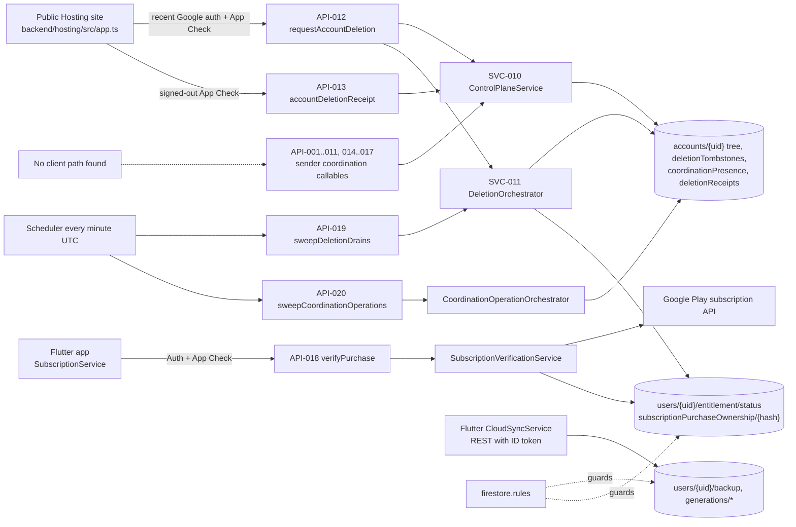

Clients, callable exports, services and server data. The sender-coordination callables (API-001…API-011, API-014…API-017) have **no Flutter caller** in the inspected source; only API-012/API-013 (public Hosting) and API-018 (Flutter purchase verification) are called by a client. Details, schemas and error model: [ARCHITECTURE.md §8](ARCHITECTURE.md).

