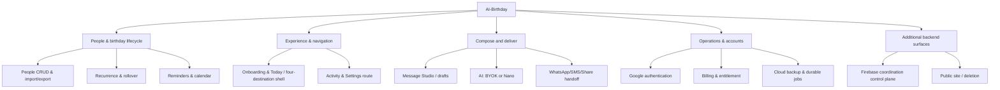

# AI-Birthday — Source-linked knowledge portal

> [Project home](../../README.md) · [Product intent](../../SSOT.md) · [Architecture baseline](../../ARCHITECTURE.md) · [Feature registry](feature-registry.json)

**Evidence snapshot:** `20a598e9789a19e2a35a2b693e63c098473cc68d` (2026-11-25 checkout). The machine-readable feature registry preserves prior IDs and adds source-grounded deeper capabilities. It describes code, tests, and explicit unknowns; it is not proof of production deployment or user demand. The checkout already has local modifications in `.gitignore`, shell goldens, and one test file; this documentation does not alter them.

## Start here

| Question | Read |
|---|---|
| What does the product do? | [Product requirement / SSOT](../../SSOT.md) |
| What is the complete interconnected project graph? | [Master project mind map](master-project-mindmap.md) · [machine graph](master-project-graph.json) |
| What exists, down to micro / nano capabilities? | [Functional tree and feature contracts](features/README.md) |
| Which UI screen do I open, and what happens next? | [Navigation and user journeys](journeys/README.md) |
| Which interactions are present on each screen? | [Screen and interaction inventory](screen-interaction-inventory.md) |
| What calls what? Where is data stored? | [Architecture and data lineage](architecture/README.md) |
| Which cross-module edges and data paths exist? | [Cross-dependency graph](cross-dependency-graph.md) · [Data-flow map](data-flow-map.md) |
| What is not done, contradictory, or unverified? | [Gap and improvement register](gaps/README.md) |
| How are findings linked to source and tests? | [Machine-readable registry](feature-registry.json) |
| What is the source/test evidence for a claim? | [Evidence register](evidence-register.md) |
| How much of the repository was inspected and validated? | [Coverage report](project-coverage-report.md) |
| Where is the full journey-to-test trace? | [Traceability matrix](traceability-matrix.csv) |
| How do we update this documentation? | [Maintenance guide](maintenance/README.md) |
| Which exact validations and business rules apply? | [Business rules](business-rules/README.md) |
| How do requirements map to functions and tests? | [Requirement traceability](traceability/README.md) |
| Which APIs and external systems interact? | [Integrations and callable APIs](integrations/README.md) |
| Who owns local/cloud data and how does it flow? | [Data model and lineage](data-model/README.md) |
| What are the atomic responsibilities of complex areas? | [Deep feature contracts](features/deep-dives/README.md) |
| Where are all declared routes and deep links? | [Navigation architecture](navigation/README.md) |
| What has CI actually verified, and what is blocked? | [Verification and coverage](verification/README.md) |

## Product boundary: important distinction

**Mobile product.** The active Flutter application is a local-first birthday manager with a user-reviewed AI/manual message studio. The high-level target cycle in [SSOT.md](../../SSOT.md) is:

```text
People → Birthday → Reminder → Prepare → AI/Manual → Review → Send → History
```

**Native integration.** Kotlin implements Android-specific notifications and Gemini Nano platform access.

**Cloud backup, purchases and identity.** The Flutter app has optional Firebase-account operations and verification integrations; none is a prerequisite for basic local contact entry.

**Additional backend product surface.** `backend/functions/` also contains a separately documented *Birthday Autopilot* server coordination control plane, and `backend/hosting/` provides public/legal/deletion routes. Their READMEs explicitly say production deployment is not evidenced. Do **not** equate the coordination capability with the current mobile app's WhatsApp workflow; see [architecture](architecture/README.md) and [gaps](gaps/README.md).

**Current navigation evidence:** the Flutter shell has four persistent destinations (Today, People, Calendar, Activity). Settings is a separate route above the shell. The public Hosting pages advertise broader Android/iOS automation, but source gates default off, the control-plane/mobile sender integration is not present, and release configuration/deployment are not evidenced. Treat the product/legal copy versus executable capability as a documented conflict, not a feature claim.

## Product capability map (containment, not execution)



A feature tree answers **what contains what**; the [journey](journeys/README.md) and [architecture](architecture/README.md) diagrams answer **what calls what**.

## Implementation and evidence legend

| Label | Meaning |
|---|---|
| `implemented` | Implementation was located in repository source. It is **not** a guarantee that every environment works. |
| `partially-implemented` | Only a verified portion of the desired capability was identified. |
| `planned/documented-only` | Requirement or historical plan without adequate implementation evidence. |
| `proposed` | Optional recommendation made by this analysis, not an approved requirement. |
| `source-reviewed` | Code and test locations were read or their existence cross-checked; tests not executed locally in this session. |
| `CI observed` | A published GitHub Actions run was inspected; does not establish physical-device or deployment correctness. |

Current-session local evidence is summarized in the [coverage report](project-coverage-report.md). No current external CI run was inspected. Do not promote a local build, widget test, or page preview to evidence of live Play Billing, real message delivery, deployed Firebase, or production Hosting.

## Repository index

```text
lib/main.dart                    Flutter entrypoint
lib/app/                       App scope, navigation, providers, theme
lib/core/                      SQLite, platform/security/logging primitives
lib/features/                  Mobile product capabilities
lib/shared/, lib/ui/           UI widgets and styling
android/app/src/main/          Kotlin and native Android configuration
backend/functions/             Separate Firebase control plane + verification
backend/hosting/               Web legal/help/deletion frontend
test/                          Dart unit/widget/E2E harness and test suites
backend/functions/test/        Backend Vitest & emulator tests
backend/hosting/test/          Hosting Node tests
docs/archive/                  Historical snapshots; not current authority
docs/audit/                    Previous investigations; status may be stale
```

## Authority and limitations

- For *intended* product behavior use [SSOT.md](../../SSOT.md); for *implemented* behavior inspect source at the cited path; for *observed tests* consult the exact execution result in the [coverage report](project-coverage-report.md).
- Historical `PROJECT.md` milestone labels and archived audit completion statements are not automatically current.
- A local Flutter test/build and Android emulator launch were observed in this session; emulator interaction beyond first-run display was blocked by input-injection permissions. The browser review covered only the separate local Hosting site, not a Flutter web build.
- Verification and unresolved distinctions are recorded in [gaps](gaps/README.md). Avoid inferring production-readiness from source presence.

**Next step:** select a node in [the feature tree](features/README.md), follow the linked Dart/Kotlin/TypeScript file, and use the associated journey and tests to verify the behavior in an appropriate runtime.
