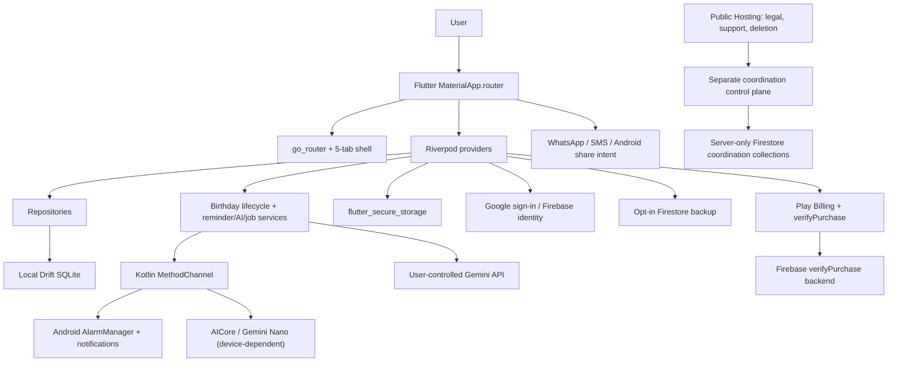
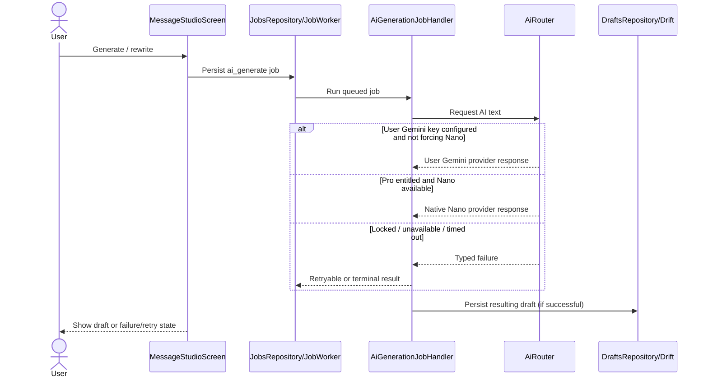
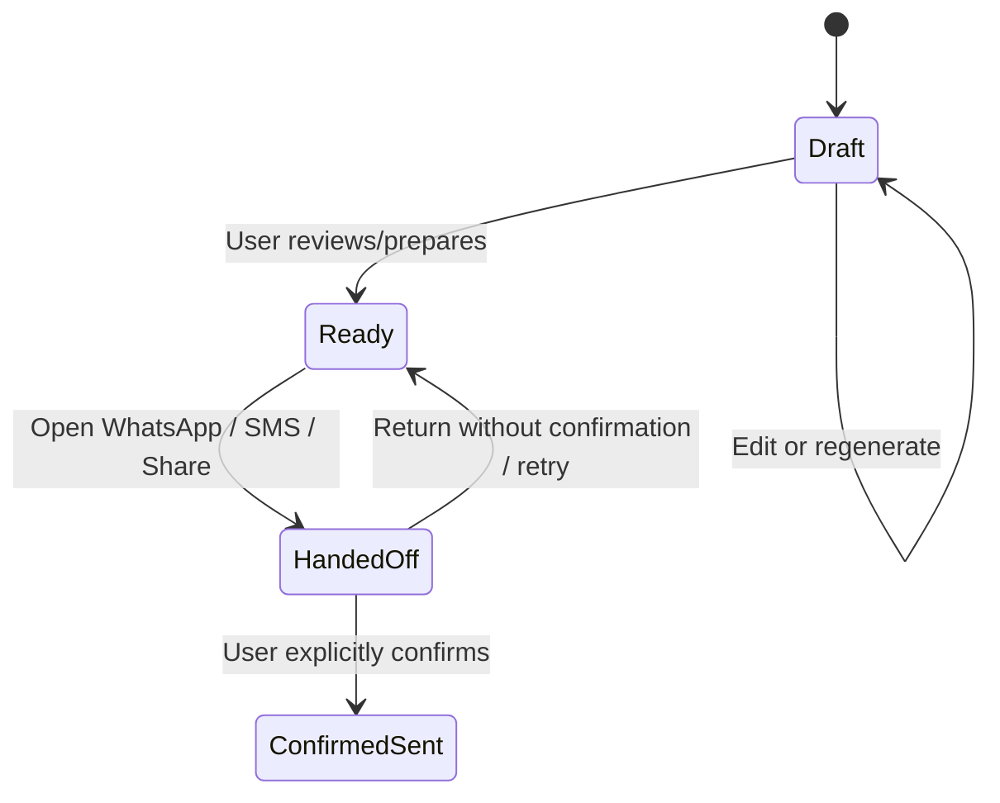

# AI-Birthday — Architecture, execution and data lineage

[Knowledge portal](../README.md) · [Features](../features/README.md) · [Journeys](../journeys/README.md) · [Gaps](../gaps/README.md)

## 1. Actual source topology



**Evidence:** [boot](../../../lib/main.dart), [app](../../../lib/app/app.dart), [providers](../../../lib/app/providers.dart), [router](../../../lib/app/router.dart), [Drift schema](../../../lib/core/database/app_database.dart), [native](../../../android/app/src/main/kotlin/com/yashsomani/ai_birthday/MainActivity.kt), [Cloud Functions](../../../backend/functions/src/functions/index.ts). Edges above summarize identified architecture; individual paths still need integration verification.

### Ownership rules

- `lib/` Flutter owns screens, user journeys, state, business validation and local persistence.
- `android/.../` Kotlin owns Android platform-specific side effects; model availability is not implied by source.
- `backend/functions/` currently contains both subscription verification and a broader *Birthday Autopilot* coordination service; distinguish independently wired endpoints from server-only capabilities.
- `backend/hosting/` is a distinct web application with `/`, `/delete/`, `/privacy/`, `/terms/` and `/support/`; see its [release gates](../../../backend/hosting/README.md).
- `SSOT.md` defines intention, not proof of deployed infrastructure.

## 2. State and persistence boundaries

| Data | Current implementation location | Reader/writer | Privacy / verification caveat |
|---|---|---|---|
| People, birthday occurrences, drafts, delivery events | [Drift tables](../../../lib/core/database/app_database.dart) | Repositories + application services | Operational source is local SQLite; see tombstones and versioning |
| Reminder preferences and durable jobs | Same Drift database | Settings controller, job worker | Android notifications require device/permission validation |
| User Gemini credential and auth session | [Secure credential storage](../../../lib/core/security/credential_storage.dart) | AI providers, auth gateway | Do not synchronize, log or include secrets in docs |
| Opt-in backup | [CloudSyncService](../../../lib/features/sync/data/cloud_sync_service.dart) | Authenticated mobile user | Snapshot generations; owner-scoped Firestore fields are **not** an end-to-end encrypted zero-PII envelope |
| Subscription | [SubscriptionService](../../../lib/features/subscription/application/subscription_service.dart) and [server verifier](../../../backend/functions/src/services/subscriptionVerification.ts) | Play purchase / backend verification | Purchase and provisioning require real store/runtime checks |
| Sender leases, claim / arm fences | [ControlPlaneService](../../../backend/functions/src/services/controlPlane.ts) | Separate callable functions | Hosting/backend docs say not deployed; do not imply normal mobile app uses the control plane |

## 3. Execution trace — add a person

```mermaid
sequenceDiagram
  actor U as User
  participant F as PersonFormScreen
  participant S as PersonService
  participant R as PersonRepository
  participant D as Drift
  participant B as BirthdaysRepository
  U->>F: Enter name and date; Save
  F->>S: Create or update draft
  S->>S: Validate with PersonInputValidator
  S->>R: Save person / version
  R->>D: Persist
  F->>B: Create or refresh birthday occurrence
  B->>D: Persist current-cycle birthday
  D-->>F: Updated reactive data
```

Source chain: [form](../../../lib/features/people/presentation/person_form_screen.dart) → [service](../../../lib/features/people/application/person_service.dart) → [validator](../../../lib/features/people/domain/person_input_validator.dart) → [people repository](../../../lib/features/people/data/person_repository.dart) and [birthday repository](../../../lib/core/database/drift_repositories.dart). Check transaction boundaries before assuming a single atomic transaction across person + occurrence.

## 4. Execution trace — draft with AI



Sources: [UI](../../../lib/features/message_studio/presentation/message_studio_screen.dart), [worker](../../../lib/features/jobs/application/job_worker.dart), [job handler](../../../lib/features/jobs/application/ai_job_handler.dart), [router](../../../lib/features/ai/domain/ai_router.dart), [prompt builder](../../../lib/features/ai/domain/ai_prompt_builder.dart). The source-level `AiRouter.generate` checks `hasGeminiApiKey` before applying the Pro gate to the non-BYOK path; a stale top-of-file comment describes another order—recorded in [gaps](../gaps/README.md).

## 5. Delivery semantics and state



This is a *conceptual* cross-entity journey, not a literal transcription of one Dart enum. Check [BirthdayStatus](../../../lib/features/birthdays/domain/models/birthday.dart), [MessageDraft](../../../lib/features/message_studio/domain/models/message_draft.dart), and [DeliveryHandoff](../../../lib/features/delivery/domain/models/delivery_handoff.dart) individually; they have different state models. [WhatsApp handoff builder](../../../lib/features/delivery/data/whatsapp_handoff_builder.dart) validates digits and text, constructs `https://wa.me/...`, and does **not** prove that the external user pressed Send. [Studio](../../../lib/features/message_studio/presentation/message_studio_screen.dart) records handoffs and requests confirmation.

## 6. Birthday / reminder data lineage

```text
Person birthday month/day, optional year, timezone
 → BirthdayEngine.computeNext (leap-day + timezone policy)
 → BirthdayLifecycleService.refresh (active occurrence)
 → Dashboard / Calendar / Message Studio
 → ReminderScheduler.plan (offsets and quiet hours)
 → ReminderService.sync
 → NotificationSchedulerGateway
 → Kotlin exact-alarm / notification handling
 → notification tap deep link to Message Studio
```

See [engine](../../../lib/features/birthdays/domain/birthday_engine.dart), [lifecycle](../../../lib/features/birthdays/application/birthday_lifecycle_service.dart), [scheduler](../../../lib/features/reminders/domain/reminder_schedule.dart), [service](../../../lib/features/reminders/application/reminder_service.dart), and [AppScaffold notification-open callback](../../../lib/app/app_scaffold.dart).

## 7. Opt-in backup lifecycle

```text
Settings backup request → durable cloud_sync job
 → fresh Firebase ID token → CloudSyncService.sync
 → write immutable people/birthday/draft/reminder generations
 → write manifest and atomically advance backup/current pointer
 → user receives completion/error state

Settings restore request → cloud_sync restore job
 → resolve backup/current and manifest
 → download / validate generation counts
 → local restoration transaction with tombstone / referential checks
 → re-plan local reminders after successful restore
```

Source: [Settings](../../../lib/features/settings/presentation/settings_screen.dart), [Cloud job handler](../../../lib/features/jobs/application/cloud_job_handler.dart), [CloudSyncService](../../../lib/features/sync/data/cloud_sync_service.dart), [Firestore rules](../../../backend/firestore.rules). The [previous remediation audit](../../audit/07-remediation-status.md) reports still-open malformed-record and cleanup work; status needs retesting at the current snapshot.

## 8. Independent server-facing capabilities

The Firebase Functions package exports callable APIs covering registration, sender lease renewal, account modes, occurrence/test claims, arm-status/retry, transfer, deletion/receipts, reset/release, companion status and scheduled cleanup. The callable declarations live in [functions/index.ts](../../../backend/functions/src/functions/index.ts); input contracts in [schemas.ts](../../../backend/functions/src/transport/schemas.ts).

Do **not** draw an execution edge from the normal Flutter message-studio WhatsApp action to `claimOccurrence` or `armAttempt` without finding its client caller and testing the path. Likewise, the Hosting deletion UI is a separate route-based app and has stated production release gates.

## 9. Verification

**Observed external CI:** [main workflow success at snapshot commit](https://github.com/yhsomani/AI-Birthday/actions/runs/38461085640). **Not executed here:** Flutter tests, Android device, emulator, Play purchase, real Gemini Nano, Firebase deployed endpoints, Hosting release-gate checks. The [gaps register](../gaps/README.md) lists targeted follow-ups and explicitly unverified claims.
