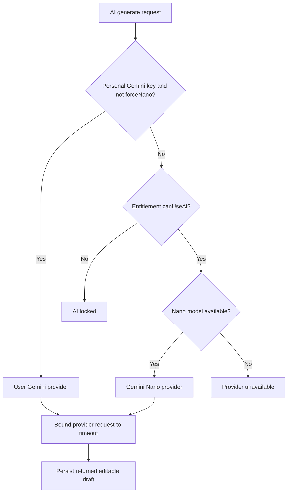
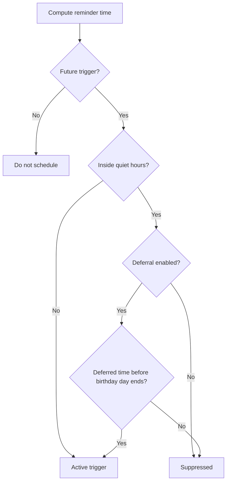

# Business rules and decision catalog

[Knowledge home](../README.md) · [Feature registry](../feature-registry.json) · [Traceability](../traceability/README.md) · [Verification](../verification/README.md)

**Baseline:** ``main`` at ``2abcc1aaa24a69c0aff5bddbc13c5f05d0ed14f8``. This catalog records source-observed rules and clearly separates runtime verification. A test-file reference does **not** imply that the individual rule has a passing named assertion without inspecting that assertion.

## Canonical rules

| Rule ID | Feature ID | Constraint / outcome | Evidence | Classification |
|---|---|---|---|---|
| BR-001 | [PEOPLE-VALIDATE](../feature-registry.json) | **Recipient name** — Trimmed name is required and must not exceed 120 characters. | [PersonInputValidator.validate](../../../lib/features/people/domain/person_input_validator.dart) · [Test location](../../../test/features/people/domain/person_input_validator_test.dart) | Implemented in source |
| BR-002 | [PEOPLE-VALIDATE](../feature-registry.json) | **Birthday date** — A birthday is required by default; the optional-mode validator still rejects an incomplete month/day pair. Day/month must be a valid calendar date. | [PersonInputValidator.validate / BirthdayEngine.isValidMonthDay](../../../lib/features/people/domain/person_input_validator.dart) · [Test location](../../../test/features/people/domain/person_input_validator_test.dart) | Implemented in source |
| BR-003 | [PEOPLE-VALIDATE](../feature-registry.json) | **Birth year** — If supplied, the birth year must be between 1900 and 2199, inclusive. | [PersonInputValidator.validate](../../../lib/features/people/domain/person_input_validator.dart) · [Test location](../../../test/features/people/domain/person_input_validator_test.dart) | Implemented in source |
| BR-004 | [PEOPLE-VALIDATE](../feature-registry.json) | **Optional phone format** — The person-form validator accepts only 6–20 characters matching digits and + - ( ) . space; the stricter WhatsApp outbound handoff rule is separate. | [PersonInputValidator._phone](../../../lib/features/people/domain/person_input_validator.dart) · [Test location](../../../test/features/people/domain/person_input_validator_test.dart) | Implemented in source |
| BR-005 | [PEOPLE-VALIDATE](../feature-registry.json) | **Optional email** — Email is checked against a simple address-shaped expression and limited to 254 characters; do not confuse this with verified address ownership. | [PersonInputValidator._email](../../../lib/features/people/domain/person_input_validator.dart) · [Test location](../../../test/features/people/domain/person_input_validator_test.dart) | Implemented in source |
| BR-006 | [PEOPLE-VALIDATE](../feature-registry.json) | **Recipient contextual field limits** — Relationship maximum 60 characters; language must be non-empty and at most 10; at most 20 nonblank facts, each no longer than 200; notes at most 2000. | [PersonInputValidator.validate](../../../lib/features/people/domain/person_input_validator.dart) · [Test location](../../../test/features/people/domain/person_input_validator_test.dart) | Implemented in source |
| BR-007 | [PEOPLE-VALIDATE](../feature-registry.json) | **Timezone validity** — Nonblank supplied timezone must resolve to an IANA timezone and be at most 64 characters. | [PersonInputValidator.validate / BirthdayEngine.isKnownTimezone](../../../lib/features/people/domain/person_input_validator.dart) · [Test location](../../../test/features/people/domain/person_input_validator_test.dart) | Implemented in source |
| BR-008 | [BIRTH-CALC](../feature-registry.json) | **Leap-day recurrence** — For Feb 29 during non-leap years, the default is Feb 28 with a selectable March 1 resolution parameter. | [BirthdayEngine.resolveFeb29](../../../lib/features/birthdays/domain/birthday_engine.dart) · [Test location](../../../test/features/birthdays/domain/birthday_engine_test.dart) | Implemented in source |
| BR-009 | [BIRTH-CALC](../feature-registry.json) | **Calendar-day calculation** — Compute next occurrences and days-until using local calendar dates, with recipient timezone when supplied. Do not model day counts as elapsed 24-hour periods across DST. | [BirthdayEngine.computeNext](../../../lib/features/birthdays/domain/birthday_engine.dart) · [Test location](../../../test/features/birthdays/domain/birthday_engine_test.dart) | Implemented in source |
| BR-010 | [REM-RULES](../feature-registry.json) | **Reminder deduplication** — Within a plan, emit no more than one reminder of each enabled kind per person. | [ReminderScheduler.plan / seen](../../../lib/features/reminders/domain/reminder_schedule.dart) · [Test location](../../../test/features/reminders/domain/reminder_scheduler_test.dart) | Implemented in source |
| BR-011 | [REM-RULES](../feature-registry.json) | **Past reminder rejection** — Do not schedule a reminder whose computed time is not after the reference instant. | [ReminderScheduler.plan](../../../lib/features/reminders/domain/reminder_schedule.dart) · [Test location](../../../test/features/reminders/domain/reminder_scheduler_test.dart) | Implemented in source |
| BR-012 | [REM-RULES](../feature-registry.json) | **Quiet hours** — A scheduled event within quiet hours is suppressed unless deferral is selected. When deferred, it must still be before the end of that birthday day. | [ReminderScheduler.plan / QuietHours.nextPermissible](../../../lib/features/reminders/domain/reminder_schedule.dart) · [Test location](../../../test/features/reminders/domain/reminder_scheduler_test.dart) | Implemented in source |
| BR-013 | [AI-BYOK](../feature-registry.json) | **User-owned Gemini credential precedence** — When a user Gemini credential exists, ordinary AI generation uses that provider without requiring app Pro; explicit Nano selection uses the entitlement gate. | [AiRouter.generate](../../../lib/features/ai/domain/ai_router.dart) · [Test location](../../../test/ai/ai_router_test.dart) | Implemented in source; top comment stale |
| BR-014 | [AI-NANO](../feature-registry.json) | **Nano entitlement and availability** — If BYOK is not selected, require entitlement before probing the on-device Nano availability; unavailable device/model results are errors, not template-based fake AI. | [AiRouter.generate](../../../lib/features/ai/domain/ai_router.dart) · [Test location](../../../test/ai/ai_router_test.dart) | Source reviewed; device operation unverified |
| BR-015 | [STUDIO-AI](../feature-registry.json) | **AI generation timeout** — A provider call is bounded by a default 30-second timeout; timeout maps to a retryable typed failure through job handling. | [AiRouter._withTimeout](../../../lib/features/ai/domain/ai_router.dart) · [Test location](../../../test/ai/ai_router_test.dart) | Implemented in source |
| BR-016 | [SEND-WA](../feature-registry.json) | **WhatsApp handoff validation** — Sanitize to numeric international-style digits, strip 00 prefix, require length 7–15 and disallow leading 0; reject an empty message; URL-encode the text. | [WhatsAppHandoffBuilder.buildHandoff](../../../lib/features/delivery/data/whatsapp_handoff_builder.dart) · [Test location](../../../test/delivery/whatsapp_handoff_test.dart) | Implemented in source |
| BR-017 | [SEND-TRUTH](../feature-registry.json) | **Delivery truthfulness** — Opening WhatsApp creates a handoff, not proof of an actual send. Confirmation requires an explicit user action and is separate from the draft editorial status. | [_handleWhatsAppSend / _showHandoffConfirmationDialog](../../../lib/features/message_studio/presentation/message_studio_screen.dart) · [Test location](../../../test/delivery/whatsapp_handoff_test.dart) | Source reviewed; third-party delivery cannot be observed |
| BR-018 | [JOBS](../feature-registry.json) | **Durable job state** — A job moves from queued to running and then succeeds, fails, is canceled, or retries. The worker deduplicates active enqueues via its repository. | [JobWorker.enqueue / _process](../../../lib/features/jobs/application/job_worker.dart) · [Test location](../../../test/features/jobs/application/job_worker_test.dart) | Implemented in source |
| BR-019 | [JOBS](../feature-registry.json) | **Retry ceiling** — Retry only when a handler marks failure retryable and attempts are below maxAttempts, using exponential backoff with jitter in production. | [JobWorker._backoff / _process](../../../lib/features/jobs/application/job_worker.dart) · [Test location](../../../test/features/jobs/application/job_worker_test.dart) | Implemented in source |
| BR-020 | [BILL](../feature-registry.json) | **Entitlement states** — Only active, trial and grace entitlements with no passed expiry are eligible for app-provided AI; expired or none must not grant access. | [UserEntitlement.canUseAi](../../../lib/features/subscription/domain/entitlement.dart) · [Test location](../../../test/features/subscription/subscription_service_test.dart) | Implemented in source |
| BR-021 | [CLOUD](../feature-registry.json) | **Cloud-backup ownership** — Firestore backup records are owned by authenticated Firebase UID under rules. Source-backed records are Firestore fields, not an opaque end-to-end encrypted envelope. | [Firestore access rules](../../../backend/firestore.rules) · [Test location](../../../backend/functions/test/firestore.rules.emulator.test.ts) | Configured in source; production enforcement unverified |
| BR-022 | [CLOUD-UP](../feature-registry.json) | **Atomic backup publication** — Write snapshot generations, validate/publish manifest, and update backup/current only after generation writes; incomplete upload must not become current. | [CloudSyncService.sync](../../../lib/features/sync/data/cloud_sync_service.dart) · [Test location](../../../test/features/sync/data/cloud_sync_service_test.dart) | Implemented in source; cloud runtime unverified |
| BR-023 | [CTRL-CLAIM](../feature-registry.json) | **Control-plane rate limits** — Backend model constants set at most 20 Birthday Arm events and 3 TEST Arm events per UID per rolling 24-hour window; confirm policy enforcement in service/tests. | [BIRTHDAY_ARM_CAP / TEST_ARM_CAP](../../../backend/functions/src/domain/model.ts) · [Test location](../../../backend/functions/test/policies.test.ts) | Configured in server source; not deployed per README |
| BR-024 | [CTRL](../feature-registry.json) | **Control-plane privacy/activation boundary** — Server coordination is a separate nondeployed capability, and its presence does not establish autonomous personal WhatsApp sending from the Flutter app. | [onCall exports](../../../backend/functions/src/functions/index.ts) · [Test location](../../../backend/functions/test/privacy-architecture.test.ts) | Boundary established; mobile integration unverified |
| BR-025 | [ONB-GATE](../feature-registry.json) | **First-run routing** — Users without onboarding-complete flag are redirected from regular routes to /onboarding. | [createAppRouter.redirect](../../../lib/app/router.dart) · [Test location](../../../test/features/onboarding/presentation/onboarding_screen_test.dart) | Implemented in source |

## Decision-flow models

## Specified policy that cannot be equated with implementation evidence

- [SSOT §6/§21](../../../SSOT.md) calls for prompt truthfulness, never inventing facts and no mention of AI in greetings. ``AiPromptBuilder`` exists, but third-party model output is not proven safe from source alone.
- [SSOT §7/§16](../../../SSOT.md) specifies auto-preparation behavior, while the complete opt-in scheduled AI trigger remains insufficiently verified in the source review.
- [SSOT §19](../../../SSOT.md) calls for robust sync/tombstones; local SQLite tables do not all expose identical version/tombstone contracts; see [data model](../data-model/README.md).
- The [backend control-plane README](../../../backend/README.md) documents more detailed fencing rules; see [integrations](../integrations/README.md) before interpreting them as active mobile behavior.

## Verification and maintenance

Each rule should eventually have: its own stable ID, code symbol, expected input/output, a named assertion or scenario, and a runtime observation for platform-critical behavior. Open rule changes should preserve old IDs and update all affected features and journeys.
