# Cross-dependency graph

[Knowledge home](README.md) · [Master mind map](master-project-mindmap.md) · [Full graph data](master-project-graph.json) · [Data flows](data-flow-map.md)

**Scope:** source-level dependencies in the 2026-11-25 checkout. The graph intentionally keeps the sender-coordination backend separate from Flutter delivery because no mobile registration/claim/arm caller was found. Edges do not imply successful external calls or deployed services.

```mermaid
flowchart LR
  J1["J-01 first launch"] --> UI1["SCR-001 onboarding"]
  UI1 --> SVC1["SVC-001 startup preflight"]
  SVC1 --> DB1[("DB-001..006 local Drift")]
  SVC1 --> SVC2["SVC-002 route/onboarding guard"]
  SVC2 --> UI2["SCR-002/003/005/006 four shell destinations"]

  J2["J-02 manage people"] --> UI3["SCR-003/004 People + form"]
  UI3 --> ACT2["ACT-002 save / ACT-004 import"]
  ACT2 --> RULE2["BR-001..007 input constraints"]
  RULE2 --> SVC3["SVC-003 PersonService"]
  SVC3 --> DB2[("DB-001 Persons")]
  DB2 --> SVC4["SVC-004 occurrence lifecycle"]
  SVC4 --> DB3[("DB-002 Birthdays")]

  J3["J-03 birthday to reminder"] --> DB3
  DB3 --> RULE3["BR-008..012 recurrence and reminder rules"]
  RULE3 --> SVC5["SVC-005 reminder planner/gateway"]
  SVC5 --> DB4[("DB-004 ReminderSettingsEntries")]
  SVC5 --> EXT3["EXT-003 Android alarm/notification"]
  EXT3 --> ACT25["ACT-025 notification tap/deep link"]
  ACT25 --> UI4["SCR-007 person-linked Studio"]

  J4["J-04 compose and hand off"] --> UI4
  UI4 --> ACT8["ACT-008 generate/retry"]
  ACT8 --> SVC6["SVC-006 AI router"]
  SVC6 --> RULEAI["BR-013..015 entitlement/provider/timeout"]
  SVC6 --> EXT5["EXT-005 user Gemini"]
  SVC6 --> EXT6["EXT-006 Gemini Nano"]
  ACT8 --> SVC7["SVC-007 durable job worker"]
  SVC7 --> DB5[("DB-006 Jobs")]
  SVC7 --> DB6[("DB-003 MessageDrafts")]
  DB6 --> ACT10["ACT-010 user-controlled handoff"]
  ACT10 --> EXT10["EXT-010 WhatsApp"]
  ACT10 --> EXT11["EXT-011 SMS composer / gated adapter"]
  ACT10 --> EXT12["EXT-012 share / clipboard"]
  ACT10 --> DB7[("DB-005 DeliveryEvents")]
  DB7 --> ACT11["ACT-011 explicit user sent confirmation"]
  ACT11 --> UI5["SCR-006 Activity"]

  J5["J-05 opt-in backup/restore"] --> UI6["SCR-008 Settings"]
  UI6 --> SVC7
  SVC7 --> SVC8["SVC-008 CloudSyncService"]
  SVC8 --> DB8[("DB-001..004 local snapshot data")]
  SVC8 --> EXT8["EXT-008 owner-scoped Firestore"]
  EXT8 --> RULEC["BR-021/022 access + generation publication"]

  J6["J-06 purchase/restore"] --> UI6
  UI6 --> EXT9["EXT-009 Play Billing"]
  EXT9 --> SVC9["SVC-009 SubscriptionService"]
  SVC9 --> API18["API-018 verifyPurchase"]
  API18 --> SVC10["SubscriptionVerificationService"]
  SVC10 --> PLAY["Google Play subscription API"]
  SVC10 --> ENT["Owner entitlement + purchase ownership"]
  ENT --> RULEAI

  J7["J-07 public deletion"] --> WEB["SCR-011 public deletion page"]
  WEB --> ACT18["ACT-018 request / ACT-019 receipt"]
  ACT18 --> API12["API-012/013 deletion callables"]
  API12 --> SVC11["SVC-011 deletion orchestrator"]
  SVC11 --> SERVERDB[("Server-owned Firestore + Auth")]
  WEB --> EXT13["EXT-013 App Check / reCAPTCHA"]

  CTRL["Separate sender control plane"] --> APICTRL["API-001..017, API-019..020"]
  APICTRL --> SVC12["SVC-010 coordination service"]
  SVC12 --> CTRLDB[("Server-only claims, leases, fences, receipts")]
  CTRL -. no Flutter caller path found .-> J4

  classDef journey fill:#e1efff,stroke:#3478c5,color:#173b63;
  classDef ui fill:#e8f4ff,stroke:#2476b9,color:#12324a;
  classDef service fill:#efe6ff,stroke:#7652a8,color:#34224d;
  classDef api fill:#fff0dd,stroke:#c16a16,color:#4f2c08;
  classDef data fill:#ddf4f1,stroke:#198a80,color:#10443f;
  classDef rule fill:#fff3cd,stroke:#be8b00,color:#4d3b00;
  classDef external fill:#fff0dd,stroke:#c16a16,color:#4f2c08;
  classDef boundary fill:#fbe4e6,stroke:#b3261e,color:#5a1511;
  class J1,J2,J3,J4,J5,J6,J7 journey;
  class UI1,UI2,UI3,UI4,UI5,UI6,WEB ui;
  class SVC1,SVC2,SVC3,SVC4,SVC5,SVC6,SVC7,SVC8,SVC9,SVC10,SVC11,SVC12 service;
  class API18,API12,APICTRL api;
  class DB1,DB2,DB3,DB4,DB5,DB6,DB7,DB8,ENT,SERVERDB,CTRLDB data;
  class RULE2,RULE3,RULEAI,RULEC rule;
  class EXT3,EXT5,EXT6,EXT8,EXT9,EXT10,EXT11,EXT12,EXT13,PLAY external;
  class CTRL boundary;
```

## Relationship inventory

The [machine graph](master-project-graph.json) is authoritative for stable node IDs and relation names. Its explicit edges include containment, calls, reads/writes, validation, requirements, navigation, test evidence, constraints, production, consumption and known blockers. Feature parent edges are imported from the registry. Counts are recorded in the [coverage report](project-coverage-report.md).

| Critical chain | Evidence-linked result |
|---|---|
| Person form/import → rules → service → Persons → birthday lifecycle | A single persisted person can feed reactive People/Calendar/Today views; person and occurrence writes still require transaction-boundary verification. |
| Birthday occurrence → reminder policy → Android scheduler → notification deep link | Preferences and OS alarm state are separate; device permission, reboot and stale-target recovery are not asserted as fully verified. |
| Studio → job → entitlement-first AI → draft → user handoff → explicit outcome | No server message-sending endpoint is on this path; an external-app handoff is not delivery proof. |
| Explicit backup → authenticated Firestore generation → manifest/current pointer | Opt-in and owner scoped; no production deployment or end-to-end encryption claim. |
| Play purchase → `verifyPurchase` → server entitlement → AI gate | Callable is used by Flutter; store and deployed verifier behavior remain unverified. |
| Public deletion → recent reauthentication/App Check → deletion saga → private receipt | Source and local Hosting contract exist; preview lacks release config and production deployment is not evidenced. |
| Sender registration/claim/arm → server coordination ledger | Implemented backend surface but disconnected from the Flutter sender/delivery journey in the inspected source. |

For route/action detail see the [screen and interaction inventory](screen-interaction-inventory.md); for data transition detail see the [data-flow map](data-flow-map.md); for full journey-to-test mappings see [traceability-matrix.csv](traceability-matrix.csv).
