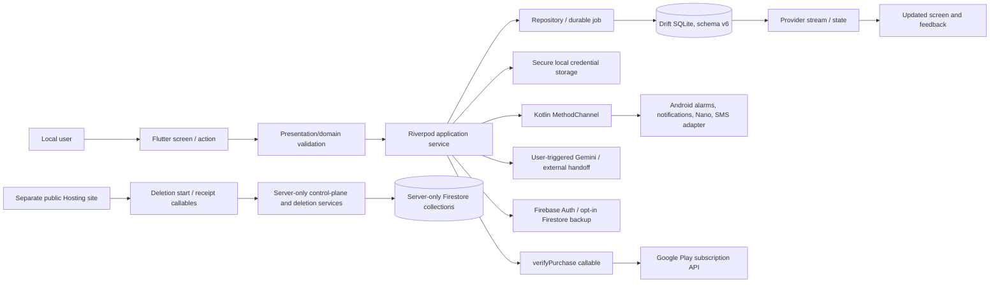

# End-to-end data, state and lifecycle flows

[Knowledge home](README.md) · [Data model](data-model/README.md) · [API/backend map](api-backend-map.md) · [Cross-dependency graph](cross-dependency-graph.md)

## System flow overview



Solid arrows are source-level call/data dependencies. They do not prove external network success or deployment. The control-plane branch is deliberately not joined to the Flutter sender flow because a client caller was not found.

## Critical feature traces

### FLOW-001 — Startup and route state

```text
main()
 -> initialize Flutter/timezone
 -> try Firebase/App Check initialization (cloud is allowed to fail closed)
 -> ProviderScope / AiBirthdayApp
 -> databaseStartupProvider runs SELECT 1 with 10-second bound
 -> loading, ready, or local recovery/retry
 -> routerProvider checks persisted onboarding flag
 -> /onboarding or four-branch shell at /dashboard
```

Evidence: [main.dart](../../lib/main.dart), [app.dart](../../lib/app/app.dart), [core providers](../../lib/core/core_providers.dart), [router](../../lib/app/router.dart).

### FLOW-002 — Person create/edit and import

```text
Form or selected import candidates
 -> input parsing/normalization and validation
 -> PersonService / repository write
 -> Drift Persons
 -> birthday occurrence creation/reconciliation
 -> reactive People, Today and Calendar views
 -> reminder planning/synchronization where preferences require it
```

The current source still has two `Person` model namespaces used in different layers. The exact transaction boundary across person, occurrence, and reminder side effects must be checked before claiming the entire journey is atomic. Evidence: [PersonService](../../lib/features/people/application/person_service.dart), [validator](../../lib/features/people/domain/person_input_validator.dart), [repositories](../../lib/core/database/drift_repositories.dart), [lifecycle](../../lib/features/birthdays/application/birthday_lifecycle_service.dart).

### FLOW-003 — Birthday and notification lifecycle

```text
Saved person birthday + timezone + leap choice
 -> BirthdayEngine computes occurrence
 -> BirthdayLifecycleService upserts/reconciles cycle
 -> ReminderScheduler applies offset, past-date, dedup and quiet-hour rules
 -> ReminderService compares/applies desired schedule
 -> NotificationSchedulerGateway MethodChannel
 -> Kotlin receiver / Android alarm and notification
 -> notification open carries person ID to person-linked Studio
```

SQLite stores preferences and birthday state; the OS alarm is a separate side effect. Permission changes, reboot, device time/timezone changes and notification callbacks are distinct reconciliation branches.

### FLOW-004 — AI generation and draft persistence

```text
Studio input/action
 -> enqueue ai_generate with non-secret payload
 -> Jobs row
 -> app-process JobWorker claims job
 -> AiRouter checks application entitlement first
 -> user-key Gemini OR explicitly selected/eligible Gemini Nano
 -> AiGenerationJobHandler writes draft/result
 -> Studio observes durable job and draft stream
 -> typed failure/retry/manual editing if provider fails
```

The AI key and identity tokens are read from secure/live providers, not embedded in job payload. Widget edit revisions guard against stale output overwriting newer human edits. This worker is app-process backed; the presence of a durable SQLite row is not an OS scheduling guarantee.

### FLOW-005 — User-controlled delivery and history

```text
Reviewed draft
 -> validate selected channel and destination
 -> launch WhatsApp URL / SMS composer / share or copy
 -> persist a handoff outcome/event where supported
 -> return to app
 -> user may explicitly confirm sent
 -> Activity reads draft and delivery event
```

Opening another app is not send/delivery evidence. Actual delivery depends on the external client, user action, carrier and recipient; the app must not infer it from lifecycle return.

### FLOW-006 — Opt-in cloud backup and restore

```text
Settings action
 -> durable cloud_sync job
 -> fresh Firebase ID token
 -> CloudSyncService validates local snapshot records
 -> write immutable generation collections
 -> write manifest/counts
 -> update backup/current pointer only after generation commit
 -> show result

Restore
 -> explicit user confirmation
 -> fetch current pointer + manifest + generation
 -> validate format/counts/references before writes
 -> apply local transaction / preserve tombstone rules
 -> refresh lifecycle and reminder schedules
 -> show result or recoverable failure
```

Source supports this design; no production Firestore project was accessed in this review.

### FLOW-007 — Play purchase verification

```text
Play Billing purchase/restore
 -> Flutter validates account/session and obtains Auth/App Check tokens
 -> verifyPurchase callable (consumed App Check)
 -> strict request schema + Firebase UID
 -> Google Play subscription lookup
 -> package/product/account-binding/expiry/status checks
 -> owner entitlement + hashed token ownership write
 -> typed entitlement response to Flutter
 -> AI router checks entitlement before provider selection
```

### FLOW-008 — Public deletion and server-only sender control

```text
Public Hosting deletion page
 -> fail closed if runtime config absent
 -> recent Google reauthentication
 -> limited-use App Check + deletion request id
 -> requestAccountDeletion
 -> server tombstone/fence/drain and recursive deletion orchestration
 -> Auth deletion and completion receipt
 -> signed-out, App-Checked receipt lookup
```

Separate sender registration/claim/arm/retry functions also operate over server-only coordination collections, but no Flutter client call path was found. Do not connect this flow to Message Studio or WhatsApp without new evidence.

## State machines and recovery

| State family | Source-of-truth data | Typical transition | Error/fallback |
|---|---|---|---|
| Database startup | SQLite open/query | checking → ready or failed | explicit local retry; no success-shaped fallback |
| Onboarding | secure stored flag + route guard | incomplete → complete → shell | storage failure must not silently complete |
| Birthday | Birthday row status/cycle | due/upcoming/drafted/handed-off/completed/failed per domain | refresh/reconcile; stale/deleted target recovery |
| Draft/job | MessageDrafts + Jobs | queued → running → success/failure/retry/cancel | manual draft, retry, or typed failure |
| Delivery | DeliveryEvents + explicit user action | launched/handed off → user confirmation | remain unconfirmed when send outcome unknown |
| Reminders | SQLite preference + OS scheduler | desired plan → apply/cancel → reconciled | permission/timezone/reboot requires re-evaluation |
| Backup | Jobs + Firestore generation manifest/pointer | started → complete or failed | keep previous pointer on incomplete generation |
| SMS queue | Native queue + Dart schedule gate | disabled by default; optional schedules are token/occurrence-bound | cancel/reconcile; never enable by assumption |
| Control-plane account | server docs and operation receipt | active/paused/transfer/deleting/complete | strict fences, replay, scheduled recovery; deployment not evidenced |

## Data ownership constraints

- People, birthday events, drafts, reminder preferences, delivery events and local jobs are operationally stored in Drift SQLite.
- Gemini keys and credential material use secure storage. Job payloads should not contain secrets.
- Opt-in backup sends selected personal data into owner-scoped Firestore fields; source does not establish client-side end-to-end encryption.
- Public deletion removes app-operated server account data under its saga; it does not erase device-local records or external messages/source contacts/carrier copies.
- Server coordination uses pseudonymous/opaque data and server-only collections; no raw recipient message content is accepted by sender-control schemas.

See [database model](data-model/README.md) and [API/backend catalog](api-backend-map.md) for entities and contracts.
