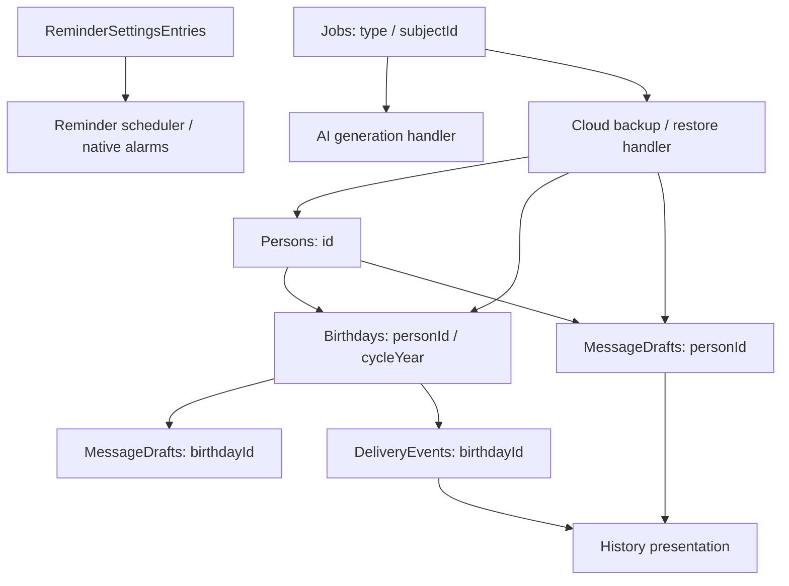

# Domain entities, persistence, state and data lineage

[Knowledge home](../README.md) · [Business rules](../business-rules/README.md) · [Integrations](../integrations/README.md)

**Observed local database schema version:** ``5`` in [AppDatabase](../../../lib/core/database/app_database.dart). The six declared local tables below are based on its actual definitions. This guide does not claim all properties or migrations have been independently tested.

## SQLite table inventory

| Table | Business responsibility | Producing / consuming subsystem | Critical caveat |
|---|---|---|---|
| `Persons` | Recipient identity, month/day, preferences and user-entered facts | People service, CSV import, backup/restore | Local operational record; version and deletedAt tombstone present |
| `Birthdays` | Cycle-specific occurrence with state, date, person ID and optional draft link | BirthdayLifecycleService, Dashboard, Studio | Different sync-envelope completeness than Persons |
| `MessageDrafts` | Editable body, tone, provider, status and timestamps | Studio, AI durable job handler, History | Draft editorial status distinct from delivery confirmation evidence |
| `ReminderSettingsEntries` | Reminder kinds, quiet hours and preferences | ReminderSettingsController, backup/restore | Scheduling side effect is on Android platform, not in SQLite |
| `DeliveryEvents` | Handoff record and channel/time evidence | Studio, History | Opening another app does not establish sent/delivered |
| `Jobs` | Durable operation type/status/attempts/retry due and payload | JobWorker, AI/Cloud handlers | Sensitive tokens should not be persisted in job payload |

## Conceptual entity relationships

**Important:** arrows are conceptual entity references, not a claim that all are enforced with SQLite foreign-key constraints. The actual constraints and migration handlers require DB-level verification.

## Data source and ownership matrix

| Data kind | Primary owner | Optional processing or external destination | Constraints |
|---|---|---|---|
| Person identity, birthday, private facts | Drift on device | Firebase Firestore opt-in snapshot; Gemini API only for selected generation | Minimize personal-data disclosure; owner-scoped backup is not client-exclusive encryption |
| Message body and versions | Drift drafts | BYOK Gemini request or user-initiated SMS/WhatsApp/Share | Manual review before handoff; do not imply external delivery confirmed |
| Notification state | SQLite settings and Android OS scheduler | Android notification manager | Local permission and reboot behavior differs from persisted preference |
| Gemini API key | Secure storage | Direct user-owned Gemini provider | Never copy into SQLite backups/job payloads/logging |
| Google auth and purchase tokens | Secure auth session/checkout | Firebase Auth, Play, backend verifier | Check expiry and account binding; log non-sensitive metadata only |
| Coordination sender aliases/claims | Separate backend Firestore and server-only logic | Authenticated App Check callables | Not part of local recipient schema; no asserted deployed production integration |

## Source-level transaction and recovery boundaries

1. **Person create/edit:** form → PersonService → repository → Drift; ensure birthday occurrence reconciliation and reminder planning. See [person service](../../../lib/features/people/application/person_service.dart).
2. **AI draft write:** Studio enqueues ``ai_generate``; JobWorker invokes AI handler; the handler uses stable per-birthday upsert logic; verify race suppression after human edits. See [AI handler](../../../lib/features/jobs/application/ai_job_handler.dart).
3. **External handoff:** transactional delivery evidence/birthday state should be compared with actual draft state independently; see [Drift repositories](../../../lib/core/database/drift_repositories.dart).
4. **Cloud backup:** [CloudSyncService](../../../lib/features/sync/data/cloud_sync_service.dart) writes immutable generation records, manifest and advances ``backup/current`` only after writes. Restore checks manifest/count and applies to local storage; runtime fault-injection remains necessary.
5. **Local delete:** People soft-delete sets tombstone/version; cloud restore should not resurrect deleted people or orphaned drafts. Check [cloud tests](../../../test/features/sync/data/cloud_sync_service_test.dart) and [repository tests](../../../test/core/database/drift_repositories_test.dart).

## Model duplication to resolve before refactoring

Both [Person model A](../../../lib/features/people/domain/person.dart) and [Person model B](../../../lib/features/people/domain/models/person.dart) define ``Person`` in different namespaces with overlapping fields and behavior. Before choosing a canonical one, compare callers, persistence codecs and import/export paths; characterize all field round-trips; document migration and compatibility. Treat duplication as source-confirmed, but downstream data-loss scenarios as *risk pending verification*.

## Data-lineage acceptance conditions

- No unintended personal information is written when cloud backup is disabled.
- A cloud-generation pointer never references incomplete rows.
- Failed restore does not partially overwrite local data.
- Deletion tombstones prevent unintended resurrection.
- A saved outgoing draft is traceable through handoff evidence without claiming delivered.
- Notifications reflect persisted preferences after changes and lifecycle refresh.

These are proposed verification scenarios, not claims that every case passed a live device/emulator test.
