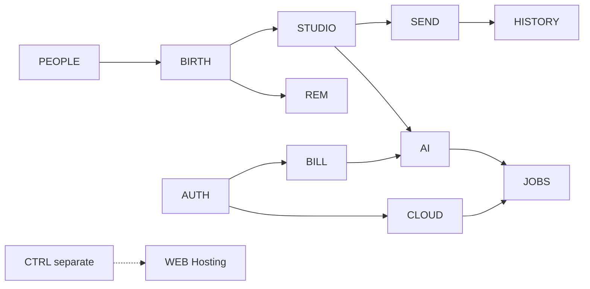

# Feature deep dives: functional, micro, nano and atomic contracts

[Knowledge home](../../README.md) · [Feature registry](../../feature-registry.json) · [Journeys](../../journeys/README.md) · [Business rules](../../business-rules/README.md)

**Read first:** a feature is source-implemented when code exists, but source review is narrower than runtime success or production deployment. Detailed sections below are *evidence-backed models with explicitly proposed verification scenarios*. Level labels are conceptual; there is no artificial minimum depth.

## Open one fully expanded domain

Each page uses the same conceptual contract—purpose, AS-IS source behavior, execution diagram, hierarchical micro/nano/atomic responsibilities, rules, data flows, error handling, related tests and a clearly labeled TO-BE recommendation. The existing 50-node [canonical feature registry](../../feature-registry.json) supplies stable IDs; these pages expand evidence, not create another registry.

| Domain / feature IDs | Detailed, source-linked deep dive |
|---|---|
| PEOPLE, PEOPLE-CRUD, PEOPLE-IMPORT | [Recipient management, CSV and device import](people-import.md) |
| BIRTH, REM, BIRTH-CALC, REM-NATIVE | [Birthday lifecycle and reminders](birthday-reminders.md) |
| STUDIO, AI, AI-BYOK, AI-NANO | [Message Studio and AI routing](message-studio-ai.md) |
| SEND, SEND-TRUTH, HISTORY | [User-controlled delivery and truthful History](delivery-history.md) |
| AUTH, BILL, CTRL-PURCHASE | [Identity and verified subscription](identity-subscription.md) |
| CLOUD, CLOUD-UP, CLOUD-DOWN, JOBS | [Backup, restore and durable jobs](cloud-jobs.md) |
| NAV, ONB, DASH, CAL, SETTINGS, THEME | [Navigation, first run and UI](navigation-ux.md) |
| CTRL, CTRL-CLAIM, CTRL-DELETE, WEB | [Separate backend and public Hosting](backend-hosting.md) |

These are **source-reviewed** decompositions. The diagrams depict identified or intended boundaries; do not treat them as measured, end-to-end production traces.

## Cross-feature composition

The dashed separate-backend relationship is intentionally **not** a Flutter Studio → backend automatic send call.

## PEOPLE — People lifecycle

**Purpose/entry:** `/people` and `/people/add`; CRUD, search, CSV and Android import.

**Observed functional contract:** Trigger create/edit; validate trimmed name/date and optional fields; preserve version/tombstone semantics; update occurrences; show success/undo/errors.

**Hierarchy:** Micros: edit form, relationship metadata, validation, import candidates, selection, persistence. Nanos: name-bound validation, Feb-29 acceptance, duplicate warning, per-row parser failures, CSV formula guard, user confirmation of destructive operations.

**Main source:** [people_screen.dart](../../../../lib/features/people/presentation/people_screen.dart). **Relevant test:** [person_service_test.dart](../../../../test/features/people/application/person_service_test.dart).

**Input/error/alternate/recovery cases to verify:** Offline state and permission rejection; race between imported data and reminders; unknown delivery phone.

**Status:** source reviewed; runtime not independently executed in this documentation run.

## BIRTH — Birthday lifecycle

**Purpose/entry:** Dashboard/Calendar/People → BirthdayEngine → lifecycle refresh.

**Observed functional contract:** Calculate next occurrence in time zone, apply leap resolution, create/preserve correct yearly record.

**Hierarchy:** Micros: recurrence engine, current-year occurrence, lifecycle transition. Nanos: leap-year predicate, Feb-29 alternate, calendar-day count, timezone priority, midnight rollover, status display selection.

**Main source:** [birthday_lifecycle_service.dart](../../../../lib/features/birthdays/application/birthday_lifecycle_service.dart). **Relevant test:** [birthday_engine_test.dart](../../../../test/features/birthdays/domain/birthday_engine_test.dart).

**Input/error/alternate/recovery cases to verify:** Foreground resume, timezone change, rollover while jobs active.

**Status:** source reviewed; runtime not independently executed in this documentation run.

## REM — Reminders

**Purpose/entry:** Settings → ReminderSettingsController; birthday changes → ReminderService.

**Observed functional contract:** Compute enabled offsets, remove past triggers, handle quiet hours and native AlarmManager permissions; notify person-linked Studio when opened.

**Hierarchy:** Micros: persisted schedule preferences, local schedule planning, Android execution. Nanos: one trigger per person/kind, timezone conversion, defer-before-birthday-end, cancel disabled, notification privacy/hide-name.

**Main source:** [reminder_schedule.dart](../../../../lib/features/reminders/domain/reminder_schedule.dart). **Relevant test:** [reminder_scheduler_test.dart](../../../../test/features/reminders/domain/reminder_scheduler_test.dart).

**Input/error/alternate/recovery cases to verify:** Reboot, permission revoked, DST, repeated settings updates, deferred expired reminder.

**Status:** source reviewed; runtime not independently executed in this documentation run.

## STUDIO — Message Studio

**Purpose/entry:** `/message-studio/:birthdayId` or `/message-studio/person/:personId`.

**Observed functional contract:** Resolve person/birthday, allow manual edit or AI job, persist draft, provide explicit handoff and sent confirmation.

**Hierarchy:** Micros: load draft, debounce/autosave, queue generation, text revision, translate/variations, handoff record, confirm. Nanos: _editRevision conflict guard, AI progress/timeout/retry, absent-phone redirection, empty-text validation, handoff-vs-sent separation.

**Main source:** [message_studio_screen.dart](../../../../lib/features/message_studio/presentation/message_studio_screen.dart). **Relevant test:** [message_studio_optimistic_test.dart](../../../../test/features/message_studio/presentation/message_studio_optimistic_test.dart).

**Input/error/alternate/recovery cases to verify:** User edits during AI generation; duplicate taps; app background; external-app return without send.

**Status:** source reviewed; runtime not independently executed in this documentation run.

## AI — AI routing

**Purpose/entry:** AiRouter → user Gemini provider OR entitled Nano.

**Observed functional contract:** Use personal key without Pro unless forceNano; otherwise entitlement gate then Nano availability; bound requests and report typed failures.

**Hierarchy:** Micros: secure key setup/test/remove, prompt builder, provider selection, Nano state bridge. Nanos: configured-but-invalid key feedback, forceNano semantics, generation timeout, no invented user facts policy, user quota disclosure.

**Main source:** [ai_router.dart](../../../../lib/features/ai/domain/ai_router.dart). **Relevant test:** [ai_router_test.dart](../../../../test/ai/ai_router_test.dart).

**Input/error/alternate/recovery cases to verify:** Model/device availability, external provider limits, abuse of notes as prompt instructions.

**Status:** source reviewed; runtime not independently executed in this documentation run.

## CLOUD — Cloud backup / restore

**Purpose/entry:** Settings → durable cloud_sync job → CloudSyncService.

**Observed functional contract:** Require Firebase identity; upload complete immutable generation and atomically publish pointer; restore only validated generation.

**Hierarchy:** Micros: fresh token acquisition, serialized records, Firestore batch, manifest/counts, pointer publication, restore transaction, reminder re-plan. Nanos: collection count check, incomplete generation rejection, tombstone skip, failure classification, retry boundaries.

**Main source:** [cloud_sync_service.dart](../../../../lib/features/sync/data/cloud_sync_service.dart). **Relevant test:** [cloud_sync_service_test.dart](../../../../test/features/sync/data/cloud_sync_service_test.dart).

**Input/error/alternate/recovery cases to verify:** Network interruption, missing row, corrupt JSON, expired auth, cross-account access.

**Status:** source reviewed; runtime not independently executed in this documentation run.

## JOBS — Durable jobs

**Purpose/entry:** App boot starts JobWorker; Studio/Settings enqueue jobs.

**Observed functional contract:** Persist queue, recover stale running work, dedupe active operation, execute by handler, store retry/success/failure.

**Hierarchy:** Micros: enqueue, claim, run handler, classify outcome, backoff and recover. Nanos: maxAttempts guard, jitter, stream emission, cancelled state, safe idempotent draft upsert.

**Main source:** [job_worker.dart](../../../../lib/features/jobs/application/job_worker.dart). **Relevant test:** [job_worker_test.dart](../../../../test/features/jobs/application/job_worker_test.dart).

**Input/error/alternate/recovery cases to verify:** Crash between network write and acknowledgement, duplicate client requests, stale worker.

**Status:** source reviewed; runtime not independently executed in this documentation run.

## CTRL — Coordination backend (separate)

**Purpose/entry:** Firebase callable declarations (not ordinary mobile UI routes).

**Observed functional contract:** Register installation/epoch, lease, claim, arm, bounded retry, sender transfer, cleanup and deletion under server authorization.

**Hierarchy:** Micros: request schema, auth/AppCheck, policy decisions, opaque hashing, transactional fences, race handling, receipt/tombstone workflows. Nanos: 24h quota limits, arm expiry, one authorized retry, content-free receipt verification, scheduled drain sweep.

**Main source:** [index.ts](../../../../backend/functions/src/functions/index.ts). **Relevant test:** [decisions.test.ts](../../../../backend/functions/test/decisions.test.ts).

**Input/error/alternate/recovery cases to verify:** Backend README states undeployed; avoid assuming UI automation or WhatsApp integration.

**Status:** source reviewed; runtime not independently executed in this documentation run.

## Distinguishing frontend message states

The exact enums are distinct: [BirthdayStatus](../../../../lib/features/birthdays/domain/models/birthday.dart), [DraftStatus](../../../../lib/features/message_studio/domain/models/message_draft.dart), and [DeliveryHandoff](../../../../lib/features/delivery/domain/models/delivery_handoff.dart). The draft enum has ``draft``, ``ready``, ``confirmedSent``; a handoff event records opening an external delivery path. No code-only inspection can prove the external WhatsApp user clicked Send.

## Incomplete coverage register

This deliberately expands eight complex areas, not every atomic capability in the repository. [The existing 50-node registry](../../feature-registry.json) remains canonical for other areas such as Onboarding, Dashboard, Calendar, History, Settings, public Hosting and design. A full per-feature atomic census would need a more exhaustive function-by-function review and should not be claimed complete here.

## How to extend

For a changed feature: identify stable ID → business reason → entry point → decision tree → side effects → alternate states → source/test references → user-visible outcome → proposed improvements; then update [traceability](../../traceability/README.md) and [verification](../../verification/README.md) without inventing runtime coverage.
