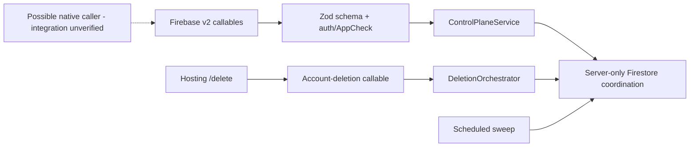

# CTRL + WEB · Separate coordination service and public website

[Feature index](README.md) · [Knowledge home](../../README.md) · [Rules](../../business-rules/README.md) · [Traceability](../../traceability/README.md) · [Verification](../../verification/README.md)

## Purpose, scope and implementation status

The `backend/functions` TypeScript package implements a coordination control plane with server-only Firestore collections and callable Cloud Functions; `backend/hosting` provides product/legal/support and authenticated account deletion pages. The backend READMEs explicitly say release/deployment gates remain outstanding. This **must not** be interpreted as the Flutter app automatically sending personal WhatsApp messages.

## Feature and execution map

## Hierarchy → atomic responsibilities

| Micro domain | Nano capability | Evidence |
|---|---|---|
| CTRL-CLAIM · registration | Authenticate caller, validate installation, establish fenced sender epoch | [Functions index](../../../../backend/functions/src/functions/index.ts), [ControlPlaneService](../../../../backend/functions/src/services/controlPlane.ts) |
| CTRL-CLAIM · leases | Renew lease, change account mode, guard stale sender | `renewSenderLease`, `changeAccountMode` |
| CTRL-CLAIM · occurrences | Separate Birthday vs TEST claims and content-free identifiers | `claimOccurrence`, `claimTest` and [domain model](../../../../backend/functions/src/domain/model.ts) |
| CTRL-CLAIM · attempt | Arm, query ambiguity, authorize bounded safe retry | `armAttempt`, `getArmStatus`, `authorizeSafeRetry` |
| CTRL-CLAIM · transfer | Two-phase sender transfer with drain constraints | `beginSenderTransfer`, `completeSenderTransfer` |
| CTRL-DELETE · deletion | Begin deletion, receipt, drain/cleanup and identity verification | [deletion orchestrator](../../../../backend/functions/src/services/deletionOrchestrator.ts) |
| CTRL · repair | Run scheduled deletion and coordination sweeps | `sweepDeletionDrains`, `sweepCoordinationOperations` |
| CTRL-PURCHASE | Verify purchase token against Play developer API | [subscription verifier](../../../../backend/functions/src/services/subscriptionVerification.ts) |
| WEB | Render product/help/privacy/terms route surfaces | [web app](../../../../backend/hosting/src/app.ts) |
| WEB-DELETE | Require reauth + App Check and preserve content-free deletion receipt | [deletion contract](../../../../backend/hosting/src/deletion-contract.ts) |

## Rules, data lineage, failure branches and verification

**Security invariants (declared in source):** [Zod transport schemas](../../../../backend/functions/src/transport/schemas.ts) reject raw contacts/messages in coordination calls; [opaque identities](../../../../backend/functions/src/domain/opaque.ts) transform aliases; [domain model](../../../../backend/functions/src/domain/model.ts) defines claim expiry, rolling budgets, modes, receipts and retention windows. Stronger *runtime enforcement* still depends on deployment, IAM, App Check and real Firestore config.

**Expected failure paths:** expired lease, clock boundary, duplicate claim, ambiguous arm response, cross-account call, invalid schema, rate-budget exhausted, stale sender transfer, deletion already in progress, loss of identity, missing release config. Transport failures must not be treated as proof of no-write.

**Tests:** [coordination decisions](../../../../backend/functions/test/decisions.test.ts), [race properties](../../../../backend/functions/test/races.property.test.ts), [emulator](../../../../backend/functions/test/controlPlane.emulator.test.ts), [deletion contract](../../../../backend/hosting/test/deletion-contract.test.mjs). **Unverified:** deployment, actual mobile caller paths, App Check at release, public legal copy review. **TO-BE:** publish a deployment boundary/caller matrix and evidence from sandbox, without relaxing fail-closed guarantees.

> **Evidence boundary:** The implementation was reviewed in repository source at commit `2abcc1aaa24a69c0aff5bddbc13c5f05d0ed14f8`. Runtime, device, deployed backend and physical delivery behavior are not independently established by these notes.
