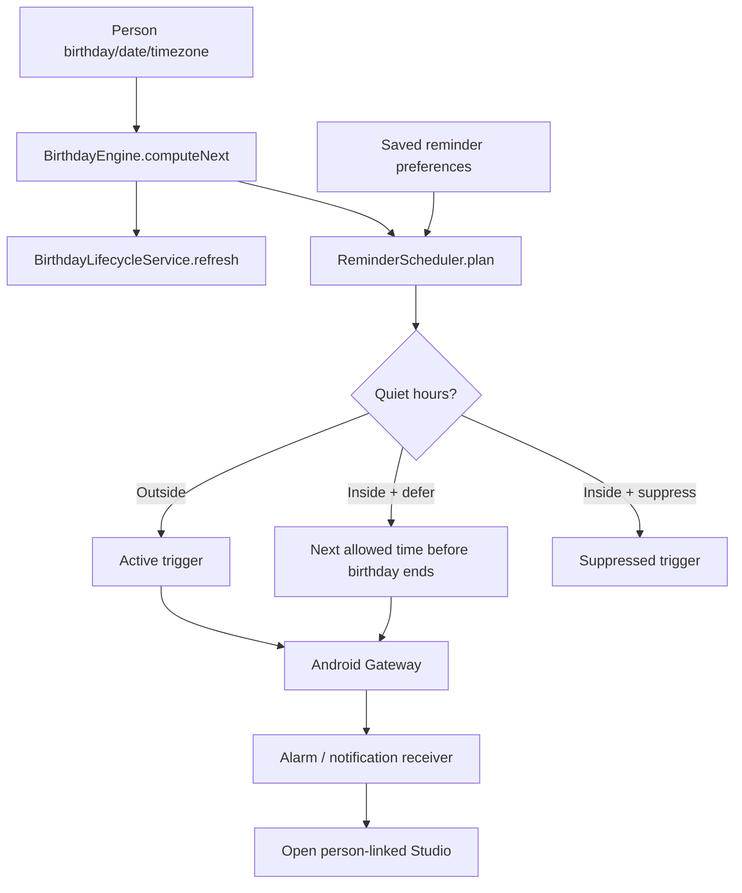

# BIRTH + REM · Recurrence, notifications and lifecycle

[Feature index](README.md) · [Knowledge home](../../README.md) · [Rules](../../business-rules/README.md) · [Traceability](../../traceability/README.md) · [Verification](../../verification/README.md)

## Purpose, scope and implementation status

The birthday domain derives calendar occurrences; the reminder domain schedules optional advance notifications. These are separate from delivery, and receiving a reminder does not send any message. Entry points are Dashboard, Calendar, Settings and Android notification callbacks.

## Feature and execution map

## Hierarchy → atomic responsibilities

| Level | Capability | Source |
|---|---|---|
| BIRTH-CALC · micro | Next occurrence and daysUntil for wall-clock or IANA recipient timezone | [BirthdayEngine](../../../../lib/features/birthdays/domain/birthday_engine.dart) |
| BIRTH-CALC · nano | Leap-year determination and Feb 29 → Feb 28 default or March 1 override | `BirthdayEngine.isLeapYear`, `resolveFeb29` |
| BIRTH-CYCLE · micro | Create/refresh per-cycle birthday record; preserve same-cycle work | [BirthdayLifecycleService](../../../../lib/features/birthdays/application/birthday_lifecycle_service.dart) |
| REM-RULES · micro | Calculate enabled offset triggers | [ReminderScheduler](../../../../lib/features/reminders/domain/reminder_schedule.dart) |
| REM-RULES · nano | Drop elapsed triggers; dedupe by person+kind | `ReminderScheduler.plan` |
| REM-RULES · nano | Suppress/defer during quiet hours and enforce birthday end | [QuietHours](../../../../lib/features/reminders/domain/quiet_hours.dart), `plan` |
| REM-PREFS · micro | Persist enabled kinds, hours and hide-names preferences | [ReminderSettingsController](../../../../lib/features/reminders/application/reminder_settings_controller.dart) |
| REM-NATIVE · micro | Apply/cancel scheduled notifications; resolve notification tap | [Gateway](../../../../lib/features/reminders/application/android_notification_scheduler_gateway.dart), [AppScaffold](../../../../lib/app/app_scaffold.dart) |

## Rules, data lineage, failure branches and verification

**State/output:** Reminder plans partition into `active`, `suppressed`, and `deferred`; a deferred trigger can also be active. A planned event is not evidence it fired. Android permission, reboot and exact-alarm state influence actual execution. **Rules:** BR-008..BR-012.

**End-to-end trace:** Person → Engine → Scheduler (timezone + quiet hours) → ReminderService → Kotlin alarm/channel → OS notification → notification-open handler → `/message-studio/person/:personId`. See [receiver](../../../../android/app/src/main/kotlin/com/yashsomani/ai_birthday/BirthdayNotificationReceiver.kt) and [Kotlin activity](../../../../android/app/src/main/kotlin/com/yashsomani/ai_birthday/MainActivity.kt).

**Test requirements:** birthday today near midnight, DST, leap-day 2028/2029, timezone invalid fallback, one kind disabled, no future trigger left, quiet hours crossing midnight, defer moves past the birthday end, app restore, reboot, permission denial/regrant and notification tapped after process restart. **Existing evidence:** [birthday tests](../../../../test/features/birthdays/domain/birthday_engine_test.dart), [reminder tests](../../../../test/features/reminders/domain/reminder_scheduler_test.dart), [native gateway tests](../../../../test/features/reminders/application/android_notification_scheduler_gateway_test.dart). **Unverified:** real device alarm firing and reboot restoration. **TO-BE:** explicit foreground/timezone-change reconciler with regression tests.

> **Evidence boundary:** The implementation was reviewed in repository source at commit `2abcc1aaa24a69c0aff5bddbc13c5f05d0ed14f8`. Runtime, device, deployed backend and physical delivery behavior are not independently established by these notes.
