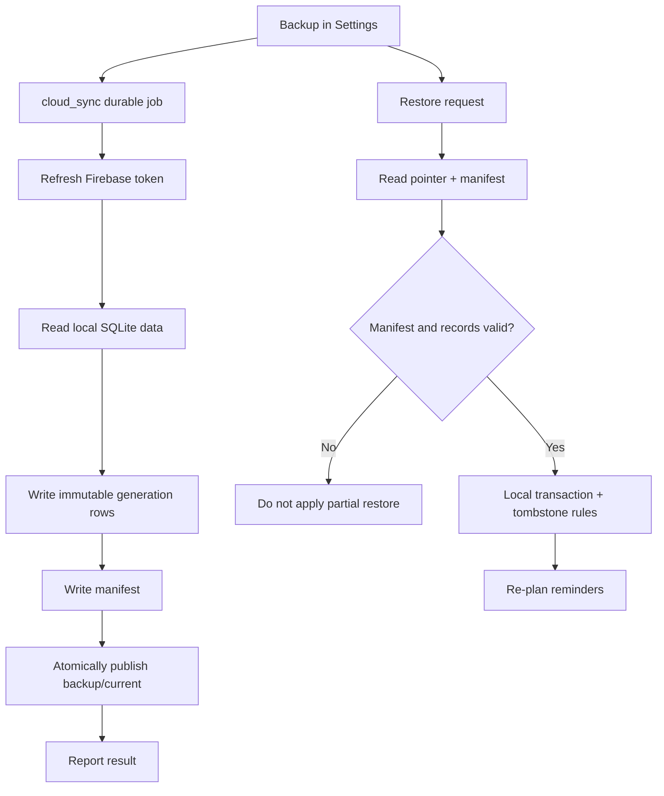

# CLOUD + JOBS · Snapshot backups and durable work

[Feature index](README.md) · [Knowledge home](../../README.md) · [Rules](../../business-rules/README.md) · [Traceability](../../traceability/README.md) · [Verification](../../verification/README.md)

## Purpose, scope and implementation status

Cloud backup is user-opt-in and account-scoped; it is not the primary operational database. Local Drift tables remain authoritative for everyday editing. Long-running AI and backup tasks use a durable queue to survive process interruption. Backup records are plaintext Firestore fields under owner-only access rules, **not** end-to-end encrypted ciphertext.

## Feature and execution map

## Hierarchy → atomic responsibilities

| Level | Atomic operation | Source |
|---|---|---|
| CLOUD-UP · micro | Start backup using current signed-in Firebase user | [Settings](../../../../lib/features/settings/presentation/settings_screen.dart) |
| CLOUD-UP · nano | Ensure fresh ID token, serialize supported tables | [CloudSyncService.sync](../../../../lib/features/sync/data/cloud_sync_service.dart) |
| CLOUD-UP · nano | Split commits into Firestore limits, prepare generation + manifest | `CloudSyncService._commitBatch`, `_flushWrites`, `sync` |
| CLOUD-UP · nano | Advance `backup/current` only after complete generation | `CloudSyncService.sync` |
| CLOUD-DOWN · micro | Resolve current snapshot and restore into local store | `CloudSyncService.restore` |
| CLOUD-DOWN · nano | Validate manifest and expected row counts before transaction | `CloudSyncService.restore` |
| CLOUD-DOWN · nano | Omit invalid/orphaned references; keep tombstone safety | `CloudSyncService.restore` |
| JOBS · micro | Queue active job (dedup), drain due work and recover stale entries | [JobWorker](../../../../lib/features/jobs/application/job_worker.dart), [JobsRepository](../../../../lib/features/jobs/data/jobs_repository.dart) |
| JOBS · nano | Retry only allowed attempts using backoff/jitter | `JobWorker._backoff`, `_process` |
| JOBS · micro | Dispatch AI generation or cloud backup/restore handler | [AI handler](../../../../lib/features/jobs/application/ai_job_handler.dart), [Cloud handler](../../../../lib/features/jobs/application/cloud_job_handler.dart) |

## Rules, data lineage, failure branches and verification

**Storage contracts:** [Drift schema](../../../../lib/core/database/app_database.dart) includes Persons, Birthdays, MessageDrafts, ReminderSettingsEntries, DeliveryEvents and Jobs. [Firestore rules](../../../../backend/firestore.rules) distinguish owner-scoped backup generations from server-only entitlements. **Rule:** BR-018/019 and BR-021/022.

**Failure matrix:** token expired, disconnected midway through writes, missing manifest row, orphan draft, conflicting tombstone, out-of-date generation, retried upload after uncertain result, account switch during queue, duplicate enqueue, crash after applying network mutation but before reporting success. A successful function return alone does not prove cloud restore in real account.

**Tests:** [sync tests](../../../../test/features/sync/data/cloud_sync_service_test.dart), [worker](../../../../test/features/jobs/application/job_worker_test.dart), [cloud handler](../../../../test/features/jobs/application/cloud_job_handler_test.dart), [Firestore rules emulator](../../../../backend/functions/test/firestore.rules.emulator.test.ts). **Unverified:** staging Firestore, retention/pruning, malformed snapshot report semantics, account reauthentication. **TO-BE:** explicit schema-version evolution plan and safe generation retention cleanup, plus account-partitioning/reconcile tests.

> **Evidence boundary:** The implementation was reviewed in repository source at commit `2abcc1aaa24a69c0aff5bddbc13c5f05d0ed14f8`. Runtime, device, deployed backend and physical delivery behavior are not independently established by these notes.
