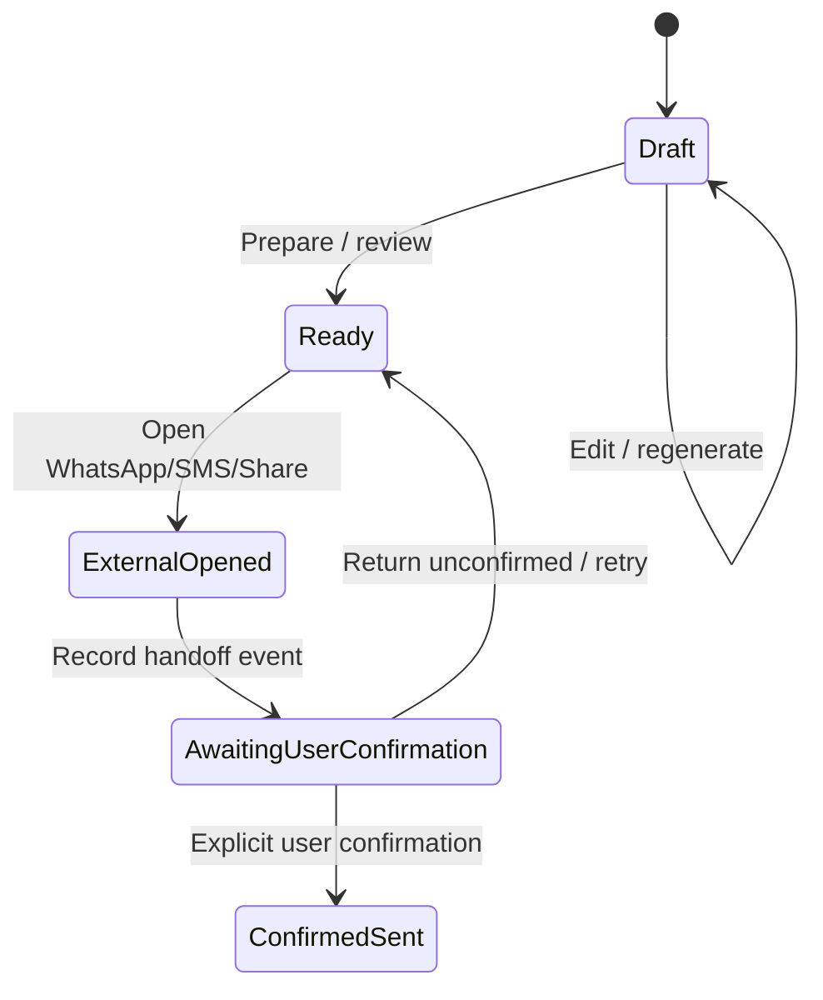

# SEND + HISTORY · User-controlled handoff and truthful evidence

[Feature index](README.md) · [Knowledge home](../../README.md) · [Rules](../../business-rules/README.md) · [Traceability](../../traceability/README.md) · [Verification](../../verification/README.md)

## Purpose, scope and implementation status

Delivery has distinct semantics from drafting. The app can prepare text and open an external composer, but a successful launch does not confirm a recipient received a message. A separate user confirmation upgrades a draft/birthday to a sent status. Entry: Message Studio and History.

## Feature and execution map

## Hierarchy → atomic responsibilities

| Feature / micro | Nano responsibility | Source |
|---|---|---|
| SEND-WA | Strip phone separators / optional 00, enforce 7–15 digits / no leading zero | [WhatsAppHandoffBuilder](../../../../lib/features/delivery/data/whatsapp_handoff_builder.dart) |
| SEND-WA | Reject empty message and generate URL-encoded `wa.me` link | `WhatsAppHandoffBuilder.buildHandoff` |
| SEND-SMS | Build/open platform SMS composer | [SmsDeliveryService](../../../../lib/features/delivery/data/sms_delivery_service.dart) |
| SEND-SHARE | Invoke native share intent | [NativeShareService](../../../../lib/features/delivery/data/native_share_service.dart) |
| SEND-TRUTH | Atomically record handoff event with associated birthday update | [Studio](../../../../lib/features/message_studio/presentation/message_studio_screen.dart), [Drift repository](../../../../lib/core/database/drift_repositories.dart) |
| SEND-TRUTH | Request explicit post-handoff sent confirmation | `_showHandoffConfirmationDialog`, `_confirmFromHandedOff` |
| HISTORY | Join draft/person/handoff views; show missing/deleted recipient as such | [HistoryScreen](../../../../lib/features/history/presentation/history_screen.dart) |

## Rules, data lineage, failure branches and verification

**Three separate state owners:** [BirthdayStatus](../../../../lib/features/birthdays/domain/models/birthday.dart), [DraftStatus](../../../../lib/features/message_studio/domain/models/message_draft.dart), [DeliveryHandoff](../../../../lib/features/delivery/domain/models/delivery_handoff.dart). Editorial draft states are `draft`, `ready`, `confirmedSent`; `handedOff` belongs to birthday/delivery evidence, not the draft enum. See BR-016/BR-017.

**User journey:** edit/AI draft → review → choose channel → launch external app (may fail) → preserve a handoff record (not delivery proof) → user personally sends → returns → explicit confirm → History presentation. A copy/share action must not automatically become a confirmed send.

**Cases:** phone missing/wrong country prefix, unsupported external app, intent failure, user closes external app without sending, app killed while in composer, double handoff, timestamp ordering, edited draft after handoff, deleted recipient in History. **Tests:** [WhatsApp contract](../../../../test/delivery/whatsapp_handoff_test.dart), [Drift repositories](../../../../test/core/database/drift_repositories_test.dart), [history view](../../../../test/features/history/presentation/history_screen_test.dart). **Unverified:** true delivery in external messaging apps. **TO-BE:** clarify history copy for each channel and preserve immutable attempt evidence without implying delivery.

> **Evidence boundary:** The implementation was reviewed in repository source at commit `2abcc1aaa24a69c0aff5bddbc13c5f05d0ed14f8`. Runtime, device, deployed backend and physical delivery behavior are not independently established by these notes.
