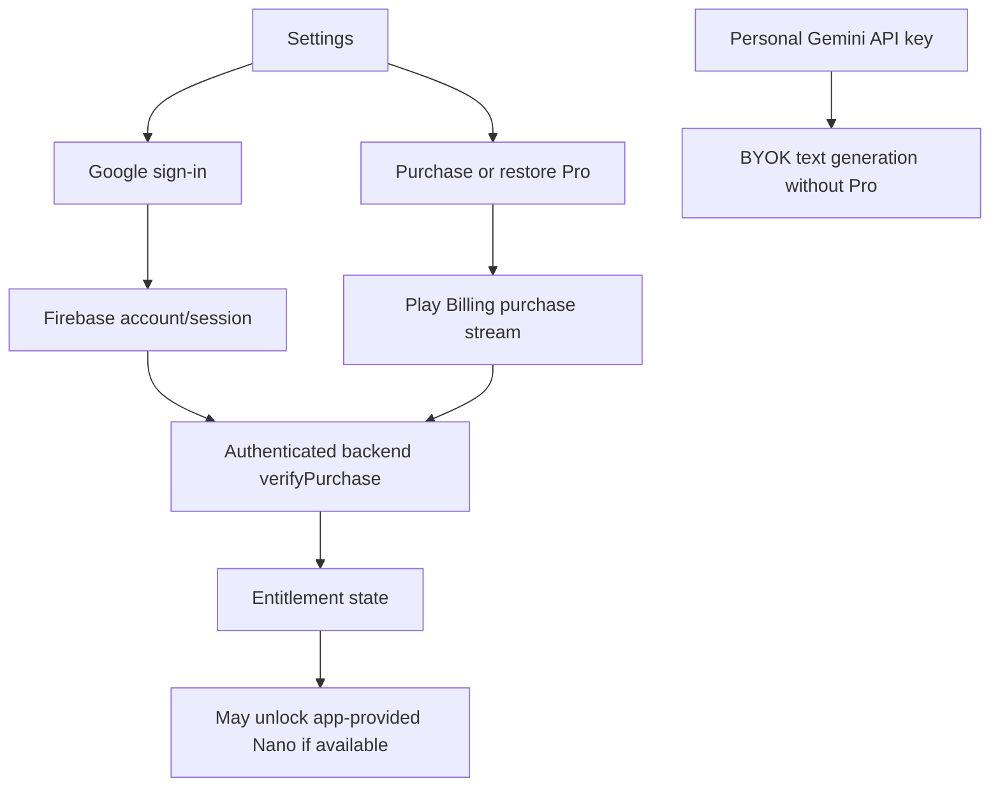

# AUTH + BILL · Google identity and verified subscription

[Feature index](README.md) · [Knowledge home](../../README.md) · [Rules](../../business-rules/README.md) · [Traceability](../../traceability/README.md) · [Verification](../../verification/README.md)

## Purpose, scope and implementation status

Authentication and app-provided AI entitlement are different contracts. Google sign-in establishes user account identity for cloud actions; a user-owned Gemini key is not a second login. Google Play purchases require server verification before Pro entitlement is granted. Core offline people management does not depend on sign-in.

## Feature and execution map

## Hierarchy → atomic responsibilities

| Unit | Operation and side effects | Source |
|---|---|---|
| AUTH | Sign in, refresh, sign out, map errors/state to UI | [AuthController](../../../../lib/features/auth/application/auth_controller.dart) |
| AUTH · micro | Google identity exchange for Firebase credential; preserve secure tokens | [LiveGoogleAuthGateway](../../../../lib/features/auth/data/live_google_auth_gateway.dart) |
| AUTH · nano | Refresh expired token or clear revoked session | Same gateway, [secure storage](../../../../lib/core/security/credential_storage.dart) |
| BILL | Observe Play purchase stream and renewal/restore states | [SubscriptionService](../../../../lib/features/subscription/application/subscription_service.dart) |
| BILL · micro | Request server verification with Firebase identity and account binding | `SubscriptionNotifier._verifyPurchase` |
| CTRL-PURCHASE | Server-side Play token/ownership and product verification | [SubscriptionVerificationService](../../../../backend/functions/src/services/subscriptionVerification.ts) |
| BILL · nano | Entitlement active/trial/grace and optional expiry behavior | [UserEntitlement](../../../../lib/features/subscription/domain/entitlement.dart) |

## Rules, data lineage, failure branches and verification

**Rules:** BR-020 + BR-013/014. `UserEntitlement.canUseAi` depends on entitlement status and unexpired `expiryDate` where present; non-BYOK Nano access is conditional on device capability. Purchase receipt *existence* is not sufficient verification.

**Error/abuse scenarios:** revoked Firebase refresh token, user cancels Play, Play unavailable, ID token expired, invalid package/product/account binding, Google identity changes while purchase pending, App Check not available, trial/grace expiry, server unreachable. Correct UX must show missing verification rather than optimistically granting Pro.

**Evidence:** [auth gateway tests](../../../../test/features/auth/data/live_google_auth_gateway_test.dart), [subscription tests](../../../../test/features/subscription/subscription_service_test.dart), [backend purchase verification](../../../../backend/functions/test/subscriptionVerification.test.ts), [security auth tests](../../../../test/features/auth/adversarial_auth_security_test.dart). **Unverified:** real Play sandbox verification, staging Firebase identity, production App Check, store refund/revoke events. **TO-BE:** reactive purchase-progress state and durable pending-verification retries with clearly bounded entitlement transitions, subject to latest implementation review.

> **Evidence boundary:** The implementation was reviewed in repository source at commit `2abcc1aaa24a69c0aff5bddbc13c5f05d0ed14f8`. Runtime, device, deployed backend and physical delivery behavior are not independently established by these notes.
