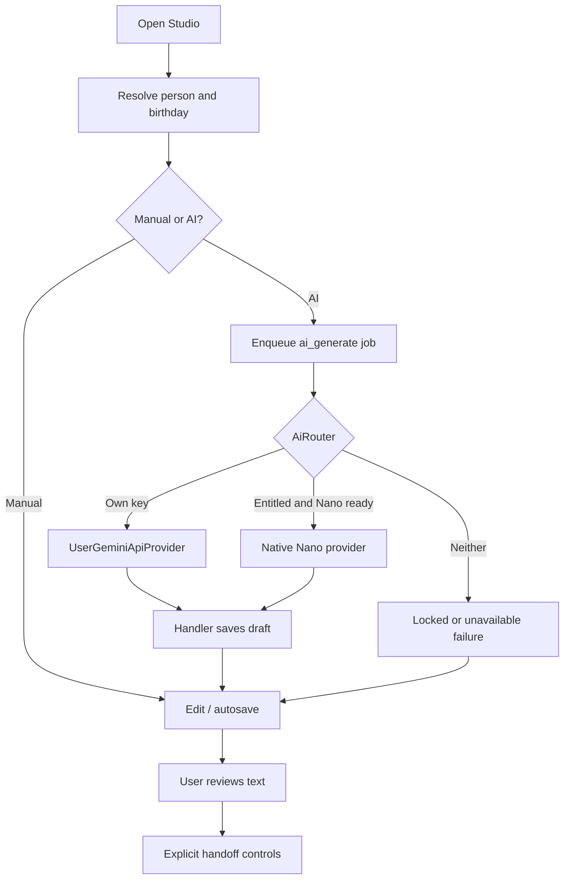

# STUDIO + AI · Draft creation, text revision and AI routing

[Feature index](README.md) · [Knowledge home](../../README.md) · [Rules](../../business-rules/README.md) · [Traceability](../../traceability/README.md) · [Verification](../../verification/README.md)

## Purpose, scope and implementation status

The studio is the composition center. It accepts manual text even when AI access is locked; AI requests create durable jobs rather than directly sending text. Current code supports birthday-linked and person-linked entry routes. A person or birthday must resolve before meaningful operations.

## Feature and execution map

## Hierarchy → atomic responsibilities

| Level | Atomic responsibility | Implementation |
|---|---|---|
| STUDIO-DRAFT · micro | Resolve birthday/person, load draft, preserve human edits, persist autosave | [MessageStudioScreen](../../../../lib/features/message_studio/presentation/message_studio_screen.dart) |
| STUDIO-DRAFT · nano | Debounce input, mark edit revision and handle async stale-result protection | `_onMessageChanged`, `_performAutosave`, `_editRevision` |
| STUDIO-AI · micro | Enqueue `ai_generate` and show progress/retry result | `_enqueueGenerate`, `_handleJobEvent` |
| AI-PROMPT · nano | Construct short bounded prompt with only user-provided facts | [AiPromptBuilder](../../../../lib/features/ai/domain/ai_prompt_builder.dart) |
| AI-BYOK · nano | Check configured credential; use user-owned provider without Pro | [AiRouter](../../../../lib/features/ai/domain/ai_router.dart) |
| AI-NANO · nano | Require entitlement, probe Nano status, handle unavailable/hardware failure | [Router](../../../../lib/features/ai/domain/ai_router.dart), [native bridge](../../../../lib/core/platform/gemini_nano_platform.dart) |
| STUDIO-AI · nano | Bound request to configured timeout, surface typed failure | `AiRouter._withTimeout` |
| JOBS · nano | Apply handler output via per-birthday stable draft ID and update birthday status | [AiGenerationJobHandler](../../../../lib/features/jobs/application/ai_job_handler.dart) |
| STUDIO-EDIT · micro | Rewrite, translate, variations and manual correction | [Message Studio](../../../../lib/features/message_studio/presentation/message_studio_screen.dart) |

## Rules, data lineage, failure branches and verification

**Business rules:** BR-013..BR-015. Normal BYOK takes precedence and does not require app Pro; forced Nano or absent personal key requires entitlement. A stale `AiRouter` doc comment says entitlement-first and should not be trusted over the executable `generate` method. An invalid **configured** key should present correction options, not silently convert to missing-key.

**Failure paths:** app Pro locked, unavailable device model, invalid credential/quota, HTTP timeout, lost network, user edits while job is pending, retry after restart, draft no longer available, duplicate generate button presses. The fallback must preserve manual composition.

**Tests:** [router](../../../../test/ai/ai_router_test.dart), [prompt](../../../../test/ai/ai_prompt_builder_test.dart), [AI job](../../../../test/features/jobs/application/ai_job_handler_test.dart), [optimistic editor](../../../../test/features/message_studio/presentation/message_studio_optimistic_test.dart), [durable Studio](../../../../test/features/message_studio/presentation/message_studio_durable_test.dart). **Unverified:** real external Gemini API and AICore readiness on supported devices. **TO-BE:** separate oversized Studio widget into state controller, draft editor and external handoff view only after golden/interaction behavior is characterized.

> **Evidence boundary:** The implementation was reviewed in repository source at commit `2abcc1aaa24a69c0aff5bddbc13c5f05d0ed14f8`. Runtime, device, deployed backend and physical delivery behavior are not independently established by these notes.
