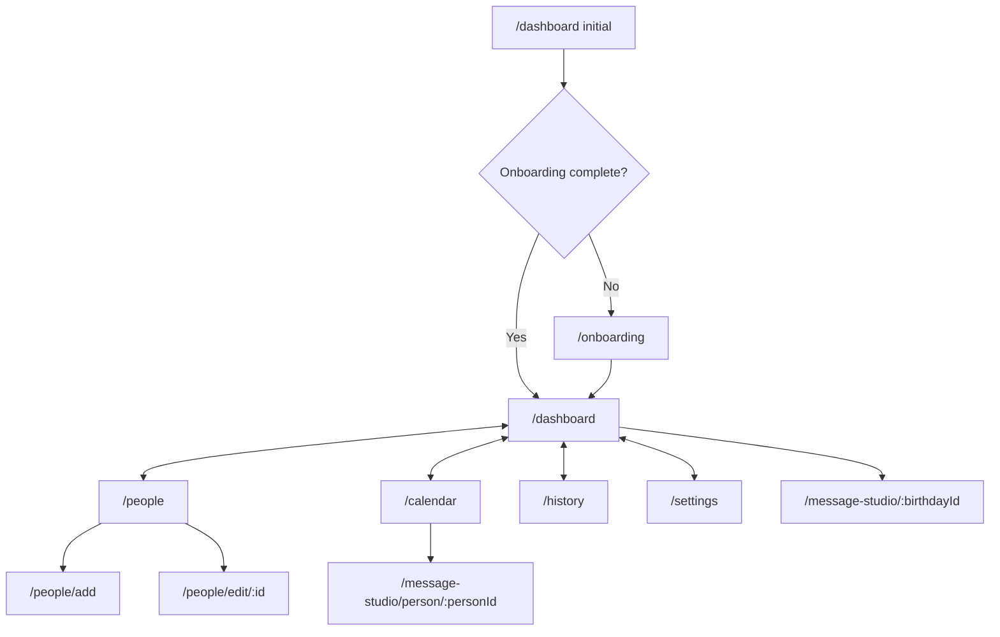

# NAV + ONB + DASH + CAL + SETTINGS · Experience architecture

[Feature index](README.md) · [Knowledge home](../../README.md) · [Rules](../../business-rules/README.md) · [Traceability](../../traceability/README.md) · [Verification](../../verification/README.md)

## Purpose, scope and implementation status

The Flutter router owns navigation; a `StatefulShellRoute.indexedStack` maintains five main tabs. First-run onboarding is gated by a stored preference. Modal/detail screens live above the tab shell. UX intent is to reduce cognitive load and guide users from seeing an upcoming birthday to preparing and sending a greeting.

## Feature and execution map

## Hierarchy → atomic responsibilities

| Feature | Responsibility / atomic exit | Code |
|---|---|---|
| ONB-GATE | Check secure completion flag and redirect first-run user | [App router](../../../../lib/app/router.dart) |
| ONB-FLOW | Walkthrough, Next/Skip, add/import onramps | [OnboardingScreen](../../../../lib/features/onboarding/presentation/onboarding_screen.dart) |
| NAV | Indexed five-tab shell, not-found fallback, detail routes | [router](../../../../lib/app/router.dart), [scaffold](../../../../lib/app/app_scaffold.dart) |
| DASH | Combine people and birthday streams, sort today/upcoming and action needed | [DashboardScreen](../../../../lib/features/dashboard/presentation/dashboard_screen.dart) |
| CAL | Navigate month, open a day, initiate person-linked Studio | [CalendarScreen](../../../../lib/features/calendar/presentation/calendar_screen.dart) |
| HISTORY | Show saved drafts, handoff events and sent confirmation status | [HistoryScreen](../../../../lib/features/history/presentation/history_screen.dart) |
| SETTINGS | Reminders, auth, Gemini, subscription, cloud backup and onboarding replay | [SettingsScreen](../../../../lib/features/settings/presentation/settings_screen.dart) |
| THEME | Theme mode, typography, semantics and reusable components | [theme](../../../../lib/app/theme/app_theme.dart), [shared components](../../../../lib/shared/design_system/design_system.dart) |

## Rules, data lineage, failure branches and verification

**Flow matrix:** onboarding → dashboard or People; dashboard birthday → birthday-linked Studio; People contact detail → person-linked Studio or edit form; calendar day → person-linked Studio; History → birthday-linked Studio; Settings opens onboarding replay. Native notification press enters person-linked Studio through AppScaffold callback.

**States:** loading/empty/error for lists, form field errors, confirmed destructive actions, secure-entry settings, dark/light/text-scale, disabled buttons, permission-denied notification disclosure. **Not-found** route returns user to Dashboard.

**Tests:** [shell](../../../../test/app/shell_test.dart), [not found](../../../../test/app/router_not_found_test.dart), [onboarding](../../../../test/features/onboarding/presentation/onboarding_screen_test.dart), [dashboard visibility](../../../../test/features/dashboard/presentation/dashboard_visibility_test.dart), [calendar](../../../../test/features/calendar/presentation/calendar_screen_test.dart), [contrast](../../../../test/ui/contrast_test.dart). **Unverified:** full cross-screen real navigation, accessibility on screen reader, Android insets/IME, golden snapshots in CI. **TO-BE:** decompose large Settings and Studio presentations into micro-components once regression baselines are captured.

> **Evidence boundary:** The implementation was reviewed in repository source at commit `2abcc1aaa24a69c0aff5bddbc13c5f05d0ed14f8`. Runtime, device, deployed backend and physical delivery behavior are not independently established by these notes.
