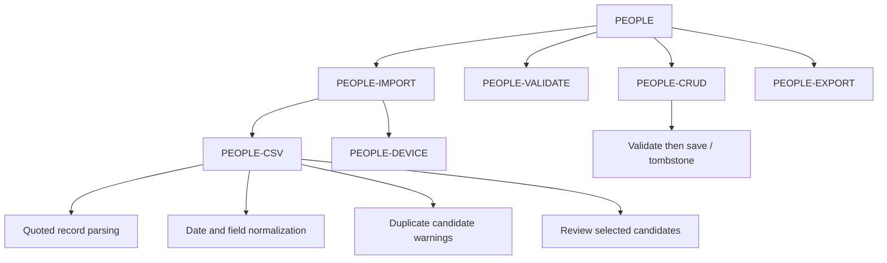

# PEOPLE · Recipient management, import and export

[Feature index](README.md) · [Knowledge home](../../README.md) · [Rules](../../business-rules/README.md) · [Traceability](../../traceability/README.md) · [Verification](../../verification/README.md)

## Purpose, scope and implementation status

The recipient is the primary local record that drives birthday cycles, personalization and reminders. Entry: `/people`, `/people/add`, `/people/edit/:id`; the first-run walkthrough also routes to contact entry. Users can create, update, search, delete/undo, import from Android contacts or CSV and export a CSV for sharing. All are **source-implemented**, not device-tested by this documentation run.

## Feature and execution map

## Hierarchy → atomic responsibilities

| Level / ID | Trigger and atomic responsibility | Implementation |
|---|---|---|
| Feature · PEOPLE | List / search active people; show empty/error states | [PeopleScreen](../../../../lib/features/people/presentation/people_screen.dart) |
| Subfeature · PEOPLE-CRUD | Submit create/update, soft delete, undo | [PersonService](../../../../lib/features/people/application/person_service.dart) |
| Micro · PEOPLE-VALIDATE | Trim name, validate calendar dates and optional fields; report field errors | [PersonInputValidator](../../../../lib/features/people/domain/person_input_validator.dart) |
| Micro · PEOPLE-IMPORT | Permission/CSV entry, show review UI, selectively import candidates | [PeopleScreen](../../../../lib/features/people/presentation/people_screen.dart) |
| Nano · PEOPLE-CSV parse | Split quoted records, parse fields including date, reject malformed rows | [ContactCsvService](../../../../lib/features/people/data/contact_csv_service.dart) |
| Nano · PEOPLE-CSV dedupe | Compare candidates with existing records and batch candidates; flag potential matches | Same parser and [People import UI](../../../../lib/features/people/presentation/people_screen.dart) |
| Micro · PEOPLE-DEVICE | Explain/request contacts permission, fetch device candidates | [DeviceContactsService](../../../../lib/features/people/data/device_contacts_service.dart) |
| Micro · PEOPLE-EXPORT | Serialize known person fields and share via native system | [ContactCsvService](../../../../lib/features/people/data/contact_csv_service.dart) |

## Rules, data lineage, failure branches and verification

**Entry to storage trace**: People form → validator → PersonService → people repository → Drift `persons`; birthday occurrence creation is coordinated by the form and birthday repository. This is a **cross-service sequence**, not automatically an atomic two-table transaction. Source: [form](../../../../lib/features/people/presentation/person_form_screen.dart), [person service](../../../../lib/features/people/application/person_service.dart), [Drift](../../../../lib/core/database/drift_repositories.dart).

**Rules:** BR-001..BR-007 name/date/metadata limits; CSV quote/fomula safety; duplicate detection should *warn*, not merge automatically. Separate the broad person phone validator from the stricter WhatsApp destination rule BR-016.

**Alternates/failures:** missing birthday, invalid timezone, empty selection, denied contact permission, CSV parse failure, duplicate candidate, partial importer, deletion then undo, refresh/read failure. After successful import check that recurring occurrences and reminders are reconciled.

**Evidence:** [validator tests](../../../../test/features/people/domain/person_input_validator_test.dart), [CSV tests](../../../../test/features/people/data/contact_csv_service_test.dart), [person service tests](../../../../test/features/people/application/person_service_test.dart). **Unverified:** actual Android contact permission, large imported datasets, complete round-trip across *both* Person model representations. **TO-BE:** reconcile duplicate model definitions and enforce lossless import/export with a migration+round-trip matrix.

> **Evidence boundary:** The implementation was reviewed in repository source at commit `2abcc1aaa24a69c0aff5bddbc13c5f05d0ed14f8`. Runtime, device, deployed backend and physical delivery behavior are not independently established by these notes.
