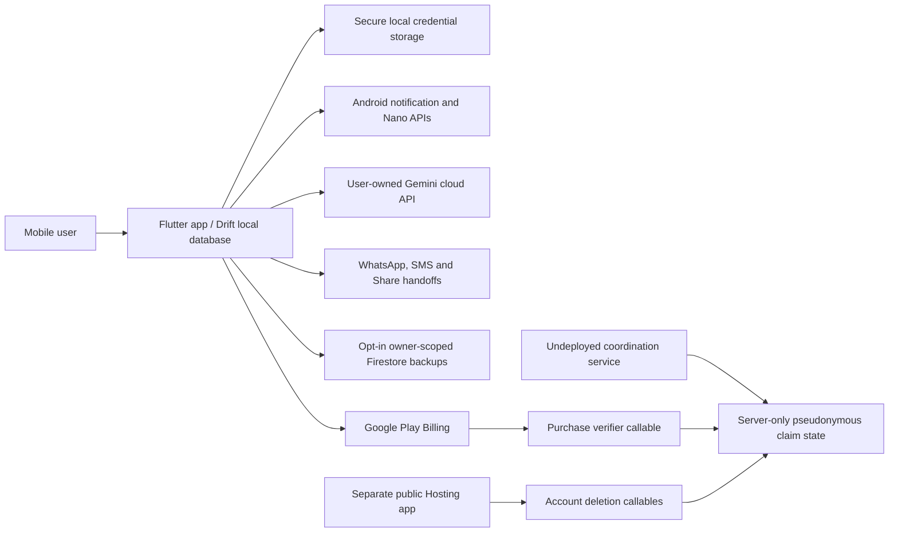

# Integration, API and external-boundary catalog

[Knowledge home](../README.md) · [Architecture](../architecture/README.md) · [Data ownership](../data-model/README.md) · [Verification](../verification/README.md)

**Source baseline:** `2abcc1aaa24a69c0aff5bddbc13c5f05d0ed14f8`. **Important:** a declared endpoint is not proof a matching mobile call is wired, that a function is deployed, or that it is safe to invoke against live accounts.

## Mobile integrations

| Boundary | Source entry point | What crosses the boundary | Safety / unknowns |
|---|---|---|---|
| Flutter ↔ Android alarm/notifications | [NotificationSchedulerGateway](../../../lib/features/reminders/application/android_notification_scheduler_gateway.dart) ↔ [Kotlin MainActivity](../../../android/app/src/main/kotlin/com/yashsomani/ai_birthday/MainActivity.kt) | Scheduled trigger IDs and notification behavior | Android permissions, exact alarm access, boot recovery and actual deliveries need device verification |
| Flutter ↔ AICore / Gemini Nano | [Nano platform](../../../lib/core/platform/gemini_nano_platform.dart) ↔ [native bridge](../../../android/app/src/main/kotlin/com/yashsomani/ai_birthday/MainActivity.kt) | Availability and generated text | Hardware/OS/model dependent; source presence not proof of model readiness |
| Flutter → user Gemini API | [BYOK provider](../../../lib/features/ai/data/user_gemini_api_provider.dart) | Personal API credential and generated prompt | Credentials belong in secure storage; avoid logging, sync and hidden app-owned quota |
| Flutter → external WhatsApp | [Click-to-Chat builder](../../../lib/features/delivery/data/whatsapp_handoff_builder.dart) | Recipient phone and prefilled text via URL | User manually sends; neither URL opening nor app handoff proves delivery |
| Flutter → SMS / Android share | [SMS](../../../lib/features/delivery/data/sms_delivery_service.dart) · [share](../../../lib/features/delivery/data/native_share_service.dart) | User-authored draft text | Do not claim sent/delivered without independent evidence |
| Flutter → Google identity / Firebase | [Auth gateway](../../../lib/features/auth/data/live_google_auth_gateway.dart) | Google identity, Firebase tokens | Refresh and revoked/expired paths must be tested |
| Flutter → Firestore backups | [Cloud sync](../../../lib/features/sync/data/cloud_sync_service.dart) · [rules](../../../backend/firestore.rules) | Saved people, birthdays, drafts and reminder fields when user opts in | UID-scoped fields, not opaque client-only encrypted blob |
| Flutter → Google Play + verifier | [billing](../../../lib/features/subscription/application/subscription_service.dart) · [server verification](../../../backend/functions/src/services/subscriptionVerification.ts) | Purchase token, binding / entitlement | Separate store/device/backend deployment testing required |
| Public Hosting → deletion callable | [Hosting app](../../../backend/hosting/src/app.ts) · [callable](../../../backend/functions/src/functions/index.ts) | Fresh reauth and bounded deletion receipt | Deployment gate explicitly not satisfied in Hosting README |

## Firebase callable-function catalog

Source of function names: [index.ts](../../../backend/functions/src/functions/index.ts). Source of input contracts: [schemas.ts](../../../backend/functions/src/transport/schemas.ts).

| Callable or scheduled function | Request schema where exposed | Responsibility | Caller/deployment evidence |
|---|---|---|---|
| `registerAndroidInstallation` | `registrationSchema` | Installation registration + epoch | Not established for mobile Flutter |
| `renewSenderLease` | `leaseSchema` | Renew active sender lease | Not established for mobile Flutter |
| `changeAccountMode` | `accountModeSchema` | Switch coordination operating mode | Not established for mobile Flutter |
| `claimOccurrence` | `birthdayClaimSchema` | Claim single Birthday occurrence | Not established for mobile Flutter |
| `claimTest` | `testClaimSchema` | Independent TEST claim | Not established for mobile Flutter |
| `armAttempt` | `armSchema` | Fence and arm bounded attempt | Not established for mobile Flutter |
| `getArmStatus` | `armSchema` | Read attempt arm state | Not established for mobile Flutter |
| `reportTestOutcome` | `testReportSchema` | Record test outcome | Not established for mobile Flutter |
| `authorizeSafeRetry` | `retrySchema` | Authorize conditional retry | Not established for mobile Flutter |
| `beginSenderTransfer` | `transferSchema` | Begin sender transfer/drain | Not established for mobile Flutter |
| `completeSenderTransfer` | `transferSchema` | Finish sender transfer | Not established for mobile Flutter |
| `requestAccountDeletion` | `deletionSchema` | Begin account deletion saga | Referenced by Hosting deletion flow |
| `accountDeletionReceipt` | `deletionReceiptSchema` | Poll deletion receipt | Referenced by Hosting contract |
| `resetContactDerivedState` | `contactDerivedResetSchema` | Reset hashed contact-derived coordination | Not established for mobile Flutter |
| `releaseAndroidSender` | `senderReleaseSchema` | Release active Android sender | Not established for mobile Flutter |
| `coordinationLifecycleStatus` | `coordinationLifecycleStatusSchema` | Inspect long-running coordination state | Not established for mobile Flutter |
| `companionStatus` | `companionStatusSchema` | Read iOS-oriented companion eligibility | Not established for mobile Flutter |
| `verifyPurchase` | `verifyPurchaseSchema` | Google Play purchase-token verification | Flutter subscription calls its verifier path; deployment unverified |
| `sweepDeletionDrains` | `scheduled` | Continue delayed deletion cleanup | Server scheduled function |
| `sweepCoordinationOperations` | `scheduled` | Recover/reset interrupted coordination | Server scheduled function |

**Caution:** `getArmStatus` uses the arm-related contract in the inspected code family; inspect the actual ``index.ts`` argument parser for exact payload reuse before writing a client. `sweep*` are scheduled server functions, not HTTP endpoints. This catalog is a **surface inventory**, not a claim of deployed URLs.

## Trust-boundary diagram

The conceptual cross-boundary arrows are not proof of unified deployment. Verification is separate for each integration.

## Firestore and server-side security boundaries

- [Flutter backup / entitlement rules](../../../backend/firestore.rules) has owner-scoped backup access and server-only entitlement writes. Sensitive backend-only coordination collections use different rules and provisioning. Confirm correct Firebase project/rules deployment before declaring enforcement.
- [Opaque domain](../../../backend/functions/src/domain/opaque.ts) and [policies](../../../backend/functions/src/domain/policies.ts) support server privacy/rate-limit policy; avoid logging recipient names/messages or returning raw destination identities.
- [Control-plane release README](../../../backend/README.md) and [Hosting release README](../../../backend/hosting/README.md) explicitly list release gates. No source-only audit can clear those gates.

## How to verify an integration

For each row: confirm client callsite → request schema → authorization / App Check → backend handler → service → persistence → response mapping → user-visible state. Exercise denied, expired, timeout, idempotent retry, partial failure and recovery cases in emulator/test installations. Do not probe live deletion/claim/purchase endpoints while documenting.
