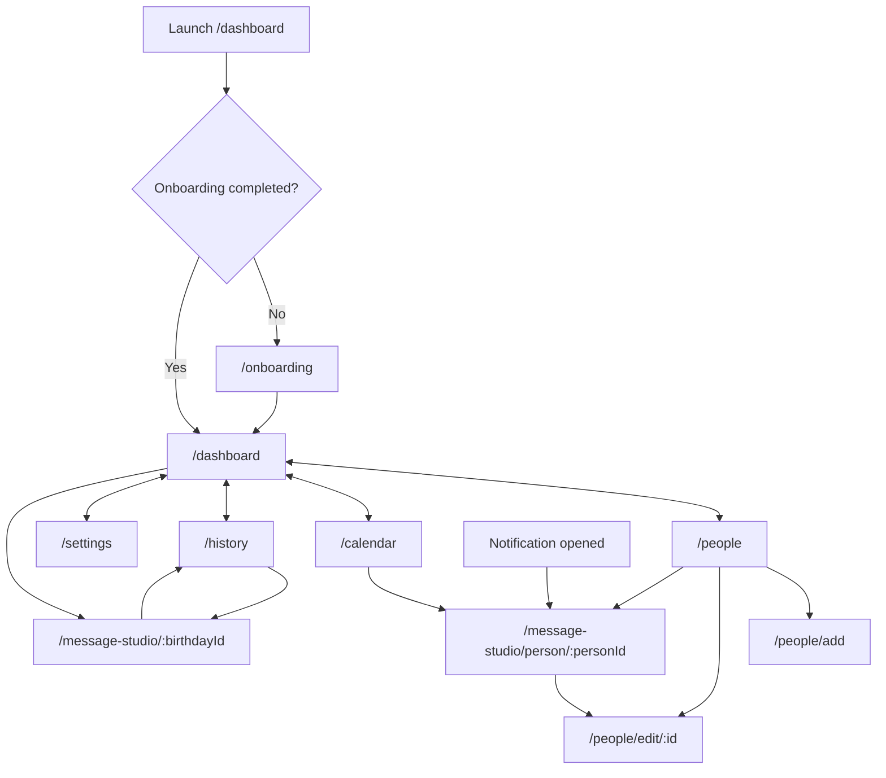
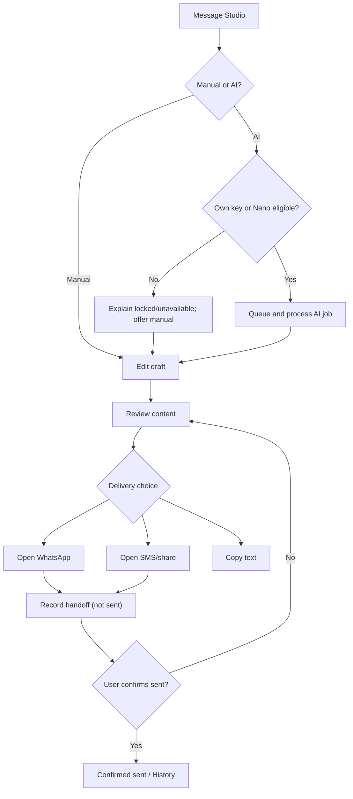

# Navigation and end-to-end user journeys

[Knowledge portal](../README.md) · [Features](../features/README.md) · [Architecture](../architecture/README.md)

## Source-linked route inventory

| Route | UI destination | Evidence |
|---|---|---|
| `/onboarding` | First-run walkthrough | [router.dart](../../../lib/app/router.dart) |
| `/dashboard` | Today / upcoming / actions (main tab) | [router.dart](../../../lib/app/router.dart) |
| `/people` | People list, search and import (main tab) | [router.dart](../../../lib/app/router.dart) |
| `/calendar` | Month view (main tab) | [router.dart](../../../lib/app/router.dart) |
| `/history` | Draft and delivery history (main tab) | [router.dart](../../../lib/app/router.dart) |
| `/settings` | Account, AI, backup, reminders, subscription (main tab) | [router.dart](../../../lib/app/router.dart) |
| `/people/add` | Create person | [router.dart](../../../lib/app/router.dart) |
| `/people/edit/:id` | Edit person | [router.dart](../../../lib/app/router.dart) |
| `/message-studio/:birthdayId` | Open cycle-linked Studio | [router.dart](../../../lib/app/router.dart) |
| `/message-studio/person/:personId` | Open person-linked Studio, including notification deep link | [router.dart](../../../lib/app/router.dart), [shell](../../../lib/app/app_scaffold.dart) |

Unmatched locations render the not-found screen with return-to-dashboard action. The initial location is Dashboard; incomplete onboarding redirects to `/onboarding` if the credential storage guard is present.

**Important:** arrows represent identified source-level navigation opportunities and shell tab access; they are not proof every UI branch was exercised. Source: [router](../../../lib/app/router.dart), [people screen](../../../lib/features/people/presentation/people_screen.dart), [calendar](../../../lib/features/calendar/presentation/calendar_screen.dart), [history](../../../lib/features/history/presentation/history_screen.dart).

## J-01 — First launch

**Actor:** new user. **Preconditions:** onboarding flag not yet set. **Flow:** app initializes services → router checks saved onboarding completion → `/onboarding` appears → Next/Skip or add/import path → completion stored → main shell / contact entry. **Alternatives:** replay onboarding from Settings. **Failure to verify:** interrupted secure storage write, external permission refusal. **Sources:** [onboarding](../../../lib/features/onboarding/presentation/onboarding_screen.dart), [route guard](../../../lib/app/router.dart). **Tests:** [onboarding test](../../../test/features/onboarding/presentation/onboarding_screen_test.dart).

## J-02 — Add or import birthday

**Actor:** user maintaining contacts. **Entry:** People tab / Dashboard shortcut. **Manual path:** `/people/add` → edit required recipient fields → validate birthday date and optional context → save Person → ensure birthday occurrence → display in People/Calendar/Dashboard. **Import path:** Phone permission or pasted CSV → parse/normalize → warn about duplicates and invalid rows → select candidates → persist selected contacts → update reminders. **Branches:** invalid date, empty selection, denied device permission, duplicate warning, save failure. **Sources:** [People](../../../lib/features/people/presentation/people_screen.dart), [form](../../../lib/features/people/presentation/person_form_screen.dart), [CSV](../../../lib/features/people/data/contact_csv_service.dart), [service](../../../lib/features/people/application/person_service.dart).

## J-03 — Birthday reminder to draft

**Actor:** user receiving a reminder. **Precondition:** reminder permission and scheduled birthday. **Flow:** Person date → timezone-aware occurrence → reminder-offset plan → native gateway → notification tap → `/message-studio/person/:personId` → draft/message editor. **Branches:** permissions denied, quiet-hours suppression or deferral, reboot/foreground changes. **Sources:** [engine](../../../lib/features/birthdays/domain/birthday_engine.dart), [scheduler](../../../lib/features/reminders/domain/reminder_schedule.dart), [notification callback](../../../lib/app/app_scaffold.dart). **Verification:** source-reviewed; physical notifications and reboot not independently tested.

## J-04 — Generate, review and hand off a greeting

**Actor:** user preparing a message. **Preconditions:** a recipient and birthday cycle; optional AI access. **Flow:** Dashboard/People/Calendar → Studio → manual text or `ai_generate` queued job → BYOK or entitled Nano route → editable draft and explicit review → choose WhatsApp, SMS or Share/Copy → external client opens / text is copied → user personally sends → return and explicitly confirm sent → History. **Branches:** missing key/Pro, invalid phone, empty draft, provider timeout, failed external launcher, unknown send result; do not infer delivery. **Sources:** [Studio](../../../lib/features/message_studio/presentation/message_studio_screen.dart), [router](../../../lib/features/ai/domain/ai_router.dart), [WhatsApp builder](../../../lib/features/delivery/data/whatsapp_handoff_builder.dart), [History](../../../lib/features/history/presentation/history_screen.dart).

## J-05 — Backup and restore

**Actor:** signed-in user. **Entry:** Settings Cloud Backup. **Backup:** authenticated request → durable cloud job → refreshed token → snapshot rows → write immutable generation and manifest → advance current pointer → surface result. **Restore:** explicit user confirmation → resolve manifest → integrity checks → local transaction → reminder replanning → surface result. **Branches:** invalid/expired auth, partial upload, incomplete manifest, malformed record, conflict, network timeout. **Sources:** [Settings](../../../lib/features/settings/presentation/settings_screen.dart), [CloudSyncService](../../../lib/features/sync/data/cloud_sync_service.dart), [Cloud handler](../../../lib/features/jobs/application/cloud_job_handler.dart). **Unverified:** real Firebase deployment and recoverability.

## J-06 — Purchase/restore Pro

**Actor:** a user requesting app-provided Nano AI. **Entry:** Settings. **Flow:** Google sign-in / Firebase account → Play Billing purchase/restore → backend purchase verification → entitlement state → Nano eligibility. BYOK remains a different entitlement path. **Branches:** store unavailable, purchase cancelled, pending, expired, auth missing, verification failed, model unavailable. **Sources:** [subscription](../../../lib/features/subscription/application/subscription_service.dart), [server verification](../../../backend/functions/src/services/subscriptionVerification.ts).

## J-07 — Public-site account deletion (separate application)

**Actor:** account owner in web Hosting app. **Entry:** `/delete/`. **Flow:** Firebase web initialization → fresh Google reauth → limited-use App Check → deletion callable → receipt/journal and deterministic status handling. **Branches:** missing release config, auth failure, App Check unavailable, ambiguous result, pending drain, completed. **Sources:** [Hosting README](../../../backend/hosting/README.md), [web app](../../../backend/hosting/src/app.ts), [server orchestration](../../../backend/functions/src/services/deletionOrchestrator.ts). **Critical distinction:** source exists but release/deployment explicitly not established.

## Runtime verification matrix

| Journey | Source trace | Existing tests located | Independently executed here |
|---|---|---|---|
| J-01 | Yes | Yes | No |
| J-02 | Yes | Yes | No |
| J-03 | Yes | Yes | No |
| J-04 | Yes | Yes | No |
| J-05 | Yes | Yes | No |
| J-06 | Yes | Yes | No |
| J-07 | Yes | Yes | No |

The [successful main CI workflow](https://github.com/yhsomani/AI-Birthday/actions/runs/38461085640) is independent build/test automation evidence, but not a substitute for live physical device or cloud release testing.
