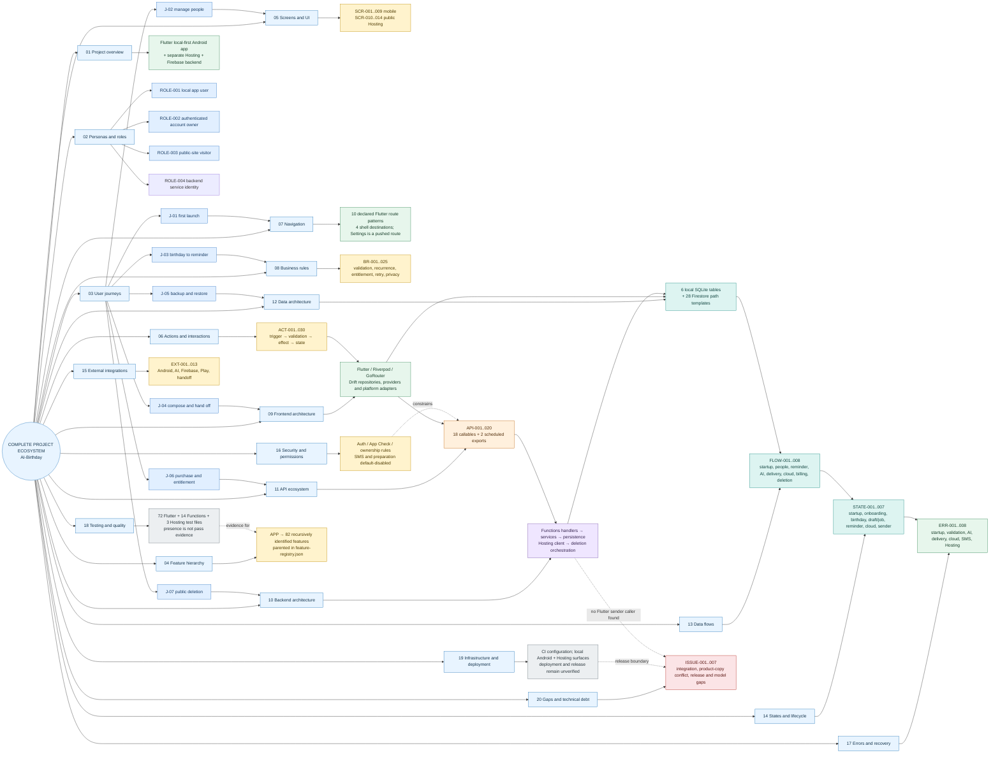

# AI-Birthday — complete project mind map

[Knowledge home](README.md) · [Machine-readable interconnected graph](master-project-graph.json) · [Cross-dependency graph](cross-dependency-graph.md) · [Feature registry](feature-registry.json)

**Evidence snapshot:** `20a598e9789a19e2a35a2b693e63c098473cc68d` (2026-11-25 checkout). The machine graph is the complete, stable-ID node and edge source: it imports all 82 feature-registry nodes, defines 187 additional project nodes, and records 236 explicit cross-system edges plus 81 feature-parent edges. This Mermaid view is the readable map of the same ecosystem; inventories linked below carry the complete field-level detail. It describes source presence, not a production deployment claim.

## Master ecosystem map

`R4` is a service identity, not a human persona. Areas are linked to their major subsystems above; the machine graph additionally contains all source-mapped features, screens, actions, APIs, services, tables, integrations, flows, states, failure paths, tests and issues with their specific evidence and cross-edge types.

## Visual legend

| Encoding | Meaning |
|---|---|
| Blue | Product branches, user journeys and personas |
| Green | Source-implemented capability or application surface |
| Yellow | Partial implementation or runtime/approval limitation |
| Red | Missing, conflicting or incomplete project capability |
| Purple | Backend and business execution |
| Orange | API boundary |
| Teal | Data, state and flow |
| Grey | Infrastructure and release boundary |
| Solid arrow | Containment or source-level dependency/sequence |
| Dotted arrow | Constraint, evidence relationship or known boundary |

## Companion views

- [Complete feature inventory](feature-registry.json) — 82 stable feature IDs, parent IDs, implementation status, source/test references and evidence limits.
- [Journey inventory](journeys/traceability.md) and [journey-to-test matrix](traceability-matrix.csv).
- [Screen and interaction inventory](screen-interaction-inventory.md) — 14 screens/pages and 30 grouped interaction patterns.
- [API and backend map](api-backend-map.md) — callable exports, scheduled functions, callers, security, services and data effects.
- [Database and data lineage](data-model/README.md) and [end-to-end flow map](data-flow-map.md).
- [Cross-dependency graph](cross-dependency-graph.md), [implementation gaps](gaps/README.md), and [evidence register](evidence-register.md).
- [Coverage and verification report](project-coverage-report.md) — inventory counts, runtime observations and limitations.
