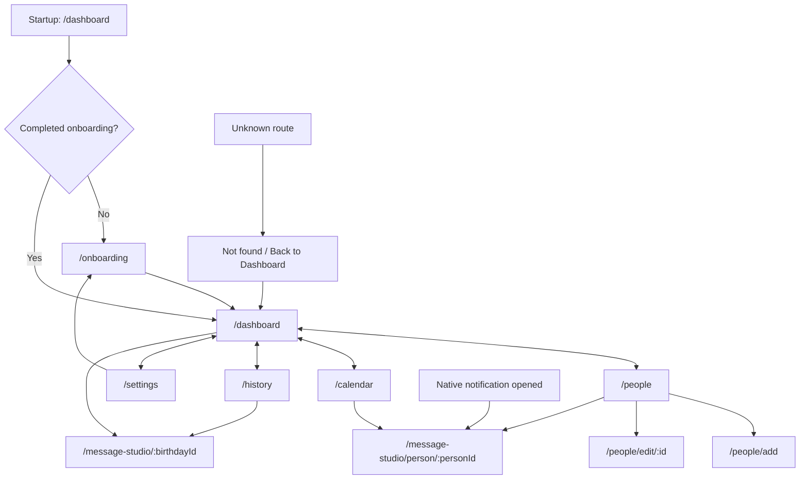

# Navigation ownership, edges and deep links

[Knowledge home](../README.md) · [Journey scenarios](../journeys/README.md) · [Feature decomposition](../features/deep-dives/navigation-ux.md)

**Scope:** Flutter `go_router` and the material bottom navigation source at commit `2abcc1aaa24a69c0aff5bddbc13c5f05d0ed14f8`. Edges are source-level evidence of routes or UI action handlers, **not** automated end-to-end runtime proof.

## Route inventory (10 declared destinations)

| Route | Owner | Navigation role | ID |
|---|---|---|---|
| `/onboarding` | [OnboardingScreen](../../../lib/features/onboarding/presentation/onboarding_screen.dart) | First run / Settings replay, root-level | ONB |
| `/dashboard` | [DashboardScreen](../../../lib/features/dashboard/presentation/dashboard_screen.dart) | Indexed tab 1, router initial | DASH |
| `/people` | [PeopleScreen](../../../lib/features/people/presentation/people_screen.dart) | Indexed tab 2 | PEOPLE |
| `/calendar` | [CalendarScreen](../../../lib/features/calendar/presentation/calendar_screen.dart) | Indexed tab 3 | CAL |
| `/history` | [HistoryScreen](../../../lib/features/history/presentation/history_screen.dart) | Indexed tab 4 | HISTORY |
| `/settings` | [SettingsScreen](../../../lib/features/settings/presentation/settings_screen.dart) | Indexed tab 5 | SETTINGS |
| `/people/add` | [PersonFormScreen](../../../lib/features/people/presentation/person_form_screen.dart) | Create form above shell | PEOPLE-CRUD |
| `/people/edit/:id` | [PersonFormScreen](../../../lib/features/people/presentation/person_form_screen.dart) | Editor above shell | PEOPLE-CRUD |
| `/message-studio/:birthdayId` | [MessageStudioScreen](../../../lib/features/message_studio/presentation/message_studio_screen.dart) | Cycle-linked Studio above shell | STUDIO |
| `/message-studio/person/:personId` | [MessageStudioScreen](../../../lib/features/message_studio/presentation/message_studio_screen.dart) | Person-linked Studio above shell | STUDIO |

Source: [router.dart](../../../lib/app/router.dart). The unmatched-path fallback uses `_NotFoundScreen`, which offers a path back to Dashboard; this is not one of the ten declared routes.

## Execution and navigation graph

The five tab destinations are implemented as a `StatefulShellRoute.indexedStack`, which retains branch navigators. Navigation from notifications is handled in [AppScaffold](../../../lib/app/app_scaffold.dart) using `getInitialNotificationPersonId` and a notification-open callback. Onboarding is conditional on the saved flag in [credential storage](../../../lib/core/security/credential_storage.dart).

## Route contract: journey, state, error and exit

| Entry | Preconditions / guards | Primary action | Failure / recovery | Exit |
|---|---|---|---|---|
| First launch | Secure onboarding flag not completed | Walkthrough, skip or choose add/import | Onboarding storage write failure requires explicit handling | Dashboard or People form |
| People add/edit | Existing `:id` for edit | Validate/persist person | Invalid inputs; unsaved changes confirmation | People shell |
| Person Studio | Valid person identifier | Compose manually/AI; share | Missing/deleted person, missing phone, model unavailable | People, History, editor |
| Birthday Studio | Valid birthday identifier | Compose/review/hand off | Missing birthday, stale cycle, external launcher fails | History or back |
| Settings | Local account may be signed out | Change preferences, Google sign-in, backup/purchases | Missing auth/permission/network, provider lock | Same tab or onboarding replay |
| Invalid route | No route matches | Explain unmatched URL | Graceful return | Dashboard |

## Important user-experience checks

- A direct link to a person or birthday deleted since the link was generated must render recoverable not-found feedback; do not silently redirect to the wrong contact.
- Returning from the external messaging app must **not** automatically confirm a message was sent.
- Notification tap behavior needs device, permission and cold-start tests (not only widget navigation tests).
- Keyboard, screen-reader, text-scaling and dark mode should be verified across root shell plus modal screens.
- A route declaration does not imply any corresponding permission, network or data state has been tested.

**Tests located:** [shell behavior](../../../test/app/shell_test.dart), [unknown route](../../../test/app/router_not_found_test.dart), [onboarding](../../../test/features/onboarding/presentation/onboarding_screen_test.dart), [calendar](../../../test/features/calendar/presentation/calendar_screen_test.dart). **Not executed in this documentation authoring session:** physical-device and cloud/navigation integration tests.
