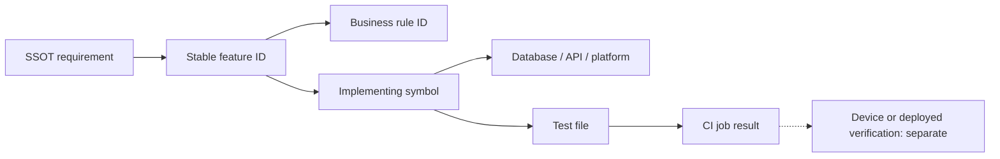

# Requirements → features → code → tests

[Knowledge home](../README.md) · [Feature registry](../feature-registry.json) · [Business rules](../business-rules/README.md)

**Evidence date:** 2026-10-14. **Base SHA:** ``2abcc1aaa24a69c0aff5bddbc13c5f05d0ed14f8``. ``SPEC-*`` are documentation mapping keys based on SSOT sections, **not** original product requirement IDs. The ``FR-*`` labels are from the existing [archived requirements traceability](../../archive/REQUIREMENTS_TRACEABILITY.md), whose coverage statuses may now be stale.

## Mapped requirements

| Req ID | Expected behavior | Feature | Product evidence | Source | Test location | Evidence status |
|---|---|---|---|---|---|---|
| FR-002 | People CRUD | PEOPLE-CRUD | [SSOT §7](../../../SSOT.md) | [Implementation](../../../lib/features/people/application/person_service.dart) | [Test location](../../../test/features/people/application/person_service_test.dart) | Source mapped; runtime not independently verified |
| FR-003 | Birthday recurrence | BIRTH-CALC | [SSOT §14](../../../SSOT.md) | [Implementation](../../../lib/features/birthdays/domain/birthday_engine.dart) | [Test location](../../../test/features/birthdays/domain/birthday_engine_test.dart) | Source mapped; runtime not independently verified |
| FR-004 | Import phone/CSV contacts | PEOPLE-IMPORT | [SSOT §18](../../../SSOT.md) | [Implementation](../../../lib/features/people/presentation/people_screen.dart) | [Test location](../../../test/features/people/data/contact_csv_service_test.dart) | Source mapped; runtime not independently verified |
| FR-005 | Reminders/quiet hours | REM-RULES | [SSOT §17](../../../SSOT.md) | [Implementation](../../../lib/features/reminders/domain/reminder_schedule.dart) | [Test location](../../../test/features/reminders/domain/reminder_scheduler_test.dart) | Source mapped; runtime not independently verified |
| FR-006 | App AI entitlement gate | BILL | [SSOT §11](../../../SSOT.md) | [Implementation](../../../lib/features/subscription/application/subscription_service.dart) | [Test location](../../../test/features/subscription/subscription_service_test.dart) | Source mapped; runtime not independently verified |
| FR-007 | User Gemini key | AI-BYOK | [SSOT §5](../../../SSOT.md) | [Implementation](../../../lib/features/ai/data/user_gemini_api_provider.dart) | [Test location](../../../test/ai/user_gemini_api_provider_test.dart) | Source mapped; runtime not independently verified |
| SPEC-05 | BYOK precedence + Nano fallback | AI | [SSOT §5](../../../SSOT.md) | [Implementation](../../../lib/features/ai/domain/ai_router.dart) | [Test location](../../../test/ai/ai_router_test.dart) | Source mapped; runtime not independently verified |
| SPEC-07 | Recipient facts/preferences | PEOPLE | [SSOT §7](../../../SSOT.md) | [Implementation](../../../lib/features/people/domain/person.dart) | [Test location](../../../test/features/people/domain/person_input_validator_test.dart) | Source mapped; runtime not independently verified |
| SPEC-08 | Birthday lifecycle | BIRTH-CYCLE | [SSOT §8](../../../SSOT.md) | [Implementation](../../../lib/features/birthdays/application/birthday_lifecycle_service.dart) | [Test location](../../../test/features/birthdays/application/birthday_lifecycle_service_test.dart) | Source mapped; runtime not independently verified |
| SPEC-09 | Human-controlled WhatsApp handoff | SEND-WA | [SSOT §9](../../../SSOT.md) | [Implementation](../../../lib/features/delivery/data/whatsapp_handoff_builder.dart) | [Test location](../../../test/delivery/whatsapp_handoff_test.dart) | Source mapped; runtime not independently verified |
| SPEC-10 | SMS/Copy/Share | SEND | [SSOT §10](../../../SSOT.md) | [Implementation](../../../lib/features/delivery/data/native_share_service.dart) | [Test location](../../../test/features/message_studio/presentation/message_studio_visibility_test.dart) | Source mapped; runtime not independently verified |
| SPEC-12 | Google sign-in | AUTH | [SSOT §12](../../../SSOT.md) | [Implementation](../../../lib/features/auth/data/live_google_auth_gateway.dart) | [Test location](../../../test/features/auth/data/live_google_auth_gateway_test.dart) | Source mapped; runtime not independently verified |
| SPEC-13 | Useful offline operation | JOBS | [SSOT §13](../../../SSOT.md) | [Implementation](../../../lib/features/jobs/application/job_worker.dart) | [Test location](../../../test/features/jobs/application/job_worker_test.dart) | Source mapped; runtime not independently verified |
| SPEC-15 | Action-focused home | DASH | [SSOT §15](../../../SSOT.md) | [Implementation](../../../lib/features/dashboard/presentation/dashboard_screen.dart) | [Test location](../../../test/features/dashboard/presentation/dashboard_visibility_test.dart) | Source mapped; runtime not independently verified |
| SPEC-16 | Editable Studio/rewrite | STUDIO | [SSOT §16](../../../SSOT.md) | [Implementation](../../../lib/features/message_studio/presentation/message_studio_screen.dart) | [Test location](../../../test/features/message_studio/presentation/message_studio_durable_test.dart) | Source mapped; runtime not independently verified |
| SPEC-18 | Import normalization / duplicate review | PEOPLE-CSV | [SSOT §18](../../../SSOT.md) | [Implementation](../../../lib/features/people/data/contact_csv_service.dart) | [Test location](../../../test/features/people/data/contact_csv_service_test.dart) | Source mapped; runtime not independently verified |
| SPEC-19 | Opt-in backup, versioning, tombstones | CLOUD | [SSOT §19](../../../SSOT.md) | [Implementation](../../../lib/features/sync/data/cloud_sync_service.dart) | [Test location](../../../test/features/sync/data/cloud_sync_service_test.dart) | Source mapped; runtime not independently verified |
| SPEC-20 | Secrets and authentication boundary | AUTH | [SSOT §20](../../../SSOT.md) | [Implementation](../../../lib/core/security/credential_storage.dart) | [Test location](../../../test/security/credential_storage_test.dart) | Source mapped; runtime not independently verified |
| SPEC-21 | Truthful generated wording | AI-PROMPT | [SSOT §21](../../../SSOT.md) | [Implementation](../../../lib/features/ai/domain/ai_prompt_builder.dart) | [Test location](../../../test/ai/ai_prompt_builder_test.dart) | Source mapped; runtime not independently verified |
| SPEC-22 | Accessible theme/controls | THEME | [SSOT §22](../../../SSOT.md) | [Implementation](../../../lib/app/theme/app_theme.dart) | [Test location](../../../test/ui/contrast_test.dart) | Source mapped; runtime not independently verified |
| SPEC-23 | Non-sensitive logs | APP | [SSOT §23](../../../SSOT.md) | [Implementation](../../../lib/core/logging/app_logger.dart) | [Test location](../../../test/core/logging/app_logger_test.dart) | Source mapped; runtime not independently verified |
| BACKEND-COORD | Sender coordination fencing | CTRL-CLAIM | [backend/README.md](../../../backend/README.md) | [Implementation](../../../backend/functions/src/services/controlPlane.ts) | [Test location](../../../backend/functions/test/decisions.test.ts) | Source mapped; runtime not independently verified |
| HOSTING-DELETE | Account deletion web flow | WEB-DELETE | [backend/hosting/README.md](../../../backend/hosting/README.md) | [Implementation](../../../backend/hosting/src/deletion-contract.ts) | [Test location](../../../backend/hosting/test/deletion-contract.test.mjs) | Source mapped; runtime not independently verified |

### Trace graph

## Coverage interpretation

This is a **curated sample of high-value traceability**: the number of mapped rows is not a credible percentage of all intended requirements or atomic capabilities. A test path being present does not demonstrate every assertion or integration edge is tested. Validate individual scenarios before changing status to test verified.

## Explicit requirement mismatches and undocumented behavior

- **Potential gap:** auto-prepare preference exists, but a complete event-to-AI-draft scheduling chain is not established by this review. Refer to [GAP-05](../gaps/README.md).
- **Conflicting historical claim:** [PROJECT.md](../../../PROJECT.md) describes an AES-encrypted backup envelope that is not the actual snapshot-Firestore-fields implementation. Refer to [GAP-02](../gaps/README.md).
- **Implementation beyond core UX:** the server-only coordination control plane exposes claims, leases, transfer, repair and deletion flows. Their caller/release evidence differs from normal Flutter user journeys; refer to [integrations](../integrations/README.md).
- **Architecture drift:** two ``Person`` definitions exist; future requirements should refer to a canonical field schema only after migration is decided.

## How to add traceability

Use an existing requirement ID when one exists. For requirements without an ID, mint ``SPEC-{section}`` as a mapping label and retain the original paragraph link. Avoid interpreting recommended functionality as a mandatory requirement. Add concrete test names, and distinguish source/test observation from device deployment.
