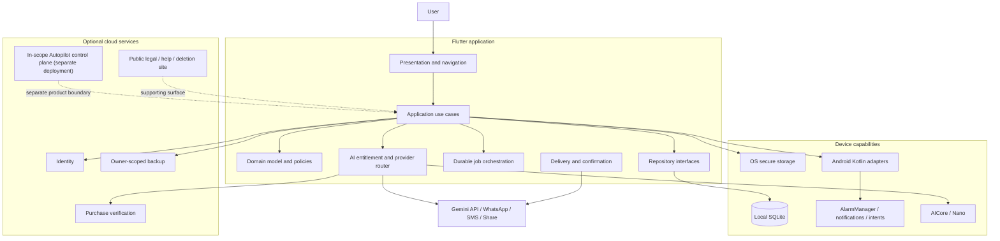
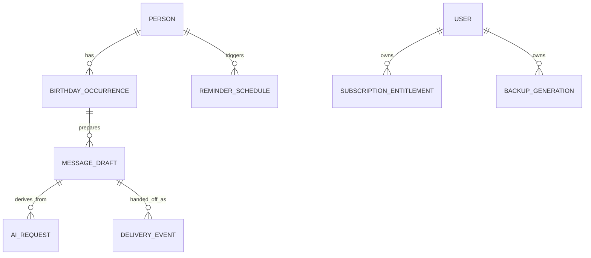

# 06 — Target technical architecture

**Architecture status:** target baseline, subject to source verification and stakeholder approval. Technology names below are evaluation candidates and current repository context, not automatic mandates.

## 1. Architecture principles

1. Local-first core domain with explicit cloud boundaries.
2. Domain logic independent of Flutter widgets and platform APIs.
3. One canonical owner for each business entity and state transition.
4. Durable operations for work that must survive process death.
5. Typed contracts at every external or native boundary.
6. Server-authoritative identity, purchase and cloud authorization.
7. Explicit idempotency and concurrency behavior.
8. No new microservice unless a measured requirement justifies it.

## 2. Logical architecture



## 3. Layer responsibilities

| Layer | Owns | Must not own |
|---|---|---|
| Presentation | Screens, controls, accessibility, navigation, view state | Date policy, entitlement truth, database mutation rules |
| Application | Use cases, orchestration, transactions, cancellation and job boundaries | UI rendering or direct platform-specific logic |
| Domain | Person, birthday occurrence, draft, entitlement, reminder and delivery semantics | Firebase/Flutter/Android SDK dependencies |
| Data | Drift implementation, serialization, repositories, sync adapters | Product policy decisions hidden in mapper code |
| Platform adapters | Android permissions, alarms, notification receiver, Nano bridge, SMS capability | Product-level state ownership |
| Backend | Purchase verification, account-scoped cloud operations, separately approved coordination | Client-trusted entitlement or unapproved message content |
| Public web | Legal/help/deletion workflows | Direct access to private contact/message data |

## 4. Domain ownership and aggregate boundaries

- **Person aggregate:** stable person ID, name, birthday facts, relationship context, contact endpoints, preferences, consent flags, created/updated metadata and deletion state.
- **Birthday occurrence:** occurrence ID, person ID, cycle year, resolved date/timezone policy, lifecycle status and occurrence timestamps.
- **Message draft:** draft ID, occurrence ID, revision, content, origin (manual/AI), review state and timestamps.
- **AI request:** request ID, draft/person/occurrence references, entitlement decision, provider class, operation, status, retry metadata and redacted diagnostics. Never persist raw credential.
- **Reminder preference:** user scope, enabled offsets, quiet-hour policy, timezone policy and version.
- **Reminder schedule:** derived execution record, schedule identity, due instant, OS registration state and last reconciliation.
- **Delivery event:** event ID, draft revision, channel, requested action, handoff result, user confirmation, timestamp and idempotency key.
- **Subscription entitlement:** user/account ID, product, state, expiry, verification source/time and revocation state.
- **Backup generation:** owner UID, generation ID, manifest, record versions, integrity metadata and completion state.

Entity relationship sketch:



This is a logical model, not the current physical schema. Foreign keys, deletion strategy and table shape require a separate migration design.

## 5. Data architecture requirements

- Define primary keys, foreign keys, uniqueness and cascade/tombstone semantics explicitly.
- Use transactions for aggregate operations such as person + occurrence creation/deletion.
- Keep draft revisions and delivery events separate.
- Version serialized records and reject unsupported schema versions safely.
- Use deterministic idempotency keys for jobs, reminders and delivery attempts.
- Define a conflict matrix for local edits, remote backup generations, deletion tombstones and restore.
- Never sync secrets, auth refresh tokens, API keys or message content to analytics/logging.
- Backup encryption claims must match the actual cryptographic design and key lifecycle.
- Retention and deletion policy must cover local DB, backup generations, logs, hosting receipts and operational control-plane records separately.

## 6. API and integration contracts

No endpoint is approved merely because a callable exists in source. Maintain an integration contract for every external boundary.

| Integration | Purpose | Contract requirements |
|---|---|---|
| Google identity / Firebase Auth | Optional account identity | OAuth scopes, token exchange, refresh, revocation, sign-out, account deletion |
| Google Play Billing | Subscription purchase | Product IDs, purchase token handling, acknowledgement, restore, pending/expired/revoked states |
| Purchase verification function | Trusted entitlement | Auth + App Check, schema validation, package/product binding, server verification, idempotency, error taxonomy |
| Firestore backup | Optional data continuity | UID authorization, opt-in, version/manifest, atomic generation, deletion propagation |
| Gemini API | BYOK generation | Entitlement first, key secure storage, timeout/quota handling, no key logging, model capability contract |
| Android AICore / ML Kit | On-device generation | Capability discovery, download/readiness, busy/quota/error, cancellation and device support |
| Android alarms/notifications | Reminder delivery | Permission, exact alarm, reboot, timezone, cancellation, OS version behavior |
| WhatsApp Click-to-Chat | Prefilled user handoff | E.164 normalization, URI encoding, launch result, no send confirmation |
| SMS composer / SmsManager | User handoff or separately approved personal automation | Flavor capability, permission, explicit consent, stale guard and duplicate protection |
| Public Hosting | Privacy/help/deletion | Release configuration, legal review, identity, App Check, CSP and verified deletion status |
| Autopilot callables | Separate sender coordination | Strict schemas, auth/App Check, fencing, replay protection, rate limits, deployment proof |

For each API, document exact method, path, auth, request/response schema, status/error codes, idempotency, rate limits, PII classification, retry behavior, versioning and tests. Do not invent endpoint contracts where source or provider documentation has not been inspected.

## 7. AI architecture decision

**Approved project rule carried into this blueprint:** subscription entitlement is checked before any provider is selected. BYOK and Nano do not bypass the application subscription.

```text
AI operation
  → verify active application entitlement
      → inactive / unknown: AI_LOCKED (no provider call)
      → active: resolve configured provider
          → user Gemini credential configured: Gemini API
          → otherwise: supported Gemini Nano
          → neither available: AI_UNAVAILABLE
```

A configured invalid key returns a credential error; it is not treated as a missing key. Provider failure preserves the last valid draft. Manual editing remains available when AI is locked or unavailable. No application-owned cloud Gemini fallback is assumed.

## 8. Reliability and scalability

- Local reads should use indexed queries and reactive streams where useful.
- Avoid full-table scans for dashboard/calendar at expected data sizes; establish test datasets before setting performance thresholds.
- Use bounded background queues with per-job idempotency, attempt limits, deadlines and cancellation.
- Avoid duplicate alarm registrations; reconcile intended schedules against OS state after reboot, permission changes, timezone changes and app resume.
- Use snapshot generations and atomic promotion for backup.
- Keep the control plane isolated; its sender leases and fencing logic must not be confused with ordinary reminder scheduling.
- Define backup/restore and deletion recovery runbooks before production enablement.

## 9. Environments and delivery

Required environments: local development, automated CI, isolated emulator/test project, staging/preview and production. Exact Firebase projects, regions, signing keys, app identifiers and secrets must be managed outside source control.

Release pipeline:
1. Static analysis and dependency audit.
2. Unit/component tests.
3. Backend and rules tests.
4. Build per distribution flavor.
5. Integration and E2E tests.
6. Device matrix and permission lifecycle tests.
7. Security/privacy review.
8. Release signing and artifact provenance.
9. Staged rollout and monitoring.
10. Rollback and incident runbook.

## 10. Architecture decisions still open

- Confirm Android-only versus multi-platform product support.
- Confirm whether SQLite schema needs a normalized event model and explicit relational constraints.
- Decide whether sync is a backup/restore feature or a bidirectional multi-device synchronization product.
- Decide whether delivery history is append-only event storage or derived from current status plus audit events.
- Define supported Android OS/device matrix for Gemini Nano and exact alarms.
- Approve public Hosting identity and deployment owner for the in-scope Birthday Autopilot service.

## 11. People/Birthday detailed target design

The domain-specific target architecture, repository ownership, transaction boundary, data migration strategy, open decisions and verification gates are specified in [Phase 2.4 — People/Birthday architecture design](phase-2.4-architecture-design/README.md). That design is a documentation artifact only. It does not approve a physical schema, database migration, source-code refactor or production behavior change.
