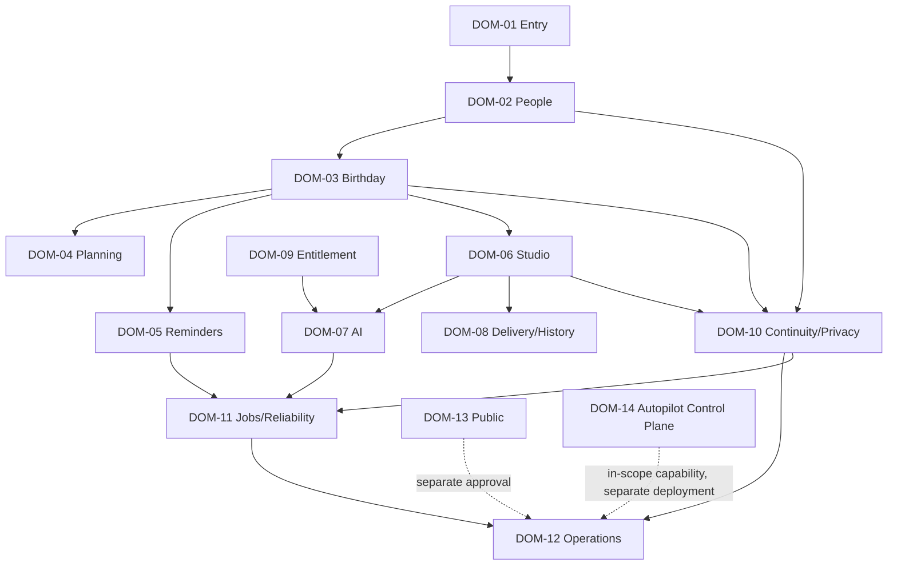

# Capability Dependency Map

Hard prerequisites: Person validation → birthday identity → cross-view occurrence → reminders/studio. Entitlement/store truth → AI. Privacy/retention → backup/delete. Supported platform/release evidence → any production claim. Autopilot is optional and its server control plane must remain isolated; local tracking and manual delivery must work when it is unavailable.
