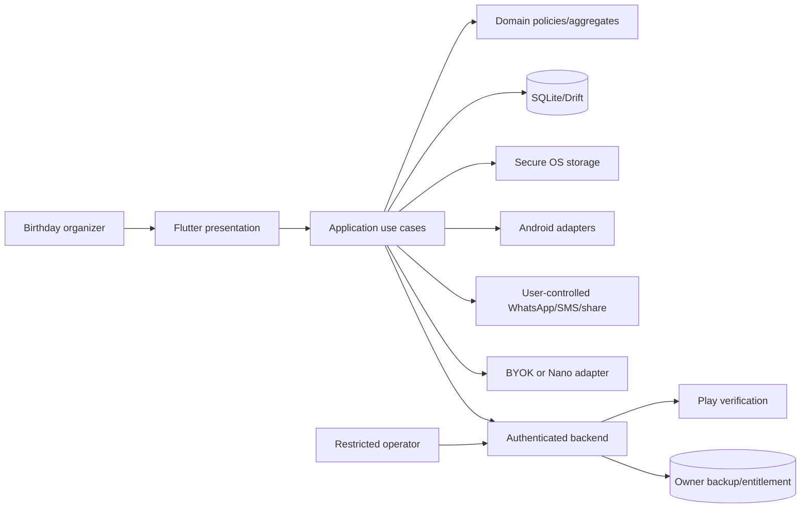

# System Architecture

## Recommended style and system boundary

Use a local-first modular monolith in Flutter with ports-and-adapters. Current Flutter/Riverpod/Drift and Firebase choices are viable, not permanent mandates. A modular backend may be a serverless deployment, but identity, entitlement, backup and conditional control plane remain logical/security boundaries. (`ER`.)

Trust boundaries: client owns UI/local interaction, not entitlement truth; store verifies purchases; OS owns permissions/scheduling; messaging app owns transport after handoff; backend owns authenticated account/control state. One application transaction owns the Person/Birthday aggregate. External effects become durable intents/jobs after commit; no claim that SQLite and network work are one transaction.

Architecture decision gates: DEC-041 Person write authority, DEC-042 occurrence identity, DEC-039 backup, DEC-044 Autopilot boundary. Detailed target: [definitive technical architecture](../../definitive/03-technical-architecture.md).
