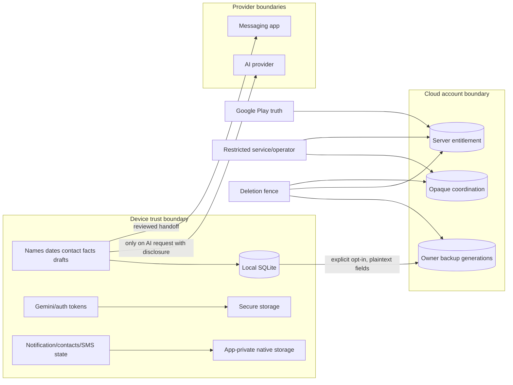

# Data and Security Map

Security invariant: secrets never enter SQLite/backup/analytics. Current gap: full deletion/retention is not reconciled across SQLite, native storage, backup generations, jobs, drafts and delivery events. No diagram implies encryption, deployment or compliance without evidence.
