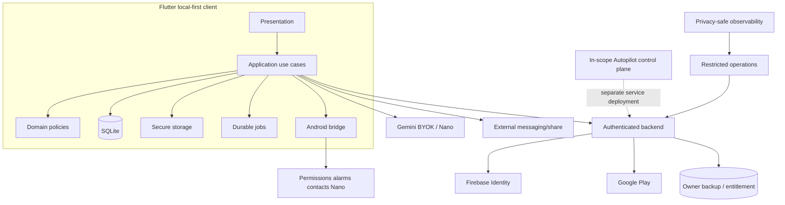

# Technical Architecture Map

Authoritative architecture details: [system](../06-architecture/system-architecture.md), [security](../06-architecture/security-architecture.md), [API](../06-architecture/api-architecture.md).
