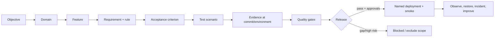

# Testing and Release Map

Each critical journey requires normal, boundary, negative, permission, timeout, dependency failure, concurrency, recovery, security and accessibility evidence. See [quality gates](../07-quality/quality-gates.md).
