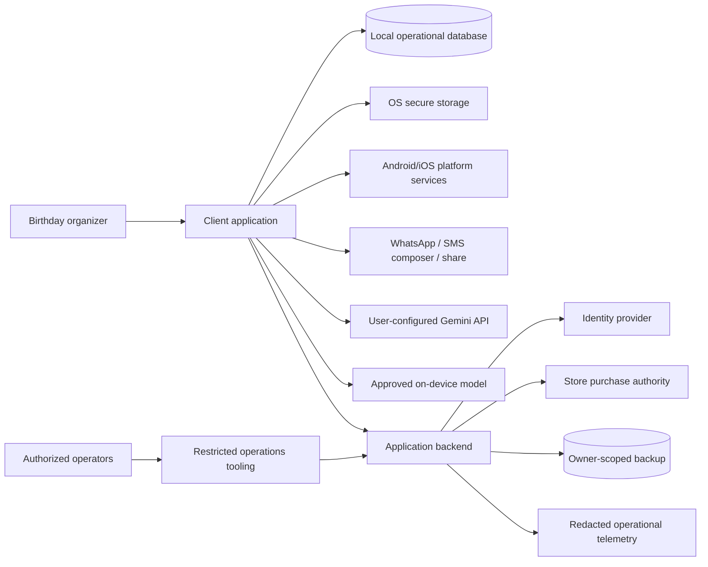

# 03 — Definitive Technical Architecture

**ID:** BP-ARCH-001 · **Version:** 1.0 · **Status:** Target specification; approval and implementation evidence pending  
**Classification:** Recommendation unless explicitly marked approved. Application/configuration changes are not authorized by this document.

## 1. Decision basis

The architecture optimizes for the verified product constraint: a single user's trustworthy relationship/birthday workspace must remain useful offline, while identity, purchase verification, optional backup and separate platform operations may require controlled cloud boundaries. It does not require the existing Flutter/Firebase implementation to be retained; however, those technologies are suitable candidates when they satisfy the contracts below.

Architecture decisions are accepted only after ADR approval. See [12 — Governance registers](12-governance-registers.md).

## 2. System context

**Trust rules:** the client owns local interaction state, not entitlement truth; the OS owns permissions and scheduling; external messaging apps own message transport after handoff; cloud services own authenticated account resources; only the store verification service can establish a paid entitlement.

## 3. Logical application architecture

Use ports-and-adapters modular architecture inside one client application. A domain model is shared where product semantics are truly common; UI and infrastructure code must depend inward.

| Layer | Responsibilities | Prohibitions |
|---|---|---|
| Presentation | Navigation, state rendering, validation feedback, accessibility, responsive behavior | Date/recurrence policy, cloud authorization, entitlement grants |
| Application | Use cases, transactions, orchestration, cancellation, job creation | Widget details, direct SDK calls, hidden policy |
| Domain | Entities, value objects, policies, state transitions, domain events | Flutter/OS/Firebase/HTTP types |
| Infrastructure | Repository implementations, serializers, adapters, platform bridges | Inventing business state or mutating canonical records outside use cases |
| Composition | Dependency registration, runtime environment, feature flags, startup order | Feature logic |

Recommended module boundaries: `onboarding`, `people`, `birthdays`, `planning`, `reminders`, `studio`, `ai`, `delivery`, `history`, `identity`, `entitlement`, `continuity`, `privacy`, `operations`, `shared-kernel` and `design-system`.

## 4. Canonical aggregate and ownership model

| Aggregate | Canonical owner | Key invariant |
|---|---|---|
| Person | People domain | Stable ID, valid birthday on new writes, explicit facts/consent |
| Birthday occurrence | Birthday domain | At most one durable occurrence per `(personId, cycleYear)` |
| Draft revision | Studio domain | Delivery references an immutable revision, not mutable “current text” |
| Reminder plan/schedule | Reminder domain | Derived from occurrence and preferences; idempotent schedule key |
| Delivery event | Delivery domain | Handoff, user confirmation and external delivery are distinct facts |
| Entitlement | Entitlement domain | Server-verified, expiring evidence; never granted from a client flag |
| Backup generation | Continuity domain | Complete, integrity-checked, atomically published |
| Job | Jobs subsystem | Idempotent, bounded retries, cancellable before side effect |

A person create/update/delete affecting birthday data runs inside one local transaction. Reminder/backup/AI work is generated after commit through durable jobs or reconciliation; this avoids partial aggregates without pretending external effects are transactional with SQLite.

## 5. State and communication

- Use a unidirectional state model: command/use case → transaction/domain event → repository → immutable UI state.
- Presentation stores view-only state. Durable product state lives in the canonical aggregate, not in controllers.
- Keep an explicit `Loading`, `Content`, `Empty`, `Failure(actionable)`, `Stale` model where connectivity/capability checks can age.
- In-process events are hints; no critical write may depend only on an event bus listener.
- Background jobs are durable database records with `queued`, `running`, `retry-wait`, `succeeded`, `failed`, `cancelled`, and stale-running recovery.
- Native bridges use versioned, typed requests/responses and normalize unknown platform states.
- Network calls have operation IDs, deadlines, cancellation, typed errors and no secret/PII logging.

## 6. Client persistence

Use a relational database for the operational local store because product consistency depends on unique occurrence identity, relationships, transactions, queries and migrations. SQLite/Drift is acceptable evidence-based selection, not a permanent mandate.

Required constraints include:
- primary keys on all entities;
- foreign keys enabled;
- uniqueness on `(person_id, cycle_year)`;
- controlled FK behavior (restrict person purge while references exist);
- monotonic entity `version` plus `updated_at` for synchronized entities;
- tombstones/retention semantics only where approved;
- indexes for upcoming occurrence date, person name, status, due jobs and reminder due time;
- append-only delivery events;
- schema compatibility tests from every shipped version.

Encryption at rest for the local SQLite database is not assumed. OS sandboxing is the baseline; a future encrypted database requires measured threat need and backup/key-recovery design.

## 7. Backend boundaries

A modular backend may initially deploy as one serverless/managed application, but logical services are separate:

1. **Identity/session integration** — token validation, account deletion coordination.
2. **Entitlement verification** — store-token verification, product/account checks, expiring authoritative result.
3. **Backup/restore** — opt-in owner-scoped generation storage and validated manifests.
4. **Public privacy/support intake** — separate from private user content.
5. **Conditional operations control plane** — leases/fences/retries only if separately approved and integrated.

Do not route AI prompt content through the application backend by default. Do not let a callable grant entitlement from client-provided status, expiry or product name.

## 8. API architecture

Standards: versioned JSON over HTTPS; Firebase callable envelope is acceptable only if client/server contract tests use the exact deployed envelope. API requirements:

- authenticated subject from validated identity token, never request-body UID authority;
- App Check or equivalent abuse signal where supported;
- contract version;
- UUID request/operation IDs;
- strict request validation and bounded payloads;
- stable error `{code, message, retryable, operationId, details?}` where details cannot leak internals;
- idempotency key for purchase verification, deletion, claim/fence and restore publication;
- server-side rate limits and replay protection on sensitive operations;
- no raw tokens, recipient data or message bodies in normal logs;
- explicit deprecation window and compatibility matrix.

Complete initial contracts are in [04 — Data and API contracts](04-data-and-api-contracts.md).

## 9. Security architecture

- Secrets in platform/managed secret stores; never in SQLite, analytics, backups or ordinary environment files committed to source.
- Identity tokens are short-lived and refreshed; sensitive account operations require recent authentication.
- Least-privilege rules authorize owner-scoped backup access; entitlement writes are backend-only.
- Prompt injection is handled by strict data/policy separation, allow-listed prompt fields, output validation and human review.
- External handoff validates recipient/channel and never assumes send completion.
- Deletion fencing prevents writes from recreating deleted remote records.
- Dependency, secret, manifest and authorization scanning is required in CI.

Detailed controls and threat tests are in [05 — Security and operations](05-security-operations.md).

## 10. Reliability, scale and performance

Numeric budgets must be established through supported-device baselines. Target qualities:

- Indexed local reads avoid full scans for current dashboard/calendar queries.
- Calendar and lists render progressive/paginated windows when data volume requires it.
- All jobs have deadlines, bounded attempts, exponential backoff with jitter and explicit terminal failures.
- Reminder reconciliation is idempotent and runs after boot/reboot, permission changes, timezone changes and app resume.
- Backup uses validated generation upload then atomic “current” pointer publication.
- Restores are all-or-nothing at the local transaction boundary, or expose an explicit resumable plan without mixed silent state.
- Backend scales horizontally/statelessly; uniqueness and fencing remain in durable storage.
- Caches are disposable and cannot be entitlement or occurrence authority.

Proposed initial budgets, to be measured and approved: common local screen interaction under 100 ms UI response; cold start to usable local shell under an approved device-specific threshold; 95th-percentile AI result depends on provider and must expose progress rather than block manual editing.

## 11. Environments and deployment

| Environment | Purpose | Required isolation |
|---|---|---|
| Developer | local emulators/fakes, no production secrets | synthetic data only |
| CI | deterministic automated tests/builds | ephemeral credentials/projects |
| Integration | live-provider/managed-service tests | test accounts and purchases |
| Staging | release-candidate rehearsal | separate identity, billing, backup, functions, domains |
| Production | supported release | least privilege, approvals, observability, backups, rollback |

Promotion requires immutable artifact provenance, flavor/manifest validation, migration checks, schema/API compatibility, signed artifacts and rollback/feature-disable ability. No production claim follows merely from deployed source in a repository.

## 12. Observability and incident response

Emit redacted metrics/events for operation category, result code, retryable flag, latency bucket, release/build/flavor, capability and coarse platform version. Never log names, birthday, destination, facts, message body, prompt body, credential/token or raw request/response.

Required alerts after baselines exist: entitlement verification failure spike; AI provider timeout/quota spike; backup generation/restore failure; reminder reconciliation failure; deletion failure/age; backend 5xx/authorization rejection; crash loop; permission capability regression.

Incidents follow detect → protect/disable → preserve non-sensitive evidence → communicate scope → recover → verify → postmortem → requirement/control update.

## 13. Architecture acceptance criteria

1. Every P0 feature names its canonical data/state owner and external boundaries.
2. No duplicated date, entitlement or delivery-state authority exists.
3. A killed process can recover queued work without duplicating a side effect.
4. Cross-account/cloud authorization and unentitled AI calls have negative tests.
5. Person/Birthday aggregate transaction and backup generation tests are deterministic.
6. A deployed contract can be traced from documentation → schema → implementation → test → environment evidence.

## 14. Architecture decision gates

- [ ] Approve Android-only versus other platform support.
- [ ] Approve local-only backup/restore versus bidirectional multi-device sync.
- [ ] Approve durable occurrence/history retention.
- [ ] Approve backend/product ownership for conditional control plane.
- [ ] Approve local encryption need, if any, and key recovery.
- [ ] Approve measurable performance and availability objectives after baselines.
