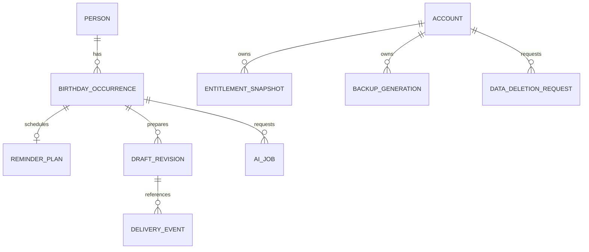

# 04 — Data, Database and API Contracts

**ID:** BP-DATA-001 · **Version:** 1.0 · **Status:** Target contract; physical migration authorization pending.

## 1. Data dictionary

Timestamps are UTC instants. Birthday calendar components are stored separately from instants. All IDs are opaque UUID/ULID-like values and never encode PII.

| Entity | Required target fields | Constraints / lifecycle |
|---|---|---|
| Person | `id`, `displayName`, `birthdayMonth`, `birthdayDay`, `birthYear?`, `relationshipCategory`, `closeness?`, `phoneE164?`, `email?`, `language`, `tone`, `facts[]`, `notes?`, `recipientTimezone?`, `leapDayPolicy?`, `autoPrepare`, `deliveryPolicy`, `createdAt`, `updatedAt`, `version`, `deletedAt?` | New writes require valid month/day. `facts` are user-approved context. Invalid legacy timezone remains distinguishable from absent. |
| BirthdayOccurrence | `id`, `personId`, `cycleYear`, `resolvedDate`, `localTimezone`, `leapDayPolicySnapshot`, `status`, `revision`, `createdAt`, `updatedAt` | Unique `(personId, cycleYear)`. Derived date follows one policy. Durable history unless approved purge. |
| ReminderPreference | `id`, `enabled`, `offsets[]`, `quietStart`, `quietEnd`, `quietPolicy`, `version`, `updatedAt` | Validate minute ranges and crossing-midnight behavior. |
| ReminderSchedule | `id`, `occurrenceId`, `kind`, `dueAt`, `scheduleKey`, `osState`, `attempts`, `updatedAt` | `scheduleKey` deterministic; OS callback is reconciled, not authoritative business truth. |
| DraftRevision | `id`, `draftId`, `occurrenceId`, `body`, `tone`, `length`, `language`, `origin`, `providerClass?`, `reviewState`, `createdAt`, `supersedesId?` | Append-only revisions. Empty/oversize output rejected. Message body is sensitive content. |
| DeliveryEvent | `id`, `draftRevisionId`, `occurrenceId`, `channel`, `action`, `attemptedAt`, `handoffResult`, `userConfirmation?`, `confirmationAt?`, `idempotencyKey` | Append-only evidence. Only explicit user action writes confirmed/not-sent. |
| AiJob | `id`, `occurrenceId`, `draftId`, `operation`, `providerClass`, `requestFingerprint`, `status`, `attempt`, `maxAttempts`, `deadlineAt`, `resultRevisionId?`, `errorCode?` | No credential, raw prompt or raw response. Enforce entitlement at start and immediately before provider call. |
| EntitlementSnapshot | `accountId`, `productId`, `state`, `expiresAt`, `verifiedAt`, `source`, `verificationId`, `revocation?` | Client snapshot is expiring display/cache only; backend/store establishes truth. |
| BackupGeneration | `ownerId`, `generationId`, `manifestHash`, `schemaVersion`, `recordCounts`, `createdAt`, `publishedAt?`, `integrity`, `state` | Immutable after publication; pointer publication is atomic. |
| DataDeletionRequest | `id`, `accountId?`, `scope`, `state`, `requestedAt`, `acceptedAt?`, `completedAt?`, `evidence`, `operationId` | Accepted ≠ completed. Sensitive auth recency applies. |

## 2. Relationship and integrity rules



- Person deletion is soft visibility plus approved retention. Active occurrences/reminders/jobs for a deleted person stop; linked history remains read-only or is purged only by the approved retention policy.
- Restore rejects orphan children, duplicate unique identities, unknown schema versions, invalid enums/dates and records owned by a different account.
- Tombstones must not be applied before aggregate conflict review; permanent purge removes remote generations under the approved deletion saga.
- A draft delivery always references the exact revision handed off. Editing creates a new revision and invalidates any pending automated approval.

## 3. Index plan

Required logical indexes:
- `person(display_name normalized)`, `person(deleted_at, display_name)`;
- unique `birthday_occurrence(person_id, cycle_year)`;
- `birthday_occurrence(resolved_date, status)`;
- `reminder_schedule(due_at, os_state)`;
- `job(status, next_attempt_at)`;
- `delivery_event(occurrence_id, attempted_at)`;
- `backup_generation(owner_id, published_at)`.

Index choices are validated with representative datasets and query plans, not copied from one device assumption.

## 4. Migration and restore strategy

1. Read old schema in compatibility mode without writes.
2. Back up/mark the pre-migration database generation where feasible.
3. Run validation inventory: null birthdays, invalid timezone, duplicate occurrence identity, orphan child, unknown enum, unsafe auto-approval.
4. Block destructive writes until approved repair outcome is selected.
5. Apply additive/transactional migration.
6. Recompute derived schedules only from repaired canonical aggregates.
7. Verify invariants and rollback/forward-recovery evidence.
8. Never treat migration success as restoration/deletion completion without explicit reconciliation.

Unknown fields are quarantined or ignored by documented policy, never silently reinterpreted. No NOT NULL/foreign-key constraint is added before zero-violation preflight and approved legacy remediation.

## 5. API contract standard

### Common response headers/fields
- `X-Request-Id` / `operationId` for correlation (non-PII).
- `contractVersion`.
- UTC times or documented epoch millis consistently.
- `retryAfterMs` for retryable throttling/availability responses when safe.

### Common error shape

```json
{
  "error": {
    "code": "STABLE_ERROR_CODE",
    "message": "Safe actionable text",
    "retryable": false,
    "operationId": "uuid"
  }
}
```

Common categories: `UNAUTHENTICATED`, `RECENT_AUTH_REQUIRED`, `FORBIDDEN`, `INVALID_ARGUMENT`, `NOT_FOUND`, `CONFLICT`, `PRECONDITION_FAILED`, `RATE_LIMITED`, `UPSTREAM_UNAVAILABLE`, `TIMEOUT`, `INTERNAL`. Raw stack traces are forbidden.

## 6. Initial external contracts

### 6.1 Verify purchase (backend-to-store protected operation)

**Purpose:** determine server-authoritative entitlement. **Auth:** validated account token + App Check/abuse signal where supported. **Idempotency:** purchase token plus account/product/operation ID; replay is safe.

```json
// request
{
  "contractVersion": 1,
  "productId": "approved-product-id",
  "packageName": "registered-package-id",
  "purchaseToken": "opaque-store-token",
  "operationId": "uuid"
}
```

```json
// backend domain result; transport envelope must be tested exactly
{
  "status": "ACTIVE|PENDING|EXPIRED|REVOKED|NONE",
  "productId": "approved-product-id",
  "expiresAt": "ISO-8601 UTC or null",
  "verifiedAt": "ISO-8601 UTC",
  "isAutoRenewing": false,
  "verificationId": "uuid"
}
```

Validation: bound token/payload length; allow-listed package/product; reject account mismatch, malformed/replayed token and state not recognized. Client acknowledges a store purchase only after an authoritative safe result per the final approved acknowledgement policy. Unknown transport result fails closed and preserves retry.

### 6.2 Start/continue backup

**Purpose:** create an owner-scoped immutable generation. **Auth:** account owner; recent auth if enabling for first time. **Privacy:** exact categories disclosed and opt-in required.

Request metadata: `contractVersion`, `baseSchemaVersion`, `generationId`, `part`, `partHash`, bounded records. Response: accepted part, count/hash, next part or manifest validation result. Promotion to `current` happens only after complete manifest/hash validation. Writes are fenced during deletion. Existing generations follow an approved retention policy.

### 6.3 Restore generation

**Purpose:** retrieve a verified snapshot without partial destructive mutation. Response includes manifest, version, count/hash and records/parts. Client validates every item before transaction. Conflict result returns deterministic categories and never silently overwrites newer local edits.

### 6.4 Account deletion

**Purpose:** manage asynchronous deletion across account, backup and operational stores. **Auth:** recent authentication. Request returns receipt with `ACCEPTED|PROCESSING|COMPLETED|FAILED|UNKNOWN` and operation ID. Acceptance alone cannot be rendered as completed. Retry is idempotent; each data location and retention exception is recorded in completion evidence.

### 6.5 Conditional control-plane operations

Claims, leases and retry authorization require strict authorization, App Check/abuse control, per-install identity, fencing tokens, lease expiry, replay-safe idempotency and no assumption of message delivery. They are **not** approved core endpoints until product/deployment approval. Any future schemas must include a contract version and separate internal product ID.

## 7. Client-to-provider integrations

| Boundary | Input | Output / failure | Required handling |
|---|---|---|---|
| User Gemini API | Approved prompt, configured secret, cancellation | Text candidate, quota/invalid/timeout | Entitlement first; timeout; no secret logs; preserve draft |
| On-device AI | Prompt/capability state | Candidate or typed native state | Normalize download/busy/unsupported; no false readiness |
| WhatsApp | Valid E.164 phone, URL-encoded body | Launch result | Opening is handoff only; missing app fallback |
| SMS composer | Phone, text, size metadata | Launch/handoff result | No delivery claim; platform validation |
| OS reminder | due instant, channel, occurrence ID | registration/rejection/callback | Reconcile/re-register/cancel idempotently |

## 8. Search, filters and sort contracts

- People: normalized name, relationship, language, birthday month, “needs birthday repair”, deleted/active scope; sort name or next birthday.
- History: person, channel, date range, draft/handed-off/confirmed/failed/unknown state; default newest first.
- Calendar: month/date; same canonical occurrence query as dashboard.
- Backup/diagnostics: account/user only, generation state/date; no PII in list labels by default.
- All filters are represented in persisted/navigable UI state, with zero-result copy and reset.

## 9. Data retention decisions required

- Draft revision and delivery-event history duration.
- Backup generation count/age and purge timing.
- Deleted Person/tombstone retention and reappearance/undo window.
- Logs, crash data, deletion receipts and operational events.
- Whether control-plane state has legal/operational retention distinct from product data.

No requirement may claim “delete everything” until the retention inventory is approved and all scopes are implementable and verified.
