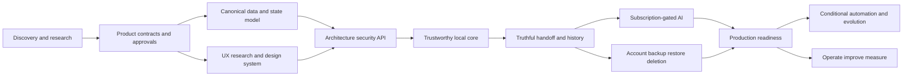

# 08 — Dependency-Aware Product Roadmap

**ID:** BP-ROAD-001 · **Version:** 1.0 · **Status:** Sequencing recommendation; no deadlines, team size or budget asserted.

## 1. Delivery logic

The roadmap is dependency-led. A downstream phase may reuse existing code only after it is mapped to approved behavior, not rebuilt or retained by assumption. Parallel preparation is allowed only where it does not pre-approve unresolved decisions.

## 2. Phase plan

### Phase 0 — Product discovery and research
**Objective:** validate need, positioning and strategic boundaries. **Scope:** interviews, journey observation, competitor/alternative landscape, privacy/trust, pricing hypotheses, platform/geography/language discovery, support needs. **Deliverables:** research plan/results, evidence log, target problem/user/platform recommendation, market assumptions. **Prereqs:** owner and participant access. **Risks:** confirmation bias, invented market claims, narrow implementation-led research. **Completion:** product, legal/privacy and business owners approve facts/proposals/unknowns. **Approval:** Product founder/owner.

### Phase 1 — Product contracts and definition
**Objective:** approve intended behavior independent of source. **Scope:** vision, outcomes, scope/non-goals, domain/feature catalogue, user/permission model, journeys, BR/NFR, glossary. **Deliverables:** `01`, `02`, `06`, requirements/rules registers. **Dependencies:** Phase 0 for user/platform/commercial facts; approved principles may be reconciled earlier. **Risks:** generic requirements, unowned contradiction. **Completion:** every P0 feature has purpose/outcome/actor/owner/state/data/AC/test/dependency, P0 rules approved. **Approval:** Product + UX + Data + Security + QA.

### Phase 2 — Domain, data and lifecycle design
**Objective:** establish canonical ownership and integrity. **Scope:** Person/Birthday aggregate, occurrence retention, draft/event model, entitlement, backup/deletion, legacy inventory/migration. **Deliverables:** physical ER/DDL proposal, state matrices, constraints/indexes, migration/repair/rollback, data classification. **Dependencies:** Phase 1 decisions; real/aggregate DB inventory where available. **Risks:** destructive constraint migration, missing legacy rows, silent enum/date coercion. **Completion:** zero-violation preflight, approved conflict/deletion/retention/sync semantics. **Approval:** Product/Data/Security.

### Phase 3 — UX and design system
**Objective:** validate all critical tasks across supported conditions. **Scope:** IA, prototype, forms, Studio, import, reminder, entitlement, backup/deletion, component/state inventory, content, accessibility. **Deliverables:** design tokens, component contracts, screen specs, tested prototypes, locale/content list. **Dependencies:** Phase 1; Phase 2 state/data vocabulary. **Risks:** technical-state overload, fixed-height/contrast/large-text regressions. **Completion:** representative users complete core journeys; accessibility tasks pass. **Approval:** UX/Product/Accessibility.

### Phase 4 — Architecture, API, security and infrastructure
**Objective:** produce buildable, operable boundaries. **Scope:** ADRs, API schemas/envelopes, platform bridges, threat/privacy model, environments, CI/CD, observability, runbooks, cost/availability baseline. **Deliverables:** approved ADRs, contract suites, infrastructure topology, security controls, operations plan. **Dependencies:** 2–3. **Risks:** selecting technology for existing code rather than requirement; unproven deployability. **Completion:** contract and threat review; staging/test environments exist; rollback/disable designs. **Approval:** Architecture/Security/DevOps/Product.

### Phase 5 — Trustworthy local core
**Objective:** deliver remember/plan/prepare manually offline. **Scope:** F-001–F-044 and F-096/098 as applicable: onboarding/shell, People, import validation, occurrence, dashboard/calendar, reminders, manual Studio/revisions. **Deliverables:** supported local product slice, migrations, tests, accessibility/device matrix, data/recovery docs. **Dependencies:** 1–4. **Risks:** parallel repositories/date logic, schema/undo, device scheduling. **Completion:** kill/restart/migration core E2E; no false states; supported-device reminder and accessibility gates. **Approval:** Feature/QA/Data/Security.

### Phase 6 — Truthful handoff and history
**Objective:** complete user-controlled action with honest evidence. **Scope:** Studio review, WhatsApp/SMS/copy/share, handoff events, explicit confirmation, history. **Dependencies:** Phase 5 draft identity. **Risks:** launch→sent misclassification, wrong recipient, duplicate. **Completion:** external app absent/reject/kill/unknown/yes/no E2E; all states consistent. **Approval:** Product/UX/QA/Legal where applicable.

### Phase 7 — Subscription-gated AI
**Objective:** safe optional preparation. **Scope:** purchase/store verification exact contract, entitlement cache/refresh, BYOK secure config, Nano capability, prompt policy, generate/rewrite, failure/cancel/stale. **Dependencies:** Phases 4–6, supported commercial/store decision. **Risks:** wire mismatch, charged/locked, invalid fallback, prompt/data leakage. **Completion:** zero provider call without entitlement; live sandbox; exact envelope; provider failure/manual fallback; no secret leak. **Approval:** Product/AI/Security/QA/Store/Commercial.

### Phase 8 — Account continuity and privacy lifecycle
**Objective:** opt-in backup/restore/export/deletion. **Scope:** identity/session, backup generations, restore conflicts, account switch, sign-out, export, deletion saga. **Dependencies:** Phase 2 decisions, 4, 5. **Risks:** cross-account access, corruption/resurrection, false deletion, plaintext misunderstandings. **Completion:** emulator/live staging cross-account; restore/deletion/device/process failures; policy/UI match. **Approval:** Privacy/Security/Data/Operations/Legal.

### Phase 9 — Conditional automation
**Objective:** validate/implement separately approved auto-prepare and automatic personal SMS/control-plane. **Scope:** F-064/097/109 only after consent, provider/store/channel/platform/legal decisions. **Dependencies:** 5–8 stable; operational owner. **Risks:** unexpected messages, stale/revoked content, duplicate send, policy breach. **Completion:** separate launch approval, flavor isolation, race/reboot/retry, user stop/revoke and incident runbook. **Approval:** Founder/Product/Privacy/Legal/Platform/Security/Ops.

### Phase 10 — Release readiness
**Objective:** produce an evidence-backed controlled release. **Scope:** environment provision, signing, artifact provenance, migration rehearsal, privacy/legal, accessibility/device matrix, staged rollout, support/incident/rollback. **Dependencies:** all enabled phases. **Risks:** unverified live/deployed claims, CI-only readiness, irreversible bad config. **Completion:** Gate 2/3 evidence, known risks explicitly accepted, rollback/disable tested. **Approval:** Release authority + required functional/security/privacy sign-offs.

### Phase 11 — Operate and improve
**Objective:** sustain quality, trust and product learning. **Scope:** SLO/metrics after baseline, support, incidents, deletion requests, dependency/security, research, roadmap refresh. **Deliverables:** periodic health/risk review, postmortems, customer findings, architecture/data/document updates. **Dependencies:** operational ownership. **Completion:** review cadence and owners active; issues feed register/traceability. **Approval:** Product/Operations.

## 3. Release slices

- **Slice A — Trustworthy core:** local People/occurrence/planning/reminders/manual drafts/export.
- **Slice B — Truthful action:** WhatsApp/composer/copy/share/history/confirmation.
- **Slice C — Entitled AI:** verified store entitlement, BYOK/Nano/grounding/failures.
- **Slice D — Continuity:** account, opt-in backup/restore, privacy export/deletion.
- **Slice E — Conditional automation:** only after separate approval.

Existing implementation may place features ahead in source, but product readiness follows dependencies and evidence.

## 4. Cross-phase workstreams

| Workstream | Starts | Completion dependence |
|---|---|---|
| Research/usability/accessibility | Phase 0 | Every slice |
| Traceability/documentation governance | Phase 1 | Every change |
| CI/security/scanning | Phase 4 design; start earlier if non-authorizing | Release |
| Data inventory/migration fixtures | Phase 2 | Local release, continuity |
| Device/provider/store integration research | Phase 4 | Phases 5–8 |
| Support/legal/retention/operations | Phase 1 policy, Phase 4 runbook | Phase 10 |

## 5. Risks and required approvals

No estimate, staffing, deadline, budget or SLA is introduced. Phase owners must approve: platform scope; commercial model; canonical DB/retention; sync semantics; automatic SMS; auto-prepare; public surfaces/control plane; provider choices; data encryption claims; supported performance/availability targets; deployment authority.
