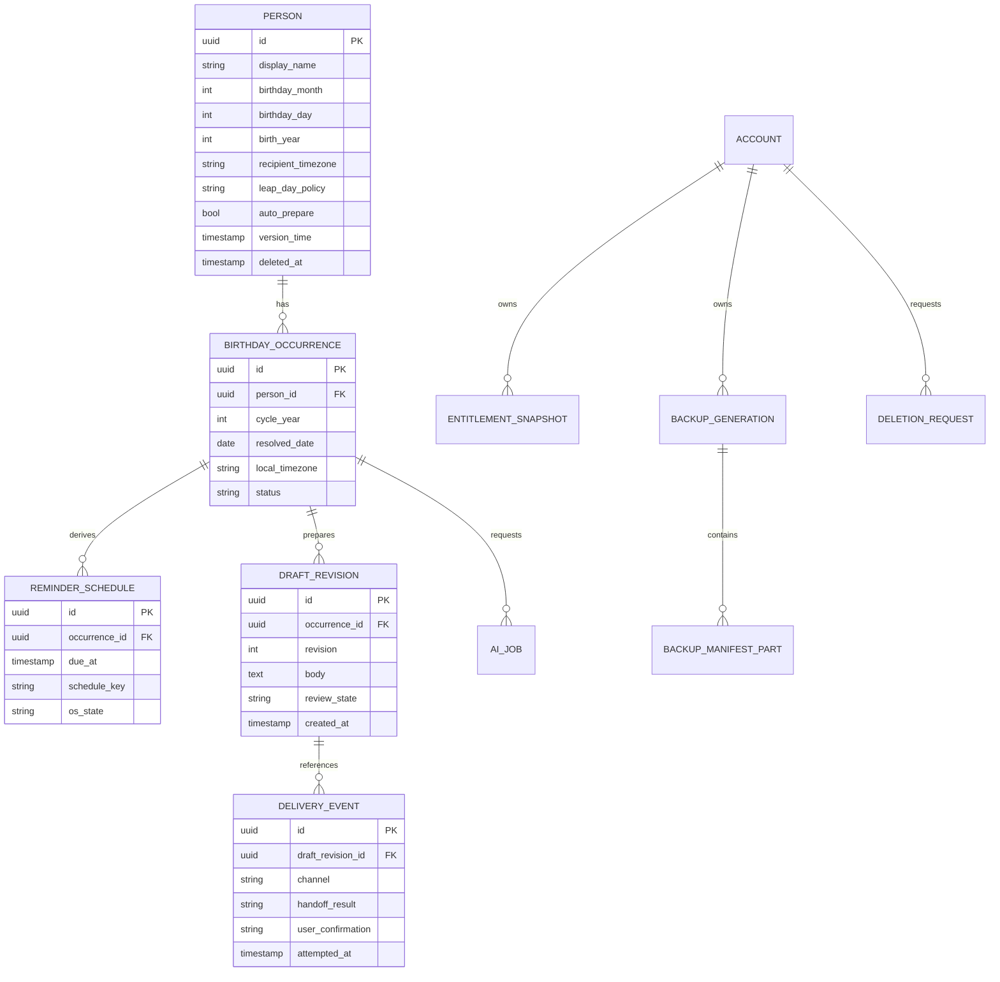

# Data Relationship Map

**Diagram type:** Mermaid · **Status:** target blueprint view · **Authority:** supporting diagram; the linked specification remains authoritative.

See [data and API contracts](../04-data-and-api-contracts.md) for entity ownership and field constraints.
